# 요청 처리와 문제 진단

**요청의 제출 성공과 촬영 완료를 구분하고, 버퍼를 유지할 기간과 오류가 난 위치를 확인하세요.**

| 지금 확인할 내용 | 이동할 절 |
|---|---|
| <a id="구성-실패를-좁히는-순서"></a>구성 실패를 좁히는 순서의 조건과 근거를 대조하세요. | [구성과 요청 오류 조사](request-diagnosis.md#구성-실패를-좁히는-순서) |
| 요청 제출과 완료의 연결을 확인합니다. | [제출에서 완료까지](#제출에서-완료까지) |
| 자원을 재사용하거나 해제할 시점을 확인합니다. | [요청·버퍼·fence의 수명](#요청버퍼fence의-수명) |
| <a id="실패-위치별-확인-순서"></a>실패 위치별 확인 순서의 조건과 근거를 대조하세요. | [구성과 요청 오류 조사](request-diagnosis.md#실패-위치별-확인-순서) |
| 정지와 연결 해제의 차이를 확인합니다. | [정지와 연결 해제를 구분하기](#정지와-연결-해제를-구분하기) |
| <a id="요청이-대기하거나-장치로-가는-조건"></a>“요청이 대기하거나 장치로 가는 조건” 그림을 확인하세요. | [구성과 요청 오류 조사](request-diagnosis.md#요청이-대기하거나-장치로-가는-조건) |
| <a id="구성-실패를-좁히는-분기"></a>“구성 실패를 좁히는 분기” 그림을 확인하세요. | [구성과 요청 오류 조사](request-diagnosis.md#구성-실패를-좁히는-분기) |

## 제출에서 완료까지

요청을 파이프라인에 비동기로 전달하도록 예약하면 queueRequest는 0을 반환하며, 이는 요청 완료를 뜻하지 않습니다. 파이프라인 핸들러는 이미 완료된 요청을 completeRequest로 카메라에 알려야 하며, 완료된 요청은 제출 순서대로 애플리케이션에 반환됩니다. `src/libcamera/camera.cpp:1308`, `src/libcamera/base/bound_method.cpp:68`, `src/libcamera/pipeline_handler.cpp:571`

<!-- sdd:visual:request-stages -->
### 제출·준비·장치 처리·완료의 연결

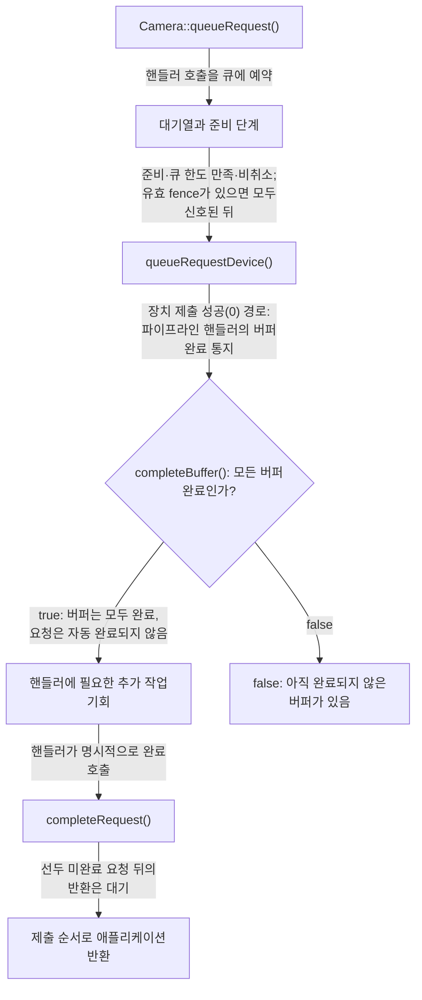

[Mermaid 원문](request-lifecycle.request-stages.mmd)

??? note "그림 근거와 확인 범위"
    접수 성공 뒤에도 준비 대기와 장치 처리가 남습니다. 정상 촬영 경로의 계약을 연결한 그림이며 실제 실행 시간이나 전체 실패 경로를 나타내지 않습니다.
    
    소스에 연결한 설계 해석입니다. 자동 연결 검사는 의미 승인이나 기기 실행 검증이 아닙니다.
    
    | 요소·전이 | 소스 근거 |
    |---|---|
    | <span data-sdd-label-en="Camera::queueRequest()">Camera::queueRequest&#40;&#41;</span> | [src/libcamera/camera.cpp:1308](#source-28d007de6ad1a8a5) |
    | <span data-sdd-label-en="Waiting queue and preparation">대기열과 준비 단계</span> | [src/libcamera/pipeline_handler.cpp:428](#source-789eafedfaa7f3c5) |
    | <span data-sdd-label-en="queueRequestDevice()">queueRequestDevice&#40;&#41;</span> | [src/libcamera/pipeline_handler.cpp:428](#source-789eafedfaa7f3c5) |
    | <span data-sdd-label-en="completeBuffer(): have all buffers completed?">completeBuffer&#40;&#41;: 모든 버퍼 완료인가?</span> | [src/libcamera/pipeline_handler.cpp:547](#source-ab8710f8a8a7905d) |
    | <span data-sdd-label-en="Opportunity for any additional required work">핸들러에 필요한 추가 작업 기회</span> | [src/libcamera/pipeline_handler.cpp:547](#source-01ad7c6605c3296a) |
    | <span data-sdd-label-en="completeRequest()">completeRequest&#40;&#41;</span> | [src/libcamera/pipeline_handler.cpp:547](#source-01ad7c6605c3296a) |
    | <span data-sdd-label-en="Return to application in submission order">제출 순서로 애플리케이션 반환</span> | [src/libcamera/pipeline_handler.cpp:547](#source-01ad7c6605c3296a) |
    | <span data-sdd-label-en="false: buffers have not all completed">false: 아직 완료되지 않은 버퍼가 있음</span> | [src/libcamera/pipeline_handler.cpp:547](#source-ab8710f8a8a7905d) |
    | <span data-sdd-label-en="Queue the handler invocation">핸들러 호출을 큐에 예약</span> | [src/libcamera/camera.cpp:1308](#source-28d007de6ad1a8a5) |
    | <span data-sdd-label-en="Prepared, within queue limit, not cancelled; all valid fences signalled if present">준비·큐 한도 만족·비취소; 유효 fence가 있으면 모두 신호된 뒤</span> | [src/libcamera/pipeline_handler.cpp:428](#source-789eafedfaa7f3c5) · [src/libcamera/request.cpp:442](#source-95ae69eeb085e3b1) |
    | <span data-sdd-label-en="Device submission success (0): pipeline handler signals buffer completion">장치 제출 성공&#40;0&#41; 경로: 파이프라인 핸들러의 버퍼 완료 통지</span> | [src/libcamera/pipeline_handler.cpp:547](#source-ab8710f8a8a7905d) · [src/libcamera/pipeline_handler.cpp:530](#source-c05f8214908fe4fe) |
    | <span data-sdd-label-en="true: all buffers completed; request is not automatically completed">true: 버퍼는 모두 완료, 요청은 자동 완료되지 않음</span> | [src/libcamera/pipeline_handler.cpp:553](#source-5b0ae08604dff588) |
    | <span data-sdd-label-en="Handler explicitly calls completion">핸들러가 명시적으로 완료 호출</span> | [src/libcamera/pipeline_handler.cpp:547](#source-01ad7c6605c3296a) |
    | <span data-sdd-label-en="Wait behind an incomplete head request">선두 미완료 요청 뒤의 반환은 대기</span> | [src/libcamera/pipeline_handler.cpp:547](#source-01ad7c6605c3296a) |
    | <span data-sdd-label-en="false">false</span> | [src/libcamera/pipeline_handler.cpp:547](#source-ab8710f8a8a7905d) |
<!-- /sdd:visual:request-stages -->

<!-- sdd:visual:lifecycle-queue-return-completion -->
### 접수 반환과 완료 알림

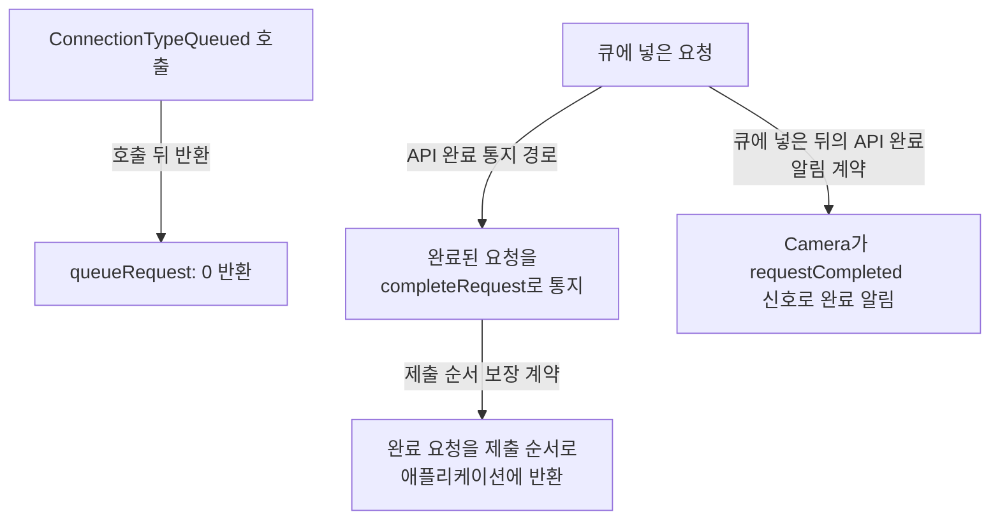

[Mermaid 원문](request-lifecycle.lifecycle-queue-return-completion.mmd)

??? note "그림 근거와 확인 범위"
    queueRequest의 0 반환과 requestCompleted 알림은 각각 무엇을 뜻합니까?
    
    소스에 연결한 설계 해석입니다. 자동 연결 검사는 의미 승인이나 기기 실행 검증이 아닙니다.
    
    | 요소·전이 | 소스 근거 |
    |---|---|
    | <span data-sdd-label-en="Invoke with ConnectionTypeQueued">ConnectionTypeQueued 호출</span> | [src/libcamera/camera.cpp:1308](#source-28d007de6ad1a8a5) |
    | <span data-sdd-label-en="queueRequest returns 0">queueRequest: 0 반환</span> | [src/libcamera/camera.cpp:1308](#source-28d007de6ad1a8a5) |
    | <span data-sdd-label-en="Queued request">큐에 넣은 요청</span> | [src/libcamera/camera.cpp:1308](#source-28d007de6ad1a8a5) |
    | <span data-sdd-label-en="Notify the already-completed request through completeRequest">완료된 요청을 completeRequest로 통지</span> | [src/libcamera/pipeline_handler.cpp:571](#source-236c920e906cb6fd) |
    | <span data-sdd-label-en="Return completed requests to the application in submission order">완료 요청을 제출 순서로 애플리케이션에 반환</span> | [src/libcamera/pipeline_handler.cpp:571](#source-236c920e906cb6fd) |
    | <span data-sdd-label-en="Camera notifies completion through requestCompleted">Camera가 requestCompleted 신호로 완료 알림</span> | [src/libcamera/camera.cpp:1308](#source-28d007de6ad1a8a5) |
    | <span data-sdd-label-en="Return after invoking">호출 뒤 반환</span> | [src/libcamera/camera.cpp:1308](#source-28d007de6ad1a8a5) |
    | <span data-sdd-label-en="API completion-notification path">API 완료 통지 경로</span> | [src/libcamera/camera.cpp:1308](#source-28d007de6ad1a8a5) · [src/libcamera/pipeline_handler.cpp:571](#source-236c920e906cb6fd) |
    | <span data-sdd-label-en="Submission-order contract">제출 순서 보장 계약</span> | [src/libcamera/pipeline_handler.cpp:571](#source-236c920e906cb6fd) |
    | <span data-sdd-label-en="API completion-notification contract after queuing">큐에 넣은 뒤의 API 완료 알림 계약</span> | [src/libcamera/camera.cpp:1308](#source-28d007de6ad1a8a5) |
<!-- /sdd:visual:lifecycle-queue-return-completion -->

<!-- sdd:visual:waiting-queue-conditions -->
### 선두 요청을 전달하거나 반복을 멈추는 조건

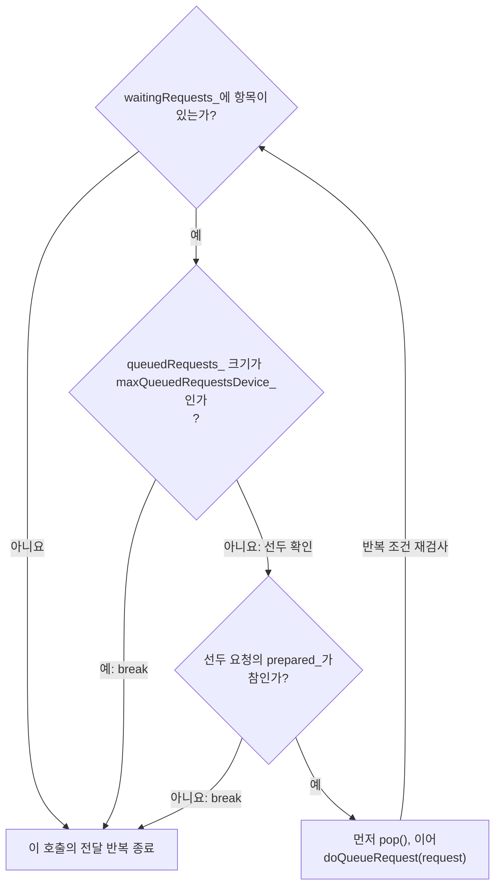

[Mermaid 원문](request-lifecycle.waiting-queue-conditions.mmd)

??? note "그림 근거와 확인 범위"
    waitingRequests_ 순회에서 준비 상태와 queuedRequests_ 소프트웨어 큐 크기는 어떻게 전달을 제한합니까?
    
    소스에 연결한 설계 해석입니다. 자동 연결 검사는 의미 승인이나 기기 실행 검증이 아닙니다.
    
    | 요소·전이 | 소스 근거 |
    |---|---|
    | <span data-sdd-label-en="Does waitingRequests_ contain an item?">waitingRequests&#95;에 항목이 있는가?</span> | [src/libcamera/pipeline_handler.cpp:428](#source-789eafedfaa7f3c5) |
    | <span data-sdd-label-en="Does queuedRequests_ size equal maxQueuedRequestsDevice_?">queuedRequests&#95; 크기가 maxQueuedRequestsDevice&#95;인가?</span> | [src/libcamera/pipeline_handler.cpp:428](#source-789eafedfaa7f3c5) |
    | <span data-sdd-label-en="Is the front request prepared_?">선두 요청의 prepared&#95;가 참인가?</span> | [src/libcamera/pipeline_handler.cpp:428](#source-789eafedfaa7f3c5) |
    | <span data-sdd-label-en="pop() first, then doQueueRequest(request)">먼저 pop&#40;&#41;, 이어 doQueueRequest&#40;request&#41;</span> | [src/libcamera/pipeline_handler.cpp:428](#source-789eafedfaa7f3c5) |
    | <span data-sdd-label-en="End this invocation&#x27;s forwarding loop">이 호출의 전달 반복 종료</span> | [src/libcamera/pipeline_handler.cpp:428](#source-789eafedfaa7f3c5) |
    | <span data-sdd-label-en="Yes">예</span> | [src/libcamera/pipeline_handler.cpp:428](#source-789eafedfaa7f3c5) |
    | <span data-sdd-label-en="No">아니요</span> | [src/libcamera/pipeline_handler.cpp:428](#source-789eafedfaa7f3c5) |
    | <span data-sdd-label-en="Yes: break">예: break</span> | [src/libcamera/pipeline_handler.cpp:428](#source-789eafedfaa7f3c5) |
    | <span data-sdd-label-en="No: inspect front">아니요: 선두 확인</span> | [src/libcamera/pipeline_handler.cpp:428](#source-789eafedfaa7f3c5) |
    | <span data-sdd-label-en="No: break">아니요: break</span> | [src/libcamera/pipeline_handler.cpp:428](#source-789eafedfaa7f3c5) |
    | <span data-sdd-label-en="Yes">예</span> | [src/libcamera/pipeline_handler.cpp:428](#source-789eafedfaa7f3c5) |
    | <span data-sdd-label-en="Recheck loop condition">반복 조건 재검사</span> | [src/libcamera/pipeline_handler.cpp:428](#source-789eafedfaa7f3c5) |
<!-- /sdd:visual:waiting-queue-conditions -->

<!-- sdd:visual:dispatch-cancel-or-device -->
### void 전달 함수의 두 취소 경로

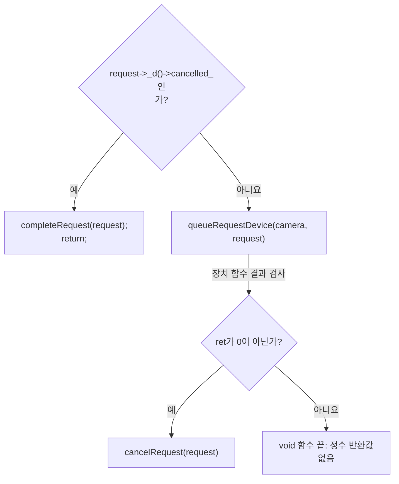

[Mermaid 원문](request-lifecycle.dispatch-cancel-or-device.mmd)

??? note "그림 근거와 확인 범위"
    doQueueRequest는 이미 취소된 요청과 장치 전달 실패를 각각 어느 함수로 처리합니까?
    
    소스에 연결한 설계 해석입니다. 자동 연결 검사는 의미 승인이나 기기 실행 검증이 아닙니다.
    
    | 요소·전이 | 소스 근거 |
    |---|---|
    | <span data-sdd-label-en="Is request-&gt;_d()-&gt;cancelled_ true?">request-&gt;&#95;d&#40;&#41;-&gt;cancelled&#95;인가?</span> | [src/libcamera/pipeline_handler.cpp:483](#source-7348e9b4af985eb2) |
    | <span data-sdd-label-en="completeRequest(request); return;">completeRequest&#40;request&#41;; return;</span> | [src/libcamera/pipeline_handler.cpp:483](#source-7348e9b4af985eb2) |
    | <span data-sdd-label-en="queueRequestDevice(camera, request)">queueRequestDevice&#40;camera, request&#41;</span> | [src/libcamera/pipeline_handler.cpp:483](#source-7348e9b4af985eb2) |
    | <span data-sdd-label-en="Is ret nonzero?">ret가 0이 아닌가?</span> | [src/libcamera/pipeline_handler.cpp:483](#source-7348e9b4af985eb2) |
    | <span data-sdd-label-en="cancelRequest(request)">cancelRequest&#40;request&#41;</span> | [src/libcamera/pipeline_handler.cpp:483](#source-7348e9b4af985eb2) |
    | <span data-sdd-label-en="End of void function: no integer return">void 함수 끝: 정수 반환값 없음</span> | [src/libcamera/pipeline_handler.cpp:483](#source-7348e9b4af985eb2) |
    | <span data-sdd-label-en="Yes">예</span> | [src/libcamera/pipeline_handler.cpp:483](#source-7348e9b4af985eb2) |
    | <span data-sdd-label-en="No">아니요</span> | [src/libcamera/pipeline_handler.cpp:483](#source-7348e9b4af985eb2) |
    | <span data-sdd-label-en="Inspect device result">장치 함수 결과 검사</span> | [src/libcamera/pipeline_handler.cpp:483](#source-7348e9b4af985eb2) |
    | <span data-sdd-label-en="Yes">예</span> | [src/libcamera/pipeline_handler.cpp:483](#source-7348e9b4af985eb2) |
    | <span data-sdd-label-en="No">아니요</span> | [src/libcamera/pipeline_handler.cpp:483](#source-7348e9b4af985eb2) |
<!-- /sdd:visual:dispatch-cancel-or-device -->

<!-- sdd:visual:buffer-and-request-completion -->
### 버퍼 완료와 명시적 요청 완료의 경계

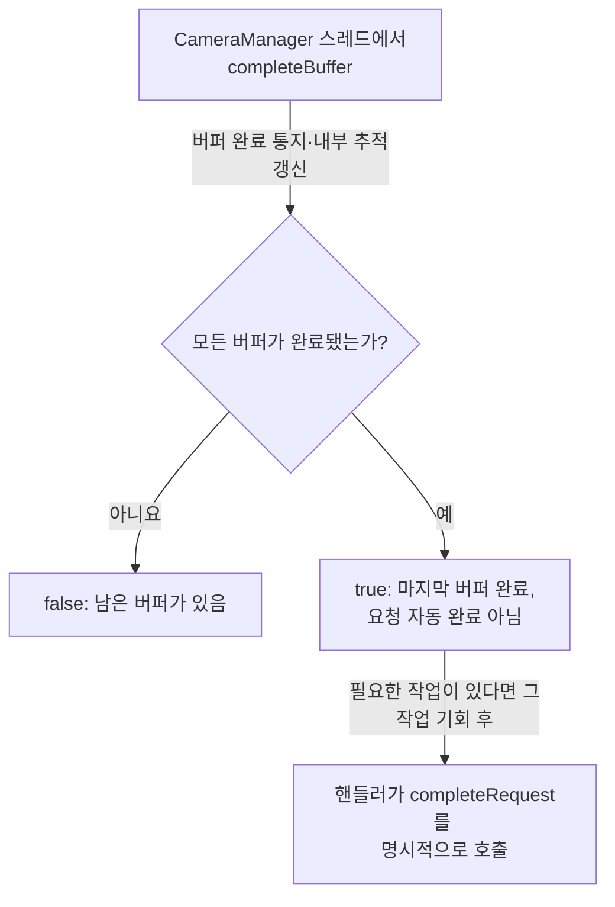

[Mermaid 원문](request-lifecycle.buffer-and-request-completion.mmd)

??? note "그림 근거와 확인 범위"
    마지막 버퍼가 끝났을 때 completeBuffer의 반환과 핸들러의 요청 완료 의무는 어떻게 구분됩니까?
    
    소스에 연결한 설계 해석입니다. 자동 연결 검사는 의미 승인이나 기기 실행 검증이 아닙니다.
    
    | 요소·전이 | 소스 근거 |
    |---|---|
    | <span data-sdd-label-en="completeBuffer in CameraManager thread">CameraManager 스레드에서 completeBuffer</span> | [src/libcamera/pipeline_handler.cpp:547](#source-ab8710f8a8a7905d) |
    | <span data-sdd-label-en="Have all buffers completed?">모든 버퍼가 완료됐는가?</span> | [src/libcamera/pipeline_handler.cpp:547](#source-ab8710f8a8a7905d) |
    | <span data-sdd-label-en="false: buffers remain">false: 남은 버퍼가 있음</span> | [src/libcamera/pipeline_handler.cpp:547](#source-ab8710f8a8a7905d) |
    | <span data-sdd-label-en="true: last buffer completed, request not automatically completed">true: 마지막 버퍼 완료, 요청 자동 완료 아님</span> | [src/libcamera/pipeline_handler.cpp:553](#source-5b0ae08604dff588) |
    | <span data-sdd-label-en="Handler explicitly calls completeRequest">핸들러가 completeRequest를 명시적으로 호출</span> | [src/libcamera/pipeline_handler.cpp:553](#source-5b0ae08604dff588) |
    | <span data-sdd-label-en="Notify buffer completion and update tracking">버퍼 완료 통지·내부 추적 갱신</span> | [src/libcamera/pipeline_handler.cpp:547](#source-ab8710f8a8a7905d) |
    | <span data-sdd-label-en="No">아니요</span> | [src/libcamera/pipeline_handler.cpp:547](#source-ab8710f8a8a7905d) |
    | <span data-sdd-label-en="Yes">예</span> | [src/libcamera/pipeline_handler.cpp:547](#source-ab8710f8a8a7905d) |
    | <span data-sdd-label-en="After an opportunity for any remaining required work">필요한 작업이 있다면 그 작업 기회 후</span> | [src/libcamera/pipeline_handler.cpp:553](#source-5b0ae08604dff588) |
<!-- /sdd:visual:buffer-and-request-completion -->

<!-- sdd:visual:submission-order-completion -->
### 제출 큐의 선두 상태와 반환 순서

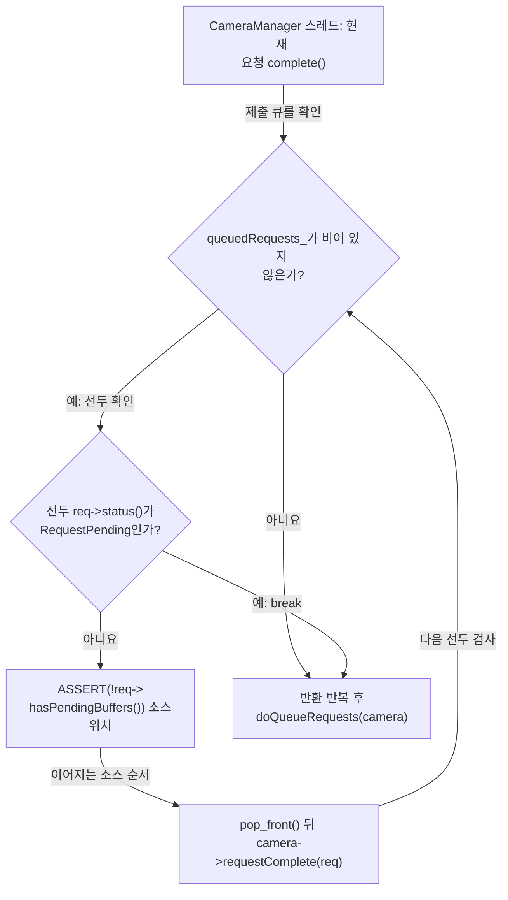

[Mermaid 원문](request-lifecycle.submission-order-completion.mmd)

??? note "그림 근거와 확인 범위"
    CameraManager 스레드의 completeRequest는 어느 조건에서 반환 반복을 멈추고 어느 요청을 애플리케이션에 알립니까?
    
    소스에 연결한 설계 해석입니다. 자동 연결 검사는 의미 승인이나 기기 실행 검증이 아닙니다.
    
    | 요소·전이 | 소스 근거 |
    |---|---|
    | <span data-sdd-label-en="CameraManager thread: complete() current request">CameraManager 스레드: 현재 요청 complete&#40;&#41;</span> | [src/libcamera/pipeline_handler.cpp:571](#source-236c920e906cb6fd) |
    | <span data-sdd-label-en="Is queuedRequests_ nonempty?">queuedRequests&#95;가 비어 있지 않은가?</span> | [src/libcamera/pipeline_handler.cpp:571](#source-236c920e906cb6fd) |
    | <span data-sdd-label-en="Is front req-&gt;status() RequestPending?">선두 req-&gt;status&#40;&#41;가 RequestPending인가?</span> | [src/libcamera/pipeline_handler.cpp:571](#source-236c920e906cb6fd) |
    | <span data-sdd-label-en="Source location of ASSERT(!req-&gt;hasPendingBuffers())">ASSERT&#40;&#33;req-&gt;hasPendingBuffers&#40;&#41;&#41; 소스 위치</span> | [src/libcamera/pipeline_handler.cpp:571](#source-236c920e906cb6fd) |
    | <span data-sdd-label-en="pop_front() then camera-&gt;requestComplete(req)">pop&#95;front&#40;&#41; 뒤 camera-&gt;requestComplete&#40;req&#41;</span> | [src/libcamera/pipeline_handler.cpp:571](#source-236c920e906cb6fd) |
    | <span data-sdd-label-en="doQueueRequests(camera) after return loop">반환 반복 후 doQueueRequests&#40;camera&#41;</span> | [src/libcamera/pipeline_handler.cpp:571](#source-236c920e906cb6fd) |
    | <span data-sdd-label-en="Inspect submission queue">제출 큐를 확인</span> | [src/libcamera/pipeline_handler.cpp:571](#source-236c920e906cb6fd) |
    | <span data-sdd-label-en="Yes: inspect front">예: 선두 확인</span> | [src/libcamera/pipeline_handler.cpp:571](#source-236c920e906cb6fd) |
    | <span data-sdd-label-en="No">아니요</span> | [src/libcamera/pipeline_handler.cpp:571](#source-236c920e906cb6fd) |
    | <span data-sdd-label-en="Yes: break">예: break</span> | [src/libcamera/pipeline_handler.cpp:571](#source-236c920e906cb6fd) |
    | <span data-sdd-label-en="No">아니요</span> | [src/libcamera/pipeline_handler.cpp:571](#source-236c920e906cb6fd) |
    | <span data-sdd-label-en="Following source order">이어지는 소스 순서</span> | [src/libcamera/pipeline_handler.cpp:571](#source-236c920e906cb6fd) |
    | <span data-sdd-label-en="Inspect next front">다음 선두 검사</span> | [src/libcamera/pipeline_handler.cpp:571](#source-236c920e906cb6fd) |
<!-- /sdd:visual:submission-order-completion -->

createRequest의 반환 타입은 `std::unique_ptr<Request>`이며, 새로 생성된 빈 `Request` 객체를 반환합니다. 오류가 발생하면 nullptr을 반환합니다. `Request::addBuffer()`는 버퍼가 속한 스트림을 지정하여 해당 버퍼를 요청에 추가합니다. `src/libcamera/camera.cpp:1243`, `src/libcamera/request.cpp:442`

`waitingRequests_`의 선두 요청에서 `prepared_`가 거짓이면 뒤에 있는 요청도 전달하지 않습니다. `queuedRequests_`.size() == `maxQueuedRequestsDevice_`이면 요청 전달을 중단합니다. `src/libcamera/pipeline_handler.cpp:428`, `src/libcamera/pipeline_handler.cpp:516`

doQueueRequest는 요청을 `queuedRequests_`의 끝에 추가한 뒤 요청에 순번을 지정하고 `requestSequence_`를 증가시킵니다. `cancelled_`가 참이면 completeRequest를 호출하고 함수를 종료합니다. 그렇지 않으면 queueRequestDevice를 호출하며, 그 반환값이 0이 아니면 cancelRequest를 호출합니다. queueRequestDevice 함수는 성공하면 0을 반환하고, 오류가 발생하면 음수 오류 코드를 반환합니다. `src/libcamera/pipeline_handler.cpp:483`, `src/libcamera/pipeline_handler.cpp:530`

근거 원문: [src/libcamera/camera.cpp:1243](#source-0ae00d77839f61cb) · [src/libcamera/camera.cpp:1308](#source-28d007de6ad1a8a5) · [src/libcamera/request.cpp:442](#source-95ae69eeb085e3b1) · [src/libcamera/pipeline_handler.cpp:428](#source-789eafedfaa7f3c5) · [src/libcamera/pipeline_handler.cpp:547](#source-01ad7c6605c3296a) · [src/libcamera/pipeline_handler.cpp:483](#source-7348e9b4af985eb2) · [src/libcamera/pipeline_handler.cpp:530](#source-c05f8214908fe4fe) · [src/libcamera/pipeline_handler.cpp:547](#source-ab8710f8a8a7905d) · [src/libcamera/pipeline_handler.cpp:571](#source-236c920e906cb6fd) · [src/libcamera/pipeline_handler.cpp:516](#source-a637b7daf9acb7ac) · [src/libcamera/pipeline_handler.cpp:553](#source-5b0ae08604dff588) · [src/libcamera/pipeline_handler.cpp:594](#source-bae861ceef5e8406) · [src/libcamera/base/bound_method.cpp:68](#source-0470759dc8387e9a)

## 요청·버퍼·fence의 수명

### 제출 성공 뒤에도 남는 수명 문제

`Camera::queueRequest`가 입력 검사를 통과해 `0`을 반환하는 성공 경로에서는 `ConnectionTypeQueued`로 `invokeMethod`를 호출한 뒤 `0`을 반환합니다. 요청 완료는 별도의 `requestCompleted` 신호로 통지합니다. `src/libcamera/camera.cpp:1308`

### 소유권과 두 완료 경계

`Camera::createRequest()`가 반환한 `Request`의 소유권은 호출자에게 넘어가며, 호출자는 이를 삭제할 책임이 있습니다. 호출자는 완료 핸들러에서 요청을 삭제하거나 `Request::reuse()`로 상태를 초기화한 뒤 재사용할 수 있습니다. `Request::addBuffer()`는 버퍼의 참조를 요청에 저장하며, 호출자는 요청 완료 콜백이 호출될 때까지 버퍼를 유효하게 유지해야 합니다. 파이프라인 핸들러는 `completeRequest()` 또는 `cancelRequest()`가 반환된 뒤 해당 요청에 접근해서는 안 됩니다. `src/libcamera/camera.cpp:1243`, `src/libcamera/request.cpp:376`, `src/libcamera/request.cpp:447`, `src/libcamera/pipeline_handler.cpp:575`, `src/libcamera/pipeline_handler.cpp:610`

<!-- sdd:visual:request-ownership -->
#### 요청과 버퍼를 유지할 기간

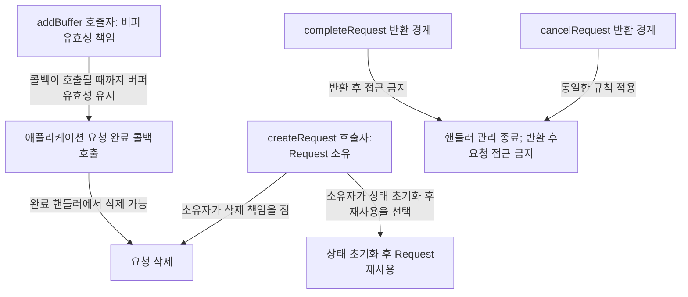

[Mermaid 원문](request-lifecycle.request-ownership.mmd)

??? note "그림 근거와 확인 범위"
    createRequest와 addBuffer 호출자의 책임 및 completeRequest·cancelRequest 반환 뒤 핸들러의 접근 경계는 어떻게 구분됩니까?
    
    소스에 연결한 설계 해석입니다. 자동 연결 검사는 의미 승인이나 기기 실행 검증이 아닙니다.
    
    | 요소·전이 | 소스 근거 |
    |---|---|
    | <span data-sdd-label-en="createRequest caller: owns Request">createRequest 호출자: Request 소유</span> | [src/libcamera/camera.cpp:1243](#source-0ae00d77839f61cb) |
    | <span data-sdd-label-en="addBuffer caller: buffer validity duty">addBuffer 호출자: 버퍼 유효성 책임</span> | [src/libcamera/request.cpp:442](#source-95ae69eeb085e3b1) |
    | <span data-sdd-label-en="Application request-completion callback is called">애플리케이션 요청 완료 콜백 호출</span> | [src/libcamera/request.cpp:442](#source-95ae69eeb085e3b1) |
    | <span data-sdd-label-en="Delete request">요청 삭제</span> | [src/libcamera/camera.cpp:1243](#source-0ae00d77839f61cb) |
    | <span data-sdd-label-en="Reuse Request after resetting state">상태 초기화 후 Request 재사용</span> | [src/libcamera/request.cpp:376](#source-38494771cb29cc8c) |
    | <span data-sdd-label-en="completeRequest return boundary">completeRequest 반환 경계</span> | [src/libcamera/pipeline_handler.cpp:547](#source-01ad7c6605c3296a) |
    | <span data-sdd-label-en="cancelRequest return boundary">cancelRequest 반환 경계</span> | [src/libcamera/pipeline_handler.cpp:547](#source-01ad7c6605c3296a) |
    | <span data-sdd-label-en="Handler management ends; must not access request after return">핸들러 관리 종료; 반환 후 요청 접근 금지</span> | [src/libcamera/pipeline_handler.cpp:575](#source-d93a02e9220fa760) |
    | <span data-sdd-label-en="Keep buffer valid until callback is called">콜백이 호출될 때까지 버퍼 유효성 유지</span> | [src/libcamera/request.cpp:442](#source-95ae69eeb085e3b1) |
    | <span data-sdd-label-en="May delete in completion handler">완료 핸들러에서 삭제 가능</span> | [src/libcamera/camera.cpp:1243](#source-0ae00d77839f61cb) |
    | <span data-sdd-label-en="No access once it returns">반환 후 접근 금지</span> | [src/libcamera/pipeline_handler.cpp:575](#source-d93a02e9220fa760) |
    | <span data-sdd-label-en="Same rules apply">동일한 규칙 적용</span> | [src/libcamera/pipeline_handler.cpp:610](#source-52fb58c8956b1a91) · [src/libcamera/pipeline_handler.cpp:575](#source-d93a02e9220fa760) |
    | <span data-sdd-label-en="Owner may reuse after resetting state">소유자가 상태 초기화 후 재사용을 선택</span> | [src/libcamera/camera.cpp:1243](#source-0ae00d77839f61cb) |
    | <span data-sdd-label-en="Owner is responsible for deletion">소유자가 삭제 책임을 짐</span> | [src/libcamera/camera.cpp:1243](#source-0ae00d77839f61cb) |
<!-- /sdd:visual:request-ownership -->

### 정상 완료와 다음 요청 준비

파이프라인 핸들러가 호출하는 `completeBuffer`는 `bufferCompleted`를 emit한 뒤 요청의 내부 버퍼 추적을 갱신합니다. 마지막 버퍼가 완료되어도 요청은 자동 완료되지 않으므로 핸들러는 필요한 처리를 마친 뒤 `completeRequest`로 명시적으로 완료를 통지해야 합니다. 두 API는 `CameraManager` 스레드에서 호출해야 하며, 이 의무만으로 실제 콜백의 실행 스레드를 확인할 수는 없습니다. `completeRequest`가 호출하는 내부 `complete`는 `cancelled_`가 false이면 `RequestComplete`를, true이면 `RequestCancelled`를 선택합니다. `src/libcamera/pipeline_handler.cpp:547`, `src/libcamera/request.cpp:91`

<!-- sdd:visual:completion-notification-order -->
#### 버퍼 알림에서 요청 반환까지

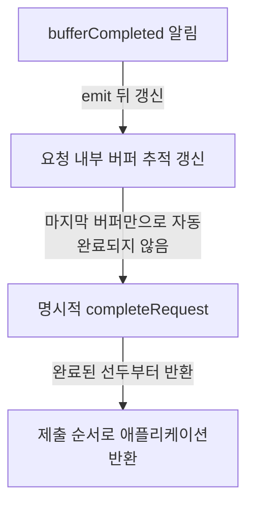

[Mermaid 원문](request-lifecycle.completion-notification-order.mmd)

??? note "그림 근거와 확인 범위"
    정상 경로의 호출·추적 순서입니다. 모든 버퍼와 필요한 추가 처리가 끝난 뒤 요청 완료를 통지하며, 실제 실행 시간이나 애플리케이션 콜백 스레드를 나타내지 않습니다.
    
    소스에 연결한 설계 해석입니다. 자동 연결 검사는 의미 승인이나 기기 실행 검증이 아닙니다.
    
    | 요소·전이 | 소스 근거 |
    |---|---|
    | <span data-sdd-label-en="bufferCompleted notification">bufferCompleted 알림</span> | [src/libcamera/pipeline_handler.cpp:547](#source-01ad7c6605c3296a) |
    | <span data-sdd-label-en="Update internal buffer tracking">요청 내부 버퍼 추적 갱신</span> | [src/libcamera/pipeline_handler.cpp:547](#source-01ad7c6605c3296a) |
    | <span data-sdd-label-en="Explicit completeRequest">명시적 completeRequest</span> | [src/libcamera/pipeline_handler.cpp:547](#source-01ad7c6605c3296a) |
    | <span data-sdd-label-en="Return to application in submission order">제출 순서로 애플리케이션 반환</span> | [src/libcamera/pipeline_handler.cpp:547](#source-01ad7c6605c3296a) |
    | <span data-sdd-label-en="Update after emit">emit 뒤 갱신</span> | [src/libcamera/pipeline_handler.cpp:547](#source-01ad7c6605c3296a) |
    | <span data-sdd-label-en="Last buffer does not automatically complete request">마지막 버퍼만으로 자동 완료되지 않음</span> | [src/libcamera/pipeline_handler.cpp:547](#source-01ad7c6605c3296a) |
    | <span data-sdd-label-en="Return completed queue heads">완료된 선두부터 반환</span> | [src/libcamera/pipeline_handler.cpp:547](#source-01ad7c6605c3296a) |
<!-- /sdd:visual:completion-notification-order -->

마지막 버퍼 알림은 관찰했지만 요청 완료 콜백은 아직 관찰하지 못한 경우, 그 관측만으로 내부 추적 갱신이나 `completeRequest` 호출이 아직 남았다고 단정할 수 없습니다. 또한 그 알림은 버퍼 유효성 유지 기한이 끝났다는 근거가 아니며, 버퍼 해제나 다른 요청 연결의 안전성을 판정하기에도 충분하지 않습니다. 유효성을 깨뜨리는 해제와 모든 재사용의 일괄 금지는 구별해야 하며, 다른 요청에 연결할 수 있는지는 API·동기화 계약과 유효성 유지를 별도로 대조해야 합니다. `src/libcamera/request.cpp:447`, `src/libcamera/pipeline_handler.cpp:547`

소스 기반 조사 계획으로, 조사자는 기존 `completeBuffer` 호출의 반환값을 관찰해 모든 버퍼가 완료되었는지 확인합니다. 조사자는 `completeRequest` 호출 자체도 관찰합니다. 이어서 제출 순서에 따라 선두 요청이 대기 중이어서 반환이 지연되는지와 요청 완료 콜백을 관찰합니다. `src/libcamera/pipeline_handler.cpp:547`

### 알림 순서와 취소가 달라질 때

소스에서 유도한 조건부 예입니다. `A` 다음에 `B`를 제출했고, 선두 `A`가 `RequestPending`인 동안 `B`의 모든 버퍼와 추가 처리를 마친 핸들러가 `completeRequest(B)`를 호출합니다. `Request::Private::complete`는 `cancelled_`가 false이면 `RequestComplete`를, true이면 `RequestCancelled`를 선택하며, 버퍼 처리가 끝났다는 사실만으로 취소되지 않았다고 판단할 수는 없습니다. `src/libcamera/request.cpp:91`, `src/libcamera/pipeline_handler.cpp:547`

<!-- sdd:visual:completed-but-not-returned -->
#### 완료 상태와 애플리케이션 반환의 차이

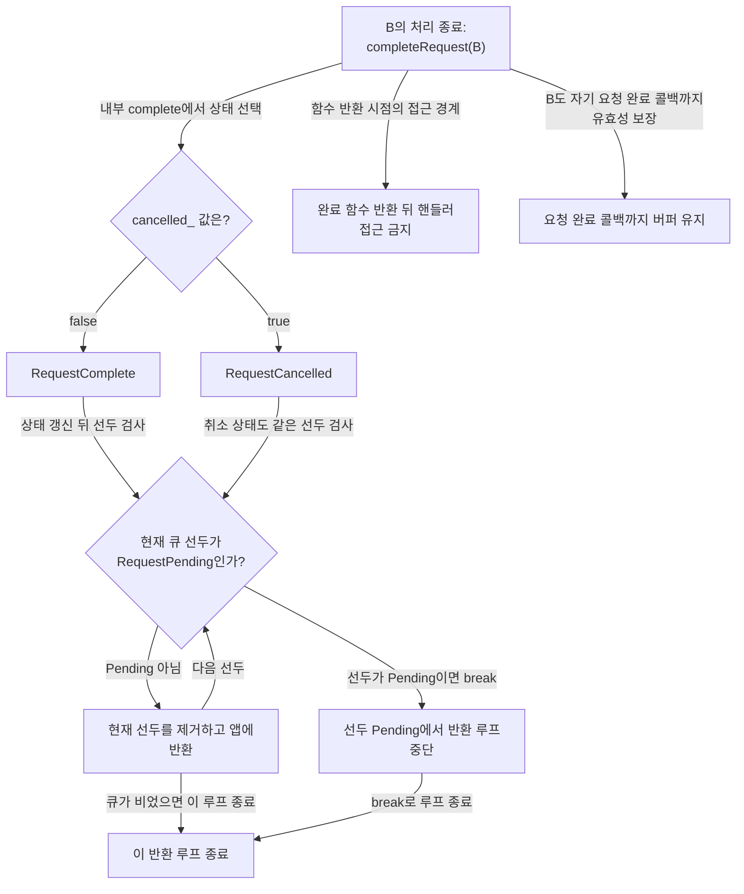

[Mermaid 원문](request-lifecycle.completed-but-not-returned.mmd)

??? note "그림 근거와 확인 범위"
    A 다음 B를 제출한 조건부 예이며 두 요청 사이에 다른 요청이 있을 수도 있습니다. cancelled_가 B의 상태를 정하고, 반환 루프는 현재 선두를 하나씩 검사합니다. 중간 Pending 요청에서도 중단하므로 A가 끝났다는 사실만으로 B 반환을 보장하지 않습니다. 수명 화살표는 접근·유효성 계약이며 실제 콜백 시각이나 함수 전체의 종료 순서가 아닙니다.
    
    소스에 연결한 설계 해석입니다. 자동 연결 검사는 의미 승인이나 기기 실행 검증이 아닙니다.
    
    | 요소·전이 | 소스 근거 |
    |---|---|
    | <span data-sdd-label-en="B processing finished: completeRequest(B)">B의 처리 종료: completeRequest&#40;B&#41;</span> | [src/libcamera/pipeline_handler.cpp:547](#source-01ad7c6605c3296a) |
    | <span data-sdd-label-en="Value of cancelled_?">cancelled&#95; 값은?</span> | [src/libcamera/request.cpp:91](#source-c78836578026f078) |
    | <span data-sdd-label-en="RequestComplete">RequestComplete</span> | [src/libcamera/request.cpp:91](#source-c78836578026f078) |
    | <span data-sdd-label-en="RequestCancelled">RequestCancelled</span> | [src/libcamera/request.cpp:91](#source-c78836578026f078) |
    | <span data-sdd-label-en="Is the current queue head RequestPending?">현재 큐 선두가 RequestPending인가?</span> | [src/libcamera/pipeline_handler.cpp:547](#source-01ad7c6605c3296a) |
    | <span data-sdd-label-en="Stop the return loop at a Pending head">선두 Pending에서 반환 루프 중단</span> | [src/libcamera/pipeline_handler.cpp:547](#source-01ad7c6605c3296a) |
    | <span data-sdd-label-en="Pop the current head and return it to the app">현재 선두를 제거하고 앱에 반환</span> | [src/libcamera/pipeline_handler.cpp:547](#source-01ad7c6605c3296a) |
    | <span data-sdd-label-en="No handler access after completion function returns">완료 함수 반환 뒤 핸들러 접근 금지</span> | [src/libcamera/pipeline_handler.cpp:575](#source-d93a02e9220fa760) |
    | <span data-sdd-label-en="Keep buffer valid until request completion callback">요청 완료 콜백까지 버퍼 유지</span> | [src/libcamera/request.cpp:447](#source-4cdce80c57526221) |
    | <span data-sdd-label-en="End this return loop">이 반환 루프 종료</span> | [src/libcamera/pipeline_handler.cpp:547](#source-01ad7c6605c3296a) |
    | <span data-sdd-label-en="Select status in internal complete">내부 complete에서 상태 선택</span> | [src/libcamera/pipeline_handler.cpp:547](#source-01ad7c6605c3296a) · [src/libcamera/request.cpp:91](#source-c78836578026f078) |
    | <span data-sdd-label-en="false">false</span> | [src/libcamera/request.cpp:91](#source-c78836578026f078) |
    | <span data-sdd-label-en="true">true</span> | [src/libcamera/request.cpp:91](#source-c78836578026f078) |
    | <span data-sdd-label-en="Check queue head after status update">상태 갱신 뒤 선두 검사</span> | [src/libcamera/pipeline_handler.cpp:547](#source-01ad7c6605c3296a) |
    | <span data-sdd-label-en="Same head check for cancelled status">취소 상태도 같은 선두 검사</span> | [src/libcamera/pipeline_handler.cpp:547](#source-01ad7c6605c3296a) |
    | <span data-sdd-label-en="Break if the head is Pending">선두가 Pending이면 break</span> | [src/libcamera/pipeline_handler.cpp:547](#source-01ad7c6605c3296a) |
    | <span data-sdd-label-en="Not Pending">Pending 아님</span> | [src/libcamera/pipeline_handler.cpp:547](#source-01ad7c6605c3296a) |
    | <span data-sdd-label-en="Access boundary when the function returns">함수 반환 시점의 접근 경계</span> | [src/libcamera/pipeline_handler.cpp:575](#source-d93a02e9220fa760) |
    | <span data-sdd-label-en="Keep B buffers valid until its own request completion callback">B도 자기 요청 완료 콜백까지 유효성 보장</span> | [src/libcamera/request.cpp:447](#source-4cdce80c57526221) |
    | <span data-sdd-label-en="Next head">다음 선두</span> | [src/libcamera/pipeline_handler.cpp:547](#source-01ad7c6605c3296a) |
    | <span data-sdd-label-en="End this loop if the queue is empty">큐가 비었으면 이 루프 종료</span> | [src/libcamera/pipeline_handler.cpp:547](#source-01ad7c6605c3296a) |
    | <span data-sdd-label-en="Exit the loop via break">break로 루프 종료</span> | [src/libcamera/pipeline_handler.cpp:547](#source-01ad7c6605c3296a) |
<!-- /sdd:visual:completed-but-not-returned -->

<!-- sdd:visual:lifecycle-timeout-fence-recovery -->
#### 타임아웃 뒤 펜스 회수

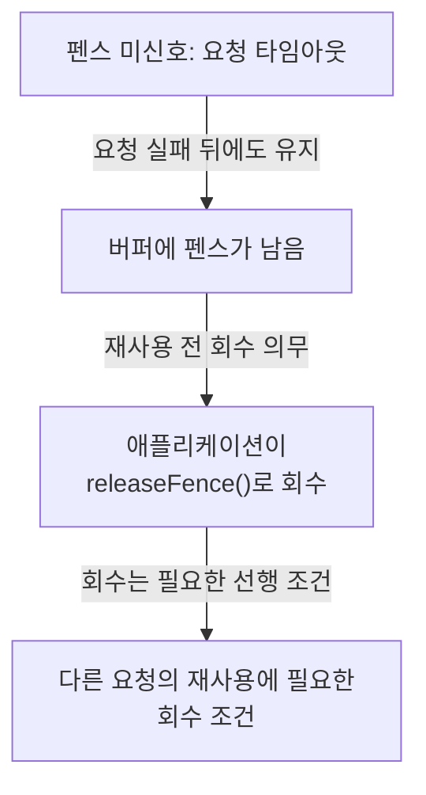

[Mermaid 원문](request-lifecycle.lifecycle-timeout-fence-recovery.mmd)

??? note "그림 근거와 확인 범위"
    신호되지 않은 펜스로 타임아웃이 나면 다른 요청에 재사용하기 전에 무엇을 해야 합니까?
    
    소스에 연결한 설계 해석입니다. 자동 연결 검사는 의미 승인이나 기기 실행 검증이 아닙니다.
    
    | 요소·전이 | 소스 근거 |
    |---|---|
    | <span data-sdd-label-en="Unsignalled fence: request times out">펜스 미신호: 요청 타임아웃</span> | [src/libcamera/request.cpp:462](#source-d8cf34a75a4333a7) |
    | <span data-sdd-label-en="Buffer still contains its fence">버퍼에 펜스가 남음</span> | [src/libcamera/request.cpp:462](#source-d8cf34a75a4333a7) |
    | <span data-sdd-label-en="Application retrieves with releaseFence()">애플리케이션이 releaseFence&#40;&#41;로 회수</span> | [src/libcamera/request.cpp:462](#source-d8cf34a75a4333a7) |
    | <span data-sdd-label-en="Required retrieval condition for reuse in another request">다른 요청의 재사용에 필요한 회수 조건</span> | [src/libcamera/request.cpp:462](#source-d8cf34a75a4333a7) |
    | <span data-sdd-label-en="Remains after request failure">요청 실패 뒤에도 유지</span> | [src/libcamera/request.cpp:462](#source-d8cf34a75a4333a7) |
    | <span data-sdd-label-en="Must retrieve before reuse">재사용 전 회수 의무</span> | [src/libcamera/request.cpp:462](#source-d8cf34a75a4333a7) |
    | <span data-sdd-label-en="Retrieval is a necessary precondition">회수는 필요한 선행 조건</span> | [src/libcamera/request.cpp:462](#source-d8cf34a75a4333a7) |
<!-- /sdd:visual:lifecycle-timeout-fence-recovery -->

<!-- sdd:visual:lifecycle-reuse-buffer-fence-distinction -->
#### 버퍼 재사용과 펜스 권고

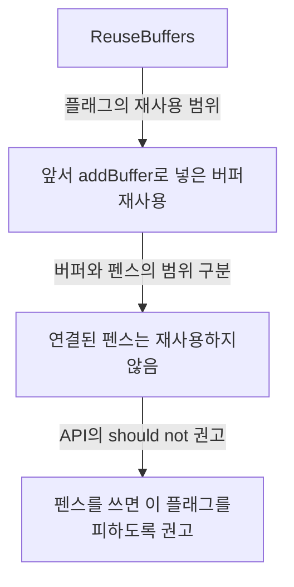

[Mermaid 원문](request-lifecycle.lifecycle-reuse-buffer-fence-distinction.mmd)

??? note "그림 근거와 확인 범위"
    ReuseBuffers가 재사용하는 대상과 펜스 사용 시 권고는 무엇입니까?
    
    소스에 연결한 설계 해석입니다. 자동 연결 검사는 의미 승인이나 기기 실행 검증이 아닙니다.
    
    | 요소·전이 | 소스 근거 |
    |---|---|
    | <span data-sdd-label-en="ReuseBuffers">ReuseBuffers</span> | [src/libcamera/request.cpp:326](#source-447804db33308244) |
    | <span data-sdd-label-en="Reuse buffers previously added by addBuffer">앞서 addBuffer로 넣은 버퍼 재사용</span> | [src/libcamera/request.cpp:326](#source-447804db33308244) |
    | <span data-sdd-label-en="Associated fences are not reused">연결된 펜스는 재사용하지 않음</span> | [src/libcamera/request.cpp:326](#source-447804db33308244) |
    | <span data-sdd-label-en="Should not use this flag with fences">펜스를 쓰면 이 플래그를 피하도록 권고</span> | [src/libcamera/request.cpp:326](#source-447804db33308244) |
    | <span data-sdd-label-en="Flag reuse scope">플래그의 재사용 범위</span> | [src/libcamera/request.cpp:326](#source-447804db33308244) |
    | <span data-sdd-label-en="Distinguish buffer and fence reuse">버퍼와 펜스의 범위 구분</span> | [src/libcamera/request.cpp:326](#source-447804db33308244) |
    | <span data-sdd-label-en="API should-not recommendation">API의 should not 권고</span> | [src/libcamera/request.cpp:326](#source-447804db33308244) |
<!-- /sdd:visual:lifecycle-reuse-buffer-fence-distinction -->

두 상태 모두 `queuedRequests_`의 선두 `A`가 `RequestPending`이면 `B`의 애플리케이션 반환이 지연됩니다. 이후 `A`가 완료되고 `B`까지 이어지는 선두 요청들이 완료 상태이면 `A`, `B` 순으로 반환됩니다. `addBuffer` 호출자는 `B`의 버퍼를 요청 완료 콜백이 호출될 때까지 유효하게 유지해야 하며, 파이프라인 핸들러는 `completeRequest(B)`가 반환된 뒤 `B`에 접근해서는 안 됩니다. `src/libcamera/pipeline_handler.cpp:547`, `src/libcamera/request.cpp:447`, `src/libcamera/pipeline_handler.cpp:575`

소스 기반 조사 계획으로, `Request::Private::complete`의 상태 대입 지점에서 `cancelled_`와 선택된 상태를 대조합니다. 제출 큐의 선두와 대기 중인 버퍼, 요청 완료 콜백도 관찰합니다. `src/libcamera/request.cpp:91`, `src/libcamera/pipeline_handler.cpp:547`

앞의 정상 완료 예와 별도로, 선두 A와 B가 모두 `RequestPending`인 상태에서 파이프라인 핸들러가 B에 `completeRequest(B)` 대신 `cancelRequest(B)`를 호출하는 경우입니다. `Request::Private::doCancelRequest`는 `pending_`의 각 버퍼를 취소하고 `bufferCompleted`를 emit한 뒤 `cancelled_`를 `true`로 설정하고 `pending_`를 비웁니다. `cancelRequest`는 취소 후 `completeRequest`를 호출하고, 내부 `Request::Private::complete`는 B의 상태로 `RequestCancelled`를 선택합니다. 선두 A가 여전히 `RequestPending`이면 큐 처리가 중단되어 B의 애플리케이션 반환은 지연되며, 수명과 접근에는 앞의 공통 규칙이 적용됩니다. `src/libcamera/pipeline_handler.cpp:547`, `src/libcamera/request.cpp:91`, `src/libcamera/request.cpp:447`, `src/libcamera/pipeline_handler.cpp:575`

`Request::addBuffer()`가 성공하면 전달된 유효한 `Fence`의 소유권이 `buffer`로 이동하지만, 실패하면 전달한 `fence`는 수정되지 않고 소유권도 넘어가지 않습니다. 버퍼에 연결된 펜스가 신호되지 않으면 요청은 타임아웃 후 실패하며 버퍼에는 펜스가 그대로 남습니다. 애플리케이션은 이 버퍼를 다른 요청에서 재사용하기 전에 `FrameBuffer::releaseFence()`로 펜스를 회수해야 합니다. `src/libcamera/request.cpp:456`, `src/libcamera/request.cpp:462`

`ReuseBuffers`는 `addBuffer()`로 이전에 추가한 버퍼를 유지해 재사용하지만, 버퍼에 연결된 펜스는 재사용하지 않습니다. 펜스를 사용하는 경우 이 플래그를 사용하지 않아야 한다는 권고는 `should not be used`입니다. `src/libcamera/request.cpp:326`, `src/libcamera/request.cpp:334`

### 완료 책임을 변경하기 전에

변경 검토 계획에서는 `completeBuffer`와 `completeRequest`의 기존 호출자와 스레드 전달 경계를 찾아, 파이프라인 핸들러가 두 함수를 `CameraManager` 스레드에서 호출해야 한다는 의무가 유지되는지 대조합니다. 다른 스레드에서 두 API를 직접 호출하도록 옮기면 이 문서화된 의무와 충돌합니다. 이 계획은 실제 콜백 스레드, 기기 DMA, 캐시, 실행 시간이나 사내 HAL을 검증한 결과가 아닙니다. 역사적 설계 이유와 대안의 우열을 판단하려면 별도의 결정 기록이나 실행 자료가 필요합니다. `src/libcamera/pipeline_handler.cpp:547`

<!-- sdd:visual:completion-change-checks -->
#### 완료 책임 변경에서 함께 대조할 계약

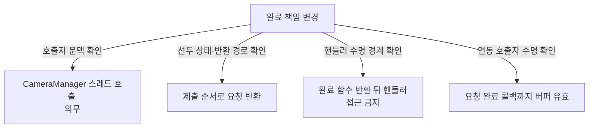

[Mermaid 원문](request-lifecycle.completion-change-checks.mmd)

??? note "그림 근거와 확인 범위"
    변경 검토의 확인 관계입니다. 화살표는 실행 순서나 기기 보장이 아니라 completeRequest 책임을 바꿀 때 함께 보존할 소스 계약을 가리킵니다.
    
    소스에 연결한 설계 해석입니다. 자동 연결 검사는 의미 승인이나 기기 실행 검증이 아닙니다.
    
    | 요소·전이 | 소스 근거 |
    |---|---|
    | <span data-sdd-label-en="Change completion responsibility">완료 책임 변경</span> | [src/libcamera/pipeline_handler.cpp:547](#source-01ad7c6605c3296a) |
    | <span data-sdd-label-en="Must call from CameraManager thread">CameraManager 스레드 호출 의무</span> | [src/libcamera/pipeline_handler.cpp:547](#source-01ad7c6605c3296a) |
    | <span data-sdd-label-en="Return requests in submission order">제출 순서로 요청 반환</span> | [src/libcamera/pipeline_handler.cpp:547](#source-01ad7c6605c3296a) |
    | <span data-sdd-label-en="No handler access after completion function returns">완료 함수 반환 뒤 핸들러 접근 금지</span> | [src/libcamera/pipeline_handler.cpp:575](#source-d93a02e9220fa760) |
    | <span data-sdd-label-en="Buffer valid until request completion callback">요청 완료 콜백까지 버퍼 유효</span> | [src/libcamera/request.cpp:447](#source-4cdce80c57526221) |
    | <span data-sdd-label-en="Check caller context">호출자 문맥 확인</span> | [src/libcamera/pipeline_handler.cpp:547](#source-01ad7c6605c3296a) |
    | <span data-sdd-label-en="Check queue head and return path">선두 상태·반환 경로 확인</span> | [src/libcamera/pipeline_handler.cpp:547](#source-01ad7c6605c3296a) |
    | <span data-sdd-label-en="Check handler lifetime boundary">핸들러 수명 경계 확인</span> | [src/libcamera/pipeline_handler.cpp:575](#source-d93a02e9220fa760) |
    | <span data-sdd-label-en="Check integration caller lifetime">연동 호출자 수명 확인</span> | [src/libcamera/request.cpp:447](#source-4cdce80c57526221) |
<!-- /sdd:visual:completion-change-checks -->

근거 원문: [src/libcamera/camera.cpp:1243](#source-0ae00d77839f61cb) · [src/libcamera/request.cpp:376](#source-38494771cb29cc8c) · [src/libcamera/pipeline_handler.cpp:547](#source-01ad7c6605c3296a) · [src/libcamera/request.cpp:326](#source-447804db33308244) · [src/libcamera/request.cpp:456](#source-86a8d784a8348122) · [src/libcamera/request.cpp:462](#source-d8cf34a75a4333a7) · [src/libcamera/request.cpp:447](#source-4cdce80c57526221) · [src/libcamera/pipeline_handler.cpp:575](#source-d93a02e9220fa760) · [src/libcamera/pipeline_handler.cpp:610](#source-52fb58c8956b1a91) · [src/libcamera/request.cpp:334](#source-d9944a69f2dd6758) · [src/libcamera/request.cpp:442](#source-95ae69eeb085e3b1) · [src/libcamera/camera.cpp:1308](#source-28d007de6ad1a8a5) · [src/libcamera/request.cpp:91](#source-c78836578026f078)

## 정지와 연결 해제를 구분하기

정지할 때 모든 대기 요청을 취소하고 즉시 오류 상태로 완료하는 것이 `PipelineHandler::stop`의 계약입니다. 실행 중 연결 해제 시 대기 요청 처리는 `Camera::disconnect`에 TODO로 남아 있습니다. `src/libcamera/pipeline_handler.cpp:359`, `src/libcamera/camera.cpp:952`

<!-- sdd:visual:stop-order -->
### 정지할 때 대기 요청을 처리하는 순서

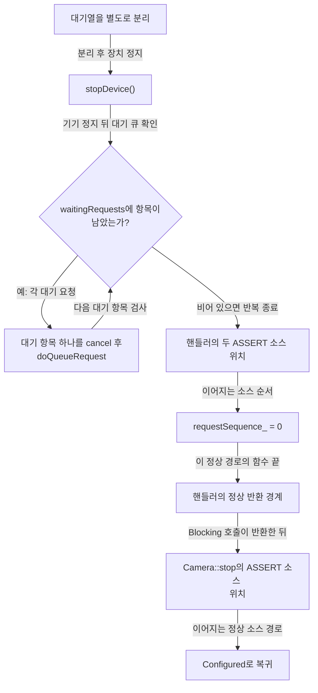

[Mermaid 원문](request-lifecycle.stop-order.mmd)

??? note "그림 근거와 확인 범위"
    정상 정지 경로의 순서를 표시합니다. 연결 해제 알림의 미완료 요청 TODO를 이 정지 보장과 혼동하지 마세요.
    
    소스에 연결한 설계 해석입니다. 자동 연결 검사는 의미 승인이나 기기 실행 검증이 아닙니다.
    
    | 요소·전이 | 소스 근거 |
    |---|---|
    | <span data-sdd-label-en="Detach waiting queue">대기열을 별도로 분리</span> | [src/libcamera/pipeline_handler.cpp:359](#source-eefd1bbecb1aad0a) |
    | <span data-sdd-label-en="stopDevice()">stopDevice&#40;&#41;</span> | [src/libcamera/pipeline_handler.cpp:359](#source-eefd1bbecb1aad0a) |
    | <span data-sdd-label-en="Cancel one waiting item, then doQueueRequest">대기 항목 하나를 cancel 후 doQueueRequest</span> | [src/libcamera/pipeline_handler.cpp:359](#source-eefd1bbecb1aad0a) |
    | <span data-sdd-label-en="Return to Configured">Configured로 복귀</span> | [src/libcamera/camera.cpp:1431](#source-e09324743def3f09) |
    | <span data-sdd-label-en="Does waitingRequests contain an item?">waitingRequests에 항목이 남았는가?</span> | [src/libcamera/pipeline_handler.cpp:359](#source-eefd1bbecb1aad0a) |
    | <span data-sdd-label-en="Source locations of the two handler ASSERTs">핸들러의 두 ASSERT 소스 위치</span> | [src/libcamera/pipeline_handler.cpp:359](#source-eefd1bbecb1aad0a) |
    | <span data-sdd-label-en="requestSequence_ = 0">requestSequence&#95; = 0</span> | [src/libcamera/pipeline_handler.cpp:359](#source-eefd1bbecb1aad0a) |
    | <span data-sdd-label-en="Handler normal-return boundary">핸들러의 정상 반환 경계</span> | [src/libcamera/pipeline_handler.cpp:359](#source-eefd1bbecb1aad0a) |
    | <span data-sdd-label-en="Source location of Camera::stop ASSERT">Camera::stop의 ASSERT 소스 위치</span> | [src/libcamera/camera.cpp:1431](#source-e09324743def3f09) |
    | <span data-sdd-label-en="Stop device after detaching">분리 후 장치 정지</span> | [src/libcamera/pipeline_handler.cpp:359](#source-eefd1bbecb1aad0a) |
    | <span data-sdd-label-en="Inspect next waiting item">다음 대기 항목 검사</span> | [src/libcamera/pipeline_handler.cpp:359](#source-eefd1bbecb1aad0a) |
    | <span data-sdd-label-en="Inspect waiting queue after device stop">기기 정지 뒤 대기 큐 확인</span> | [src/libcamera/pipeline_handler.cpp:359](#source-eefd1bbecb1aad0a) |
    | <span data-sdd-label-en="Yes: each waiting request">예: 각 대기 요청</span> | [src/libcamera/pipeline_handler.cpp:359](#source-eefd1bbecb1aad0a) |
    | <span data-sdd-label-en="If empty: leave loop">비어 있으면 반복 종료</span> | [src/libcamera/pipeline_handler.cpp:359](#source-eefd1bbecb1aad0a) |
    | <span data-sdd-label-en="Following source order">이어지는 소스 순서</span> | [src/libcamera/pipeline_handler.cpp:359](#source-eefd1bbecb1aad0a) |
    | <span data-sdd-label-en="End of this normal function path">이 정상 경로의 함수 끝</span> | [src/libcamera/pipeline_handler.cpp:359](#source-eefd1bbecb1aad0a) |
    | <span data-sdd-label-en="After the blocking invocation returns">Blocking 호출이 반환한 뒤</span> | [src/libcamera/camera.cpp:1431](#source-e09324743def3f09) |
    | <span data-sdd-label-en="Following normal source path">이어지는 정상 소스 경로</span> | [src/libcamera/camera.cpp:1431](#source-e09324743def3f09) |
<!-- /sdd:visual:stop-order -->

<!-- sdd:visual:stop-disconnect-contract -->
### 정지 API 계약과 연결 해제 TODO

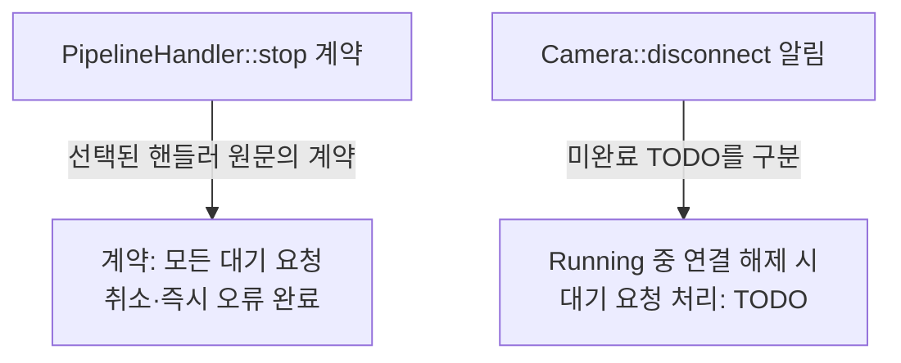

[Mermaid 원문](request-lifecycle.stop-disconnect-contract.mmd)

??? note "그림 근거와 확인 범위"
    PipelineHandler::stop과 Camera::disconnect의 선택된 두 원문은 대기 요청 처리를 어떻게 다르게 명시합니까?
    
    소스에 연결한 설계 해석입니다. 자동 연결 검사는 의미 승인이나 기기 실행 검증이 아닙니다.
    
    | 요소·전이 | 소스 근거 |
    |---|---|
    | <span data-sdd-label-en="PipelineHandler::stop contract">PipelineHandler::stop 계약</span> | [src/libcamera/pipeline_handler.cpp:359](#source-eefd1bbecb1aad0a) |
    | <span data-sdd-label-en="Contract: cancel all pending requests; immediately complete in error">계약: 모든 대기 요청 취소·즉시 오류 완료</span> | [src/libcamera/pipeline_handler.cpp:359](#source-eefd1bbecb1aad0a) |
    | <span data-sdd-label-en="Camera::disconnect notification">Camera::disconnect 알림</span> | [src/libcamera/camera.cpp:944](#source-839140c350119dd1) |
    | <span data-sdd-label-en="Pending requests on disconnection while Running: TODO">Running 중 연결 해제 시 대기 요청 처리: TODO</span> | [src/libcamera/camera.cpp:944](#source-839140c350119dd1) |
    | <span data-sdd-label-en="Contract in the selected handler source">선택된 핸들러 원문의 계약</span> | [src/libcamera/pipeline_handler.cpp:359](#source-eefd1bbecb1aad0a) |
    | <span data-sdd-label-en="Distinguish unfinished TODO">미완료 TODO를 구분</span> | [src/libcamera/camera.cpp:944](#source-839140c350119dd1) |
<!-- /sdd:visual:stop-disconnect-contract -->

<!-- sdd:visual:camera-stop-branches -->
### Camera::stop의 미실행·오류·정상 경로

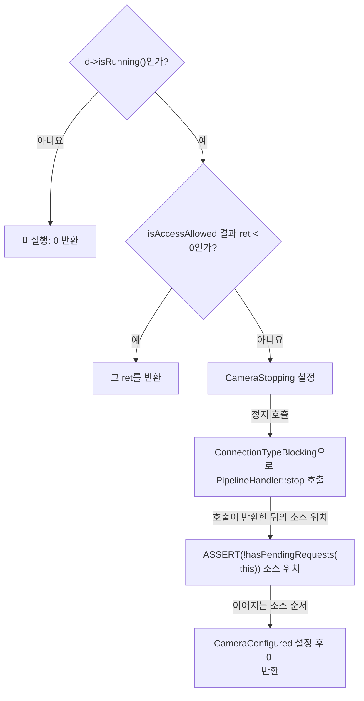

[Mermaid 원문](request-lifecycle.camera-stop-branches.mmd)

??? note "그림 근거와 확인 범위"
    isRunning과 접근 검사 결과에 따라 Camera::stop은 어떤 경로로 반환합니까?
    
    소스에 연결한 설계 해석입니다. 자동 연결 검사는 의미 승인이나 기기 실행 검증이 아닙니다.
    
    | 요소·전이 | 소스 근거 |
    |---|---|
    | <span data-sdd-label-en="Is d-&gt;isRunning() true?">d-&gt;isRunning&#40;&#41;인가?</span> | [src/libcamera/camera.cpp:1431](#source-e09324743def3f09) |
    | <span data-sdd-label-en="Not running: return 0">미실행: 0 반환</span> | [src/libcamera/camera.cpp:1431](#source-e09324743def3f09) |
    | <span data-sdd-label-en="Is isAccessAllowed result ret &lt; 0?">isAccessAllowed 결과 ret &lt; 0인가?</span> | [src/libcamera/camera.cpp:1431](#source-e09324743def3f09) |
    | <span data-sdd-label-en="Return that ret">그 ret를 반환</span> | [src/libcamera/camera.cpp:1431](#source-e09324743def3f09) |
    | <span data-sdd-label-en="Set CameraStopping">CameraStopping 설정</span> | [src/libcamera/camera.cpp:1431](#source-e09324743def3f09) |
    | <span data-sdd-label-en="Invoke PipelineHandler::stop with ConnectionTypeBlocking">ConnectionTypeBlocking으로 PipelineHandler::stop 호출</span> | [src/libcamera/camera.cpp:1431](#source-e09324743def3f09) |
    | <span data-sdd-label-en="Source location of ASSERT(!hasPendingRequests(this))">ASSERT&#40;&#33;hasPendingRequests&#40;this&#41;&#41; 소스 위치</span> | [src/libcamera/camera.cpp:1431](#source-e09324743def3f09) |
    | <span data-sdd-label-en="Set CameraConfigured, then return 0">CameraConfigured 설정 후 0 반환</span> | [src/libcamera/camera.cpp:1431](#source-e09324743def3f09) |
    | <span data-sdd-label-en="No">아니요</span> | [src/libcamera/camera.cpp:1431](#source-e09324743def3f09) |
    | <span data-sdd-label-en="Yes">예</span> | [src/libcamera/camera.cpp:1431](#source-e09324743def3f09) |
    | <span data-sdd-label-en="Yes">예</span> | [src/libcamera/camera.cpp:1431](#source-e09324743def3f09) |
    | <span data-sdd-label-en="No">아니요</span> | [src/libcamera/camera.cpp:1431](#source-e09324743def3f09) |
    | <span data-sdd-label-en="Invoke stop">정지 호출</span> | [src/libcamera/camera.cpp:1431](#source-e09324743def3f09) |
    | <span data-sdd-label-en="Source location after invocation returns">호출이 반환한 뒤의 소스 위치</span> | [src/libcamera/camera.cpp:1431](#source-e09324743def3f09) |
    | <span data-sdd-label-en="Following source order">이어지는 소스 순서</span> | [src/libcamera/camera.cpp:1431](#source-e09324743def3f09) |
<!-- /sdd:visual:camera-stop-branches -->

<!-- sdd:visual:stop-device-observation-plan -->
### stopDevice 호출 구간의 관찰 계획

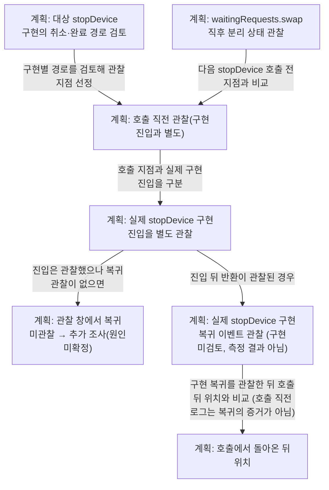

[Mermaid 원문](request-lifecycle.stop-device-observation-plan.mmd)

??? note "그림 근거와 확인 범위"
    분리 직후, 호출 직전, 실제 구현 진입과 복귀를 각각 관찰하는 조사 계획입니다. 호출 직전 표시만으로 구현 진입이나 멎은 원인을 확정하지 않습니다.
    
    소스에 연결한 설계 해석입니다. 자동 연결 검사는 의미 승인이나 기기 실행 검증이 아닙니다.
    
    | 요소·전이 | 소스 근거 |
    |---|---|
    | <span data-sdd-label-en="Plan: review cancellation and completion in the target stopDevice implementation">계획: 대상 stopDevice 구현의 취소·완료 경로 검토</span> | [src/libcamera/pipeline_handler.cpp:359](#source-eefd1bbecb1aad0a) |
    | <span data-sdd-label-en="Plan: inspect separation immediately after waitingRequests.swap">계획: waitingRequests.swap 직후 분리 상태 관찰</span> | [src/libcamera/pipeline_handler.cpp:359](#source-eefd1bbecb1aad0a) |
    | <span data-sdd-label-en="Plan: observe before call, separately from implementation entry">계획: 호출 직전 관찰&#40;구현 진입과 별도&#41;</span> | [src/libcamera/pipeline_handler.cpp:359](#source-eefd1bbecb1aad0a) |
    | <span data-sdd-label-en="Plan: separately observe entry into the actual stopDevice implementation">계획: 실제 stopDevice 구현 진입을 별도 관찰</span> | [src/libcamera/pipeline_handler.cpp:359](#source-eefd1bbecb1aad0a) |
    | <span data-sdd-label-en="Plan: source position after the call returns">계획: 호출에서 돌아온 뒤 위치</span> | [src/libcamera/pipeline_handler.cpp:359](#source-eefd1bbecb1aad0a) |
    | <span data-sdd-label-en="Plan: no observed return in observation window → investigate; cause unresolved">계획: 관찰 창에서 복귀 미관찰 → 추가 조사&#40;원인 미확정&#41;</span> | [src/libcamera/pipeline_handler.cpp:359](#source-eefd1bbecb1aad0a) |
    | <span data-sdd-label-en="Plan: observe the actual stopDevice implementation return event (implementation not reviewed, not a measured result)">계획: 실제 stopDevice 구현 복귀 이벤트 관찰 &#40;구현 미검토, 측정 결과 아님&#41;</span> | [src/libcamera/pipeline_handler.cpp:359](#source-eefd1bbecb1aad0a) |
    | <span data-sdd-label-en="Select observation points after reviewing implementation-specific paths">구현별 경로를 검토해 관찰 지점 선정</span> | [src/libcamera/pipeline_handler.cpp:359](#source-eefd1bbecb1aad0a) |
    | <span data-sdd-label-en="Compare with the position before the following stopDevice call">다음 stopDevice 호출 전 지점과 비교</span> | [src/libcamera/pipeline_handler.cpp:359](#source-eefd1bbecb1aad0a) |
    | <span data-sdd-label-en="Distinguish call site from actual implementation entry">호출 지점과 실제 구현 진입을 구분</span> | [src/libcamera/pipeline_handler.cpp:359](#source-eefd1bbecb1aad0a) |
    | <span data-sdd-label-en="If a return is observed after entry">진입 뒤 반환이 관찰된 경우</span> | [src/libcamera/pipeline_handler.cpp:359](#source-eefd1bbecb1aad0a) |
    | <span data-sdd-label-en="If entry was observed but return was not">진입은 관찰했으나 복귀 관찰이 없으면</span> | [src/libcamera/pipeline_handler.cpp:359](#source-eefd1bbecb1aad0a) |
    | <span data-sdd-label-en="Compare with the post-call position after an observed implementation return (a before-call log is not evidence of return)">구현 복귀를 관찰한 뒤 호출 뒤 위치와 비교 &#40;호출 직전 로그는 복귀의 증거가 아님&#41;</span> | [src/libcamera/pipeline_handler.cpp:359](#source-eefd1bbecb1aad0a) |
<!-- /sdd:visual:stop-device-observation-plan -->

<!-- sdd:visual:stopping-completion-contract -->
### 완료 통지의 호출자 의무와 반환 뒤 경계

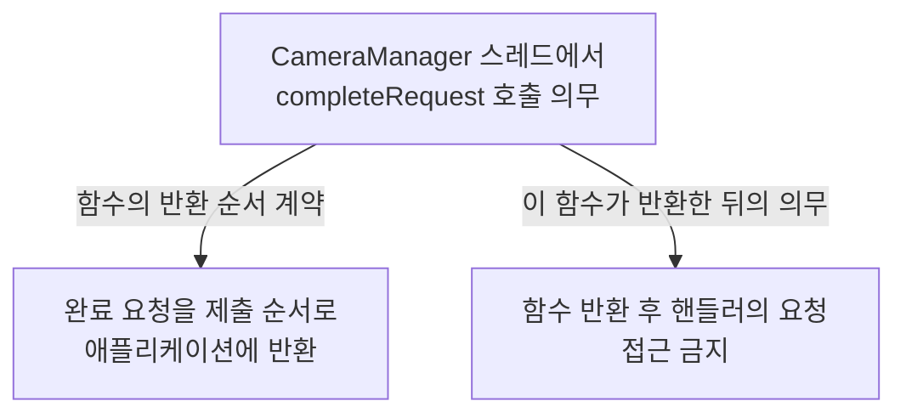

[Mermaid 원문](request-lifecycle.stopping-completion-contract.mmd)

??? note "그림 근거와 확인 범위"
    completeRequest 호출 스레드, 제출 순서 반환과 핸들러의 접근 금지 경계는 어떻게 연결됩니까?
    
    소스에 연결한 설계 해석입니다. 자동 연결 검사는 의미 승인이나 기기 실행 검증이 아닙니다.
    
    | 요소·전이 | 소스 근거 |
    |---|---|
    | <span data-sdd-label-en="Caller must invoke completeRequest in CameraManager thread">CameraManager 스레드에서 completeRequest 호출 의무</span> | [src/libcamera/pipeline_handler.cpp:547](#source-01ad7c6605c3296a) |
    | <span data-sdd-label-en="Return completed requests to the application in submission order">완료 요청을 제출 순서로 애플리케이션에 반환</span> | [src/libcamera/pipeline_handler.cpp:547](#source-01ad7c6605c3296a) |
    | <span data-sdd-label-en="Handler must not access request once the function returns">함수 반환 후 핸들러의 요청 접근 금지</span> | [src/libcamera/pipeline_handler.cpp:547](#source-01ad7c6605c3296a) |
    | <span data-sdd-label-en="Function submission-order contract">함수의 반환 순서 계약</span> | [src/libcamera/pipeline_handler.cpp:547](#source-01ad7c6605c3296a) |
    | <span data-sdd-label-en="Duty once this function returns">이 함수가 반환한 뒤의 의무</span> | [src/libcamera/pipeline_handler.cpp:547](#source-01ad7c6605c3296a) |
<!-- /sdd:visual:stopping-completion-contract -->

<!-- sdd:visual:request-completion-audit-plan -->
### 제출 회차별 완료 기록의 비교 계획

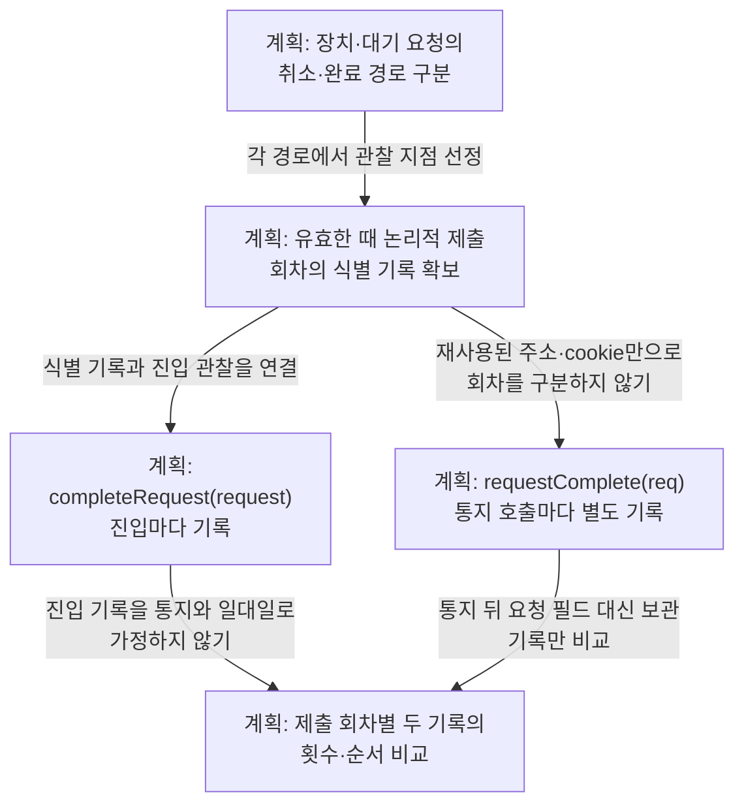

[Mermaid 원문](request-lifecycle.request-completion-audit-plan.mmd)

??? note "그림 근거와 확인 범위"
    completeRequest 진입과 requestComplete 통지 호출은 별도 기록으로 조사합니다. 유효한 때 확보한 제출 회차별 기록을 비교하는 계획이며 두 호출을 일대일로 가정하거나 통지 뒤 요청 필드를 읽지 않습니다. 실제 검사 결과는 아닙니다.
    
    소스에 연결한 설계 해석입니다. 자동 연결 검사는 의미 승인이나 기기 실행 검증이 아닙니다.
    
    | 요소·전이 | 소스 근거 |
    |---|---|
    | <span data-sdd-label-en="Plan: distinguish device and waiting-request cancellation/completion paths">계획: 장치·대기 요청의 취소·완료 경로 구분</span> | [src/libcamera/pipeline_handler.cpp:359](#source-eefd1bbecb1aad0a) |
    | <span data-sdd-label-en="Plan: capture logical-submission identity while the request is valid">계획: 유효한 때 논리적 제출 회차의 식별 기록 확보</span> | [src/libcamera/pipeline_handler.cpp:547](#source-01ad7c6605c3296a) |
    | <span data-sdd-label-en="Plan: record each completeRequest(request) entry">계획: completeRequest&#40;request&#41; 진입마다 기록</span> | [src/libcamera/pipeline_handler.cpp:547](#source-01ad7c6605c3296a) |
    | <span data-sdd-label-en="Plan: separately record each requestComplete(req) notification call">계획: requestComplete&#40;req&#41; 통지 호출마다 별도 기록</span> | [src/libcamera/pipeline_handler.cpp:547](#source-01ad7c6605c3296a) |
    | <span data-sdd-label-en="Plan: compare both record counts and order per submission">계획: 제출 회차별 두 기록의 횟수·순서 비교</span> | [src/libcamera/pipeline_handler.cpp:547](#source-01ad7c6605c3296a) |
    | <span data-sdd-label-en="Select observation points on each path">각 경로에서 관찰 지점 선정</span> | [src/libcamera/pipeline_handler.cpp:359](#source-eefd1bbecb1aad0a) |
    | <span data-sdd-label-en="Associate captured identity with entry observations">식별 기록과 진입 관찰을 연결</span> | [src/libcamera/pipeline_handler.cpp:547](#source-01ad7c6605c3296a) |
    | <span data-sdd-label-en="Do not identify submissions from a reused address or cookie alone">재사용된 주소·cookie만으로 회차를 구분하지 않기</span> | [src/libcamera/pipeline_handler.cpp:547](#source-01ad7c6605c3296a) |
    | <span data-sdd-label-en="Do not assume entry records correspond one-to-one with notifications">진입 기록을 통지와 일대일로 가정하지 않기</span> | [src/libcamera/pipeline_handler.cpp:547](#source-01ad7c6605c3296a) |
    | <span data-sdd-label-en="Compare only retained records after notification, without reading request fields">통지 뒤 요청 필드 대신 보관 기록만 비교</span> | [src/libcamera/pipeline_handler.cpp:547](#source-01ad7c6605c3296a) |
<!-- /sdd:visual:request-completion-audit-plan -->

조사 계획에서는 `Camera::stop`의 실행 경로와 반환값을 관찰합니다. 카메라가 실행 중이 아니면 `0`을 반환하고, 실행 중일 때 `isAccessAllowed`의 결과가 음수이면 그 값을 반환합니다. 접근 확인을 통과한 경로에서는 `CameraStopping` 상태 설정과 `ConnectionTypeBlocking` 방식의 `PipelineHandler::stop` 호출 진입·복귀를 관찰하고, 이어서 대기 요청이 없다는 `ASSERT`, `CameraConfigured` 상태 설정, `0` 반환을 순서대로 확인합니다. 조사 계획으로 대상 장치의 `PipelineHandler`를 식별하고, 모든 대기 중 요청을 취소하여 오류 상태로 즉시 완료한다는 `stopDevice`의 공통 계약과 구분하여 해당 구현의 요청 취소·완료 경로를 검토합니다. `src/libcamera/camera.cpp:1462`, `src/libcamera/camera.cpp:1431`, `src/libcamera/pipeline_handler.cpp:359`

조사 계획으로 `PipelineHandler::stop`에서 `waitingRequests_`를 분리하는 지점과 `stopDevice` 호출 직전, 실제 구현의 진입과 복귀를 각각 관찰합니다. 호출 직전 표시만으로 장치 내부 정지를 확정하지 않으며, 선택한 관찰 창에서 복귀가 보이지 않으면 원인은 미확정으로 둡니다. 조사 계획으로, 기존 실행에서 `PipelineHandler::stop()`의 취소 반복문이 `doQueueRequest(request)`에 전달하는 `request` 값을 관찰 기록에 남깁니다. `src/libcamera/pipeline_handler.cpp:359`, `src/libcamera/pipeline_handler.cpp:394`

조사 계획으로 `PipelineHandler::completeRequest(request)` 진입과 `camera->requestComplete(req)` 통지 호출을 구분해 기록합니다. 요청이 유효할 때 확보한 논리적 제출 회차 기록을 사용해 중복 완료와 반환 순서를 비교합니다. 조사 계획으로 `PipelineHandler::stop()`의 두 `ASSERT` 검사 지점에서 `queuedRequests_`와 `waitingRequests_`가 비어 있는지 관찰하며, 코드에서는 검사 뒤에 `requestSequence_`를 0으로 초기화합니다. `src/libcamera/pipeline_handler.cpp:547`, `src/libcamera/pipeline_handler.cpp:398`

실행 확인 항목: 실제 대상 애플리케이션의 연결 위치·방식과 수신 객체 스레드는 아직 검증되지 않았으므로, 추가 조사에서는 콜백 진입과 복귀 근처의 시각 및 실행 스레드를 기록할 계획입니다. 별도로 파이프라인 핸들러는 `completeRequest()`를 `CameraManager` 스레드에서 호출해야 합니다. `src/libcamera/pipeline_handler.cpp:547`

`Camera::disconnect()`는 내부 처리 함수 `_d()->disconnect()`를 호출한 뒤 `disconnected` 신호를 발생시킵니다. `Camera::disconnect()`의 이 호출은 `disconnected` 신호를 발행합니다. `Camera::disconnect`의 TODO에는 카메라가 실행 중 연결 해제될 때 대기 중인 요청을 처리하는 작업이 남아 있습니다. `src/libcamera/camera.cpp:959`, `src/libcamera/camera.cpp:960`, `src/libcamera/camera.cpp:944`

근거 원문: [src/libcamera/camera.cpp:1431](#source-e09324743def3f09) · [src/libcamera/pipeline_handler.cpp:359](#source-eefd1bbecb1aad0a) · [src/libcamera/pipeline_handler.cpp:547](#source-01ad7c6605c3296a) · [src/libcamera/camera.cpp:1462](#source-6191f91df6cbffa2) · [src/libcamera/pipeline_handler.cpp:398](#source-5e7914238ff81605) · [src/libcamera/camera.cpp:952](#source-1d583253fc11ef1c) · [src/libcamera/pipeline_handler.cpp:394](#source-fd5daba4aa44adfd) · [src/libcamera/camera.cpp:959](#source-56494d0aedf70c2d) · [src/libcamera/camera.cpp:960](#source-7d48ce2e18c8877c) · [src/libcamera/camera.cpp:944](#source-2758e9ddd31ad41d) · [src/libcamera/camera.cpp:944](#source-839140c350119dd1)

## 변경 검토와 실행 확인

`Camera::queueRequest`의 반환값을 그대로 기록하고 성공을 뜻하는 0과 실패를 뜻하는 음수 오류 코드를 구분하는 조사 계획을 제안합니다. `Request::reuse` 호출 전과 호출 완료 후의 `status_`·`controls_`·`metadata_` 값과 `status_`에 RequestPending을 대입하는 동작을 조사 기록 항목으로 제안합니다. 선두 요청의 상태를 조회하는 식 `req->status()`의 결과를 조사 기록 항목으로 제안합니다. `src/libcamera/camera.cpp:1308`, `src/libcamera/request.cpp:400`, `src/libcamera/request.cpp:402`, `src/libcamera/request.cpp:403`, `src/libcamera/pipeline_handler.cpp:594`

근거 원문: [src/libcamera/camera.cpp:1308](#source-28d007de6ad1a8a5) · [src/libcamera/request.cpp:400](#source-a98823fa5ec440a2) · [src/libcamera/request.cpp:402](#source-c8638489aa83cfd1) · [src/libcamera/request.cpp:403](#source-47569737e131b31a) · [src/libcamera/pipeline_handler.cpp:594](#source-bae861ceef5e8406)

## 공개 가상 카메라의 콜백 관찰

**가상 시험 구성입니다. 실제 제품의 지원·성능 주장으로 사용하지 마세요.**

공개 가상 CPU 프로브를 3회 실행했으며, 실행마다 RequestComplete로 보고된 요청 4개와 RequestCancelled로 보고된 요청 4개에 대해 콜백 24회가 관찰됐습니다. 전체 콜백은 72회였습니다. Ubuntu WSL2 Virtual2의 공개 가상 프로브에서 Auto와 Queued 콜백은 수신 객체가 속한 메인 스레드에서, Direct 콜백은 그와 다른 스레드에서 실행됐습니다. 정지로 취소된 요청의 콜백 진입·복귀 근처 표식은 Auto와 Queued에서 stop-return 뒤에, Direct에서 stop-enter와 stop-return 사이에 관찰됐으며, stop-enter와 stop-return은 camera->stop() 호출 직전과 직후에 남긴 애플리케이션 표식으로 함수 내부의 정확한 명령 경계는 아닙니다. `product-evidence/libcamera-callback-probe/callback-run.txt:1`

<!-- sdd:visual:observed-stop-callback-timing -->
### 가상 CPU 프로브의 연결별 취소 콜백 표시

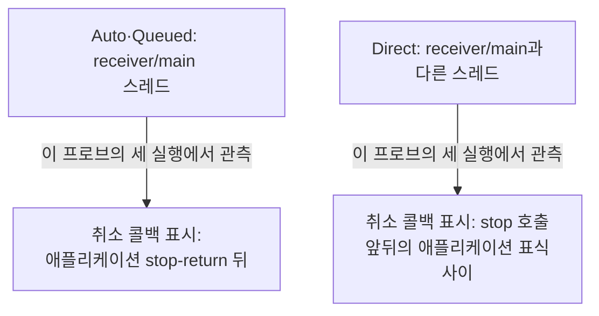

[Mermaid 원문](request-lifecycle.observed-stop-callback-timing.mmd)

??? note "그림 근거와 확인 범위"
    이 공개 가상 CPU 프로브에서 취소 요청의 콜백 표시와 애플리케이션 stop 표시는 어떻게 배치됐습니까? 서로 다른 연결 사이의 순서나 실제 C++ 반환 완료는 측정하지 않았습니다.
    
    소스에 연결한 설계 해석입니다. 자동 연결 검사는 의미 승인이나 기기 실행 검증이 아닙니다.
    
    | 요소·전이 | 소스 근거 |
    |---|---|
    | <span data-sdd-label-en="Auto/Queued: receiver/main thread">Auto·Queued: receiver/main 스레드</span> | [product-evidence/libcamera-callback-probe/callback-run.txt:1](#source-54dc055eafaa8a99) |
    | <span data-sdd-label-en="Direct: different from receiver/main thread">Direct: receiver/main과 다른 스레드</span> | [product-evidence/libcamera-callback-probe/callback-run.txt:1](#source-54dc055eafaa8a99) |
    | <span data-sdd-label-en="Cancelled callback markers: after application stop-return">취소 콜백 표시: 애플리케이션 stop-return 뒤</span> | [product-evidence/libcamera-callback-probe/callback-run.txt:1](#source-54dc055eafaa8a99) |
    | <span data-sdd-label-en="Cancelled callback markers: between application markers around stop()">취소 콜백 표시: stop 호출 앞뒤의 애플리케이션 표식 사이</span> | [product-evidence/libcamera-callback-probe/callback-run.txt:1](#source-54dc055eafaa8a99) |
    | <span data-sdd-label-en="Observed in three runs of this probe">이 프로브의 세 실행에서 관측</span> | [product-evidence/libcamera-callback-probe/callback-run.txt:1](#source-54dc055eafaa8a99) |
    | <span data-sdd-label-en="Observed in three runs of this probe">이 프로브의 세 실행에서 관측</span> | [product-evidence/libcamera-callback-probe/callback-run.txt:1](#source-54dc055eafaa8a99) |
<!-- /sdd:visual:observed-stop-callback-timing -->

<!-- sdd:visual:near-return-marker-boundary -->
### 반환 근처 표시로 알 수 있는 범위

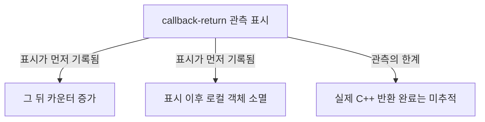

[Mermaid 원문](request-lifecycle.near-return-marker-boundary.mmd)

??? note "그림 근거와 확인 범위"
    callback-return 표시는 어떤 후속 작업보다 앞서며, 무엇의 완료를 추적하지 않습니까?
    
    소스에 연결한 설계 해석입니다. 자동 연결 검사는 의미 승인이나 기기 실행 검증이 아닙니다.
    
    | 요소·전이 | 소스 근거 |
    |---|---|
    | <span data-sdd-label-en="Observed callback-return marker">callback-return 관측 표시</span> | [product-evidence/libcamera-callback-probe/callback-run.txt:1](#source-54dc055eafaa8a99) |
    | <span data-sdd-label-en="Counter increment follows">그 뒤 카운터 증가</span> | [product-evidence/libcamera-callback-probe/callback-run.txt:1](#source-54dc055eafaa8a99) |
    | <span data-sdd-label-en="Local destruction follows the marker">표시 이후 로컬 객체 소멸</span> | [product-evidence/libcamera-callback-probe/callback-run.txt:1](#source-54dc055eafaa8a99) |
    | <span data-sdd-label-en="Actual C++ return is not traced">실제 C++ 반환 완료는 미추적</span> | [product-evidence/libcamera-callback-probe/callback-run.txt:1](#source-54dc055eafaa8a99) |
    | <span data-sdd-label-en="Marker is recorded first">표시가 먼저 기록됨</span> | [product-evidence/libcamera-callback-probe/callback-run.txt:1](#source-54dc055eafaa8a99) |
    | <span data-sdd-label-en="Marker is recorded first">표시가 먼저 기록됨</span> | [product-evidence/libcamera-callback-probe/callback-run.txt:1](#source-54dc055eafaa8a99) |
    | <span data-sdd-label-en="Observation limit">관측의 한계</span> | [product-evidence/libcamera-callback-probe/callback-run.txt:1](#source-54dc055eafaa8a99) |
<!-- /sdd:visual:near-return-marker-boundary -->

반환 근처 표식은 returned.`fetch_add`(1)과 지역 객체 소멸 전에 기록되므로 실제 C++ 함수의 반환 완료나 명령 수준의 반환 추적을 증명하지 않습니다. 이 실행은 Ubuntu WSL2의 Virtual2에서 CPU 전용 memfd 버퍼와 신호가 없는 eventfd 시험 입력을 사용한 가상 프로브로, 실제 애플리케이션 콜백을 관찰했습니다. DMA 동기화·제공자 오류는 보존했으며 DMA 동기화, 물리 카메라 촬영, 다른 애플리케이션과 사내 `Camera` HAL은 검증하지 않았습니다. `product-evidence/libcamera-callback-probe/callback-run.txt:1`

근거 원문: [product-evidence/libcamera-callback-probe/callback-run.txt:1](#source-54dc055eafaa8a99)

??? note "설계 질문과 검증 범위"
    질문별 답변과 근거 연결을 검사했습니다. 의미와 실행 결과는 사람 검토가 필요합니다.
    
    | 설계 질문 | 설명 위치 | 확인 범위 |
    |---|---|---|
    | 제출 성공 이후의 대기 조건과 완료 책임은 무엇입니까? | [제출에서 완료까지](#제출에서-완료까지) | 코드 근거와 설명 연결 |
    | 어떤 자원을 누가 유지하고 완료 후 무엇을 초기화해야 합니까? | [요청·버퍼·fence의 수명](#요청버퍼fence의-수명) | 코드 근거와 설명 연결 |
    | 정지 중 요청 반환과 연결 해제의 보장 범위는 어떻게 다릅니까? | [정지와 연결 해제를 구분하기](#정지와-연결-해제를-구분하기) | 코드 근거와 설명 연결 · 실행 확인 항목 별도 |
    | 문서를 읽고 어떤 질문에 답하고 어떤 실행 증거를 확보해야 합니까? | [변경 검토와 실행 확인](#변경-검토와-실행-확인) | 코드 근거와 설명 연결 |
    | 공개 가상 콜백 프로브에서 실제로 관찰한 범위와 아직 검증하지 않은 범위는 무엇입니까? | [공개 가상 카메라의 콜백 관찰](#공개-가상-카메라의-콜백-관찰) | 코드 근거와 설명 연결 |

## 소스 근거

같은 발췌는 한 번만 싣습니다. 필요한 원문을 펼쳐 설명과 대조하세요.

<a id="source-0ae00d77839f61cb"></a>

??? note "소스 근거: src/libcamera/camera.cpp:1243"
    `src/libcamera/camera.cpp:1243`에서 시작하는 발췌입니다. 종료 줄은 1263이며, 아래 원문을 설명과 대조할 수 있습니다.
    
    SHA-256: `9f251ecf5ba569606e9753d3619b88e1aef5a4ce15f816ae97efd283e34b823b`
    
    ```text
    \brief Create a request object for the camera
     * \param[in] cookie Opaque cookie for application use
     *
     * This function creates an empty request for the application to fill with
     * buffers and parameters, and queue for capture.
     *
     * The \a cookie is stored in the request and is accessible through the
     * Request::cookie() function at any time. It is typically used by applications
     * to map the request to an external resource in the request completion
     * handler, and is completely opaque to libcamera.
     *
     * The ownership of the returned request is passed to the caller, which is
     * responsible for deleting it. The request may be deleted in the completion
     * handler, or reused after resetting its state with Request::reuse().
     *
     * \context This function is \threadsafe. It may only be called when the camera
     * is in the Configured or Running state as defined in \ref camera_operation.
     *
     * \return A pointer to the newly created request, or nullptr on error
     */
    std::unique_ptr<Request> Camera::createRequest(uint64_t cookie)
    ```

<a id="source-28d007de6ad1a8a5"></a>

??? note "소스 근거: src/libcamera/camera.cpp:1308"
    `src/libcamera/camera.cpp:1308`에서 시작하는 발췌입니다. 종료 줄은 1383이며, 아래 원문을 설명과 대조할 수 있습니다.
    
    SHA-256: `96db61baeb32065c966b20942f97518ddbd3a43b36b64e8083eb29a90ecb7f4b`
    
    ```text
    \brief Queue a request to the camera
     * \param[in] request The request to queue to the camera
     *
     * This function queues a \a request to the camera for capture.
     *
     * After allocating the request with createRequest(), the application shall
     * fill it with at least one capture buffer before queuing it. Requests that
     * contain no buffers are invalid and are rejected without being queued.
     *
     * Once the request has been queued, the camera will notify its completion
     * through the \ref requestCompleted signal.
     *
     * \context This function is \threadsafe. It may only be called when the camera
     * is in the Running state as defined in \ref camera_operation.
     *
     * \return 0 on success or a negative error code otherwise
     * \retval -ENODEV The camera has been disconnected from the system
     * \retval -EACCES The camera is not running so requests can't be queued
     * \retval -EXDEV The request does not belong to this camera
     * \retval -EINVAL The request is invalid
     * \retval -ENOMEM No buffer memory was available to handle the request
     */
    int Camera::queueRequest(Request *request)
    {
    	Private *const d = _d();
    
    	int ret = d->isAccessAllowed(Private::CameraRunning);
    	if (ret < 0)
    		return ret;
    
    	/* Requests can only be queued to the camera that created them. */
    	if (request->_d()->camera() != this) {
    		LOG(Camera, Error) << "Request was not created by this camera";
    		return -EXDEV;
    	}
    
    	if (request->status() != Request::RequestPending) {
    		LOG(Camera, Error) << request->toString() << " is not valid";
    		return -EINVAL;
    	}
    
    	/* Make sure the Request has a valid control list. */
    	if (request->controls().infoMap() != &controls()) {
    		LOG(Camera, Error) << "Overwriting Request::controls() is not allowed";
    		return -EINVAL;
    	}
    
    	/*
    	 * The camera state may change until the end of the function. No locking
    	 * is however needed as PipelineHandler::queueRequest() will handle
    	 * this.
    	 */
    
    	if (request->buffers().empty()) {
    		LOG(Camera, Error) << "Request contains no buffers";
    		return -EINVAL;
    	}
    
    	for (const auto &[stream, buffer] : request->buffers()) {
    		if (d->activeStreams_.find(stream) == d->activeStreams_.end()) {
    			LOG(Camera, Error) << "Invalid request";
    			return -EINVAL;
    		}
    	}
    
    	/* Pre-process AeEnable. */
    	patchControlList(request->controls());
    
    	d->pipe_->invokeMethod(&PipelineHandler::queueRequest,
    			       ConnectionTypeQueued, request);
    
    	return 0;
    }
    
    /**
     * \brief Start capture from camera
    ```

<a id="source-95ae69eeb085e3b1"></a>

??? note "소스 근거: src/libcamera/request.cpp:442"
    `src/libcamera/request.cpp:442`에서 시작하는 발췌입니다. 종료 줄은 475이며, 아래 원문을 설명과 대조할 수 있습니다.
    
    SHA-256: `65cd8b0501b7f6545dd10eaaec4a4fe46c52a096a3bbd94ea6b4813e4a670876`
    
    ```text
    \brief Add a FrameBuffer with its associated Stream to the Request
     * \param[in] stream The stream the buffer belongs to
     * \param[in] buffer The FrameBuffer to add to the request
     * \param[in] fence The optional fence
     *
     * A reference to the buffer is stored in the request. The caller is responsible
     * for ensuring that the buffer will remain valid until the request complete
     * callback is called.
     *
     * A request can only contain one buffer per stream. If a buffer has already
     * been added to the request for the same stream, this function returns -EEXIST.
     *
     * A Fence can be optionally associated with the \a buffer.
     *
     * When a valid Fence is provided to this function, \a fence is moved to \a
     * buffer and this Request will only be queued to the device once the
     * fences of all its buffers have been correctly signalled. Ownership of the
     * fence will only be taken in case of success, otherwise the fence will
     * be left unmodified.
     *
     * If the \a fence associated with \a buffer isn't signalled, the request will
     * fail after a timeout. The buffer will still contain the fence, which
     * applications must retrieve with FrameBuffer::releaseFence() before the buffer
     * can be reused in another request. Attempting to add a buffer that still
     * contains a fence to a request will result in this function returning -EEXIST.
     *
     * \sa FrameBuffer::releaseFence()
     *
     * \return 0 on success or a negative error code otherwise
     * \retval -EEXIST The request already contains a buffer for the stream
     *  or the buffer still references a fence
     * \retval -EINVAL The buffer does not reference a valid Stream
     */
    int Request::addBuffer(const Stream *stream, FrameBuffer *buffer,
    ```

<a id="source-789eafedfaa7f3c5"></a>

??? note "소스 근거: src/libcamera/pipeline_handler.cpp:428"
    `src/libcamera/pipeline_handler.cpp:428`에서 시작하는 발췌입니다. 종료 줄은 547이며, 아래 원문을 설명과 대조할 수 있습니다.
    
    SHA-256: `5a7a3397a6034a73fe348ae44eb1e2568d2823e95542fe43386e16359d627180`
    
    ```text
    \fn PipelineHandler::registerRequest()
     * \brief Register a request for use by the pipeline handler
     * \param[in] request The request to register
     *
     * This function is called when the request is created, and allows the pipeline
     * handler to perform any one-time initialization it requries for the request.
     */
    void PipelineHandler::registerRequest(Request *request)
    {
    	/*
    	 * Connect the request prepared signal to notify the pipeline handler
    	 * when a request is ready to be processed.
    	 */
    	request->_d()->prepared.connect(this, [this, request]() {
    		doQueueRequests(request->_d()->camera());
    	});
    }
    
    /**
     * \fn PipelineHandler::queueRequest()
     * \brief Queue a request
     * \param[in] request The request to queue
     *
     * This function queues a capture request to the pipeline handler for
     * processing. The request is first added to the internal list of waiting
     * requests which have to be prepared to make sure they are ready for being
     * queued to the pipeline handler.
     *
     * The queue of waiting requests is iterated and up to \a
     * maxQueuedRequestsDevice_ prepared requests are passed to the pipeline handler
     * in the same order they have been queued by calling this function.
     *
     * If a Request fails during the preparation phase or if the pipeline handler
     * fails in queuing the request to the hardware the request is cancelled.
     *
     * Keeping track of queued requests ensures automatic completion of all requests
     * when the pipeline handler is stopped with stop(). Request completion shall be
     * signalled by the pipeline handler using the completeRequest() function.
     *
     * \context This function is called from the CameraManager thread.
     */
    void PipelineHandler::queueRequest(Request *request)
    {
    	LIBCAMERA_TRACEPOINT(request_queue, request);
    
    	Camera *camera = request->_d()->camera();
    	Camera::Private *data = camera->_d();
    	data->waitingRequests_.push(request);
    
    	request->_d()->prepare(300ms);
    }
    
    /**
     * \brief Queue one requests to the device
     */
    void PipelineHandler::doQueueRequest(Request *request)
    {
    	LIBCAMERA_TRACEPOINT(request_device_queue, request);
    
    	Camera *camera = request->_d()->camera();
    	Camera::Private *data = camera->_d();
    	data->queuedRequests_.push_back(request);
    
    	request->_d()->sequence_ = data->requestSequence_++;
    
    	if (request->_d()->cancelled_) {
    		completeRequest(request);
    		return;
    	}
    
    	int ret = queueRequestDevice(camera, request);
    	if (ret)
    		cancelRequest(request);
    }
    
    /**
     * \brief Queue prepared requests to the device
     *
     * Iterate the list of waiting requests and queue them to the device one
     * by one if they have been prepared.
     */
    void PipelineHandler::doQueueRequests(Camera *camera)
    {
    	Camera::Private *data = camera->_d();
    	while (!data->waitingRequests_.empty()) {
    		if (data->queuedRequests_.size() == maxQueuedRequestsDevice_)
    			break;
    
    		Request *request = data->waitingRequests_.front();
    		if (!request->_d()->prepared_)
    			break;
    
    		/*
    		 * Pop the request first, in case doQueueRequests() is called
    		 * recursively from within doQueueRequest()
    		 */
    		data->waitingRequests_.pop();
    		doQueueRequest(request);
    	}
    }
    
    /**
     * \fn PipelineHandler::queueRequestDevice()
     * \brief Queue a request to the device
     * \param[in] camera The camera to queue the request to
     * \param[in] request The request to queue
     *
     * This function queues a capture request to the device for processing. The
     * request contains a set of buffers associated with streams and a set of
     * parameters. The pipeline handler shall program the device to ensure that the
     * parameters will be applied to the frames captured in the buffers provided in
     * the request.
     *
     * \context This function is called from the CameraManager thread.
     *
     * \return 0 on success or a negative error code otherwise
     */
    
    /**
     * \brief Complete a buffer for a request
    ```

<a id="source-01ad7c6605c3296a"></a>

??? note "소스 근거: src/libcamera/pipeline_handler.cpp:547"
    `src/libcamera/pipeline_handler.cpp:547`에서 시작하는 발췌입니다. 종료 줄은 620이며, 아래 원문을 설명과 대조할 수 있습니다.
    
    SHA-256: `514288cc958de9ff5fd19d46393cec3bb3088f4f08486528d4559071138638c9`
    
    ```text
    \brief Complete a buffer for a request
     * \param[in] request The request the buffer belongs to
     * \param[in] buffer The buffer that has completed
     *
     * This function shall be called by pipeline handlers to signal completion of
     * the \a buffer part of the \a request. It notifies applications of buffer
     * completion and updates the request's internal buffer tracking. The request
     * is not completed automatically when the last buffer completes to give
     * pipeline handlers a chance to perform any operation that may still be
     * needed. They shall complete requests explicitly with completeRequest().
     *
     * \context This function shall be called from the CameraManager thread.
     *
     * \return True if all buffers contained in the request have completed, false
     * otherwise
     */
    bool PipelineHandler::completeBuffer(Request *request, FrameBuffer *buffer)
    {
    	Camera *camera = request->_d()->camera();
    	camera->bufferCompleted.emit(request, buffer);
    	return request->_d()->completeBuffer(buffer);
    }
    
    /**
     * \brief Signal request completion
     * \param[in] request The request that has completed
     *
     * The pipeline handler shall call this function to notify the \a camera that
     * the request has completed. The request is no longer managed by the pipeline
     * handler and shall not be accessed once this function returns.
     *
     * This function ensures that requests will be returned to the application in
     * submission order, the pipeline handler may call it on any complete request
     * without any ordering constraint.
     *
     * \context This function shall be called from the CameraManager thread.
     */
    void PipelineHandler::completeRequest(Request *request)
    {
    	Camera *camera = request->_d()->camera();
    
    	request->_d()->complete();
    
    	Camera::Private *data = camera->_d();
    
    	while (!data->queuedRequests_.empty()) {
    		Request *req = data->queuedRequests_.front();
    		if (req->status() == Request::RequestPending)
    			break;
    
    		ASSERT(!req->hasPendingBuffers());
    		data->queuedRequests_.pop_front();
    		camera->requestComplete(req);
    	}
    
    	/* Allow any waiting requests to be queued to the pipeline. */
    	doQueueRequests(camera);
    }
    
    /**
     * \brief Cancel request and signal its completion
     * \param[in] request The request to cancel
     *
     * This function cancels and completes the request. The same rules as for
     * completeRequest() apply.
     */
    void PipelineHandler::cancelRequest(Request *request)
    {
    	request->_d()->cancel();
    	completeRequest(request);
    }
    
    /**
     * \brief Retrieve the absolute path to a platform configuration file
    ```

<a id="source-7348e9b4af985eb2"></a>

??? note "소스 근거: src/libcamera/pipeline_handler.cpp:483"
    `src/libcamera/pipeline_handler.cpp:483`에서 시작하는 발췌입니다. 종료 줄은 501이며, 아래 원문을 설명과 대조할 수 있습니다.
    
    SHA-256: `fbd3ed6fe295b1cdd82d6ce420a30695986e43199347f92ac2545fe0e7831da8`
    
    ```text
    void PipelineHandler::doQueueRequest(Request *request)
    {
    	LIBCAMERA_TRACEPOINT(request_device_queue, request);
    
    	Camera *camera = request->_d()->camera();
    	Camera::Private *data = camera->_d();
    	data->queuedRequests_.push_back(request);
    
    	request->_d()->sequence_ = data->requestSequence_++;
    
    	if (request->_d()->cancelled_) {
    		completeRequest(request);
    		return;
    	}
    
    	int ret = queueRequestDevice(camera, request);
    	if (ret)
    		cancelRequest(request);
    }
    ```

<a id="source-c05f8214908fe4fe"></a>

??? note "소스 근거: src/libcamera/pipeline_handler.cpp:530"
    `src/libcamera/pipeline_handler.cpp:530`에서 시작하는 발췌입니다. 종료 줄은 544이며, 아래 원문을 설명과 대조할 수 있습니다.
    
    SHA-256: `18f697dba5bc979e14125471abadb8a7ecccef4de79e75e1f385e2c6ee044df2`
    
    ```text
    \fn PipelineHandler::queueRequestDevice()
     * \brief Queue a request to the device
     * \param[in] camera The camera to queue the request to
     * \param[in] request The request to queue
     *
     * This function queues a capture request to the device for processing. The
     * request contains a set of buffers associated with streams and a set of
     * parameters. The pipeline handler shall program the device to ensure that the
     * parameters will be applied to the frames captured in the buffers provided in
     * the request.
     *
     * \context This function is called from the CameraManager thread.
     *
     * \return 0 on success or a negative error code otherwise
     */
    ```

<a id="source-ab8710f8a8a7905d"></a>

??? note "소스 근거: src/libcamera/pipeline_handler.cpp:547"
    `src/libcamera/pipeline_handler.cpp:547`에서 시작하는 발췌입니다. 종료 줄은 563이며, 아래 원문을 설명과 대조할 수 있습니다.
    
    SHA-256: `096784b4798b3156e88e3acf84577f60a27f0bf0e2422ae7850e44b081eb9d3a`
    
    ```text
    \brief Complete a buffer for a request
     * \param[in] request The request the buffer belongs to
     * \param[in] buffer The buffer that has completed
     *
     * This function shall be called by pipeline handlers to signal completion of
     * the \a buffer part of the \a request. It notifies applications of buffer
     * completion and updates the request's internal buffer tracking. The request
     * is not completed automatically when the last buffer completes to give
     * pipeline handlers a chance to perform any operation that may still be
     * needed. They shall complete requests explicitly with completeRequest().
     *
     * \context This function shall be called from the CameraManager thread.
     *
     * \return True if all buffers contained in the request have completed, false
     * otherwise
     */
    bool PipelineHandler::completeBuffer(Request *request, FrameBuffer *buffer)
    ```

<a id="source-236c920e906cb6fd"></a>

??? note "소스 근거: src/libcamera/pipeline_handler.cpp:571"
    `src/libcamera/pipeline_handler.cpp:571`에서 시작하는 발췌입니다. 종료 줄은 607이며, 아래 원문을 설명과 대조할 수 있습니다.
    
    SHA-256: `6ad80c6800e8b980c2a6146d7dcc5648de9db2b0ca408711a896c4e46a624684`
    
    ```text
    \brief Signal request completion
     * \param[in] request The request that has completed
     *
     * The pipeline handler shall call this function to notify the \a camera that
     * the request has completed. The request is no longer managed by the pipeline
     * handler and shall not be accessed once this function returns.
     *
     * This function ensures that requests will be returned to the application in
     * submission order, the pipeline handler may call it on any complete request
     * without any ordering constraint.
     *
     * \context This function shall be called from the CameraManager thread.
     */
    void PipelineHandler::completeRequest(Request *request)
    {
    	Camera *camera = request->_d()->camera();
    
    	request->_d()->complete();
    
    	Camera::Private *data = camera->_d();
    
    	while (!data->queuedRequests_.empty()) {
    		Request *req = data->queuedRequests_.front();
    		if (req->status() == Request::RequestPending)
    			break;
    
    		ASSERT(!req->hasPendingBuffers());
    		data->queuedRequests_.pop_front();
    		camera->requestComplete(req);
    	}
    
    	/* Allow any waiting requests to be queued to the pipeline. */
    	doQueueRequests(camera);
    }
    
    /**
     * \brief Cancel request and signal its completion
    ```

<a id="source-a637b7daf9acb7ac"></a>

??? note "소스 근거: src/libcamera/pipeline_handler.cpp:516"
    `src/libcamera/pipeline_handler.cpp:516`에서 시작하는 발췌입니다. 종료 줄은 518이며, 아래 원문을 설명과 대조할 수 있습니다.
    
    SHA-256: `f655f79ce0ac9e9361d1759b2974e6f382b7fe1e9e3aa35b51952572af8d5a6f`
    
    ```text
    Request *request = data->waitingRequests_.front();
    		if (!request->_d()->prepared_)
    			break;
    ```

<a id="source-5b0ae08604dff588"></a>

??? note "소스 근거: src/libcamera/pipeline_handler.cpp:553"
    `src/libcamera/pipeline_handler.cpp:553`에서 시작하는 발췌입니다. 종료 줄은 556이며, 아래 원문을 설명과 대조할 수 있습니다.
    
    SHA-256: `957ec8f5090b25e8e97e61a6390c77c799eb5e696028a5674ca4717473b6d42d`
    
    ```text
    The request
     * is not completed automatically when the last buffer completes to give
     * pipeline handlers a chance to perform any operation that may still be
     * needed. They shall complete requests explicitly with completeRequest().
    ```

<a id="source-bae861ceef5e8406"></a>

??? note "소스 근거: src/libcamera/pipeline_handler.cpp:594"
    `src/libcamera/pipeline_handler.cpp:594`에서 시작하는 발췌입니다. 종료 줄은 595이며, 아래 원문을 설명과 대조할 수 있습니다.
    
    SHA-256: `103a09a61422ec5ef5b879512b00b4194d428eb70ce8bbe292ded0be5382caf6`
    
    ```text
    if (req->status() == Request::RequestPending)
    			break;
    ```

<a id="source-0470759dc8387e9a"></a>

??? note "소스 근거: src/libcamera/base/bound_method.cpp:68"
    `src/libcamera/base/bound_method.cpp:68`에서 시작하는 발췌입니다. 종료 줄은 108이며, 아래 원문을 설명과 대조할 수 있습니다.
    
    SHA-256: `9d139a7558500489b81d2ef8b83d3b1a3b143d252992c91f56331bc1e6d1b327`
    
    ```text
    bool BoundMethodBase::activatePack(std::shared_ptr<BoundMethodPackBase> pack,
    				   bool deleteMethod)
    {
    	ConnectionType type = connectionType_;
    	if (type == ConnectionTypeAuto) {
    		if (Thread::current() == object_->thread())
    			type = ConnectionTypeDirect;
    		else
    			type = ConnectionTypeQueued;
    	} else if (type == ConnectionTypeBlocking) {
    		if (Thread::current() == object_->thread())
    			type = ConnectionTypeDirect;
    	}
    
    	switch (type) {
    	case ConnectionTypeDirect:
    	default:
    		invokePack(pack.get());
    		if (deleteMethod)
    			delete this;
    		return true;
    
    	case ConnectionTypeQueued: {
    		std::unique_ptr<Message> msg =
    			std::make_unique<InvokeMessage>(this, pack, nullptr, deleteMethod);
    		object_->postMessage(std::move(msg));
    		return false;
    	}
    
    	case ConnectionTypeBlocking: {
    		Semaphore semaphore;
    
    		std::unique_ptr<Message> msg =
    			std::make_unique<InvokeMessage>(this, pack, &semaphore, deleteMethod);
    		object_->postMessage(std::move(msg));
    
    		semaphore.acquire();
    		return true;
    	}
    	}
    }
    ```

<a id="source-38494771cb29cc8c"></a>

??? note "소스 근거: src/libcamera/request.cpp:376"
    `src/libcamera/request.cpp:376`에서 시작하는 발췌입니다. 종료 줄은 407이며, 아래 원문을 설명과 대조할 수 있습니다.
    
    SHA-256: `22294a6809bd4c6655824af9603fb3879603cec256c6845e00d3d2a0e6bf7679`
    
    ```text
    \brief Reset the request for reuse
     * \param[in] flags Indicate whether or not to reuse the buffers
     *
     * Reset the status and controls associated with the request, to allow it to
     * be reused and requeued without destruction. This function shall be called
     * prior to queueing the request to the camera, in lieu of constructing a new
     * request. The application can reuse the buffers that were previously added
     * to the request via addBuffer() by setting \a flags to ReuseBuffers.
     */
    void Request::reuse(ReuseFlag flags)
    {
    	LIBCAMERA_TRACEPOINT(request_reuse, this);
    
    	_d()->reset();
    
    	if (flags & ReuseBuffers) {
    		for (const auto &[stream, buffer] : bufferMap_) {
    			buffer->_d()->setRequest(this);
    			_d()->pending_.insert(buffer);
    		}
    	} else {
    		bufferMap_.clear();
    	}
    
    	status_ = RequestPending;
    
    	controls_.clear();
    	_d()->metadata_.clear();
    }
    
    /**
     * \fn Request::controls()
    ```

<a id="source-447804db33308244"></a>

??? note "소스 근거: src/libcamera/request.cpp:326"
    `src/libcamera/request.cpp:326`에서 시작하는 발췌입니다. 종료 줄은 338이며, 아래 원문을 설명과 대조할 수 있습니다.
    
    SHA-256: `9e55d8335a38080c0af78cf267bac78c573636447425e25d394e5b206217e7fe`
    
    ```text
    \enum Request::ReuseFlag
     * Flags to control the behavior of Request::reuse()
     * \var Request::Default
     * Don't reuse buffers
     * \var Request::ReuseBuffers
     * Reuse the buffers that were previously added by addBuffer()
     *
     * \note Fences associated with the buffers are not reused.
     *  This flag should not be used if fences are used.
     */
    
    /**
     * \typedef Request::BufferMap
    ```

<a id="source-86a8d784a8348122"></a>

??? note "소스 근거: src/libcamera/request.cpp:456"
    `src/libcamera/request.cpp:456`에서 시작하는 발췌입니다. 종료 줄은 460이며, 아래 원문을 설명과 대조할 수 있습니다.
    
    SHA-256: `e7cc6e59b5401c6d2ef2bef1cceef1090d9bdd058ea8ce00a74bc573f5e4fdc2`
    
    ```text
    When a valid Fence is provided to this function, \a fence is moved to \a
     * buffer and this Request will only be queued to the device once the
     * fences of all its buffers have been correctly signalled. Ownership of the
     * fence will only be taken in case of success, otherwise the fence will
     * be left unmodified.
    ```

<a id="source-d8cf34a75a4333a7"></a>

??? note "소스 근거: src/libcamera/request.cpp:462"
    `src/libcamera/request.cpp:462`에서 시작하는 발췌입니다. 종료 줄은 465이며, 아래 원문을 설명과 대조할 수 있습니다.
    
    SHA-256: `ebb24de716cdebb7c0c82cfddf05e91d7d2fb938eda24fe5027d3e9efcf62104`
    
    ```text
    If the \a fence associated with \a buffer isn't signalled, the request will
     * fail after a timeout. The buffer will still contain the fence, which
     * applications must retrieve with FrameBuffer::releaseFence() before the buffer
     * can be reused in another request.
    ```

<a id="source-4cdce80c57526221"></a>

??? note "소스 근거: src/libcamera/request.cpp:447"
    `src/libcamera/request.cpp:447`에서 시작하는 발췌입니다. 종료 줄은 449이며, 아래 원문을 설명과 대조할 수 있습니다.
    
    SHA-256: `996424643a0de2ec5fbd8b8491639ae1afea030ab989179410e7a1eaa48c1673`
    
    ```text
    A reference to the buffer is stored in the request. The caller is responsible
     * for ensuring that the buffer will remain valid until the request complete
     * callback is called.
    ```

<a id="source-d93a02e9220fa760"></a>

??? note "소스 근거: src/libcamera/pipeline_handler.cpp:575"
    `src/libcamera/pipeline_handler.cpp:575`에서 시작하는 발췌입니다. 종료 줄은 576이며, 아래 원문을 설명과 대조할 수 있습니다.
    
    SHA-256: `d2c64999e07c4a9df08f21b514cd8480e6ccc091f1aeef3ebaf44522d8fb0961`
    
    ```text
    The request is no longer managed by the pipeline
     * handler and shall not be accessed once this function returns.
    ```

<a id="source-52fb58c8956b1a91"></a>

??? note "소스 근거: src/libcamera/pipeline_handler.cpp:610"
    `src/libcamera/pipeline_handler.cpp:610`에서 시작하는 발췌입니다. 종료 줄은 611이며, 아래 원문을 설명과 대조할 수 있습니다.
    
    SHA-256: `048bc649f307f0f41b7702b59be24a5fba9f7a48ff6a266bfbe458df4a5bdc8d`
    
    ```text
    This function cancels and completes the request. The same rules as for
     * completeRequest() apply.
    ```

<a id="source-d9944a69f2dd6758"></a>

??? note "소스 근거: src/libcamera/request.cpp:334"
    `src/libcamera/request.cpp:334`에서 시작하는 발췌입니다. 종료 줄은 334이며, 아래 원문을 설명과 대조할 수 있습니다.
    
    SHA-256: `7b740fbb97fdbfb9b7d270aa48ba5e7902f04d691349b58981ea011f324282d5`
    
    ```text
    This flag should not be used if fences are used.
    ```

<a id="source-c78836578026f078"></a>

??? note "소스 근거: src/libcamera/request.cpp:91"
    `src/libcamera/request.cpp:91`에서 시작하는 발췌입니다. 종료 줄은 173이며, 아래 원문을 설명과 대조할 수 있습니다.
    
    SHA-256: `8498bd73d69b1968ec400ec4ac12b473ec4ded1098969af3318c7238fe9d68b8`
    
    ```text
    \brief Complete a buffer for the request
     * \param[in] buffer The buffer that has completed
     *
     * A request tracks the status of all buffers it contains through a set of
     * pending buffers. This function removes the \a buffer from the set to mark it
     * as complete. All buffers associate with the request shall be marked as
     * complete by calling this function once and once only before reporting the
     * request as complete with the complete() function.
     *
     * \return True if all buffers contained in the request have completed, false
     * otherwise
     */
    bool Request::Private::completeBuffer(FrameBuffer *buffer)
    {
    	LIBCAMERA_TRACEPOINT(request_complete_buffer, this, buffer);
    
    	int ret = pending_.erase(buffer);
    	ASSERT(ret == 1);
    
    	buffer->_d()->setRequest(nullptr);
    
    	if (buffer->metadata().status == FrameMetadata::FrameCancelled)
    		cancelled_ = true;
    
    	return !hasPendingBuffers();
    }
    
    /**
     * \brief Complete a queued request
     *
     * Mark the request as complete by updating its status to RequestComplete,
     * unless buffers have been cancelled in which case the status is set to
     * RequestCancelled.
     */
    void Request::Private::complete()
    {
    	Request *request = _o<Request>();
    
    	ASSERT(request->status() == RequestPending);
    	ASSERT(!hasPendingBuffers());
    
    	request->status_ = cancelled_ ? RequestCancelled : RequestComplete;
    
    	LOG(Request, Debug) << request->toString();
    
    	LIBCAMERA_TRACEPOINT(request_complete, this);
    }
    
    void Request::Private::doCancelRequest()
    {
    	Request *request = _o<Request>();
    
    	for (FrameBuffer *buffer : pending_) {
    		buffer->_d()->cancel();
    		camera_->bufferCompleted.emit(request, buffer);
    	}
    
    	cancelled_ = true;
    	pending_.clear();
    	notifiers_.clear();
    	timer_.reset();
    }
    
    /**
     * \brief Cancel a queued request
     *
     * Mark the request and its associated buffers as cancelled and complete it.
     *
     * Set each pending buffer in error state and emit the buffer completion signal
     * before completing the Request.
     */
    void Request::Private::cancel()
    {
    	LIBCAMERA_TRACEPOINT(request_cancel, this);
    
    	Request *request = _o<Request>();
    	ASSERT(request->status() == RequestPending);
    
    	doCancelRequest();
    }
    
    /**
     * \brief Reset the request internal data to default values
    ```

<a id="source-e09324743def3f09"></a>

??? note "소스 근거: src/libcamera/camera.cpp:1431"
    `src/libcamera/camera.cpp:1431`에서 시작하는 발췌입니다. 종료 줄은 1475이며, 아래 원문을 설명과 대조할 수 있습니다.
    
    SHA-256: `0009c665993b995489738e48affc81643a7159d82b5326e5f182e30fe11e4901`
    
    ```text
    \brief Stop capture from camera
     *
     * This function stops capturing and processing requests immediately. All
     * pending requests are cancelled and complete synchronously in an error state.
     *
     * \context This function may be called in any camera state as defined in \ref
     * camera_operation, and shall be synchronized by the caller with other
     * functions that affect the camera state. If called when the camera isn't
     * running, it is a no-op.
     *
     * \return 0 on success or a negative error code otherwise
     * \retval -ENODEV The camera has been disconnected from the system
     * \retval -EACCES The camera is not running so can't be stopped
     */
    int Camera::stop()
    {
    	Private *const d = _d();
    
    	/*
    	 * \todo Make calling stop() when not in 'Running' part of the state
    	 * machine rather than take this shortcut
    	 */
    	if (!d->isRunning())
    		return 0;
    
    	int ret = d->isAccessAllowed(Private::CameraRunning);
    	if (ret < 0)
    		return ret;
    
    	LOG(Camera, Debug) << "Stopping capture";
    
    	d->setState(Private::CameraStopping);
    
    	d->pipe_->invokeMethod(&PipelineHandler::stop, ConnectionTypeBlocking,
    			       this);
    
    	ASSERT(!d->pipe_->hasPendingRequests(this));
    
    	d->setState(Private::CameraConfigured);
    
    	return 0;
    }
    
    /**
     * \brief Handle request completion and notify application
    ```

<a id="source-eefd1bbecb1aad0a"></a>

??? note "소스 근거: src/libcamera/pipeline_handler.cpp:359"
    `src/libcamera/pipeline_handler.cpp:359`에서 시작하는 발췌입니다. 종료 줄은 414이며, 아래 원문을 설명과 대조할 수 있습니다.
    
    SHA-256: `108b1bea5a8314ba57213d15c1e3ba01abe2b3f8a9e0e1e1281864b5492c7304`
    
    ```text
    \brief Stop capturing from all running streams and cancel pending requests
     * \param[in] camera The camera to stop
     *
     * This function stops capturing and processing requests immediately. All
     * pending requests are cancelled and complete immediately in an error state.
     *
     * \context This function is called from the CameraManager thread.
     */
    void PipelineHandler::stop(Camera *camera)
    {
    	/*
    	 * Take all waiting requests so that they are not requeued in response
    	 * to completeRequest() being called inside stopDevice(). Cancel them
    	 * after the device to keep them in order.
    	 */
    	Camera::Private *data = camera->_d();
    	std::queue<Request *> waitingRequests;
    	waitingRequests.swap(data->waitingRequests_);
    
    	/* Stop the pipeline handler and let the queued requests complete. */
    	stopDevice(camera);
    
    	/* Cancel and signal as complete all waiting requests. */
    	while (!waitingRequests.empty()) {
    		Request *request = waitingRequests.front();
    		waitingRequests.pop();
    
    		/*
    		 * Cancel all requests by marking them as cancelled and calling
    		 * doQueueRequest() instead of cancelRequest(). This ensures
    		 * that the requests get a sequence number and are temporarily
    		 * added to queuedRequests_ so they can be properly completed in
    		 * completeRequest().
    		 */
    		request->_d()->cancel();
    		doQueueRequest(request);
    	}
    
    	/* Make sure no requests are pending. */
    	ASSERT(data->queuedRequests_.empty());
    	ASSERT(data->waitingRequests_.empty());
    
    	data->requestSequence_ = 0;
    }
    
    /**
     * \fn PipelineHandler::stopDevice()
     * \brief Stop capturing from all running streams
     * \param[in] camera The camera to stop
     *
     * This function stops capturing and processing requests immediately. All
     * pending requests are cancelled and complete immediately in an error state.
     */
    
    /**
     * \brief Determine if the camera has any requests pending
    ```

<a id="source-6191f91df6cbffa2"></a>

??? note "소스 근거: src/libcamera/camera.cpp:1462"
    `src/libcamera/camera.cpp:1462`에서 시작하는 발췌입니다. 종료 줄은 1465이며, 아래 원문을 설명과 대조할 수 있습니다.
    
    SHA-256: `a75876cfb66d256185fe7085444cbe91f726b87bdceca83cb6b243514f03c1ed`
    
    ```text
    d->setState(Private::CameraStopping);
    
    	d->pipe_->invokeMethod(&PipelineHandler::stop, ConnectionTypeBlocking,
    			       this);
    ```

<a id="source-5e7914238ff81605"></a>

??? note "소스 근거: src/libcamera/pipeline_handler.cpp:398"
    `src/libcamera/pipeline_handler.cpp:398`에서 시작하는 발췌입니다. 종료 줄은 399이며, 아래 원문을 설명과 대조할 수 있습니다.
    
    SHA-256: `d21508cce62c51c0c63a2a50ba2c452548a69a2be9d425d526f42ee04c86c7a1`
    
    ```text
    ASSERT(data->queuedRequests_.empty());
    	ASSERT(data->waitingRequests_.empty());
    ```

<a id="source-1d583253fc11ef1c"></a>

??? note "소스 근거: src/libcamera/camera.cpp:952"
    `src/libcamera/camera.cpp:952`에서 시작하는 발췌입니다. 종료 줄은 953이며, 아래 원문을 설명과 대조할 수 있습니다.
    
    SHA-256: `94a54591940109c4ab230abf56ac78e1d5821e1db9e35016cb50505c40b34e55`
    
    ```text
    \todo Deal with pending requests if the camera is disconnected in a
     * running state.
    ```

<a id="source-fd5daba4aa44adfd"></a>

??? note "소스 근거: src/libcamera/pipeline_handler.cpp:394"
    `src/libcamera/pipeline_handler.cpp:394`에서 시작하는 발췌입니다. 종료 줄은 394이며, 아래 원문을 설명과 대조할 수 있습니다.
    
    SHA-256: `b7a285b9db4abdc209d166d80bdc9e1ef6658f4908d2b05274beddc1592943e1`
    
    ```text
    doQueueRequest(request);
    ```

<a id="source-56494d0aedf70c2d"></a>

??? note "소스 근거: src/libcamera/camera.cpp:959"
    `src/libcamera/camera.cpp:959`에서 시작하는 발췌입니다. 종료 줄은 959이며, 아래 원문을 설명과 대조할 수 있습니다.
    
    SHA-256: `e90a232265587ca40e1236c80aa01d9e22649c8379b6b580fcab5dcccc5728c1`
    
    ```text
    _d()->disconnect();
    ```

<a id="source-7d48ce2e18c8877c"></a>

??? note "소스 근거: src/libcamera/camera.cpp:960"
    `src/libcamera/camera.cpp:960`에서 시작하는 발췌입니다. 종료 줄은 960이며, 아래 원문을 설명과 대조할 수 있습니다.
    
    SHA-256: `b9f19485d322f3dc7639a06e2f78ddb25a293c4f361a7c44e01a9b4fe971f974`
    
    ```text
    disconnected.emit();
    ```

<a id="source-2758e9ddd31ad41d"></a>

??? note "소스 근거: src/libcamera/camera.cpp:944"
    `src/libcamera/camera.cpp:944`에서 시작하는 발췌입니다. 종료 줄은 963이며, 아래 원문을 설명과 대조할 수 있습니다.
    
    SHA-256: `cbc12aaba21898e519c8599faec5e998b408162912a507880b162ee6787cf8b0`
    
    ```text
    \brief Notify camera disconnection
     *
     * This function is used to notify the camera instance that the underlying
     * hardware has been unplugged. In response to the disconnection the camera
     * instance notifies the application by emitting the #disconnected signal, and
     * ensures that all new calls to the application-facing Camera API return an
     * error immediately.
     *
     * \todo Deal with pending requests if the camera is disconnected in a
     * running state.
     */
    void Camera::disconnect()
    {
    	LOG(Camera, Debug) << "Disconnecting camera " << id();
    
    	_d()->disconnect();
    	disconnected.emit();
    }
    
    int Camera::exportFrameBuffers(Stream *stream,
    ```

<a id="source-839140c350119dd1"></a>

??? note "소스 근거: src/libcamera/camera.cpp:944"
    `src/libcamera/camera.cpp:944`에서 시작하는 발췌입니다. 종료 줄은 955이며, 아래 원문을 설명과 대조할 수 있습니다.
    
    SHA-256: `768781b1763c3413e3780132c987fb0733d6fff2cdf1d128a6be5bbd1aa50d71`
    
    ```text
    \brief Notify camera disconnection
     *
     * This function is used to notify the camera instance that the underlying
     * hardware has been unplugged. In response to the disconnection the camera
     * instance notifies the application by emitting the #disconnected signal, and
     * ensures that all new calls to the application-facing Camera API return an
     * error immediately.
     *
     * \todo Deal with pending requests if the camera is disconnected in a
     * running state.
     */
    void Camera::disconnect()
    ```

<a id="source-a98823fa5ec440a2"></a>

??? note "소스 근거: src/libcamera/request.cpp:400"
    `src/libcamera/request.cpp:400`에서 시작하는 발췌입니다. 종료 줄은 400이며, 아래 원문을 설명과 대조할 수 있습니다.
    
    SHA-256: `aaf5bc87fb8a4ce9c7fbee2875c9cd6f20a8eb982ace6a531236dbd558cc8fc4`
    
    ```text
    status_ = RequestPending;
    ```

<a id="source-c8638489aa83cfd1"></a>

??? note "소스 근거: src/libcamera/request.cpp:402"
    `src/libcamera/request.cpp:402`에서 시작하는 발췌입니다. 종료 줄은 402이며, 아래 원문을 설명과 대조할 수 있습니다.
    
    SHA-256: `e0203f8fd7483c79c6b1a03e35cf952e3839dce41ea145adaa678eceb1382491`
    
    ```text
    controls_.clear();
    ```

<a id="source-47569737e131b31a"></a>

??? note "소스 근거: src/libcamera/request.cpp:403"
    `src/libcamera/request.cpp:403`에서 시작하는 발췌입니다. 종료 줄은 403이며, 아래 원문을 설명과 대조할 수 있습니다.
    
    SHA-256: `794ec4bc82f6076eb388d21eab25bd1409e880c0160e00c1fee50d822c8fa82d`
    
    ```text
    _d()->metadata_.clear();
    ```

<a id="source-54dc055eafaa8a99"></a>

??? note "제품 자료: product-evidence/libcamera-callback-probe/callback-run.txt:1"
    소스와 별도로 제공된 자료입니다. 제공자·버전·적용 범위를 아래 기록에서 확인하세요. 자동 검사는 사람 승인이 아닙니다.
    
    `product-evidence/libcamera-callback-probe/callback-run.txt:1`에서 시작하는 발췌입니다. 종료 줄은 96이며, 아래 원문을 설명과 대조할 수 있습니다.
    
    SHA-256: `f78e369710f01e2740a79e5b32a9035d66792ac52f51bdbea9050bb5ebafca8c`
    
    ```text
    {
      "schema": 1,
      "kind": "bounded runtime observation, not a product support or performance guarantee",
      "source_commit": "293d751a814e0d4c34e85ad457ccd9d5eefd1a61",
      "probe_sha256": "59b73503b14c9bdddeb2513982fae0a59af012dd26183e34c35fc34ff8c1c4ac",
      "raw_observation_sha256": "6433a4dbc5bc7de72bfc9e734fb395be2d0a6d7cc77ca1080901b52fba999f34",
      "pipeline": "upstream virtual",
      "camera": "Virtual2",
      "kernel": "6.18.33.2-microsoft-standard-WSL2",
      "application_callback": "Observer::complete",
      "connection_site": "callback_probe.cpp requestCompleted.connect calls; source SHA pinned",
      "runs": 3,
      "per_run": {
        "requests_reported_RequestComplete": 4,
        "requests_reported_RequestCancelled": 4,
        "callbacks": 24
      },
      "total_callbacks": 72,
      "connections": [
        {
          "connection": "auto",
          "receiver_affinity": "main application thread; Object never moved",
          "callback_thread": "receiver/main thread",
          "all_runs_consistent": true,
          "callbacks_per_run": 8,
          "stop_callback_entry_and_near_return_markers_after_stop_return": true,
          "stop_cancelled_markers_between_application_stop_enter_and_return_markers": false
        },
        {
          "connection": "direct",
          "receiver_affinity": "main application thread; Object never moved",
          "callback_thread": "different thread from the receiver/main thread; no thread-name identification is claimed",
          "all_runs_consistent": true,
          "callbacks_per_run": 8,
          "stop_callback_entry_and_near_return_markers_after_stop_return": false,
          "stop_cancelled_markers_between_application_stop_enter_and_return_markers": true
        },
        {
          "connection": "queued",
          "receiver_affinity": "main application thread; Object never moved",
          "callback_thread": "receiver/main thread",
          "all_runs_consistent": true,
          "callbacks_per_run": 8,
          "stop_callback_entry_and_near_return_markers_after_stop_return": true,
          "stop_cancelled_markers_between_application_stop_enter_and_return_markers": false
        }
      ],
      "callback_return_marker": "Near-return marker before the counter increment and local destruction; does not trace the actual C++ return.",
      "buffers": "application memfd; CPU-only; not DMA-BUF",
      "stop_fences": "unsignalled eventfd test input; not kernel sync_file",
      "retained_dma_sync_errors_per_run": [
        8,
        8,
        8
      ],
      "retained_dma_provider_errors_per_run": [
        2,
        2,
        2
      ],
      "validation_scope": "Actual callback dispatch/entry/return markers/status/order/thread in this controlled public virtual probe only.",
      "exclusions": [
        "DMA synchronisation was not validated; actual sync/provider ERROR lines are retained.",
        "Physical camera/sensor/ISP capture was not validated.",
        "Other applications, other connection configurations, other devices and internal Camera HAL were not validated.",
        "RequestComplete/FrameSuccess observations here do not certify DMA correctness or real capture."
      ],
      "human_review": "pending",
      "connection_code": [
        "camera->requestCompleted.connect(&automatic, &Observer::complete, ConnectionTypeAuto);",
        "camera->requestCompleted.connect(&direct, &Observer::complete, ConnectionTypeDirect);",
        "camera->requestCompleted.connect(&queued, &Observer::complete, ConnectionTypeQueued);"
      ],
      "callback_instrumentation_in_source_order": [
        "event(\"callback-enter\", data);",
        "event(\"callback-return\", data);",
        "returned.fetch_add(1);"
      ],
      "operating_system": {
        "wsl_distribution": "Ubuntu",
        "os_release": "PRETTY_NAME=\"Ubuntu 26.04 LTS\"\nNAME=\"Ubuntu\"\nVERSION_ID=\"26.04\"\nVERSION=\"26.04 LTS (Resolute Raccoon)\"\nVERSION_CODENAME=resolute\nID=ubuntu\nID_LIKE=debian\nHOME_URL=\"https://www.ubuntu.com/\"\nSUPPORT_URL=\"https://help.ubuntu.com/\"\nBUG_REPORT_URL=\"https://bugs.launchpad.net/ubuntu/\"\nPRIVACY_POLICY_URL=\"https://www.ubuntu.com/legal/terms-and-policies/privacy-policy\"\nUBUNTU_CODENAME=resolute\nLOGO=ubuntu-logo\n",
        "os_release_sha256": "de1a366db70de1ae4b6612a1696f9c1f37948028fab733508a3d5cf49836faac"
      },
      "test_configuration": {
        "simulation": true,
        "scope": "Isolated public virtual-camera test harness, not a production product.",
        "definition": "The authored probe chooses Virtual2 and the runner restricts matching to the virtual pipeline; hardware capture inputs are simulated. Actual library and application callbacks execute."
      },
      "stop_instrumentation_in_source_order": [
        "event(\"stop-enter\", \",\\\"phase\\\":\" + std::to_string(phase));",
        "int ret = camera->stop();",
        "event(\"stop-return\", \",\\\"phase\\\":\" + std::to_string(phase) + \",\\\"ret\\\":\" + std::to_string(ret));"
      ],
      "stop_interval_definition": "The application emits stop-enter immediately before camera->stop() and stop-return immediately after it. Observations describe ordering between these application boundary markers, not instruction-level function-entry/exit tracing. No fixed ordering between different connections is asserted."
    }
    
    ```
    
    ```json
    {
      "type": "measurement",
      "supplier": "Public source-pinned libcamera callback probe; raw native events and errors retained",
      "version": "59b73503b14c9bdddeb2513982fae0a59af012dd26183e34c35fc34ff8c1c4ac",
      "date": "2026-10-31",
      "valid_until": "2026-10-31",
      "product": "libcamera-callback-probe",
      "release": "293d751a814e0d4c34e85ad457ccd9d5eefd1a61",
      "configuration": "wsl2-virtual2-cpu-memfd",
      "feature": "callback-observation",
      "conditions": [
        "libcamera source 293d751a814e0d4c34e85ad457ccd9d5eefd1a61",
        "Ubuntu WSL2 Virtual2 with CPU memfd buffers and eventfd test fences",
        "DMA provider and sync errors retained; no physical/internal HAL validation"
      ],
      "sha256": "f78e369710f01e2740a79e5b32a9035d66792ac52f51bdbea9050bb5ebafca8c"
    }
    ```

??? note "근거와 검토 정보"
    - 생성 방식: 추출 사실과 LLM 설명
    - 검증 범위: 표·그림은 facts로 만들고 설명은 LLM이 작성합니다. 인용·문장 및 설정된 구조 검사를 적용합니다.
    - 근거 파일: `include/libcamera/camera.h`, `include/libcamera/internal/pipeline_handler.h`, `include/libcamera/request.h`, `product-evidence/libcamera-callback-probe/callback-run.txt`, `src/libcamera/base/bound_method.cpp`, `src/libcamera/camera.cpp`, `src/libcamera/pipeline_handler.cpp`, `src/libcamera/request.cpp`
    - 근거 수준: 코드 확인 (정적 분석, simple_compdb 구성, commit `be7e83e913`)
    - 자동 검사 (인용·문장 및 설정된 구조 검사): 통과
    - 검토 상태 기록일: 2026-11-05 · 사람 검토 전

다음 단계: [구성과 요청 오류 조사](request-diagnosis.md)
