# 요청 처리와 문제 진단

**요청의 제출 성공과 촬영 완료를 구분하고, 버퍼를 유지할 기간과 오류가 난 위치를 확인하세요.**

| 지금 확인할 내용 | 이동할 절 |
|---|---|
| <a id="구성-실패를-좁히는-순서"></a>구성 실패를 좁히는 순서의 조건과 근거를 대조하세요. | [구성과 요청 오류 조사](request-diagnosis.md#구성-실패를-좁히는-순서) |
| 요청 제출과 완료의 연결을 확인합니다. | [제출에서 완료까지](#제출에서-완료까지) |
| 자원을 재사용하거나 해제할 시점을 확인합니다. | [요청·버퍼·fence의 수명](#요청버퍼fence의-수명) |
| <a id="실패-위치별-확인-순서"></a>실패 위치별 확인 순서의 조건과 근거를 대조하세요. | [구성과 요청 오류 조사](request-diagnosis.md#실패-위치별-확인-순서) |
| 정지와 연결 해제의 차이를 확인합니다. | [정지와 연결 해제를 구분하기](#정지와-연결-해제를-구분하기) |
| <a id="요청이-대기하거나-장치로-가는-조건"></a>“요청이 대기하거나 장치로 가는 조건” 그림을 확인하세요. | [구성과 요청 오류 조사](request-diagnosis.md#요청이-대기하거나-장치로-가는-조건) |
| <a id="구성-실패를-좁히는-분기"></a>“구성 실패를 좁히는 분기” 그림을 확인하세요. | [구성과 요청 오류 조사](request-diagnosis.md#구성-실패를-좁히는-분기) |

## 제출에서 완료까지

queueRequest가 0을 반환하는 것은 파이프라인 대상의 queued 호출이 예약되었다는 성공을 뜻하며, 요청의 완료를 뜻하지 않습니다. completeRequest는 이미 완료된 요청을 카메라에 알리며, 파이프라인 핸들러는 순서 제약 없이 이를 호출할 수 있고 요청은 제출 순서대로 애플리케이션에 반환됩니다. `src/libcamera/camera.cpp:1308`, `src/libcamera/base/bound_method.cpp:68`, `src/libcamera/pipeline_handler.cpp:571`, `src/libcamera/pipeline_handler.cpp:594`

<!-- sdd:visual:request-stages -->
### 제출·준비·장치 처리·완료의 연결

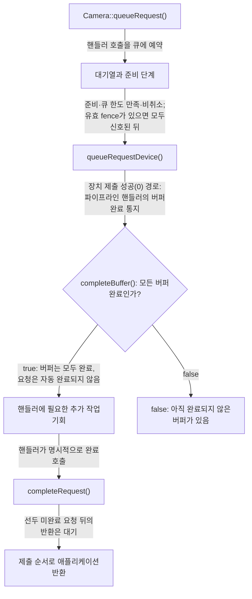

[Mermaid 원문](request-lifecycle.request-stages.mmd)

??? note "그림 근거와 확인 범위"
    접수 성공 뒤에도 준비 대기와 장치 처리가 남습니다. 정상 촬영 경로의 계약을 연결한 그림이며 실제 실행 시간이나 전체 실패 경로를 나타내지 않습니다.
    
    소스에 연결한 설계 해석입니다. 자동 연결 검사는 의미 승인이나 기기 실행 검증이 아닙니다.
    
    | 요소·전이 | 소스 근거 |
    |---|---|
    | Camera::queueRequest() | [src/libcamera/camera.cpp:1308](#source-28d007de6ad1a8a5) |
    | 대기열과 준비 단계 | [src/libcamera/pipeline_handler.cpp:428](#source-789eafedfaa7f3c5) |
    | queueRequestDevice() | [src/libcamera/pipeline_handler.cpp:428](#source-789eafedfaa7f3c5) |
    | completeBuffer(): 모든 버퍼 완료인가? | [src/libcamera/pipeline_handler.cpp:547](#source-ab8710f8a8a7905d) |
    | 핸들러에 필요한 추가 작업 기회 | [src/libcamera/pipeline_handler.cpp:547](#source-01ad7c6605c3296a) |
    | completeRequest() | [src/libcamera/pipeline_handler.cpp:547](#source-01ad7c6605c3296a) |
    | 제출 순서로 애플리케이션 반환 | [src/libcamera/pipeline_handler.cpp:547](#source-01ad7c6605c3296a) |
    | false: 아직 완료되지 않은 버퍼가 있음 | [src/libcamera/pipeline_handler.cpp:547](#source-ab8710f8a8a7905d) |
    | 핸들러 호출을 큐에 예약 | [src/libcamera/camera.cpp:1308](#source-28d007de6ad1a8a5) |
    | 준비·큐 한도 만족·비취소; 유효 fence가 있으면 모두 신호된 뒤 | [src/libcamera/pipeline_handler.cpp:428](#source-789eafedfaa7f3c5) · [src/libcamera/request.cpp:442](#source-95ae69eeb085e3b1) |
    | 장치 제출 성공(0) 경로: 파이프라인 핸들러의 버퍼 완료 통지 | [src/libcamera/pipeline_handler.cpp:547](#source-ab8710f8a8a7905d) · [src/libcamera/pipeline_handler.cpp:530](#source-c05f8214908fe4fe) |
    | true: 버퍼는 모두 완료, 요청은 자동 완료되지 않음 | [src/libcamera/pipeline_handler.cpp:553](#source-5b0ae08604dff588) |
    | 핸들러가 명시적으로 완료 호출 | [src/libcamera/pipeline_handler.cpp:547](#source-01ad7c6605c3296a) |
    | 선두 미완료 요청 뒤의 반환은 대기 | [src/libcamera/pipeline_handler.cpp:547](#source-01ad7c6605c3296a) |
    | false | [src/libcamera/pipeline_handler.cpp:547](#source-ab8710f8a8a7905d) |
<!-- /sdd:visual:request-stages -->

<!-- sdd:visual:lifecycle-queue-return-completion -->
### 접수 반환과 완료 알림

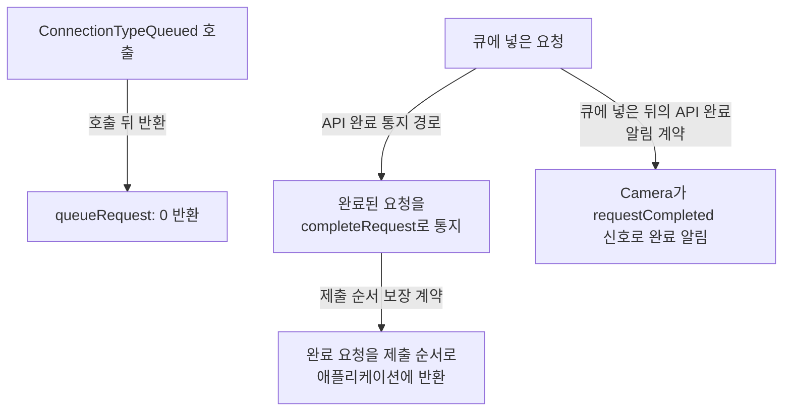

[Mermaid 원문](request-lifecycle.lifecycle-queue-return-completion.mmd)

??? note "그림 근거와 확인 범위"
    queueRequest의 0 반환과 requestCompleted 알림은 각각 무엇을 뜻합니까?
    
    소스에 연결한 설계 해석입니다. 자동 연결 검사는 의미 승인이나 기기 실행 검증이 아닙니다.
    
    | 요소·전이 | 소스 근거 |
    |---|---|
    | ConnectionTypeQueued 호출 | [src/libcamera/camera.cpp:1308](#source-28d007de6ad1a8a5) |
    | queueRequest: 0 반환 | [src/libcamera/camera.cpp:1308](#source-28d007de6ad1a8a5) |
    | 큐에 넣은 요청 | [src/libcamera/camera.cpp:1308](#source-28d007de6ad1a8a5) |
    | 완료된 요청을 completeRequest로 통지 | [src/libcamera/pipeline_handler.cpp:571](#source-236c920e906cb6fd) |
    | 완료 요청을 제출 순서로 애플리케이션에 반환 | [src/libcamera/pipeline_handler.cpp:571](#source-236c920e906cb6fd) |
    | Camera가 requestCompleted 신호로 완료 알림 | [src/libcamera/camera.cpp:1308](#source-28d007de6ad1a8a5) |
    | 호출 뒤 반환 | [src/libcamera/camera.cpp:1308](#source-28d007de6ad1a8a5) |
    | API 완료 통지 경로 | [src/libcamera/camera.cpp:1308](#source-28d007de6ad1a8a5) · [src/libcamera/pipeline_handler.cpp:571](#source-236c920e906cb6fd) |
    | 제출 순서 보장 계약 | [src/libcamera/pipeline_handler.cpp:571](#source-236c920e906cb6fd) |
    | 큐에 넣은 뒤의 API 완료 알림 계약 | [src/libcamera/camera.cpp:1308](#source-28d007de6ad1a8a5) |
<!-- /sdd:visual:lifecycle-queue-return-completion -->

<!-- sdd:visual:waiting-queue-conditions -->
### 선두 요청을 전달하거나 반복을 멈추는 조건

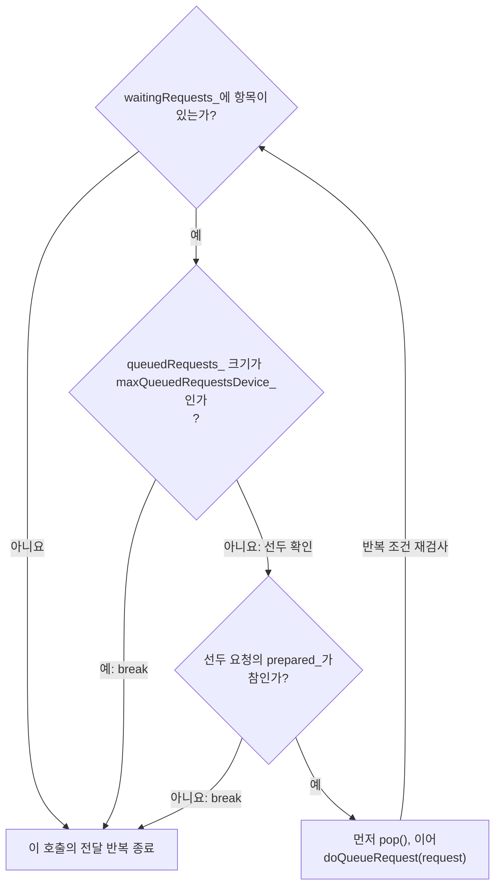

[Mermaid 원문](request-lifecycle.waiting-queue-conditions.mmd)

??? note "그림 근거와 확인 범위"
    waitingRequests_ 순회에서 준비 상태와 queuedRequests_ 소프트웨어 큐 크기는 어떻게 전달을 제한합니까?
    
    소스에 연결한 설계 해석입니다. 자동 연결 검사는 의미 승인이나 기기 실행 검증이 아닙니다.
    
    | 요소·전이 | 소스 근거 |
    |---|---|
    | waitingRequests_에 항목이 있는가? | [src/libcamera/pipeline_handler.cpp:428](#source-789eafedfaa7f3c5) |
    | queuedRequests_ 크기가 maxQueuedRequestsDevice_인가? | [src/libcamera/pipeline_handler.cpp:428](#source-789eafedfaa7f3c5) |
    | 선두 요청의 prepared_가 참인가? | [src/libcamera/pipeline_handler.cpp:428](#source-789eafedfaa7f3c5) |
    | 먼저 pop(), 이어 doQueueRequest(request) | [src/libcamera/pipeline_handler.cpp:428](#source-789eafedfaa7f3c5) |
    | 이 호출의 전달 반복 종료 | [src/libcamera/pipeline_handler.cpp:428](#source-789eafedfaa7f3c5) |
    | 예 | [src/libcamera/pipeline_handler.cpp:428](#source-789eafedfaa7f3c5) |
    | 아니요 | [src/libcamera/pipeline_handler.cpp:428](#source-789eafedfaa7f3c5) |
    | 예: break | [src/libcamera/pipeline_handler.cpp:428](#source-789eafedfaa7f3c5) |
    | 아니요: 선두 확인 | [src/libcamera/pipeline_handler.cpp:428](#source-789eafedfaa7f3c5) |
    | 아니요: break | [src/libcamera/pipeline_handler.cpp:428](#source-789eafedfaa7f3c5) |
    | 예 | [src/libcamera/pipeline_handler.cpp:428](#source-789eafedfaa7f3c5) |
    | 반복 조건 재검사 | [src/libcamera/pipeline_handler.cpp:428](#source-789eafedfaa7f3c5) |
<!-- /sdd:visual:waiting-queue-conditions -->

<!-- sdd:visual:dispatch-cancel-or-device -->
### void 전달 함수의 두 취소 경로

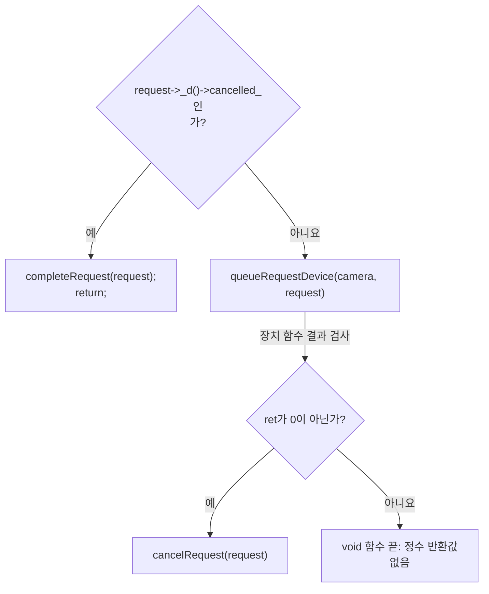

[Mermaid 원문](request-lifecycle.dispatch-cancel-or-device.mmd)

??? note "그림 근거와 확인 범위"
    doQueueRequest는 이미 취소된 요청과 장치 전달 실패를 각각 어느 함수로 처리합니까?
    
    소스에 연결한 설계 해석입니다. 자동 연결 검사는 의미 승인이나 기기 실행 검증이 아닙니다.
    
    | 요소·전이 | 소스 근거 |
    |---|---|
    | request-&gt;_d()-&gt;cancelled_인가? | [src/libcamera/pipeline_handler.cpp:483](#source-7348e9b4af985eb2) |
    | completeRequest(request); return; | [src/libcamera/pipeline_handler.cpp:483](#source-7348e9b4af985eb2) |
    | queueRequestDevice(camera, request) | [src/libcamera/pipeline_handler.cpp:483](#source-7348e9b4af985eb2) |
    | ret가 0이 아닌가? | [src/libcamera/pipeline_handler.cpp:483](#source-7348e9b4af985eb2) |
    | cancelRequest(request) | [src/libcamera/pipeline_handler.cpp:483](#source-7348e9b4af985eb2) |
    | void 함수 끝: 정수 반환값 없음 | [src/libcamera/pipeline_handler.cpp:483](#source-7348e9b4af985eb2) |
    | 예 | [src/libcamera/pipeline_handler.cpp:483](#source-7348e9b4af985eb2) |
    | 아니요 | [src/libcamera/pipeline_handler.cpp:483](#source-7348e9b4af985eb2) |
    | 장치 함수 결과 검사 | [src/libcamera/pipeline_handler.cpp:483](#source-7348e9b4af985eb2) |
    | 예 | [src/libcamera/pipeline_handler.cpp:483](#source-7348e9b4af985eb2) |
    | 아니요 | [src/libcamera/pipeline_handler.cpp:483](#source-7348e9b4af985eb2) |
<!-- /sdd:visual:dispatch-cancel-or-device -->

<!-- sdd:visual:buffer-and-request-completion -->
### 버퍼 완료와 명시적 요청 완료의 경계

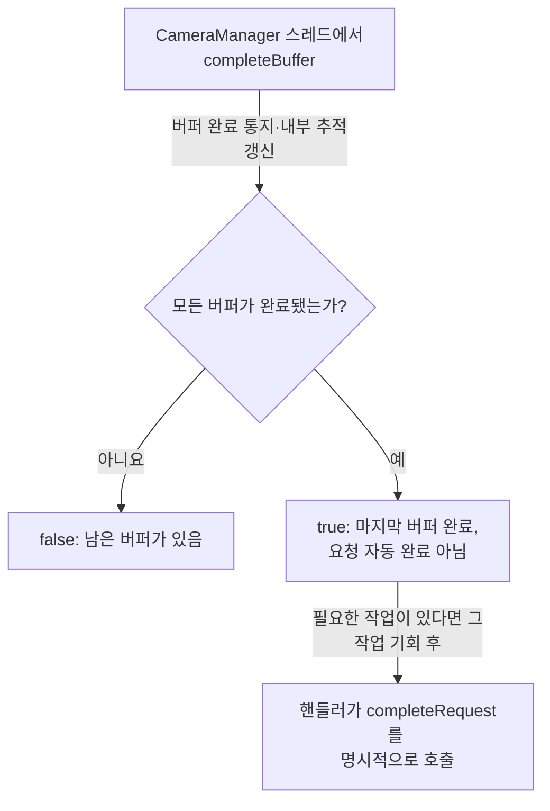

[Mermaid 원문](request-lifecycle.buffer-and-request-completion.mmd)

??? note "그림 근거와 확인 범위"
    마지막 버퍼가 끝났을 때 completeBuffer의 반환과 핸들러의 요청 완료 의무는 어떻게 구분됩니까?
    
    소스에 연결한 설계 해석입니다. 자동 연결 검사는 의미 승인이나 기기 실행 검증이 아닙니다.
    
    | 요소·전이 | 소스 근거 |
    |---|---|
    | CameraManager 스레드에서 completeBuffer | [src/libcamera/pipeline_handler.cpp:547](#source-ab8710f8a8a7905d) |
    | 모든 버퍼가 완료됐는가? | [src/libcamera/pipeline_handler.cpp:547](#source-ab8710f8a8a7905d) |
    | false: 남은 버퍼가 있음 | [src/libcamera/pipeline_handler.cpp:547](#source-ab8710f8a8a7905d) |
    | true: 마지막 버퍼 완료, 요청 자동 완료 아님 | [src/libcamera/pipeline_handler.cpp:553](#source-5b0ae08604dff588) |
    | 핸들러가 completeRequest를 명시적으로 호출 | [src/libcamera/pipeline_handler.cpp:553](#source-5b0ae08604dff588) |
    | 버퍼 완료 통지·내부 추적 갱신 | [src/libcamera/pipeline_handler.cpp:547](#source-ab8710f8a8a7905d) |
    | 아니요 | [src/libcamera/pipeline_handler.cpp:547](#source-ab8710f8a8a7905d) |
    | 예 | [src/libcamera/pipeline_handler.cpp:547](#source-ab8710f8a8a7905d) |
    | 필요한 작업이 있다면 그 작업 기회 후 | [src/libcamera/pipeline_handler.cpp:553](#source-5b0ae08604dff588) |
<!-- /sdd:visual:buffer-and-request-completion -->

<!-- sdd:visual:submission-order-completion -->
### 제출 큐의 선두 상태와 반환 순서

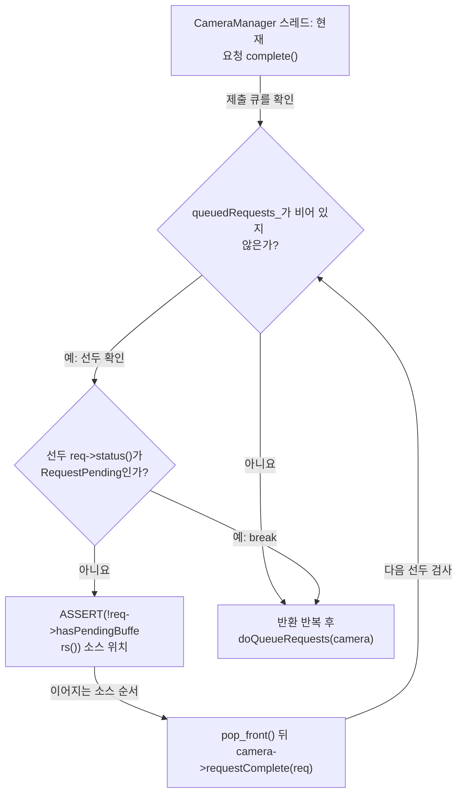

[Mermaid 원문](request-lifecycle.submission-order-completion.mmd)

??? note "그림 근거와 확인 범위"
    CameraManager 스레드의 completeRequest는 어느 조건에서 반환 반복을 멈추고 어느 요청을 애플리케이션에 알립니까?
    
    소스에 연결한 설계 해석입니다. 자동 연결 검사는 의미 승인이나 기기 실행 검증이 아닙니다.
    
    | 요소·전이 | 소스 근거 |
    |---|---|
    | CameraManager 스레드: 현재 요청 complete() | [src/libcamera/pipeline_handler.cpp:571](#source-236c920e906cb6fd) |
    | queuedRequests_가 비어 있지 않은가? | [src/libcamera/pipeline_handler.cpp:571](#source-236c920e906cb6fd) |
    | 선두 req-&gt;status()가 RequestPending인가? | [src/libcamera/pipeline_handler.cpp:571](#source-236c920e906cb6fd) |
    | ASSERT(!req-&gt;hasPendingBuffers()) 소스 위치 | [src/libcamera/pipeline_handler.cpp:571](#source-236c920e906cb6fd) |
    | pop_front() 뒤 camera-&gt;requestComplete(req) | [src/libcamera/pipeline_handler.cpp:571](#source-236c920e906cb6fd) |
    | 반환 반복 후 doQueueRequests(camera) | [src/libcamera/pipeline_handler.cpp:571](#source-236c920e906cb6fd) |
    | 제출 큐를 확인 | [src/libcamera/pipeline_handler.cpp:571](#source-236c920e906cb6fd) |
    | 예: 선두 확인 | [src/libcamera/pipeline_handler.cpp:571](#source-236c920e906cb6fd) |
    | 아니요 | [src/libcamera/pipeline_handler.cpp:571](#source-236c920e906cb6fd) |
    | 예: break | [src/libcamera/pipeline_handler.cpp:571](#source-236c920e906cb6fd) |
    | 아니요 | [src/libcamera/pipeline_handler.cpp:571](#source-236c920e906cb6fd) |
    | 이어지는 소스 순서 | [src/libcamera/pipeline_handler.cpp:571](#source-236c920e906cb6fd) |
    | 다음 선두 검사 | [src/libcamera/pipeline_handler.cpp:571](#source-236c920e906cb6fd) |
<!-- /sdd:visual:submission-order-completion -->

`Camera::createRequest`(`uint64_t` cookie)의 반환 타입은 `std::unique_ptr<Request>`입니다. 이 함수가 반환하는 객체는 애플리케이션이 버퍼와 매개변수를 채워 캡처 대기열에 넣기 위해 만들어진 빈 `Request` 객체입니다. 생성에 실패하면 nullptr을 반환합니다. `src/libcamera/camera.cpp:1243`

`Request::addBuffer`는 `FrameBuffer`를 요청에 추가하면서, 인자 stream으로 지정한 그 버퍼가 속한 스트림에 버퍼를 연결하는 API입니다. 요청은 스트림마다 버퍼를 하나만 담을 수 있으므로, 같은 스트림에 이미 버퍼가 있거나 버퍼가 아직 fence를 참조하고 있으면 -EEXIST를 반환합니다. 버퍼가 유효한 `Stream`을 참조하지 않으면 -EINVAL을 반환합니다. `src/libcamera/request.cpp:442`

`Camera::queueRequest()`는 요청 유효성 검사를 통과하면 `PipelineHandler::queueRequest`를 ConnectionTypeQueued 방식의 invokeMethod로 호출한 뒤 0을 반환합니다. ConnectionTypeQueued는 호출자가 대상의 실행 완료를 기다리지 않는 비동기 방식이므로, 반환값 0은 성공을 뜻하고 요청 완료는 별도의 requestCompleted 신호로 통지됩니다. `src/libcamera/camera.cpp:1308`, `src/libcamera/base/bound_method.cpp:68`

`waitingRequests_`의 선두 요청 `prepared_`가 거짓이면 `doQueueRequests()`는 반복을 멈추므로 그 뒤에 있는 요청도 장치로 전달하지 않습니다. 반면 `queuedRequests_.size()`가 `maxQueuedRequestsDevice_`와 같으면 반복을 멈추며, 이 `queuedRequests_`는 장치 전달 전에 요청을 추가하는 소프트웨어 큐이므로 그 크기를 장치에 전달된 요청 수로 볼 수 없고 취소된 요청도 이 큐에 포함될 수 있습니다. `src/libcamera/pipeline_handler.cpp:516`, `src/libcamera/pipeline_handler.cpp:428`

doQueueRequest는 void 함수이므로 호출자에게 값을 반환하지 않습니다. 함수는 요청을 `queuedRequests_`에 추가하고 `sequence_`를 부여한 뒤 request->`_d()`->`cancelled_`를 확인합니다. `cancelled_`가 참이면 completeRequest(request)를 호출하고 return하므로 queueRequestDevice는 호출되지 않습니다. `cancelled_`가 거짓이면 queueRequestDevice(camera, request)를 호출하고, 결과 ret이 0이 아닐 때만 cancelRequest(request)를 호출합니다. `src/libcamera/pipeline_handler.cpp:483`

`PipelineHandler::queueRequestDevice()` 함수는 캡처 요청을 장치에 대기열로 넣으며, 성공하면 0을 반환하고 오류가 발생하면 음수 오류 코드를 반환합니다. 파이프라인 핸들러는 버퍼 완료를 알릴 때 `CameraManager` 스레드에서 completeBuffer를 호출해야 합니다. 마지막 버퍼가 완료되어도 요청은 자동으로 완료되지 않으므로, 핸들러는 completeRequest를 별도로 명시 호출해야 합니다. `src/libcamera/pipeline_handler.cpp:530`, `src/libcamera/pipeline_handler.cpp:547`, `src/libcamera/pipeline_handler.cpp:553`

completeRequest는 `queuedRequests_`의 앞 요청부터 확인하며, 그 요청의 status()가 RequestPending이면 반복을 중단합니다. RequestPending이 아니면 ASSERT(!req->hasPendingBuffers())로 대기 버퍼가 없음을 확인한 뒤 요청을 큐 앞에서 제거하고 camera->requestComplete(req)를 호출하며, 주석에 따르면 이 과정으로 요청은 제출 순서대로 애플리케이션에 반환됩니다. `src/libcamera/pipeline_handler.cpp:594`, `src/libcamera/pipeline_handler.cpp:571`

근거 원문: [src/libcamera/camera.cpp:1243](#source-0ae00d77839f61cb) · [src/libcamera/camera.cpp:1308](#source-28d007de6ad1a8a5) · [src/libcamera/request.cpp:442](#source-95ae69eeb085e3b1) · [src/libcamera/pipeline_handler.cpp:428](#source-789eafedfaa7f3c5) · [src/libcamera/pipeline_handler.cpp:547](#source-01ad7c6605c3296a) · [src/libcamera/pipeline_handler.cpp:483](#source-7348e9b4af985eb2) · [src/libcamera/pipeline_handler.cpp:530](#source-c05f8214908fe4fe) · [src/libcamera/pipeline_handler.cpp:547](#source-ab8710f8a8a7905d) · [src/libcamera/pipeline_handler.cpp:571](#source-236c920e906cb6fd) · [src/libcamera/pipeline_handler.cpp:516](#source-a637b7daf9acb7ac) · [src/libcamera/pipeline_handler.cpp:553](#source-5b0ae08604dff588) · [src/libcamera/pipeline_handler.cpp:594](#source-bae861ceef5e8406) · [src/libcamera/base/bound_method.cpp:68](#source-0470759dc8387e9a)

## 요청·버퍼·fence의 수명

요청을 만든 호출자는 요청 삭제를 책임집니다. 요청에 버퍼를 추가한 호출자는 요청 완료 콜백이 호출될 때까지 버퍼가 유효하도록 해야 합니다. 파이프라인 핸들러는 `completeRequest`가 반환한 뒤 해당 요청에 접근해서는 안 됩니다. `src/libcamera/camera.cpp:1243`, `src/libcamera/request.cpp:447`, `src/libcamera/request.cpp:442`, `src/libcamera/pipeline_handler.cpp:575`

<!-- sdd:visual:request-ownership -->
### 요청과 버퍼를 유지할 기간

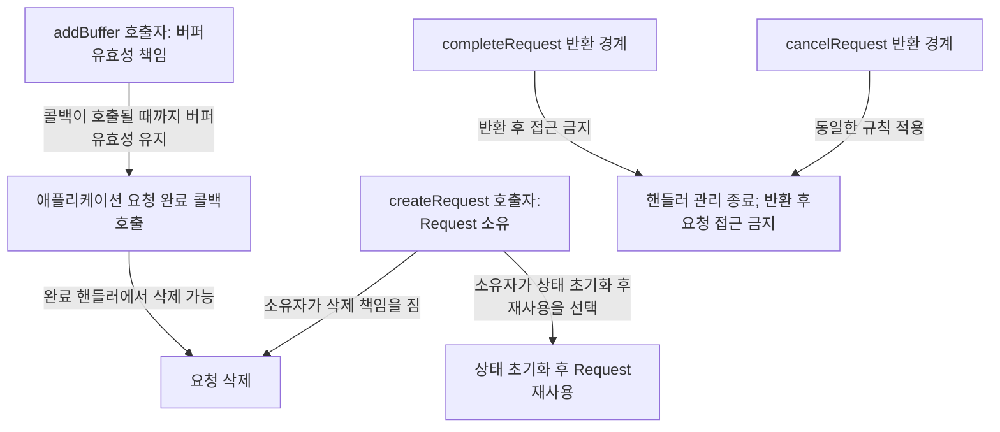

[Mermaid 원문](request-lifecycle.request-ownership.mmd)

??? note "그림 근거와 확인 범위"
    createRequest와 addBuffer 호출자의 책임 및 completeRequest·cancelRequest 반환 뒤 핸들러의 접근 경계는 어떻게 구분됩니까?
    
    소스에 연결한 설계 해석입니다. 자동 연결 검사는 의미 승인이나 기기 실행 검증이 아닙니다.
    
    | 요소·전이 | 소스 근거 |
    |---|---|
    | createRequest 호출자: Request 소유 | [src/libcamera/camera.cpp:1243](#source-0ae00d77839f61cb) |
    | addBuffer 호출자: 버퍼 유효성 책임 | [src/libcamera/request.cpp:442](#source-95ae69eeb085e3b1) |
    | 애플리케이션 요청 완료 콜백 호출 | [src/libcamera/request.cpp:442](#source-95ae69eeb085e3b1) |
    | 요청 삭제 | [src/libcamera/camera.cpp:1243](#source-0ae00d77839f61cb) |
    | 상태 초기화 후 Request 재사용 | [src/libcamera/request.cpp:376](#source-38494771cb29cc8c) |
    | completeRequest 반환 경계 | [src/libcamera/pipeline_handler.cpp:547](#source-01ad7c6605c3296a) |
    | cancelRequest 반환 경계 | [src/libcamera/pipeline_handler.cpp:547](#source-01ad7c6605c3296a) |
    | 핸들러 관리 종료; 반환 후 요청 접근 금지 | [src/libcamera/pipeline_handler.cpp:575](#source-d93a02e9220fa760) |
    | 콜백이 호출될 때까지 버퍼 유효성 유지 | [src/libcamera/request.cpp:442](#source-95ae69eeb085e3b1) |
    | 완료 핸들러에서 삭제 가능 | [src/libcamera/camera.cpp:1243](#source-0ae00d77839f61cb) |
    | 반환 후 접근 금지 | [src/libcamera/pipeline_handler.cpp:575](#source-d93a02e9220fa760) |
    | 동일한 규칙 적용 | [src/libcamera/pipeline_handler.cpp:610](#source-52fb58c8956b1a91) · [src/libcamera/pipeline_handler.cpp:575](#source-d93a02e9220fa760) |
    | 소유자가 상태 초기화 후 재사용을 선택 | [src/libcamera/camera.cpp:1243](#source-0ae00d77839f61cb) |
    | 소유자가 삭제 책임을 짐 | [src/libcamera/camera.cpp:1243](#source-0ae00d77839f61cb) |
<!-- /sdd:visual:request-ownership -->

<!-- sdd:visual:lifecycle-timeout-fence-recovery -->
### 타임아웃 뒤 펜스 회수

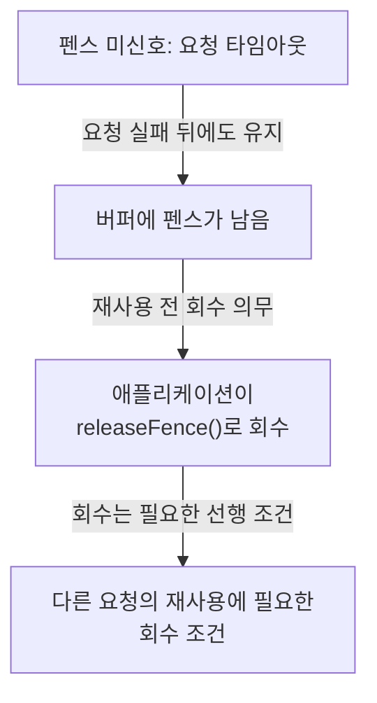

[Mermaid 원문](request-lifecycle.lifecycle-timeout-fence-recovery.mmd)

??? note "그림 근거와 확인 범위"
    신호되지 않은 펜스로 타임아웃이 나면 다른 요청에 재사용하기 전에 무엇을 해야 합니까?
    
    소스에 연결한 설계 해석입니다. 자동 연결 검사는 의미 승인이나 기기 실행 검증이 아닙니다.
    
    | 요소·전이 | 소스 근거 |
    |---|---|
    | 펜스 미신호: 요청 타임아웃 | [src/libcamera/request.cpp:462](#source-d8cf34a75a4333a7) |
    | 버퍼에 펜스가 남음 | [src/libcamera/request.cpp:462](#source-d8cf34a75a4333a7) |
    | 애플리케이션이 releaseFence()로 회수 | [src/libcamera/request.cpp:462](#source-d8cf34a75a4333a7) |
    | 다른 요청의 재사용에 필요한 회수 조건 | [src/libcamera/request.cpp:462](#source-d8cf34a75a4333a7) |
    | 요청 실패 뒤에도 유지 | [src/libcamera/request.cpp:462](#source-d8cf34a75a4333a7) |
    | 재사용 전 회수 의무 | [src/libcamera/request.cpp:462](#source-d8cf34a75a4333a7) |
    | 회수는 필요한 선행 조건 | [src/libcamera/request.cpp:462](#source-d8cf34a75a4333a7) |
<!-- /sdd:visual:lifecycle-timeout-fence-recovery -->

<!-- sdd:visual:lifecycle-reuse-buffer-fence-distinction -->
### 버퍼 재사용과 펜스 권고

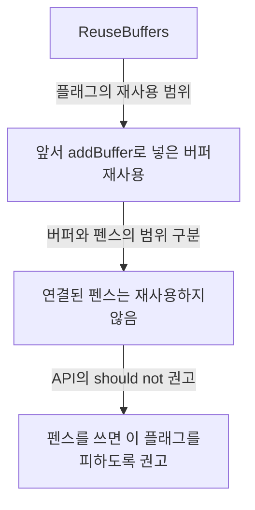

[Mermaid 원문](request-lifecycle.lifecycle-reuse-buffer-fence-distinction.mmd)

??? note "그림 근거와 확인 범위"
    ReuseBuffers가 재사용하는 대상과 펜스 사용 시 권고는 무엇입니까?
    
    소스에 연결한 설계 해석입니다. 자동 연결 검사는 의미 승인이나 기기 실행 검증이 아닙니다.
    
    | 요소·전이 | 소스 근거 |
    |---|---|
    | ReuseBuffers | [src/libcamera/request.cpp:326](#source-447804db33308244) |
    | 앞서 addBuffer로 넣은 버퍼 재사용 | [src/libcamera/request.cpp:326](#source-447804db33308244) |
    | 연결된 펜스는 재사용하지 않음 | [src/libcamera/request.cpp:326](#source-447804db33308244) |
    | 펜스를 쓰면 이 플래그를 피하도록 권고 | [src/libcamera/request.cpp:326](#source-447804db33308244) |
    | 플래그의 재사용 범위 | [src/libcamera/request.cpp:326](#source-447804db33308244) |
    | 버퍼와 펜스의 범위 구분 | [src/libcamera/request.cpp:326](#source-447804db33308244) |
    | API의 should not 권고 | [src/libcamera/request.cpp:326](#source-447804db33308244) |
<!-- /sdd:visual:lifecycle-reuse-buffer-fence-distinction -->

`createRequest`가 반환한 요청의 소유권은 호출자에게 넘어갑니다. 호출자는 이 요청을 삭제할 책임이 있으며, 완료 핸들러에서 삭제할 수도 있습니다. 호출자는 `Request::reuse()`로 상태를 초기화한 뒤 이 요청을 재사용할 수도 있습니다. `src/libcamera/camera.cpp:1243`

`Request::addBuffer()`는 전달받은 `FrameBuffer`의 참조를 요청 안에 저장합니다. 호출자는 요청 완료 콜백이 호출될 때까지 버퍼가 유효하게 유지되도록 해야 합니다. `src/libcamera/request.cpp:447`, `src/libcamera/request.cpp:442`

유효한 `Fence`가 `addBuffer`에 전달되면, `addBuffer`는 `fence`를 `buffer`로 이동합니다. `Fence` 소유권은 `addBuffer`가 성공한 경우에만 가져가며, 이때 소유권을 넘겨받는 대상은 `buffer`입니다. 실패하면 `fence`는 수정되지 않은 상태로 남습니다. `src/libcamera/request.cpp:456`

`Request::addBuffer()`가 실패하면 전달받은 `fence`는 `buffer`로 옮겨지지 않고 그대로 유지됩니다. 소스 주석에 따르면 `fence`의 소유권은 성공한 경우에만 가져가며, 실패한 경우에는 `fence`를 변경하지 않은 상태로 둡니다. 또한 `buffer`가 아직 `fence`를 참조하고 있으면 `-EEXIST`가 반환됩니다. `src/libcamera/request.cpp:456`

펜스가 신호되지 않으면 요청은 타임아웃 후 실패합니다. 이때 펜스는 버퍼에 그대로 남아 있습니다. 애플리케이션은 버퍼를 다른 요청에 재사용하기 전에 `FrameBuffer::releaseFence()`로 펜스를 가져와야 합니다. `src/libcamera/request.cpp:462`

`Request::ReuseBuffers`는 `addBuffer()`로 이전에 추가된 버퍼를 재사용하는 플래그이며, 기존 버퍼를 유지하는 방식입니다. 버퍼에 연결된 펜스는 이 플래그를 지정해도 재사용되지 않습니다. 펜스를 사용하는 경우에는 이 플래그를 피하도록 권고합니다. `src/libcamera/request.cpp:326`, `src/libcamera/request.cpp:334`

파이프라인 핸들러는 요청 완료를 `camera`에 알리기 위해 `completeRequest`를 호출해야 합니다. 이 함수가 반환된 뒤 요청은 더 이상 파이프라인 핸들러가 관리하지 않으며, 파이프라인 핸들러는 그 요청에 접근해서는 안 됩니다. `cancelRequest`는 `request->_d()->cancel()`로 요청을 취소한 뒤 `completeRequest`를 호출하며, 소스는 이 함수에도 `completeRequest`와 같은 규칙이 적용된다고 명시합니다. `src/libcamera/pipeline_handler.cpp:575`, `src/libcamera/pipeline_handler.cpp:547`, `src/libcamera/pipeline_handler.cpp:610`

근거 원문: [src/libcamera/camera.cpp:1243](#source-0ae00d77839f61cb) · [src/libcamera/request.cpp:376](#source-38494771cb29cc8c) · [src/libcamera/pipeline_handler.cpp:547](#source-01ad7c6605c3296a) · [src/libcamera/request.cpp:326](#source-447804db33308244) · [src/libcamera/request.cpp:456](#source-86a8d784a8348122) · [src/libcamera/request.cpp:462](#source-d8cf34a75a4333a7) · [src/libcamera/request.cpp:447](#source-4cdce80c57526221) · [src/libcamera/pipeline_handler.cpp:575](#source-d93a02e9220fa760) · [src/libcamera/pipeline_handler.cpp:610](#source-52fb58c8956b1a91) · [src/libcamera/request.cpp:334](#source-d9944a69f2dd6758) · [src/libcamera/request.cpp:442](#source-95ae69eeb085e3b1)

## 정지와 연결 해제를 구분하기

`PipelineHandler::stop`은 모든 실행 중 스트림의 캡처를 정지하는 함수이며, 문서에 따르면 모든 대기 요청을 취소하고 즉시 오류 상태로 완료합니다. 반면 `Camera::disconnect`에는 실행 중 카메라의 연결 해제 시 대기 요청을 처리하는 것에 관한 TODO만 있으며, 그 처리 방식은 원문에 명시되어 있지 않습니다. `src/libcamera/pipeline_handler.cpp:359`, `src/libcamera/camera.cpp:952`

<!-- sdd:visual:stop-order -->
### 정지할 때 대기 요청을 처리하는 순서

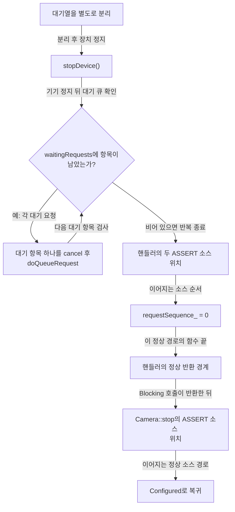

[Mermaid 원문](request-lifecycle.stop-order.mmd)

??? note "그림 근거와 확인 범위"
    정상 정지 경로의 순서를 표시합니다. 연결 해제 알림의 미완료 요청 TODO를 이 정지 보장과 혼동하지 마세요.
    
    소스에 연결한 설계 해석입니다. 자동 연결 검사는 의미 승인이나 기기 실행 검증이 아닙니다.
    
    | 요소·전이 | 소스 근거 |
    |---|---|
    | 대기열을 별도로 분리 | [src/libcamera/pipeline_handler.cpp:359](#source-eefd1bbecb1aad0a) |
    | stopDevice() | [src/libcamera/pipeline_handler.cpp:359](#source-eefd1bbecb1aad0a) |
    | 대기 항목 하나를 cancel 후 doQueueRequest | [src/libcamera/pipeline_handler.cpp:359](#source-eefd1bbecb1aad0a) |
    | Configured로 복귀 | [src/libcamera/camera.cpp:1431](#source-e09324743def3f09) |
    | waitingRequests에 항목이 남았는가? | [src/libcamera/pipeline_handler.cpp:359](#source-eefd1bbecb1aad0a) |
    | 핸들러의 두 ASSERT 소스 위치 | [src/libcamera/pipeline_handler.cpp:359](#source-eefd1bbecb1aad0a) |
    | requestSequence_ = 0 | [src/libcamera/pipeline_handler.cpp:359](#source-eefd1bbecb1aad0a) |
    | 핸들러의 정상 반환 경계 | [src/libcamera/pipeline_handler.cpp:359](#source-eefd1bbecb1aad0a) |
    | Camera::stop의 ASSERT 소스 위치 | [src/libcamera/camera.cpp:1431](#source-e09324743def3f09) |
    | 분리 후 장치 정지 | [src/libcamera/pipeline_handler.cpp:359](#source-eefd1bbecb1aad0a) |
    | 다음 대기 항목 검사 | [src/libcamera/pipeline_handler.cpp:359](#source-eefd1bbecb1aad0a) |
    | 기기 정지 뒤 대기 큐 확인 | [src/libcamera/pipeline_handler.cpp:359](#source-eefd1bbecb1aad0a) |
    | 예: 각 대기 요청 | [src/libcamera/pipeline_handler.cpp:359](#source-eefd1bbecb1aad0a) |
    | 비어 있으면 반복 종료 | [src/libcamera/pipeline_handler.cpp:359](#source-eefd1bbecb1aad0a) |
    | 이어지는 소스 순서 | [src/libcamera/pipeline_handler.cpp:359](#source-eefd1bbecb1aad0a) |
    | 이 정상 경로의 함수 끝 | [src/libcamera/pipeline_handler.cpp:359](#source-eefd1bbecb1aad0a) |
    | Blocking 호출이 반환한 뒤 | [src/libcamera/camera.cpp:1431](#source-e09324743def3f09) |
    | 이어지는 정상 소스 경로 | [src/libcamera/camera.cpp:1431](#source-e09324743def3f09) |
<!-- /sdd:visual:stop-order -->

<!-- sdd:visual:stop-disconnect-contract -->
### 정지 API 계약과 연결 해제 TODO

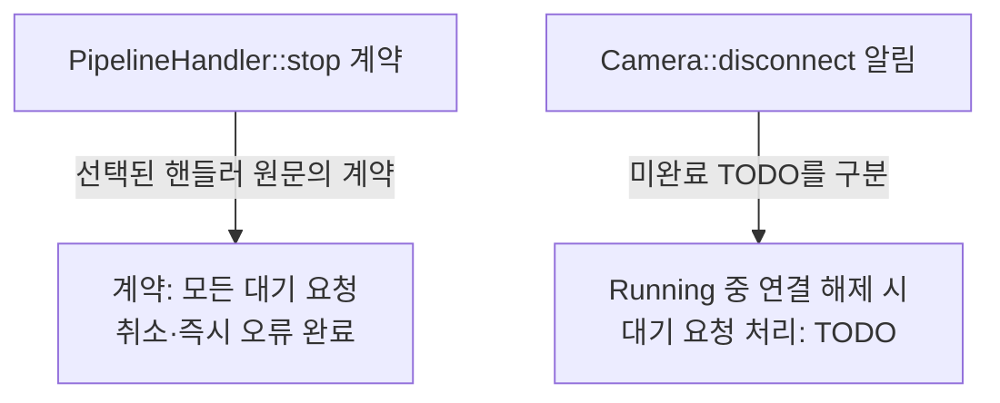

[Mermaid 원문](request-lifecycle.stop-disconnect-contract.mmd)

??? note "그림 근거와 확인 범위"
    PipelineHandler::stop과 Camera::disconnect의 선택된 두 원문은 대기 요청 처리를 어떻게 다르게 명시합니까?
    
    소스에 연결한 설계 해석입니다. 자동 연결 검사는 의미 승인이나 기기 실행 검증이 아닙니다.
    
    | 요소·전이 | 소스 근거 |
    |---|---|
    | PipelineHandler::stop 계약 | [src/libcamera/pipeline_handler.cpp:359](#source-eefd1bbecb1aad0a) |
    | 계약: 모든 대기 요청 취소·즉시 오류 완료 | [src/libcamera/pipeline_handler.cpp:359](#source-eefd1bbecb1aad0a) |
    | Camera::disconnect 알림 | [src/libcamera/camera.cpp:944](#source-839140c350119dd1) |
    | Running 중 연결 해제 시 대기 요청 처리: TODO | [src/libcamera/camera.cpp:944](#source-839140c350119dd1) |
    | 선택된 핸들러 원문의 계약 | [src/libcamera/pipeline_handler.cpp:359](#source-eefd1bbecb1aad0a) |
    | 미완료 TODO를 구분 | [src/libcamera/camera.cpp:944](#source-839140c350119dd1) |
<!-- /sdd:visual:stop-disconnect-contract -->

<!-- sdd:visual:camera-stop-branches -->
### Camera::stop의 미실행·오류·정상 경로

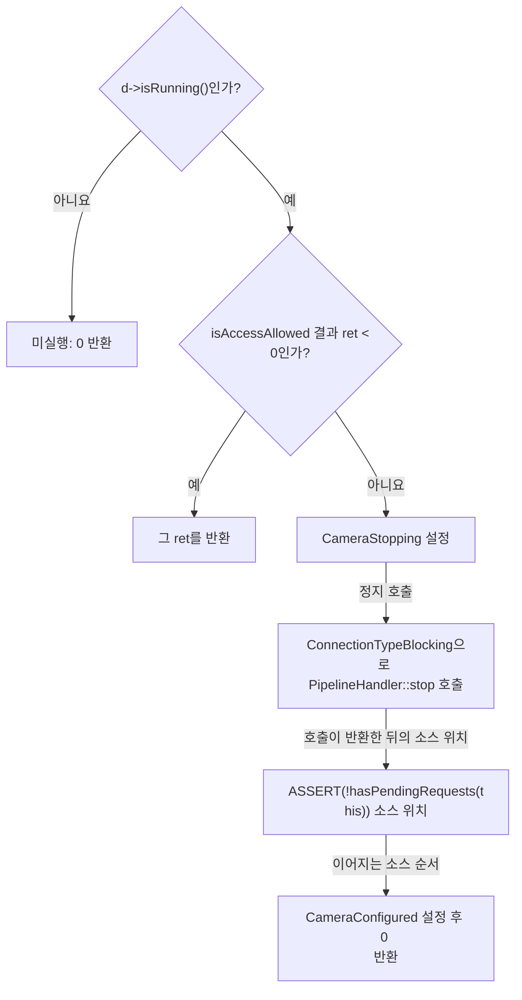

[Mermaid 원문](request-lifecycle.camera-stop-branches.mmd)

??? note "그림 근거와 확인 범위"
    isRunning과 접근 검사 결과에 따라 Camera::stop은 어떤 경로로 반환합니까?
    
    소스에 연결한 설계 해석입니다. 자동 연결 검사는 의미 승인이나 기기 실행 검증이 아닙니다.
    
    | 요소·전이 | 소스 근거 |
    |---|---|
    | d-&gt;isRunning()인가? | [src/libcamera/camera.cpp:1431](#source-e09324743def3f09) |
    | 미실행: 0 반환 | [src/libcamera/camera.cpp:1431](#source-e09324743def3f09) |
    | isAccessAllowed 결과 ret &lt; 0인가? | [src/libcamera/camera.cpp:1431](#source-e09324743def3f09) |
    | 그 ret를 반환 | [src/libcamera/camera.cpp:1431](#source-e09324743def3f09) |
    | CameraStopping 설정 | [src/libcamera/camera.cpp:1431](#source-e09324743def3f09) |
    | ConnectionTypeBlocking으로 PipelineHandler::stop 호출 | [src/libcamera/camera.cpp:1431](#source-e09324743def3f09) |
    | ASSERT(!hasPendingRequests(this)) 소스 위치 | [src/libcamera/camera.cpp:1431](#source-e09324743def3f09) |
    | CameraConfigured 설정 후 0 반환 | [src/libcamera/camera.cpp:1431](#source-e09324743def3f09) |
    | 아니요 | [src/libcamera/camera.cpp:1431](#source-e09324743def3f09) |
    | 예 | [src/libcamera/camera.cpp:1431](#source-e09324743def3f09) |
    | 예 | [src/libcamera/camera.cpp:1431](#source-e09324743def3f09) |
    | 아니요 | [src/libcamera/camera.cpp:1431](#source-e09324743def3f09) |
    | 정지 호출 | [src/libcamera/camera.cpp:1431](#source-e09324743def3f09) |
    | 호출이 반환한 뒤의 소스 위치 | [src/libcamera/camera.cpp:1431](#source-e09324743def3f09) |
    | 이어지는 소스 순서 | [src/libcamera/camera.cpp:1431](#source-e09324743def3f09) |
<!-- /sdd:visual:camera-stop-branches -->

<!-- sdd:visual:stop-device-observation-plan -->
### stopDevice 호출 구간의 관찰 계획

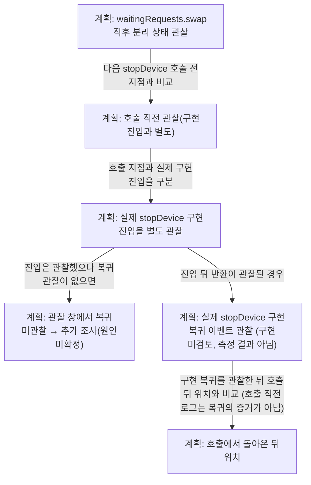

[Mermaid 원문](request-lifecycle.stop-device-observation-plan.mmd)

??? note "그림 근거와 확인 범위"
    분리 직후, 호출 직전, 실제 구현 진입과 복귀를 각각 관찰하는 조사 계획입니다. 호출 직전 표시만으로 구현 진입이나 멎은 원인을 확정하지 않습니다.
    
    소스에 연결한 설계 해석입니다. 자동 연결 검사는 의미 승인이나 기기 실행 검증이 아닙니다.
    
    | 요소·전이 | 소스 근거 |
    |---|---|
    | 계획: waitingRequests.swap 직후 분리 상태 관찰 | [src/libcamera/pipeline_handler.cpp:359](#source-eefd1bbecb1aad0a) |
    | 계획: 호출 직전 관찰(구현 진입과 별도) | [src/libcamera/pipeline_handler.cpp:359](#source-eefd1bbecb1aad0a) |
    | 계획: 실제 stopDevice 구현 진입을 별도 관찰 | [src/libcamera/pipeline_handler.cpp:359](#source-eefd1bbecb1aad0a) |
    | 계획: 호출에서 돌아온 뒤 위치 | [src/libcamera/pipeline_handler.cpp:359](#source-eefd1bbecb1aad0a) |
    | 계획: 관찰 창에서 복귀 미관찰 → 추가 조사(원인 미확정) | [src/libcamera/pipeline_handler.cpp:359](#source-eefd1bbecb1aad0a) |
    | 계획: 실제 stopDevice 구현 복귀 이벤트 관찰 (구현 미검토, 측정 결과 아님) | [src/libcamera/pipeline_handler.cpp:359](#source-eefd1bbecb1aad0a) |
    | 다음 stopDevice 호출 전 지점과 비교 | [src/libcamera/pipeline_handler.cpp:359](#source-eefd1bbecb1aad0a) |
    | 호출 지점과 실제 구현 진입을 구분 | [src/libcamera/pipeline_handler.cpp:359](#source-eefd1bbecb1aad0a) |
    | 진입 뒤 반환이 관찰된 경우 | [src/libcamera/pipeline_handler.cpp:359](#source-eefd1bbecb1aad0a) |
    | 진입은 관찰했으나 복귀 관찰이 없으면 | [src/libcamera/pipeline_handler.cpp:359](#source-eefd1bbecb1aad0a) |
    | 구현 복귀를 관찰한 뒤 호출 뒤 위치와 비교 (호출 직전 로그는 복귀의 증거가 아님) | [src/libcamera/pipeline_handler.cpp:359](#source-eefd1bbecb1aad0a) |
<!-- /sdd:visual:stop-device-observation-plan -->

<!-- sdd:visual:stopping-completion-contract -->
### 완료 통지의 호출자 의무와 반환 뒤 경계

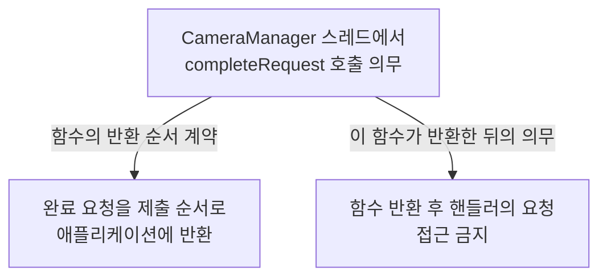

[Mermaid 원문](request-lifecycle.stopping-completion-contract.mmd)

??? note "그림 근거와 확인 범위"
    completeRequest 호출 스레드, 제출 순서 반환과 핸들러의 접근 금지 경계는 어떻게 연결됩니까?
    
    소스에 연결한 설계 해석입니다. 자동 연결 검사는 의미 승인이나 기기 실행 검증이 아닙니다.
    
    | 요소·전이 | 소스 근거 |
    |---|---|
    | CameraManager 스레드에서 completeRequest 호출 의무 | [src/libcamera/pipeline_handler.cpp:547](#source-01ad7c6605c3296a) |
    | 완료 요청을 제출 순서로 애플리케이션에 반환 | [src/libcamera/pipeline_handler.cpp:547](#source-01ad7c6605c3296a) |
    | 함수 반환 후 핸들러의 요청 접근 금지 | [src/libcamera/pipeline_handler.cpp:547](#source-01ad7c6605c3296a) |
    | 함수의 반환 순서 계약 | [src/libcamera/pipeline_handler.cpp:547](#source-01ad7c6605c3296a) |
    | 이 함수가 반환한 뒤의 의무 | [src/libcamera/pipeline_handler.cpp:547](#source-01ad7c6605c3296a) |
<!-- /sdd:visual:stopping-completion-contract -->

이 내용은 실행하지 않은 조사 계획이며, 관찰 대상은 위 코드의 변수·반환값·분기로 한정하고 `Camera::stop`은 다시 호출하지 않습니다. `d->isRunning()`이 거짓이면 `return 0;`으로 끝나고, 참이면 `d->isAccessAllowed(Private::CameraRunning)`의 반환값이 음수일 때 `return ret;`으로 그 값을 반환합니다. 통과하면 `d->setState(Private::CameraStopping)`을 설정한 뒤 `d->pipe_->invokeMethod(&PipelineHandler::stop, ConnectionTypeBlocking, this)` 호출에 진입하고 복귀하는 시점을 관찰합니다. 복귀 뒤에는 `ASSERT(!d->pipe_->hasPendingRequests(this))` 조건의 결과를 관찰하고, `d->setState(Private::CameraConfigured)` 설정과 `return 0;` 반환값을 확인합니다. `src/libcamera/camera.cpp:1431`, `src/libcamera/camera.cpp:1462`

실행 결과가 아닌 조사 계획으로, `PipelineHandler::stop`에서 `waitingRequests_`를 분리하는 `swap` 지점, `stopDevice(camera)` 호출 직전, `stopDevice` 구현의 진입과 복귀를 각각 관찰합니다. 관찰 창에서 복귀가 보이지 않으면 원인은 미확정으로 남기며, 호출 직전 표시만으로 장치 내부 정지를 확정하지 않습니다. 조사 계획으로, `PipelineHandler::stop()`의 취소 반복문에서 `doQueueRequest(request)`에 전달되는 `request` 값을 기존 실행의 관찰 기록 항목으로 남기는 것을 제안합니다. `src/libcamera/pipeline_handler.cpp:359`, `src/libcamera/pipeline_handler.cpp:394`

조사 계획으로 제안하며, 실행하거나 측정한 결과가 아닙니다. `PipelineHandler::stop(Camera *camera)`에서 `ASSERT(data->queuedRequests_.empty());`와 `ASSERT(data->waitingRequests_.empty());` 검사 지점의 `queuedRequests_`와 `waitingRequests_` 빈 상태를 관찰하고, 이어서 `data->requestSequence_ = 0;`이 실행되는 위치를 확인합니다. 파이프라인 핸들러는 완료된 요청을 알릴 때 `completeRequest()`를 `CameraManager` 스레드에서 호출해야 합니다. 이 함수는 요청을 제출 순서대로 애플리케이션에 반환하도록 보장하며, 함수가 반환된 뒤에는 핸들러가 해당 요청에 접근해서는 안 됩니다. `src/libcamera/pipeline_handler.cpp:398`, `src/libcamera/pipeline_handler.cpp:547`

실행 확인 항목: 대상 애플리케이션의 연결 위치, 연결 방식, 수신 객체 스레드가 아직 확인되지 않아 이 항목은 검증 전 상태입니다. 조사 계획으로는 콜백 진입과 반환 근처의 시각 및 실행 스레드만 기록하는 방안을 제안하며, 이는 실행된 테스트나 시간 측정 결과가 아닙니다. 이 계획에서 공개 가상 프로브의 관찰을 다른 애플리케이션이나 물리 장치의 결과로 일반화해서는 안 되며, `PipelineHandler::completeRequest()`의 `CameraManager` 스레드 호출 의무를 애플리케이션 콜백 관측 결과로 바꿔서는 안 됩니다. `camera->requestComplete(req)` 호출 뒤에는 `req`의 필드나 버퍼를 읽는 항목을 계획에 넣어서는 안 됩니다. `src/libcamera/pipeline_handler.cpp:547`

`Camera::disconnect()`는 먼저 `LOG(Camera, Debug)`로 카메라 ID를 포함한 디버그 로그를 남긴 뒤 내부 구현 `_d()->disconnect()`를 호출합니다. 그 다음 `disconnected.emit()`으로 `disconnected` 시그널을 발생시킵니다. 제공된 소스에는 `_d()->disconnect()`의 내부 동작이 없으므로, 이 호출이 무엇을 처리하는지는 이 소스만으로 설명할 수 없습니다. `src/libcamera/camera.cpp:959`, `src/libcamera/camera.cpp:944`

`Camera::disconnect()` 안에서 `disconnected.emit();`이 호출되어 `disconnected` 신호가 발행됩니다. 소스 주석에 따르면 이 신호는 하드웨어가 분리되었음을 애플리케이션에 알리기 위해 발행됩니다. `Camera::disconnect` 함수의 TODO 항목은 카메라가 실행 중 상태(running state)에서 연결 해제될 때 대기 중인 요청을 처리하는 작업이 아직 남아 있음을 나타냅니다. `src/libcamera/camera.cpp:960`, `src/libcamera/camera.cpp:952`, `src/libcamera/camera.cpp:944`

근거 원문: [src/libcamera/camera.cpp:1431](#source-e09324743def3f09) · [src/libcamera/pipeline_handler.cpp:359](#source-eefd1bbecb1aad0a) · [src/libcamera/pipeline_handler.cpp:547](#source-01ad7c6605c3296a) · [src/libcamera/camera.cpp:1462](#source-6191f91df6cbffa2) · [src/libcamera/pipeline_handler.cpp:398](#source-5e7914238ff81605) · [src/libcamera/camera.cpp:952](#source-1d583253fc11ef1c) · [src/libcamera/pipeline_handler.cpp:394](#source-fd5daba4aa44adfd) · [src/libcamera/camera.cpp:959](#source-56494d0aedf70c2d) · [src/libcamera/camera.cpp:960](#source-7d48ce2e18c8877c) · [src/libcamera/camera.cpp:944](#source-2758e9ddd31ad41d) · [src/libcamera/camera.cpp:944](#source-839140c350119dd1)

## 변경 검토와 실행 확인

`Camera::queueRequest`의 반환값을 가공하지 않고 기록 항목으로 그대로 남겨, 성공을 뜻하는 0과 실패를 뜻하는 음수 오류 코드를 구분하는 조사 계획을 제안합니다. `src/libcamera/camera.cpp:1308`

대입 대상은 `Request::reuse` 안의 `status_`이며, 대입 값은 RequestPending입니다. 조사 기록 항목으로는 기존 `Request::reuse` 호출 전과 호출 완료 후의 `status_`, `controls_`, `metadata_` 값과 RequestPending 대입 여부를 제안합니다. 관찰 시점을 `status_` 대입 행 앞뒤로만 잡으면 그 뒤에서 실행되는 `controls_`.clear()와 `metadata_`.clear()를 놓칠 수 있습니다. 이 항목은 제공된 소스에 근거한 관찰 계획이며, 실행하여 얻은 결과나 측정값이 아닙니다. `src/libcamera/request.cpp:400`, `src/libcamera/request.cpp:402`, `src/libcamera/request.cpp:403`

선두 요청의 상태 조회식은 `PipelineHandler::completeRequest(Request *request)`의 반복문 안에서 `if (req->status() == Request::RequestPending)` 형태로 쓰이며, `req`는 `data->queuedRequests_.front()`로 얻은 선두 요청입니다. 조사 기록 항목으로는 `조회 대상 변수(req)`, `조회식(req->status() == Request::RequestPending)`, `조회 결과(참 또는 거짓)`, `조회 위치(completeRequest의 while 반복문)`를 제안합니다. 조회 결과가 참이면 코드상 `break`로 반복문을 빠져나가므로, 이 항목을 함께 기록하면 선두 요청이 대기 상태여서 반복문이 멈춘 경우를 구분할 수 있습니다. 이 기록은 제안이며 실제 조사나 측정 결과를 포함하지 않습니다. `src/libcamera/pipeline_handler.cpp:594`

근거 원문: [src/libcamera/camera.cpp:1308](#source-28d007de6ad1a8a5) · [src/libcamera/request.cpp:400](#source-a98823fa5ec440a2) · [src/libcamera/request.cpp:402](#source-c8638489aa83cfd1) · [src/libcamera/request.cpp:403](#source-47569737e131b31a) · [src/libcamera/pipeline_handler.cpp:594](#source-bae861ceef5e8406)

## 공개 가상 카메라의 콜백 관찰

**가상 시험 구성입니다. 실제 제품의 지원·성능 주장으로 사용하지 마세요.**

공개 가상 CPU 프로브는 3회 실행되었습니다. 실행당 RequestComplete 요청은 4개, RequestCancelled 요청은 4개가 보고되었고, 실행당 콜백은 24회였으며 3회 실행의 전체 콜백은 72회였습니다. 이 24회는 요청 수가 아니라 auto, direct, queued 연결 3종에서 연결별로 8회씩 관측된 콜백의 합이므로 요청 수와 혼동하지 않아야 합니다. 이 결과는 Virtual2 WSL2 시뮬레이션 테스트 환경의 관측이며, 정상 촬영이나 DMA 검증 성공을 의미하지 않습니다. `product-evidence/libcamera-callback-probe/callback-run.txt:1`

<!-- sdd:visual:observed-stop-callback-timing -->
### 가상 CPU 프로브의 연결별 취소 콜백 표시

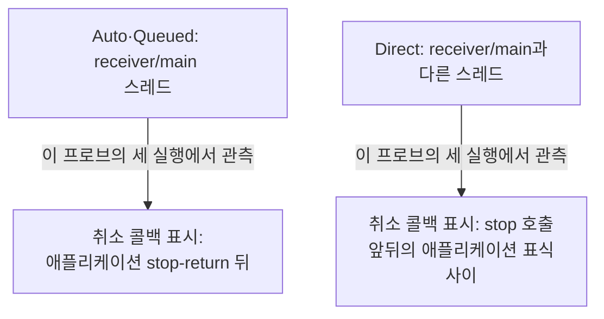

[Mermaid 원문](request-lifecycle.observed-stop-callback-timing.mmd)

??? note "그림 근거와 확인 범위"
    이 공개 가상 CPU 프로브에서 취소 요청의 콜백 표시와 애플리케이션 stop 표시는 어떻게 배치됐습니까? 서로 다른 연결 사이의 순서나 실제 C++ 반환 완료는 측정하지 않았습니다.
    
    소스에 연결한 설계 해석입니다. 자동 연결 검사는 의미 승인이나 기기 실행 검증이 아닙니다.
    
    | 요소·전이 | 소스 근거 |
    |---|---|
    | Auto·Queued: receiver/main 스레드 | [product-evidence/libcamera-callback-probe/callback-run.txt:1](#source-54dc055eafaa8a99) |
    | Direct: receiver/main과 다른 스레드 | [product-evidence/libcamera-callback-probe/callback-run.txt:1](#source-54dc055eafaa8a99) |
    | 취소 콜백 표시: 애플리케이션 stop-return 뒤 | [product-evidence/libcamera-callback-probe/callback-run.txt:1](#source-54dc055eafaa8a99) |
    | 취소 콜백 표시: stop 호출 앞뒤의 애플리케이션 표식 사이 | [product-evidence/libcamera-callback-probe/callback-run.txt:1](#source-54dc055eafaa8a99) |
    | 이 프로브의 세 실행에서 관측 | [product-evidence/libcamera-callback-probe/callback-run.txt:1](#source-54dc055eafaa8a99) |
    | 이 프로브의 세 실행에서 관측 | [product-evidence/libcamera-callback-probe/callback-run.txt:1](#source-54dc055eafaa8a99) |
<!-- /sdd:visual:observed-stop-callback-timing -->

<!-- sdd:visual:near-return-marker-boundary -->
### 반환 근처 표시로 알 수 있는 범위

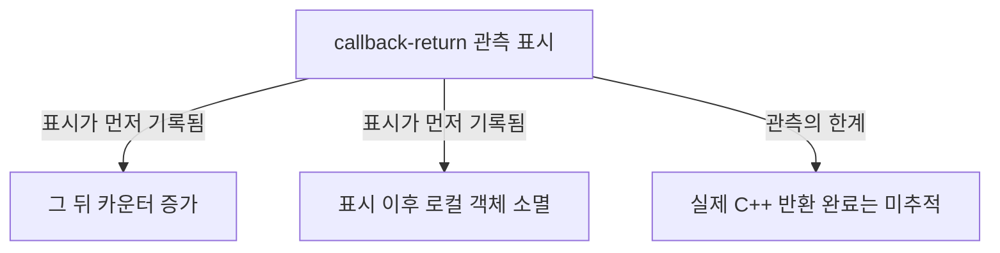

[Mermaid 원문](request-lifecycle.near-return-marker-boundary.mmd)

??? note "그림 근거와 확인 범위"
    callback-return 표시는 어떤 후속 작업보다 앞서며, 무엇의 완료를 추적하지 않습니까?
    
    소스에 연결한 설계 해석입니다. 자동 연결 검사는 의미 승인이나 기기 실행 검증이 아닙니다.
    
    | 요소·전이 | 소스 근거 |
    |---|---|
    | callback-return 관측 표시 | [product-evidence/libcamera-callback-probe/callback-run.txt:1](#source-54dc055eafaa8a99) |
    | 그 뒤 카운터 증가 | [product-evidence/libcamera-callback-probe/callback-run.txt:1](#source-54dc055eafaa8a99) |
    | 표시 이후 로컬 객체 소멸 | [product-evidence/libcamera-callback-probe/callback-run.txt:1](#source-54dc055eafaa8a99) |
    | 실제 C++ 반환 완료는 미추적 | [product-evidence/libcamera-callback-probe/callback-run.txt:1](#source-54dc055eafaa8a99) |
    | 표시가 먼저 기록됨 | [product-evidence/libcamera-callback-probe/callback-run.txt:1](#source-54dc055eafaa8a99) |
    | 표시가 먼저 기록됨 | [product-evidence/libcamera-callback-probe/callback-run.txt:1](#source-54dc055eafaa8a99) |
    | 관측의 한계 | [product-evidence/libcamera-callback-probe/callback-run.txt:1](#source-54dc055eafaa8a99) |
<!-- /sdd:visual:near-return-marker-boundary -->

이 공개 가상 프로브에서 Auto와 Queued 연결의 콜백은 수신 객체가 있는 메인 스레드에서 실행됐고, Direct 연결의 콜백은 메인 스레드와 다른 스레드에서 실행됐으며 스레드 이름은 확인되지 않았습니다. 정지 취소 요청에서 Auto와 Queued 연결의 콜백 진입·반환 표식은 stop-return 뒤에 있었고, Direct 연결의 취소 표식은 stop-enter와 stop-return 사이에 있었으며, stop-enter와 stop-return은 camera->stop() 호출 앞뒤의 애플리케이션 표식이라 함수 내부의 정확한 명령 경계가 아니므로 이 결과를 정상 완료 요청이나 연결 간 고정 실행 순서로 일반화하지 않습니다. `product-evidence/libcamera-callback-probe/callback-run.txt:1`

반환 근처 표식은 카운터 증가(`returned.fetch_add(1)`)와 지역 객체 소멸보다 앞에 기록되므로, 이 표식만으로는 실제 C++ 함수 반환이 완료되었다거나 명령 수준의 반환 추적이 이루어졌다고 증명하지 않습니다. `product-evidence/libcamera-callback-probe/callback-run.txt:1`

이 실행은 WSL2 Ubuntu의 Virtual2 카메라에서 memfd CPU 버퍼와 eventfd 시험 입력을 사용한 가상 프로브이며, 제품이 아닌 시험 구성입니다. 실행마다 DMA 동기화 오류 8건과 DMA 제공자 오류 2건이 나타났으며, 실제 ERROR 줄은 원문 그대로 보존했습니다. DMA 동기화는 검증되지 않았고, 물리 카메라·센서·ISP 캡처, 다른 애플리케이션, 다른 연결 구성, 다른 장치, 사내 `Camera` HAL도 검증되지 않았습니다. 가상 프로브에서 관찰한 Observer::complete 콜백 진입·반환 표지는 DMA 정상 동작이나 실기기 검증 성공의 근거가 아닙니다. `product-evidence/libcamera-callback-probe/callback-run.txt:1`

근거 원문: [product-evidence/libcamera-callback-probe/callback-run.txt:1](#source-54dc055eafaa8a99)

??? note "설계 질문과 검증 범위"
    질문별 답변과 근거 연결을 검사했습니다. 의미와 실행 결과는 사람 검토가 필요합니다.
    
    | 설계 질문 | 설명 위치 | 확인 범위 |
    |---|---|---|
    | 제출 성공 이후의 대기 조건과 완료 책임은 무엇입니까? | [제출에서 완료까지](#제출에서-완료까지) | 코드 근거와 설명 연결 |
    | 어떤 자원을 누가 유지하고 완료 후 무엇을 초기화해야 합니까? | [요청·버퍼·fence의 수명](#요청버퍼fence의-수명) | 코드 근거와 설명 연결 |
    | 정지 중 요청 반환과 연결 해제의 보장 범위는 어떻게 다릅니까? | [정지와 연결 해제를 구분하기](#정지와-연결-해제를-구분하기) | 코드 근거와 설명 연결 · 실행 확인 항목 별도 |
    | 문서를 읽고 어떤 질문에 답하고 어떤 실행 증거를 확보해야 합니까? | [변경 검토와 실행 확인](#변경-검토와-실행-확인) | 코드 근거와 설명 연결 |
    | 공개 가상 콜백 프로브에서 실제로 관찰한 범위와 아직 검증하지 않은 범위는 무엇입니까? | [공개 가상 카메라의 콜백 관찰](#공개-가상-카메라의-콜백-관찰) | 코드 근거와 설명 연결 |

## 소스 근거

같은 발췌는 한 번만 싣습니다. 필요한 원문을 펼쳐 설명과 대조하세요.

<a id="source-0ae00d77839f61cb"></a>

??? note "소스 근거: src/libcamera/camera.cpp:1243"
    `src/libcamera/camera.cpp:1243`에서 시작하는 발췌입니다. 종료 줄은 1263이며, 아래 원문을 설명과 대조할 수 있습니다.
    
    SHA-256: `9f251ecf5ba569606e9753d3619b88e1aef5a4ce15f816ae97efd283e34b823b`
    
    ```text
    \brief Create a request object for the camera
     * \param[in] cookie Opaque cookie for application use
     *
     * This function creates an empty request for the application to fill with
     * buffers and parameters, and queue for capture.
     *
     * The \a cookie is stored in the request and is accessible through the
     * Request::cookie() function at any time. It is typically used by applications
     * to map the request to an external resource in the request completion
     * handler, and is completely opaque to libcamera.
     *
     * The ownership of the returned request is passed to the caller, which is
     * responsible for deleting it. The request may be deleted in the completion
     * handler, or reused after resetting its state with Request::reuse().
     *
     * \context This function is \threadsafe. It may only be called when the camera
     * is in the Configured or Running state as defined in \ref camera_operation.
     *
     * \return A pointer to the newly created request, or nullptr on error
     */
    std::unique_ptr<Request> Camera::createRequest(uint64_t cookie)
    ```

<a id="source-28d007de6ad1a8a5"></a>

??? note "소스 근거: src/libcamera/camera.cpp:1308"
    `src/libcamera/camera.cpp:1308`에서 시작하는 발췌입니다. 종료 줄은 1383이며, 아래 원문을 설명과 대조할 수 있습니다.
    
    SHA-256: `96db61baeb32065c966b20942f97518ddbd3a43b36b64e8083eb29a90ecb7f4b`
    
    ```text
    \brief Queue a request to the camera
     * \param[in] request The request to queue to the camera
     *
     * This function queues a \a request to the camera for capture.
     *
     * After allocating the request with createRequest(), the application shall
     * fill it with at least one capture buffer before queuing it. Requests that
     * contain no buffers are invalid and are rejected without being queued.
     *
     * Once the request has been queued, the camera will notify its completion
     * through the \ref requestCompleted signal.
     *
     * \context This function is \threadsafe. It may only be called when the camera
     * is in the Running state as defined in \ref camera_operation.
     *
     * \return 0 on success or a negative error code otherwise
     * \retval -ENODEV The camera has been disconnected from the system
     * \retval -EACCES The camera is not running so requests can't be queued
     * \retval -EXDEV The request does not belong to this camera
     * \retval -EINVAL The request is invalid
     * \retval -ENOMEM No buffer memory was available to handle the request
     */
    int Camera::queueRequest(Request *request)
    {
    	Private *const d = _d();
    
    	int ret = d->isAccessAllowed(Private::CameraRunning);
    	if (ret < 0)
    		return ret;
    
    	/* Requests can only be queued to the camera that created them. */
    	if (request->_d()->camera() != this) {
    		LOG(Camera, Error) << "Request was not created by this camera";
    		return -EXDEV;
    	}
    
    	if (request->status() != Request::RequestPending) {
    		LOG(Camera, Error) << request->toString() << " is not valid";
    		return -EINVAL;
    	}
    
    	/* Make sure the Request has a valid control list. */
    	if (request->controls().infoMap() != &controls()) {
    		LOG(Camera, Error) << "Overwriting Request::controls() is not allowed";
    		return -EINVAL;
    	}
    
    	/*
    	 * The camera state may change until the end of the function. No locking
    	 * is however needed as PipelineHandler::queueRequest() will handle
    	 * this.
    	 */
    
    	if (request->buffers().empty()) {
    		LOG(Camera, Error) << "Request contains no buffers";
    		return -EINVAL;
    	}
    
    	for (const auto &[stream, buffer] : request->buffers()) {
    		if (d->activeStreams_.find(stream) == d->activeStreams_.end()) {
    			LOG(Camera, Error) << "Invalid request";
    			return -EINVAL;
    		}
    	}
    
    	/* Pre-process AeEnable. */
    	patchControlList(request->controls());
    
    	d->pipe_->invokeMethod(&PipelineHandler::queueRequest,
    			       ConnectionTypeQueued, request);
    
    	return 0;
    }
    
    /**
     * \brief Start capture from camera
    ```

<a id="source-95ae69eeb085e3b1"></a>

??? note "소스 근거: src/libcamera/request.cpp:442"
    `src/libcamera/request.cpp:442`에서 시작하는 발췌입니다. 종료 줄은 475이며, 아래 원문을 설명과 대조할 수 있습니다.
    
    SHA-256: `65cd8b0501b7f6545dd10eaaec4a4fe46c52a096a3bbd94ea6b4813e4a670876`
    
    ```text
    \brief Add a FrameBuffer with its associated Stream to the Request
     * \param[in] stream The stream the buffer belongs to
     * \param[in] buffer The FrameBuffer to add to the request
     * \param[in] fence The optional fence
     *
     * A reference to the buffer is stored in the request. The caller is responsible
     * for ensuring that the buffer will remain valid until the request complete
     * callback is called.
     *
     * A request can only contain one buffer per stream. If a buffer has already
     * been added to the request for the same stream, this function returns -EEXIST.
     *
     * A Fence can be optionally associated with the \a buffer.
     *
     * When a valid Fence is provided to this function, \a fence is moved to \a
     * buffer and this Request will only be queued to the device once the
     * fences of all its buffers have been correctly signalled. Ownership of the
     * fence will only be taken in case of success, otherwise the fence will
     * be left unmodified.
     *
     * If the \a fence associated with \a buffer isn't signalled, the request will
     * fail after a timeout. The buffer will still contain the fence, which
     * applications must retrieve with FrameBuffer::releaseFence() before the buffer
     * can be reused in another request. Attempting to add a buffer that still
     * contains a fence to a request will result in this function returning -EEXIST.
     *
     * \sa FrameBuffer::releaseFence()
     *
     * \return 0 on success or a negative error code otherwise
     * \retval -EEXIST The request already contains a buffer for the stream
     *  or the buffer still references a fence
     * \retval -EINVAL The buffer does not reference a valid Stream
     */
    int Request::addBuffer(const Stream *stream, FrameBuffer *buffer,
    ```

<a id="source-789eafedfaa7f3c5"></a>

??? note "소스 근거: src/libcamera/pipeline_handler.cpp:428"
    `src/libcamera/pipeline_handler.cpp:428`에서 시작하는 발췌입니다. 종료 줄은 547이며, 아래 원문을 설명과 대조할 수 있습니다.
    
    SHA-256: `5a7a3397a6034a73fe348ae44eb1e2568d2823e95542fe43386e16359d627180`
    
    ```text
    \fn PipelineHandler::registerRequest()
     * \brief Register a request for use by the pipeline handler
     * \param[in] request The request to register
     *
     * This function is called when the request is created, and allows the pipeline
     * handler to perform any one-time initialization it requries for the request.
     */
    void PipelineHandler::registerRequest(Request *request)
    {
    	/*
    	 * Connect the request prepared signal to notify the pipeline handler
    	 * when a request is ready to be processed.
    	 */
    	request->_d()->prepared.connect(this, [this, request]() {
    		doQueueRequests(request->_d()->camera());
    	});
    }
    
    /**
     * \fn PipelineHandler::queueRequest()
     * \brief Queue a request
     * \param[in] request The request to queue
     *
     * This function queues a capture request to the pipeline handler for
     * processing. The request is first added to the internal list of waiting
     * requests which have to be prepared to make sure they are ready for being
     * queued to the pipeline handler.
     *
     * The queue of waiting requests is iterated and up to \a
     * maxQueuedRequestsDevice_ prepared requests are passed to the pipeline handler
     * in the same order they have been queued by calling this function.
     *
     * If a Request fails during the preparation phase or if the pipeline handler
     * fails in queuing the request to the hardware the request is cancelled.
     *
     * Keeping track of queued requests ensures automatic completion of all requests
     * when the pipeline handler is stopped with stop(). Request completion shall be
     * signalled by the pipeline handler using the completeRequest() function.
     *
     * \context This function is called from the CameraManager thread.
     */
    void PipelineHandler::queueRequest(Request *request)
    {
    	LIBCAMERA_TRACEPOINT(request_queue, request);
    
    	Camera *camera = request->_d()->camera();
    	Camera::Private *data = camera->_d();
    	data->waitingRequests_.push(request);
    
    	request->_d()->prepare(300ms);
    }
    
    /**
     * \brief Queue one requests to the device
     */
    void PipelineHandler::doQueueRequest(Request *request)
    {
    	LIBCAMERA_TRACEPOINT(request_device_queue, request);
    
    	Camera *camera = request->_d()->camera();
    	Camera::Private *data = camera->_d();
    	data->queuedRequests_.push_back(request);
    
    	request->_d()->sequence_ = data->requestSequence_++;
    
    	if (request->_d()->cancelled_) {
    		completeRequest(request);
    		return;
    	}
    
    	int ret = queueRequestDevice(camera, request);
    	if (ret)
    		cancelRequest(request);
    }
    
    /**
     * \brief Queue prepared requests to the device
     *
     * Iterate the list of waiting requests and queue them to the device one
     * by one if they have been prepared.
     */
    void PipelineHandler::doQueueRequests(Camera *camera)
    {
    	Camera::Private *data = camera->_d();
    	while (!data->waitingRequests_.empty()) {
    		if (data->queuedRequests_.size() == maxQueuedRequestsDevice_)
    			break;
    
    		Request *request = data->waitingRequests_.front();
    		if (!request->_d()->prepared_)
    			break;
    
    		/*
    		 * Pop the request first, in case doQueueRequests() is called
    		 * recursively from within doQueueRequest()
    		 */
    		data->waitingRequests_.pop();
    		doQueueRequest(request);
    	}
    }
    
    /**
     * \fn PipelineHandler::queueRequestDevice()
     * \brief Queue a request to the device
     * \param[in] camera The camera to queue the request to
     * \param[in] request The request to queue
     *
     * This function queues a capture request to the device for processing. The
     * request contains a set of buffers associated with streams and a set of
     * parameters. The pipeline handler shall program the device to ensure that the
     * parameters will be applied to the frames captured in the buffers provided in
     * the request.
     *
     * \context This function is called from the CameraManager thread.
     *
     * \return 0 on success or a negative error code otherwise
     */
    
    /**
     * \brief Complete a buffer for a request
    ```

<a id="source-01ad7c6605c3296a"></a>

??? note "소스 근거: src/libcamera/pipeline_handler.cpp:547"
    `src/libcamera/pipeline_handler.cpp:547`에서 시작하는 발췌입니다. 종료 줄은 620이며, 아래 원문을 설명과 대조할 수 있습니다.
    
    SHA-256: `514288cc958de9ff5fd19d46393cec3bb3088f4f08486528d4559071138638c9`
    
    ```text
    \brief Complete a buffer for a request
     * \param[in] request The request the buffer belongs to
     * \param[in] buffer The buffer that has completed
     *
     * This function shall be called by pipeline handlers to signal completion of
     * the \a buffer part of the \a request. It notifies applications of buffer
     * completion and updates the request's internal buffer tracking. The request
     * is not completed automatically when the last buffer completes to give
     * pipeline handlers a chance to perform any operation that may still be
     * needed. They shall complete requests explicitly with completeRequest().
     *
     * \context This function shall be called from the CameraManager thread.
     *
     * \return True if all buffers contained in the request have completed, false
     * otherwise
     */
    bool PipelineHandler::completeBuffer(Request *request, FrameBuffer *buffer)
    {
    	Camera *camera = request->_d()->camera();
    	camera->bufferCompleted.emit(request, buffer);
    	return request->_d()->completeBuffer(buffer);
    }
    
    /**
     * \brief Signal request completion
     * \param[in] request The request that has completed
     *
     * The pipeline handler shall call this function to notify the \a camera that
     * the request has completed. The request is no longer managed by the pipeline
     * handler and shall not be accessed once this function returns.
     *
     * This function ensures that requests will be returned to the application in
     * submission order, the pipeline handler may call it on any complete request
     * without any ordering constraint.
     *
     * \context This function shall be called from the CameraManager thread.
     */
    void PipelineHandler::completeRequest(Request *request)
    {
    	Camera *camera = request->_d()->camera();
    
    	request->_d()->complete();
    
    	Camera::Private *data = camera->_d();
    
    	while (!data->queuedRequests_.empty()) {
    		Request *req = data->queuedRequests_.front();
    		if (req->status() == Request::RequestPending)
    			break;
    
    		ASSERT(!req->hasPendingBuffers());
    		data->queuedRequests_.pop_front();
    		camera->requestComplete(req);
    	}
    
    	/* Allow any waiting requests to be queued to the pipeline. */
    	doQueueRequests(camera);
    }
    
    /**
     * \brief Cancel request and signal its completion
     * \param[in] request The request to cancel
     *
     * This function cancels and completes the request. The same rules as for
     * completeRequest() apply.
     */
    void PipelineHandler::cancelRequest(Request *request)
    {
    	request->_d()->cancel();
    	completeRequest(request);
    }
    
    /**
     * \brief Retrieve the absolute path to a platform configuration file
    ```

<a id="source-7348e9b4af985eb2"></a>

??? note "소스 근거: src/libcamera/pipeline_handler.cpp:483"
    `src/libcamera/pipeline_handler.cpp:483`에서 시작하는 발췌입니다. 종료 줄은 501이며, 아래 원문을 설명과 대조할 수 있습니다.
    
    SHA-256: `fbd3ed6fe295b1cdd82d6ce420a30695986e43199347f92ac2545fe0e7831da8`
    
    ```text
    void PipelineHandler::doQueueRequest(Request *request)
    {
    	LIBCAMERA_TRACEPOINT(request_device_queue, request);
    
    	Camera *camera = request->_d()->camera();
    	Camera::Private *data = camera->_d();
    	data->queuedRequests_.push_back(request);
    
    	request->_d()->sequence_ = data->requestSequence_++;
    
    	if (request->_d()->cancelled_) {
    		completeRequest(request);
    		return;
    	}
    
    	int ret = queueRequestDevice(camera, request);
    	if (ret)
    		cancelRequest(request);
    }
    ```

<a id="source-c05f8214908fe4fe"></a>

??? note "소스 근거: src/libcamera/pipeline_handler.cpp:530"
    `src/libcamera/pipeline_handler.cpp:530`에서 시작하는 발췌입니다. 종료 줄은 544이며, 아래 원문을 설명과 대조할 수 있습니다.
    
    SHA-256: `18f697dba5bc979e14125471abadb8a7ecccef4de79e75e1f385e2c6ee044df2`
    
    ```text
    \fn PipelineHandler::queueRequestDevice()
     * \brief Queue a request to the device
     * \param[in] camera The camera to queue the request to
     * \param[in] request The request to queue
     *
     * This function queues a capture request to the device for processing. The
     * request contains a set of buffers associated with streams and a set of
     * parameters. The pipeline handler shall program the device to ensure that the
     * parameters will be applied to the frames captured in the buffers provided in
     * the request.
     *
     * \context This function is called from the CameraManager thread.
     *
     * \return 0 on success or a negative error code otherwise
     */
    ```

<a id="source-ab8710f8a8a7905d"></a>

??? note "소스 근거: src/libcamera/pipeline_handler.cpp:547"
    `src/libcamera/pipeline_handler.cpp:547`에서 시작하는 발췌입니다. 종료 줄은 563이며, 아래 원문을 설명과 대조할 수 있습니다.
    
    SHA-256: `096784b4798b3156e88e3acf84577f60a27f0bf0e2422ae7850e44b081eb9d3a`
    
    ```text
    \brief Complete a buffer for a request
     * \param[in] request The request the buffer belongs to
     * \param[in] buffer The buffer that has completed
     *
     * This function shall be called by pipeline handlers to signal completion of
     * the \a buffer part of the \a request. It notifies applications of buffer
     * completion and updates the request's internal buffer tracking. The request
     * is not completed automatically when the last buffer completes to give
     * pipeline handlers a chance to perform any operation that may still be
     * needed. They shall complete requests explicitly with completeRequest().
     *
     * \context This function shall be called from the CameraManager thread.
     *
     * \return True if all buffers contained in the request have completed, false
     * otherwise
     */
    bool PipelineHandler::completeBuffer(Request *request, FrameBuffer *buffer)
    ```

<a id="source-236c920e906cb6fd"></a>

??? note "소스 근거: src/libcamera/pipeline_handler.cpp:571"
    `src/libcamera/pipeline_handler.cpp:571`에서 시작하는 발췌입니다. 종료 줄은 607이며, 아래 원문을 설명과 대조할 수 있습니다.
    
    SHA-256: `6ad80c6800e8b980c2a6146d7dcc5648de9db2b0ca408711a896c4e46a624684`
    
    ```text
    \brief Signal request completion
     * \param[in] request The request that has completed
     *
     * The pipeline handler shall call this function to notify the \a camera that
     * the request has completed. The request is no longer managed by the pipeline
     * handler and shall not be accessed once this function returns.
     *
     * This function ensures that requests will be returned to the application in
     * submission order, the pipeline handler may call it on any complete request
     * without any ordering constraint.
     *
     * \context This function shall be called from the CameraManager thread.
     */
    void PipelineHandler::completeRequest(Request *request)
    {
    	Camera *camera = request->_d()->camera();
    
    	request->_d()->complete();
    
    	Camera::Private *data = camera->_d();
    
    	while (!data->queuedRequests_.empty()) {
    		Request *req = data->queuedRequests_.front();
    		if (req->status() == Request::RequestPending)
    			break;
    
    		ASSERT(!req->hasPendingBuffers());
    		data->queuedRequests_.pop_front();
    		camera->requestComplete(req);
    	}
    
    	/* Allow any waiting requests to be queued to the pipeline. */
    	doQueueRequests(camera);
    }
    
    /**
     * \brief Cancel request and signal its completion
    ```

<a id="source-a637b7daf9acb7ac"></a>

??? note "소스 근거: src/libcamera/pipeline_handler.cpp:516"
    `src/libcamera/pipeline_handler.cpp:516`에서 시작하는 발췌입니다. 종료 줄은 518이며, 아래 원문을 설명과 대조할 수 있습니다.
    
    SHA-256: `f655f79ce0ac9e9361d1759b2974e6f382b7fe1e9e3aa35b51952572af8d5a6f`
    
    ```text
    Request *request = data->waitingRequests_.front();
    		if (!request->_d()->prepared_)
    			break;
    ```

<a id="source-5b0ae08604dff588"></a>

??? note "소스 근거: src/libcamera/pipeline_handler.cpp:553"
    `src/libcamera/pipeline_handler.cpp:553`에서 시작하는 발췌입니다. 종료 줄은 556이며, 아래 원문을 설명과 대조할 수 있습니다.
    
    SHA-256: `957ec8f5090b25e8e97e61a6390c77c799eb5e696028a5674ca4717473b6d42d`
    
    ```text
    The request
     * is not completed automatically when the last buffer completes to give
     * pipeline handlers a chance to perform any operation that may still be
     * needed. They shall complete requests explicitly with completeRequest().
    ```

<a id="source-bae861ceef5e8406"></a>

??? note "소스 근거: src/libcamera/pipeline_handler.cpp:594"
    `src/libcamera/pipeline_handler.cpp:594`에서 시작하는 발췌입니다. 종료 줄은 595이며, 아래 원문을 설명과 대조할 수 있습니다.
    
    SHA-256: `103a09a61422ec5ef5b879512b00b4194d428eb70ce8bbe292ded0be5382caf6`
    
    ```text
    if (req->status() == Request::RequestPending)
    			break;
    ```

<a id="source-0470759dc8387e9a"></a>

??? note "소스 근거: src/libcamera/base/bound_method.cpp:68"
    `src/libcamera/base/bound_method.cpp:68`에서 시작하는 발췌입니다. 종료 줄은 108이며, 아래 원문을 설명과 대조할 수 있습니다.
    
    SHA-256: `9d139a7558500489b81d2ef8b83d3b1a3b143d252992c91f56331bc1e6d1b327`
    
    ```text
    bool BoundMethodBase::activatePack(std::shared_ptr<BoundMethodPackBase> pack,
    				   bool deleteMethod)
    {
    	ConnectionType type = connectionType_;
    	if (type == ConnectionTypeAuto) {
    		if (Thread::current() == object_->thread())
    			type = ConnectionTypeDirect;
    		else
    			type = ConnectionTypeQueued;
    	} else if (type == ConnectionTypeBlocking) {
    		if (Thread::current() == object_->thread())
    			type = ConnectionTypeDirect;
    	}
    
    	switch (type) {
    	case ConnectionTypeDirect:
    	default:
    		invokePack(pack.get());
    		if (deleteMethod)
    			delete this;
    		return true;
    
    	case ConnectionTypeQueued: {
    		std::unique_ptr<Message> msg =
    			std::make_unique<InvokeMessage>(this, pack, nullptr, deleteMethod);
    		object_->postMessage(std::move(msg));
    		return false;
    	}
    
    	case ConnectionTypeBlocking: {
    		Semaphore semaphore;
    
    		std::unique_ptr<Message> msg =
    			std::make_unique<InvokeMessage>(this, pack, &semaphore, deleteMethod);
    		object_->postMessage(std::move(msg));
    
    		semaphore.acquire();
    		return true;
    	}
    	}
    }
    ```

<a id="source-38494771cb29cc8c"></a>

??? note "소스 근거: src/libcamera/request.cpp:376"
    `src/libcamera/request.cpp:376`에서 시작하는 발췌입니다. 종료 줄은 407이며, 아래 원문을 설명과 대조할 수 있습니다.
    
    SHA-256: `22294a6809bd4c6655824af9603fb3879603cec256c6845e00d3d2a0e6bf7679`
    
    ```text
    \brief Reset the request for reuse
     * \param[in] flags Indicate whether or not to reuse the buffers
     *
     * Reset the status and controls associated with the request, to allow it to
     * be reused and requeued without destruction. This function shall be called
     * prior to queueing the request to the camera, in lieu of constructing a new
     * request. The application can reuse the buffers that were previously added
     * to the request via addBuffer() by setting \a flags to ReuseBuffers.
     */
    void Request::reuse(ReuseFlag flags)
    {
    	LIBCAMERA_TRACEPOINT(request_reuse, this);
    
    	_d()->reset();
    
    	if (flags & ReuseBuffers) {
    		for (const auto &[stream, buffer] : bufferMap_) {
    			buffer->_d()->setRequest(this);
    			_d()->pending_.insert(buffer);
    		}
    	} else {
    		bufferMap_.clear();
    	}
    
    	status_ = RequestPending;
    
    	controls_.clear();
    	_d()->metadata_.clear();
    }
    
    /**
     * \fn Request::controls()
    ```

<a id="source-447804db33308244"></a>

??? note "소스 근거: src/libcamera/request.cpp:326"
    `src/libcamera/request.cpp:326`에서 시작하는 발췌입니다. 종료 줄은 338이며, 아래 원문을 설명과 대조할 수 있습니다.
    
    SHA-256: `9e55d8335a38080c0af78cf267bac78c573636447425e25d394e5b206217e7fe`
    
    ```text
    \enum Request::ReuseFlag
     * Flags to control the behavior of Request::reuse()
     * \var Request::Default
     * Don't reuse buffers
     * \var Request::ReuseBuffers
     * Reuse the buffers that were previously added by addBuffer()
     *
     * \note Fences associated with the buffers are not reused.
     *  This flag should not be used if fences are used.
     */
    
    /**
     * \typedef Request::BufferMap
    ```

<a id="source-86a8d784a8348122"></a>

??? note "소스 근거: src/libcamera/request.cpp:456"
    `src/libcamera/request.cpp:456`에서 시작하는 발췌입니다. 종료 줄은 460이며, 아래 원문을 설명과 대조할 수 있습니다.
    
    SHA-256: `e7cc6e59b5401c6d2ef2bef1cceef1090d9bdd058ea8ce00a74bc573f5e4fdc2`
    
    ```text
    When a valid Fence is provided to this function, \a fence is moved to \a
     * buffer and this Request will only be queued to the device once the
     * fences of all its buffers have been correctly signalled. Ownership of the
     * fence will only be taken in case of success, otherwise the fence will
     * be left unmodified.
    ```

<a id="source-d8cf34a75a4333a7"></a>

??? note "소스 근거: src/libcamera/request.cpp:462"
    `src/libcamera/request.cpp:462`에서 시작하는 발췌입니다. 종료 줄은 465이며, 아래 원문을 설명과 대조할 수 있습니다.
    
    SHA-256: `ebb24de716cdebb7c0c82cfddf05e91d7d2fb938eda24fe5027d3e9efcf62104`
    
    ```text
    If the \a fence associated with \a buffer isn't signalled, the request will
     * fail after a timeout. The buffer will still contain the fence, which
     * applications must retrieve with FrameBuffer::releaseFence() before the buffer
     * can be reused in another request.
    ```

<a id="source-4cdce80c57526221"></a>

??? note "소스 근거: src/libcamera/request.cpp:447"
    `src/libcamera/request.cpp:447`에서 시작하는 발췌입니다. 종료 줄은 449이며, 아래 원문을 설명과 대조할 수 있습니다.
    
    SHA-256: `996424643a0de2ec5fbd8b8491639ae1afea030ab989179410e7a1eaa48c1673`
    
    ```text
    A reference to the buffer is stored in the request. The caller is responsible
     * for ensuring that the buffer will remain valid until the request complete
     * callback is called.
    ```

<a id="source-d93a02e9220fa760"></a>

??? note "소스 근거: src/libcamera/pipeline_handler.cpp:575"
    `src/libcamera/pipeline_handler.cpp:575`에서 시작하는 발췌입니다. 종료 줄은 576이며, 아래 원문을 설명과 대조할 수 있습니다.
    
    SHA-256: `d2c64999e07c4a9df08f21b514cd8480e6ccc091f1aeef3ebaf44522d8fb0961`
    
    ```text
    The request is no longer managed by the pipeline
     * handler and shall not be accessed once this function returns.
    ```

<a id="source-52fb58c8956b1a91"></a>

??? note "소스 근거: src/libcamera/pipeline_handler.cpp:610"
    `src/libcamera/pipeline_handler.cpp:610`에서 시작하는 발췌입니다. 종료 줄은 611이며, 아래 원문을 설명과 대조할 수 있습니다.
    
    SHA-256: `048bc649f307f0f41b7702b59be24a5fba9f7a48ff6a266bfbe458df4a5bdc8d`
    
    ```text
    This function cancels and completes the request. The same rules as for
     * completeRequest() apply.
    ```

<a id="source-d9944a69f2dd6758"></a>

??? note "소스 근거: src/libcamera/request.cpp:334"
    `src/libcamera/request.cpp:334`에서 시작하는 발췌입니다. 종료 줄은 334이며, 아래 원문을 설명과 대조할 수 있습니다.
    
    SHA-256: `7b740fbb97fdbfb9b7d270aa48ba5e7902f04d691349b58981ea011f324282d5`
    
    ```text
    This flag should not be used if fences are used.
    ```

<a id="source-e09324743def3f09"></a>

??? note "소스 근거: src/libcamera/camera.cpp:1431"
    `src/libcamera/camera.cpp:1431`에서 시작하는 발췌입니다. 종료 줄은 1475이며, 아래 원문을 설명과 대조할 수 있습니다.
    
    SHA-256: `0009c665993b995489738e48affc81643a7159d82b5326e5f182e30fe11e4901`
    
    ```text
    \brief Stop capture from camera
     *
     * This function stops capturing and processing requests immediately. All
     * pending requests are cancelled and complete synchronously in an error state.
     *
     * \context This function may be called in any camera state as defined in \ref
     * camera_operation, and shall be synchronized by the caller with other
     * functions that affect the camera state. If called when the camera isn't
     * running, it is a no-op.
     *
     * \return 0 on success or a negative error code otherwise
     * \retval -ENODEV The camera has been disconnected from the system
     * \retval -EACCES The camera is not running so can't be stopped
     */
    int Camera::stop()
    {
    	Private *const d = _d();
    
    	/*
    	 * \todo Make calling stop() when not in 'Running' part of the state
    	 * machine rather than take this shortcut
    	 */
    	if (!d->isRunning())
    		return 0;
    
    	int ret = d->isAccessAllowed(Private::CameraRunning);
    	if (ret < 0)
    		return ret;
    
    	LOG(Camera, Debug) << "Stopping capture";
    
    	d->setState(Private::CameraStopping);
    
    	d->pipe_->invokeMethod(&PipelineHandler::stop, ConnectionTypeBlocking,
    			       this);
    
    	ASSERT(!d->pipe_->hasPendingRequests(this));
    
    	d->setState(Private::CameraConfigured);
    
    	return 0;
    }
    
    /**
     * \brief Handle request completion and notify application
    ```

<a id="source-eefd1bbecb1aad0a"></a>

??? note "소스 근거: src/libcamera/pipeline_handler.cpp:359"
    `src/libcamera/pipeline_handler.cpp:359`에서 시작하는 발췌입니다. 종료 줄은 414이며, 아래 원문을 설명과 대조할 수 있습니다.
    
    SHA-256: `108b1bea5a8314ba57213d15c1e3ba01abe2b3f8a9e0e1e1281864b5492c7304`
    
    ```text
    \brief Stop capturing from all running streams and cancel pending requests
     * \param[in] camera The camera to stop
     *
     * This function stops capturing and processing requests immediately. All
     * pending requests are cancelled and complete immediately in an error state.
     *
     * \context This function is called from the CameraManager thread.
     */
    void PipelineHandler::stop(Camera *camera)
    {
    	/*
    	 * Take all waiting requests so that they are not requeued in response
    	 * to completeRequest() being called inside stopDevice(). Cancel them
    	 * after the device to keep them in order.
    	 */
    	Camera::Private *data = camera->_d();
    	std::queue<Request *> waitingRequests;
    	waitingRequests.swap(data->waitingRequests_);
    
    	/* Stop the pipeline handler and let the queued requests complete. */
    	stopDevice(camera);
    
    	/* Cancel and signal as complete all waiting requests. */
    	while (!waitingRequests.empty()) {
    		Request *request = waitingRequests.front();
    		waitingRequests.pop();
    
    		/*
    		 * Cancel all requests by marking them as cancelled and calling
    		 * doQueueRequest() instead of cancelRequest(). This ensures
    		 * that the requests get a sequence number and are temporarily
    		 * added to queuedRequests_ so they can be properly completed in
    		 * completeRequest().
    		 */
    		request->_d()->cancel();
    		doQueueRequest(request);
    	}
    
    	/* Make sure no requests are pending. */
    	ASSERT(data->queuedRequests_.empty());
    	ASSERT(data->waitingRequests_.empty());
    
    	data->requestSequence_ = 0;
    }
    
    /**
     * \fn PipelineHandler::stopDevice()
     * \brief Stop capturing from all running streams
     * \param[in] camera The camera to stop
     *
     * This function stops capturing and processing requests immediately. All
     * pending requests are cancelled and complete immediately in an error state.
     */
    
    /**
     * \brief Determine if the camera has any requests pending
    ```

<a id="source-6191f91df6cbffa2"></a>

??? note "소스 근거: src/libcamera/camera.cpp:1462"
    `src/libcamera/camera.cpp:1462`에서 시작하는 발췌입니다. 종료 줄은 1465이며, 아래 원문을 설명과 대조할 수 있습니다.
    
    SHA-256: `a75876cfb66d256185fe7085444cbe91f726b87bdceca83cb6b243514f03c1ed`
    
    ```text
    d->setState(Private::CameraStopping);
    
    	d->pipe_->invokeMethod(&PipelineHandler::stop, ConnectionTypeBlocking,
    			       this);
    ```

<a id="source-5e7914238ff81605"></a>

??? note "소스 근거: src/libcamera/pipeline_handler.cpp:398"
    `src/libcamera/pipeline_handler.cpp:398`에서 시작하는 발췌입니다. 종료 줄은 399이며, 아래 원문을 설명과 대조할 수 있습니다.
    
    SHA-256: `d21508cce62c51c0c63a2a50ba2c452548a69a2be9d425d526f42ee04c86c7a1`
    
    ```text
    ASSERT(data->queuedRequests_.empty());
    	ASSERT(data->waitingRequests_.empty());
    ```

<a id="source-1d583253fc11ef1c"></a>

??? note "소스 근거: src/libcamera/camera.cpp:952"
    `src/libcamera/camera.cpp:952`에서 시작하는 발췌입니다. 종료 줄은 953이며, 아래 원문을 설명과 대조할 수 있습니다.
    
    SHA-256: `94a54591940109c4ab230abf56ac78e1d5821e1db9e35016cb50505c40b34e55`
    
    ```text
    \todo Deal with pending requests if the camera is disconnected in a
     * running state.
    ```

<a id="source-fd5daba4aa44adfd"></a>

??? note "소스 근거: src/libcamera/pipeline_handler.cpp:394"
    `src/libcamera/pipeline_handler.cpp:394`에서 시작하는 발췌입니다. 종료 줄은 394이며, 아래 원문을 설명과 대조할 수 있습니다.
    
    SHA-256: `b7a285b9db4abdc209d166d80bdc9e1ef6658f4908d2b05274beddc1592943e1`
    
    ```text
    doQueueRequest(request);
    ```

<a id="source-56494d0aedf70c2d"></a>

??? note "소스 근거: src/libcamera/camera.cpp:959"
    `src/libcamera/camera.cpp:959`에서 시작하는 발췌입니다. 종료 줄은 959이며, 아래 원문을 설명과 대조할 수 있습니다.
    
    SHA-256: `e90a232265587ca40e1236c80aa01d9e22649c8379b6b580fcab5dcccc5728c1`
    
    ```text
    _d()->disconnect();
    ```

<a id="source-7d48ce2e18c8877c"></a>

??? note "소스 근거: src/libcamera/camera.cpp:960"
    `src/libcamera/camera.cpp:960`에서 시작하는 발췌입니다. 종료 줄은 960이며, 아래 원문을 설명과 대조할 수 있습니다.
    
    SHA-256: `b9f19485d322f3dc7639a06e2f78ddb25a293c4f361a7c44e01a9b4fe971f974`
    
    ```text
    disconnected.emit();
    ```

<a id="source-2758e9ddd31ad41d"></a>

??? note "소스 근거: src/libcamera/camera.cpp:944"
    `src/libcamera/camera.cpp:944`에서 시작하는 발췌입니다. 종료 줄은 963이며, 아래 원문을 설명과 대조할 수 있습니다.
    
    SHA-256: `cbc12aaba21898e519c8599faec5e998b408162912a507880b162ee6787cf8b0`
    
    ```text
    \brief Notify camera disconnection
     *
     * This function is used to notify the camera instance that the underlying
     * hardware has been unplugged. In response to the disconnection the camera
     * instance notifies the application by emitting the #disconnected signal, and
     * ensures that all new calls to the application-facing Camera API return an
     * error immediately.
     *
     * \todo Deal with pending requests if the camera is disconnected in a
     * running state.
     */
    void Camera::disconnect()
    {
    	LOG(Camera, Debug) << "Disconnecting camera " << id();
    
    	_d()->disconnect();
    	disconnected.emit();
    }
    
    int Camera::exportFrameBuffers(Stream *stream,
    ```

<a id="source-839140c350119dd1"></a>

??? note "소스 근거: src/libcamera/camera.cpp:944"
    `src/libcamera/camera.cpp:944`에서 시작하는 발췌입니다. 종료 줄은 955이며, 아래 원문을 설명과 대조할 수 있습니다.
    
    SHA-256: `768781b1763c3413e3780132c987fb0733d6fff2cdf1d128a6be5bbd1aa50d71`
    
    ```text
    \brief Notify camera disconnection
     *
     * This function is used to notify the camera instance that the underlying
     * hardware has been unplugged. In response to the disconnection the camera
     * instance notifies the application by emitting the #disconnected signal, and
     * ensures that all new calls to the application-facing Camera API return an
     * error immediately.
     *
     * \todo Deal with pending requests if the camera is disconnected in a
     * running state.
     */
    void Camera::disconnect()
    ```

<a id="source-a98823fa5ec440a2"></a>

??? note "소스 근거: src/libcamera/request.cpp:400"
    `src/libcamera/request.cpp:400`에서 시작하는 발췌입니다. 종료 줄은 400이며, 아래 원문을 설명과 대조할 수 있습니다.
    
    SHA-256: `aaf5bc87fb8a4ce9c7fbee2875c9cd6f20a8eb982ace6a531236dbd558cc8fc4`
    
    ```text
    status_ = RequestPending;
    ```

<a id="source-c8638489aa83cfd1"></a>

??? note "소스 근거: src/libcamera/request.cpp:402"
    `src/libcamera/request.cpp:402`에서 시작하는 발췌입니다. 종료 줄은 402이며, 아래 원문을 설명과 대조할 수 있습니다.
    
    SHA-256: `e0203f8fd7483c79c6b1a03e35cf952e3839dce41ea145adaa678eceb1382491`
    
    ```text
    controls_.clear();
    ```

<a id="source-47569737e131b31a"></a>

??? note "소스 근거: src/libcamera/request.cpp:403"
    `src/libcamera/request.cpp:403`에서 시작하는 발췌입니다. 종료 줄은 403이며, 아래 원문을 설명과 대조할 수 있습니다.
    
    SHA-256: `794ec4bc82f6076eb388d21eab25bd1409e880c0160e00c1fee50d822c8fa82d`
    
    ```text
    _d()->metadata_.clear();
    ```

<a id="source-54dc055eafaa8a99"></a>

??? note "제품 자료: product-evidence/libcamera-callback-probe/callback-run.txt:1"
    소스와 별도로 제공된 자료입니다. 제공자·버전·적용 범위를 아래 기록에서 확인하세요. 자동 검사는 사람 승인이 아닙니다.
    
    `product-evidence/libcamera-callback-probe/callback-run.txt:1`에서 시작하는 발췌입니다. 종료 줄은 96이며, 아래 원문을 설명과 대조할 수 있습니다.
    
    SHA-256: `f78e369710f01e2740a79e5b32a9035d66792ac52f51bdbea9050bb5ebafca8c`
    
    ```text
    {
      "schema": 1,
      "kind": "bounded runtime observation, not a product support or performance guarantee",
      "source_commit": "293d751a814e0d4c34e85ad457ccd9d5eefd1a61",
      "probe_sha256": "59b73503b14c9bdddeb2513982fae0a59af012dd26183e34c35fc34ff8c1c4ac",
      "raw_observation_sha256": "6433a4dbc5bc7de72bfc9e734fb395be2d0a6d7cc77ca1080901b52fba999f34",
      "pipeline": "upstream virtual",
      "camera": "Virtual2",
      "kernel": "6.18.33.2-microsoft-standard-WSL2",
      "application_callback": "Observer::complete",
      "connection_site": "callback_probe.cpp requestCompleted.connect calls; source SHA pinned",
      "runs": 3,
      "per_run": {
        "requests_reported_RequestComplete": 4,
        "requests_reported_RequestCancelled": 4,
        "callbacks": 24
      },
      "total_callbacks": 72,
      "connections": [
        {
          "connection": "auto",
          "receiver_affinity": "main application thread; Object never moved",
          "callback_thread": "receiver/main thread",
          "all_runs_consistent": true,
          "callbacks_per_run": 8,
          "stop_callback_entry_and_near_return_markers_after_stop_return": true,
          "stop_cancelled_markers_between_application_stop_enter_and_return_markers": false
        },
        {
          "connection": "direct",
          "receiver_affinity": "main application thread; Object never moved",
          "callback_thread": "different thread from the receiver/main thread; no thread-name identification is claimed",
          "all_runs_consistent": true,
          "callbacks_per_run": 8,
          "stop_callback_entry_and_near_return_markers_after_stop_return": false,
          "stop_cancelled_markers_between_application_stop_enter_and_return_markers": true
        },
        {
          "connection": "queued",
          "receiver_affinity": "main application thread; Object never moved",
          "callback_thread": "receiver/main thread",
          "all_runs_consistent": true,
          "callbacks_per_run": 8,
          "stop_callback_entry_and_near_return_markers_after_stop_return": true,
          "stop_cancelled_markers_between_application_stop_enter_and_return_markers": false
        }
      ],
      "callback_return_marker": "Near-return marker before the counter increment and local destruction; does not trace the actual C++ return.",
      "buffers": "application memfd; CPU-only; not DMA-BUF",
      "stop_fences": "unsignalled eventfd test input; not kernel sync_file",
      "retained_dma_sync_errors_per_run": [
        8,
        8,
        8
      ],
      "retained_dma_provider_errors_per_run": [
        2,
        2,
        2
      ],
      "validation_scope": "Actual callback dispatch/entry/return markers/status/order/thread in this controlled public virtual probe only.",
      "exclusions": [
        "DMA synchronisation was not validated; actual sync/provider ERROR lines are retained.",
        "Physical camera/sensor/ISP capture was not validated.",
        "Other applications, other connection configurations, other devices and internal Camera HAL were not validated.",
        "RequestComplete/FrameSuccess observations here do not certify DMA correctness or real capture."
      ],
      "human_review": "pending",
      "connection_code": [
        "camera->requestCompleted.connect(&automatic, &Observer::complete, ConnectionTypeAuto);",
        "camera->requestCompleted.connect(&direct, &Observer::complete, ConnectionTypeDirect);",
        "camera->requestCompleted.connect(&queued, &Observer::complete, ConnectionTypeQueued);"
      ],
      "callback_instrumentation_in_source_order": [
        "event(\"callback-enter\", data);",
        "event(\"callback-return\", data);",
        "returned.fetch_add(1);"
      ],
      "operating_system": {
        "wsl_distribution": "Ubuntu",
        "os_release": "PRETTY_NAME=\"Ubuntu 26.04 LTS\"\nNAME=\"Ubuntu\"\nVERSION_ID=\"26.04\"\nVERSION=\"26.04 LTS (Resolute Raccoon)\"\nVERSION_CODENAME=resolute\nID=ubuntu\nID_LIKE=debian\nHOME_URL=\"https://www.ubuntu.com/\"\nSUPPORT_URL=\"https://help.ubuntu.com/\"\nBUG_REPORT_URL=\"https://bugs.launchpad.net/ubuntu/\"\nPRIVACY_POLICY_URL=\"https://www.ubuntu.com/legal/terms-and-policies/privacy-policy\"\nUBUNTU_CODENAME=resolute\nLOGO=ubuntu-logo\n",
        "os_release_sha256": "de1a366db70de1ae4b6612a1696f9c1f37948028fab733508a3d5cf49836faac"
      },
      "test_configuration": {
        "simulation": true,
        "scope": "Isolated public virtual-camera test harness, not a production product.",
        "definition": "The authored probe chooses Virtual2 and the runner restricts matching to the virtual pipeline; hardware capture inputs are simulated. Actual library and application callbacks execute."
      },
      "stop_instrumentation_in_source_order": [
        "event(\"stop-enter\", \",\\\"phase\\\":\" + std::to_string(phase));",
        "int ret = camera->stop();",
        "event(\"stop-return\", \",\\\"phase\\\":\" + std::to_string(phase) + \",\\\"ret\\\":\" + std::to_string(ret));"
      ],
      "stop_interval_definition": "The application emits stop-enter immediately before camera->stop() and stop-return immediately after it. Observations describe ordering between these application boundary markers, not instruction-level function-entry/exit tracing. No fixed ordering between different connections is asserted."
    }
    
    ```
    
    ```json
    {
      "type": "measurement",
      "supplier": "Public source-pinned libcamera callback probe; raw native events and errors retained",
      "version": "59b73503b14c9bdddeb2513982fae0a59af012dd26183e34c35fc34ff8c1c4ac",
      "date": "2026-10-31",
      "valid_until": "2026-10-31",
      "product": "libcamera-callback-probe",
      "release": "293d751a814e0d4c34e85ad457ccd9d5eefd1a61",
      "configuration": "wsl2-virtual2-cpu-memfd",
      "feature": "callback-observation",
      "conditions": [
        "libcamera source 293d751a814e0d4c34e85ad457ccd9d5eefd1a61",
        "Ubuntu WSL2 Virtual2 with CPU memfd buffers and eventfd test fences",
        "DMA provider and sync errors retained; no physical/internal HAL validation"
      ],
      "sha256": "f78e369710f01e2740a79e5b32a9035d66792ac52f51bdbea9050bb5ebafca8c"
    }
    ```

??? note "근거와 검토 정보"
    - 생성 방식: 추출 사실과 LLM 설명
    - 검증 범위: 표·그림은 facts로 만들고 설명은 LLM이 작성합니다. 인용·문장 및 설정된 구조 검사를 적용합니다.
    - 근거 파일: `include/libcamera/camera.h`, `include/libcamera/internal/pipeline_handler.h`, `include/libcamera/request.h`, `product-evidence/libcamera-callback-probe/callback-run.txt`, `src/libcamera/base/bound_method.cpp`, `src/libcamera/camera.cpp`, `src/libcamera/pipeline_handler.cpp`, `src/libcamera/request.cpp`
    - 근거 수준: 코드 확인 (정적 분석, simple_compdb 구성, commit `293d751a81`)
    - 자동 검사 (인용·문장 및 설정된 구조 검사): 통과
    - 검토 상태 기록일: 2026-10-31 · 사람 검토 전

다음 단계: [구성과 요청 오류 조사](request-diagnosis.md)
