# 요청 처리와 문제 진단

**요청의 제출 성공과 촬영 완료를 구분하고, 버퍼를 유지할 기간과 오류가 난 위치를 확인하세요.**

| 지금 확인할 내용 | 이동할 절 |
|---|---|
| <a id="구성-실패를-좁히는-순서"></a>구성 실패를 좁히는 순서의 조건과 근거를 대조하세요. | [구성과 요청 오류 조사](request-diagnosis.md#구성-실패를-좁히는-순서) |
| 요청 제출과 완료의 연결을 확인합니다. | [제출에서 완료까지](#제출에서-완료까지) |
| 자원을 재사용하거나 해제할 시점을 확인합니다. | [요청·버퍼·fence의 수명](#요청버퍼fence의-수명) |
| <a id="실패-위치별-확인-순서"></a>실패 위치별 확인 순서의 조건과 근거를 대조하세요. | [구성과 요청 오류 조사](request-diagnosis.md#실패-위치별-확인-순서) |
| 정지와 연결 해제의 차이를 확인합니다. | [정지와 연결 해제를 구분하기](#정지와-연결-해제를-구분하기) |
| <a id="요청이-대기하거나-장치로-가는-조건"></a>“요청이 대기하거나 장치로 가는 조건” 그림을 확인하세요. | [구성과 요청 오류 조사](request-diagnosis.md#요청이-대기하거나-장치로-가는-조건) |
| <a id="구성-실패를-좁히는-분기"></a>“구성 실패를 좁히는 분기” 그림을 확인하세요. | [구성과 요청 오류 조사](request-diagnosis.md#구성-실패를-좁히는-분기) |

## 제출에서 완료까지

파이프라인 대상 호출을 비동기로 예약한 성공을 뜻하는 queueRequest의 0 반환은 요청 완료와 구분됩니다. 파이프라인 핸들러는 completeRequest로 이미 완료된 요청을 카메라에 알려야 하며, 완료된 요청은 제출 순서대로 애플리케이션에 반환됩니다. `src/libcamera/camera.cpp:1308`, `src/libcamera/base/bound_method.cpp:68`, `src/libcamera/pipeline_handler.cpp:571`

<!-- sdd:visual:request-stages -->
### 제출·준비·장치 처리·완료의 연결

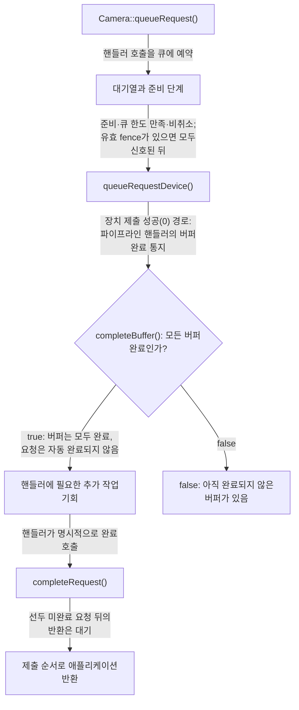

[Mermaid 원문](request-lifecycle.request-stages.mmd)

??? note "그림 근거와 확인 범위"
    접수 성공 뒤에도 준비 대기와 장치 처리가 남습니다. 정상 촬영 경로의 계약을 연결한 그림이며 실제 실행 시간이나 전체 실패 경로를 나타내지 않습니다.
    
    소스에 연결한 설계 해석입니다. 자동 연결 검사는 의미 승인이나 기기 실행 검증이 아닙니다.
    
    | 요소·전이 | 소스 근거 |
    |---|---|
    | <span data-sdd-label-en="Camera::queueRequest()">Camera::queueRequest&#40;&#41;</span> | [src/libcamera/camera.cpp:1308](#source-28d007de6ad1a8a5) |
    | <span data-sdd-label-en="Waiting queue and preparation">대기열과 준비 단계</span> | [src/libcamera/pipeline_handler.cpp:428](#source-789eafedfaa7f3c5) |
    | <span data-sdd-label-en="queueRequestDevice()">queueRequestDevice&#40;&#41;</span> | [src/libcamera/pipeline_handler.cpp:428](#source-789eafedfaa7f3c5) |
    | <span data-sdd-label-en="completeBuffer(): have all buffers completed?">completeBuffer&#40;&#41;: 모든 버퍼 완료인가?</span> | [src/libcamera/pipeline_handler.cpp:547](#source-ab8710f8a8a7905d) |
    | <span data-sdd-label-en="Opportunity for any additional required work">핸들러에 필요한 추가 작업 기회</span> | [src/libcamera/pipeline_handler.cpp:547](#source-01ad7c6605c3296a) |
    | <span data-sdd-label-en="completeRequest()">completeRequest&#40;&#41;</span> | [src/libcamera/pipeline_handler.cpp:547](#source-01ad7c6605c3296a) |
    | <span data-sdd-label-en="Return to application in submission order">제출 순서로 애플리케이션 반환</span> | [src/libcamera/pipeline_handler.cpp:547](#source-01ad7c6605c3296a) |
    | <span data-sdd-label-en="false: buffers have not all completed">false: 아직 완료되지 않은 버퍼가 있음</span> | [src/libcamera/pipeline_handler.cpp:547](#source-ab8710f8a8a7905d) |
    | <span data-sdd-label-en="Queue the handler invocation">핸들러 호출을 큐에 예약</span> | [src/libcamera/camera.cpp:1308](#source-28d007de6ad1a8a5) |
    | <span data-sdd-label-en="Prepared, within queue limit, not cancelled; all valid fences signalled if present">준비·큐 한도 만족·비취소; 유효 fence가 있으면 모두 신호된 뒤</span> | [src/libcamera/pipeline_handler.cpp:428](#source-789eafedfaa7f3c5) · [src/libcamera/request.cpp:442](#source-95ae69eeb085e3b1) |
    | <span data-sdd-label-en="Device submission success (0): pipeline handler signals buffer completion">장치 제출 성공&#40;0&#41; 경로: 파이프라인 핸들러의 버퍼 완료 통지</span> | [src/libcamera/pipeline_handler.cpp:547](#source-ab8710f8a8a7905d) · [src/libcamera/pipeline_handler.cpp:530](#source-c05f8214908fe4fe) |
    | <span data-sdd-label-en="true: all buffers completed; request is not automatically completed">true: 버퍼는 모두 완료, 요청은 자동 완료되지 않음</span> | [src/libcamera/pipeline_handler.cpp:553](#source-5b0ae08604dff588) |
    | <span data-sdd-label-en="Handler explicitly calls completion">핸들러가 명시적으로 완료 호출</span> | [src/libcamera/pipeline_handler.cpp:547](#source-01ad7c6605c3296a) |
    | <span data-sdd-label-en="Wait behind an incomplete head request">선두 미완료 요청 뒤의 반환은 대기</span> | [src/libcamera/pipeline_handler.cpp:547](#source-01ad7c6605c3296a) |
    | <span data-sdd-label-en="false">false</span> | [src/libcamera/pipeline_handler.cpp:547](#source-ab8710f8a8a7905d) |
<!-- /sdd:visual:request-stages -->

<!-- sdd:visual:lifecycle-queue-return-completion -->
### 접수 반환과 완료 알림

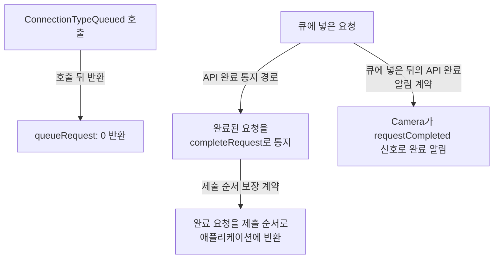

[Mermaid 원문](request-lifecycle.lifecycle-queue-return-completion.mmd)

??? note "그림 근거와 확인 범위"
    queueRequest의 0 반환과 requestCompleted 알림은 각각 무엇을 뜻합니까?
    
    소스에 연결한 설계 해석입니다. 자동 연결 검사는 의미 승인이나 기기 실행 검증이 아닙니다.
    
    | 요소·전이 | 소스 근거 |
    |---|---|
    | <span data-sdd-label-en="Invoke with ConnectionTypeQueued">ConnectionTypeQueued 호출</span> | [src/libcamera/camera.cpp:1308](#source-28d007de6ad1a8a5) |
    | <span data-sdd-label-en="queueRequest returns 0">queueRequest: 0 반환</span> | [src/libcamera/camera.cpp:1308](#source-28d007de6ad1a8a5) |
    | <span data-sdd-label-en="Queued request">큐에 넣은 요청</span> | [src/libcamera/camera.cpp:1308](#source-28d007de6ad1a8a5) |
    | <span data-sdd-label-en="Notify the already-completed request through completeRequest">완료된 요청을 completeRequest로 통지</span> | [src/libcamera/pipeline_handler.cpp:571](#source-236c920e906cb6fd) |
    | <span data-sdd-label-en="Return completed requests to the application in submission order">완료 요청을 제출 순서로 애플리케이션에 반환</span> | [src/libcamera/pipeline_handler.cpp:571](#source-236c920e906cb6fd) |
    | <span data-sdd-label-en="Camera notifies completion through requestCompleted">Camera가 requestCompleted 신호로 완료 알림</span> | [src/libcamera/camera.cpp:1308](#source-28d007de6ad1a8a5) |
    | <span data-sdd-label-en="Return after invoking">호출 뒤 반환</span> | [src/libcamera/camera.cpp:1308](#source-28d007de6ad1a8a5) |
    | <span data-sdd-label-en="API completion-notification path">API 완료 통지 경로</span> | [src/libcamera/camera.cpp:1308](#source-28d007de6ad1a8a5) · [src/libcamera/pipeline_handler.cpp:571](#source-236c920e906cb6fd) |
    | <span data-sdd-label-en="Submission-order contract">제출 순서 보장 계약</span> | [src/libcamera/pipeline_handler.cpp:571](#source-236c920e906cb6fd) |
    | <span data-sdd-label-en="API completion-notification contract after queuing">큐에 넣은 뒤의 API 완료 알림 계약</span> | [src/libcamera/camera.cpp:1308](#source-28d007de6ad1a8a5) |
<!-- /sdd:visual:lifecycle-queue-return-completion -->

<!-- sdd:visual:waiting-queue-conditions -->
### 선두 요청을 전달하거나 반복을 멈추는 조건

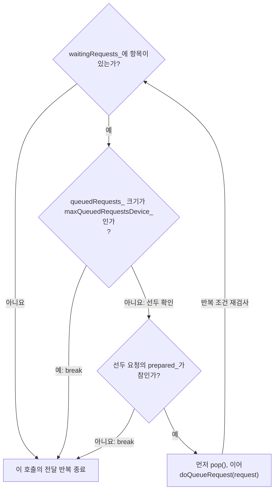

[Mermaid 원문](request-lifecycle.waiting-queue-conditions.mmd)

??? note "그림 근거와 확인 범위"
    waitingRequests_ 순회에서 준비 상태와 queuedRequests_ 소프트웨어 큐 크기는 어떻게 전달을 제한합니까?
    
    소스에 연결한 설계 해석입니다. 자동 연결 검사는 의미 승인이나 기기 실행 검증이 아닙니다.
    
    | 요소·전이 | 소스 근거 |
    |---|---|
    | <span data-sdd-label-en="Does waitingRequests_ contain an item?">waitingRequests&#95;에 항목이 있는가?</span> | [src/libcamera/pipeline_handler.cpp:428](#source-789eafedfaa7f3c5) |
    | <span data-sdd-label-en="Does queuedRequests_ size equal maxQueuedRequestsDevice_?">queuedRequests&#95; 크기가 maxQueuedRequestsDevice&#95;인가?</span> | [src/libcamera/pipeline_handler.cpp:428](#source-789eafedfaa7f3c5) |
    | <span data-sdd-label-en="Is the front request prepared_?">선두 요청의 prepared&#95;가 참인가?</span> | [src/libcamera/pipeline_handler.cpp:428](#source-789eafedfaa7f3c5) |
    | <span data-sdd-label-en="pop() first, then doQueueRequest(request)">먼저 pop&#40;&#41;, 이어 doQueueRequest&#40;request&#41;</span> | [src/libcamera/pipeline_handler.cpp:428](#source-789eafedfaa7f3c5) |
    | <span data-sdd-label-en="End this invocation&#x27;s forwarding loop">이 호출의 전달 반복 종료</span> | [src/libcamera/pipeline_handler.cpp:428](#source-789eafedfaa7f3c5) |
    | <span data-sdd-label-en="Yes">예</span> | [src/libcamera/pipeline_handler.cpp:428](#source-789eafedfaa7f3c5) |
    | <span data-sdd-label-en="No">아니요</span> | [src/libcamera/pipeline_handler.cpp:428](#source-789eafedfaa7f3c5) |
    | <span data-sdd-label-en="Yes: break">예: break</span> | [src/libcamera/pipeline_handler.cpp:428](#source-789eafedfaa7f3c5) |
    | <span data-sdd-label-en="No: inspect front">아니요: 선두 확인</span> | [src/libcamera/pipeline_handler.cpp:428](#source-789eafedfaa7f3c5) |
    | <span data-sdd-label-en="No: break">아니요: break</span> | [src/libcamera/pipeline_handler.cpp:428](#source-789eafedfaa7f3c5) |
    | <span data-sdd-label-en="Yes">예</span> | [src/libcamera/pipeline_handler.cpp:428](#source-789eafedfaa7f3c5) |
    | <span data-sdd-label-en="Recheck loop condition">반복 조건 재검사</span> | [src/libcamera/pipeline_handler.cpp:428](#source-789eafedfaa7f3c5) |
<!-- /sdd:visual:waiting-queue-conditions -->

<!-- sdd:visual:dispatch-cancel-or-device -->
### void 전달 함수의 두 취소 경로

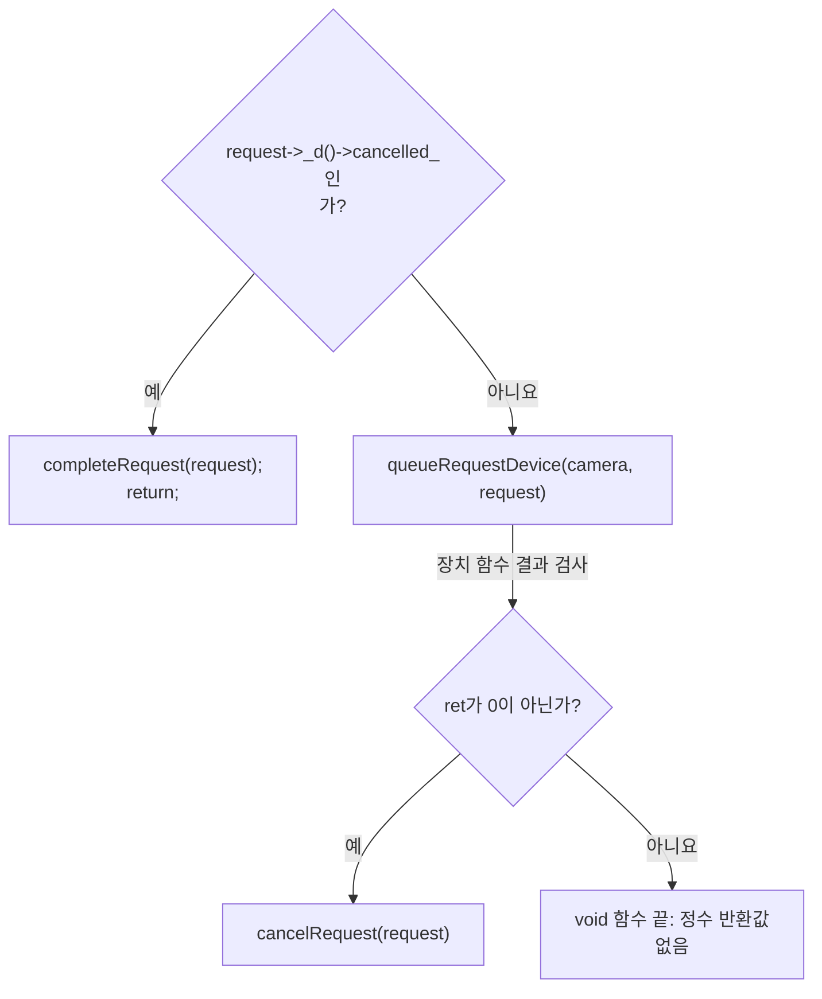

[Mermaid 원문](request-lifecycle.dispatch-cancel-or-device.mmd)

??? note "그림 근거와 확인 범위"
    doQueueRequest는 이미 취소된 요청과 장치 전달 실패를 각각 어느 함수로 처리합니까?
    
    소스에 연결한 설계 해석입니다. 자동 연결 검사는 의미 승인이나 기기 실행 검증이 아닙니다.
    
    | 요소·전이 | 소스 근거 |
    |---|---|
    | <span data-sdd-label-en="Is request-&gt;_d()-&gt;cancelled_ true?">request-&gt;&#95;d&#40;&#41;-&gt;cancelled&#95;인가?</span> | [src/libcamera/pipeline_handler.cpp:483](#source-7348e9b4af985eb2) |
    | <span data-sdd-label-en="completeRequest(request); return;">completeRequest&#40;request&#41;; return;</span> | [src/libcamera/pipeline_handler.cpp:483](#source-7348e9b4af985eb2) |
    | <span data-sdd-label-en="queueRequestDevice(camera, request)">queueRequestDevice&#40;camera, request&#41;</span> | [src/libcamera/pipeline_handler.cpp:483](#source-7348e9b4af985eb2) |
    | <span data-sdd-label-en="Is ret nonzero?">ret가 0이 아닌가?</span> | [src/libcamera/pipeline_handler.cpp:483](#source-7348e9b4af985eb2) |
    | <span data-sdd-label-en="cancelRequest(request)">cancelRequest&#40;request&#41;</span> | [src/libcamera/pipeline_handler.cpp:483](#source-7348e9b4af985eb2) |
    | <span data-sdd-label-en="End of void function: no integer return">void 함수 끝: 정수 반환값 없음</span> | [src/libcamera/pipeline_handler.cpp:483](#source-7348e9b4af985eb2) |
    | <span data-sdd-label-en="Yes">예</span> | [src/libcamera/pipeline_handler.cpp:483](#source-7348e9b4af985eb2) |
    | <span data-sdd-label-en="No">아니요</span> | [src/libcamera/pipeline_handler.cpp:483](#source-7348e9b4af985eb2) |
    | <span data-sdd-label-en="Inspect device result">장치 함수 결과 검사</span> | [src/libcamera/pipeline_handler.cpp:483](#source-7348e9b4af985eb2) |
    | <span data-sdd-label-en="Yes">예</span> | [src/libcamera/pipeline_handler.cpp:483](#source-7348e9b4af985eb2) |
    | <span data-sdd-label-en="No">아니요</span> | [src/libcamera/pipeline_handler.cpp:483](#source-7348e9b4af985eb2) |
<!-- /sdd:visual:dispatch-cancel-or-device -->

<!-- sdd:visual:buffer-and-request-completion -->
### 버퍼 완료와 명시적 요청 완료의 경계

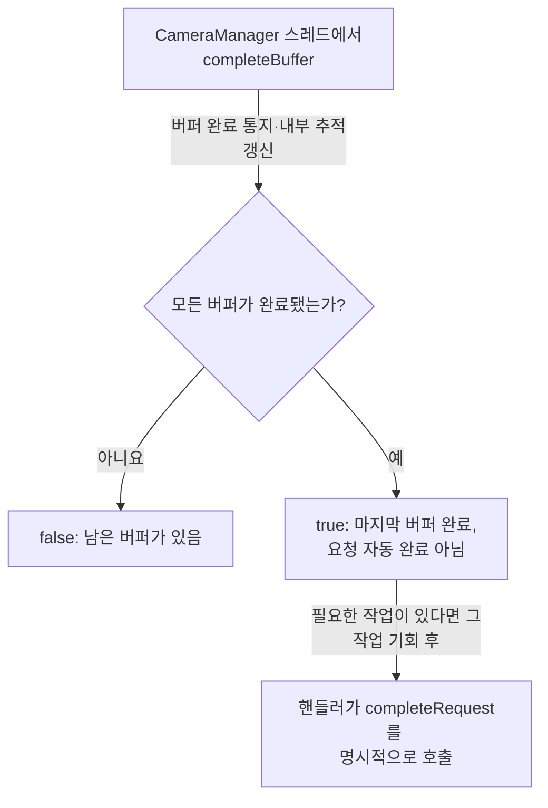

[Mermaid 원문](request-lifecycle.buffer-and-request-completion.mmd)

??? note "그림 근거와 확인 범위"
    마지막 버퍼가 끝났을 때 completeBuffer의 반환과 핸들러의 요청 완료 의무는 어떻게 구분됩니까?
    
    소스에 연결한 설계 해석입니다. 자동 연결 검사는 의미 승인이나 기기 실행 검증이 아닙니다.
    
    | 요소·전이 | 소스 근거 |
    |---|---|
    | <span data-sdd-label-en="completeBuffer in CameraManager thread">CameraManager 스레드에서 completeBuffer</span> | [src/libcamera/pipeline_handler.cpp:547](#source-ab8710f8a8a7905d) |
    | <span data-sdd-label-en="Have all buffers completed?">모든 버퍼가 완료됐는가?</span> | [src/libcamera/pipeline_handler.cpp:547](#source-ab8710f8a8a7905d) |
    | <span data-sdd-label-en="false: buffers remain">false: 남은 버퍼가 있음</span> | [src/libcamera/pipeline_handler.cpp:547](#source-ab8710f8a8a7905d) |
    | <span data-sdd-label-en="true: last buffer completed, request not automatically completed">true: 마지막 버퍼 완료, 요청 자동 완료 아님</span> | [src/libcamera/pipeline_handler.cpp:553](#source-5b0ae08604dff588) |
    | <span data-sdd-label-en="Handler explicitly calls completeRequest">핸들러가 completeRequest를 명시적으로 호출</span> | [src/libcamera/pipeline_handler.cpp:553](#source-5b0ae08604dff588) |
    | <span data-sdd-label-en="Notify buffer completion and update tracking">버퍼 완료 통지·내부 추적 갱신</span> | [src/libcamera/pipeline_handler.cpp:547](#source-ab8710f8a8a7905d) |
    | <span data-sdd-label-en="No">아니요</span> | [src/libcamera/pipeline_handler.cpp:547](#source-ab8710f8a8a7905d) |
    | <span data-sdd-label-en="Yes">예</span> | [src/libcamera/pipeline_handler.cpp:547](#source-ab8710f8a8a7905d) |
    | <span data-sdd-label-en="After an opportunity for any remaining required work">필요한 작업이 있다면 그 작업 기회 후</span> | [src/libcamera/pipeline_handler.cpp:553](#source-5b0ae08604dff588) |
<!-- /sdd:visual:buffer-and-request-completion -->

<!-- sdd:visual:submission-order-completion -->
### 제출 큐의 선두 상태와 반환 순서

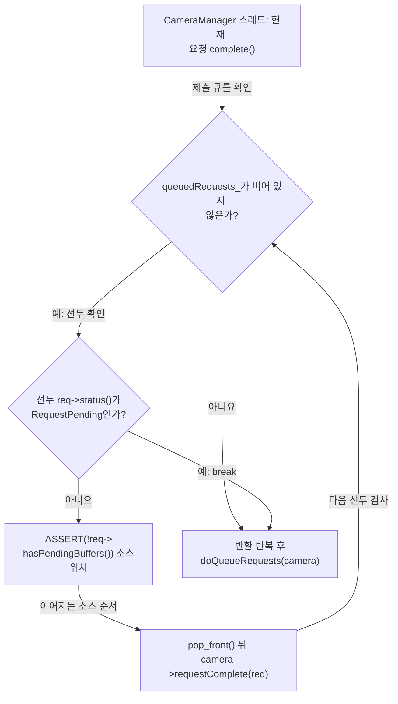

[Mermaid 원문](request-lifecycle.submission-order-completion.mmd)

??? note "그림 근거와 확인 범위"
    CameraManager 스레드의 completeRequest는 어느 조건에서 반환 반복을 멈추고 어느 요청을 애플리케이션에 알립니까?
    
    소스에 연결한 설계 해석입니다. 자동 연결 검사는 의미 승인이나 기기 실행 검증이 아닙니다.
    
    | 요소·전이 | 소스 근거 |
    |---|---|
    | <span data-sdd-label-en="CameraManager thread: complete() current request">CameraManager 스레드: 현재 요청 complete&#40;&#41;</span> | [src/libcamera/pipeline_handler.cpp:571](#source-236c920e906cb6fd) |
    | <span data-sdd-label-en="Is queuedRequests_ nonempty?">queuedRequests&#95;가 비어 있지 않은가?</span> | [src/libcamera/pipeline_handler.cpp:571](#source-236c920e906cb6fd) |
    | <span data-sdd-label-en="Is front req-&gt;status() RequestPending?">선두 req-&gt;status&#40;&#41;가 RequestPending인가?</span> | [src/libcamera/pipeline_handler.cpp:571](#source-236c920e906cb6fd) |
    | <span data-sdd-label-en="Source location of ASSERT(!req-&gt;hasPendingBuffers())">ASSERT&#40;&#33;req-&gt;hasPendingBuffers&#40;&#41;&#41; 소스 위치</span> | [src/libcamera/pipeline_handler.cpp:571](#source-236c920e906cb6fd) |
    | <span data-sdd-label-en="pop_front() then camera-&gt;requestComplete(req)">pop&#95;front&#40;&#41; 뒤 camera-&gt;requestComplete&#40;req&#41;</span> | [src/libcamera/pipeline_handler.cpp:571](#source-236c920e906cb6fd) |
    | <span data-sdd-label-en="doQueueRequests(camera) after return loop">반환 반복 후 doQueueRequests&#40;camera&#41;</span> | [src/libcamera/pipeline_handler.cpp:571](#source-236c920e906cb6fd) |
    | <span data-sdd-label-en="Inspect submission queue">제출 큐를 확인</span> | [src/libcamera/pipeline_handler.cpp:571](#source-236c920e906cb6fd) |
    | <span data-sdd-label-en="Yes: inspect front">예: 선두 확인</span> | [src/libcamera/pipeline_handler.cpp:571](#source-236c920e906cb6fd) |
    | <span data-sdd-label-en="No">아니요</span> | [src/libcamera/pipeline_handler.cpp:571](#source-236c920e906cb6fd) |
    | <span data-sdd-label-en="Yes: break">예: break</span> | [src/libcamera/pipeline_handler.cpp:571](#source-236c920e906cb6fd) |
    | <span data-sdd-label-en="No">아니요</span> | [src/libcamera/pipeline_handler.cpp:571](#source-236c920e906cb6fd) |
    | <span data-sdd-label-en="Following source order">이어지는 소스 순서</span> | [src/libcamera/pipeline_handler.cpp:571](#source-236c920e906cb6fd) |
    | <span data-sdd-label-en="Inspect next front">다음 선두 검사</span> | [src/libcamera/pipeline_handler.cpp:571](#source-236c920e906cb6fd) |
<!-- /sdd:visual:submission-order-completion -->

createRequest의 반환 타입은 `std::unique_ptr<Request>`이며, 새로 생성된 빈 `Request` 객체를 가리키는 포인터를 반환합니다. 오류가 발생하면 nullptr을 반환합니다. addBuffer는 버퍼를 해당 `Stream`과 연결하여 요청에 참조를 저장하며, 호출자는 요청 완료 콜백까지 버퍼가 유효하도록 보장해야 합니다. API 계약에서 버퍼가 유효한 `Stream`을 참조하지 않으면 -EINVAL을 반환하며, 구현은 stream이 nullptr인 경우를 확인하고, 같은 `Stream`의 버퍼가 이미 요청에 있거나 버퍼가 여전히 펜스를 참조하면 -EEXIST를 반환합니다. `src/libcamera/camera.cpp:1243`, `src/libcamera/request.cpp:442`, `src/libcamera/request.cpp:475`

queued 호출 전에 isAccessAllowed 검사가 음수 ret을 반환하면 그 값을 그대로 반환하고, 다른 카메라가 만든 요청에는 -EXDEV를 반환합니다. 요청 상태가 RequestPending이 아니거나 controls().infoMap()이 &controls()와 다르거나 버퍼가 없거나 비활성 `Stream`이 포함되면 -EINVAL을 반환합니다. API 주석의 반환 계약은 카메라 연결 해제에 -ENODEV, 실행 상태가 아닐 때 -EACCES, 요청을 처리할 버퍼 메모리가 부족할 때 -ENOMEM을 명시하지만, 함수 본문에는 -ENOMEM을 직접 반환하는 분기가 없습니다. `PipelineHandler::queueRequest()`와 `PipelineHandler::queueRequestDevice()`는 모두 `CameraManager` 스레드에서 호출됩니다. `src/libcamera/camera.cpp:1308`, `src/libcamera/pipeline_handler.cpp:428`, `src/libcamera/pipeline_handler.cpp:530`

`PipelineHandler::registerRequest()`는 요청이 준비되면 doQueueRequests(request->`_d()`->camera())를 호출하도록 prepared 신호를 연결합니다. `PipelineHandler::queueRequest()`는 요청을 `waitingRequests_`에 추가한 뒤 prepare(300ms)를 호출합니다. 요청이 준비 단계에서 실패하면 취소됩니다. `src/libcamera/pipeline_handler.cpp:428`

doQueueRequests()는 `waitingRequests_`의 선두 요청에서 `prepared_`가 거짓이면 뒤 요청을 전달하지 않고 중단합니다. 또한 `queuedRequests_`.size() == `maxQueuedRequestsDevice_`이면 요청 전달을 중단합니다. completeRequest()는 `queuedRequests_`의 선두부터 대기 중이 아닌 요청을 제거한 뒤 doQueueRequests(camera)를 호출해, 큐 크기에 여유가 생긴 경우 대기 요청의 전달을 다시 시도합니다. `src/libcamera/pipeline_handler.cpp:428`, `src/libcamera/pipeline_handler.cpp:516`, `src/libcamera/pipeline_handler.cpp:547`

doQueueRequest는 요청을 `queuedRequests_`에 추가하고 `sequence_`에 `requestSequence_` 값을 할당한 뒤 `requestSequence_`를 증가시킵니다. `cancelled_`가 참이면 completeRequest를 호출하고 함수를 종료합니다. 그렇지 않으면 queueRequestDevice를 호출하며, 그 결과가 0이 아니면 cancelRequest를 호출합니다. `src/libcamera/pipeline_handler.cpp:483`

queueRequestDevice()의 구현자는 요청에 제공된 버퍼에 캡처되는 프레임에 요청 파라미터가 적용되도록 장치를 프로그래밍해야 합니다. 성공하면 0을 반환하고, 오류가 발생하면 음수 오류 코드를 반환합니다. `src/libcamera/pipeline_handler.cpp:530`

실행 확인 항목: completeRequest와 애플리케이션 콜백의 진입·복귀 시점을 각각 기록하고, 현재 Linux 스레드 ID를 반환하는 `Thread::currentId()`의 반환값을 비교하는 조사를 계획합니다. 이 계획은 아직 실행하지 않았으며 콜백의 실제 실행 결과와 실행 스레드는 검증 전입니다. `src/libcamera/pipeline_handler.cpp:547`, `src/libcamera/base/thread.cpp:502`

근거 원문: [src/libcamera/camera.cpp:1243](#source-0ae00d77839f61cb) · [src/libcamera/camera.cpp:1308](#source-28d007de6ad1a8a5) · [src/libcamera/request.cpp:442](#source-95ae69eeb085e3b1) · [src/libcamera/pipeline_handler.cpp:428](#source-789eafedfaa7f3c5) · [src/libcamera/pipeline_handler.cpp:547](#source-01ad7c6605c3296a) · [src/libcamera/pipeline_handler.cpp:483](#source-7348e9b4af985eb2) · [src/libcamera/pipeline_handler.cpp:530](#source-c05f8214908fe4fe) · [src/libcamera/pipeline_handler.cpp:547](#source-ab8710f8a8a7905d) · [src/libcamera/pipeline_handler.cpp:571](#source-236c920e906cb6fd) · [src/libcamera/pipeline_handler.cpp:516](#source-a637b7daf9acb7ac) · [src/libcamera/pipeline_handler.cpp:553](#source-5b0ae08604dff588) · [src/libcamera/pipeline_handler.cpp:594](#source-bae861ceef5e8406) · [src/libcamera/base/thread.cpp:502](#source-87063df7f844467f) · [src/libcamera/base/bound_method.cpp:68](#source-0470759dc8387e9a) · [src/libcamera/request.cpp:475](#source-605100b059a6864d)

## 준비 대기와 재진입을 좁히기

조사 계획으로, `Camera::queueRequest()`가 0을 반환했지만 `PipelineHandler::queueRequest()`에 진입하지 않은 경우에는 `waitingRequests_`의 준비 대기를 살펴보기 전에 `ConnectionTypeQueued` 메시지의 대상 객체 스레드와 이벤트 루프 진행 및 메서드 진입을 관찰합니다. `Object::invokeMethod()`는 포인터를 그대로 전달하므로 호출자는 `Request` 포인터가 실제 메서드 호출까지 유효하도록 해야 하며, `ConnectionTypeQueued` 호출은 스레드가 멈추기 전에 실행된다고 보장되지 않습니다. `src/libcamera/base/object.cpp:258`, `src/libcamera/camera.cpp:1308`, `src/libcamera/pipeline_handler.cpp:435`

<!-- sdd:visual:preparation-depth-flow -->
### 준비 대기와 재진입을 좁히기 그림

```mermaid
flowchart TB
%% sdd:translations {"doQueueRequest 안에서 <br/>doQueueRequests가 재귀 <br/>호출될 수 있으므로 <br/>waitingRequests#95;에서 선두 <br/>요청을 먼저 pop합니다.": "The front request is popped <br/>from waitingRequests#95; first <br/>because doQueueRequests may <br/>be called recursively from <br/>within doQueueRequest.", "doQueueRequests는 대기 <br/>요청이 있는 동안 <br/>Camera::Private::<br/>queuedRequests#95;에 등록된 <br/>소프트웨어 요청 수와 한도의 <br/>동등 여부를 검사합니다. <br/>같으면 break하고, 같지 <br/>않으면 이 조건으로 중단하지 <br/>않습니다. 크기가 한도를 <br/>넘지 않는다는 불변조건은 <br/>별도로 검증해야 합니다.": "While requests are waiting, <br/>doQueueRequests tests <br/>whether the number of <br/>software requests <br/>registered in <br/>Camera::Private::<br/>queuedRequests#95; equals the <br/>limit. If equal, it breaks; <br/>otherwise, this condition <br/>does not stop it. The <br/>invariant that the size <br/>does not exceed the limit <br/>must be verified separately.", "doQueueRequest는 먼저 <br/>요청을 <br/>Camera::Private::<br/>queuedRequests#95; 소프트웨어 <br/>큐에 등록합니다. 이미 <br/>취소된 요청은 <br/>completeRequest 후 반환해 <br/>queueRequestDevice를 <br/>건너뜁니다. 그 외에는 <br/>queueRequestDevice로 장치 <br/>제출을 시도하고 실패하면 <br/>cancelRequest를 호출합니다.": "doQueueRequest first <br/>registers the request in <br/>the <br/>Camera::Private::<br/>queuedRequests#95; software <br/>queue. For an already <br/>cancelled request, it calls <br/>completeRequest and <br/>returns, skipping <br/>queueRequestDevice. <br/>Otherwise, it attempts <br/>device submission through <br/>queueRequestDevice and <br/>calls cancelRequest if it <br/>fails.", "emitPrepareCompleted는 <br/>prepared#95;를 true로 설정한 <br/>뒤 prepared 신호를 보냅니다.": "emitPrepareCompleted sets <br/>prepared#95; to true and then <br/>emits the prepared signal.", "notifierActivated는 해당 <br/>fence를 해제하고 notifier <br/>항목을 지웁니다. 처리되지 <br/>않은 notifier가 남으면 <br/>반환합니다.": "notifierActivated releases <br/>the corresponding fence and <br/>removes its notifier entry. <br/>It returns if unprocessed <br/>notifiers remain.", "prepared 신호는 준비가 <br/>끝났음을 알립니다. 준비 중 <br/>오류가 생기면 요청이 취소될 <br/>수 있습니다.": "The prepared signal reports <br/>that preparation is <br/>complete. The request may <br/>be cancelled if an error <br/>occurs during preparation.", "prepared#95;를 설정한 뒤 <br/>prepared를 보냅니다.": "It emits prepared after <br/>setting prepared#95;.", "timeout은 처리되지 않은 <br/>notifier가 남았음을 <br/>단언하고 항목을 모두 지운 <br/>뒤 cancel#40;#41;과 <br/>emitPrepareCompleted#40;#41;를 <br/>호출합니다.": "timeout asserts that <br/>unprocessed notifiers <br/>remain, clears all entries, <br/>and then calls cancel#40;#41; and <br/>emitPrepareCompleted#40;#41;.", "동등 비교가 거짓이면 선두 <br/>요청의 준비 여부를 <br/>검사합니다. · <br/>data-#62;queuedRequests#95;.size#40;#41;<br/> #61;#61; <br/>maxQueuedRequestsDevice#95; <br/>#91;false#93;": "If the equality comparison <br/>is false, it checks whether <br/>the front request is <br/>prepared. · <br/>data-#62;queuedRequests#95;.size#40;#41;<br/> #61;#61; <br/>maxQueuedRequestsDevice#95; <br/>#91;false#93;", "등록된 prepared 신호가 <br/>doQueueRequests를 <br/>호출합니다.": "The registered prepared <br/>signal calls <br/>doQueueRequests.", "선두 요청을 pop한 뒤 <br/>doQueueRequest에 전달합니다.": "It pops the front request <br/>before passing it to <br/>doQueueRequest.", "선두 요청의 prepared#95;가 <br/>설정되지 않았으면 반복을 <br/>멈춥니다.": "If the front request#39;s <br/>prepared#95; is not set, <br/>iteration stops.", "선두 요청이 준비되었으면 <br/>대기열에서 꺼냅니다. · <br/>#33;request-#62;#95;d#40;#41;-#62;prepared#95; <br/>#91;false#93;": "If the front request is <br/>prepared, it is popped from <br/>the waiting queue. · <br/>#33;request-#62;#95;d#40;#41;-#62;prepared#95; <br/>#91;false#93;", "요청을 취소한 뒤 준비 <br/>완료를 알립니다.": "It reports preparation <br/>completion after cancelling <br/>the request.", "처리되지 않은 notifier가 <br/>남지 않으면 타이머를 <br/>해제하고 준비 완료를 <br/>알립니다. · <br/>#33;notifiers#95;.empty#40;#41; #91;false#93;": "If no unprocessed notifiers <br/>remain, it resets the timer <br/>and reports preparation <br/>completion. · <br/>#33;notifiers#95;.empty#40;#41; #91;false#93;"}
  v_fence{"notifierActivated는 해당 <br/>fence를 해제하고 notifier <br/>항목을 지웁니다. 처리되지 <br/>않은 notifier가 남으면 <br/>반환합니다."}
  v_timeout["timeout은 처리되지 않은 <br/>notifier가 남았음을 <br/>단언하고 항목을 모두 지운 <br/>뒤 cancel#40;#41;과 <br/>emitPrepareCompleted#40;#41;를 <br/>호출합니다."]
  v_emit["emitPrepareCompleted는 <br/>prepared#95;를 true로 설정한 <br/>뒤 prepared 신호를 보냅니다."]
  v_signal["prepared 신호는 준비가 <br/>끝났음을 알립니다. 준비 중 <br/>오류가 생기면 요청이 취소될 <br/>수 있습니다."]
  v_limit{"doQueueRequests는 대기 <br/>요청이 있는 동안 <br/>Camera::Private::<br/>queuedRequests#95;에 등록된 <br/>소프트웨어 요청 수와 한도의 <br/>동등 여부를 검사합니다. <br/>같으면 break하고, 같지 <br/>않으면 이 조건으로 중단하지 <br/>않습니다. 크기가 한도를 <br/>넘지 않는다는 불변조건은 <br/>별도로 검증해야 합니다."}
  v_ready{"선두 요청의 prepared#95;가 <br/>설정되지 않았으면 반복을 <br/>멈춥니다."}
  v_waiting["doQueueRequest 안에서 <br/>doQueueRequests가 재귀 <br/>호출될 수 있으므로 <br/>waitingRequests#95;에서 선두 <br/>요청을 먼저 pop합니다."]
  v_queue["doQueueRequest는 먼저 <br/>요청을 <br/>Camera::Private::<br/>queuedRequests#95; 소프트웨어 <br/>큐에 등록합니다. 이미 <br/>취소된 요청은 <br/>completeRequest 후 반환해 <br/>queueRequestDevice를 <br/>건너뜁니다. 그 외에는 <br/>queueRequestDevice로 장치 <br/>제출을 시도하고 실패하면 <br/>cancelRequest를 호출합니다."]
  v_fence -->|"처리되지 않은 notifier가 <br/>남지 않으면 타이머를 <br/>해제하고 준비 완료를 <br/>알립니다. · <br/>#33;notifiers#95;.empty#40;#41; #91;false#93;"| v_emit
  v_timeout -->|"요청을 취소한 뒤 준비 <br/>완료를 알립니다."| v_emit
  v_emit -->|"prepared#95;를 설정한 뒤 <br/>prepared를 보냅니다."| v_signal
  v_signal -->|"등록된 prepared 신호가 <br/>doQueueRequests를 <br/>호출합니다."| v_limit
  v_limit -->|"동등 비교가 거짓이면 선두 <br/>요청의 준비 여부를 <br/>검사합니다. · <br/>data-#62;queuedRequests#95;.size#40;#41;<br/> #61;#61; <br/>maxQueuedRequestsDevice#95; <br/>#91;false#93;"| v_ready
  v_ready -->|"선두 요청이 준비되었으면 <br/>대기열에서 꺼냅니다. · <br/>#33;request-#62;#95;d#40;#41;-#62;prepared#95; <br/>#91;false#93;"| v_waiting
  v_waiting -->|"선두 요청을 pop한 뒤 <br/>doQueueRequest에 전달합니다."| v_queue
```

[Mermaid 원문](request-lifecycle.preparation-depth-flow.mmd)

??? note "그림 근거와 확인 범위"
    fence 신호 또는 타임아웃에서 prepared_가 설정된 뒤 선두 준비·큐 한도를 검사하고, 재진입 전 pop하여 전달하는 흐름은 무엇입니까?
    
    소스에 연결한 설계 해석입니다. 자동 연결 검사는 의미 승인이나 기기 실행 검증이 아닙니다.
    
    LLM 그림 초안 · 사람 검토 전
    
    작성 모델: `cli/codex/gpt-6.1-terra`
    
    | 요소·전이 | 소스 근거 |
    |---|---|
    | <span data-sdd-label-en="notifierActivated releases the corresponding fence and removes its notifier entry. It returns if unprocessed notifiers remain.">notifierActivated는 해당 fence를 해제하고 notifier 항목을 지웁니다. 처리되지 않은 notifier가 남으면 반환합니다.</span> | [src/libcamera/request.cpp:192](#source-7fddc16569422edd) |
    | <span data-sdd-label-en="timeout asserts that unprocessed notifiers remain, clears all entries, and then calls cancel() and emitPrepareCompleted().">timeout은 처리되지 않은 notifier가 남았음을 단언하고 항목을 모두 지운 뒤 cancel&#40;&#41;과 emitPrepareCompleted&#40;&#41;를 호출합니다.</span> | [src/libcamera/request.cpp:192](#source-7fddc16569422edd) |
    | <span data-sdd-label-en="emitPrepareCompleted sets prepared_ to true and then emits the prepared signal.">emitPrepareCompleted는 prepared&#95;를 true로 설정한 뒤 prepared 신호를 보냅니다.</span> | [src/libcamera/request.cpp:192](#source-7fddc16569422edd) |
    | <span data-sdd-label-en="The prepared signal reports that preparation is complete. The request may be cancelled if an error occurs during preparation.">prepared 신호는 준비가 끝났음을 알립니다. 준비 중 오류가 생기면 요청이 취소될 수 있습니다.</span> | [src/libcamera/request.cpp:192](#source-7fddc16569422edd) |
    | <span data-sdd-label-en="While requests are waiting, doQueueRequests tests whether the number of software requests registered in Camera::Private::queuedRequests_ equals the limit. If equal, it breaks; otherwise, this condition does not stop it. The invariant that the size does not exceed the limit must be verified separately.">doQueueRequests는 대기 요청이 있는 동안 Camera::Private::queuedRequests&#95;에 등록된 소프트웨어 요청 수와 한도의 동등 여부를 검사합니다. 같으면 break하고, 같지 않으면 이 조건으로 중단하지 않습니다. 크기가 한도를 넘지 않는다는 불변조건은 별도로 검증해야 합니다.</span> | [src/libcamera/pipeline_handler.cpp:435](#source-f905d5de57d1030f) |
    | <span data-sdd-label-en="If the front request&#x27;s prepared_ is not set, iteration stops.">선두 요청의 prepared&#95;가 설정되지 않았으면 반복을 멈춥니다.</span> | [src/libcamera/pipeline_handler.cpp:435](#source-f905d5de57d1030f) |
    | <span data-sdd-label-en="The front request is popped from waitingRequests_ first because doQueueRequests may be called recursively from within doQueueRequest.">doQueueRequest 안에서 doQueueRequests가 재귀 호출될 수 있으므로 waitingRequests&#95;에서 선두 요청을 먼저 pop합니다.</span> | [src/libcamera/pipeline_handler.cpp:435](#source-f905d5de57d1030f) |
    | <span data-sdd-label-en="doQueueRequest first registers the request in the Camera::Private::queuedRequests_ software queue. For an already cancelled request, it calls completeRequest and returns, skipping queueRequestDevice. Otherwise, it attempts device submission through queueRequestDevice and calls cancelRequest if it fails.">doQueueRequest는 먼저 요청을 Camera::Private::queuedRequests&#95; 소프트웨어 큐에 등록합니다. 이미 취소된 요청은 completeRequest 후 반환해 queueRequestDevice를 건너뜁니다. 그 외에는 queueRequestDevice로 장치 제출을 시도하고 실패하면 cancelRequest를 호출합니다.</span> | [src/libcamera/pipeline_handler.cpp:435](#source-f905d5de57d1030f) |
    | <span data-sdd-label-en="If no unprocessed notifiers remain, it resets the timer and reports preparation completion. · !notifiers_.empty() [false]">처리되지 않은 notifier가 남지 않으면 타이머를 해제하고 준비 완료를 알립니다. · &#33;notifiers&#95;.empty&#40;&#41; &#91;false&#93;</span> | [src/libcamera/request.cpp:192](#source-7fddc16569422edd) |
    | <span data-sdd-label-en="It reports preparation completion after cancelling the request.">요청을 취소한 뒤 준비 완료를 알립니다.</span> | [src/libcamera/request.cpp:192](#source-7fddc16569422edd) |
    | <span data-sdd-label-en="It emits prepared after setting prepared_.">prepared&#95;를 설정한 뒤 prepared를 보냅니다.</span> | [src/libcamera/request.cpp:192](#source-7fddc16569422edd) |
    | <span data-sdd-label-en="The registered prepared signal calls doQueueRequests.">등록된 prepared 신호가 doQueueRequests를 호출합니다.</span> | [src/libcamera/pipeline_handler.cpp:435](#source-f905d5de57d1030f) |
    | <span data-sdd-label-en="If the equality comparison is false, it checks whether the front request is prepared. · data-&gt;queuedRequests_.size() == maxQueuedRequestsDevice_ [false]">동등 비교가 거짓이면 선두 요청의 준비 여부를 검사합니다. · data-&gt;queuedRequests&#95;.size&#40;&#41; == maxQueuedRequestsDevice&#95; &#91;false&#93;</span> | [src/libcamera/pipeline_handler.cpp:435](#source-f905d5de57d1030f) |
    | <span data-sdd-label-en="If the front request is prepared, it is popped from the waiting queue. · !request-&gt;_d()-&gt;prepared_ [false]">선두 요청이 준비되었으면 대기열에서 꺼냅니다. · &#33;request-&gt;&#95;d&#40;&#41;-&gt;prepared&#95; &#91;false&#93;</span> | [src/libcamera/pipeline_handler.cpp:435](#source-f905d5de57d1030f) |
    | <span data-sdd-label-en="It pops the front request before passing it to doQueueRequest.">선두 요청을 pop한 뒤 doQueueRequest에 전달합니다.</span> | [src/libcamera/pipeline_handler.cpp:435](#source-f905d5de57d1030f) |
<!-- /sdd:visual:preparation-depth-flow -->

<!-- sdd:visual:submission-order-flow -->
### 동시 제출의 순서를 관찰할 경계

```mermaid
flowchart TB
%% sdd:translations {"Thread의 postMessage는 <br/>mutex 안에서 메시지를 <br/>추가합니다. 호출자는 포인터 <br/>인자를 메서드가 호출될 <br/>때까지 유효하게 유지해야 <br/>합니다.": "Thread postMessage adds the <br/>message under a mutex. The <br/>caller must keep pointer <br/>arguments valid until the <br/>method is invoked.", "doQueueRequest는 <br/>queuedRequests#95;에 요청을 <br/>넣고 소프트웨어 sequence#95;를 <br/>부여합니다. 이는 장치의 <br/>FrameMetadata sequence와 <br/>별개입니다. <br/>registerRequest는 준비 <br/>신호를 연결합니다.": "doQueueRequest adds the <br/>request to queuedRequests#95; <br/>and assigns its software <br/>sequence#95;, separate from <br/>the device FrameMetadata <br/>sequence. registerRequest <br/>connects the prepared <br/>signal.", "queueRequest의 시작 시각은 <br/>스레드 간 게시 순서를 <br/>정하지 않습니다. 이 그림은 <br/>추가 계측 위치이며 실제 <br/>동시 시험 결과가 아닙니다.": "queueRequest start times do <br/>not establish posting order <br/>across threads. This <br/>diagram shows additional <br/>instrumentation points, not <br/>results of a concurrent <br/>test.", "requestCompleted 신호 <br/>발생과 특정 연결의 콜백 <br/>관찰은 다릅니다. 요청 <br/>완료가 촬영 성공을 <br/>보장하지는 않습니다.": "Emitting requestCompleted <br/>differs from observing a <br/>callback on a particular <br/>connection. Request <br/>completion does not <br/>guarantee successful <br/>capture.", "검증을 통과하면 큐에 넣을 <br/>호출을 게시한 뒤 0을 <br/>반환합니다.": "After validation passes, <br/>the queued invocation is <br/>posted before 0 is returned.", "완료 처리에서 <br/>queuedRequests#95;의 선두가 <br/>완료된 상태이면 이를 꺼낸 <br/>뒤 신호를 발생합니다. · <br/>req-#62;status#40;#41; #61;#61; <br/>Request::RequestPending <br/>#91;false#93;": "During completion <br/>processing, a completed <br/>queuedRequests#95; head is <br/>popped before the signal is <br/>emitted. · req-#62;status#40;#41; #61;#61; <br/>Request::RequestPending <br/>#91;false#93;", "정상 경로에서는 준비와 장치 <br/>한도가 허용할 때 <br/>등록합니다. 정지 중에는 <br/>분리한 대기 요청을 취소한 <br/>뒤 전달합니다.": "On the normal path, <br/>registration requires <br/>preparation and device <br/>capacity. During stop, a <br/>cancelled waiting request <br/>is passed for registration.", "파이프라인은 요청을 <br/>waitingRequests#95;에 넣고 <br/>준비합니다. 큐에 넣은 <br/>호출은 스레드가 정지하기 <br/>전에 실행된다는 보장이 <br/>없습니다.": "The pipeline adds the <br/>request to waitingRequests#95; <br/>and prepares it. A queued <br/>invocation is not <br/>guaranteed to run before <br/>the thread stops.", "해당 메시지를 소비해 <br/>핸들러를 실행하면 요청이 <br/>대기 목록에 들어갑니다.": "If the message is consumed <br/>and its handler runs, the <br/>request enters the waiting <br/>queue."}
  v_api["queueRequest의 시작 시각은 <br/>스레드 간 게시 순서를 <br/>정하지 않습니다. 이 그림은 <br/>추가 계측 위치이며 실제 <br/>동시 시험 결과가 아닙니다."]
  v_post["Thread의 postMessage는 <br/>mutex 안에서 메시지를 <br/>추가합니다. 호출자는 포인터 <br/>인자를 메서드가 호출될 <br/>때까지 유효하게 유지해야 <br/>합니다."]
  v_waiting["파이프라인은 요청을 <br/>waitingRequests#95;에 넣고 <br/>준비합니다. 큐에 넣은 <br/>호출은 스레드가 정지하기 <br/>전에 실행된다는 보장이 <br/>없습니다."]
  v_register["doQueueRequest는 <br/>queuedRequests#95;에 요청을 <br/>넣고 소프트웨어 sequence#95;를 <br/>부여합니다. 이는 장치의 <br/>FrameMetadata sequence와 <br/>별개입니다. <br/>registerRequest는 준비 <br/>신호를 연결합니다."]
  v_notice["requestCompleted 신호 <br/>발생과 특정 연결의 콜백 <br/>관찰은 다릅니다. 요청 <br/>완료가 촬영 성공을 <br/>보장하지는 않습니다."]
  v_api -->|"검증을 통과하면 큐에 넣을 <br/>호출을 게시한 뒤 0을 <br/>반환합니다."| v_post
  v_post -->|"해당 메시지를 소비해 <br/>핸들러를 실행하면 요청이 <br/>대기 목록에 들어갑니다."| v_waiting
  v_waiting -->|"정상 경로에서는 준비와 장치 <br/>한도가 허용할 때 <br/>등록합니다. 정지 중에는 <br/>분리한 대기 요청을 취소한 <br/>뒤 전달합니다."| v_register
  v_register -->|"완료 처리에서 <br/>queuedRequests#95;의 선두가 <br/>완료된 상태이면 이를 꺼낸 <br/>뒤 신호를 발생합니다. · <br/>req-#62;status#40;#41; #61;#61; <br/>Request::RequestPending <br/>#91;false#93;"| v_notice
```

[Mermaid 원문](request-lifecycle.submission-order-flow.mmd)

??? note "그림 근거와 확인 범위"
    API 호출 시작과 실제 게시·등록·완료 통지의 순서는 어디에서 구분합니까?
    
    소스에 연결한 설계 해석입니다. 자동 연결 검사는 의미 승인이나 기기 실행 검증이 아닙니다.
    
    LLM 그림 초안 · 사람 검토 전
    
    작성 모델: `cli/codex/gpt-6.1-terra`
    
    | 요소·전이 | 소스 근거 |
    |---|---|
    | <span data-sdd-label-en="queueRequest start times do not establish posting order across threads. This diagram shows additional instrumentation points, not results of a concurrent test.">queueRequest의 시작 시각은 스레드 간 게시 순서를 정하지 않습니다. 이 그림은 추가 계측 위치이며 실제 동시 시험 결과가 아닙니다.</span> | [src/libcamera/camera.cpp:1308](#source-28d007de6ad1a8a5) · [src/libcamera/base/thread.cpp:558](#source-30a3738b60b6abb2) |
    | <span data-sdd-label-en="Thread postMessage adds the message under a mutex. The caller must keep pointer arguments valid until the method is invoked.">Thread의 postMessage는 mutex 안에서 메시지를 추가합니다. 호출자는 포인터 인자를 메서드가 호출될 때까지 유효하게 유지해야 합니다.</span> | [src/libcamera/base/thread.cpp:558](#source-30a3738b60b6abb2) · [src/libcamera/base/object.cpp:258](#source-438c51d63c1510a4) |
    | <span data-sdd-label-en="The pipeline adds the request to waitingRequests_ and prepares it. A queued invocation is not guaranteed to run before the thread stops.">파이프라인은 요청을 waitingRequests&#95;에 넣고 준비합니다. 큐에 넣은 호출은 스레드가 정지하기 전에 실행된다는 보장이 없습니다.</span> | [src/libcamera/pipeline_handler.cpp:435](#source-f905d5de57d1030f) · [src/libcamera/base/object.cpp:258](#source-438c51d63c1510a4) |
    | <span data-sdd-label-en="doQueueRequest adds the request to queuedRequests_ and assigns its software sequence_, separate from the device FrameMetadata sequence. registerRequest connects the prepared signal.">doQueueRequest는 queuedRequests&#95;에 요청을 넣고 소프트웨어 sequence&#95;를 부여합니다. 이는 장치의 FrameMetadata sequence와 별개입니다. registerRequest는 준비 신호를 연결합니다.</span> | [src/libcamera/pipeline_handler.cpp:435](#source-f905d5de57d1030f) · [src/libcamera/v4l2_videodevice.cpp:1814](#source-c75cbbe9c0bd5f96) |
    | <span data-sdd-label-en="Emitting requestCompleted differs from observing a callback on a particular connection. Request completion does not guarantee successful capture.">requestCompleted 신호 발생과 특정 연결의 콜백 관찰은 다릅니다. 요청 완료가 촬영 성공을 보장하지는 않습니다.</span> | [src/libcamera/camera.cpp:1475](#source-a8b87568e9f33e81) · [src/libcamera/base/bound_method.cpp:22](#source-bfdfed92f905633d) · [src/libcamera/pipeline_handler.cpp:359](#source-eefd1bbecb1aad0a) |
    | <span data-sdd-label-en="After validation passes, the queued invocation is posted before 0 is returned.">검증을 통과하면 큐에 넣을 호출을 게시한 뒤 0을 반환합니다.</span> | [src/libcamera/camera.cpp:1308](#source-28d007de6ad1a8a5) · [include/libcamera/base/object.h:26](#source-b4f8bfcb927a6e0c) · [include/libcamera/base/bound_method.h:59](#source-ded819c4f6ccbb7c) · [src/libcamera/base/bound_method.cpp:22](#source-bfdfed92f905633d) · [src/libcamera/base/object.cpp:184](#source-993262a2c2838b27) · [src/libcamera/base/thread.cpp:558](#source-30a3738b60b6abb2) |
    | <span data-sdd-label-en="If the message is consumed and its handler runs, the request enters the waiting queue.">해당 메시지를 소비해 핸들러를 실행하면 요청이 대기 목록에 들어갑니다.</span> | [src/libcamera/base/thread.cpp:558](#source-30a3738b60b6abb2) · [src/libcamera/base/thread.cpp:630](#source-d1c65540038fa8b5) · [src/libcamera/base/object.cpp:184](#source-993262a2c2838b27) · [src/libcamera/base/message.cpp:151](#source-f8ca77901599d6f4) · [include/libcamera/base/bound_method.h:59](#source-ded819c4f6ccbb7c) · [src/libcamera/camera.cpp:1308](#source-28d007de6ad1a8a5) · [src/libcamera/pipeline_handler.cpp:435](#source-f905d5de57d1030f) |
    | <span data-sdd-label-en="On the normal path, registration requires preparation and device capacity. During stop, a cancelled waiting request is passed for registration.">정상 경로에서는 준비와 장치 한도가 허용할 때 등록합니다. 정지 중에는 분리한 대기 요청을 취소한 뒤 전달합니다.</span> | [src/libcamera/pipeline_handler.cpp:435](#source-f905d5de57d1030f) · [src/libcamera/pipeline_handler.cpp:359](#source-eefd1bbecb1aad0a) |
    | <span data-sdd-label-en="During completion processing, a completed queuedRequests_ head is popped before the signal is emitted. · req-&gt;status() == Request::RequestPending [false]">완료 처리에서 queuedRequests&#95;의 선두가 완료된 상태이면 이를 꺼낸 뒤 신호를 발생합니다. · req-&gt;status&#40;&#41; == Request::RequestPending &#91;false&#93;</span> | [src/libcamera/pipeline_handler.cpp:435](#source-f905d5de57d1030f) · [src/libcamera/pipeline_handler.cpp:547](#source-01ad7c6605c3296a) · [src/libcamera/camera.cpp:1475](#source-a8b87568e9f33e81) |
<!-- /sdd:visual:submission-order-flow -->

<!-- sdd:visual:fence-timer-order-flow -->
### 같은 Poll 회차의 fence와 타이머 처리

```mermaid
flowchart TB
%% sdd:translations {"Timer 소멸자가 stop을 <br/>호출합니다.": "The Timer destructor calls <br/>stop.", "fence를 기다리는 notifier의 <br/>activated는 <br/>notifierActivated에 <br/>연결됩니다.": "The activated signal of the <br/>notifier waiting for a <br/>fence is connected to <br/>notifierActivated.", "notifier의 신호는 이 콜백에 <br/>연결됩니다.": "The notifier signal is <br/>connected to this callback.", "poll 결과가 양수이면 알림을 <br/>처리합니다. · ret #62; 0 #91;true#93;": "It processes notifiers when <br/>poll returns a positive <br/>result. · ret #62; 0 #91;true#93;", "processNotifiers가 반환한 <br/>뒤 processTimers를 <br/>호출합니다.": "It calls processTimers <br/>after processNotifiers <br/>returns.", "timeout은 남은 notifiers#95;를 <br/>지우고 요청을 취소합니다. <br/>미신호 fence는 버퍼에 <br/>남으므로 재사용 전에 <br/>FrameBuffer::releaseFence로 <br/>꺼내야 합니다.": "timeout clears the <br/>remaining notifiers#95; and <br/>cancels the request. An <br/>unsignalled fence remains <br/>in the buffer and must be <br/>retrieved with <br/>FrameBuffer::releaseFence <br/>before reuse.", "기본 Poll은 양수 결과에서 <br/>알림을 처리한 뒤 타이머를 <br/>처리합니다.": "For a positive result, the <br/>default Poll processes <br/>notifiers before timers.", "남은 notifiers#95;를 지우고 <br/>요청을 취소한 뒤 준비 <br/>완료를 발행합니다.": "It clears the remaining <br/>notifiers#95;, cancels the <br/>request, and emits <br/>preparation completion.", "남은 notifier가 없으면 <br/>timer#95;.reset을 호출합니다. <br/>· #33;notifiers#95;.empty#40;#41; <br/>#91;false#93;": "If no notifier remains, it <br/>calls timer#95;.reset. · <br/>#33;notifiers#95;.empty#40;#41; #91;false#93;", "다른 fence가 남고 타이머가 <br/>여전히 등록되어 기한이 <br/>지났으면 timeout을 <br/>발행합니다. · <br/>timer-#62;deadline#40;#41; #62; now <br/>#91;false#93;": "If another fence remains <br/>and the timer is still <br/>registered and expired, it <br/>emits timeout. · <br/>timer-#62;deadline#40;#41; #62; now <br/>#91;false#93;", "등록된 Read notifier의 <br/>유효한 이벤트가 일치하면 <br/>activated를 발행합니다.": "It emits activated when a <br/>registered Read notifier <br/>has a matching valid event.", "등록된 타이머가 남아 있고 <br/>기한이 지났을 때 <br/>처리합니다. 기한 경과만으로 <br/>timeout 선행이 보장되지는 <br/>않습니다.": "It processes a timer if it <br/>remains registered and its <br/>deadline has passed. Expiry <br/>alone does not guarantee <br/>that timeout runs first.", "마지막 fence가 완료되면 <br/>timer#95;.reset이 Timer를 <br/>소멸합니다.": "When the last fence <br/>completes, timer#95;.reset <br/>destroys the Timer.", "마지막 notifier를 제거하면 <br/>timer#95;.reset을 마친 뒤 준비 <br/>완료를 발행합니다. · <br/>#33;notifiers#95;.empty#40;#41; #91;false#93;": "After removing the last <br/>notifier, it emits <br/>preparation completion <br/>after timer#95;.reset returns. <br/>· #33;notifiers#95;.empty#40;#41; <br/>#91;false#93;", "소멸자는 stop을 호출합니다. <br/>올바른 스레드에서 실행 중인 <br/>타이머는 등록이 제거됩니다.": "The destructor calls stop. <br/>A running timer is <br/>unregistered on the correct <br/>thread.", "신호된 fence를 <br/>releaseFence로 꺼내고 해당 <br/>notifier를 제거한 뒤 남은 <br/>notifier를 확인합니다.": "It retrieves the signalled <br/>fence with releaseFence, <br/>removes its notifier, and <br/>checks for remaining <br/>notifiers.", "유효한 Read notifier의 <br/>이벤트가 일치하면 <br/>발행합니다. · pfd.revents #38; <br/>event.events #91;true#93;": "It emits for a valid Read <br/>notifier when its event <br/>matches. · pfd.revents #38; <br/>event.events #91;true#93;", "준비 완료를 발행합니다. <br/>이후 요청이 장치 오류로 <br/>취소될 수도 있습니다.": "It emits preparation <br/>completion. The request may <br/>still be cancelled due to a <br/>later device error."}
  v_events["기본 Poll은 양수 결과에서 <br/>알림을 처리한 뒤 타이머를 <br/>처리합니다."]
  v_notifiers["등록된 Read notifier의 <br/>유효한 이벤트가 일치하면 <br/>activated를 발행합니다."]
  v_activated["fence를 기다리는 notifier의 <br/>activated는 <br/>notifierActivated에 <br/>연결됩니다."]
  v_notifier{"신호된 fence를 <br/>releaseFence로 꺼내고 해당 <br/>notifier를 제거한 뒤 남은 <br/>notifier를 확인합니다."}
  v_timer["마지막 fence가 완료되면 <br/>timer#95;.reset이 Timer를 <br/>소멸합니다."]
  v_stop["소멸자는 stop을 호출합니다. <br/>올바른 스레드에서 실행 중인 <br/>타이머는 등록이 제거됩니다."]
  v_timers["등록된 타이머가 남아 있고 <br/>기한이 지났을 때 <br/>처리합니다. 기한 경과만으로 <br/>timeout 선행이 보장되지는 <br/>않습니다."]
  v_timeout["timeout은 남은 notifiers#95;를 <br/>지우고 요청을 취소합니다. <br/>미신호 fence는 버퍼에 <br/>남으므로 재사용 전에 <br/>FrameBuffer::releaseFence로 <br/>꺼내야 합니다."]
  v_prepared["준비 완료를 발행합니다. <br/>이후 요청이 장치 오류로 <br/>취소될 수도 있습니다."]
  v_events -->|"poll 결과가 양수이면 알림을 <br/>처리합니다. · ret #62; 0 #91;true#93;"| v_notifiers
  v_notifiers -->|"유효한 Read notifier의 <br/>이벤트가 일치하면 <br/>발행합니다. · pfd.revents #38; <br/>event.events #91;true#93;"| v_activated
  v_activated -->|"notifier의 신호는 이 콜백에 <br/>연결됩니다."| v_notifier
  v_notifiers -->|"processNotifiers가 반환한 <br/>뒤 processTimers를 <br/>호출합니다."| v_timers
  v_notifier -->|"남은 notifier가 없으면 <br/>timer#95;.reset을 호출합니다. <br/>· #33;notifiers#95;.empty#40;#41; <br/>#91;false#93;"| v_timer
  v_timer -->|"Timer 소멸자가 stop을 <br/>호출합니다."| v_stop
  v_notifier -->|"마지막 notifier를 제거하면 <br/>timer#95;.reset을 마친 뒤 준비 <br/>완료를 발행합니다. · <br/>#33;notifiers#95;.empty#40;#41; #91;false#93;"| v_prepared
  v_timers -->|"다른 fence가 남고 타이머가 <br/>여전히 등록되어 기한이 <br/>지났으면 timeout을 <br/>발행합니다. · <br/>timer-#62;deadline#40;#41; #62; now <br/>#91;false#93;"| v_timeout
  v_timeout -->|"남은 notifiers#95;를 지우고 <br/>요청을 취소한 뒤 준비 <br/>완료를 발행합니다."| v_prepared
```

[Mermaid 원문](request-lifecycle.fence-timer-order-flow.mmd)

??? note "그림 근거와 확인 범위"
    fence 준비와 타이머 기한 경과가 같은 Poll 회차에 잡히면 어느 분기를 확인합니까?
    
    소스에 연결한 설계 해석입니다. 자동 연결 검사는 의미 승인이나 기기 실행 검증이 아닙니다.
    
    LLM 그림 초안 · 사람 검토 전
    
    작성 모델: `cli/codex/gpt-6.1-terra`
    
    | 요소·전이 | 소스 근거 |
    |---|---|
    | <span data-sdd-label-en="For a positive result, the default Poll processes notifiers before timers.">기본 Poll은 양수 결과에서 알림을 처리한 뒤 타이머를 처리합니다.</span> | [src/libcamera/base/event_dispatcher_poll.cpp:1](#source-26d8c6fc2ebea7ad) |
    | <span data-sdd-label-en="It emits activated when a registered Read notifier has a matching valid event.">등록된 Read notifier의 유효한 이벤트가 일치하면 activated를 발행합니다.</span> | [src/libcamera/base/event_dispatcher_poll.cpp:1](#source-26d8c6fc2ebea7ad) |
    | <span data-sdd-label-en="The activated signal of the notifier waiting for a fence is connected to notifierActivated.">fence를 기다리는 notifier의 activated는 notifierActivated에 연결됩니다.</span> | [src/libcamera/request.cpp:192](#source-7fddc16569422edd) |
    | <span data-sdd-label-en="It retrieves the signalled fence with releaseFence, removes its notifier, and checks for remaining notifiers.">신호된 fence를 releaseFence로 꺼내고 해당 notifier를 제거한 뒤 남은 notifier를 확인합니다.</span> | [src/libcamera/request.cpp:192](#source-7fddc16569422edd) |
    | <span data-sdd-label-en="When the last fence completes, timer_.reset destroys the Timer.">마지막 fence가 완료되면 timer&#95;.reset이 Timer를 소멸합니다.</span> | [src/libcamera/request.cpp:192](#source-7fddc16569422edd) · [include/libcamera/internal/request.h:28](#source-54503df575ebd339) |
    | <span data-sdd-label-en="The destructor calls stop. A running timer is unregistered on the correct thread.">소멸자는 stop을 호출합니다. 올바른 스레드에서 실행 중인 타이머는 등록이 제거됩니다.</span> | [src/libcamera/base/timer.cpp:60](#source-9f261f2b61d35a0b) |
    | <span data-sdd-label-en="It processes a timer if it remains registered and its deadline has passed. Expiry alone does not guarantee that timeout runs first.">등록된 타이머가 남아 있고 기한이 지났을 때 처리합니다. 기한 경과만으로 timeout 선행이 보장되지는 않습니다.</span> | [src/libcamera/base/event_dispatcher_poll.cpp:1](#source-26d8c6fc2ebea7ad) |
    | <span data-sdd-label-en="timeout clears the remaining notifiers_ and cancels the request. An unsignalled fence remains in the buffer and must be retrieved with FrameBuffer::releaseFence before reuse.">timeout은 남은 notifiers&#95;를 지우고 요청을 취소합니다. 미신호 fence는 버퍼에 남으므로 재사용 전에 FrameBuffer::releaseFence로 꺼내야 합니다.</span> | [src/libcamera/request.cpp:192](#source-7fddc16569422edd) · [src/libcamera/request.cpp:462](#source-d8cf34a75a4333a7) |
    | <span data-sdd-label-en="It emits preparation completion. The request may still be cancelled due to a later device error.">준비 완료를 발행합니다. 이후 요청이 장치 오류로 취소될 수도 있습니다.</span> | [src/libcamera/request.cpp:192](#source-7fddc16569422edd) |
    | <span data-sdd-label-en="It processes notifiers when poll returns a positive result. · ret &gt; 0 [true]">poll 결과가 양수이면 알림을 처리합니다. · ret &gt; 0 &#91;true&#93;</span> | [src/libcamera/base/event_dispatcher_poll.cpp:1](#source-26d8c6fc2ebea7ad) |
    | <span data-sdd-label-en="It emits for a valid Read notifier when its event matches. · pfd.revents &amp; event.events [true]">유효한 Read notifier의 이벤트가 일치하면 발행합니다. · pfd.revents &amp; event.events &#91;true&#93;</span> | [src/libcamera/base/event_dispatcher_poll.cpp:1](#source-26d8c6fc2ebea7ad) |
    | <span data-sdd-label-en="The notifier signal is connected to this callback.">notifier의 신호는 이 콜백에 연결됩니다.</span> | [src/libcamera/request.cpp:192](#source-7fddc16569422edd) |
    | <span data-sdd-label-en="It calls processTimers after processNotifiers returns.">processNotifiers가 반환한 뒤 processTimers를 호출합니다.</span> | [src/libcamera/base/event_dispatcher_poll.cpp:1](#source-26d8c6fc2ebea7ad) |
    | <span data-sdd-label-en="If no notifier remains, it calls timer_.reset. · !notifiers_.empty() [false]">남은 notifier가 없으면 timer&#95;.reset을 호출합니다. · &#33;notifiers&#95;.empty&#40;&#41; &#91;false&#93;</span> | [src/libcamera/request.cpp:192](#source-7fddc16569422edd) |
    | <span data-sdd-label-en="The Timer destructor calls stop.">Timer 소멸자가 stop을 호출합니다.</span> | [src/libcamera/base/timer.cpp:60](#source-9f261f2b61d35a0b) |
    | <span data-sdd-label-en="After removing the last notifier, it emits preparation completion after timer_.reset returns. · !notifiers_.empty() [false]">마지막 notifier를 제거하면 timer&#95;.reset을 마친 뒤 준비 완료를 발행합니다. · &#33;notifiers&#95;.empty&#40;&#41; &#91;false&#93;</span> | [src/libcamera/request.cpp:192](#source-7fddc16569422edd) |
    | <span data-sdd-label-en="If another fence remains and the timer is still registered and expired, it emits timeout. · timer-&gt;deadline() &gt; now [false]">다른 fence가 남고 타이머가 여전히 등록되어 기한이 지났으면 timeout을 발행합니다. · timer-&gt;deadline&#40;&#41; &gt; now &#91;false&#93;</span> | [src/libcamera/base/event_dispatcher_poll.cpp:1](#source-26d8c6fc2ebea7ad) · [src/libcamera/request.cpp:192](#source-7fddc16569422edd) |
    | <span data-sdd-label-en="It clears the remaining notifiers_, cancels the request, and emits preparation completion.">남은 notifiers&#95;를 지우고 요청을 취소한 뒤 준비 완료를 발행합니다.</span> | [src/libcamera/request.cpp:192](#source-7fddc16569422edd) |
<!-- /sdd:visual:fence-timer-order-flow -->

`PipelineHandler::queueRequest()`는 요청을 `waitingRequests_`에 넣고 `prepare(300ms)`를 호출하며, `doQueueRequests()`는 큐가 가득 찼거나 선두 요청의 `prepared_`가 거짓이면 순회를 멈춥니다. `Request::Private::prepare()`는 fence가 없으면 동기적으로 준비 완료를 알리고, fence가 있으면 `notifiers_`로 기다리며, `notifierActivated()`가 마지막 fence를 처리하거나 `timeout()`이 요청을 취소하면 `emitPrepareCompleted()`가 `prepared_`를 참으로 바꾼 뒤 `prepared` 신호를 보냅니다. 따라서 `prepared_`는 촬영 준비 성공을 뜻하지 않으며, 완료 누락 조사에서는 `waitingRequests_` 선두의 `prepared_`, `notifiers_`에 남은 fence, `notifierActivated()`와 `timeout()`의 실행 및 다음 분기를 관찰합니다. `src/libcamera/request.cpp:192`, `src/libcamera/pipeline_handler.cpp:435`

`doQueueRequests()`는 `queuedRequests_.size() == maxQueuedRequestsDevice_`이거나 대기 큐의 선두 요청이 준비되지 않았으면 반복을 중단하고, 준비된 선두 요청은 큐에서 제거한 뒤 `doQueueRequest()`를 호출합니다. 이 제거 순서는 `doQueueRequest()` 안에서 `doQueueRequests()`가 재귀 호출되는 경우를 고려한 것이며, 준비 중 취소된 요청이나 장치 제출에 실패한 요청은 완료 처리를 거쳐 다시 `doQueueRequests()`를 호출할 수 있습니다. 조사 계획으로는 이 제거 순서를 변경하기 전에 대기 큐의 선두와 제거 순서, 각 요청의 중복 처리 여부를 관찰합니다. `src/libcamera/pipeline_handler.cpp:435`, `src/libcamera/pipeline_handler.cpp:547`

호출자는 이미 제출된 요청이 있는 경우에도 `Camera::stop()`을 다른 카메라 상태 변경 함수와 동기화해야 합니다. `Camera::queueRequest()`는 상태 검사 후에도 함수 실행 중 카메라 상태가 바뀔 수 있다고 명시하며, 게시된 `PipelineHandler::queueRequest()`는 `CameraStopping`을 재검사하지 않고 요청을 `waitingRequests_`에 추가한 뒤 `prepare(300ms)`를 실행합니다. 조사 계획으로, 게시된 호출이 정지 시 대기 큐를 분리한 뒤 실행되는지 확인하기 위해 호출 게시와 실행, `CameraStopping` 설정, 대기 큐 분리, `stopDevice()`, 준비, 장치 제출 및 `Camera::requestComplete()` 상태 검사의 순서를 기록합니다. `src/libcamera/camera.cpp:1431`, `src/libcamera/camera.cpp:1308`, `src/libcamera/pipeline_handler.cpp:435`, `src/libcamera/pipeline_handler.cpp:359`, `src/libcamera/camera.cpp:1475`

`Camera::requestComplete()`는 `isAccessAllowed()`에 `CameraStopping`부터 `CameraRunning`까지의 범위와 `allowDisconnected=true`를 전달하며, 이 인자는 연결 해제 거부만 건너뛰고 상태 범위 검사는 유지합니다. 게시된 호출이 대기 큐 분리 뒤 실행되고 요청 완료가 `CameraConfigured` 상태에서 `Camera::requestComplete()`에 도달하면 범위 검사에서 `-EACCES`가 반환되어 `Trying to complete a request when stopped` Fatal 로그 경계에 도달합니다. `src/libcamera/camera.cpp:1475`, `src/libcamera/camera.cpp:709`, `include/libcamera/internal/camera.h:49`, `src/libcamera/pipeline_handler.cpp:359`, `src/libcamera/pipeline_handler.cpp:435`

검증 계획: 선택한 카메라에서 각 `Camera::queueRequest`의 호출 시작과 `0` 반환, 그리고 `Thread::postMessage`가 mutex를 얻은 뒤 메시지를 추가한 순서를 따로 기록하며, 서로 다른 스레드의 호출 시작 순서를 게시 순서로 단정하지 않습니다. `Camera::queueRequest`의 `ConnectionTypeQueued` 호출은 `Object::invokeMethod`, 바인딩된 메서드와 `Object::postMessage`를 거쳐 게시되며, `Thread::dispatchMessages`가 `Object::message`를 호출하고 `InvokeMessage::invoke`가 패킹된 메서드를 호출하는 경로를 확인합니다. `src/libcamera/camera.cpp:1308`, `include/libcamera/base/object.h:26`, `include/libcamera/base/bound_method.h:59`, `src/libcamera/base/bound_method.cpp:22`, `src/libcamera/base/object.cpp:184`, `src/libcamera/base/thread.cpp:558`, `src/libcamera/base/thread.cpp:630`, `src/libcamera/base/message.cpp:151`

검증 계획: `PipelineHandler::queueRequest` 진입과 `waitingRequests_` 등록을 기록하고, `registerRequest`는 `prepared` 신호를 연결하며 `doQueueRequest`가 `queuedRequests_`에 추가한 뒤 `sequence_`를 부여하는 지점과 구분하여 준비된 요청의 제출 순서를 확인합니다. `completeRequest`에 따른 완료 통지와 `Camera::requestComplete`의 `requestCompleted` 발생 및 특정 수신 연결의 실제 콜백을 따로 기록하고 여러 수신 연결을 중복 완료로 세지 않으며, `Request`의 `sequence_`와 V4L2의 `FrameMetadata::sequence`는 동일하다고 가정하지 않고 출력 버퍼 여부와 첫 프레임 보정 조건을 함께 확인합니다. `src/libcamera/pipeline_handler.cpp:435`, `src/libcamera/camera.cpp:1475`, `src/libcamera/base/bound_method.cpp:22`, `src/libcamera/v4l2_videodevice.cpp:1814`

선택한 `EventDispatcherPoll::processEvents()`는 같은 회차에서 `poll`의 반환값이 양수이면 `processNotifiers()`를 처리한 뒤 `processTimers()`를 호출합니다. 유효한 fence fd에 Read 준비가 보고되고 요청 타이머의 기한도 지난 경우, `notifierActivated()`가 마지막 `notifiers_` 항목을 제거하면 `timer_.reset()`으로 `Timer`를 소멸시키며, 소멸자는 `Timer::stop()`을 통해 dispatcher 등록을 제거합니다. 이어서 `notifierActivated()`는 별도로 `emitPrepareCompleted()`를 호출하고, 이 함수는 `prepared_`를 설정한 뒤 `prepared`를 발행하므로 기한 경과만으로 `timeout()`이 먼저 호출되었다고 판정할 수 없습니다. 다른 fence가 남아 타이머가 여전히 등록되어 있고 만료 상태라면 뒤의 `processTimers()`에서 `timeout()`이 실행될 수 있습니다. `src/libcamera/request.cpp:192`, `src/libcamera/base/event_dispatcher_poll.cpp:1`, `src/libcamera/base/timer.cpp:60`

조사 계획으로 handler가 실행되기 전에 fence의 fd와 `revents`를 기록합니다. 이어서 notifier와 timer의 진입 순서, 등록 제거, `cancelled_`와 `prepared_` 값을 각 경계에서 기록합니다. 이 확인은 timeout 경로를 판정하기 위한 것이며, 후속 장치 제출 오류에 따른 취소를 배제하지 않습니다. `src/libcamera/base/event_dispatcher_poll.cpp:1`, `src/libcamera/request.cpp:192`, `include/libcamera/internal/request.h:28`

조사 계획으로 앱에 추가 계측을 넣어 `Camera::queueRequest()`를 시작할 때마다 회차 표식을 만들고, 같은 표식으로 API 반환값 `0` 또는 오류, 메시지 큐 등록, `PipelineHandler::queueRequest()` 진입을 연결합니다. 성공 반환 후 진입 기록이 없으면 메시지 전달을 조사하고, 진입 기록이 있으면 대기 큐 조사를 이어가며, 같은 `Request` 주소와 나중에 `doQueueRequest()`가 부여하는 `sequence`는 진입 전 회차 표식을 대신할 수 없습니다. `src/libcamera/camera.cpp:1308`, `src/libcamera/base/thread.cpp:558`, `src/libcamera/pipeline_handler.cpp:435`

근거 원문: [src/libcamera/pipeline_handler.cpp:435](#source-f905d5de57d1030f) · [src/libcamera/request.cpp:192](#source-7fddc16569422edd) · [src/libcamera/request.cpp:139](#source-c98dc1442538e903) · [src/libcamera/pipeline_handler.cpp:547](#source-01ad7c6605c3296a) · [src/libcamera/camera.cpp:1308](#source-28d007de6ad1a8a5) · [src/libcamera/base/object.cpp:258](#source-438c51d63c1510a4) · [src/libcamera/camera.cpp:1431](#source-e09324743def3f09) · [src/libcamera/pipeline_handler.cpp:359](#source-eefd1bbecb1aad0a) · [src/libcamera/camera.cpp:1475](#source-a8b87568e9f33e81) · [src/libcamera/base/thread.cpp:558](#source-30a3738b60b6abb2) · [src/libcamera/v4l2_videodevice.cpp:1814](#source-c75cbbe9c0bd5f96) · [include/libcamera/base/object.h:26](#source-b4f8bfcb927a6e0c) · [include/libcamera/base/bound_method.h:59](#source-ded819c4f6ccbb7c) · [src/libcamera/base/bound_method.cpp:22](#source-bfdfed92f905633d) · [src/libcamera/base/object.cpp:184](#source-993262a2c2838b27) · [src/libcamera/base/message.cpp:151](#source-f8ca77901599d6f4) · [src/libcamera/base/thread.cpp:630](#source-d1c65540038fa8b5) · [src/libcamera/base/event_dispatcher_poll.cpp:1](#source-26d8c6fc2ebea7ad) · [src/libcamera/base/timer.cpp:60](#source-9f261f2b61d35a0b) · [include/libcamera/internal/request.h:28](#source-54503df575ebd339) · [src/libcamera/request.cpp:462](#source-d8cf34a75a4333a7) · [src/libcamera/camera.cpp:709](#source-1e64f4ece8808997) · [include/libcamera/internal/camera.h:49](#source-a46d382d4070001c)

## UVC의 장치 제출과 완료를 추적하기

`processControls`는 각 `processControl`의 반환값을 검사하지 않고 구성한 `ControlList`를 `setControls`에 전달한 뒤 그 반환값을 반환합니다. `V4L2Device::setControls`는 빈 목록에 0을 반환하고, 미등록 제어나 일반 검증 오류에는 `-EINVAL`을 반환하며, 특정 제어의 쓰기 실패에는 `error_idx` 앞의 제어만 대상으로 `updateControls`를 호출하고 `-EIO`를 반환합니다. 조사 계획에서는 원래 호출의 반환값을 확인하고, `ioctl`이 실패한 경우 `error_idx`와 그 앞의 제어 상태를 관찰합니다. `src/libcamera/pipeline/uvcvideo/uvcvideo.cpp:427`, `src/libcamera/pipeline/uvcvideo/uvcvideo.cpp:327`, `src/libcamera/v4l2_device.cpp:309`

<!-- sdd:visual:uvc-depth-flow -->
### UVC의 장치 제출과 완료를 추적하기 그림

```mermaid
flowchart TB
%% sdd:translations {"DQBUF가 성공하고 등록된 <br/>버퍼를 찾아 반환하면 <br/>bufferReady를 내보내고 <br/>연결된 imageBufferReady가 <br/>알림을 받습니다. · #33;buffer <br/>#91;false#93;": "If DQBUF succeeds and the <br/>registered buffer is found <br/>and returned, bufferReady <br/>is emitted and the <br/>connected imageBufferReady <br/>receives the notification. <br/>· #33;buffer #91;false#93;", "VIDIOC#95;QBUF가 성공하면 <br/>버퍼를 등록합니다. · ret #60; <br/>0 #91;false#93;": "If VIDIOC#95;QBUF succeeds, it <br/>records the buffer. · ret #60; <br/>0 #91;false#93;", "bufferAvailable은 별도의 <br/>장치 완료 이벤트를 <br/>처리합니다. DQBUF가 <br/>실패하거나 예상하지 못한 <br/>버퍼가 반환되면 bufferReady <br/>알림 없이 반환합니다.": "bufferAvailable handles a <br/>separate device completion <br/>event. If DQBUF fails or an <br/>unexpected buffer is <br/>returned, it returns <br/>without a bufferReady <br/>notification.", "cancelRequest는 요청을 <br/>취소하고 완료하며 <br/>completeRequest와 같은 <br/>규칙을 따릅니다.": "cancelRequest cancels and <br/>completes the request and <br/>follows the same rules as <br/>completeRequest.", "completeBuffer로 버퍼 <br/>완료를 알린 뒤 <br/>completeRequest를 <br/>호출합니다. 버퍼 완료만으로 <br/>요청이 자동 완료되지는 <br/>않습니다.": "It calls completeRequest <br/>after signaling buffer <br/>completion with <br/>completeBuffer. Buffer <br/>completion alone does not <br/>automatically complete the <br/>request.", "imageBufferReady는 버퍼 <br/>타임스탬프를 요청에 기록한 <br/>뒤 버퍼와 요청을 차례로 <br/>완료합니다.": "imageBufferReady records <br/>the buffer timestamp in the <br/>request, then completes the <br/>buffer and the request in <br/>that order.", "processControls는 개별 <br/>processControl의 반환을 <br/>검사하지 않고 구성된 목록을 <br/>setControls에 전달합니다. <br/>빈 목록도 0을 반환할 수 <br/>있으므로 0은 모든 요청 <br/>제어가 적용되었다는 증명이 <br/>아닙니다.": "processControls does not <br/>check individual <br/>processControl returns; it <br/>passes the constructed list <br/>to setControls. An empty <br/>list can also return 0, so <br/>0 does not prove that all <br/>requested controls were <br/>applied.", "queueBuffer는 VIDIOC#95;QBUF를 <br/>수행합니다. cache#95;가 없으면 <br/>Fatal을 기록하므로 이를 <br/>정상적인 음수 반환으로 <br/>일반화하면 안 됩니다.": "queueBuffer performs <br/>VIDIOC#95;QBUF. A missing <br/>cache#95; logs Fatal, so it <br/>must not be generalized as <br/>a normal negative return.", "queueRequestDevice는 스트림 <br/>버퍼가 없으면 -ENOENT를 <br/>반환하고, 제어 처리와 버퍼 <br/>제출이 모두 성공하면 0을 <br/>반환합니다.": "queueRequestDevice returns <br/>-ENOENT if the stream <br/>buffer is missing and <br/>returns 0 if both control <br/>processing and buffer <br/>submission succeed.", "queuedBuffers#95;에는 QBUF에 <br/>성공한 버퍼가 인덱스로 <br/>등록됩니다.": "queuedBuffers#95; records <br/>buffers by index after QBUF <br/>succeeds.", "등록 후 별도의 장치 완료 <br/>이벤트가 발생하면 <br/>bufferAvailable이 <br/>처리합니다. 등록 자체는 <br/>즉시 알림이나 하드웨어 <br/>완료를 보장하지 않습니다.": "If a separate device <br/>completion event occurs <br/>after registration, <br/>bufferAvailable handles it. <br/>Registration itself does <br/>not guarantee an immediate <br/>notification or hardware <br/>completion.", "스트림 버퍼를 찾으면 요청의 <br/>제어를 처리합니다. · <br/>#33;buffer #91;false#93;": "If the stream buffer is <br/>found, it processes the <br/>request controls. · #33;buffer <br/>#91;false#93;", "제어 처리 결과가 음수가 <br/>아니면 버퍼를 큐에 <br/>넣습니다. · ret #60; 0 #91;false#93;": "If the control processing <br/>result is not negative, it <br/>queues the buffer. · ret #60; <br/>0 #91;false#93;", "제어 처리 결과가 음수이면 <br/>QBUF 전에 그 값을 반환하고 <br/>호출자가 요청을 취소합니다. <br/>· ret #60; 0 #91;true#93;": "If control processing <br/>returns a negative value, <br/>it is returned before QBUF <br/>and the caller cancels the <br/>request. · ret #60; 0 #91;true#93;", "제어 처리 뒤 버퍼 큐잉이 <br/>음수를 반환하면 호출자가 <br/>요청을 취소합니다. 제어 <br/>롤백은 보장되지 않습니다. · <br/>ret #60; 0 #91;true#93;": "If buffer queueing returns <br/>a negative value after <br/>control processing, the <br/>caller cancels the request. <br/>Control rollback is not <br/>guaranteed. · ret #60; 0 #91;true#93;", "취소한 요청을 완료합니다.": "It completes the cancelled <br/>request.", "파이프라인 핸들러는 <br/>CameraManager 스레드에서 <br/>요청을 명시적으로 완료해야 <br/>하며 반환 후에는 요청에 <br/>접근하면 안 됩니다. 완료된 <br/>요청은 순서 제약 없이 <br/>전달할 수 있고 <br/>애플리케이션에는 제출 <br/>순서대로 반환됩니다.": "The pipeline handler must <br/>explicitly complete the <br/>request on the <br/>CameraManager thread and <br/>must not access it after <br/>completeRequest returns. It <br/>may call completeRequest on <br/>complete requests without <br/>an ordering constraint, and <br/>requests are returned to <br/>the application in <br/>submission order."}
  v_submit["queueRequestDevice는 스트림 <br/>버퍼가 없으면 -ENOENT를 <br/>반환하고, 제어 처리와 버퍼 <br/>제출이 모두 성공하면 0을 <br/>반환합니다."]
  v_controls["processControls는 개별 <br/>processControl의 반환을 <br/>검사하지 않고 구성된 목록을 <br/>setControls에 전달합니다. <br/>빈 목록도 0을 반환할 수 <br/>있으므로 0은 모든 요청 <br/>제어가 적용되었다는 증명이 <br/>아닙니다."]
  v_queue["queueBuffer는 VIDIOC#95;QBUF를 <br/>수행합니다. cache#95;가 없으면 <br/>Fatal을 기록하므로 이를 <br/>정상적인 음수 반환으로 <br/>일반화하면 안 됩니다."]
  v_queued["queuedBuffers#95;에는 QBUF에 <br/>성공한 버퍼가 인덱스로 <br/>등록됩니다."]
  v_cancel["cancelRequest는 요청을 <br/>취소하고 완료하며 <br/>completeRequest와 같은 <br/>규칙을 따릅니다."]
  v_available["bufferAvailable은 별도의 <br/>장치 완료 이벤트를 <br/>처리합니다. DQBUF가 <br/>실패하거나 예상하지 못한 <br/>버퍼가 반환되면 bufferReady <br/>알림 없이 반환합니다."]
  v_ready["imageBufferReady는 버퍼 <br/>타임스탬프를 요청에 기록한 <br/>뒤 버퍼와 요청을 차례로 <br/>완료합니다."]
  v_complete["파이프라인 핸들러는 <br/>CameraManager 스레드에서 <br/>요청을 명시적으로 완료해야 <br/>하며 반환 후에는 요청에 <br/>접근하면 안 됩니다. 완료된 <br/>요청은 순서 제약 없이 <br/>전달할 수 있고 <br/>애플리케이션에는 제출 <br/>순서대로 반환됩니다."]
  v_submit -->|"스트림 버퍼를 찾으면 요청의 <br/>제어를 처리합니다. · <br/>#33;buffer #91;false#93;"| v_controls
  v_controls -->|"제어 처리 결과가 음수가 <br/>아니면 버퍼를 큐에 <br/>넣습니다. · ret #60; 0 #91;false#93;"| v_queue
  v_controls -->|"제어 처리 결과가 음수이면 <br/>QBUF 전에 그 값을 반환하고 <br/>호출자가 요청을 취소합니다. <br/>· ret #60; 0 #91;true#93;"| v_cancel
  v_queue -->|"제어 처리 뒤 버퍼 큐잉이 <br/>음수를 반환하면 호출자가 <br/>요청을 취소합니다. 제어 <br/>롤백은 보장되지 않습니다. · <br/>ret #60; 0 #91;true#93;"| v_cancel
  v_queue -->|"VIDIOC#95;QBUF가 성공하면 <br/>버퍼를 등록합니다. · ret #60; <br/>0 #91;false#93;"| v_queued
  v_queued -->|"등록 후 별도의 장치 완료 <br/>이벤트가 발생하면 <br/>bufferAvailable이 <br/>처리합니다. 등록 자체는 <br/>즉시 알림이나 하드웨어 <br/>완료를 보장하지 않습니다."| v_available
  v_available -->|"DQBUF가 성공하고 등록된 <br/>버퍼를 찾아 반환하면 <br/>bufferReady를 내보내고 <br/>연결된 imageBufferReady가 <br/>알림을 받습니다. · #33;buffer <br/>#91;false#93;"| v_ready
  v_ready -->|"completeBuffer로 버퍼 <br/>완료를 알린 뒤 <br/>completeRequest를 <br/>호출합니다. 버퍼 완료만으로 <br/>요청이 자동 완료되지는 <br/>않습니다."| v_complete
  v_cancel -->|"취소한 요청을 완료합니다."| v_complete
```

[Mermaid 원문](request-lifecycle.uvc-depth-flow.mmd)

??? note "그림 근거와 확인 범위"
    제어 적용 뒤 QBUF 실패의 취소와, 성공 제출 뒤 별도로 도착한 장치 완료 알림은 어디에서 갈라집니까?
    
    소스에 연결한 설계 해석입니다. 자동 연결 검사는 의미 승인이나 기기 실행 검증이 아닙니다.
    
    LLM 그림 초안 · 사람 검토 전
    
    작성 모델: `cli/codex/gpt-6.1-terra`
    
    | 요소·전이 | 소스 근거 |
    |---|---|
    | <span data-sdd-label-en="queueRequestDevice returns -ENOENT if the stream buffer is missing and returns 0 if both control processing and buffer submission succeed.">queueRequestDevice는 스트림 버퍼가 없으면 -ENOENT를 반환하고, 제어 처리와 버퍼 제출이 모두 성공하면 0을 반환합니다.</span> | [src/libcamera/pipeline/uvcvideo/uvcvideo.cpp:448](#source-3a087e0a990d7e90) |
    | <span data-sdd-label-en="processControls does not check individual processControl returns; it passes the constructed list to setControls. An empty list can also return 0, so 0 does not prove that all requested controls were applied.">processControls는 개별 processControl의 반환을 검사하지 않고 구성된 목록을 setControls에 전달합니다. 빈 목록도 0을 반환할 수 있으므로 0은 모든 요청 제어가 적용되었다는 증명이 아닙니다.</span> | [src/libcamera/pipeline/uvcvideo/uvcvideo.cpp:427](#source-10ae274fe1533335) · [src/libcamera/v4l2_device.cpp:309](#source-9fe67b6f6386944c) |
    | <span data-sdd-label-en="queueBuffer performs VIDIOC_QBUF. A missing cache_ logs Fatal, so it must not be generalized as a normal negative return.">queueBuffer는 VIDIOC&#95;QBUF를 수행합니다. cache&#95;가 없으면 Fatal을 기록하므로 이를 정상적인 음수 반환으로 일반화하면 안 됩니다.</span> | [src/libcamera/v4l2_videodevice.cpp:1648](#source-c944ca5694efdd7e) |
    | <span data-sdd-label-en="queuedBuffers_ records buffers by index after QBUF succeeds.">queuedBuffers&#95;에는 QBUF에 성공한 버퍼가 인덱스로 등록됩니다.</span> | [src/libcamera/v4l2_videodevice.cpp:1648](#source-c944ca5694efdd7e) |
    | <span data-sdd-label-en="cancelRequest cancels and completes the request and follows the same rules as completeRequest.">cancelRequest는 요청을 취소하고 완료하며 completeRequest와 같은 규칙을 따릅니다.</span> | [src/libcamera/pipeline_handler.cpp:547](#source-01ad7c6605c3296a) |
    | <span data-sdd-label-en="bufferAvailable handles a separate device completion event. If DQBUF fails or an unexpected buffer is returned, it returns without a bufferReady notification.">bufferAvailable은 별도의 장치 완료 이벤트를 처리합니다. DQBUF가 실패하거나 예상하지 못한 버퍼가 반환되면 bufferReady 알림 없이 반환합니다.</span> | [src/libcamera/v4l2_videodevice.cpp:1648](#source-c944ca5694efdd7e) · [src/libcamera/v4l2_videodevice.cpp:1814](#source-c75cbbe9c0bd5f96) |
    | <span data-sdd-label-en="imageBufferReady records the buffer timestamp in the request, then completes the buffer and the request in that order.">imageBufferReady는 버퍼 타임스탬프를 요청에 기록한 뒤 버퍼와 요청을 차례로 완료합니다.</span> | [src/libcamera/pipeline/uvcvideo/uvcvideo.cpp:893](#source-bfa0db3a4bc7970d) |
    | <span data-sdd-label-en="The pipeline handler must explicitly complete the request on the CameraManager thread and must not access it after completeRequest returns. It may call completeRequest on complete requests without an ordering constraint, and requests are returned to the application in submission order.">파이프라인 핸들러는 CameraManager 스레드에서 요청을 명시적으로 완료해야 하며 반환 후에는 요청에 접근하면 안 됩니다. 완료된 요청은 순서 제약 없이 전달할 수 있고 애플리케이션에는 제출 순서대로 반환됩니다.</span> | [src/libcamera/pipeline_handler.cpp:547](#source-01ad7c6605c3296a) |
    | <span data-sdd-label-en="If the stream buffer is found, it processes the request controls. · !buffer [false]">스트림 버퍼를 찾으면 요청의 제어를 처리합니다. · &#33;buffer &#91;false&#93;</span> | [src/libcamera/pipeline/uvcvideo/uvcvideo.cpp:448](#source-3a087e0a990d7e90) |
    | <span data-sdd-label-en="If the control processing result is not negative, it queues the buffer. · ret &lt; 0 [false]">제어 처리 결과가 음수가 아니면 버퍼를 큐에 넣습니다. · ret &lt; 0 &#91;false&#93;</span> | [src/libcamera/pipeline/uvcvideo/uvcvideo.cpp:448](#source-3a087e0a990d7e90) |
    | <span data-sdd-label-en="If control processing returns a negative value, it is returned before QBUF and the caller cancels the request. · ret &lt; 0 [true]">제어 처리 결과가 음수이면 QBUF 전에 그 값을 반환하고 호출자가 요청을 취소합니다. · ret &lt; 0 &#91;true&#93;</span> | [src/libcamera/pipeline/uvcvideo/uvcvideo.cpp:448](#source-3a087e0a990d7e90) · [src/libcamera/pipeline_handler.cpp:483](#source-8bf901f3faef18e5) |
    | <span data-sdd-label-en="If buffer queueing returns a negative value after control processing, the caller cancels the request. Control rollback is not guaranteed. · ret &lt; 0 [true]">제어 처리 뒤 버퍼 큐잉이 음수를 반환하면 호출자가 요청을 취소합니다. 제어 롤백은 보장되지 않습니다. · ret &lt; 0 &#91;true&#93;</span> | [src/libcamera/pipeline/uvcvideo/uvcvideo.cpp:448](#source-3a087e0a990d7e90) · [src/libcamera/pipeline_handler.cpp:483](#source-8bf901f3faef18e5) · [src/libcamera/v4l2_videodevice.cpp:1648](#source-c944ca5694efdd7e) |
    | <span data-sdd-label-en="If VIDIOC_QBUF succeeds, it records the buffer. · ret &lt; 0 [false]">VIDIOC&#95;QBUF가 성공하면 버퍼를 등록합니다. · ret &lt; 0 &#91;false&#93;</span> | [src/libcamera/v4l2_videodevice.cpp:1648](#source-c944ca5694efdd7e) |
    | <span data-sdd-label-en="If a separate device completion event occurs after registration, bufferAvailable handles it. Registration itself does not guarantee an immediate notification or hardware completion.">등록 후 별도의 장치 완료 이벤트가 발생하면 bufferAvailable이 처리합니다. 등록 자체는 즉시 알림이나 하드웨어 완료를 보장하지 않습니다.</span> | [src/libcamera/v4l2_videodevice.cpp:1648](#source-c944ca5694efdd7e) · [src/libcamera/v4l2_videodevice.cpp:1814](#source-c75cbbe9c0bd5f96) |
    | <span data-sdd-label-en="If DQBUF succeeds and the registered buffer is found and returned, bufferReady is emitted and the connected imageBufferReady receives the notification. · !buffer [false]">DQBUF가 성공하고 등록된 버퍼를 찾아 반환하면 bufferReady를 내보내고 연결된 imageBufferReady가 알림을 받습니다. · &#33;buffer &#91;false&#93;</span> | [src/libcamera/v4l2_videodevice.cpp:1814](#source-c75cbbe9c0bd5f96) · [src/libcamera/pipeline/uvcvideo/uvcvideo.cpp:535](#source-f9929d36ff1c1b93) |
    | <span data-sdd-label-en="It calls completeRequest after signaling buffer completion with completeBuffer. Buffer completion alone does not automatically complete the request.">completeBuffer로 버퍼 완료를 알린 뒤 completeRequest를 호출합니다. 버퍼 완료만으로 요청이 자동 완료되지는 않습니다.</span> | [src/libcamera/pipeline/uvcvideo/uvcvideo.cpp:893](#source-bfa0db3a4bc7970d) · [src/libcamera/pipeline_handler.cpp:547](#source-01ad7c6605c3296a) |
    | <span data-sdd-label-en="It completes the cancelled request.">취소한 요청을 완료합니다.</span> | [src/libcamera/pipeline_handler.cpp:547](#source-01ad7c6605c3296a) |
<!-- /sdd:visual:uvc-depth-flow -->

<!-- sdd:visual:pre-qbuf-failure-flow -->
### QBUF 호출 전 실패와 cache 반환

```mermaid
flowchart TB
%% sdd:translations {"cache#95;가 있고 장치가 <br/>Stopping이 아니면 <br/>queueBuffer가 get을 <br/>호출합니다. 두 오류에서는 <br/>이번 버퍼를 <br/>queuedBuffers#95;에 새로 <br/>등록하지 않습니다.": "When cache#95; exists and the <br/>device is not Stopping, <br/>queueBuffer calls get. <br/>Neither error newly <br/>registers this buffer in <br/>queuedBuffers#95;.", "cancelRequest는 요청을 <br/>취소하고 완료합니다. <br/>completeRequest의 제출 <br/>순서와 호출 규칙이 <br/>적용됩니다.": "cancelRequest cancels and <br/>completes the request. The <br/>submission ordering and <br/>calling rules of <br/>completeRequest apply.", "doQueueRequest는 <br/>queueRequestDevice의 <br/>반환값이 0이 아닌지 <br/>검사합니다.": "doQueueRequest checks <br/>whether the return value <br/>from queueRequestDevice is <br/>nonzero.", "get은 사용 가능한 cache <br/>항목을 고르지 못하면 <br/>-ENOENT를 반환합니다. 이때 <br/>guard와 확보된 index는 아직 <br/>없습니다.": "get returns -ENOENT if it <br/>cannot select an available <br/>cache entry. At that point, <br/>there is no guard or <br/>acquired index.", "get의 음수 ret을 <br/>queueBuffer가 즉시 반환하면 <br/>queueRequestDevice가 그대로 <br/>전달합니다. · ret #60; 0 #91;true#93;": "When queueBuffer <br/>immediately returns the <br/>negative ret from get, <br/>queueRequestDevice passes <br/>it on unchanged. · ret #60; 0 <br/>#91;true#93;", "get이 index를 확보하면 <br/>guard를 만든 뒤 planes를 <br/>검사합니다. · ret #60; 0 <br/>#91;false#93;": "When get acquires an index, <br/>the function creates the <br/>guard and then checks <br/>planes. · ret #60; 0 #91;false#93;", "guard가 put을 수행한 뒤 <br/>queueRequestDevice가 <br/>queueBuffer의 -EINVAL을 <br/>그대로 반환합니다.": "After the guard calls put, <br/>queueRequestDevice returns <br/>queueBuffer#39;s -EINVAL <br/>unchanged.", "isContiguous 검사는 planes <br/>수가 형식의 수와 다를 때 <br/>연속성을 확인하며, 연속되지 <br/>않으면 -EINVAL을 반환합니다.": "The isContiguous check <br/>tests contiguity when the <br/>number of planes differs <br/>from the format count and <br/>returns -EINVAL if the <br/>buffer is not contiguous.", "planes 수가 부족하면 <br/>-EINVAL 반환 시 guard가 <br/>index를 put합니다. · <br/>planes.size#40;#41; #60; <br/>numV4l2Planes #91;true#93;": "If there are too few <br/>planes, the guard calls put <br/>on the index when returning <br/>-EINVAL. · planes.size#40;#41; #60; <br/>numV4l2Planes #91;true#93;", "planes 수가 부족하지 않으면 <br/>필요한 연속성을 검사합니다. <br/>· planes.size#40;#41; #60; <br/>numV4l2Planes #91;false#93;": "If there are enough planes, <br/>the function checks the <br/>required contiguity. · <br/>planes.size#40;#41; #60; <br/>numV4l2Planes #91;false#93;", "planes의 수가 장치 형식에 <br/>필요한 수보다 적으면 공통 <br/>검증이 -EINVAL을 반환합니다.": "The common validation <br/>returns -EINVAL if the <br/>number of planes is smaller <br/>than the device format <br/>requires.", "queueBuffer가 cache index를 <br/>요청합니다.": "queueBuffer requests a <br/>cache index.", "queueRequestDevice는 먼저 <br/>제어를 처리하고 <br/>queueBuffer의 음수 ret을 <br/>그대로 반환합니다. 모든 <br/>제어의 적용 보장이나 롤백은 <br/>이 경로에 없습니다.": "queueRequestDevice <br/>processes controls first <br/>and returns a negative ret <br/>from queueBuffer unchanged. <br/>This path provides no <br/>guarantee that all controls <br/>are applied and shows no <br/>rollback.", "queueRequestDevice의 원래 <br/>오류 반환값을 <br/>doQueueRequest가 받습니다.": "doQueueRequest receives the <br/>original error return value <br/>from queueRequestDevice.", "공통 검증 실패로 반환할 때 <br/>scope#95;exit guard가 확보한 <br/>index에 put을 호출해 해당 <br/>cache 항목을 다시 사용 <br/>가능하게 합니다.": "On return after common <br/>validation fails, the <br/>scope#95;exit guard calls put <br/>on the acquired index, <br/>making that cache entry <br/>available again.", "공통 검증과 나머지 사전 <br/>처리를 통과하면 <br/>VIDIOC#95;QBUF를 호출합니다. <br/>ioctl 이후 상세는 별도 <br/>범위입니다.": "After the common checks and <br/>remaining preliminary <br/>processing pass, <br/>VIDIOC#95;QBUF is called. <br/>Details after ioctl are <br/>outside this scope.", "반환값이 0이 아니면 <br/>cancelRequest를 호출합니다. <br/>· ret #91;true#93;": "If the return value is <br/>nonzero, doQueueRequest <br/>calls cancelRequest. · ret <br/>#91;true#93;", "연속성 검사를 통과하고 <br/>나머지 사전 처리도 통과하면 <br/>VIDIOC#95;QBUF에 도달합니다. · <br/>planes.size#40;#41; #33;#61; <br/>numV4l2Planes #38;#38; <br/>#33;buffer-#62;#95;d#40;#41;-#62;isContiguous#40;<br/>#41; #91;false#93;": "After the contiguity check <br/>and the remaining <br/>preliminary processing <br/>pass, execution reaches <br/>VIDIOC#95;QBUF. · <br/>planes.size#40;#41; #33;#61; <br/>numV4l2Planes #38;#38; <br/>#33;buffer-#62;#95;d#40;#41;-#62;isContiguous#40;<br/>#41; #91;false#93;", "연속성 조건을 충족하지 <br/>못하면 -EINVAL 반환 시 <br/>guard가 index를 put합니다. <br/>· planes.size#40;#41; #33;#61; <br/>numV4l2Planes #38;#38; <br/>#33;buffer-#62;#95;d#40;#41;-#62;isContiguous#40;<br/>#41; #91;true#93;": "If the contiguity <br/>requirement is not met, the <br/>guard calls put on the <br/>index when returning <br/>-EINVAL. · planes.size#40;#41; #33;#61; <br/>numV4l2Planes #38;#38; <br/>#33;buffer-#62;#95;d#40;#41;-#62;isContiguous#40;<br/>#41; #91;true#93;"}
  v_n0["cache#95;가 있고 장치가 <br/>Stopping이 아니면 <br/>queueBuffer가 get을 <br/>호출합니다. 두 오류에서는 <br/>이번 버퍼를 <br/>queuedBuffers#95;에 새로 <br/>등록하지 않습니다."]
  v_n1{"get은 사용 가능한 cache <br/>항목을 고르지 못하면 <br/>-ENOENT를 반환합니다. 이때 <br/>guard와 확보된 index는 아직 <br/>없습니다."}
  v_n2{"planes의 수가 장치 형식에 <br/>필요한 수보다 적으면 공통 <br/>검증이 -EINVAL을 반환합니다."}
  v_n3{"isContiguous 검사는 planes <br/>수가 형식의 수와 다를 때 <br/>연속성을 확인하며, 연속되지 <br/>않으면 -EINVAL을 반환합니다."}
  v_n4["공통 검증 실패로 반환할 때 <br/>scope#95;exit guard가 확보한 <br/>index에 put을 호출해 해당 <br/>cache 항목을 다시 사용 <br/>가능하게 합니다."]
  v_n5["공통 검증과 나머지 사전 <br/>처리를 통과하면 <br/>VIDIOC#95;QBUF를 호출합니다. <br/>ioctl 이후 상세는 별도 <br/>범위입니다."]
  v_n6["queueRequestDevice는 먼저 <br/>제어를 처리하고 <br/>queueBuffer의 음수 ret을 <br/>그대로 반환합니다. 모든 <br/>제어의 적용 보장이나 롤백은 <br/>이 경로에 없습니다."]
  v_n7{"doQueueRequest는 <br/>queueRequestDevice의 <br/>반환값이 0이 아닌지 <br/>검사합니다."}
  v_n8["cancelRequest는 요청을 <br/>취소하고 완료합니다. <br/>completeRequest의 제출 <br/>순서와 호출 규칙이 <br/>적용됩니다."]
  v_n0 -->|"queueBuffer가 cache index를 <br/>요청합니다."| v_n1
  v_n1 -->|"get이 index를 확보하면 <br/>guard를 만든 뒤 planes를 <br/>검사합니다. · ret #60; 0 <br/>#91;false#93;"| v_n2
  v_n1 -->|"get의 음수 ret을 <br/>queueBuffer가 즉시 반환하면 <br/>queueRequestDevice가 그대로 <br/>전달합니다. · ret #60; 0 #91;true#93;"| v_n6
  v_n2 -->|"planes 수가 부족하면 <br/>-EINVAL 반환 시 guard가 <br/>index를 put합니다. · <br/>planes.size#40;#41; #60; <br/>numV4l2Planes #91;true#93;"| v_n4
  v_n2 -->|"planes 수가 부족하지 않으면 <br/>필요한 연속성을 검사합니다. <br/>· planes.size#40;#41; #60; <br/>numV4l2Planes #91;false#93;"| v_n3
  v_n3 -->|"연속성 조건을 충족하지 <br/>못하면 -EINVAL 반환 시 <br/>guard가 index를 put합니다. <br/>· planes.size#40;#41; #33;#61; <br/>numV4l2Planes #38;#38; <br/>#33;buffer-#62;#95;d#40;#41;-#62;isContiguous#40;<br/>#41; #91;true#93;"| v_n4
  v_n3 -->|"연속성 검사를 통과하고 <br/>나머지 사전 처리도 통과하면 <br/>VIDIOC#95;QBUF에 도달합니다. · <br/>planes.size#40;#41; #33;#61; <br/>numV4l2Planes #38;#38; <br/>#33;buffer-#62;#95;d#40;#41;-#62;isContiguous#40;<br/>#41; #91;false#93;"| v_n5
  v_n4 -->|"guard가 put을 수행한 뒤 <br/>queueRequestDevice가 <br/>queueBuffer의 -EINVAL을 <br/>그대로 반환합니다."| v_n6
  v_n6 -->|"queueRequestDevice의 원래 <br/>오류 반환값을 <br/>doQueueRequest가 받습니다."| v_n7
  v_n7 -->|"반환값이 0이 아니면 <br/>cancelRequest를 호출합니다. <br/>· ret #91;true#93;"| v_n8
```

[Mermaid 원문](request-lifecycle.pre-qbuf-failure-flow.mmd)

??? note "그림 근거와 확인 범위"
    cache 인덱스 확보와 공통 plane 검증의 실패는 ioctl·cache 반환·공통 취소에서 어떻게 갈립니까?
    
    소스에 연결한 설계 해석입니다. 자동 연결 검사는 의미 승인이나 기기 실행 검증이 아닙니다.
    
    LLM 그림 초안 · 사람 검토 전
    
    작성 모델: `cli/codex/gpt-6.1-terra`
    
    | 요소·전이 | 소스 근거 |
    |---|---|
    | <span data-sdd-label-en="When cache_ exists and the device is not Stopping, queueBuffer calls get. Neither error newly registers this buffer in queuedBuffers_.">cache&#95;가 있고 장치가 Stopping이 아니면 queueBuffer가 get을 호출합니다. 두 오류에서는 이번 버퍼를 queuedBuffers&#95;에 새로 등록하지 않습니다.</span> | [src/libcamera/v4l2_videodevice.cpp:1648](#source-c944ca5694efdd7e) |
    | <span data-sdd-label-en="get returns -ENOENT if it cannot select an available cache entry. At that point, there is no guard or acquired index.">get은 사용 가능한 cache 항목을 고르지 못하면 -ENOENT를 반환합니다. 이때 guard와 확보된 index는 아직 없습니다.</span> | [src/libcamera/v4l2_videodevice.cpp:230](#source-1bcb60608dcf5671) · [src/libcamera/v4l2_videodevice.cpp:1648](#source-c944ca5694efdd7e) |
    | <span data-sdd-label-en="The common validation returns -EINVAL if the number of planes is smaller than the device format requires.">planes의 수가 장치 형식에 필요한 수보다 적으면 공통 검증이 -EINVAL을 반환합니다.</span> | [src/libcamera/v4l2_videodevice.cpp:1648](#source-c944ca5694efdd7e) |
    | <span data-sdd-label-en="The isContiguous check tests contiguity when the number of planes differs from the format count and returns -EINVAL if the buffer is not contiguous.">isContiguous 검사는 planes 수가 형식의 수와 다를 때 연속성을 확인하며, 연속되지 않으면 -EINVAL을 반환합니다.</span> | [src/libcamera/v4l2_videodevice.cpp:1648](#source-c944ca5694efdd7e) |
    | <span data-sdd-label-en="On return after common validation fails, the scope_exit guard calls put on the acquired index, making that cache entry available again.">공통 검증 실패로 반환할 때 scope&#95;exit guard가 확보한 index에 put을 호출해 해당 cache 항목을 다시 사용 가능하게 합니다.</span> | [src/libcamera/v4l2_videodevice.cpp:1648](#source-c944ca5694efdd7e) · [src/libcamera/v4l2_videodevice.cpp:272](#source-63aea0f4c80543b9) · [include/libcamera/base/utils.h:397](#source-5b47396152bb7c6f) |
    | <span data-sdd-label-en="After the common checks and remaining preliminary processing pass, VIDIOC_QBUF is called. Details after ioctl are outside this scope.">공통 검증과 나머지 사전 처리를 통과하면 VIDIOC&#95;QBUF를 호출합니다. ioctl 이후 상세는 별도 범위입니다.</span> | [src/libcamera/v4l2_videodevice.cpp:1648](#source-c944ca5694efdd7e) |
    | <span data-sdd-label-en="queueRequestDevice processes controls first and returns a negative ret from queueBuffer unchanged. This path provides no guarantee that all controls are applied and shows no rollback.">queueRequestDevice는 먼저 제어를 처리하고 queueBuffer의 음수 ret을 그대로 반환합니다. 모든 제어의 적용 보장이나 롤백은 이 경로에 없습니다.</span> | [src/libcamera/pipeline/uvcvideo/uvcvideo.cpp:448](#source-3a087e0a990d7e90) · [src/libcamera/pipeline/uvcvideo/uvcvideo.cpp:427](#source-10ae274fe1533335) |
    | <span data-sdd-label-en="doQueueRequest checks whether the return value from queueRequestDevice is nonzero.">doQueueRequest는 queueRequestDevice의 반환값이 0이 아닌지 검사합니다.</span> | [src/libcamera/pipeline_handler.cpp:483](#source-8bf901f3faef18e5) |
    | <span data-sdd-label-en="cancelRequest cancels and completes the request. The submission ordering and calling rules of completeRequest apply.">cancelRequest는 요청을 취소하고 완료합니다. completeRequest의 제출 순서와 호출 규칙이 적용됩니다.</span> | [src/libcamera/pipeline_handler.cpp:547](#source-01ad7c6605c3296a) |
    | <span data-sdd-label-en="queueBuffer requests a cache index.">queueBuffer가 cache index를 요청합니다.</span> | [src/libcamera/v4l2_videodevice.cpp:1648](#source-c944ca5694efdd7e) |
    | <span data-sdd-label-en="When get acquires an index, the function creates the guard and then checks planes. · ret &lt; 0 [false]">get이 index를 확보하면 guard를 만든 뒤 planes를 검사합니다. · ret &lt; 0 &#91;false&#93;</span> | [src/libcamera/v4l2_videodevice.cpp:1648](#source-c944ca5694efdd7e) |
    | <span data-sdd-label-en="When queueBuffer immediately returns the negative ret from get, queueRequestDevice passes it on unchanged. · ret &lt; 0 [true]">get의 음수 ret을 queueBuffer가 즉시 반환하면 queueRequestDevice가 그대로 전달합니다. · ret &lt; 0 &#91;true&#93;</span> | [src/libcamera/v4l2_videodevice.cpp:1648](#source-c944ca5694efdd7e) · [src/libcamera/pipeline/uvcvideo/uvcvideo.cpp:448](#source-3a087e0a990d7e90) |
    | <span data-sdd-label-en="If there are too few planes, the guard calls put on the index when returning -EINVAL. · planes.size() &lt; numV4l2Planes [true]">planes 수가 부족하면 -EINVAL 반환 시 guard가 index를 put합니다. · planes.size&#40;&#41; &lt; numV4l2Planes &#91;true&#93;</span> | [src/libcamera/v4l2_videodevice.cpp:1648](#source-c944ca5694efdd7e) · [include/libcamera/base/utils.h:397](#source-5b47396152bb7c6f) |
    | <span data-sdd-label-en="If there are enough planes, the function checks the required contiguity. · planes.size() &lt; numV4l2Planes [false]">planes 수가 부족하지 않으면 필요한 연속성을 검사합니다. · planes.size&#40;&#41; &lt; numV4l2Planes &#91;false&#93;</span> | [src/libcamera/v4l2_videodevice.cpp:1648](#source-c944ca5694efdd7e) |
    | <span data-sdd-label-en="If the contiguity requirement is not met, the guard calls put on the index when returning -EINVAL. · planes.size() != numV4l2Planes &amp;&amp; !buffer-&gt;_d()-&gt;isContiguous() [true]">연속성 조건을 충족하지 못하면 -EINVAL 반환 시 guard가 index를 put합니다. · planes.size&#40;&#41; &#33;= numV4l2Planes &amp;&amp; &#33;buffer-&gt;&#95;d&#40;&#41;-&gt;isContiguous&#40;&#41; &#91;true&#93;</span> | [src/libcamera/v4l2_videodevice.cpp:1648](#source-c944ca5694efdd7e) · [include/libcamera/base/utils.h:397](#source-5b47396152bb7c6f) |
    | <span data-sdd-label-en="After the contiguity check and the remaining preliminary processing pass, execution reaches VIDIOC_QBUF. · planes.size() != numV4l2Planes &amp;&amp; !buffer-&gt;_d()-&gt;isContiguous() [false]">연속성 검사를 통과하고 나머지 사전 처리도 통과하면 VIDIOC&#95;QBUF에 도달합니다. · planes.size&#40;&#41; &#33;= numV4l2Planes &amp;&amp; &#33;buffer-&gt;&#95;d&#40;&#41;-&gt;isContiguous&#40;&#41; &#91;false&#93;</span> | [src/libcamera/v4l2_videodevice.cpp:1648](#source-c944ca5694efdd7e) |
    | <span data-sdd-label-en="After the guard calls put, queueRequestDevice returns queueBuffer&#x27;s -EINVAL unchanged.">guard가 put을 수행한 뒤 queueRequestDevice가 queueBuffer의 -EINVAL을 그대로 반환합니다.</span> | [src/libcamera/v4l2_videodevice.cpp:1648](#source-c944ca5694efdd7e) · [include/libcamera/base/utils.h:397](#source-5b47396152bb7c6f) · [src/libcamera/pipeline/uvcvideo/uvcvideo.cpp:448](#source-3a087e0a990d7e90) |
    | <span data-sdd-label-en="doQueueRequest receives the original error return value from queueRequestDevice.">queueRequestDevice의 원래 오류 반환값을 doQueueRequest가 받습니다.</span> | [src/libcamera/pipeline_handler.cpp:483](#source-8bf901f3faef18e5) |
    | <span data-sdd-label-en="If the return value is nonzero, doQueueRequest calls cancelRequest. · ret [true]">반환값이 0이 아니면 cancelRequest를 호출합니다. · ret &#91;true&#93;</span> | [src/libcamera/pipeline_handler.cpp:483](#source-8bf901f3faef18e5) |
<!-- /sdd:visual:pre-qbuf-failure-flow -->

`PipelineHandlerUVC::queueRequestDevice`는 `findBuffer`가 버퍼를 찾지 못하면 `-ENOENT`를 반환하고, `processControls`가 음수를 반환하면 장치에 버퍼를 제출하기 전에 그 값을 반환하며, `queueBuffer`가 음수를 반환하면 그 값을 반환합니다. `processControls`는 `setControls`를 호출하며, 성공한 뒤 `queueBuffer`가 실패하는 경로에는 제어 변경을 롤백하는 코드가 없습니다. `PipelineHandler::doQueueRequest`는 요청을 `queuedRequests_`에 등록하고 sequence를 지정한 뒤, 이미 취소된 요청은 `completeRequest`로 완료하고 그렇지 않은 요청에서 `queueRequestDevice`가 0이 아닌 값을 반환하면 `cancelRequest`를 호출합니다. `src/libcamera/pipeline/uvcvideo/uvcvideo.cpp:448`, `src/libcamera/pipeline/uvcvideo/uvcvideo.cpp:427`, `src/libcamera/pipeline_handler.cpp:483`, `src/libcamera/pipeline_handler.cpp:547`

`V4L2VideoDevice::queueBuffer()`는 상태가 `State::Stopping`이면 `-ESHUTDOWN`을 반환합니다. `cache_`가 없으면 Fatal 로그 뒤에 `-ENOENT` 반환문이 있지만, 그 반환문이나 취소 경로에 도달한다고 보장할 수는 없습니다. `src/libcamera/v4l2_videodevice.cpp:1648`

`queueBuffer()`에서 캐시 획득에 성공한 뒤 `VIDIOC_QBUF`가 음수를 반환하면, 활성 `scope_exit`가 `cache_->put(buf.index)`를 실행하고 이번 버퍼를 `queuedBuffers_`에 새로 등록하지 않은 채 원래 `ret`를 반환합니다. `V4L2BufferCache::put()`은 해당 인덱스를 사용 가능으로 표시합니다. `VIDIOC_QBUF`가 성공하면 함수는 버퍼를 `queuedBuffers_`에 등록한 뒤 `guard.release()`를 호출하므로 이 함수의 반환 시에는 자동 `put`이 실행되지 않습니다. 프레임 완료는 별도로 `bufferAvailable()`에서 `bufferReady` 신호로 알리며, 조사할 때는 기존 `VIDIOC_QBUF` 반환값과 이어지는 분기 및 등록 여부를 관찰하는 계획입니다. `src/libcamera/v4l2_videodevice.cpp:1648`, `include/libcamera/base/utils.h:397`, `src/libcamera/v4l2_videodevice.cpp:272`

`dequeueBuffer()`는 `VIDIOC_DQBUF` 오류나 예상 밖 `index`에서 `nullptr`를 반환하고, `bufferAvailable()`은 `bufferReady`를 보내지 않습니다. 버퍼가 반환되면 UVC에 연결된 `imageBufferReady()`가 `completeBuffer()`와 `completeRequest()`를 순서대로 호출합니다. `src/libcamera/v4l2_videodevice.cpp:1814`, `src/libcamera/pipeline/uvcvideo/uvcvideo.cpp:535`, `src/libcamera/pipeline/uvcvideo/uvcvideo.cpp:893`

`dequeueBuffer()`는 입출력 모두에서 오류 플래그에 따라 `FrameError`를 정하고, 출력 타입은 캡처 플레인 검사 전에 반환합니다. 캡처에서 플레인 수가 다르고 V4L2 플레인이 1개가 아니거나 분할 중 플레인 시작 전 `remaining`이 0이면 `FrameError`이며, 마지막 플레인의 `bytesused`는 길이보다 작을 수 있습니다. `Request::Private::complete()`는 프레임 성공과 별개로 `cancelled_`에 따라 `RequestComplete` 또는 `RequestCancelled`를 정합니다. 완료 누락 조사 계획에서는 `pending_`과 `queuedRequests_` 선두 상태를 확인하며, 선두가 `RequestPending`이면 후속 완료 통지가 지연될 수 있습니다. `src/libcamera/v4l2_videodevice.cpp:1814`, `src/libcamera/request.cpp:103`, `src/libcamera/pipeline_handler.cpp:547`

`FrameMetadata::FrameSuccess`는 프레임이 성공적으로 캡처되어 데이터와 모든 메타데이터 필드가 유효한 상태입니다. `FrameMetadata::FrameError`는 프레임 데이터가 일부 또는 전체 손상되었거나 없거나 유효하지 않은 상태이며, `sequence`와 `timestamp`는 유효하고 나머지 필드는 유효하지 않을 수 있습니다. `FrameMetadata::FrameCancelled`는 프레임이 완료되기 전에 캡처가 중단된 상태이며, 프레임 데이터와 `status`를 제외한 모든 메타데이터 필드가 유효하지 않습니다. `src/libcamera/framebuffer.cpp:40`

`V4L2BufferCache::get`은 `free_`인 항목만 검사하고, 사용할 항목이 없으면 미스 횟수를 증가시킨 뒤 `-ENOENT`를 반환합니다. `queueBuffer`는 이 음수를 그대로 반환하며, 이번 호출에서는 새 인덱스를 확보하지 못했고 `scope_exit` guard도 아직 만들지 않았으므로 그 guard에 의한 `put`도 없습니다. 이 반환은 `VIDIOC_QBUF` 호출과 이번 버퍼의 `queuedBuffers_` 등록보다 앞섭니다. `cache_` 자체가 없는 경우의 Fatal 분기는 이 경우와 별개입니다. `src/libcamera/v4l2_videodevice.cpp:230`, `src/libcamera/v4l2_videodevice.cpp:1648`

UVC의 `queueRequestDevice`는 `processControls`가 0을 반환한 뒤 `queueBuffer`에 도달하고, 그 음수를 그대로 반환합니다. 공통 호출자인 `doQueueRequest`는 반환값이 0이 아니면 `cancelRequest`를 호출합니다. 제어 처리는 앞서지만 실제 제어 적용이나 롤백은 보장하지 않습니다. 조사 계획에서는 기존 호출의 `processControls`와 `queueBuffer` 반환값 및 이어지는 분기를 확인합니다. `src/libcamera/pipeline/uvcvideo/uvcvideo.cpp:448`, `src/libcamera/pipeline/uvcvideo/uvcvideo.cpp:427`, `src/libcamera/pipeline_handler.cpp:483`, `src/libcamera/pipeline_handler.cpp:547`, `src/libcamera/v4l2_videodevice.cpp:1648`

`V4L2VideoDevice::queueBuffer`는 cache 인덱스를 확보한 뒤 `planes.size()`가 `numV4l2Planes`보다 작으면 버퍼의 연속성과 관계없이 `-EINVAL`을 반환합니다. 플레인이 더 많으면 두 번째 검사는 비연속 버퍼에서 `-EINVAL`을 반환하고, 연속 버퍼는 두 검사를 통과합니다. 플레인 수가 같으면 두 검사 분기는 반환을 일으키지 않습니다. `src/libcamera/v4l2_videodevice.cpp:1648`

두 `-EINVAL` 반환에서는 `scope_exit`가 현재 인덱스로 `cache_->put`을 호출해 해당 cache 항목을 비어 있는 상태로 표시합니다. 이 반환 경로는 `VIDIOC_QBUF` ioctl과 이번 버퍼의 `queuedBuffers_` 등록에 도달하지 않습니다. 두 검사를 통과해도 이후 `VIDIOC_QBUF`의 성공이 보장되지는 않습니다. `src/libcamera/v4l2_videodevice.cpp:1648`, `include/libcamera/base/utils.h:397`, `src/libcamera/v4l2_videodevice.cpp:272`

근거 원문: [src/libcamera/pipeline/uvcvideo/uvcvideo.cpp:448](#source-3a087e0a990d7e90) · [src/libcamera/pipeline/uvcvideo/uvcvideo.cpp:427](#source-10ae274fe1533335) · [src/libcamera/pipeline/uvcvideo/uvcvideo.cpp:327](#source-e2dd9c088789d48d) · [src/libcamera/v4l2_device.cpp:309](#source-9fe67b6f6386944c) · [src/libcamera/v4l2_videodevice.cpp:1648](#source-c944ca5694efdd7e) · [src/libcamera/v4l2_videodevice.cpp:1814](#source-c75cbbe9c0bd5f96) · [src/libcamera/pipeline/uvcvideo/uvcvideo.cpp:893](#source-bfa0db3a4bc7970d) · [src/libcamera/pipeline/uvcvideo/uvcvideo.cpp:535](#source-f9929d36ff1c1b93) · [src/libcamera/pipeline_handler.cpp:547](#source-01ad7c6605c3296a) · [src/libcamera/request.cpp:103](#source-db7f21585c4c2708) · [src/libcamera/pipeline_handler.cpp:483](#source-8bf901f3faef18e5) · [src/libcamera/framebuffer.cpp:40](#source-50aa8a55cc04062e) · [src/libcamera/v4l2_videodevice.cpp:230](#source-1bcb60608dcf5671) · [src/libcamera/v4l2_videodevice.cpp:272](#source-63aea0f4c80543b9) · [include/libcamera/base/utils.h:397](#source-5b47396152bb7c6f)

## 요청·버퍼·fence의 수명

### 제출 성공 뒤에도 남는 수명 문제

`Camera::queueRequest`가 입력 검사를 통과해 `0`을 반환하는 성공 경로에서는 `ConnectionTypeQueued`로 `invokeMethod`를 호출한 뒤 `0`을 반환합니다. 요청 완료는 별도의 `requestCompleted` 신호로 통지합니다. `src/libcamera/camera.cpp:1308`

### 소유권과 두 완료 경계

`Camera::createRequest()` 호출자는 반환된 `Request`의 소유권을 받으며 삭제할 책임이 있습니다. 호출자는 완료 핸들러에서 요청을 삭제하거나 `Request::reuse()`로 상태를 초기화한 뒤 재사용할 수 있습니다. `Request::addBuffer()`는 버퍼 참조를 요청에 저장하며, 호출자는 요청 완료 콜백이 호출될 때까지 버퍼가 유효하도록 해야 합니다. 파이프라인 핸들러는 `completeRequest()` 또는 `cancelRequest()`가 반환된 뒤 해당 요청에 접근해서는 안 됩니다. `src/libcamera/camera.cpp:1243`, `src/libcamera/request.cpp:376`, `src/libcamera/request.cpp:447`, `src/libcamera/pipeline_handler.cpp:575`, `src/libcamera/pipeline_handler.cpp:610`

<!-- sdd:visual:request-ownership -->
#### 요청과 버퍼를 유지할 기간

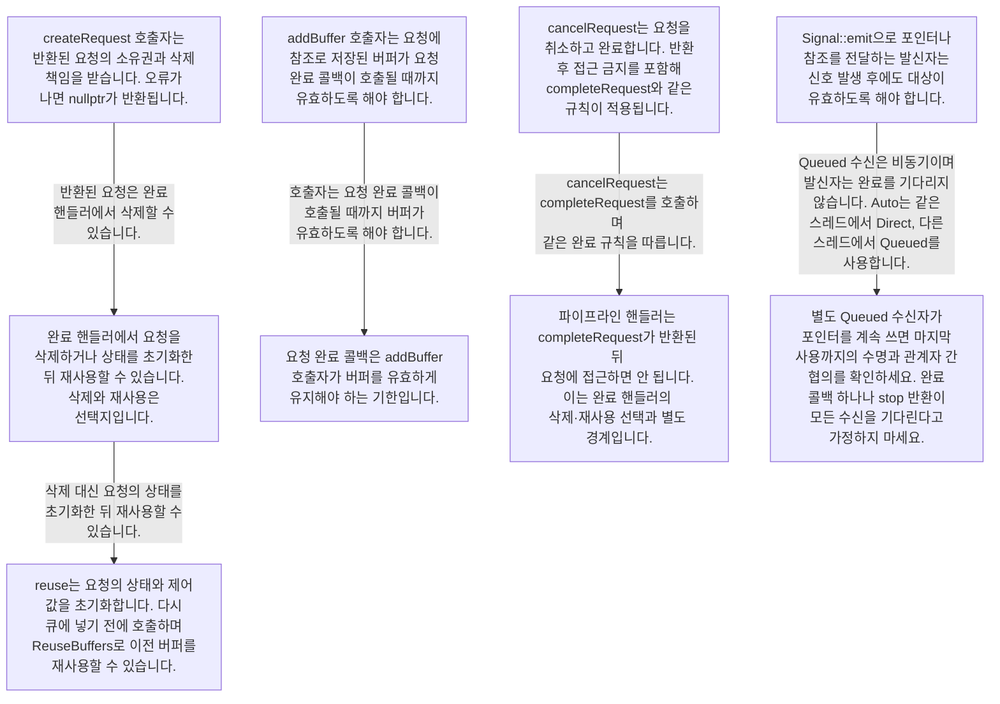

[Mermaid 원문](request-lifecycle.request-ownership.mmd)

??? note "그림 근거와 확인 범위"
    createRequest·addBuffer 호출자, 완료 핸들러의 삭제·재사용과 핸들러 접근 종료, 별도 Queued 수신자의 포인터 수명을 어떻게 구분합니까?
    
    소스에 연결한 설계 해석입니다. 자동 연결 검사는 의미 승인이나 기기 실행 검증이 아닙니다.
    
    LLM 그림 초안 · 사람 검토 전
    
    작성 모델: `cli/codex/gpt-6.1-terra`
    
    | 요소·전이 | 소스 근거 |
    |---|---|
    | <span data-sdd-label-en="The createRequest caller receives ownership of the returned request and is responsible for deleting it. On error, nullptr is returned.">createRequest 호출자는 반환된 요청의 소유권과 삭제 책임을 받습니다. 오류가 나면 nullptr가 반환됩니다.</span> | [src/libcamera/camera.cpp:1243](#source-0ae00d77839f61cb) |
    | <span data-sdd-label-en="The addBuffer caller must ensure that the buffer referenced by the request remains valid until the request completion callback is called.">addBuffer 호출자는 요청에 참조로 저장된 버퍼가 요청 완료 콜백이 호출될 때까지 유효하도록 해야 합니다.</span> | [src/libcamera/request.cpp:442](#source-95ae69eeb085e3b1) |
    | <span data-sdd-label-en="The request may be deleted in the completion handler or reused after its state is reset. Deletion and reuse are alternatives.">완료 핸들러에서 요청을 삭제하거나 상태를 초기화한 뒤 재사용할 수 있습니다. 삭제와 재사용은 선택지입니다.</span> | [src/libcamera/camera.cpp:1243](#source-0ae00d77839f61cb) |
    | <span data-sdd-label-en="The request completion callback is the point until which the addBuffer caller must keep the buffer valid.">요청 완료 콜백은 addBuffer 호출자가 버퍼를 유효하게 유지해야 하는 기한입니다.</span> | [src/libcamera/request.cpp:442](#source-95ae69eeb085e3b1) |
    | <span data-sdd-label-en="reuse resets the request status and controls. Call it before requeuing; ReuseBuffers can be used to reuse previously added buffers.">reuse는 요청의 상태와 제어 값을 초기화합니다. 다시 큐에 넣기 전에 호출하며 ReuseBuffers로 이전 버퍼를 재사용할 수 있습니다.</span> | [src/libcamera/request.cpp:376](#source-38494771cb29cc8c) |
    | <span data-sdd-label-en="The pipeline handler must not access the request after completeRequest returns. This is a separate boundary from the completion handler&#x27;s deletion or reuse choice.">파이프라인 핸들러는 completeRequest가 반환된 뒤 요청에 접근하면 안 됩니다. 이는 완료 핸들러의 삭제·재사용 선택과 별도 경계입니다.</span> | [src/libcamera/pipeline_handler.cpp:547](#source-01ad7c6605c3296a) · [src/libcamera/camera.cpp:1243](#source-0ae00d77839f61cb) |
    | <span data-sdd-label-en="cancelRequest cancels and completes the request. The same rules as completeRequest apply, including the prohibition on access after return.">cancelRequest는 요청을 취소하고 완료합니다. 반환 후 접근 금지를 포함해 completeRequest와 같은 규칙이 적용됩니다.</span> | [src/libcamera/pipeline_handler.cpp:547](#source-01ad7c6605c3296a) |
    | <span data-sdd-label-en="An emitter passing a pointer or reference through Signal::emit must ensure that its target remains valid after emission.">Signal::emit으로 포인터나 참조를 전달하는 발신자는 신호 발생 후에도 대상이 유효하도록 해야 합니다.</span> | [src/libcamera/base/signal.cpp:73](#source-52064eba9532db6a) |
    | <span data-sdd-label-en="If a separate Queued receiver continues to use a pointer, verify its lifetime through the last use and coordination between parties. Do not assume one completion callback or stop return waits for all receivers.">별도 Queued 수신자가 포인터를 계속 쓰면 마지막 사용까지의 수명과 관계자 간 협의를 확인하세요. 완료 콜백 하나나 stop 반환이 모든 수신을 기다린다고 가정하지 마세요.</span> | [src/libcamera/base/signal.cpp:73](#source-52064eba9532db6a) · [src/libcamera/base/bound_method.cpp:22](#source-bfdfed92f905633d) |
    | <span data-sdd-label-en="The returned request may be deleted in the completion handler.">반환된 요청은 완료 핸들러에서 삭제할 수 있습니다.</span> | [src/libcamera/camera.cpp:1243](#source-0ae00d77839f61cb) |
    | <span data-sdd-label-en="As an alternative to deletion, the request may be reused after its state is reset.">삭제 대신 요청의 상태를 초기화한 뒤 재사용할 수 있습니다.</span> | [src/libcamera/camera.cpp:1243](#source-0ae00d77839f61cb) |
    | <span data-sdd-label-en="The caller must ensure that the buffer remains valid until the request completion callback is called.">호출자는 요청 완료 콜백이 호출될 때까지 버퍼가 유효하도록 해야 합니다.</span> | [src/libcamera/request.cpp:442](#source-95ae69eeb085e3b1) |
    | <span data-sdd-label-en="cancelRequest calls completeRequest and follows the same completion rules.">cancelRequest는 completeRequest를 호출하며 같은 완료 규칙을 따릅니다.</span> | [src/libcamera/pipeline_handler.cpp:547](#source-01ad7c6605c3296a) |
    | <span data-sdd-label-en="Queued delivery is asynchronous and the sender does not wait for completion. Auto uses Direct in the same thread and Queued in different threads.">Queued 수신은 비동기이며 발신자는 완료를 기다리지 않습니다. Auto는 같은 스레드에서 Direct, 다른 스레드에서 Queued를 사용합니다.</span> | [src/libcamera/base/bound_method.cpp:22](#source-bfdfed92f905633d) |
<!-- /sdd:visual:request-ownership -->

### 정상 완료와 다음 요청 준비

`completeBuffer`는 `bufferCompleted`를 emit한 뒤 요청 내부의 버퍼 추적을 갱신하고, 모든 버퍼가 완료되면 `true`, 남은 버퍼가 있으면 `false`를 반환합니다. 마지막 버퍼가 완료되어도 요청은 자동 완료되지 않으므로, 파이프라인 핸들러는 필요한 처리를 마친 뒤 `completeRequest`로 명시적으로 완료를 통지해야 합니다. 두 함수는 `CameraManager` 스레드에서 호출해야 하며, 실제 콜백 실행 스레드는 이 소스에서 확인되지 않습니다. `completeRequest`가 호출하는 내부 `complete`는 `cancelled_`가 `false`이면 `RequestComplete`, `true`이면 `RequestCancelled`를 선택합니다. `src/libcamera/pipeline_handler.cpp:547`, `src/libcamera/request.cpp:91`

<!-- sdd:visual:completion-notification-order -->
#### 버퍼 알림에서 요청 반환까지

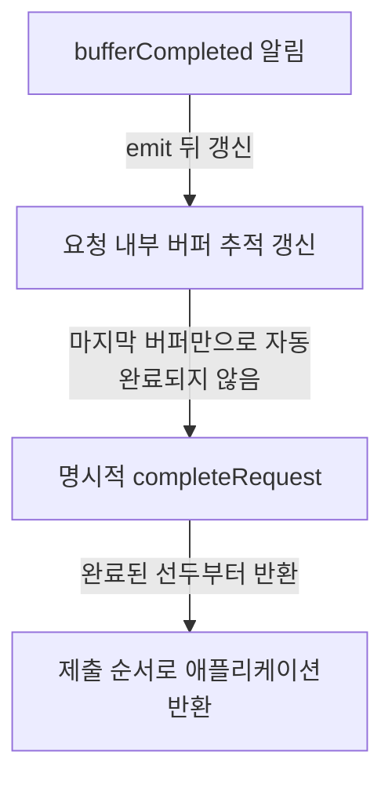

[Mermaid 원문](request-lifecycle.completion-notification-order.mmd)

??? note "그림 근거와 확인 범위"
    정상 경로의 호출·추적 순서입니다. 모든 버퍼와 필요한 추가 처리가 끝난 뒤 요청 완료를 통지하며, 실제 실행 시간이나 애플리케이션 콜백 스레드를 나타내지 않습니다.
    
    소스에 연결한 설계 해석입니다. 자동 연결 검사는 의미 승인이나 기기 실행 검증이 아닙니다.
    
    | 요소·전이 | 소스 근거 |
    |---|---|
    | <span data-sdd-label-en="bufferCompleted notification">bufferCompleted 알림</span> | [src/libcamera/pipeline_handler.cpp:547](#source-01ad7c6605c3296a) |
    | <span data-sdd-label-en="Update internal buffer tracking">요청 내부 버퍼 추적 갱신</span> | [src/libcamera/pipeline_handler.cpp:547](#source-01ad7c6605c3296a) |
    | <span data-sdd-label-en="Explicit completeRequest">명시적 completeRequest</span> | [src/libcamera/pipeline_handler.cpp:547](#source-01ad7c6605c3296a) |
    | <span data-sdd-label-en="Return to application in submission order">제출 순서로 애플리케이션 반환</span> | [src/libcamera/pipeline_handler.cpp:547](#source-01ad7c6605c3296a) |
    | <span data-sdd-label-en="Update after emit">emit 뒤 갱신</span> | [src/libcamera/pipeline_handler.cpp:547](#source-01ad7c6605c3296a) |
    | <span data-sdd-label-en="Last buffer does not automatically complete request">마지막 버퍼만으로 자동 완료되지 않음</span> | [src/libcamera/pipeline_handler.cpp:547](#source-01ad7c6605c3296a) |
    | <span data-sdd-label-en="Return completed queue heads">완료된 선두부터 반환</span> | [src/libcamera/pipeline_handler.cpp:547](#source-01ad7c6605c3296a) |
<!-- /sdd:visual:completion-notification-order -->

마지막 버퍼 알림은 관찰했지만 요청 완료 콜백은 아직 관찰하지 못한 경우, 그 관측만으로 내부 추적 갱신이나 `completeRequest` 호출이 아직 남았다고 단정할 수 없습니다. 이 알림은 버퍼 유효성 유지 기한이 끝났다는 근거가 아니므로, 버퍼 유효성을 깨뜨리는 해제나 다른 요청에 연결하는 작업의 안전성을 알림만으로 판정할 수 없습니다. 모든 재사용이 일괄적으로 금지되는 것은 아니며, 다른 요청에 연결할 수 있는지는 적용되는 API와 동기화 계약 및 버퍼 유효성 유지를 별도로 대조해야 합니다. `src/libcamera/request.cpp:447`, `src/libcamera/pipeline_handler.cpp:547`

소스 기반 조사 계획으로, 조사자는 기존 `completeBuffer` 호출의 반환값을 관찰합니다. 조사자는 `completeRequest` 호출 자체도 관찰합니다. 이어서 조사자는 제출 순서 때문에 완료된 요청의 반환이 지연되는지와 요청 완료 콜백이 발생하는지를 확인합니다. `src/libcamera/pipeline_handler.cpp:547`

### 알림 순서와 취소가 달라질 때

소스에서 유도한 조건부 예로, `A` 다음에 `B`를 제출했고 선두 `A`가 `RequestPending`인 동안 `B`의 모든 버퍼와 추가 처리를 마친 핸들러가 `completeRequest(B)`를 호출한 경우를 살펴봅니다. `Request::Private::complete()`는 `cancelled_`가 false이면 `RequestComplete`를, true이면 `RequestCancelled`를 대입합니다. 버퍼 처리가 끝났다는 사실만으로 `cancelled_`가 false라고 판단할 수는 없습니다. `src/libcamera/request.cpp:91`, `src/libcamera/pipeline_handler.cpp:547`

<!-- sdd:visual:completed-but-not-returned -->
#### 완료 상태와 애플리케이션 반환의 차이

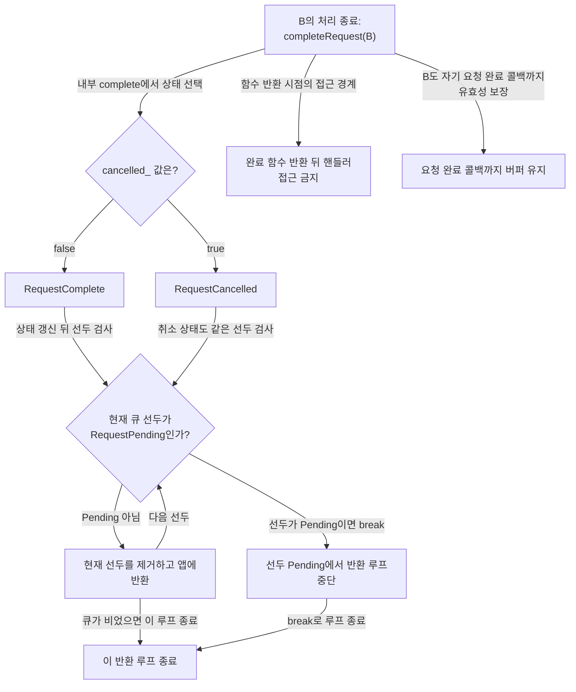

[Mermaid 원문](request-lifecycle.completed-but-not-returned.mmd)

??? note "그림 근거와 확인 범위"
    A 다음 B를 제출한 조건부 예이며 두 요청 사이에 다른 요청이 있을 수도 있습니다. cancelled_가 B의 상태를 정하고, 반환 루프는 현재 선두를 하나씩 검사합니다. 중간 Pending 요청에서도 중단하므로 A가 끝났다는 사실만으로 B 반환을 보장하지 않습니다. 수명 화살표는 접근·유효성 계약이며 실제 콜백 시각이나 함수 전체의 종료 순서가 아닙니다.
    
    소스에 연결한 설계 해석입니다. 자동 연결 검사는 의미 승인이나 기기 실행 검증이 아닙니다.
    
    | 요소·전이 | 소스 근거 |
    |---|---|
    | <span data-sdd-label-en="B processing finished: completeRequest(B)">B의 처리 종료: completeRequest&#40;B&#41;</span> | [src/libcamera/pipeline_handler.cpp:547](#source-01ad7c6605c3296a) |
    | <span data-sdd-label-en="Value of cancelled_?">cancelled&#95; 값은?</span> | [src/libcamera/request.cpp:91](#source-c78836578026f078) |
    | <span data-sdd-label-en="RequestComplete">RequestComplete</span> | [src/libcamera/request.cpp:91](#source-c78836578026f078) |
    | <span data-sdd-label-en="RequestCancelled">RequestCancelled</span> | [src/libcamera/request.cpp:91](#source-c78836578026f078) |
    | <span data-sdd-label-en="Is the current queue head RequestPending?">현재 큐 선두가 RequestPending인가?</span> | [src/libcamera/pipeline_handler.cpp:547](#source-01ad7c6605c3296a) |
    | <span data-sdd-label-en="Stop the return loop at a Pending head">선두 Pending에서 반환 루프 중단</span> | [src/libcamera/pipeline_handler.cpp:547](#source-01ad7c6605c3296a) |
    | <span data-sdd-label-en="Pop the current head and return it to the app">현재 선두를 제거하고 앱에 반환</span> | [src/libcamera/pipeline_handler.cpp:547](#source-01ad7c6605c3296a) |
    | <span data-sdd-label-en="No handler access after completion function returns">완료 함수 반환 뒤 핸들러 접근 금지</span> | [src/libcamera/pipeline_handler.cpp:575](#source-d93a02e9220fa760) |
    | <span data-sdd-label-en="Keep buffer valid until request completion callback">요청 완료 콜백까지 버퍼 유지</span> | [src/libcamera/request.cpp:447](#source-4cdce80c57526221) |
    | <span data-sdd-label-en="End this return loop">이 반환 루프 종료</span> | [src/libcamera/pipeline_handler.cpp:547](#source-01ad7c6605c3296a) |
    | <span data-sdd-label-en="Select status in internal complete">내부 complete에서 상태 선택</span> | [src/libcamera/pipeline_handler.cpp:547](#source-01ad7c6605c3296a) · [src/libcamera/request.cpp:91](#source-c78836578026f078) |
    | <span data-sdd-label-en="false">false</span> | [src/libcamera/request.cpp:91](#source-c78836578026f078) |
    | <span data-sdd-label-en="true">true</span> | [src/libcamera/request.cpp:91](#source-c78836578026f078) |
    | <span data-sdd-label-en="Check queue head after status update">상태 갱신 뒤 선두 검사</span> | [src/libcamera/pipeline_handler.cpp:547](#source-01ad7c6605c3296a) |
    | <span data-sdd-label-en="Same head check for cancelled status">취소 상태도 같은 선두 검사</span> | [src/libcamera/pipeline_handler.cpp:547](#source-01ad7c6605c3296a) |
    | <span data-sdd-label-en="Break if the head is Pending">선두가 Pending이면 break</span> | [src/libcamera/pipeline_handler.cpp:547](#source-01ad7c6605c3296a) |
    | <span data-sdd-label-en="Not Pending">Pending 아님</span> | [src/libcamera/pipeline_handler.cpp:547](#source-01ad7c6605c3296a) |
    | <span data-sdd-label-en="Access boundary when the function returns">함수 반환 시점의 접근 경계</span> | [src/libcamera/pipeline_handler.cpp:575](#source-d93a02e9220fa760) |
    | <span data-sdd-label-en="Keep B buffers valid until its own request completion callback">B도 자기 요청 완료 콜백까지 유효성 보장</span> | [src/libcamera/request.cpp:447](#source-4cdce80c57526221) |
    | <span data-sdd-label-en="Next head">다음 선두</span> | [src/libcamera/pipeline_handler.cpp:547](#source-01ad7c6605c3296a) |
    | <span data-sdd-label-en="End this loop if the queue is empty">큐가 비었으면 이 루프 종료</span> | [src/libcamera/pipeline_handler.cpp:547](#source-01ad7c6605c3296a) |
    | <span data-sdd-label-en="Exit the loop via break">break로 루프 종료</span> | [src/libcamera/pipeline_handler.cpp:547](#source-01ad7c6605c3296a) |
<!-- /sdd:visual:completed-but-not-returned -->

<!-- sdd:visual:lifecycle-timeout-fence-recovery -->
#### 타임아웃 뒤 펜스 회수

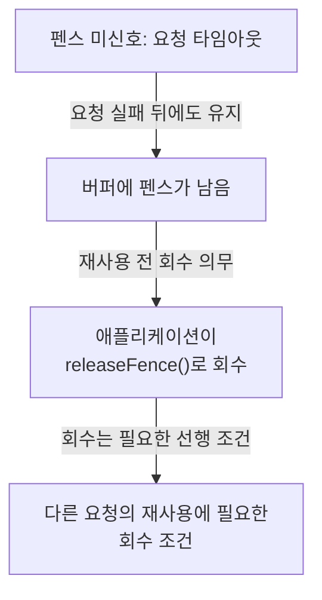

[Mermaid 원문](request-lifecycle.lifecycle-timeout-fence-recovery.mmd)

??? note "그림 근거와 확인 범위"
    신호되지 않은 펜스로 타임아웃이 나면 다른 요청에 재사용하기 전에 무엇을 해야 합니까?
    
    소스에 연결한 설계 해석입니다. 자동 연결 검사는 의미 승인이나 기기 실행 검증이 아닙니다.
    
    | 요소·전이 | 소스 근거 |
    |---|---|
    | <span data-sdd-label-en="Unsignalled fence: request times out">펜스 미신호: 요청 타임아웃</span> | [src/libcamera/request.cpp:462](#source-d8cf34a75a4333a7) |
    | <span data-sdd-label-en="Buffer still contains its fence">버퍼에 펜스가 남음</span> | [src/libcamera/request.cpp:462](#source-d8cf34a75a4333a7) |
    | <span data-sdd-label-en="Application retrieves with releaseFence()">애플리케이션이 releaseFence&#40;&#41;로 회수</span> | [src/libcamera/request.cpp:462](#source-d8cf34a75a4333a7) |
    | <span data-sdd-label-en="Required retrieval condition for reuse in another request">다른 요청의 재사용에 필요한 회수 조건</span> | [src/libcamera/request.cpp:462](#source-d8cf34a75a4333a7) |
    | <span data-sdd-label-en="Remains after request failure">요청 실패 뒤에도 유지</span> | [src/libcamera/request.cpp:462](#source-d8cf34a75a4333a7) |
    | <span data-sdd-label-en="Must retrieve before reuse">재사용 전 회수 의무</span> | [src/libcamera/request.cpp:462](#source-d8cf34a75a4333a7) |
    | <span data-sdd-label-en="Retrieval is a necessary precondition">회수는 필요한 선행 조건</span> | [src/libcamera/request.cpp:462](#source-d8cf34a75a4333a7) |
<!-- /sdd:visual:lifecycle-timeout-fence-recovery -->

<!-- sdd:visual:lifecycle-reuse-buffer-fence-distinction -->
#### 버퍼 재사용과 펜스 권고

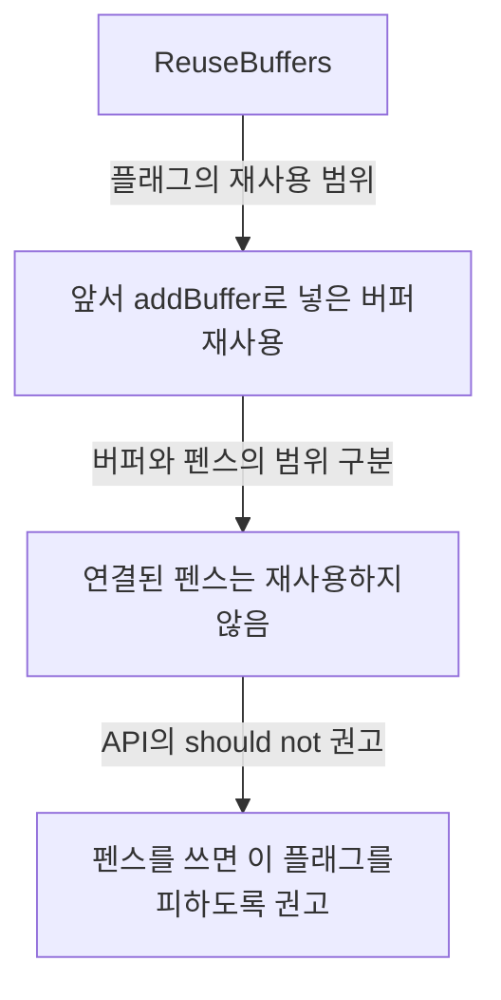

[Mermaid 원문](request-lifecycle.lifecycle-reuse-buffer-fence-distinction.mmd)

??? note "그림 근거와 확인 범위"
    ReuseBuffers가 재사용하는 대상과 펜스 사용 시 권고는 무엇입니까?
    
    소스에 연결한 설계 해석입니다. 자동 연결 검사는 의미 승인이나 기기 실행 검증이 아닙니다.
    
    | 요소·전이 | 소스 근거 |
    |---|---|
    | <span data-sdd-label-en="ReuseBuffers">ReuseBuffers</span> | [src/libcamera/request.cpp:326](#source-447804db33308244) |
    | <span data-sdd-label-en="Reuse buffers previously added by addBuffer">앞서 addBuffer로 넣은 버퍼 재사용</span> | [src/libcamera/request.cpp:326](#source-447804db33308244) |
    | <span data-sdd-label-en="Associated fences are not reused">연결된 펜스는 재사용하지 않음</span> | [src/libcamera/request.cpp:326](#source-447804db33308244) |
    | <span data-sdd-label-en="Should not use this flag with fences">펜스를 쓰면 이 플래그를 피하도록 권고</span> | [src/libcamera/request.cpp:326](#source-447804db33308244) |
    | <span data-sdd-label-en="Flag reuse scope">플래그의 재사용 범위</span> | [src/libcamera/request.cpp:326](#source-447804db33308244) |
    | <span data-sdd-label-en="Distinguish buffer and fence reuse">버퍼와 펜스의 범위 구분</span> | [src/libcamera/request.cpp:326](#source-447804db33308244) |
    | <span data-sdd-label-en="API should-not recommendation">API의 should not 권고</span> | [src/libcamera/request.cpp:326](#source-447804db33308244) |
<!-- /sdd:visual:lifecycle-reuse-buffer-fence-distinction -->

소스에서 유도한 조건부 예로, `completeRequest(B)`가 호출되어도 `queuedRequests_`의 선두 A가 `RequestPending`이면 순회가 멈춰 B의 통지가 지연됩니다. 이후 A와 B가 앞에서부터 완료되어 순회가 각각에 도달하고 `Camera::requestComplete`의 상태 검사에서 `CameraStopping` 또는 `CameraRunning`이 허용되면, A와 B 순서로 `requestCompleted`를 emit해 애플리케이션에 통지합니다. 범위 밖 상태에서는 상태 검사가 실패하여 `Fatal` 경계로 진입합니다. `src/libcamera/pipeline_handler.cpp:547`, `src/libcamera/camera.cpp:709`, `include/libcamera/internal/camera.h:49`, `src/libcamera/camera.cpp:1475`

소스 기반 조사 계획으로 `Request::Private::complete()`의 상태 대입 지점에서 `cancelled_`와 대입되는 상태를 대조합니다. 제출 큐의 선두와 pending 버퍼, 요청 완료 콜백도 관찰합니다. `src/libcamera/request.cpp:91`, `src/libcamera/pipeline_handler.cpp:547`

앞의 정상 완료 예와 별도로, 제출 큐의 선두 요청 A와 요청 B가 모두 `RequestPending`인 시점에 파이프라인 핸들러가 `completeRequest(B)` 대신 `cancelRequest(B)`를 호출하는 경우입니다. `Request::Private::doCancelRequest`는 B의 `pending_` 버퍼를 각각 취소하고 `bufferCompleted`를 발생시킨 뒤 `cancelled_`를 `true`로 설정하고 `pending_`를 비웁니다. `cancelRequest`는 `cancel` 다음에 `completeRequest`를 호출하며, `Request::Private::complete`는 B의 상태로 `RequestCancelled`를 선택합니다. 선두 A가 여전히 `RequestPending`이면 B의 애플리케이션 반환은 지연되며, 버퍼 수명과 핸들러의 요청 접근에는 앞에서 설명한 공통 규칙이 적용됩니다. `src/libcamera/pipeline_handler.cpp:547`, `src/libcamera/request.cpp:91`, `src/libcamera/request.cpp:447`, `src/libcamera/pipeline_handler.cpp:575`

`Request::addBuffer()`에 유효한 `Fence`를 전달하면 성공 시 소유권이 `buffer`로 이동하지만, 실패 시에는 전달한 `fence`가 수정되지 않고 소유권도 넘어가지 않습니다. 버퍼에 연결된 펜스가 신호되지 않으면 요청은 타임아웃 후 실패하며, 버퍼에는 펜스가 그대로 남습니다. 애플리케이션은 버퍼를 다른 요청에서 재사용하기 전에 `FrameBuffer::releaseFence()`로 펜스를 회수해야 합니다. `src/libcamera/request.cpp:456`, `src/libcamera/request.cpp:462`

`Request::ReuseBuffers`는 `addBuffer()`로 이전에 추가한 버퍼를 유지하여 재사용하지만, 버퍼에 연결된 펜스는 재사용하지 않습니다. 펜스를 사용하는 경우 이 플래그를 사용하지 않아야 한다는 권고가 있습니다(`should not be used`). `src/libcamera/request.cpp:326`, `src/libcamera/request.cpp:334`

### 완료 책임을 변경하기 전에

조사 계획은 기존 `completeBuffer`와 `completeRequest` 호출자 및 스레드 전달 경계를 찾아 변경 전후의 호출 위치를 대조하는 것입니다. 파이프라인 핸들러는 두 함수를 `CameraManager` 스레드에서 호출해야 합니다. 변경으로 다른 스레드에서 이 API를 직접 호출하면 문서화된 호출 의무와 충돌합니다. `src/libcamera/pipeline_handler.cpp:547`

<!-- sdd:visual:completion-change-checks -->
#### 완료 책임 변경에서 함께 대조할 계약

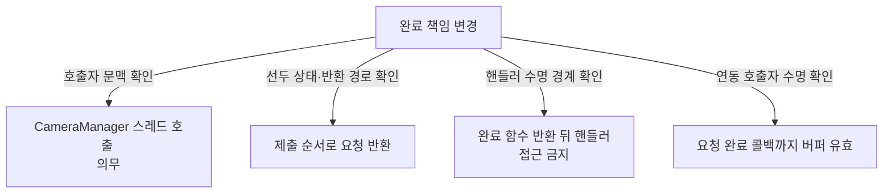

[Mermaid 원문](request-lifecycle.completion-change-checks.mmd)

??? note "그림 근거와 확인 범위"
    변경 검토의 확인 관계입니다. 화살표는 실행 순서나 기기 보장이 아니라 completeRequest 책임을 바꿀 때 함께 보존할 소스 계약을 가리킵니다.
    
    소스에 연결한 설계 해석입니다. 자동 연결 검사는 의미 승인이나 기기 실행 검증이 아닙니다.
    
    | 요소·전이 | 소스 근거 |
    |---|---|
    | <span data-sdd-label-en="Change completion responsibility">완료 책임 변경</span> | [src/libcamera/pipeline_handler.cpp:547](#source-01ad7c6605c3296a) |
    | <span data-sdd-label-en="Must call from CameraManager thread">CameraManager 스레드 호출 의무</span> | [src/libcamera/pipeline_handler.cpp:547](#source-01ad7c6605c3296a) |
    | <span data-sdd-label-en="Return requests in submission order">제출 순서로 요청 반환</span> | [src/libcamera/pipeline_handler.cpp:547](#source-01ad7c6605c3296a) |
    | <span data-sdd-label-en="No handler access after completion function returns">완료 함수 반환 뒤 핸들러 접근 금지</span> | [src/libcamera/pipeline_handler.cpp:575](#source-d93a02e9220fa760) |
    | <span data-sdd-label-en="Buffer valid until request completion callback">요청 완료 콜백까지 버퍼 유효</span> | [src/libcamera/request.cpp:447](#source-4cdce80c57526221) |
    | <span data-sdd-label-en="Check caller context">호출자 문맥 확인</span> | [src/libcamera/pipeline_handler.cpp:547](#source-01ad7c6605c3296a) |
    | <span data-sdd-label-en="Check queue head and return path">선두 상태·반환 경로 확인</span> | [src/libcamera/pipeline_handler.cpp:547](#source-01ad7c6605c3296a) |
    | <span data-sdd-label-en="Check handler lifetime boundary">핸들러 수명 경계 확인</span> | [src/libcamera/pipeline_handler.cpp:575](#source-d93a02e9220fa760) |
    | <span data-sdd-label-en="Check integration caller lifetime">연동 호출자 수명 확인</span> | [src/libcamera/request.cpp:447](#source-4cdce80c57526221) |
<!-- /sdd:visual:completion-change-checks -->

실행 확인 항목: 이 조사 계획은 실제 콜백 스레드, 기기 DMA, 캐시, 실행 시간 또는 사내 HAL을 검증한 결과가 아닙니다. 역사적 설계 이유와 대안의 우열을 판단하려면 별도의 결정 기록이나 실행 자료가 필요합니다. `src/libcamera/pipeline_handler.cpp:547`

근거 원문: [src/libcamera/camera.cpp:1243](#source-0ae00d77839f61cb) · [src/libcamera/request.cpp:376](#source-38494771cb29cc8c) · [src/libcamera/pipeline_handler.cpp:547](#source-01ad7c6605c3296a) · [src/libcamera/request.cpp:326](#source-447804db33308244) · [src/libcamera/request.cpp:456](#source-86a8d784a8348122) · [src/libcamera/request.cpp:462](#source-d8cf34a75a4333a7) · [src/libcamera/request.cpp:447](#source-4cdce80c57526221) · [src/libcamera/pipeline_handler.cpp:575](#source-d93a02e9220fa760) · [src/libcamera/pipeline_handler.cpp:610](#source-52fb58c8956b1a91) · [src/libcamera/request.cpp:334](#source-d9944a69f2dd6758) · [src/libcamera/request.cpp:442](#source-95ae69eeb085e3b1) · [src/libcamera/camera.cpp:1308](#source-28d007de6ad1a8a5) · [src/libcamera/request.cpp:91](#source-c78836578026f078) · [src/libcamera/base/signal.cpp:73](#source-52064eba9532db6a) · [src/libcamera/base/bound_method.cpp:22](#source-bfdfed92f905633d) · [src/libcamera/camera.cpp:1475](#source-a8b87568e9f33e81) · [src/libcamera/camera.cpp:709](#source-1e64f4ece8808997) · [include/libcamera/internal/camera.h:49](#source-a46d382d4070001c)

## 버퍼 알림과 요청 반환의 내부 경계

`PipelineHandler::completeBuffer`는 `bufferCompleted.emit` 뒤에 `Request::Private::completeBuffer`를 호출해 `pending_`에서 버퍼를 제거하고 버퍼의 요청 연결을 해제하며, `ConnectionTypeDirect` 콜백은 송신자 스레드에서 즉시 동기 실행되므로 내부 갱신 전에 실행될 수 있습니다. 호출자는 `bufferCompleted` 신호만으로 요청 완료나 삭제·재사용 시점을 판단해서는 안 되며, 요청 완료 콜백까지 버퍼를 유효하게 유지해야 합니다. `src/libcamera/pipeline_handler.cpp:547`, `src/libcamera/request.cpp:103`, `src/libcamera/base/bound_method.cpp:22`, `src/libcamera/request.cpp:442`, `src/libcamera/camera.cpp:1243`

<!-- sdd:visual:callback-order-flow -->
### 버퍼 알림과 요청 반환의 내부 경계 그림

```mermaid
flowchart TB
%% sdd:translations {"PipelineHandler::<br/>completeBuffer가 <br/>bufferCompleted 신호를 <br/>발생시킵니다.": "PipelineHandler::<br/>completeBuffer emits the <br/>bufferCompleted signal.", "PipelineHandler::<br/>completeBuffer는 요청의 <br/>모든 버퍼가 완료되면 <br/>true를, 그렇지 않으면 <br/>false를 반환합니다.": "PipelineHandler::<br/>completeBuffer returns true <br/>if all buffers in the <br/>request have completed, and <br/>false otherwise.", "Request::Private::<br/>completeBuffer가 <br/>pending#95;에서 버퍼를 <br/>지웁니다.": "Request::Private::<br/>completeBuffer erases the <br/>buffer from pending#95;.", "Request::Private::<br/>completeBuffer가 요청의 <br/>버퍼 추적을 갱신합니다.": "Request::Private::<br/>completeBuffer updates the <br/>request#39;s buffer tracking.", "bufferCompleted 신호가 <br/>발생하고 emit이 반환됩니다. <br/>수신 함수의 실행 경계는 <br/>별도 콜백 경계 그림에서 <br/>다룹니다.": "The bufferCompleted signal <br/>is emitted and emit <br/>returns. The receiver <br/>execution boundary is <br/>covered in a separate <br/>callback boundary diagram.", "bufferCompleted의 emit이 <br/>반환된 뒤 요청의 <br/>completeBuffer를 호출합니다.": "After the bufferCompleted <br/>emit returns, it calls the <br/>request#39;s completeBuffer.", "completeRequest가 현재 <br/>요청의 complete를 <br/>호출합니다.": "completeRequest calls <br/>complete on the current <br/>request.", "complete는 요청이 <br/>RequestPending이고 대기 <br/>버퍼가 없는지 검사합니다. <br/>cancelled#95;가 true이면 <br/>RequestCancelled로, <br/>false이면 RequestComplete로 <br/>상태를 설정합니다. <br/>doCancelRequest는 <br/>pending#95;이 비어 있어도 <br/>cancelled#95;를 true로 <br/>설정합니다.": "complete asserts that the <br/>request is RequestPending <br/>and has no pending buffers. <br/>It sets the status to <br/>RequestCancelled if <br/>cancelled#95; is true and to <br/>RequestComplete if it is <br/>false. doCancelRequest sets <br/>cancelled#95; to true even <br/>when pending#95; is empty.", "pending#95; 제거와 연결 해제 <br/>등을 마친 뒤 <br/>PipelineHandler::<br/>completeBuffer가 결과를 <br/>반환합니다.": "After removing the buffer <br/>from pending#95;, clearing its <br/>association, and performing <br/>the remaining checks, <br/>PipelineHandler::<br/>completeBuffer returns the <br/>result.", "pending#95;에서 버퍼를 지우고 <br/>삭제된 항목이 하나인지 <br/>검사한 뒤 버퍼의 요청 <br/>연결을 해제합니다. 버퍼 <br/>상태가 <br/>FrameMetadata::<br/>FrameCancelled이면 <br/>cancelled#95;를 true로 <br/>설정합니다.": "It erases the buffer from <br/>pending#95;, asserts that <br/>exactly one entry was <br/>erased, and clears the <br/>buffer#39;s request <br/>association. If the buffer <br/>status is <br/>FrameMetadata::<br/>FrameCancelled, it sets <br/>cancelled#95; to true.", "requestCompleted 신호가 <br/>발생하고 emit이 반환됩니다. <br/>수신 함수의 실행 경계는 <br/>별도 콜백 경계 그림에서 <br/>다룹니다.": "The requestCompleted signal <br/>is emitted and emit <br/>returns. The receiver <br/>execution boundary is <br/>covered in a separate <br/>callback boundary diagram.", "꺼낸 요청의 완료를 camera에 <br/>알리기 위해 <br/>Camera::requestComplete를 <br/>호출합니다. 이 그림은 상태 <br/>검사를 통과하는 경로를 보여 <br/>줍니다.": "It calls <br/>Camera::requestComplete to <br/>notify the camera that the <br/>removed request has <br/>completed. This diagram <br/>shows the path that passes <br/>the state check.", "마지막 버퍼가 끝나도 요청은 <br/>자동으로 완료되지 않습니다. <br/>핸들러는 CameraManager <br/>스레드에서 <br/>completeRequest를 <br/>명시적으로 호출해야 하며 <br/>반환 후 요청에 접근해서는 <br/>안 됩니다. 완료된 요청은 <br/>순서 제약 없이 전달할 수 <br/>있고 애플리케이션에는 제출 <br/>순서로 반환됩니다.": "The request does not <br/>complete automatically when <br/>the last buffer completes. <br/>The handler must explicitly <br/>call completeRequest from <br/>the CameraManager thread <br/>and must not access the <br/>request after it returns. <br/>The handler may pass <br/>completed requests without <br/>an ordering constraint, and <br/>they are returned to the <br/>application in submission <br/>order.", "상태 검사를 통과하면 <br/>requestComplete가 <br/>requestCompleted 신호를 <br/>발생시킵니다. · <br/>#95;d#40;#41;-#62;isAccessAllowed#40;Private::<br/>CameraStopping, <br/>Private::CameraRunning, <br/>true#41; #91;false#93;": "If the state check passes, <br/>requestComplete emits the <br/>requestCompleted signal. · <br/>#95;d#40;#41;-#62;isAccessAllowed#40;Private::<br/>CameraStopping, <br/>Private::CameraRunning, <br/>true#41; #91;false#93;", "선두 요청에 대기 버퍼가 <br/>없는지 검사한 뒤 큐에서 <br/>꺼냅니다. · req-#62;status#40;#41; <br/>#61;#61; Request::RequestPending <br/>#91;false#93;": "It asserts that the front <br/>request has no pending <br/>buffers, then removes it <br/>from the queue. · <br/>req-#62;status#40;#41; #61;#61; <br/>Request::RequestPending <br/>#91;false#93;", "선두 요청이 더 이상 대기 <br/>중이 아니면 대기 버퍼가 <br/>없는지 검사하고 pop#95;front로 <br/>큐에서 꺼냅니다.": "If the front request is no <br/>longer pending, it asserts <br/>that the request has no <br/>pending buffers and removes <br/>it from the queue with <br/>pop#95;front.", "선택한 UVC 경로에서는 <br/>completeBuffer가 반환된 뒤 <br/>completeRequest를 <br/>명시적으로 호출합니다.": "On the selected UVC path, <br/>it explicitly calls <br/>completeRequest after <br/>completeBuffer returns.", "큐가 비어 있지 않으면 선두 <br/>요청을 검사합니다. 선두가 <br/>RequestPending이면 통지하지 <br/>않고 반복을 멈춥니다.": "If the queue is not empty, <br/>it checks the front <br/>request. If the front <br/>request is RequestPending, <br/>the loop stops without <br/>notifying it.", "큐에서 꺼낸 뒤 camera에 <br/>완료를 알립니다.": "After removing the request <br/>from the queue, it notifies <br/>the camera of completion.", "파이프라인 핸들러는 버퍼 <br/>완료를 알리기 위해 <br/>CameraManager 스레드에서 <br/>PipelineHandler::<br/>completeBuffer를 호출해야 <br/>합니다.": "The pipeline handler must <br/>call <br/>PipelineHandler::<br/>completeBuffer from the <br/>CameraManager thread to <br/>signal buffer completion.", "현재 요청을 완료 처리한 뒤 <br/>큐가 비어 있지 않으면 선두 <br/>요청의 상태를 검사합니다.": "After completing the <br/>current request, it checks <br/>the status of the front <br/>request if the queue is not <br/>empty."}
  v_pipeline_buffer["파이프라인 핸들러는 버퍼 <br/>완료를 알리기 위해 <br/>CameraManager 스레드에서 <br/>PipelineHandler::<br/>completeBuffer를 호출해야 <br/>합니다."]
  v_buffer_signal["bufferCompleted 신호가 <br/>발생하고 emit이 반환됩니다. <br/>수신 함수의 실행 경계는 <br/>별도 콜백 경계 그림에서 <br/>다룹니다."]
  v_request_buffer["Request::Private::<br/>completeBuffer가 요청의 <br/>버퍼 추적을 갱신합니다."]
  v_pending["pending#95;에서 버퍼를 지우고 <br/>삭제된 항목이 하나인지 <br/>검사한 뒤 버퍼의 요청 <br/>연결을 해제합니다. 버퍼 <br/>상태가 <br/>FrameMetadata::<br/>FrameCancelled이면 <br/>cancelled#95;를 true로 <br/>설정합니다."]
  v_buffer_return["PipelineHandler::<br/>completeBuffer는 요청의 <br/>모든 버퍼가 완료되면 <br/>true를, 그렇지 않으면 <br/>false를 반환합니다."]
  v_complete_request["마지막 버퍼가 끝나도 요청은 <br/>자동으로 완료되지 않습니다. <br/>핸들러는 CameraManager <br/>스레드에서 <br/>completeRequest를 <br/>명시적으로 호출해야 하며 <br/>반환 후 요청에 접근해서는 <br/>안 됩니다. 완료된 요청은 <br/>순서 제약 없이 전달할 수 <br/>있고 애플리케이션에는 제출 <br/>순서로 반환됩니다."]
  v_complete["complete는 요청이 <br/>RequestPending이고 대기 <br/>버퍼가 없는지 검사합니다. <br/>cancelled#95;가 true이면 <br/>RequestCancelled로, <br/>false이면 RequestComplete로 <br/>상태를 설정합니다. <br/>doCancelRequest는 <br/>pending#95;이 비어 있어도 <br/>cancelled#95;를 true로 <br/>설정합니다."]
  v_front{"큐가 비어 있지 않으면 선두 <br/>요청을 검사합니다. 선두가 <br/>RequestPending이면 통지하지 <br/>않고 반복을 멈춥니다."}
  v_pop["선두 요청이 더 이상 대기 <br/>중이 아니면 대기 버퍼가 <br/>없는지 검사하고 pop#95;front로 <br/>큐에서 꺼냅니다."]
  v_notify_camera["꺼낸 요청의 완료를 camera에 <br/>알리기 위해 <br/>Camera::requestComplete를 <br/>호출합니다. 이 그림은 상태 <br/>검사를 통과하는 경로를 보여 <br/>줍니다."]
  v_notify_application["requestCompleted 신호가 <br/>발생하고 emit이 반환됩니다. <br/>수신 함수의 실행 경계는 <br/>별도 콜백 경계 그림에서 <br/>다룹니다."]
  v_pipeline_buffer -->|"PipelineHandler::<br/>completeBuffer가 <br/>bufferCompleted 신호를 <br/>발생시킵니다."| v_buffer_signal
  v_buffer_signal -->|"bufferCompleted의 emit이 <br/>반환된 뒤 요청의 <br/>completeBuffer를 호출합니다."| v_request_buffer
  v_request_buffer -->|"Request::Private::<br/>completeBuffer가 <br/>pending#95;에서 버퍼를 <br/>지웁니다."| v_pending
  v_pending -->|"pending#95; 제거와 연결 해제 <br/>등을 마친 뒤 <br/>PipelineHandler::<br/>completeBuffer가 결과를 <br/>반환합니다."| v_buffer_return
  v_buffer_return -->|"선택한 UVC 경로에서는 <br/>completeBuffer가 반환된 뒤 <br/>completeRequest를 <br/>명시적으로 호출합니다."| v_complete_request
  v_complete_request -->|"completeRequest가 현재 <br/>요청의 complete를 <br/>호출합니다."| v_complete
  v_complete -->|"현재 요청을 완료 처리한 뒤 <br/>큐가 비어 있지 않으면 선두 <br/>요청의 상태를 검사합니다."| v_front
  v_front -->|"선두 요청에 대기 버퍼가 <br/>없는지 검사한 뒤 큐에서 <br/>꺼냅니다. · req-#62;status#40;#41; <br/>#61;#61; Request::RequestPending <br/>#91;false#93;"| v_pop
  v_pop -->|"큐에서 꺼낸 뒤 camera에 <br/>완료를 알립니다."| v_notify_camera
  v_notify_camera -->|"상태 검사를 통과하면 <br/>requestComplete가 <br/>requestCompleted 신호를 <br/>발생시킵니다. · <br/>#95;d#40;#41;-#62;isAccessAllowed#40;Private::<br/>CameraStopping, <br/>Private::CameraRunning, <br/>true#41; #91;false#93;"| v_notify_application
```

[Mermaid 원문](request-lifecycle.callback-order-flow.mmd)

??? note "그림 근거와 확인 범위"
    상태 검사를 통과하는 정상 완료에서 PipelineHandler::completeBuffer 진입, bufferCompleted 신호, Request::Private::completeBuffer와 pending 제거, 명시적 요청 완료와 선두 검사 뒤 통지 순서를 구분하세요.
    
    소스에 연결한 설계 해석입니다. 자동 연결 검사는 의미 승인이나 기기 실행 검증이 아닙니다.
    
    LLM 그림 초안 · 사람 검토 전
    
    작성 모델: `cli/codex/gpt-6.1-terra`
    
    | 요소·전이 | 소스 근거 |
    |---|---|
    | <span data-sdd-label-en="The pipeline handler must call PipelineHandler::completeBuffer from the CameraManager thread to signal buffer completion.">파이프라인 핸들러는 버퍼 완료를 알리기 위해 CameraManager 스레드에서 PipelineHandler::completeBuffer를 호출해야 합니다.</span> | [src/libcamera/pipeline_handler.cpp:547](#source-01ad7c6605c3296a) |
    | <span data-sdd-label-en="The bufferCompleted signal is emitted and emit returns. The receiver execution boundary is covered in a separate callback boundary diagram.">bufferCompleted 신호가 발생하고 emit이 반환됩니다. 수신 함수의 실행 경계는 별도 콜백 경계 그림에서 다룹니다.</span> | [src/libcamera/pipeline_handler.cpp:547](#source-01ad7c6605c3296a) |
    | <span data-sdd-label-en="Request::Private::completeBuffer updates the request&#x27;s buffer tracking.">Request::Private::completeBuffer가 요청의 버퍼 추적을 갱신합니다.</span> | [src/libcamera/pipeline_handler.cpp:547](#source-01ad7c6605c3296a) · [src/libcamera/request.cpp:103](#source-db7f21585c4c2708) |
    | <span data-sdd-label-en="It erases the buffer from pending_, asserts that exactly one entry was erased, and clears the buffer&#x27;s request association. If the buffer status is FrameMetadata::FrameCancelled, it sets cancelled_ to true.">pending&#95;에서 버퍼를 지우고 삭제된 항목이 하나인지 검사한 뒤 버퍼의 요청 연결을 해제합니다. 버퍼 상태가 FrameMetadata::FrameCancelled이면 cancelled&#95;를 true로 설정합니다.</span> | [src/libcamera/request.cpp:103](#source-db7f21585c4c2708) |
    | <span data-sdd-label-en="PipelineHandler::completeBuffer returns true if all buffers in the request have completed, and false otherwise.">PipelineHandler::completeBuffer는 요청의 모든 버퍼가 완료되면 true를, 그렇지 않으면 false를 반환합니다.</span> | [src/libcamera/pipeline_handler.cpp:547](#source-01ad7c6605c3296a) · [src/libcamera/request.cpp:103](#source-db7f21585c4c2708) |
    | <span data-sdd-label-en="The request does not complete automatically when the last buffer completes. The handler must explicitly call completeRequest from the CameraManager thread and must not access the request after it returns. The handler may pass completed requests without an ordering constraint, and they are returned to the application in submission order.">마지막 버퍼가 끝나도 요청은 자동으로 완료되지 않습니다. 핸들러는 CameraManager 스레드에서 completeRequest를 명시적으로 호출해야 하며 반환 후 요청에 접근해서는 안 됩니다. 완료된 요청은 순서 제약 없이 전달할 수 있고 애플리케이션에는 제출 순서로 반환됩니다.</span> | [src/libcamera/pipeline_handler.cpp:547](#source-01ad7c6605c3296a) |
    | <span data-sdd-label-en="complete asserts that the request is RequestPending and has no pending buffers. It sets the status to RequestCancelled if cancelled_ is true and to RequestComplete if it is false. doCancelRequest sets cancelled_ to true even when pending_ is empty.">complete는 요청이 RequestPending이고 대기 버퍼가 없는지 검사합니다. cancelled&#95;가 true이면 RequestCancelled로, false이면 RequestComplete로 상태를 설정합니다. doCancelRequest는 pending&#95;이 비어 있어도 cancelled&#95;를 true로 설정합니다.</span> | [src/libcamera/request.cpp:125](#source-0626196def047e5c) · [src/libcamera/request.cpp:139](#source-c98dc1442538e903) |
    | <span data-sdd-label-en="If the queue is not empty, it checks the front request. If the front request is RequestPending, the loop stops without notifying it.">큐가 비어 있지 않으면 선두 요청을 검사합니다. 선두가 RequestPending이면 통지하지 않고 반복을 멈춥니다.</span> | [src/libcamera/pipeline_handler.cpp:547](#source-01ad7c6605c3296a) |
    | <span data-sdd-label-en="If the front request is no longer pending, it asserts that the request has no pending buffers and removes it from the queue with pop_front.">선두 요청이 더 이상 대기 중이 아니면 대기 버퍼가 없는지 검사하고 pop&#95;front로 큐에서 꺼냅니다.</span> | [src/libcamera/pipeline_handler.cpp:547](#source-01ad7c6605c3296a) |
    | <span data-sdd-label-en="It calls Camera::requestComplete to notify the camera that the removed request has completed. This diagram shows the path that passes the state check.">꺼낸 요청의 완료를 camera에 알리기 위해 Camera::requestComplete를 호출합니다. 이 그림은 상태 검사를 통과하는 경로를 보여 줍니다.</span> | [src/libcamera/pipeline_handler.cpp:547](#source-01ad7c6605c3296a) · [src/libcamera/camera.cpp:1475](#source-a8b87568e9f33e81) |
    | <span data-sdd-label-en="The requestCompleted signal is emitted and emit returns. The receiver execution boundary is covered in a separate callback boundary diagram.">requestCompleted 신호가 발생하고 emit이 반환됩니다. 수신 함수의 실행 경계는 별도 콜백 경계 그림에서 다룹니다.</span> | [src/libcamera/camera.cpp:1475](#source-a8b87568e9f33e81) |
    | <span data-sdd-label-en="PipelineHandler::completeBuffer emits the bufferCompleted signal.">PipelineHandler::completeBuffer가 bufferCompleted 신호를 발생시킵니다.</span> | [src/libcamera/pipeline_handler.cpp:547](#source-01ad7c6605c3296a) |
    | <span data-sdd-label-en="After the bufferCompleted emit returns, it calls the request&#x27;s completeBuffer.">bufferCompleted의 emit이 반환된 뒤 요청의 completeBuffer를 호출합니다.</span> | [src/libcamera/pipeline_handler.cpp:547](#source-01ad7c6605c3296a) |
    | <span data-sdd-label-en="Request::Private::completeBuffer erases the buffer from pending_.">Request::Private::completeBuffer가 pending&#95;에서 버퍼를 지웁니다.</span> | [src/libcamera/request.cpp:103](#source-db7f21585c4c2708) |
    | <span data-sdd-label-en="After removing the buffer from pending_, clearing its association, and performing the remaining checks, PipelineHandler::completeBuffer returns the result.">pending&#95; 제거와 연결 해제 등을 마친 뒤 PipelineHandler::completeBuffer가 결과를 반환합니다.</span> | [src/libcamera/request.cpp:103](#source-db7f21585c4c2708) · [src/libcamera/pipeline_handler.cpp:547](#source-01ad7c6605c3296a) |
    | <span data-sdd-label-en="On the selected UVC path, it explicitly calls completeRequest after completeBuffer returns.">선택한 UVC 경로에서는 completeBuffer가 반환된 뒤 completeRequest를 명시적으로 호출합니다.</span> | [src/libcamera/pipeline/uvcvideo/uvcvideo.cpp:893](#source-bfa0db3a4bc7970d) |
    | <span data-sdd-label-en="completeRequest calls complete on the current request.">completeRequest가 현재 요청의 complete를 호출합니다.</span> | [src/libcamera/pipeline_handler.cpp:547](#source-01ad7c6605c3296a) |
    | <span data-sdd-label-en="After completing the current request, it checks the status of the front request if the queue is not empty.">현재 요청을 완료 처리한 뒤 큐가 비어 있지 않으면 선두 요청의 상태를 검사합니다.</span> | [src/libcamera/pipeline_handler.cpp:547](#source-01ad7c6605c3296a) |
    | <span data-sdd-label-en="It asserts that the front request has no pending buffers, then removes it from the queue. · req-&gt;status() == Request::RequestPending [false]">선두 요청에 대기 버퍼가 없는지 검사한 뒤 큐에서 꺼냅니다. · req-&gt;status&#40;&#41; == Request::RequestPending &#91;false&#93;</span> | [src/libcamera/pipeline_handler.cpp:547](#source-01ad7c6605c3296a) |
    | <span data-sdd-label-en="After removing the request from the queue, it notifies the camera of completion.">큐에서 꺼낸 뒤 camera에 완료를 알립니다.</span> | [src/libcamera/pipeline_handler.cpp:547](#source-01ad7c6605c3296a) |
    | <span data-sdd-label-en="If the state check passes, requestComplete emits the requestCompleted signal. · _d()-&gt;isAccessAllowed(Private::CameraStopping, Private::CameraRunning, true) [false]">상태 검사를 통과하면 requestComplete가 requestCompleted 신호를 발생시킵니다. · &#95;d&#40;&#41;-&gt;isAccessAllowed&#40;Private::CameraStopping, Private::CameraRunning, true&#41; &#91;false&#93;</span> | [src/libcamera/camera.cpp:1475](#source-a8b87568e9f33e81) |
<!-- /sdd:visual:callback-order-flow -->

선택한 UVC의 `UVCCameraData::imageBufferReady`는 `completeBuffer`가 반환한 뒤 `completeRequest`를 명시적으로 호출하며, `completeRequest`는 `Request::Private::complete`를 호출해 요청 상태를 갱신합니다. `completeRequest`는 완료 큐 선두가 `RequestPending`이면 통지하지 않고 순회를 멈추며, 완료된 선두는 `pop_front`한 뒤 `Camera::requestComplete`에 전달하고, 이 함수는 `Camera` 상태 검사를 통과하면 `requestCompleted` 신호를 발생시킵니다. `ConnectionTypeQueued` 수신은 신호 발생과 별개로 실행되며, 수신 스레드가 이벤트 루프로 돌아가기 전에 명시적 또는 재귀적인 `Thread::dispatchMessages`가 `type`과 `receiver` 필터에 맞는 메시지를 처리할 수 있지만 스레드가 정지하기 전 실제 수신자 호출은 보장되지 않습니다. `src/libcamera/pipeline/uvcvideo/uvcvideo.cpp:893`, `src/libcamera/pipeline_handler.cpp:547`, `src/libcamera/request.cpp:125`, `src/libcamera/camera.cpp:1475`, `src/libcamera/base/bound_method.cpp:22`, `src/libcamera/base/thread.cpp:613`, `src/libcamera/base/object.cpp:258`

B의 `Request::addBuffer`가 A 버퍼의 직접 `bufferCompleted` 수신자 안에서 같은 버퍼의 연결을 B로 바꾸면, 뒤따르는 A의 내부 `completeBuffer`가 `setRequest(nullptr)`로 B 연결을 지울 수 있습니다. 지연된 수신자가 포인터를 마지막으로 사용하는 시점은 별도 수명 항목과 대조합니다. `src/libcamera/pipeline_handler.cpp:547`, `src/libcamera/base/bound_method.cpp:22`, `src/libcamera/request.cpp:475`, `src/libcamera/request.cpp:103`, `src/libcamera/request.cpp:442`

`Request::Private::completeBuffer()`는 `pending_`에서 버퍼를 지운 뒤 `setRequest(nullptr)`을 호출하지만, `doCancelRequest()`는 대기 중인 각 버퍼를 취소하고 완료 신호를 보낸 뒤 `pending_.clear()`를 호출하며 같은 연결 해제는 호출하지 않습니다. `FrameBuffer::request()`가 반환하는 포인터는 `Request::addBuffer()`로 연결된 때부터 버퍼가 완료될 때까지만 유효하므로, 취소 뒤 저장된 값이 비널이어도 유효한 `Request` 포인터나 소유권 또는 수명 연장으로 해석해서는 안 됩니다. `src/libcamera/request.cpp:103`, `src/libcamera/request.cpp:139`, `src/libcamera/framebuffer.cpp:368`

호출자는 `Request::addBuffer()`에 전달한 버퍼가 요청 완료 콜백까지 유효하도록 해야 하며, `Object::invokeMethod()`에 포인터 인수를 전달할 때는 호출된 메서드가 실행될 때까지 그 포인터가 유효하도록 해야 합니다. 유효한 fence가 신호되지 않아 요청이 타임아웃되면 애플리케이션은 버퍼를 다른 요청에서 재사용하기 전에 `FrameBuffer::releaseFence()`로 fence를 회수해야 합니다. 조사 계획으로는 기존 실행에서 정상 완료와 일괄 취소 각각의 신호와 `pending_` 처리 순서, 버퍼의 fence 상태, 재사용 시 `Request::addBuffer()`의 반환값과 그에 따른 분기를 관찰합니다. `src/libcamera/request.cpp:442`, `src/libcamera/base/object.cpp:258`, `src/libcamera/request.cpp:103`, `src/libcamera/request.cpp:139`

근거 원문: [src/libcamera/pipeline_handler.cpp:547](#source-01ad7c6605c3296a) · [src/libcamera/request.cpp:103](#source-db7f21585c4c2708) · [src/libcamera/base/bound_method.cpp:22](#source-bfdfed92f905633d) · [src/libcamera/request.cpp:442](#source-95ae69eeb085e3b1) · [src/libcamera/camera.cpp:1475](#source-a8b87568e9f33e81) · [src/libcamera/request.cpp:475](#source-605100b059a6864d) · [src/libcamera/request.cpp:139](#source-c98dc1442538e903) · [src/libcamera/framebuffer.cpp:368](#source-840277f77c8ddd07) · [src/libcamera/base/object.cpp:258](#source-438c51d63c1510a4) · [src/libcamera/pipeline/uvcvideo/uvcvideo.cpp:893](#source-bfa0db3a4bc7970d) · [src/libcamera/base/thread.cpp:613](#source-42ba1d0bfc15542a) · [src/libcamera/request.cpp:125](#source-0626196def047e5c) · [src/libcamera/camera.cpp:1243](#source-0ae00d77839f61cb)

## 콜백의 스레드와 재진입을 구분하기

파이프라인 핸들러는 `CameraManager` 스레드에서 `completeBuffer()`로 `bufferCompleted`를 내며, `completeRequest()`의 처리 과정에서 `Camera::requestComplete()`가 `requestCompleted`를 냅니다. `Object` 슬롯은 `ConnectionTypeAuto`에서 현재 스레드와 수신 스레드가 같으면 `ConnectionTypeDirect`, 다르면 `ConnectionTypeQueued`를 사용하며, 다른 스레드의 객체에도 `ConnectionTypeDirect`를 명시하면 송신 스레드에서 즉시 실행하고, `ConnectionTypeQueued`는 수신 객체가 유효하고 수신 스레드가 메시지를 소비하는 경우 비동기로 실행하며 일반적인 이벤트 루프 경로 외에 명시적 또는 재귀적인 `Thread::dispatchMessages()`로도 전달할 수 있지만 스레드 정지 전 실행은 보장되지 않고 객체 소멸 시 대기 메시지가 제거될 수 있습니다. `src/libcamera/pipeline_handler.cpp:547`, `src/libcamera/camera.cpp:1475`, `src/libcamera/base/bound_method.cpp:22`, `src/libcamera/base/thread.cpp:613`, `src/libcamera/base/object.cpp:258`, `src/libcamera/base/object.cpp:97`

<!-- sdd:visual:callback-depth-flow -->
### 콜백의 스레드와 재진입을 구분하기 그림

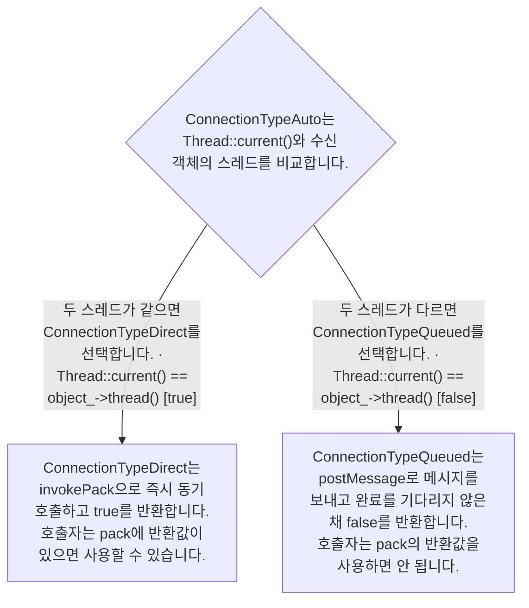

[Mermaid 원문](request-lifecycle.callback-depth-flow.mmd)

??? note "그림 근거와 확인 범위"
    Auto가 현재·수신 스레드를 비교해 Direct 즉시 호출과 Queued 메시지 전달을 고르는 분기는 무엇입니까?
    
    소스에 연결한 설계 해석입니다. 자동 연결 검사는 의미 승인이나 기기 실행 검증이 아닙니다.
    
    LLM 그림 초안 · 사람 검토 전
    
    작성 모델: `cli/codex/gpt-6.1-terra`
    
    | 요소·전이 | 소스 근거 |
    |---|---|
    | <span data-sdd-label-en="ConnectionTypeAuto compares Thread::current() with the receiver object&#x27;s thread.">ConnectionTypeAuto는 Thread::current&#40;&#41;와 수신 객체의 스레드를 비교합니다.</span> | [src/libcamera/base/bound_method.cpp:22](#source-bfdfed92f905633d) |
    | <span data-sdd-label-en="ConnectionTypeDirect calls invokePack immediately and synchronously, then returns true. The caller may use the return value in pack, if any.">ConnectionTypeDirect는 invokePack으로 즉시 동기 호출하고 true를 반환합니다. 호출자는 pack에 반환값이 있으면 사용할 수 있습니다.</span> | [src/libcamera/base/bound_method.cpp:22](#source-bfdfed92f905633d) |
    | <span data-sdd-label-en="ConnectionTypeQueued posts a message with postMessage and returns false without waiting for completion. The caller must not use the return value in pack.">ConnectionTypeQueued는 postMessage로 메시지를 보내고 완료를 기다리지 않은 채 false를 반환합니다. 호출자는 pack의 반환값을 사용하면 안 됩니다.</span> | [src/libcamera/base/bound_method.cpp:22](#source-bfdfed92f905633d) |
    | <span data-sdd-label-en="If the two threads are the same, it selects ConnectionTypeDirect. · Thread::current() == object_-&gt;thread() [true]">두 스레드가 같으면 ConnectionTypeDirect를 선택합니다. · Thread::current&#40;&#41; == object&#95;-&gt;thread&#40;&#41; &#91;true&#93;</span> | [src/libcamera/base/bound_method.cpp:22](#source-bfdfed92f905633d) |
    | <span data-sdd-label-en="If the two threads differ, it selects ConnectionTypeQueued. · Thread::current() == object_-&gt;thread() [false]">두 스레드가 다르면 ConnectionTypeQueued를 선택합니다. · Thread::current&#40;&#41; == object&#95;-&gt;thread&#40;&#41; &#91;false&#93;</span> | [src/libcamera/base/bound_method.cpp:22](#source-bfdfed92f905633d) |
<!-- /sdd:visual:callback-depth-flow -->

<!-- sdd:visual:queued-lifetime-flow -->
### Queued 수신과 해제 시점의 책임

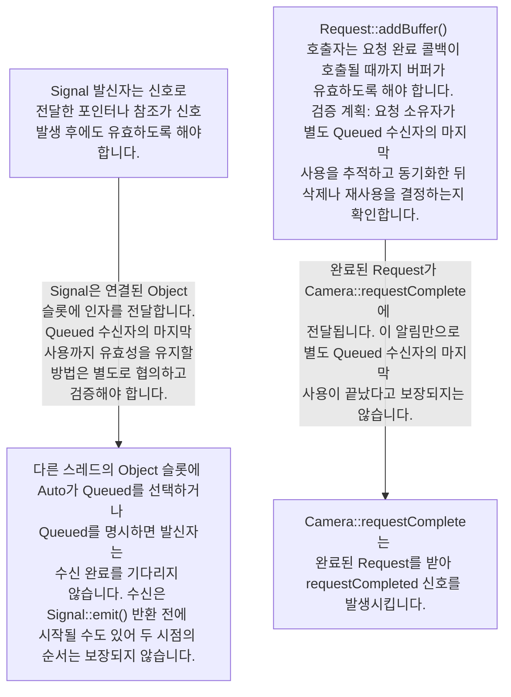

[Mermaid 원문](request-lifecycle.queued-lifetime-flow.mmd)

??? note "그림 근거와 확인 범위"
    Signal 발신자의 포인터 수명 책임과 요청 소유자의 마지막 수신 사용 확인은 어떻게 연결됩니까?
    
    소스에 연결한 설계 해석입니다. 자동 연결 검사는 의미 승인이나 기기 실행 검증이 아닙니다.
    
    LLM 그림 초안 · 사람 검토 전
    
    작성 모델: `cli/codex/gpt-6.1-terra`
    
    | 요소·전이 | 소스 근거 |
    |---|---|
    | <span data-sdd-label-en="The Signal emitter must ensure that pointers or references passed through the signal remain valid after emission.">Signal 발신자는 신호로 전달한 포인터나 참조가 신호 발생 후에도 유효하도록 해야 합니다.</span> | [src/libcamera/base/signal.cpp:73](#source-52064eba9532db6a) |
    | <span data-sdd-label-en="When Auto selects Queued for an Object slot on another thread, or Queued is specified explicitly, the sender does not wait for the receiver to finish. Reception may start before Signal::emit() returns, so their order is not guaranteed.">다른 스레드의 Object 슬롯에 Auto가 Queued를 선택하거나 Queued를 명시하면 발신자는 수신 완료를 기다리지 않습니다. 수신은 Signal::emit&#40;&#41; 반환 전에 시작될 수도 있어 두 시점의 순서는 보장되지 않습니다.</span> | [src/libcamera/base/signal.cpp:73](#source-52064eba9532db6a) · [src/libcamera/base/bound_method.cpp:22](#source-bfdfed92f905633d) · [src/libcamera/base/thread.cpp:558](#source-30a3738b60b6abb2) · [src/libcamera/base/thread.cpp:630](#source-d1c65540038fa8b5) |
    | <span data-sdd-label-en="The Request::addBuffer() caller must ensure that the buffer remains valid until the request completion callback is called. Verification plan: check that the request owner tracks and synchronizes the last use by separate Queued receivers before deciding to delete or reuse the buffer.">Request::addBuffer&#40;&#41; 호출자는 요청 완료 콜백이 호출될 때까지 버퍼가 유효하도록 해야 합니다. 검증 계획: 요청 소유자가 별도 Queued 수신자의 마지막 사용을 추적하고 동기화한 뒤 삭제나 재사용을 결정하는지 확인합니다.</span> | [src/libcamera/request.cpp:442](#source-95ae69eeb085e3b1) · [src/libcamera/base/signal.cpp:73](#source-52064eba9532db6a) · [src/libcamera/base/bound_method.cpp:22](#source-bfdfed92f905633d) |
    | <span data-sdd-label-en="Camera::requestComplete receives the completed Request and emits the requestCompleted signal.">Camera::requestComplete는 완료된 Request를 받아 requestCompleted 신호를 발생시킵니다.</span> | [src/libcamera/camera.cpp:1475](#source-a8b87568e9f33e81) |
    | <span data-sdd-label-en="Signal passes arguments to the connected Object slot. The parties must separately agree on and verify how validity will be maintained through the Queued receiver&#x27;s last use.">Signal은 연결된 Object 슬롯에 인자를 전달합니다. Queued 수신자의 마지막 사용까지 유효성을 유지할 방법은 별도로 협의하고 검증해야 합니다.</span> | [src/libcamera/base/signal.cpp:73](#source-52064eba9532db6a) |
    | <span data-sdd-label-en="The completed Request is passed to Camera::requestComplete. This notification alone does not guarantee that separate Queued receivers have finished their last use.">완료된 Request가 Camera::requestComplete에 전달됩니다. 이 알림만으로 별도 Queued 수신자의 마지막 사용이 끝났다고 보장되지는 않습니다.</span> | [src/libcamera/camera.cpp:1475](#source-a8b87568e9f33e81) · [src/libcamera/base/bound_method.cpp:22](#source-bfdfed92f905633d) |
<!-- /sdd:visual:queued-lifetime-flow -->

<!-- sdd:visual:callback-boundaries-flow -->
### 직접 중첩 호출과 별도 Queued 수신의 경계

```mermaid
flowchart TB
%% sdd:translations {"Direct 분기에서는 <br/>activatePack이 invokePack을 <br/>동기 호출합니다.": "In the Direct branch, <br/>activatePack calls <br/>invokePack synchronously.", "Direct의 invokePack은 발신 <br/>스레드에서 수신 함수를 즉시 <br/>동기 호출하고 수신 함수가 <br/>복귀한 뒤 돌아옵니다. <br/>콜백에서 같은 함수를 중첩 <br/>호출하는 것은 별도로 <br/>허용하지 않으면 금지됩니다.": "For Direct, invokePack <br/>immediately calls the <br/>receiver function <br/>synchronously in the <br/>sender#39;s thread and returns <br/>after the receiver function <br/>returns. A nested call to <br/>the same function from a <br/>callback is forbidden <br/>unless separately allowed.", "Object 수신자가 있는 멤버 <br/>또는 함수 객체의 activate는 <br/>인자를 묶어 activatePack을 <br/>호출합니다. · <br/>#33;this-#62;object#95; #91;false#93;": "The activate method of a <br/>member or functor with an <br/>Object receiver packs the <br/>arguments and calls <br/>activatePack. · <br/>#33;this-#62;object#95; #91;false#93;", "Object::message는 소비된 <br/>InvokeMessage를 객체의 <br/>스레드에서 처리합니다. 이 <br/>처리는 emit 반환이나 내부 <br/>갱신 전후 어느 때든 시작할 <br/>수 있습니다. 재정의 함수는 <br/>처리하지 않은 메시지를 부모 <br/>처리기에 넘겨야 하며 반환 <br/>후 메시지 참조를 보관해서는 <br/>안 됩니다.": "Object::message handles a <br/>consumed InvokeMessage in <br/>the object#39;s thread. This <br/>handling may start before <br/>or after emit returns or <br/>the internal update. An <br/>override must pass <br/>unhandled messages to the <br/>parent handler and must not <br/>retain a message reference <br/>after return.", "PipelineHandler::<br/>completeBuffer는 emit이 <br/>실제로 반환한 뒤 내부 <br/>completeBuffer를 호출합니다.": "PipelineHandler::<br/>completeBuffer calls the <br/>internal completeBuffer <br/>after emit actually returns.", "Queued 분기에서는 <br/>activatePack이 <br/>postMessage로 메시지를 <br/>게시하고 false를 반환합니다.": "In the Queued branch, <br/>activatePack posts the <br/>message through postMessage <br/>and returns false.", "Queued의 postMessage는 <br/>InvokeMessage를 게시합니다. <br/>발신자는 수신 함수의 완료를 <br/>기다리지 않으며, 수신 <br/>함수의 실행과 완료는 <br/>별도입니다. Object 소멸자는 <br/>남은 메시지를 제거할 수 <br/>있으므로 게시만으로 미래 <br/>전달이 보장되지는 않습니다.": "For Queued, postMessage <br/>posts an InvokeMessage. The <br/>sender does not wait for <br/>the receiver function to <br/>finish; execution and <br/>completion of the receiver <br/>function are separate. The <br/>Object destructor may <br/>remove pending messages, so <br/>posting alone does not <br/>guarantee future delivery.", "activatePack은 연결 방식에 <br/>따라 분기합니다. Auto는 <br/>같은 스레드에서 Direct를, <br/>다른 스레드에서 Queued를 <br/>선택합니다.": "activatePack branches <br/>according to the connection <br/>type. Auto selects Direct <br/>on the same thread and <br/>Queued on different threads.", "bufferCompleted.emit는 <br/>연결된 슬롯의 activate를 <br/>연결 순서대로 호출합니다. <br/>발신자는 신호로 전달한 <br/>포인터와 참조가 신호 발생 <br/>후에도 유효하도록 해야 <br/>합니다.": "bufferCompleted.emit calls <br/>activate on connected slots <br/>in connection order. The <br/>emitter must ensure that <br/>pointers and references <br/>passed through the signal <br/>remain valid after emission.", "dispatchMessages는 해당 <br/>스레드에서 type과 receiver <br/>필터에 맞는 게시 메시지를 <br/>전달합니다. 일반 이벤트 <br/>루프 밖에서 명시적으로 <br/>호출할 수 있고 같은 <br/>스레드의 메시지 핸들러에서 <br/>재귀 호출할 수 있습니다. <br/>다른 스레드에서 호출하면 <br/>동작이 정의되지 않습니다.": "dispatchMessages delivers <br/>posted messages matching <br/>the type and receiver <br/>filters in that thread. It <br/>can be called explicitly <br/>outside the normal event <br/>loop and recursively from a <br/>message handler in the same <br/>thread. Calling it from <br/>another thread has <br/>undefined behavior.", "emit은 연결된 각 슬롯의 <br/>activate를 연결 순서대로 <br/>호출합니다.": "emit calls activate on each <br/>connected slot in <br/>connection order.", "emit이 실제로 반환한 뒤 <br/>Request::Private::<br/>completeBuffer는 <br/>pending#95;에서 buffer를 <br/>제거하고 buffer의 request <br/>연결을 해제하며, 취소된 <br/>buffer면 cancelled#95;를 <br/>설정합니다. 마지막 buffer가 <br/>끝나도 요청은 자동 완료되지 <br/>않으므로 pipeline handler가 <br/>completeRequest#40;#41;를 <br/>명시적으로 호출해야 합니다.": "After emit actually <br/>returns, <br/>Request::Private::<br/>completeBuffer removes <br/>buffer from pending#95; and <br/>clears the buffer#39;s request <br/>association, setting <br/>cancelled#95; if the buffer <br/>was cancelled. The request <br/>does not complete <br/>automatically when the last <br/>buffer completes, so the <br/>pipeline handler must call <br/>completeRequest#40;#41; <br/>explicitly.", "멤버 또는 함수 객체의 <br/>activate는 Object 수신자가 <br/>있으면 인자를 묶어 <br/>activatePack을 호출하고, <br/>없으면 함수를 직접 <br/>호출합니다.": "A member or functor <br/>activate packs the <br/>arguments and calls <br/>activatePack when there is <br/>an Object receiver; <br/>otherwise, it calls the <br/>function directly.", "해당 수신 스레드에서 <br/>dispatchMessages가 큐에 <br/>남은 메시지를 소비할 때 <br/>수신 Object가 유효하고 <br/>메시지가 type과 receiver <br/>필터에 일치하면 수신 객체의 <br/>message를 호출합니다.": "When dispatchMessages <br/>consumes a message <br/>remaining in the queue in <br/>the receiving thread, it <br/>calls the receiving <br/>object#39;s message if the <br/>receiving Object is valid <br/>and the message matches the <br/>type and receiver filters.", "해당 수신 스레드의 <br/>dispatchMessages가 실행될 <br/>때 메시지가 큐에 남아 있고 <br/>수신 Object가 유효하며 <br/>type과 receiver 필터에 <br/>일치하면 게시된 메시지를 <br/>소비합니다.": "When dispatchMessages runs <br/>in the receiving thread, it <br/>consumes the posted message <br/>if the message remains in <br/>the queue, the receiving <br/>Object is valid, and the <br/>message matches the type <br/>and receiver filters."}
  v_emit["bufferCompleted.emit는 <br/>연결된 슬롯의 activate를 <br/>연결 순서대로 호출합니다. <br/>발신자는 신호로 전달한 <br/>포인터와 참조가 신호 발생 <br/>후에도 유효하도록 해야 <br/>합니다."]
  v_activate["멤버 또는 함수 객체의 <br/>activate는 Object 수신자가 <br/>있으면 인자를 묶어 <br/>activatePack을 호출하고, <br/>없으면 함수를 직접 <br/>호출합니다."]
  v_activatepack{"activatePack은 연결 방식에 <br/>따라 분기합니다. Auto는 <br/>같은 스레드에서 Direct를, <br/>다른 스레드에서 Queued를 <br/>선택합니다."}
  v_invokepack["Direct의 invokePack은 발신 <br/>스레드에서 수신 함수를 즉시 <br/>동기 호출하고 수신 함수가 <br/>복귀한 뒤 돌아옵니다. <br/>콜백에서 같은 함수를 중첩 <br/>호출하는 것은 별도로 <br/>허용하지 않으면 금지됩니다."]
  v_postmessage["Queued의 postMessage는 <br/>InvokeMessage를 게시합니다. <br/>발신자는 수신 함수의 완료를 <br/>기다리지 않으며, 수신 <br/>함수의 실행과 완료는 <br/>별도입니다. Object 소멸자는 <br/>남은 메시지를 제거할 수 <br/>있으므로 게시만으로 미래 <br/>전달이 보장되지는 않습니다."]
  v_dispatch["dispatchMessages는 해당 <br/>스레드에서 type과 receiver <br/>필터에 맞는 게시 메시지를 <br/>전달합니다. 일반 이벤트 <br/>루프 밖에서 명시적으로 <br/>호출할 수 있고 같은 <br/>스레드의 메시지 핸들러에서 <br/>재귀 호출할 수 있습니다. <br/>다른 스레드에서 호출하면 <br/>동작이 정의되지 않습니다."]
  v_message["Object::message는 소비된 <br/>InvokeMessage를 객체의 <br/>스레드에서 처리합니다. 이 <br/>처리는 emit 반환이나 내부 <br/>갱신 전후 어느 때든 시작할 <br/>수 있습니다. 재정의 함수는 <br/>처리하지 않은 메시지를 부모 <br/>처리기에 넘겨야 하며 반환 <br/>후 메시지 참조를 보관해서는 <br/>안 됩니다."]
  v_completebuffer["emit이 실제로 반환한 뒤 <br/>Request::Private::<br/>completeBuffer는 <br/>pending#95;에서 buffer를 <br/>제거하고 buffer의 request <br/>연결을 해제하며, 취소된 <br/>buffer면 cancelled#95;를 <br/>설정합니다. 마지막 buffer가 <br/>끝나도 요청은 자동 완료되지 <br/>않으므로 pipeline handler가 <br/>completeRequest#40;#41;를 <br/>명시적으로 호출해야 합니다."]
  v_emit -->|"emit은 연결된 각 슬롯의 <br/>activate를 연결 순서대로 <br/>호출합니다."| v_activate
  v_activate -->|"Object 수신자가 있는 멤버 <br/>또는 함수 객체의 activate는 <br/>인자를 묶어 activatePack을 <br/>호출합니다. · <br/>#33;this-#62;object#95; #91;false#93;"| v_activatepack
  v_activatepack -->|"Direct 분기에서는 <br/>activatePack이 invokePack을 <br/>동기 호출합니다."| v_invokepack
  v_activatepack -->|"Queued 분기에서는 <br/>activatePack이 <br/>postMessage로 메시지를 <br/>게시하고 false를 반환합니다."| v_postmessage
  v_postmessage -->|"해당 수신 스레드의 <br/>dispatchMessages가 실행될 <br/>때 메시지가 큐에 남아 있고 <br/>수신 Object가 유효하며 <br/>type과 receiver 필터에 <br/>일치하면 게시된 메시지를 <br/>소비합니다."| v_dispatch
  v_dispatch -->|"해당 수신 스레드에서 <br/>dispatchMessages가 큐에 <br/>남은 메시지를 소비할 때 <br/>수신 Object가 유효하고 <br/>메시지가 type과 receiver <br/>필터에 일치하면 수신 객체의 <br/>message를 호출합니다."| v_message
  v_emit -->|"PipelineHandler::<br/>completeBuffer는 emit이 <br/>실제로 반환한 뒤 내부 <br/>completeBuffer를 호출합니다."| v_completebuffer
```

[Mermaid 원문](request-lifecycle.callback-boundaries-flow.mmd)

??? note "그림 근거와 확인 범위"
    Direct 중첩 호출·Queued 게시와 명시적 dispatch는 emit 반환 및 내부 갱신과 어떻게 구분됩니까?
    
    소스에 연결한 설계 해석입니다. 자동 연결 검사는 의미 승인이나 기기 실행 검증이 아닙니다.
    
    LLM 그림 초안 · 사람 검토 전
    
    작성 모델: `cli/codex/gpt-6.1-terra`
    
    | 요소·전이 | 소스 근거 |
    |---|---|
    | <span data-sdd-label-en="bufferCompleted.emit calls activate on connected slots in connection order. The emitter must ensure that pointers and references passed through the signal remain valid after emission.">bufferCompleted.emit는 연결된 슬롯의 activate를 연결 순서대로 호출합니다. 발신자는 신호로 전달한 포인터와 참조가 신호 발생 후에도 유효하도록 해야 합니다.</span> | [src/libcamera/pipeline_handler.cpp:547](#source-01ad7c6605c3296a) · [include/libcamera/base/signal.h:38](#source-91522e9aaaa1dc2c) · [src/libcamera/base/signal.cpp:73](#source-52064eba9532db6a) |
    | <span data-sdd-label-en="A member or functor activate packs the arguments and calls activatePack when there is an Object receiver; otherwise, it calls the function directly.">멤버 또는 함수 객체의 activate는 Object 수신자가 있으면 인자를 묶어 activatePack을 호출하고, 없으면 함수를 직접 호출합니다.</span> | [include/libcamera/base/bound_method.h:59](#source-ded819c4f6ccbb7c) |
    | <span data-sdd-label-en="activatePack branches according to the connection type. Auto selects Direct on the same thread and Queued on different threads.">activatePack은 연결 방식에 따라 분기합니다. Auto는 같은 스레드에서 Direct를, 다른 스레드에서 Queued를 선택합니다.</span> | [src/libcamera/base/bound_method.cpp:22](#source-bfdfed92f905633d) |
    | <span data-sdd-label-en="For Direct, invokePack immediately calls the receiver function synchronously in the sender&#x27;s thread and returns after the receiver function returns. A nested call to the same function from a callback is forbidden unless separately allowed.">Direct의 invokePack은 발신 스레드에서 수신 함수를 즉시 동기 호출하고 수신 함수가 복귀한 뒤 돌아옵니다. 콜백에서 같은 함수를 중첩 호출하는 것은 별도로 허용하지 않으면 금지됩니다.</span> | [src/libcamera/base/bound_method.cpp:22](#source-bfdfed92f905633d) · [include/libcamera/base/bound_method.h:59](#source-ded819c4f6ccbb7c) · [Documentation/thread-safety.dox:1](#source-6c01009ce557af9e) |
    | <span data-sdd-label-en="For Queued, postMessage posts an InvokeMessage. The sender does not wait for the receiver function to finish; execution and completion of the receiver function are separate. The Object destructor may remove pending messages, so posting alone does not guarantee future delivery.">Queued의 postMessage는 InvokeMessage를 게시합니다. 발신자는 수신 함수의 완료를 기다리지 않으며, 수신 함수의 실행과 완료는 별도입니다. Object 소멸자는 남은 메시지를 제거할 수 있으므로 게시만으로 미래 전달이 보장되지는 않습니다.</span> | [src/libcamera/base/bound_method.cpp:22](#source-bfdfed92f905633d) · [src/libcamera/base/object.cpp:97](#source-5c4e28c7eeb42833) |
    | <span data-sdd-label-en="dispatchMessages delivers posted messages matching the type and receiver filters in that thread. It can be called explicitly outside the normal event loop and recursively from a message handler in the same thread. Calling it from another thread has undefined behavior.">dispatchMessages는 해당 스레드에서 type과 receiver 필터에 맞는 게시 메시지를 전달합니다. 일반 이벤트 루프 밖에서 명시적으로 호출할 수 있고 같은 스레드의 메시지 핸들러에서 재귀 호출할 수 있습니다. 다른 스레드에서 호출하면 동작이 정의되지 않습니다.</span> | [src/libcamera/base/thread.cpp:613](#source-42ba1d0bfc15542a) |
    | <span data-sdd-label-en="Object::message handles a consumed InvokeMessage in the object&#x27;s thread. This handling may start before or after emit returns or the internal update. An override must pass unhandled messages to the parent handler and must not retain a message reference after return.">Object::message는 소비된 InvokeMessage를 객체의 스레드에서 처리합니다. 이 처리는 emit 반환이나 내부 갱신 전후 어느 때든 시작할 수 있습니다. 재정의 함수는 처리하지 않은 메시지를 부모 처리기에 넘겨야 하며 반환 후 메시지 참조를 보관해서는 안 됩니다.</span> | [src/libcamera/base/object.cpp:184](#source-993262a2c2838b27) · [src/libcamera/base/thread.cpp:613](#source-42ba1d0bfc15542a) · [src/libcamera/pipeline_handler.cpp:547](#source-01ad7c6605c3296a) |
    | <span data-sdd-label-en="After emit actually returns, Request::Private::completeBuffer removes buffer from pending_ and clears the buffer&#x27;s request association, setting cancelled_ if the buffer was cancelled. The request does not complete automatically when the last buffer completes, so the pipeline handler must call completeRequest() explicitly.">emit이 실제로 반환한 뒤 Request::Private::completeBuffer는 pending&#95;에서 buffer를 제거하고 buffer의 request 연결을 해제하며, 취소된 buffer면 cancelled&#95;를 설정합니다. 마지막 buffer가 끝나도 요청은 자동 완료되지 않으므로 pipeline handler가 completeRequest&#40;&#41;를 명시적으로 호출해야 합니다.</span> | [src/libcamera/pipeline_handler.cpp:547](#source-01ad7c6605c3296a) · [src/libcamera/request.cpp:103](#source-db7f21585c4c2708) |
    | <span data-sdd-label-en="emit calls activate on each connected slot in connection order.">emit은 연결된 각 슬롯의 activate를 연결 순서대로 호출합니다.</span> | [include/libcamera/base/signal.h:38](#source-91522e9aaaa1dc2c) · [src/libcamera/base/signal.cpp:73](#source-52064eba9532db6a) |
    | <span data-sdd-label-en="The activate method of a member or functor with an Object receiver packs the arguments and calls activatePack. · !this-&gt;object_ [false]">Object 수신자가 있는 멤버 또는 함수 객체의 activate는 인자를 묶어 activatePack을 호출합니다. · &#33;this-&gt;object&#95; &#91;false&#93;</span> | [include/libcamera/base/bound_method.h:59](#source-ded819c4f6ccbb7c) |
    | <span data-sdd-label-en="In the Direct branch, activatePack calls invokePack synchronously.">Direct 분기에서는 activatePack이 invokePack을 동기 호출합니다.</span> | [src/libcamera/base/bound_method.cpp:22](#source-bfdfed92f905633d) |
    | <span data-sdd-label-en="In the Queued branch, activatePack posts the message through postMessage and returns false.">Queued 분기에서는 activatePack이 postMessage로 메시지를 게시하고 false를 반환합니다.</span> | [src/libcamera/base/bound_method.cpp:22](#source-bfdfed92f905633d) |
    | <span data-sdd-label-en="When dispatchMessages runs in the receiving thread, it consumes the posted message if the message remains in the queue, the receiving Object is valid, and the message matches the type and receiver filters.">해당 수신 스레드의 dispatchMessages가 실행될 때 메시지가 큐에 남아 있고 수신 Object가 유효하며 type과 receiver 필터에 일치하면 게시된 메시지를 소비합니다.</span> | [src/libcamera/base/thread.cpp:613](#source-42ba1d0bfc15542a) · [src/libcamera/base/object.cpp:97](#source-5c4e28c7eeb42833) |
    | <span data-sdd-label-en="When dispatchMessages consumes a message remaining in the queue in the receiving thread, it calls the receiving object&#x27;s message if the receiving Object is valid and the message matches the type and receiver filters.">해당 수신 스레드에서 dispatchMessages가 큐에 남은 메시지를 소비할 때 수신 Object가 유효하고 메시지가 type과 receiver 필터에 일치하면 수신 객체의 message를 호출합니다.</span> | [src/libcamera/base/thread.cpp:630](#source-d1c65540038fa8b5) · [src/libcamera/base/object.cpp:97](#source-5c4e28c7eeb42833) |
    | <span data-sdd-label-en="PipelineHandler::completeBuffer calls the internal completeBuffer after emit actually returns.">PipelineHandler::completeBuffer는 emit이 실제로 반환한 뒤 내부 completeBuffer를 호출합니다.</span> | [src/libcamera/pipeline_handler.cpp:547](#source-01ad7c6605c3296a) |
<!-- /sdd:visual:callback-boundaries-flow -->

<!-- sdd:visual:stop-lifetime-flow -->
### stop 반환과 별도 수신의 마지막 사용 확인

```mermaid
flowchart TB
%% sdd:translations {"Blocking 호출이 끝나면 <br/>단언과 상태 설정을 거쳐 <br/>반환합니다.": "After the Blocking call <br/>completes, it asserts, sets <br/>the state, and returns.", "Camera::stop은 실행 중이 <br/>아니면 0을 반환하고, 접근 <br/>검사에 실패하면 오류를 <br/>반환합니다.": "Camera::stop returns 0 if <br/>it is not running and <br/>returns the error if the <br/>access check fails.", "Camera::stop은 호출 후 <br/>pending request가 없음을 <br/>단언하고 상태를 설정한 다음 <br/>0을 반환합니다.": "After the call, <br/>Camera::stop asserts that <br/>no requests are pending, <br/>sets the state, and returns <br/>0.", "PipelineHandler::stop은 <br/>Blocking으로 호출됩니다. <br/>같은 스레드에서는 <br/>Direct이고, 다른 <br/>스레드에서는 해당 <br/>InvokeMessage의 semaphore를 <br/>기다립니다.": "PipelineHandler::stop is <br/>called with Blocking. It is <br/>Direct in the same thread; <br/>otherwise, the caller waits <br/>on that InvokeMessage#39;s <br/>semaphore.", "검증 계획에서는 별도 <br/>수신자의 Request 포인터 <br/>마지막 사용을 확인하고, <br/>그전에는 삭제하거나 <br/>재사용하지 않습니다. 이는 <br/>시험 결과가 아닙니다.": "The verification plan <br/>checks the separate <br/>receiver#39;s last use of the <br/>Request pointer before <br/>deletion or reuse. This is <br/>not a test result.", "마지막 사용은 별도 확인이 <br/>필요합니다. stop 반환과 <br/>마지막 사용의 선후는 <br/>보장되지 않습니다.": "The last use needs a <br/>separate check. The <br/>ordering of stop return and <br/>the last use is not <br/>guaranteed.", "별도 Object의 Queued 호출은 <br/>비동기로 처리되며, 스레드가 <br/>멈추기 전에 호출된다는 <br/>보장은 없습니다.": "A separate Object#39;s Queued <br/>invocation runs <br/>asynchronously and is not <br/>guaranteed to run before <br/>the thread stops.", "실행 중이고 접근 검사를 <br/>통과하면 Blocking으로 <br/>호출합니다. · ret #60; 0 <br/>#91;false#93;": "When running and the access <br/>check succeeds, it calls <br/>with Blocking. · ret #60; 0 <br/>#91;false#93;", "포인터는 그대로 전달됩니다. <br/>호출자는 호출될 때까지 <br/>포인터를 유효하게 유지해야 <br/>합니다.": "Pointers are passed <br/>untouched. The caller must <br/>keep each pointer valid <br/>until the method is invoked."}
  v_stop_entry["Camera::stop은 실행 중이 <br/>아니면 0을 반환하고, 접근 <br/>검사에 실패하면 오류를 <br/>반환합니다."]
  v_blocking_stop["PipelineHandler::stop은 <br/>Blocking으로 호출됩니다. <br/>같은 스레드에서는 <br/>Direct이고, 다른 <br/>스레드에서는 해당 <br/>InvokeMessage의 semaphore를 <br/>기다립니다."]
  v_stop_return["Camera::stop은 호출 후 <br/>pending request가 없음을 <br/>단언하고 상태를 설정한 다음 <br/>0을 반환합니다."]
  v_queued_receiver["별도 Object의 Queued 호출은 <br/>비동기로 처리되며, 스레드가 <br/>멈추기 전에 호출된다는 <br/>보장은 없습니다."]
  v_pointer_check["검증 계획에서는 별도 <br/>수신자의 Request 포인터 <br/>마지막 사용을 확인하고, <br/>그전에는 삭제하거나 <br/>재사용하지 않습니다. 이는 <br/>시험 결과가 아닙니다."]
  v_stop_entry -->|"실행 중이고 접근 검사를 <br/>통과하면 Blocking으로 <br/>호출합니다. · ret #60; 0 <br/>#91;false#93;"| v_blocking_stop
  v_blocking_stop -->|"Blocking 호출이 끝나면 <br/>단언과 상태 설정을 거쳐 <br/>반환합니다."| v_stop_return
  v_queued_receiver -->|"포인터는 그대로 전달됩니다. <br/>호출자는 호출될 때까지 <br/>포인터를 유효하게 유지해야 <br/>합니다."| v_pointer_check
  v_stop_return -->|"마지막 사용은 별도 확인이 <br/>필요합니다. stop 반환과 <br/>마지막 사용의 선후는 <br/>보장되지 않습니다."| v_pointer_check
```

[Mermaid 원문](request-lifecycle.stop-lifetime-flow.mmd)

??? note "그림 근거와 확인 범위"
    정상 stop의 Blocking 호출이 반환해도 별도 Queued 수신자의 포인터 사용은 왜 따로 확인합니까?
    
    소스에 연결한 설계 해석입니다. 자동 연결 검사는 의미 승인이나 기기 실행 검증이 아닙니다.
    
    LLM 그림 초안 · 사람 검토 전
    
    작성 모델: `cli/codex/gpt-6.1-terra`
    
    | 요소·전이 | 소스 근거 |
    |---|---|
    | <span data-sdd-label-en="Camera::stop returns 0 if it is not running and returns the error if the access check fails.">Camera::stop은 실행 중이 아니면 0을 반환하고, 접근 검사에 실패하면 오류를 반환합니다.</span> | [src/libcamera/camera.cpp:1445](#source-b0fa492ac93fb410) |
    | <span data-sdd-label-en="PipelineHandler::stop is called with Blocking. It is Direct in the same thread; otherwise, the caller waits on that InvokeMessage&#x27;s semaphore.">PipelineHandler::stop은 Blocking으로 호출됩니다. 같은 스레드에서는 Direct이고, 다른 스레드에서는 해당 InvokeMessage의 semaphore를 기다립니다.</span> | [src/libcamera/camera.cpp:1445](#source-b0fa492ac93fb410) · [src/libcamera/base/bound_method.cpp:22](#source-bfdfed92f905633d) |
    | <span data-sdd-label-en="After the call, Camera::stop asserts that no requests are pending, sets the state, and returns 0.">Camera::stop은 호출 후 pending request가 없음을 단언하고 상태를 설정한 다음 0을 반환합니다.</span> | [src/libcamera/camera.cpp:1445](#source-b0fa492ac93fb410) |
    | <span data-sdd-label-en="A separate Object&#x27;s Queued invocation runs asynchronously and is not guaranteed to run before the thread stops.">별도 Object의 Queued 호출은 비동기로 처리되며, 스레드가 멈추기 전에 호출된다는 보장은 없습니다.</span> | [src/libcamera/base/object.cpp:258](#source-438c51d63c1510a4) · [src/libcamera/base/bound_method.cpp:22](#source-bfdfed92f905633d) |
    | <span data-sdd-label-en="The verification plan checks the separate receiver&#x27;s last use of the Request pointer before deletion or reuse. This is not a test result.">검증 계획에서는 별도 수신자의 Request 포인터 마지막 사용을 확인하고, 그전에는 삭제하거나 재사용하지 않습니다. 이는 시험 결과가 아닙니다.</span> | [src/libcamera/base/object.cpp:258](#source-438c51d63c1510a4) · [src/libcamera/base/signal.cpp:73](#source-52064eba9532db6a) |
    | <span data-sdd-label-en="When running and the access check succeeds, it calls with Blocking. · ret &lt; 0 [false]">실행 중이고 접근 검사를 통과하면 Blocking으로 호출합니다. · ret &lt; 0 &#91;false&#93;</span> | [src/libcamera/camera.cpp:1445](#source-b0fa492ac93fb410) |
    | <span data-sdd-label-en="After the Blocking call completes, it asserts, sets the state, and returns.">Blocking 호출이 끝나면 단언과 상태 설정을 거쳐 반환합니다.</span> | [src/libcamera/camera.cpp:1445](#source-b0fa492ac93fb410) |
    | <span data-sdd-label-en="Pointers are passed untouched. The caller must keep each pointer valid until the method is invoked.">포인터는 그대로 전달됩니다. 호출자는 호출될 때까지 포인터를 유효하게 유지해야 합니다.</span> | [src/libcamera/base/object.cpp:258](#source-438c51d63c1510a4) |
    | <span data-sdd-label-en="The last use needs a separate check. The ordering of stop return and the last use is not guaranteed.">마지막 사용은 별도 확인이 필요합니다. stop 반환과 마지막 사용의 선후는 보장되지 않습니다.</span> | [src/libcamera/camera.cpp:1445](#source-b0fa492ac93fb410) · [src/libcamera/base/object.cpp:258](#source-438c51d63c1510a4) · [src/libcamera/base/signal.cpp:73](#source-52064eba9532db6a) |
<!-- /sdd:visual:stop-lifetime-flow -->

`Signal`에 연결된 `Object` 외 수신자의 멤버 함수와 functor, 정적 함수는 각각의 `activate`에서 호출 문맥상 즉시 실행됩니다. `Object::invokeMethod()`을 `ConnectionTypeQueued`로 호출하면 값이나 참조로 전달한 인자는 복사하지만 포인터는 그대로 전달하므로, 호출자는 실제 메서드 호출까지 포인터 대상을 유효하게 유지해야 합니다. 비동기 호출은 수신 객체가 유효하고 해당 수신 스레드가 게시된 메시지를 실제로 소비하는 조건에서 처리됩니다. `Camera` 상태를 변경하는 함수는 일반적으로 서로 동기화되지 않으므로, 호출자는 필요한 경우 동기화를 해야 합니다. `include/libcamera/base/signal.h:38`, `include/libcamera/base/bound_method.h:59`, `src/libcamera/base/object.cpp:258`, `src/libcamera/base/bound_method.cpp:22`, `src/libcamera/base/thread.cpp:613`, `src/libcamera/base/object.cpp:97`, `src/libcamera/camera.cpp:769`

`Signal` 문서는 다른 스레드에 속한 `Object` 슬롯이 인자 복사본을 받아 `Signal::emit()` 반환 뒤에 비동기로 호출된다고 설명합니다. 발신자는 신호로 전달한 포인터나 참조가 신호 발생 이후에도 유효하도록 해야 합니다. `src/libcamera/base/signal.cpp:73`

구현에서 `Signal::emit()`은 슬롯마다 `activate`를 호출하며, `ConnectionTypeAuto`가 서로 다른 스레드를 확인해 `ConnectionTypeQueued`를 선택하거나 명시적으로 `ConnectionTypeQueued`를 사용하면 메시지를 게시하고 기다리지 않고 반환합니다. `Thread::postMessage()`가 큐 잠금을 해제한 뒤 수신 측의 `Thread::dispatchMessages()`가 `Object::message()`와 `InvokeMessage::invoke()`를 호출할 수 있으므로, 다른 스레드의 수신 실행은 `Signal::emit()` 반환 전에도 시작될 수 있으며 일반적인 반환 전후 순서는 보장되지 않습니다. 명시적 `ConnectionTypeDirect`는 수신 객체가 다른 스레드에 속해도 발신 스레드에서 즉시 동기 호출합니다. `include/libcamera/base/signal.h:38`, `src/libcamera/base/bound_method.cpp:22`, `src/libcamera/base/object.cpp:184`, `src/libcamera/base/thread.cpp:558`, `src/libcamera/base/thread.cpp:630`, `src/libcamera/base/message.cpp:151`

변경 검증 계획에서는 발신자와 요청 소유자가 완료 및 해제 시점을 협의하고, 별도의 `ConnectionTypeQueued` 수신자마다 마지막 사용을 추적하고 동기화합니다. 모든 지연 수신자의 마지막 사용을 확인하기 전에는 삭제나 재사용으로 전달 대상의 수명을 끊지 않습니다. 소스 기반 조사 계획으로, `Signal::emit()`에서 수신자의 `Object` 유무, 연결 종류, 현재 스레드와 수신 스레드, 이벤트 루프, 요청과 버퍼의 상태를 기록하고 콜백 진입·복귀 및 카메라 정지 전후를 애플리케이션 표식으로 구분합니다. `ConnectionTypeDirect`의 재진입과 `ConnectionTypeQueued`의 지연을 조사하면서 전달된 포인터·참조의 유효성, `Request::Private::completeBuffer()`의 `pending_.erase(buffer)` 반환값과 다음 분기, 중복 완료 및 정지 후 요청 제출 여부를 확인합니다. `src/libcamera/base/signal.cpp:73`, `src/libcamera/base/bound_method.cpp:22`, `src/libcamera/camera.cpp:769`, `src/libcamera/pipeline_handler.cpp:547`, `src/libcamera/request.cpp:103`

`thread-safe`는 같은 인스턴스를 여러 스레드에서 동시에 호출할 수 있음을 뜻하고, `reentrant`는 호출마다 다른 인스턴스를 쓸 때 여러 스레드에서 동시에 호출할 수 있음을 뜻합니다. 두 정의는 같은 스레드의 콜백에서 같은 함수에 중첩 진입하는 것을 허용하지 않으며, 별도 문서화가 없으면 이러한 호출은 허용되지 않고 교착될 수 있습니다. `ConnectionTypeQueued` 수신은 수신 스레드가 이벤트 루프로 돌아올 때 비동기로 실행되지만, 해당 스레드에서 명시적 또는 재귀적으로 호출한 `Thread::dispatchMessages`가 필터에 맞는 메시지를 더 일찍 전달할 수도 있으며, 스레드가 정지하기 전 실제 소비가 보장되지는 않습니다. 정지나 재구성을 조사할 때는 호출자가 필요한 카메라 상태 변경 동기화를 수행했는지와 수신 이벤트 루프가 진행되는지를 확인하는 조사 계획을 세웁니다. `Documentation/thread-safety.dox:1`, `src/libcamera/base/bound_method.cpp:22`, `src/libcamera/base/thread.cpp:613`, `src/libcamera/camera.cpp:769`

`CameraManager::start()`를 호출한 애플리케이션 메인 스레드는 `Thread` 인스턴스에 연결되지만, libcamera가 접근할 수 있는 이벤트 루프는 없습니다. 조사 계획에서는 해당 스레드에 묶인 `Object`의 `Queued` 또는 다른 스레드에서 보내는 `Auto` 신호 수신을 살필 때 이 조건을 먼저 확인하고, 실제 애플리케이션의 메시지 소비 경로와 진행 여부를 별도로 기록합니다. `src/libcamera/base/thread.cpp:26`

`BoundMethodBase::activatePack()`은 `ConnectionTypeBlocking`에서 `Thread::current()`와 수신 `Object`의 스레드가 같으면 연결 방식을 `ConnectionTypeDirect`로 바꾸고 `invokePack()`을 즉시 호출합니다. 두 스레드가 다르면 이 함수는 해당 호출의 세마포어를 전달한 `InvokeMessage`를 게시한 뒤 `semaphore.acquire()`로 기다립니다. `src/libcamera/base/bound_method.cpp:22`

`Thread::dispatchMessages()`의 Doxygen 계약은 메시지를 게시한 순서대로 전달한다고 명시합니다. 실제 구현은 `type` 또는 `receiver`가 일치하지 않는 메시지를 건너뛰고, 잠금을 푼 뒤 수신자의 핸들러를 호출합니다. 다른 필터를 사용하는 재귀 호출에서는 앞서 건너뛴 메시지보다 뒤의 메시지가 먼저 전달될 수 있습니다. `src/libcamera/base/thread.cpp:613`

`Thread::dispatchMessages()`는 이벤트 루프 외에도 해당 수신 스레드에서 명시적으로 호출하거나 핸들러에서 재귀 호출하여 남아 있는 일치 메시지를 전달할 수 있습니다. `type`이 `Message::Type::None`이면 모든 유형이 일치하고, `receiver`가 null이면 모든 수신자가 일치합니다. 이 함수는 thread-safe가 아니므로 해당 스레드에서만 호출해야 하며, 다른 스레드에서 호출하면 동작은 정의되지 않습니다. `src/libcamera/base/thread.cpp:613`

소스 기반 조사 계획으로, 각 dispatch의 `type`, `receiver`, 메시지 게시 순서와 실제 전달 순서, 수신 TID와 재귀 깊이, 콜백 진입과 복귀를 기록합니다. 포인터 인자의 마지막 사용도 기록하여 호출 시점까지 유효했는지 확인하고, 메시지 포인터는 핸들러 호출이 끝난 뒤 참조를 보관하지 않아야 합니다. 이 계획은 실행 결과가 아닙니다. `src/libcamera/base/thread.cpp:613`, `src/libcamera/base/object.cpp:184`, `src/libcamera/base/object.cpp:258`

근거 원문: [src/libcamera/pipeline_handler.cpp:547](#source-01ad7c6605c3296a) · [src/libcamera/request.cpp:103](#source-db7f21585c4c2708) · [src/libcamera/base/bound_method.cpp:22](#source-bfdfed92f905633d) · [src/libcamera/base/signal.cpp:73](#source-52064eba9532db6a) · [src/libcamera/camera.cpp:769](#source-ea39665f99ddabe7) · [src/libcamera/camera.cpp:1475](#source-a8b87568e9f33e81) · [Documentation/thread-safety.dox:1](#source-6c01009ce557af9e) · [include/libcamera/base/signal.h:38](#source-91522e9aaaa1dc2c) · [include/libcamera/base/bound_method.h:59](#source-ded819c4f6ccbb7c) · [src/libcamera/base/object.cpp:258](#source-438c51d63c1510a4) · [src/libcamera/base/object.cpp:97](#source-5c4e28c7eeb42833) · [src/libcamera/request.cpp:442](#source-95ae69eeb085e3b1) · [src/libcamera/base/thread.cpp:558](#source-30a3738b60b6abb2) · [src/libcamera/base/thread.cpp:630](#source-d1c65540038fa8b5) · [src/libcamera/base/object.cpp:184](#source-993262a2c2838b27) · [src/libcamera/base/message.cpp:151](#source-f8ca77901599d6f4) · [src/libcamera/base/thread.cpp:26](#source-42e599e9840a0e43) · [src/libcamera/camera.cpp:1445](#source-b0fa492ac93fb410) · [src/libcamera/base/thread.cpp:613](#source-42ba1d0bfc15542a) · [include/libcamera/base/object.h:26](#source-b4f8bfcb927a6e0c)

## 정지와 연결 해제를 구분하기

`PipelineHandler::stop`의 문서 계약은 정지 시 모든 미완료 요청을 취소하고 즉시 오류 상태로 완료하도록 요구합니다. 실행 중 연결 해제될 때 대기 요청을 처리하는 일은 TODO이며, 선택된 UVC 구현에서는 장치 버퍼 반환 전에 스트리밍 정지가 실패해도 버퍼 해제를 계속 호출하므로 모든 요청이 반환되거나 계약이 자동으로 충족된다고 보장할 수 없습니다. `src/libcamera/pipeline_handler.cpp:359`, `src/libcamera/camera.cpp:952`, `src/libcamera/pipeline/uvcvideo/uvcvideo.cpp:320`, `src/libcamera/v4l2_videodevice.cpp:2023`

<!-- sdd:visual:stop-order -->
### 정지할 때 대기 요청을 처리하는 순서

```mermaid
flowchart TB
%% sdd:translations {"Blocking 호출이 반환한 뒤": "After the blocking <br/>invocation returns", "Camera::stop의 ASSERT 소스 <br/>위치": "Source location of <br/>Camera::stop ASSERT", "Configured로 복귀": "Return to Configured", "requestSequence#95; #61; 0": "requestSequence#95; #61; 0", "stopDevice#40;#41;": "stopDevice#40;#41;", "waitingRequests에 항목이 <br/>남았는가?": "Does waitingRequests <br/>contain an item?", "기기 정지 뒤 대기 큐 확인": "Inspect waiting queue after <br/>device stop", "다음 대기 항목 검사": "Inspect next waiting item", "대기 항목 하나를 cancel 후 <br/>doQueueRequest": "Cancel one waiting item, <br/>then doQueueRequest", "대기열을 별도로 분리": "Detach waiting queue", "분리 후 장치 정지": "Stop device after detaching", "비어 있으면 반복 종료": "If empty: leave loop", "예: 각 대기 요청": "Yes: each waiting request", "이 정상 경로의 함수 끝": "End of this normal function <br/>path", "이어지는 소스 순서": "Following source order", "이어지는 정상 소스 경로": "Following normal source path", "핸들러의 두 ASSERT 소스 위치": "Source locations of the two <br/>handler ASSERTs", "핸들러의 정상 반환 경계": "Handler normal-return <br/>boundary"}
  v_detach["대기열을 별도로 분리"]
  v_stop["stopDevice#40;#41;"]
  v_cancel["대기 항목 하나를 cancel 후 <br/>doQueueRequest"]
  v_configured["Configured로 복귀"]
  v_waiting{"waitingRequests에 항목이 <br/>남았는가?"}
  v_handlerchecks["핸들러의 두 ASSERT 소스 위치"]
  v_sequence["requestSequence#95; #61; 0"]
  v_handlerreturn["핸들러의 정상 반환 경계"]
  v_cameraassert["Camera::stop의 ASSERT 소스 <br/>위치"]
  v_detach -->|"분리 후 장치 정지"| v_stop
  v_cancel -->|"다음 대기 항목 검사"| v_waiting
  v_stop -->|"기기 정지 뒤 대기 큐 확인"| v_waiting
  v_waiting -->|"예: 각 대기 요청"| v_cancel
  v_waiting -->|"비어 있으면 반복 종료"| v_handlerchecks
  v_handlerchecks -->|"이어지는 소스 순서"| v_sequence
  v_sequence -->|"이 정상 경로의 함수 끝"| v_handlerreturn
  v_handlerreturn -->|"Blocking 호출이 반환한 뒤"| v_cameraassert
  v_cameraassert -->|"이어지는 정상 소스 경로"| v_configured
```

[Mermaid 원문](request-lifecycle.stop-order.mmd)

??? note "그림 근거와 확인 범위"
    정상 정지 경로의 순서를 표시합니다. 연결 해제 알림의 미완료 요청 TODO를 이 정지 보장과 혼동하지 마세요.
    
    소스에 연결한 설계 해석입니다. 자동 연결 검사는 의미 승인이나 기기 실행 검증이 아닙니다.
    
    | 요소·전이 | 소스 근거 |
    |---|---|
    | <span data-sdd-label-en="Detach waiting queue">대기열을 별도로 분리</span> | [src/libcamera/pipeline_handler.cpp:359](#source-eefd1bbecb1aad0a) |
    | <span data-sdd-label-en="stopDevice()">stopDevice&#40;&#41;</span> | [src/libcamera/pipeline_handler.cpp:359](#source-eefd1bbecb1aad0a) |
    | <span data-sdd-label-en="Cancel one waiting item, then doQueueRequest">대기 항목 하나를 cancel 후 doQueueRequest</span> | [src/libcamera/pipeline_handler.cpp:359](#source-eefd1bbecb1aad0a) |
    | <span data-sdd-label-en="Return to Configured">Configured로 복귀</span> | [src/libcamera/camera.cpp:1431](#source-e09324743def3f09) |
    | <span data-sdd-label-en="Does waitingRequests contain an item?">waitingRequests에 항목이 남았는가?</span> | [src/libcamera/pipeline_handler.cpp:359](#source-eefd1bbecb1aad0a) |
    | <span data-sdd-label-en="Source locations of the two handler ASSERTs">핸들러의 두 ASSERT 소스 위치</span> | [src/libcamera/pipeline_handler.cpp:359](#source-eefd1bbecb1aad0a) |
    | <span data-sdd-label-en="requestSequence_ = 0">requestSequence&#95; = 0</span> | [src/libcamera/pipeline_handler.cpp:359](#source-eefd1bbecb1aad0a) |
    | <span data-sdd-label-en="Handler normal-return boundary">핸들러의 정상 반환 경계</span> | [src/libcamera/pipeline_handler.cpp:359](#source-eefd1bbecb1aad0a) |
    | <span data-sdd-label-en="Source location of Camera::stop ASSERT">Camera::stop의 ASSERT 소스 위치</span> | [src/libcamera/camera.cpp:1431](#source-e09324743def3f09) |
    | <span data-sdd-label-en="Stop device after detaching">분리 후 장치 정지</span> | [src/libcamera/pipeline_handler.cpp:359](#source-eefd1bbecb1aad0a) |
    | <span data-sdd-label-en="Inspect next waiting item">다음 대기 항목 검사</span> | [src/libcamera/pipeline_handler.cpp:359](#source-eefd1bbecb1aad0a) |
    | <span data-sdd-label-en="Inspect waiting queue after device stop">기기 정지 뒤 대기 큐 확인</span> | [src/libcamera/pipeline_handler.cpp:359](#source-eefd1bbecb1aad0a) |
    | <span data-sdd-label-en="Yes: each waiting request">예: 각 대기 요청</span> | [src/libcamera/pipeline_handler.cpp:359](#source-eefd1bbecb1aad0a) |
    | <span data-sdd-label-en="If empty: leave loop">비어 있으면 반복 종료</span> | [src/libcamera/pipeline_handler.cpp:359](#source-eefd1bbecb1aad0a) |
    | <span data-sdd-label-en="Following source order">이어지는 소스 순서</span> | [src/libcamera/pipeline_handler.cpp:359](#source-eefd1bbecb1aad0a) |
    | <span data-sdd-label-en="End of this normal function path">이 정상 경로의 함수 끝</span> | [src/libcamera/pipeline_handler.cpp:359](#source-eefd1bbecb1aad0a) |
    | <span data-sdd-label-en="After the blocking invocation returns">Blocking 호출이 반환한 뒤</span> | [src/libcamera/camera.cpp:1431](#source-e09324743def3f09) |
    | <span data-sdd-label-en="Following normal source path">이어지는 정상 소스 경로</span> | [src/libcamera/camera.cpp:1431](#source-e09324743def3f09) |
<!-- /sdd:visual:stop-order -->

<!-- sdd:visual:stop-disconnect-contract -->
### 정지 API 계약과 연결 해제 TODO

```mermaid
flowchart TB
%% sdd:translations {"Camera::disconnect 알림": "Camera::disconnect <br/>notification", "PipelineHandler::stop 계약": "PipelineHandler::stop <br/>contract", "Running 중 연결 해제 시 <br/>대기 요청 처리: TODO": "Pending requests on <br/>disconnection while <br/>Running: TODO", "계약: 모든 대기 요청 <br/>취소·즉시 오류 완료": "Contract: cancel all <br/>pending requests; <br/>immediately complete in <br/>error", "미완료 TODO를 구분": "Distinguish unfinished TODO", "선택된 핸들러 원문의 계약": "Contract in the selected <br/>handler source"}
  v_stop["PipelineHandler::stop 계약"]
  v_complete["계약: 모든 대기 요청 <br/>취소·즉시 오류 완료"]
  v_disconnect["Camera::disconnect 알림"]
  v_todo["Running 중 연결 해제 시 <br/>대기 요청 처리: TODO"]
  v_stop -->|"선택된 핸들러 원문의 계약"| v_complete
  v_disconnect -->|"미완료 TODO를 구분"| v_todo
```

[Mermaid 원문](request-lifecycle.stop-disconnect-contract.mmd)

??? note "그림 근거와 확인 범위"
    PipelineHandler::stop과 Camera::disconnect의 선택된 두 원문은 대기 요청 처리를 어떻게 다르게 명시합니까?
    
    소스에 연결한 설계 해석입니다. 자동 연결 검사는 의미 승인이나 기기 실행 검증이 아닙니다.
    
    | 요소·전이 | 소스 근거 |
    |---|---|
    | <span data-sdd-label-en="PipelineHandler::stop contract">PipelineHandler::stop 계약</span> | [src/libcamera/pipeline_handler.cpp:359](#source-eefd1bbecb1aad0a) |
    | <span data-sdd-label-en="Contract: cancel all pending requests; immediately complete in error">계약: 모든 대기 요청 취소·즉시 오류 완료</span> | [src/libcamera/pipeline_handler.cpp:359](#source-eefd1bbecb1aad0a) |
    | <span data-sdd-label-en="Camera::disconnect notification">Camera::disconnect 알림</span> | [src/libcamera/camera.cpp:944](#source-839140c350119dd1) |
    | <span data-sdd-label-en="Pending requests on disconnection while Running: TODO">Running 중 연결 해제 시 대기 요청 처리: TODO</span> | [src/libcamera/camera.cpp:944](#source-839140c350119dd1) |
    | <span data-sdd-label-en="Contract in the selected handler source">선택된 핸들러 원문의 계약</span> | [src/libcamera/pipeline_handler.cpp:359](#source-eefd1bbecb1aad0a) |
    | <span data-sdd-label-en="Distinguish unfinished TODO">미완료 TODO를 구분</span> | [src/libcamera/camera.cpp:944](#source-839140c350119dd1) |
<!-- /sdd:visual:stop-disconnect-contract -->

<!-- sdd:visual:camera-stop-branches -->
### Camera::stop의 미실행·오류·정상 경로

```mermaid
flowchart TB
%% sdd:translations {"ASSERT#40;#33;hasPendingRequests#40;<br/>this#41;#41; 소스 위치": "Source location of <br/>ASSERT#40;#33;hasPendingRequests#40;<br/>this#41;#41;", "CameraConfigured 설정 후 0 <br/>반환": "Set CameraConfigured, then <br/>return 0", "CameraStopping 설정": "Set CameraStopping", "ConnectionTypeBlocking으로 <br/>PipelineHandler::stop 호출": "Invoke <br/>PipelineHandler::stop with <br/>ConnectionTypeBlocking", "d-#62;isRunning#40;#41;인가?": "Is d-#62;isRunning#40;#41; true?", "isAccessAllowed 결과 ret #60; <br/>0인가?": "Is isAccessAllowed result <br/>ret #60; 0?", "그 ret를 반환": "Return that ret", "미실행: 0 반환": "Not running: return 0", "아니요": "No", "예": "Yes", "이어지는 소스 순서": "Following source order", "정지 호출": "Invoke stop", "호출이 반환한 뒤의 소스 위치": "Source location after <br/>invocation returns"}
  v_running{"d-#62;isRunning#40;#41;인가?"}
  v_noop["미실행: 0 반환"]
  v_access{"isAccessAllowed 결과 ret #60; <br/>0인가?"}
  v_error["그 ret를 반환"]
  v_stopping["CameraStopping 설정"]
  v_invoke["ConnectionTypeBlocking으로 <br/>PipelineHandler::stop 호출"]
  v_assertion["ASSERT#40;#33;hasPendingRequests#40;<br/>this#41;#41; 소스 위치"]
  v_configured["CameraConfigured 설정 후 0 <br/>반환"]
  v_running -->|"아니요"| v_noop
  v_running -->|"예"| v_access
  v_access -->|"예"| v_error
  v_access -->|"아니요"| v_stopping
  v_stopping -->|"정지 호출"| v_invoke
  v_invoke -->|"호출이 반환한 뒤의 소스 위치"| v_assertion
  v_assertion -->|"이어지는 소스 순서"| v_configured
```

[Mermaid 원문](request-lifecycle.camera-stop-branches.mmd)

??? note "그림 근거와 확인 범위"
    isRunning과 접근 검사 결과에 따라 Camera::stop은 어떤 경로로 반환합니까?
    
    소스에 연결한 설계 해석입니다. 자동 연결 검사는 의미 승인이나 기기 실행 검증이 아닙니다.
    
    | 요소·전이 | 소스 근거 |
    |---|---|
    | <span data-sdd-label-en="Is d-&gt;isRunning() true?">d-&gt;isRunning&#40;&#41;인가?</span> | [src/libcamera/camera.cpp:1431](#source-e09324743def3f09) |
    | <span data-sdd-label-en="Not running: return 0">미실행: 0 반환</span> | [src/libcamera/camera.cpp:1431](#source-e09324743def3f09) |
    | <span data-sdd-label-en="Is isAccessAllowed result ret &lt; 0?">isAccessAllowed 결과 ret &lt; 0인가?</span> | [src/libcamera/camera.cpp:1431](#source-e09324743def3f09) |
    | <span data-sdd-label-en="Return that ret">그 ret를 반환</span> | [src/libcamera/camera.cpp:1431](#source-e09324743def3f09) |
    | <span data-sdd-label-en="Set CameraStopping">CameraStopping 설정</span> | [src/libcamera/camera.cpp:1431](#source-e09324743def3f09) |
    | <span data-sdd-label-en="Invoke PipelineHandler::stop with ConnectionTypeBlocking">ConnectionTypeBlocking으로 PipelineHandler::stop 호출</span> | [src/libcamera/camera.cpp:1431](#source-e09324743def3f09) |
    | <span data-sdd-label-en="Source location of ASSERT(!hasPendingRequests(this))">ASSERT&#40;&#33;hasPendingRequests&#40;this&#41;&#41; 소스 위치</span> | [src/libcamera/camera.cpp:1431](#source-e09324743def3f09) |
    | <span data-sdd-label-en="Set CameraConfigured, then return 0">CameraConfigured 설정 후 0 반환</span> | [src/libcamera/camera.cpp:1431](#source-e09324743def3f09) |
    | <span data-sdd-label-en="No">아니요</span> | [src/libcamera/camera.cpp:1431](#source-e09324743def3f09) |
    | <span data-sdd-label-en="Yes">예</span> | [src/libcamera/camera.cpp:1431](#source-e09324743def3f09) |
    | <span data-sdd-label-en="Yes">예</span> | [src/libcamera/camera.cpp:1431](#source-e09324743def3f09) |
    | <span data-sdd-label-en="No">아니요</span> | [src/libcamera/camera.cpp:1431](#source-e09324743def3f09) |
    | <span data-sdd-label-en="Invoke stop">정지 호출</span> | [src/libcamera/camera.cpp:1431](#source-e09324743def3f09) |
    | <span data-sdd-label-en="Source location after invocation returns">호출이 반환한 뒤의 소스 위치</span> | [src/libcamera/camera.cpp:1431](#source-e09324743def3f09) |
    | <span data-sdd-label-en="Following source order">이어지는 소스 순서</span> | [src/libcamera/camera.cpp:1431](#source-e09324743def3f09) |
<!-- /sdd:visual:camera-stop-branches -->

<!-- sdd:visual:stop-device-observation-plan -->
### stopDevice 호출 구간의 관찰 계획

```mermaid
flowchart TB
%% sdd:translations {"계획: waitingRequests.swap <br/>직후 분리 상태 관찰": "Plan: inspect separation <br/>immediately after <br/>waitingRequests.swap", "계획: 관찰 창에서 복귀 <br/>미관찰 → 추가 조사#40;원인 <br/>미확정#41;": "Plan: no observed return in <br/>observation window → <br/>investigate; cause <br/>unresolved", "계획: 대상 stopDevice <br/>구현의 취소·완료 경로 검토": "Plan: review cancellation <br/>and completion in the <br/>target stopDevice <br/>implementation", "계획: 실제 stopDevice 구현 <br/>복귀 이벤트 관찰 #40;선택한 <br/>UVC 구현은 별도 정적 분석, <br/>측정 결과 아님#41;": "Plan: observe the actual <br/>stopDevice implementation <br/>return event #40;selected UVC <br/>implementation statically <br/>analysed separately; not a <br/>measured result#41;", "계획: 실제 stopDevice 구현 <br/>진입을 별도 관찰": "Plan: separately observe <br/>entry into the actual <br/>stopDevice implementation", "계획: 호출 직전 관찰#40;구현 <br/>진입과 별도#41;": "Plan: observe before call, <br/>separately from <br/>implementation entry", "계획: 호출에서 돌아온 뒤 <br/>위치": "Plan: source position after <br/>the call returns", "구현 복귀를 관찰한 뒤 호출 <br/>뒤 위치와 비교 #40;호출 직전 <br/>로그는 복귀의 증거가 아님#41;": "Compare with the post-call <br/>position after an observed <br/>implementation return #40;a <br/>before-call log is not <br/>evidence of return#41;", "구현별 경로를 검토해 관찰 <br/>지점 선정": "Select observation points <br/>after reviewing <br/>implementation-specific <br/>paths", "다음 stopDevice 호출 전 <br/>지점과 비교": "Compare with the position <br/>before the following <br/>stopDevice call", "진입 뒤 반환이 관찰된 경우": "If a return is observed <br/>after entry", "진입은 관찰했으나 복귀 <br/>관찰이 없으면": "If entry was observed but <br/>return was not", "호출 지점과 실제 구현 <br/>진입을 구분": "Distinguish call site from <br/>actual implementation entry"}
  v_review["계획: 대상 stopDevice <br/>구현의 취소·완료 경로 검토"]
  v_detach["계획: waitingRequests.swap <br/>직후 분리 상태 관찰"]
  v_before["계획: 호출 직전 관찰#40;구현 <br/>진입과 별도#41;"]
  v_call["계획: 실제 stopDevice 구현 <br/>진입을 별도 관찰"]
  v_after["계획: 호출에서 돌아온 뒤 <br/>위치"]
  v_unreturned["계획: 관찰 창에서 복귀 <br/>미관찰 → 추가 조사#40;원인 <br/>미확정#41;"]
  v_implementation-return["계획: 실제 stopDevice 구현 <br/>복귀 이벤트 관찰 #40;선택한 <br/>UVC 구현은 별도 정적 분석, <br/>측정 결과 아님#41;"]
  v_review -->|"구현별 경로를 검토해 관찰 <br/>지점 선정"| v_before
  v_detach -->|"다음 stopDevice 호출 전 <br/>지점과 비교"| v_before
  v_before -->|"호출 지점과 실제 구현 <br/>진입을 구분"| v_call
  v_call -->|"진입 뒤 반환이 관찰된 경우"| v_implementation-return
  v_call -->|"진입은 관찰했으나 복귀 <br/>관찰이 없으면"| v_unreturned
  v_implementation-return -->|"구현 복귀를 관찰한 뒤 호출 <br/>뒤 위치와 비교 #40;호출 직전 <br/>로그는 복귀의 증거가 아님#41;"| v_after
```

[Mermaid 원문](request-lifecycle.stop-device-observation-plan.mmd)

??? note "그림 근거와 확인 범위"
    대상 stopDevice 구현의 취소·완료 경로 검토와 분리 직후·호출 직전·실제 구현 진입·복귀의 관찰 계획입니다. 실제 검토·측정 결과가 아니며 호출 직전 표시만으로 구현 진입이나 멎은 원인을 확정하지 않습니다.
    
    소스에 연결한 설계 해석입니다. 자동 연결 검사는 의미 승인이나 기기 실행 검증이 아닙니다.
    
    | 요소·전이 | 소스 근거 |
    |---|---|
    | <span data-sdd-label-en="Plan: review cancellation and completion in the target stopDevice implementation">계획: 대상 stopDevice 구현의 취소·완료 경로 검토</span> | [src/libcamera/pipeline_handler.cpp:359](#source-eefd1bbecb1aad0a) |
    | <span data-sdd-label-en="Plan: inspect separation immediately after waitingRequests.swap">계획: waitingRequests.swap 직후 분리 상태 관찰</span> | [src/libcamera/pipeline_handler.cpp:359](#source-eefd1bbecb1aad0a) |
    | <span data-sdd-label-en="Plan: observe before call, separately from implementation entry">계획: 호출 직전 관찰&#40;구현 진입과 별도&#41;</span> | [src/libcamera/pipeline_handler.cpp:359](#source-eefd1bbecb1aad0a) |
    | <span data-sdd-label-en="Plan: separately observe entry into the actual stopDevice implementation">계획: 실제 stopDevice 구현 진입을 별도 관찰</span> | [src/libcamera/pipeline_handler.cpp:359](#source-eefd1bbecb1aad0a) |
    | <span data-sdd-label-en="Plan: source position after the call returns">계획: 호출에서 돌아온 뒤 위치</span> | [src/libcamera/pipeline_handler.cpp:359](#source-eefd1bbecb1aad0a) |
    | <span data-sdd-label-en="Plan: no observed return in observation window → investigate; cause unresolved">계획: 관찰 창에서 복귀 미관찰 → 추가 조사&#40;원인 미확정&#41;</span> | [src/libcamera/pipeline_handler.cpp:359](#source-eefd1bbecb1aad0a) |
    | <span data-sdd-label-en="Plan: observe the actual stopDevice implementation return event (selected UVC implementation statically analysed separately; not a measured result)">계획: 실제 stopDevice 구현 복귀 이벤트 관찰 &#40;선택한 UVC 구현은 별도 정적 분석, 측정 결과 아님&#41;</span> | [src/libcamera/pipeline_handler.cpp:359](#source-eefd1bbecb1aad0a) |
    | <span data-sdd-label-en="Select observation points after reviewing implementation-specific paths">구현별 경로를 검토해 관찰 지점 선정</span> | [src/libcamera/pipeline_handler.cpp:359](#source-eefd1bbecb1aad0a) |
    | <span data-sdd-label-en="Compare with the position before the following stopDevice call">다음 stopDevice 호출 전 지점과 비교</span> | [src/libcamera/pipeline_handler.cpp:359](#source-eefd1bbecb1aad0a) |
    | <span data-sdd-label-en="Distinguish call site from actual implementation entry">호출 지점과 실제 구현 진입을 구분</span> | [src/libcamera/pipeline_handler.cpp:359](#source-eefd1bbecb1aad0a) |
    | <span data-sdd-label-en="If a return is observed after entry">진입 뒤 반환이 관찰된 경우</span> | [src/libcamera/pipeline_handler.cpp:359](#source-eefd1bbecb1aad0a) |
    | <span data-sdd-label-en="If entry was observed but return was not">진입은 관찰했으나 복귀 관찰이 없으면</span> | [src/libcamera/pipeline_handler.cpp:359](#source-eefd1bbecb1aad0a) |
    | <span data-sdd-label-en="Compare with the post-call position after an observed implementation return (a before-call log is not evidence of return)">구현 복귀를 관찰한 뒤 호출 뒤 위치와 비교 &#40;호출 직전 로그는 복귀의 증거가 아님&#41;</span> | [src/libcamera/pipeline_handler.cpp:359](#source-eefd1bbecb1aad0a) |
<!-- /sdd:visual:stop-device-observation-plan -->

<!-- sdd:visual:stopping-completion-contract -->
### 완료 통지의 호출자 의무와 반환 뒤 경계

```mermaid
flowchart TB
%% sdd:translations {"CameraManager 스레드에서 <br/>completeRequest 호출 의무": "Caller must invoke <br/>completeRequest in <br/>CameraManager thread", "완료 요청을 제출 순서로 <br/>애플리케이션에 반환": "Return completed requests <br/>to the application in <br/>submission order", "이 함수가 반환한 뒤의 의무": "Duty once this function <br/>returns", "함수 반환 후 핸들러의 요청 <br/>접근 금지": "Handler must not access <br/>request once the function <br/>returns", "함수의 반환 순서 계약": "Function submission-order <br/>contract"}
  v_call["CameraManager 스레드에서 <br/>completeRequest 호출 의무"]
  v_ordered["완료 요청을 제출 순서로 <br/>애플리케이션에 반환"]
  v_after["함수 반환 후 핸들러의 요청 <br/>접근 금지"]
  v_call -->|"함수의 반환 순서 계약"| v_ordered
  v_call -->|"이 함수가 반환한 뒤의 의무"| v_after
```

[Mermaid 원문](request-lifecycle.stopping-completion-contract.mmd)

??? note "그림 근거와 확인 범위"
    completeRequest 호출 스레드, 제출 순서 반환과 핸들러의 접근 금지 경계는 어떻게 연결됩니까?
    
    소스에 연결한 설계 해석입니다. 자동 연결 검사는 의미 승인이나 기기 실행 검증이 아닙니다.
    
    | 요소·전이 | 소스 근거 |
    |---|---|
    | <span data-sdd-label-en="Caller must invoke completeRequest in CameraManager thread">CameraManager 스레드에서 completeRequest 호출 의무</span> | [src/libcamera/pipeline_handler.cpp:547](#source-01ad7c6605c3296a) |
    | <span data-sdd-label-en="Return completed requests to the application in submission order">완료 요청을 제출 순서로 애플리케이션에 반환</span> | [src/libcamera/pipeline_handler.cpp:547](#source-01ad7c6605c3296a) |
    | <span data-sdd-label-en="Handler must not access request once the function returns">함수 반환 후 핸들러의 요청 접근 금지</span> | [src/libcamera/pipeline_handler.cpp:547](#source-01ad7c6605c3296a) |
    | <span data-sdd-label-en="Function submission-order contract">함수의 반환 순서 계약</span> | [src/libcamera/pipeline_handler.cpp:547](#source-01ad7c6605c3296a) |
    | <span data-sdd-label-en="Duty once this function returns">이 함수가 반환한 뒤의 의무</span> | [src/libcamera/pipeline_handler.cpp:547](#source-01ad7c6605c3296a) |
<!-- /sdd:visual:stopping-completion-contract -->

<!-- sdd:visual:request-completion-audit-plan -->
### 제출 회차별 완료 기록의 비교 계획

```mermaid
flowchart TB
%% sdd:translations {"각 경로에서 관찰 지점 선정": "Select observation points <br/>on each path", "계획: <br/>completeRequest#40;request#41; <br/>진입마다 기록": "Plan: record each <br/>completeRequest#40;request#41; <br/>entry", "계획: requestComplete#40;req#41; <br/>통지 호출마다 별도 기록": "Plan: separately record <br/>each requestComplete#40;req#41; <br/>notification call", "계획: 유효한 때 논리적 제출 <br/>회차의 식별 기록 확보": "Plan: capture <br/>logical-submission identity <br/>while the request is valid", "계획: 장치·대기 요청의 <br/>취소·완료 경로 구분": "Plan: distinguish device <br/>and waiting-request <br/>cancellation/completion <br/>paths", "계획: 제출 회차별 두 기록의 <br/>횟수·순서 비교": "Plan: compare both record <br/>counts and order per <br/>submission", "식별 기록과 진입 관찰을 연결": "Associate captured identity <br/>with entry observations", "재사용된 주소·cookie만으로 <br/>회차를 구분하지 않기": "Do not identify submissions <br/>from a reused address or <br/>cookie alone", "진입 기록을 통지와 일대일로 <br/>가정하지 않기": "Do not assume entry records <br/>correspond one-to-one with <br/>notifications", "통지 뒤 요청 필드 대신 보관 <br/>기록만 비교": "Compare only retained <br/>records after notification, <br/>without reading request <br/>fields"}
  v_paths["계획: 장치·대기 요청의 <br/>취소·완료 경로 구분"]
  v_identify["계획: 유효한 때 논리적 제출 <br/>회차의 식별 기록 확보"]
  v_entry["계획: <br/>completeRequest#40;request#41; <br/>진입마다 기록"]
  v_record["계획: requestComplete#40;req#41; <br/>통지 호출마다 별도 기록"]
  v_compare["계획: 제출 회차별 두 기록의 <br/>횟수·순서 비교"]
  v_paths -->|"각 경로에서 관찰 지점 선정"| v_identify
  v_identify -->|"식별 기록과 진입 관찰을 연결"| v_entry
  v_identify -->|"재사용된 주소·cookie만으로 <br/>회차를 구분하지 않기"| v_record
  v_entry -->|"진입 기록을 통지와 일대일로 <br/>가정하지 않기"| v_compare
  v_record -->|"통지 뒤 요청 필드 대신 보관 <br/>기록만 비교"| v_compare
```

[Mermaid 원문](request-lifecycle.request-completion-audit-plan.mmd)

??? note "그림 근거와 확인 범위"
    completeRequest 진입과 requestComplete 통지 호출은 별도 기록으로 조사합니다. 유효한 때 확보한 제출 회차별 기록을 비교하는 계획이며 두 호출을 일대일로 가정하거나 통지 뒤 요청 필드를 읽지 않습니다. 실제 검사 결과는 아닙니다.
    
    소스에 연결한 설계 해석입니다. 자동 연결 검사는 의미 승인이나 기기 실행 검증이 아닙니다.
    
    | 요소·전이 | 소스 근거 |
    |---|---|
    | <span data-sdd-label-en="Plan: distinguish device and waiting-request cancellation/completion paths">계획: 장치·대기 요청의 취소·완료 경로 구분</span> | [src/libcamera/pipeline_handler.cpp:359](#source-eefd1bbecb1aad0a) |
    | <span data-sdd-label-en="Plan: capture logical-submission identity while the request is valid">계획: 유효한 때 논리적 제출 회차의 식별 기록 확보</span> | [src/libcamera/pipeline_handler.cpp:547](#source-01ad7c6605c3296a) |
    | <span data-sdd-label-en="Plan: record each completeRequest(request) entry">계획: completeRequest&#40;request&#41; 진입마다 기록</span> | [src/libcamera/pipeline_handler.cpp:547](#source-01ad7c6605c3296a) |
    | <span data-sdd-label-en="Plan: separately record each requestComplete(req) notification call">계획: requestComplete&#40;req&#41; 통지 호출마다 별도 기록</span> | [src/libcamera/pipeline_handler.cpp:547](#source-01ad7c6605c3296a) |
    | <span data-sdd-label-en="Plan: compare both record counts and order per submission">계획: 제출 회차별 두 기록의 횟수·순서 비교</span> | [src/libcamera/pipeline_handler.cpp:547](#source-01ad7c6605c3296a) |
    | <span data-sdd-label-en="Select observation points on each path">각 경로에서 관찰 지점 선정</span> | [src/libcamera/pipeline_handler.cpp:359](#source-eefd1bbecb1aad0a) |
    | <span data-sdd-label-en="Associate captured identity with entry observations">식별 기록과 진입 관찰을 연결</span> | [src/libcamera/pipeline_handler.cpp:547](#source-01ad7c6605c3296a) |
    | <span data-sdd-label-en="Do not identify submissions from a reused address or cookie alone">재사용된 주소·cookie만으로 회차를 구분하지 않기</span> | [src/libcamera/pipeline_handler.cpp:547](#source-01ad7c6605c3296a) |
    | <span data-sdd-label-en="Do not assume entry records correspond one-to-one with notifications">진입 기록을 통지와 일대일로 가정하지 않기</span> | [src/libcamera/pipeline_handler.cpp:547](#source-01ad7c6605c3296a) |
    | <span data-sdd-label-en="Compare only retained records after notification, without reading request fields">통지 뒤 요청 필드 대신 보관 기록만 비교</span> | [src/libcamera/pipeline_handler.cpp:547](#source-01ad7c6605c3296a) |
<!-- /sdd:visual:request-completion-audit-plan -->

`Camera::stop` 조사에서는 카메라가 실행 중이 아니면 `0`을 반환하고, 실행 중인 경로에서 `isAccessAllowed`가 음수를 반환하면 그 값을 그대로 반환하는 분기를 확인합니다. 접근 검사를 통과한 경로에서는 `CameraStopping` 상태 설정과 `ConnectionTypeBlocking` 방식으로 호출되는 `PipelineHandler::stop`의 진입 및 복귀를 관찰합니다. 호출 뒤에는 pending 요청이 없다는 `ASSERT`, `CameraConfigured` 상태 설정, `0` 반환을 순서대로 확인합니다. `src/libcamera/camera.cpp:1462`, `src/libcamera/camera.cpp:1431`

조사 계획으로, `stopDevice`의 공통 계약은 진행 중인 모든 스트림의 캡처와 요청 처리를 즉시 중지하고 대기 중인 모든 요청을 취소해 오류 상태로 즉시 완료하는 것임을 확인한 뒤, 대상 장치의 `PipelineHandler`를 식별하고 해당 `stopDevice` 구현에서 진행 중인 요청을 취소하고 완료하는 경로를 검토합니다. 조사 계획으로 `PipelineHandler::stop`에서 `waitingRequests_`를 분리하는 지점과 `stopDevice` 호출 직전, 실제 구현 진입 및 복귀를 각각 관찰해 비교합니다. 호출 직전 표시만으로 장치 내부 정지를 확정하지 않으며, 선택한 관찰 창에서 복귀가 관찰되지 않은 원인은 미확정으로 둡니다. 조사 계획으로 기존 실행에서 `PipelineHandler::stop()`의 취소 반복문이 `doQueueRequest(request)`에 전달하는 `request` 값을 기록합니다. `src/libcamera/pipeline_handler.cpp:359`, `src/libcamera/pipeline_handler.cpp:394`

조사 계획으로 `PipelineHandler::completeRequest(request)` 진입과 `camera->requestComplete(req)` 통지 호출을 구분해 기록합니다. 유효할 때 확보한 논리적 제출 회차의 기록을 사용해 중복 완료와 반환 순서를 비교합니다. `PipelineHandler::stop()`의 마지막 `ASSERT` 검사 지점에서 `queuedRequests_`와 `waitingRequests_`가 비어 있는지 관찰하고, 뒤이어 함수가 `requestSequence_`를 0으로 초기화합니다. `src/libcamera/pipeline_handler.cpp:547`, `src/libcamera/pipeline_handler.cpp:398`

실행 확인 항목: 조사 계획입니다. `BoundMethodBase::activatePack`의 `ConnectionTypeAuto` 분기에서 `Thread::current()`와 수신 스레드인 `object_->thread()`가 서로 달라 `type`이 `ConnectionTypeQueued`가 된 기록을 확인하고, `completeRequest`가 복귀했으며 파이프라인 큐가 비어 있는데도 콜백 진입 기록이 없다면 실제 제품 애플리케이션에서 수신 스레드의 이벤트 루프가 콜백을 처리하지 않았을 가능성을 조사합니다. `src/libcamera/base/bound_method.cpp:68`, `src/libcamera/pipeline_handler.cpp:547`

`Camera::disconnect()`는 내부 객체의 `_d()->disconnect()`를 호출한 뒤 `disconnected.emit()`으로 알림을 발행합니다. `Camera::disconnect()`의 TODO는 카메라가 실행 중 연결 해제될 때 대기 중인 요청을 처리할 대상으로 남겨 둡니다. `src/libcamera/camera.cpp:944`

근거 원문: [src/libcamera/camera.cpp:1431](#source-e09324743def3f09) · [src/libcamera/pipeline_handler.cpp:359](#source-eefd1bbecb1aad0a) · [src/libcamera/pipeline_handler.cpp:547](#source-01ad7c6605c3296a) · [src/libcamera/camera.cpp:1462](#source-6191f91df6cbffa2) · [src/libcamera/pipeline_handler.cpp:398](#source-5e7914238ff81605) · [src/libcamera/camera.cpp:952](#source-1d583253fc11ef1c) · [src/libcamera/pipeline_handler.cpp:394](#source-fd5daba4aa44adfd) · [src/libcamera/camera.cpp:959](#source-56494d0aedf70c2d) · [src/libcamera/camera.cpp:960](#source-7d48ce2e18c8877c) · [src/libcamera/camera.cpp:944](#source-2758e9ddd31ad41d) · [src/libcamera/camera.cpp:944](#source-839140c350119dd1) · [src/libcamera/base/bound_method.cpp:68](#source-0470759dc8387e9a) · [src/libcamera/pipeline/uvcvideo/uvcvideo.cpp:320](#source-36920038ed2e6053) · [src/libcamera/v4l2_videodevice.cpp:2023](#source-660c24600a4d45c9)

## UVC 정지의 정상 경로와 실패 경계

`PipelineHandler::stop`은 `stopDevice` 내부에서 `completeRequest()`가 호출될 때 대기 요청이 다시 큐에 들어가지 않도록 `waitingRequests_`를 지역 큐로 `swap`하고, 장치 정지 후 순서를 유지하며 각 요청을 취소한 뒤 `doQueueRequest`에 전달해 순번을 부여하고 완료합니다. 정상 UVC 정지에서 `PipelineHandlerUVC::stopDevice`가 호출한 `streamOff`는 `Stopping` 상태에서 각 대기 버퍼를 취소하고 `bufferReady`를 발생시키며, `imageBufferReady`는 버퍼에 이어 요청을 완료합니다. `Camera::stop`은 실행 중이고 접근이 허용되면 `CameraStopping`으로 바꾸고 `PipelineHandler::stop`을 `ConnectionTypeBlocking`으로 호출한 뒤 `CameraConfigured`로 바꾸며, 공통 정지 함수는 두 요청 큐가 비었는지 `ASSERT`로 확인합니다. `src/libcamera/pipeline_handler.cpp:359`, `src/libcamera/pipeline_handler.cpp:483`, `src/libcamera/pipeline/uvcvideo/uvcvideo.cpp:320`, `src/libcamera/v4l2_videodevice.cpp:2023`, `src/libcamera/pipeline/uvcvideo/uvcvideo.cpp:893`, `src/libcamera/camera.cpp:1431`

<!-- sdd:visual:stop-depth-flow -->
### UVC 정지의 정상 경로와 실패 경계 그림

```mermaid
flowchart TB
%% sdd:translations {"ASSERT를 통과하면 큐를 <br/>비우고 알림을 끈 뒤 <br/>State::Stopped로 바꾸고 0을 <br/>반환합니다.": "If ASSERT passes, it clears <br/>the queue, disables the <br/>notifier, sets <br/>State::Stopped, and returns <br/>0.", "PipelineHandlerUVC::<br/>stopDevice는 streamOff를 <br/>호출합니다.": "PipelineHandlerUVC::<br/>stopDevice calls streamOff.", "State::Stopping으로 바꾸고 <br/>각 대기 버퍼를 cache#95;에 <br/>반납하고 취소한 뒤 <br/>bufferReady를 발생시킵니다.": "It sets State::Stopping, <br/>then puts each queued <br/>buffer in cache#95;, cancels <br/>it, and emits bufferReady.", "UVC는 반환값을 검사하지 <br/>않고 releaseBuffers를 <br/>호출합니다.": "UVC calls releaseBuffers <br/>without checking the return <br/>value.", "ioctl이 음수를 반환하면 <br/>오류를 기록하고 ret를 <br/>반환합니다.": "If ioctl returns a negative <br/>value, streamOff logs the <br/>error and returns ret.", "releaseBuffers는 cache#95;가 <br/>없으면 0을 반환합니다. <br/>있으면 cache#95;를 reset하고 <br/>실패할 수 있는 <br/>requestBuffers의 결과를 <br/>반환합니다.": "releaseBuffers returns 0 <br/>without cache#95;; otherwise <br/>it resets cache#95; and <br/>returns the result of <br/>requestBuffers, which may <br/>fail.", "ret가 실제로 반환되면 <br/>합류합니다.": "It joins when ret has <br/>actually been returned.", "streamOff가 실제로 반환된 <br/>경우에만 세 경로가 여기서 <br/>합류합니다. ASSERT 실패나 <br/>콜백의 비정상 종료는 반환을 <br/>보장하지 않습니다.": "The three paths meet only <br/>when streamOff actually <br/>returns; ASSERT failure or <br/>abnormal callback <br/>termination does not <br/>guarantee a return.", "streamOff는 스트리밍 상태와 <br/>대기 버퍼를 확인합니다.": "streamOff checks the <br/>streaming state and queued <br/>buffers.", "streamOff는 필요하면 <br/>watchdog#95;을 멈추고 <br/>VIDIOC#95;STREAMOFF를 <br/>호출합니다.": "streamOff stops watchdog#95; <br/>if needed and calls <br/>VIDIOC#95;STREAMOFF.", "streamOff를 호출합니다.": "It calls streamOff.", "대기 버퍼 처리로 <br/>진행합니다. · ret #60; 0 <br/>#91;false#93;": "It proceeds to process <br/>queued buffers. · ret #60; 0 <br/>#91;false#93;", "루프가 완료되면 ASSERT와 <br/>정리를 진행합니다.": "If the loop completes, it <br/>proceeds to ASSERT and <br/>cleanup.", "오류를 기록하고 ret를 <br/>반환합니다. · ret #60; 0 #91;true#93;": "It logs the error and <br/>returns ret. · ret #60; 0 <br/>#91;true#93;", "정리를 마치고 0이 실제로 <br/>반환되면 합류합니다.": "It joins when cleanup <br/>completes and 0 has <br/>actually been returned.", "즉시 0을 반환합니다. · <br/>state#95; #33;#61; State::Streaming <br/>#38;#38; queuedBuffers#95;.empty#40;#41; <br/>#91;true#93;": "It immediately returns 0. · <br/>state#95; #33;#61; State::Streaming <br/>#38;#38; queuedBuffers#95;.empty#40;#41; <br/>#91;true#93;", "즉시 반환하지 않으면 <br/>ioctl로 진행합니다. · <br/>state#95; #33;#61; State::Streaming <br/>#38;#38; queuedBuffers#95;.empty#40;#41; <br/>#91;false#93;": "If it does not return <br/>immediately, it proceeds to <br/>ioctl. · state#95; #33;#61; <br/>State::Streaming #38;#38; <br/>queuedBuffers#95;.empty#40;#41; <br/>#91;false#93;"}
  v_stop["PipelineHandlerUVC::<br/>stopDevice는 streamOff를 <br/>호출합니다."]
  v_entry{"streamOff는 스트리밍 상태와 <br/>대기 버퍼를 확인합니다."}
  v_ioctl{"streamOff는 필요하면 <br/>watchdog#95;을 멈추고 <br/>VIDIOC#95;STREAMOFF를 <br/>호출합니다."}
  v_failure["ioctl이 음수를 반환하면 <br/>오류를 기록하고 ret를 <br/>반환합니다."]
  v_loop["State::Stopping으로 바꾸고 <br/>각 대기 버퍼를 cache#95;에 <br/>반납하고 취소한 뒤 <br/>bufferReady를 발생시킵니다."]
  v_cleanup["ASSERT를 통과하면 큐를 <br/>비우고 알림을 끈 뒤 <br/>State::Stopped로 바꾸고 0을 <br/>반환합니다."]
  v_returned["streamOff가 실제로 반환된 <br/>경우에만 세 경로가 여기서 <br/>합류합니다. ASSERT 실패나 <br/>콜백의 비정상 종료는 반환을 <br/>보장하지 않습니다."]
  v_release["releaseBuffers는 cache#95;가 <br/>없으면 0을 반환합니다. <br/>있으면 cache#95;를 reset하고 <br/>실패할 수 있는 <br/>requestBuffers의 결과를 <br/>반환합니다."]
  v_stop -->|"streamOff를 호출합니다."| v_entry
  v_entry -->|"즉시 0을 반환합니다. · <br/>state#95; #33;#61; State::Streaming <br/>#38;#38; queuedBuffers#95;.empty#40;#41; <br/>#91;true#93;"| v_returned
  v_entry -->|"즉시 반환하지 않으면 <br/>ioctl로 진행합니다. · <br/>state#95; #33;#61; State::Streaming <br/>#38;#38; queuedBuffers#95;.empty#40;#41; <br/>#91;false#93;"| v_ioctl
  v_ioctl -->|"오류를 기록하고 ret를 <br/>반환합니다. · ret #60; 0 #91;true#93;"| v_failure
  v_failure -->|"ret가 실제로 반환되면 <br/>합류합니다."| v_returned
  v_ioctl -->|"대기 버퍼 처리로 <br/>진행합니다. · ret #60; 0 <br/>#91;false#93;"| v_loop
  v_loop -->|"루프가 완료되면 ASSERT와 <br/>정리를 진행합니다."| v_cleanup
  v_cleanup -->|"정리를 마치고 0이 실제로 <br/>반환되면 합류합니다."| v_returned
  v_returned -->|"UVC는 반환값을 검사하지 <br/>않고 releaseBuffers를 <br/>호출합니다."| v_release
```

[Mermaid 원문](request-lifecycle.stop-depth-flow.mmd)

??? note "그림 근거와 확인 범위"
    streamOff의 즉시 반환·ioctl 오류·성공 버퍼 반환은 언제 합류하여 UVC releaseBuffers 호출로 이어집니까?
    
    소스에 연결한 설계 해석입니다. 자동 연결 검사는 의미 승인이나 기기 실행 검증이 아닙니다.
    
    LLM 그림 초안 · 사람 검토 전
    
    작성 모델: `cli/codex/gpt-6.1-terra`
    
    | 요소·전이 | 소스 근거 |
    |---|---|
    | <span data-sdd-label-en="PipelineHandlerUVC::stopDevice calls streamOff.">PipelineHandlerUVC::stopDevice는 streamOff를 호출합니다.</span> | [src/libcamera/pipeline/uvcvideo/uvcvideo.cpp:320](#source-36920038ed2e6053) |
    | <span data-sdd-label-en="streamOff checks the streaming state and queued buffers.">streamOff는 스트리밍 상태와 대기 버퍼를 확인합니다.</span> | [src/libcamera/v4l2_videodevice.cpp:2023](#source-660c24600a4d45c9) |
    | <span data-sdd-label-en="streamOff stops watchdog_ if needed and calls VIDIOC_STREAMOFF.">streamOff는 필요하면 watchdog&#95;을 멈추고 VIDIOC&#95;STREAMOFF를 호출합니다.</span> | [src/libcamera/v4l2_videodevice.cpp:2023](#source-660c24600a4d45c9) |
    | <span data-sdd-label-en="If ioctl returns a negative value, streamOff logs the error and returns ret.">ioctl이 음수를 반환하면 오류를 기록하고 ret를 반환합니다.</span> | [src/libcamera/v4l2_videodevice.cpp:2023](#source-660c24600a4d45c9) |
    | <span data-sdd-label-en="It sets State::Stopping, then puts each queued buffer in cache_, cancels it, and emits bufferReady.">State::Stopping으로 바꾸고 각 대기 버퍼를 cache&#95;에 반납하고 취소한 뒤 bufferReady를 발생시킵니다.</span> | [src/libcamera/v4l2_videodevice.cpp:2023](#source-660c24600a4d45c9) |
    | <span data-sdd-label-en="If ASSERT passes, it clears the queue, disables the notifier, sets State::Stopped, and returns 0.">ASSERT를 통과하면 큐를 비우고 알림을 끈 뒤 State::Stopped로 바꾸고 0을 반환합니다.</span> | [src/libcamera/v4l2_videodevice.cpp:2023](#source-660c24600a4d45c9) |
    | <span data-sdd-label-en="The three paths meet only when streamOff actually returns; ASSERT failure or abnormal callback termination does not guarantee a return.">streamOff가 실제로 반환된 경우에만 세 경로가 여기서 합류합니다. ASSERT 실패나 콜백의 비정상 종료는 반환을 보장하지 않습니다.</span> | [src/libcamera/v4l2_videodevice.cpp:2023](#source-660c24600a4d45c9) |
    | <span data-sdd-label-en="releaseBuffers returns 0 without cache_; otherwise it resets cache_ and returns the result of requestBuffers, which may fail.">releaseBuffers는 cache&#95;가 없으면 0을 반환합니다. 있으면 cache&#95;를 reset하고 실패할 수 있는 requestBuffers의 결과를 반환합니다.</span> | [src/libcamera/v4l2_videodevice.cpp:1616](#source-538955a1660f2ce9) |
    | <span data-sdd-label-en="It calls streamOff.">streamOff를 호출합니다.</span> | [src/libcamera/pipeline/uvcvideo/uvcvideo.cpp:320](#source-36920038ed2e6053) |
    | <span data-sdd-label-en="It immediately returns 0. · state_ != State::Streaming &amp;&amp; queuedBuffers_.empty() [true]">즉시 0을 반환합니다. · state&#95; &#33;= State::Streaming &amp;&amp; queuedBuffers&#95;.empty&#40;&#41; &#91;true&#93;</span> | [src/libcamera/v4l2_videodevice.cpp:2023](#source-660c24600a4d45c9) |
    | <span data-sdd-label-en="If it does not return immediately, it proceeds to ioctl. · state_ != State::Streaming &amp;&amp; queuedBuffers_.empty() [false]">즉시 반환하지 않으면 ioctl로 진행합니다. · state&#95; &#33;= State::Streaming &amp;&amp; queuedBuffers&#95;.empty&#40;&#41; &#91;false&#93;</span> | [src/libcamera/v4l2_videodevice.cpp:2023](#source-660c24600a4d45c9) |
    | <span data-sdd-label-en="It logs the error and returns ret. · ret &lt; 0 [true]">오류를 기록하고 ret를 반환합니다. · ret &lt; 0 &#91;true&#93;</span> | [src/libcamera/v4l2_videodevice.cpp:2023](#source-660c24600a4d45c9) |
    | <span data-sdd-label-en="It joins when ret has actually been returned.">ret가 실제로 반환되면 합류합니다.</span> | [src/libcamera/v4l2_videodevice.cpp:2023](#source-660c24600a4d45c9) |
    | <span data-sdd-label-en="It proceeds to process queued buffers. · ret &lt; 0 [false]">대기 버퍼 처리로 진행합니다. · ret &lt; 0 &#91;false&#93;</span> | [src/libcamera/v4l2_videodevice.cpp:2023](#source-660c24600a4d45c9) |
    | <span data-sdd-label-en="If the loop completes, it proceeds to ASSERT and cleanup.">루프가 완료되면 ASSERT와 정리를 진행합니다.</span> | [src/libcamera/v4l2_videodevice.cpp:2023](#source-660c24600a4d45c9) |
    | <span data-sdd-label-en="It joins when cleanup completes and 0 has actually been returned.">정리를 마치고 0이 실제로 반환되면 합류합니다.</span> | [src/libcamera/v4l2_videodevice.cpp:2023](#source-660c24600a4d45c9) |
    | <span data-sdd-label-en="UVC calls releaseBuffers without checking the return value.">UVC는 반환값을 검사하지 않고 releaseBuffers를 호출합니다.</span> | [src/libcamera/pipeline/uvcvideo/uvcvideo.cpp:320](#source-36920038ed2e6053) |
<!-- /sdd:visual:stop-depth-flow -->

`V4L2VideoDevice::streamOff()`는 `state_`가 `State::Streaming`이 아니고 `queuedBuffers_`가 비어 있으면 0을 바로 반환합니다. 그 밖의 경우 watchdog 지속 시간이 0이 아니면 watchdog을 중지하고 `VIDIOC_STREAMOFF`를 호출합니다. 이 호출의 `ret`가 음수이면 오류를 기록하고 `ret`를 반환하므로 `State::Stopping` 설정과 버퍼 반환 루프에 도달하지 않습니다. 성공하면 큐의 각 버퍼를 캐시에 반환하고 취소한 뒤 `bufferReady`를 발생시키며, 캐시가 비어 있다는 `ASSERT` 다음에 큐를 비우고 알림을 끈 후 `State::Stopped`로 설정합니다. `src/libcamera/v4l2_videodevice.cpp:2023`

UVC의 `PipelineHandlerUVC::stopDevice()`는 `streamOff()`의 반환값을 확인하지 않고 이어서 `releaseBuffers()`를 호출하며, 그 반환값도 확인하지 않습니다. 따라서 `VIDIOC_STREAMOFF`가 실패해도 해제 호출로 진행합니다. `releaseBuffers()`는 `cache_`가 없으면 0을 반환하고, 있으면 `cache_`를 먼저 reset한 뒤 `requestBuffers(0, memoryType_)`의 결과를 반환합니다. `src/libcamera/pipeline/uvcvideo/uvcvideo.cpp:320`, `src/libcamera/v4l2_videodevice.cpp:2023`, `src/libcamera/v4l2_videodevice.cpp:1616`

조사 계획으로 원래 호출에서 얻은 `ret`, `state_`, `queuedBuffers_`, `queuedRequests_`, `cache_`와 각 `ASSERT`의 도달 여부를 관찰하고, 실패 분기 뒤 큐와 버퍼 알림이 남아 있는지 확인합니다. 공통 `PipelineHandler::stop()`은 `void`이며 대기 요청을 따로 보관한 뒤 `stopDevice()`를 호출하고, 이후 대기 요청을 취소해 `doQueueRequest()`로 전달합니다. `Camera::stop()`은 실행 중이 아니면 0을 반환하고 접근 검사 실패 시 음수 값을 반환하며, 정상 경로에서는 공통 stop을 호출하고 `ASSERT`를 지난 뒤 상태를 `CameraConfigured`로 바꾸고 0을 반환합니다. 이 정상 반환값에는 장치 오류가 전달되지 않습니다. `src/libcamera/v4l2_videodevice.cpp:2023`, `src/libcamera/pipeline/uvcvideo/uvcvideo.cpp:320`, `src/libcamera/v4l2_videodevice.cpp:1616`, `src/libcamera/pipeline_handler.cpp:359`, `src/libcamera/camera.cpp:1431`

선택 경로를 바꾼 뒤의 조사 계획으로, 준비 대기 요청과 장치에 대기 중인 요청이 섞인 상태에서 정지하고 `VIDIOC_STREAMOFF`와 `releaseBuffers()`에 각각 실패를 주입하여 반환값과 다음 분기, 요청별 완료 횟수, 제출 순서, 큐 잔존 상태, 정지 후 재투입 여부를 기록합니다. 취소 콜백 구간에서는 `doQueueRequests()`에 다시 들어가는지 관찰하고, `PipelineHandler::stop()`이 대기 큐를 분리한 이후에도 같은 항목을 요청별로 기록합니다. `src/libcamera/pipeline_handler.cpp:359`, `src/libcamera/pipeline/uvcvideo/uvcvideo.cpp:320`, `src/libcamera/v4l2_videodevice.cpp:2023`, `src/libcamera/v4l2_videodevice.cpp:1616`, `src/libcamera/pipeline_handler.cpp:483`, `src/libcamera/pipeline_handler.cpp:435`

`streamOff()`에서 `VIDIOC_STREAMOFF`가 실패하면 오류 값을 반환하므로 이후 `queuedBuffers_` 정리와 notifier 비활성화에 도달하지 않습니다. `PipelineHandlerUVC::stopDevice()`는 이 반환값을 확인하지 않고 `releaseBuffers()`를 호출하며, `cache_`가 있으면 `releaseBuffers()`는 이를 reset한 뒤 `requestBuffers(0, memoryType_)`를 호출합니다. 잔존 알림에서 `VIDIOC_DQBUF`가 실제로 성공하고 반환한 인덱스가 `queuedBuffers_`에 있으면, `dequeueBuffer()`의 `cache_->put()`이 null `cache_`에 접근할 가능성을 조사해야 합니다. `src/libcamera/v4l2_videodevice.cpp:2023`, `src/libcamera/pipeline/uvcvideo/uvcvideo.cpp:320`, `src/libcamera/v4l2_videodevice.cpp:1616`, `src/libcamera/v4l2_videodevice.cpp:1814`

조사 계획에서는 `VIDIOC_STREAMOFF` 오류를 주입한 뒤 기존 이벤트가 실행되는지와 `VIDIOC_DQBUF`의 반환값 및 인덱스, `cache_`, `queuedBuffers_`, notifier 상태를 관찰합니다. 반환된 인덱스가 큐에 있는지에 따른 다음 분기와 `cache_->put()`에 도달하는 조건을 확인하고, 이 관찰을 바탕으로 정지와 재구성을 안전하게 이어갈 수 있는 조건을 검증합니다. `src/libcamera/v4l2_videodevice.cpp:2023`, `src/libcamera/pipeline/uvcvideo/uvcvideo.cpp:320`, `src/libcamera/v4l2_videodevice.cpp:1616`, `src/libcamera/v4l2_videodevice.cpp:1814`

`Camera::Private::disconnect()`는 연결 해제 당시 상태가 `CameraRunning`이면 `CameraConfigured`로 바꾸고 `disconnected_`를 참으로 설정합니다. 이후 `Camera::stop()`에서 `isRunning()`이 거짓이면 0을 조기 반환하므로 `PipelineHandler::stop`을 호출하지 않습니다. 잔여 요청이 실제로 `Camera::requestComplete()`에 진입했을 때 `allowDisconnected=true`는 연결 해제 검사만 건너뛰며, `CameraConfigured`는 `CameraStopping`부터 `CameraRunning`까지의 범위보다 낮으므로 `isAccessAllowed()`가 `-EACCES`를 반환하고 Fatal 로그 분기에 진입합니다. 조사 계획으로 연결 해제 당시 상태와 `disconnected_`, 기존 `stop()` 호출의 `isRunning()` 결과와 반환값, 요청 완료에 진입한 경우 상태 검사 반환값과 다음 분기를 관찰합니다. `src/libcamera/camera.cpp:732`, `src/libcamera/camera.cpp:1431`, `src/libcamera/camera.cpp:1481`, `src/libcamera/camera.cpp:709`, `include/libcamera/internal/camera.h:49`

`V4L2VideoDevice::streamOff()`는 스트리밍 중이 아니고 대기 버퍼도 없으면 0을 반환하며, 그 외에는 `VIDIOC_STREAMOFF`가 실패할 때 오류를 반환하고 성공할 때 대기 중인 각 버퍼를 `cancel()`로 취소한 뒤 `bufferReady`를 발생시킵니다. `UVCCameraData::imageBufferReady()`는 상태 검사 없이 버퍼의 `timestamp`를 요청의 `SensorTimestamp`에 복사하지만, `FrameCancelled`에서는 `status`를 제외한 모든 메타데이터 필드가 유효하지 않으므로 이 복사가 유효한 촬영 시각을 보장하지는 않습니다. `src/libcamera/v4l2_videodevice.cpp:2023`, `src/libcamera/pipeline/uvcvideo/uvcvideo.cpp:893`, `src/libcamera/framebuffer.cpp:40`

근거 원문: [src/libcamera/pipeline_handler.cpp:359](#source-eefd1bbecb1aad0a) · [src/libcamera/pipeline/uvcvideo/uvcvideo.cpp:320](#source-36920038ed2e6053) · [src/libcamera/v4l2_videodevice.cpp:2023](#source-660c24600a4d45c9) · [src/libcamera/v4l2_videodevice.cpp:1616](#source-538955a1660f2ce9) · [src/libcamera/camera.cpp:1431](#source-e09324743def3f09) · [src/libcamera/pipeline_handler.cpp:483](#source-8bf901f3faef18e5) · [src/libcamera/pipeline/uvcvideo/uvcvideo.cpp:893](#source-bfa0db3a4bc7970d) · [src/libcamera/v4l2_videodevice.cpp:1814](#source-c75cbbe9c0bd5f96) · [src/libcamera/camera.cpp:732](#source-713261c291a53906) · [src/libcamera/camera.cpp:1481](#source-655b027df7d08524) · [src/libcamera/framebuffer.cpp:40](#source-50aa8a55cc04062e) · [src/libcamera/pipeline_handler.cpp:435](#source-f905d5de57d1030f) · [src/libcamera/camera.cpp:709](#source-1e64f4ece8808997) · [include/libcamera/internal/camera.h:49](#source-a46d382d4070001c)

## 변경 검토와 실행 확인

조사 시 기존 `Camera::queueRequest()` 호출의 반환값을 기록 항목으로 제안합니다. 기존 실행에서 `Request::reuse` 호출 전과 완료 후의 `status_`·`controls_`·`metadata_` 상태를 기록하고, `status_`에 RequestPending이 대입되는 코드 지점을 함께 기록하는 방안을 제안합니다. 기존 실행에서 선두 요청의 상태 조회식 req->status() 값을 조사 기록 항목으로 남길 것을 제안합니다. `src/libcamera/camera.cpp:1308`, `src/libcamera/request.cpp:400`, `src/libcamera/request.cpp:402`, `src/libcamera/request.cpp:403`, `src/libcamera/pipeline_handler.cpp:594`

<!-- sdd:visual:change-verification-flow -->
### 정상 완료와 bulk 취소의 검증 위치

```mermaid
flowchart TB
%% sdd:translations {"PipelineHandler::<br/>cancelRequest는 요청을 <br/>취소하고 완료하며 <br/>completeRequest#40;#41;와 같은 <br/>규칙을 따릅니다.": "PipelineHandler::<br/>cancelRequest cancels and <br/>completes the request and <br/>follows the same rules as <br/>completeRequest#40;#41;.", "Request::Private::<br/>completeBuffer는 버퍼를 <br/>pending#95;에서 제거하고 제거 <br/>결과가 1인지 검사합니다. <br/>모든 버퍼가 완료되면 <br/>true를, 아니면 false를 <br/>반환합니다.": "Request::Private::<br/>completeBuffer removes the <br/>buffer from pending#95; and <br/>asserts that the erase <br/>result is 1. It returns <br/>true if all buffers have <br/>completed, and false <br/>otherwise.", "Request::Private::<br/>complete는 요청이 <br/>RequestPending인지와 <br/>pending 버퍼가 없는지를 <br/>ASSERT로 검사한 뒤 상태를 <br/>설정합니다.": "Request::Private::complete <br/>asserts that the request is <br/>RequestPending and has no <br/>pending buffers, then sets <br/>its status.", "doCancelRequest는 각 <br/>pending 버퍼를 취소하고 <br/>bufferCompleted를 직접 알린 <br/>뒤 pending#95;을 비웁니다.": "doCancelRequest cancels <br/>each pending buffer, <br/>directly emits <br/>bufferCompleted, and then <br/>clears pending#95;.", "hasPendingBuffers는 <br/>complete#40;#41;의 pending 부재 <br/>검사에 쓰이며, <br/>completeBuffer#40;#41;의 <br/>반환값에도 쓰입니다.": "hasPendingBuffers is used <br/>to assert the absence of <br/>pending buffers in <br/>complete#40;#41; and to determine <br/>the return value of <br/>completeBuffer#40;#41;.", "pending#95;은 요청에서 아직 <br/>완료되지 않은 버퍼를 <br/>추적합니다.": "pending#95; tracks the buffers <br/>in the request that have <br/>not yet completed.", "각 pending 버퍼에 직접 완료 <br/>신호를 보낸 뒤 집합을 <br/>clear합니다.": "It directly emits a <br/>completion signal for each <br/>pending buffer and then <br/>clears the set.", "모든 버퍼가 완료되었는지 <br/>반환값으로 알립니다.": "It uses the check to return <br/>whether all buffers have <br/>completed.", "버퍼 완료 신호를 알린 뒤 <br/>요청의 completeBuffer를 <br/>호출합니다.": "It emits the buffer <br/>completion signal and then <br/>calls the request#39;s <br/>completeBuffer.", "완료 처리 위치에서 pending <br/>버퍼가 없음을 ASSERT합니다.": "At the completion point, it <br/>asserts that no buffers are <br/>pending.", "요청 완료를 알리는 함수가 <br/>요청의 complete를 <br/>호출합니다.": "The function that signals <br/>request completion calls <br/>the request#39;s complete.", "요청을 취소한 뒤 <br/>completeRequest를 <br/>호출합니다.": "It calls completeRequest <br/>after cancelling the <br/>request.", "파이프라인 핸들러는 <br/>CameraManager 스레드에서 <br/>버퍼 완료를 알리고 추적 <br/>정보를 갱신해야 합니다. <br/>마지막 버퍼가 완료되어도 <br/>요청은 자동 완료되지 <br/>않습니다.": "The pipeline handler must <br/>signal buffer completion <br/>and update tracking from <br/>the CameraManager thread. <br/>Completing the last buffer <br/>does not automatically <br/>complete the request.", "파이프라인 핸들러는 <br/>CameraManager 스레드에서 <br/>요청을 명시적으로 완료해야 <br/>합니다. 반환 후에는 요청에 <br/>접근하면 안 됩니다.": "The pipeline handler must <br/>explicitly complete the <br/>request from the <br/>CameraManager thread. It <br/>must not access the request <br/>after the function returns.", "해당 버퍼를 erase하고 <br/>제거된 항목이 정확히 <br/>하나인지 ASSERT합니다.": "It erases the buffer and <br/>asserts that exactly one <br/>entry was removed."}
  v_buffer["Request::Private::<br/>completeBuffer는 버퍼를 <br/>pending#95;에서 제거하고 제거 <br/>결과가 1인지 검사합니다. <br/>모든 버퍼가 완료되면 <br/>true를, 아니면 false를 <br/>반환합니다."]
  v_pending["pending#95;은 요청에서 아직 <br/>완료되지 않은 버퍼를 <br/>추적합니다."]
  v_cancel["doCancelRequest는 각 <br/>pending 버퍼를 취소하고 <br/>bufferCompleted를 직접 알린 <br/>뒤 pending#95;을 비웁니다."]
  v_complete["Request::Private::<br/>complete는 요청이 <br/>RequestPending인지와 <br/>pending 버퍼가 없는지를 <br/>ASSERT로 검사한 뒤 상태를 <br/>설정합니다."]
  v_check["hasPendingBuffers는 <br/>complete#40;#41;의 pending 부재 <br/>검사에 쓰이며, <br/>completeBuffer#40;#41;의 <br/>반환값에도 쓰입니다."]
  v_pipeline["파이프라인 핸들러는 <br/>CameraManager 스레드에서 <br/>버퍼 완료를 알리고 추적 <br/>정보를 갱신해야 합니다. <br/>마지막 버퍼가 완료되어도 <br/>요청은 자동 완료되지 <br/>않습니다."]
  v_request["파이프라인 핸들러는 <br/>CameraManager 스레드에서 <br/>요청을 명시적으로 완료해야 <br/>합니다. 반환 후에는 요청에 <br/>접근하면 안 됩니다."]
  v_cancelrequest["PipelineHandler::<br/>cancelRequest는 요청을 <br/>취소하고 완료하며 <br/>completeRequest#40;#41;와 같은 <br/>규칙을 따릅니다."]
  v_pipeline -->|"버퍼 완료 신호를 알린 뒤 <br/>요청의 completeBuffer를 <br/>호출합니다."| v_buffer
  v_buffer -->|"해당 버퍼를 erase하고 <br/>제거된 항목이 정확히 <br/>하나인지 ASSERT합니다."| v_pending
  v_cancel -->|"각 pending 버퍼에 직접 완료 <br/>신호를 보낸 뒤 집합을 <br/>clear합니다."| v_pending
  v_complete -->|"완료 처리 위치에서 pending <br/>버퍼가 없음을 ASSERT합니다."| v_check
  v_buffer -->|"모든 버퍼가 완료되었는지 <br/>반환값으로 알립니다."| v_check
  v_request -->|"요청 완료를 알리는 함수가 <br/>요청의 complete를 <br/>호출합니다."| v_complete
  v_cancelrequest -->|"요청을 취소한 뒤 <br/>completeRequest를 <br/>호출합니다."| v_request
```

[Mermaid 원문](request-lifecycle.change-verification-flow.mmd)

??? note "그림 근거와 확인 범위"
    정상 버퍼 완료와 bulk 취소에서 서로 다른 pending_ 정리 및 요청 완료의 검증 위치는 어디입니까?
    
    소스에 연결한 설계 해석입니다. 자동 연결 검사는 의미 승인이나 기기 실행 검증이 아닙니다.
    
    LLM 그림 초안 · 사람 검토 전
    
    작성 모델: `cli/codex/gpt-6.1-terra`
    
    | 요소·전이 | 소스 근거 |
    |---|---|
    | <span data-sdd-label-en="Request::Private::completeBuffer removes the buffer from pending_ and asserts that the erase result is 1. It returns true if all buffers have completed, and false otherwise.">Request::Private::completeBuffer는 버퍼를 pending&#95;에서 제거하고 제거 결과가 1인지 검사합니다. 모든 버퍼가 완료되면 true를, 아니면 false를 반환합니다.</span> | [src/libcamera/request.cpp:91](#source-a3d8389b5076975d) |
    | <span data-sdd-label-en="pending_ tracks the buffers in the request that have not yet completed.">pending&#95;은 요청에서 아직 완료되지 않은 버퍼를 추적합니다.</span> | [src/libcamera/request.cpp:91](#source-a3d8389b5076975d) |
    | <span data-sdd-label-en="doCancelRequest cancels each pending buffer, directly emits bufferCompleted, and then clears pending_.">doCancelRequest는 각 pending 버퍼를 취소하고 bufferCompleted를 직접 알린 뒤 pending&#95;을 비웁니다.</span> | [src/libcamera/request.cpp:139](#source-c98dc1442538e903) |
    | <span data-sdd-label-en="Request::Private::complete asserts that the request is RequestPending and has no pending buffers, then sets its status.">Request::Private::complete는 요청이 RequestPending인지와 pending 버퍼가 없는지를 ASSERT로 검사한 뒤 상태를 설정합니다.</span> | [src/libcamera/request.cpp:91](#source-a3d8389b5076975d) |
    | <span data-sdd-label-en="hasPendingBuffers is used to assert the absence of pending buffers in complete() and to determine the return value of completeBuffer().">hasPendingBuffers는 complete&#40;&#41;의 pending 부재 검사에 쓰이며, completeBuffer&#40;&#41;의 반환값에도 쓰입니다.</span> | [src/libcamera/request.cpp:91](#source-a3d8389b5076975d) |
    | <span data-sdd-label-en="The pipeline handler must signal buffer completion and update tracking from the CameraManager thread. Completing the last buffer does not automatically complete the request.">파이프라인 핸들러는 CameraManager 스레드에서 버퍼 완료를 알리고 추적 정보를 갱신해야 합니다. 마지막 버퍼가 완료되어도 요청은 자동 완료되지 않습니다.</span> | [src/libcamera/pipeline_handler.cpp:547](#source-01ad7c6605c3296a) |
    | <span data-sdd-label-en="The pipeline handler must explicitly complete the request from the CameraManager thread. It must not access the request after the function returns.">파이프라인 핸들러는 CameraManager 스레드에서 요청을 명시적으로 완료해야 합니다. 반환 후에는 요청에 접근하면 안 됩니다.</span> | [src/libcamera/pipeline_handler.cpp:547](#source-01ad7c6605c3296a) |
    | <span data-sdd-label-en="PipelineHandler::cancelRequest cancels and completes the request and follows the same rules as completeRequest().">PipelineHandler::cancelRequest는 요청을 취소하고 완료하며 completeRequest&#40;&#41;와 같은 규칙을 따릅니다.</span> | [src/libcamera/pipeline_handler.cpp:547](#source-01ad7c6605c3296a) |
    | <span data-sdd-label-en="It emits the buffer completion signal and then calls the request&#x27;s completeBuffer.">버퍼 완료 신호를 알린 뒤 요청의 completeBuffer를 호출합니다.</span> | [src/libcamera/pipeline_handler.cpp:547](#source-01ad7c6605c3296a) |
    | <span data-sdd-label-en="It erases the buffer and asserts that exactly one entry was removed.">해당 버퍼를 erase하고 제거된 항목이 정확히 하나인지 ASSERT합니다.</span> | [src/libcamera/request.cpp:91](#source-a3d8389b5076975d) |
    | <span data-sdd-label-en="It directly emits a completion signal for each pending buffer and then clears the set.">각 pending 버퍼에 직접 완료 신호를 보낸 뒤 집합을 clear합니다.</span> | [src/libcamera/request.cpp:139](#source-c98dc1442538e903) |
    | <span data-sdd-label-en="At the completion point, it asserts that no buffers are pending.">완료 처리 위치에서 pending 버퍼가 없음을 ASSERT합니다.</span> | [src/libcamera/request.cpp:91](#source-a3d8389b5076975d) |
    | <span data-sdd-label-en="It uses the check to return whether all buffers have completed.">모든 버퍼가 완료되었는지 반환값으로 알립니다.</span> | [src/libcamera/request.cpp:91](#source-a3d8389b5076975d) |
    | <span data-sdd-label-en="The function that signals request completion calls the request&#x27;s complete.">요청 완료를 알리는 함수가 요청의 complete를 호출합니다.</span> | [src/libcamera/pipeline_handler.cpp:547](#source-01ad7c6605c3296a) |
    | <span data-sdd-label-en="It calls completeRequest after cancelling the request.">요청을 취소한 뒤 completeRequest를 호출합니다.</span> | [src/libcamera/pipeline_handler.cpp:547](#source-01ad7c6605c3296a) |
<!-- /sdd:visual:change-verification-flow -->

<!-- sdd:visual:concurrent-stop-and-queued-lifetime-review -->
### 동시 제출·정지·지연 수신의 검증 위치

```mermaid
flowchart TB
%% sdd:translations {"ConnectionTypeBlocking <br/>호출과 그 반환을 <br/>기록합니다. 타 스레드에서는 <br/>호출한 쪽이 이 호출의 <br/>완료까지 기다립니다.": "Record the <br/>ConnectionTypeBlocking call <br/>and its return. Across <br/>threads, the caller waits <br/>for that invocation to <br/>complete.", "isRunning 및 접근 검사를 <br/>통과한 정지 경로를 <br/>기록합니다. 호출자는 카메라 <br/>상태에 영향을 주는 다른 <br/>함수와 동기화해야 합니다.": "Record the stop path after <br/>the isRunning and access <br/>checks pass. The caller <br/>must synchronize with other <br/>functions that affect <br/>camera state.", "mutex#95; 안에서 메시지를 <br/>list#95;에 추가하는 지점을 <br/>기록합니다.": "Record where the message is <br/>added to list#95; under mutex#95;.", "검사를 통과하면 <br/>ConnectionTypeBlocking으로 <br/>호출합니다. · ret #60; 0 <br/>#91;false#93;": "After the checks pass, <br/>invoke it using <br/>ConnectionTypeBlocking. · <br/>ret #60; 0 #91;false#93;", "독립 요청의 진입과 반환을 <br/>기록합니다. 호출 시작 <br/>순서를 전체 제출 순서로 <br/>가정하지 않습니다.": "Record entry and return for <br/>independent requests. Do <br/>not assume call-start order <br/>is the global submission <br/>order.", "메시지가 실제 처리되면 <br/>CameraManager 스레드에서 <br/>waitingRequests#95;에 등록하는 <br/>지점을 기록합니다.": "If the message is <br/>processed, record its <br/>registration in <br/>waitingRequests#95; on the <br/>CameraManager thread.", "메시지가 실제 처리되면 <br/>등록을 관찰합니다.": "If the message is <br/>processed, observe the <br/>registration.", "메시지가 실제 처리되면 수신 <br/>실행을 관찰합니다.": "If the message is <br/>processed, observe the <br/>receiver invocation.", "별도 Queued 분기는 메시지를 <br/>게시하고 즉시 false를 <br/>반환하므로 발신자는 수신 <br/>완료를 기다리지 않습니다.": "The separate Queued branch <br/>posts a message and <br/>immediately returns false, <br/>so the sender does not wait <br/>for invocation to finish.", "성공한 호출은 <br/>ConnectionTypeQueued를 <br/>선택합니다.": "A successful call selects <br/>ConnectionTypeQueued.", "수신 객체의 이벤트 루프에서 <br/>슬롯이 실행되면 마지막 <br/>사용을 기록합니다. <br/>삭제·재사용 전에 <br/>포인터·참조의 유효성과 수신 <br/>종료를 확인합니다.": "If the slot runs, record <br/>its last use. Before <br/>deletion or reuse, confirm <br/>pointer and reference <br/>validity and receiver <br/>completion."}
  v_submit["독립 요청의 진입과 반환을 <br/>기록합니다. 호출 시작 <br/>순서를 전체 제출 순서로 <br/>가정하지 않습니다."]
  v_post["mutex#95; 안에서 메시지를 <br/>list#95;에 추가하는 지점을 <br/>기록합니다."]
  v_queue["메시지가 실제 처리되면 <br/>CameraManager 스레드에서 <br/>waitingRequests#95;에 등록하는 <br/>지점을 기록합니다."]
  v_stop["isRunning 및 접근 검사를 <br/>통과한 정지 경로를 <br/>기록합니다. 호출자는 카메라 <br/>상태에 영향을 주는 다른 <br/>함수와 동기화해야 합니다."]
  v_pipeline_stop["ConnectionTypeBlocking <br/>호출과 그 반환을 <br/>기록합니다. 타 스레드에서는 <br/>호출한 쪽이 이 호출의 <br/>완료까지 기다립니다."]
  v_queued["별도 Queued 분기는 메시지를 <br/>게시하고 즉시 false를 <br/>반환하므로 발신자는 수신 <br/>완료를 기다리지 않습니다."]
  v_receiver["수신 객체의 이벤트 루프에서 <br/>슬롯이 실행되면 마지막 <br/>사용을 기록합니다. <br/>삭제·재사용 전에 <br/>포인터·참조의 유효성과 수신 <br/>종료를 확인합니다."]
  v_submit -->|"성공한 호출은 <br/>ConnectionTypeQueued를 <br/>선택합니다."| v_post
  v_post -->|"메시지가 실제 처리되면 <br/>등록을 관찰합니다."| v_queue
  v_stop -->|"검사를 통과하면 <br/>ConnectionTypeBlocking으로 <br/>호출합니다. · ret #60; 0 <br/>#91;false#93;"| v_pipeline_stop
  v_queued -->|"메시지가 실제 처리되면 수신 <br/>실행을 관찰합니다."| v_receiver
```

[Mermaid 원문](request-lifecycle.concurrent-stop-and-queued-lifetime-review.mmd)

??? note "그림 근거와 확인 범위"
    동시 요청 제출, Blocking 정지, 지연 Queued 수신자의 마지막 사용을 각각 어디에서 관찰합니까?
    
    소스에 연결한 설계 해석입니다. 자동 연결 검사는 의미 승인이나 기기 실행 검증이 아닙니다.
    
    LLM 그림 초안 · 사람 검토 전
    
    작성 모델: `cli/codex/gpt-6.1-terra`
    
    | 요소·전이 | 소스 근거 |
    |---|---|
    | <span data-sdd-label-en="Record entry and return for independent requests. Do not assume call-start order is the global submission order.">독립 요청의 진입과 반환을 기록합니다. 호출 시작 순서를 전체 제출 순서로 가정하지 않습니다.</span> | [src/libcamera/camera.cpp:1308](#source-28d007de6ad1a8a5) |
    | <span data-sdd-label-en="Record where the message is added to list_ under mutex_.">mutex&#95; 안에서 메시지를 list&#95;에 추가하는 지점을 기록합니다.</span> | [src/libcamera/base/thread.cpp:558](#source-30a3738b60b6abb2) |
    | <span data-sdd-label-en="If the message is processed, record its registration in waitingRequests_ on the CameraManager thread.">메시지가 실제 처리되면 CameraManager 스레드에서 waitingRequests&#95;에 등록하는 지점을 기록합니다.</span> | [src/libcamera/pipeline_handler.cpp:435](#source-f905d5de57d1030f) · [src/libcamera/base/bound_method.cpp:22](#source-bfdfed92f905633d) |
    | <span data-sdd-label-en="Record the stop path after the isRunning and access checks pass. The caller must synchronize with other functions that affect camera state.">isRunning 및 접근 검사를 통과한 정지 경로를 기록합니다. 호출자는 카메라 상태에 영향을 주는 다른 함수와 동기화해야 합니다.</span> | [src/libcamera/camera.cpp:1431](#source-e09324743def3f09) |
    | <span data-sdd-label-en="Record the ConnectionTypeBlocking call and its return. Across threads, the caller waits for that invocation to complete.">ConnectionTypeBlocking 호출과 그 반환을 기록합니다. 타 스레드에서는 호출한 쪽이 이 호출의 완료까지 기다립니다.</span> | [src/libcamera/camera.cpp:1431](#source-e09324743def3f09) · [src/libcamera/base/bound_method.cpp:22](#source-bfdfed92f905633d) |
    | <span data-sdd-label-en="The separate Queued branch posts a message and immediately returns false, so the sender does not wait for invocation to finish.">별도 Queued 분기는 메시지를 게시하고 즉시 false를 반환하므로 발신자는 수신 완료를 기다리지 않습니다.</span> | [src/libcamera/base/bound_method.cpp:22](#source-bfdfed92f905633d) |
    | <span data-sdd-label-en="If the slot runs, record its last use. Before deletion or reuse, confirm pointer and reference validity and receiver completion.">수신 객체의 이벤트 루프에서 슬롯이 실행되면 마지막 사용을 기록합니다. 삭제·재사용 전에 포인터·참조의 유효성과 수신 종료를 확인합니다.</span> | [src/libcamera/base/bound_method.cpp:22](#source-bfdfed92f905633d) · [src/libcamera/base/signal.cpp:73](#source-52064eba9532db6a) |
    | <span data-sdd-label-en="A successful call selects ConnectionTypeQueued.">성공한 호출은 ConnectionTypeQueued를 선택합니다.</span> | [src/libcamera/camera.cpp:1308](#source-28d007de6ad1a8a5) · [src/libcamera/base/bound_method.cpp:22](#source-bfdfed92f905633d) · [src/libcamera/base/thread.cpp:558](#source-30a3738b60b6abb2) |
    | <span data-sdd-label-en="If the message is processed, observe the registration.">메시지가 실제 처리되면 등록을 관찰합니다.</span> | [src/libcamera/base/thread.cpp:558](#source-30a3738b60b6abb2) · [src/libcamera/base/bound_method.cpp:22](#source-bfdfed92f905633d) · [src/libcamera/pipeline_handler.cpp:435](#source-f905d5de57d1030f) |
    | <span data-sdd-label-en="After the checks pass, invoke it using ConnectionTypeBlocking. · ret &lt; 0 [false]">검사를 통과하면 ConnectionTypeBlocking으로 호출합니다. · ret &lt; 0 &#91;false&#93;</span> | [src/libcamera/camera.cpp:1431](#source-e09324743def3f09) · [src/libcamera/base/bound_method.cpp:22](#source-bfdfed92f905633d) |
    | <span data-sdd-label-en="If the message is processed, observe the receiver invocation.">메시지가 실제 처리되면 수신 실행을 관찰합니다.</span> | [src/libcamera/base/bound_method.cpp:22](#source-bfdfed92f905633d) |
<!-- /sdd:visual:concurrent-stop-and-queued-lifetime-review -->

<!-- sdd:visual:failure-investigation-flow -->
### 실패 주입별 다음 관찰 분기

```mermaid
flowchart TB
%% sdd:translations {"bufferAvailable은 <br/>dequeueBuffer를 호출합니다.": "bufferAvailable calls <br/>dequeueBuffer.", "bufferAvailable은 nullptr를 <br/>받으면 bufferReady를 보내지 <br/>않고 반환합니다.": "When bufferAvailable <br/>receives nullptr, it <br/>returns without emitting <br/>bufferReady.", "bufferAvailable은 먼저 <br/>dequeueBuffer를 호출합니다.": "bufferAvailable first calls <br/>dequeueBuffer.", "cancelRequest는 요청을 <br/>취소하고 completeRequest를 <br/>호출합니다. <br/>completeRequest와 같은 호출 <br/>규칙이 적용됩니다.": "cancelRequest cancels the <br/>request and calls <br/>completeRequest. The same <br/>calling rules as <br/>completeRequest apply.", "cancelRequest는 취소한 <br/>요청에 completeRequest를 <br/>호출합니다.": "cancelRequest calls <br/>completeRequest for the <br/>cancelled request.", "completeRequest는 요청 <br/>완료를 알립니다. 호출자는 <br/>모든 버퍼를 각각 한 번 완료 <br/>처리하고 CameraManager <br/>스레드에서 호출해야 하며, <br/>반환 후 요청에 접근하면 안 <br/>됩니다.": "completeRequest signals <br/>request completion. The <br/>caller must complete each <br/>buffer exactly once and <br/>call it from the <br/>CameraManager thread, and <br/>must not access the request <br/>after it returns.", "dequeueBuffer가 nullptr를 <br/>반환하면 bufferAvailable이 <br/>반환합니다. · #33;buffer #91;true#93;": "If dequeueBuffer returns <br/>nullptr, bufferAvailable <br/>returns. · #33;buffer #91;true#93;", "dequeueBuffer는 DQBUF의 <br/>ret가 음수이거나 성공한 <br/>DQBUF의 index가 <br/>queuedBuffers#95;에 없으면 <br/>nullptr를 반환합니다. ret, <br/>사용 가능한 index와 <br/>queuedBuffers#95; 상태를 <br/>기록하세요.": "dequeueBuffer returns <br/>nullptr if DQBUF returns a <br/>negative ret or if the <br/>index from a successful <br/>DQBUF is absent from <br/>queuedBuffers#95;. Record ret, <br/>the available index, and <br/>the queuedBuffers#95; state.", "doQueueRequest는 공통 <br/>소프트웨어 기록인 <br/>queuedRequests#95;에 요청을 <br/>추가하고 sequence#95;를 설정한 <br/>뒤 cancelled#95;를 확인합니다.": "doQueueRequest adds the <br/>request to queuedRequests#95; <br/>as a common software <br/>record, sets sequence#95;, and <br/>then checks cancelled#95;.", "doQueueRequest는 장치 <br/>호출에서 돌아온 ret를 <br/>검사합니다.": "doQueueRequest checks ret <br/>after the device call <br/>returns.", "emitPrepareCompleted는 <br/>prepared#95;를 true로 설정하고 <br/>prepared 신호를 보냅니다.": "emitPrepareCompleted sets <br/>prepared#95; to true and emits <br/>the prepared signal.", "prepared 신호가 <br/>doQueueRequests를 호출한 뒤 <br/>대기열이 비어 있지 않고 <br/>선두 요청이 준비되어 있으며 <br/>한도 비교가 거짓이면 해당 <br/>요청을 꺼내 <br/>doQueueRequest를 <br/>호출합니다. · <br/>data-#62;queuedRequests#95;.size#40;#41;<br/> #61;#61; <br/>maxQueuedRequestsDevice#95; <br/>#91;false#93;": "After the prepared signal <br/>invokes doQueueRequests, if <br/>the waiting queue is <br/>nonempty, its front request <br/>is prepared, and the limit <br/>comparison is false, <br/>doQueueRequests pops that <br/>request and calls <br/>doQueueRequest. · <br/>data-#62;queuedRequests#95;.size#40;#41;<br/> #61;#61; <br/>maxQueuedRequestsDevice#95; <br/>#91;false#93;", "queueRequestDevice가 <br/>반환하면 doQueueRequest가 <br/>ret를 검사합니다.": "When queueRequestDevice <br/>returns, doQueueRequest <br/>checks ret.", "queueRequestDevice는 <br/>findBuffer 실패에 직접 <br/>-ENOENT를 반환하고 <br/>processControls 또는 <br/>queueBuffer가 음수이면 원래 <br/>ret를 반환합니다. <br/>cache#95;-#62;get도 -ENOENT를 <br/>반환할 수 있습니다. QBUF <br/>ioctl이 음수이면 활성 <br/>guard가 cache#95;-#62;put을 <br/>실행한 뒤 원래 ret가 <br/>반환되고 이번 버퍼는 신규 <br/>등록되지 않습니다. 제어 <br/>롤백은 보장되지 않습니다. <br/>실패 위치, ret, 사용 가능한 <br/>index와 큐 상태를 <br/>기록하세요.": "queueRequestDevice directly <br/>returns -ENOENT if <br/>findBuffer fails and <br/>returns the original ret if <br/>processControls or <br/>queueBuffer returns a <br/>negative value. cache#95;-#62;get <br/>can also return -ENOENT. If <br/>the QBUF ioctl returns a <br/>negative value, the active <br/>guard runs cache#95;-#62;put <br/>before the original ret is <br/>returned, and this buffer <br/>is not newly registered. <br/>Control rollback is not <br/>guaranteed. Record the <br/>failure location, ret, and <br/>available index and queue <br/>state.", "ret가 0이 아니면 <br/>cancelRequest를 호출합니다. <br/>· ret #91;true#93;": "If ret is nonzero, <br/>doQueueRequest calls <br/>cancelRequest. · ret #91;true#93;", "timeout은 cancel#40;#41; 뒤 <br/>emitPrepareCompleted를 <br/>호출합니다.": "timeout calls <br/>emitPrepareCompleted after <br/>cancel#40;#41;.", "timeout은 처리되지 않은 <br/>notifier가 남았음을 <br/>단언하고 notifiers#95;의 <br/>항목을 지운 뒤 cancel#40;#41;을 <br/>호출합니다.": "timeout asserts that <br/>unprocessed notifiers <br/>remain, clears the entries <br/>in notifiers#95;, and calls <br/>cancel#40;#41;.", "이미 취소된 요청은 <br/>completeRequest를 호출한 뒤 <br/>반환합니다. · <br/>request-#62;#95;d#40;#41;-#62;cancelled#95; <br/>#91;true#93;": "For an already cancelled <br/>request, doQueueRequest <br/>calls completeRequest and <br/>then returns. · <br/>request-#62;#95;d#40;#41;-#62;cancelled#95; <br/>#91;true#93;", "취소되지 않은 요청은 <br/>queueRequestDevice를 <br/>호출합니다. · <br/>request-#62;#95;d#40;#41;-#62;cancelled#95; <br/>#91;false#93;": "For a request that is not <br/>cancelled, doQueueRequest <br/>calls queueRequestDevice. · <br/>request-#62;#95;d#40;#41;-#62;cancelled#95; <br/>#91;false#93;"}
  v_timeout["timeout은 처리되지 않은 <br/>notifier가 남았음을 <br/>단언하고 notifiers#95;의 <br/>항목을 지운 뒤 cancel#40;#41;을 <br/>호출합니다."]
  v_prepared["emitPrepareCompleted는 <br/>prepared#95;를 true로 설정하고 <br/>prepared 신호를 보냅니다."]
  v_entry{"doQueueRequest는 공통 <br/>소프트웨어 기록인 <br/>queuedRequests#95;에 요청을 <br/>추가하고 sequence#95;를 설정한 <br/>뒤 cancelled#95;를 확인합니다."}
  v_complete["completeRequest는 요청 <br/>완료를 알립니다. 호출자는 <br/>모든 버퍼를 각각 한 번 완료 <br/>처리하고 CameraManager <br/>스레드에서 호출해야 하며, <br/>반환 후 요청에 접근하면 안 <br/>됩니다."]
  v_device["queueRequestDevice는 <br/>findBuffer 실패에 직접 <br/>-ENOENT를 반환하고 <br/>processControls 또는 <br/>queueBuffer가 음수이면 원래 <br/>ret를 반환합니다. <br/>cache#95;-#62;get도 -ENOENT를 <br/>반환할 수 있습니다. QBUF <br/>ioctl이 음수이면 활성 <br/>guard가 cache#95;-#62;put을 <br/>실행한 뒤 원래 ret가 <br/>반환되고 이번 버퍼는 신규 <br/>등록되지 않습니다. 제어 <br/>롤백은 보장되지 않습니다. <br/>실패 위치, ret, 사용 가능한 <br/>index와 큐 상태를 <br/>기록하세요."]
  v_retcheck{"doQueueRequest는 장치 <br/>호출에서 돌아온 ret를 <br/>검사합니다."}
  v_cancel["cancelRequest는 요청을 <br/>취소하고 completeRequest를 <br/>호출합니다. <br/>completeRequest와 같은 호출 <br/>규칙이 적용됩니다."]
  v_available["bufferAvailable은 먼저 <br/>dequeueBuffer를 호출합니다."]
  v_dequeue["dequeueBuffer는 DQBUF의 <br/>ret가 음수이거나 성공한 <br/>DQBUF의 index가 <br/>queuedBuffers#95;에 없으면 <br/>nullptr를 반환합니다. ret, <br/>사용 가능한 index와 <br/>queuedBuffers#95; 상태를 <br/>기록하세요."]
  v_available_return["bufferAvailable은 nullptr를 <br/>받으면 bufferReady를 보내지 <br/>않고 반환합니다."]
  v_timeout -->|"timeout은 cancel#40;#41; 뒤 <br/>emitPrepareCompleted를 <br/>호출합니다."| v_prepared
  v_prepared -->|"prepared 신호가 <br/>doQueueRequests를 호출한 뒤 <br/>대기열이 비어 있지 않고 <br/>선두 요청이 준비되어 있으며 <br/>한도 비교가 거짓이면 해당 <br/>요청을 꺼내 <br/>doQueueRequest를 <br/>호출합니다. · <br/>data-#62;queuedRequests#95;.size#40;#41;<br/> #61;#61; <br/>maxQueuedRequestsDevice#95; <br/>#91;false#93;"| v_entry
  v_entry -->|"이미 취소된 요청은 <br/>completeRequest를 호출한 뒤 <br/>반환합니다. · <br/>request-#62;#95;d#40;#41;-#62;cancelled#95; <br/>#91;true#93;"| v_complete
  v_entry -->|"취소되지 않은 요청은 <br/>queueRequestDevice를 <br/>호출합니다. · <br/>request-#62;#95;d#40;#41;-#62;cancelled#95; <br/>#91;false#93;"| v_device
  v_device -->|"queueRequestDevice가 <br/>반환하면 doQueueRequest가 <br/>ret를 검사합니다."| v_retcheck
  v_retcheck -->|"ret가 0이 아니면 <br/>cancelRequest를 호출합니다. <br/>· ret #91;true#93;"| v_cancel
  v_cancel -->|"cancelRequest는 취소한 <br/>요청에 completeRequest를 <br/>호출합니다."| v_complete
  v_available -->|"bufferAvailable은 <br/>dequeueBuffer를 호출합니다."| v_dequeue
  v_dequeue -->|"dequeueBuffer가 nullptr를 <br/>반환하면 bufferAvailable이 <br/>반환합니다. · #33;buffer #91;true#93;"| v_available_return
```

[Mermaid 원문](request-lifecycle.failure-investigation-flow.mmd)

??? note "그림 근거와 확인 범위"
    준비 timeout, 장치 제출 실패와 DQBUF 실패에서는 어떤 호출·반환·완료 분기를 차례로 확인합니까?
    
    소스에 연결한 설계 해석입니다. 자동 연결 검사는 의미 승인이나 기기 실행 검증이 아닙니다.
    
    LLM 그림 초안 · 사람 검토 전
    
    작성 모델: `cli/codex/gpt-6.1-terra`
    
    | 요소·전이 | 소스 근거 |
    |---|---|
    | <span data-sdd-label-en="timeout asserts that unprocessed notifiers remain, clears the entries in notifiers_, and calls cancel().">timeout은 처리되지 않은 notifier가 남았음을 단언하고 notifiers&#95;의 항목을 지운 뒤 cancel&#40;&#41;을 호출합니다.</span> | [src/libcamera/request.cpp:192](#source-7fddc16569422edd) |
    | <span data-sdd-label-en="emitPrepareCompleted sets prepared_ to true and emits the prepared signal.">emitPrepareCompleted는 prepared&#95;를 true로 설정하고 prepared 신호를 보냅니다.</span> | [src/libcamera/request.cpp:192](#source-7fddc16569422edd) |
    | <span data-sdd-label-en="doQueueRequest adds the request to queuedRequests_ as a common software record, sets sequence_, and then checks cancelled_.">doQueueRequest는 공통 소프트웨어 기록인 queuedRequests&#95;에 요청을 추가하고 sequence&#95;를 설정한 뒤 cancelled&#95;를 확인합니다.</span> | [src/libcamera/pipeline_handler.cpp:435](#source-f905d5de57d1030f) |
    | <span data-sdd-label-en="completeRequest signals request completion. The caller must complete each buffer exactly once and call it from the CameraManager thread, and must not access the request after it returns.">completeRequest는 요청 완료를 알립니다. 호출자는 모든 버퍼를 각각 한 번 완료 처리하고 CameraManager 스레드에서 호출해야 하며, 반환 후 요청에 접근하면 안 됩니다.</span> | [src/libcamera/pipeline_handler.cpp:547](#source-01ad7c6605c3296a) · [src/libcamera/request.cpp:91](#source-a3d8389b5076975d) |
    | <span data-sdd-label-en="queueRequestDevice directly returns -ENOENT if findBuffer fails and returns the original ret if processControls or queueBuffer returns a negative value. cache_-&gt;get can also return -ENOENT. If the QBUF ioctl returns a negative value, the active guard runs cache_-&gt;put before the original ret is returned, and this buffer is not newly registered. Control rollback is not guaranteed. Record the failure location, ret, and available index and queue state.">queueRequestDevice는 findBuffer 실패에 직접 -ENOENT를 반환하고 processControls 또는 queueBuffer가 음수이면 원래 ret를 반환합니다. cache&#95;-&gt;get도 -ENOENT를 반환할 수 있습니다. QBUF ioctl이 음수이면 활성 guard가 cache&#95;-&gt;put을 실행한 뒤 원래 ret가 반환되고 이번 버퍼는 신규 등록되지 않습니다. 제어 롤백은 보장되지 않습니다. 실패 위치, ret, 사용 가능한 index와 큐 상태를 기록하세요.</span> | [src/libcamera/pipeline/uvcvideo/uvcvideo.cpp:448](#source-3a087e0a990d7e90) · [src/libcamera/pipeline/uvcvideo/uvcvideo.cpp:427](#source-10ae274fe1533335) · [src/libcamera/v4l2_device.cpp:309](#source-9fe67b6f6386944c) · [src/libcamera/v4l2_videodevice.cpp:1648](#source-c944ca5694efdd7e) · [src/libcamera/v4l2_videodevice.cpp:230](#source-1bcb60608dcf5671) · [include/libcamera/base/utils.h:397](#source-5b47396152bb7c6f) |
    | <span data-sdd-label-en="doQueueRequest checks ret after the device call returns.">doQueueRequest는 장치 호출에서 돌아온 ret를 검사합니다.</span> | [src/libcamera/pipeline_handler.cpp:435](#source-f905d5de57d1030f) |
    | <span data-sdd-label-en="cancelRequest cancels the request and calls completeRequest. The same calling rules as completeRequest apply.">cancelRequest는 요청을 취소하고 completeRequest를 호출합니다. completeRequest와 같은 호출 규칙이 적용됩니다.</span> | [src/libcamera/pipeline_handler.cpp:547](#source-01ad7c6605c3296a) |
    | <span data-sdd-label-en="bufferAvailable first calls dequeueBuffer.">bufferAvailable은 먼저 dequeueBuffer를 호출합니다.</span> | [src/libcamera/v4l2_videodevice.cpp:1814](#source-c75cbbe9c0bd5f96) |
    | <span data-sdd-label-en="dequeueBuffer returns nullptr if DQBUF returns a negative ret or if the index from a successful DQBUF is absent from queuedBuffers_. Record ret, the available index, and the queuedBuffers_ state.">dequeueBuffer는 DQBUF의 ret가 음수이거나 성공한 DQBUF의 index가 queuedBuffers&#95;에 없으면 nullptr를 반환합니다. ret, 사용 가능한 index와 queuedBuffers&#95; 상태를 기록하세요.</span> | [src/libcamera/v4l2_videodevice.cpp:1814](#source-c75cbbe9c0bd5f96) |
    | <span data-sdd-label-en="When bufferAvailable receives nullptr, it returns without emitting bufferReady.">bufferAvailable은 nullptr를 받으면 bufferReady를 보내지 않고 반환합니다.</span> | [src/libcamera/v4l2_videodevice.cpp:1814](#source-c75cbbe9c0bd5f96) |
    | <span data-sdd-label-en="timeout calls emitPrepareCompleted after cancel().">timeout은 cancel&#40;&#41; 뒤 emitPrepareCompleted를 호출합니다.</span> | [src/libcamera/request.cpp:192](#source-7fddc16569422edd) |
    | <span data-sdd-label-en="After the prepared signal invokes doQueueRequests, if the waiting queue is nonempty, its front request is prepared, and the limit comparison is false, doQueueRequests pops that request and calls doQueueRequest. · data-&gt;queuedRequests_.size() == maxQueuedRequestsDevice_ [false]">prepared 신호가 doQueueRequests를 호출한 뒤 대기열이 비어 있지 않고 선두 요청이 준비되어 있으며 한도 비교가 거짓이면 해당 요청을 꺼내 doQueueRequest를 호출합니다. · data-&gt;queuedRequests&#95;.size&#40;&#41; == maxQueuedRequestsDevice&#95; &#91;false&#93;</span> | [src/libcamera/request.cpp:192](#source-7fddc16569422edd) · [src/libcamera/pipeline_handler.cpp:435](#source-f905d5de57d1030f) |
    | <span data-sdd-label-en="For an already cancelled request, doQueueRequest calls completeRequest and then returns. · request-&gt;_d()-&gt;cancelled_ [true]">이미 취소된 요청은 completeRequest를 호출한 뒤 반환합니다. · request-&gt;&#95;d&#40;&#41;-&gt;cancelled&#95; &#91;true&#93;</span> | [src/libcamera/pipeline_handler.cpp:435](#source-f905d5de57d1030f) |
    | <span data-sdd-label-en="For a request that is not cancelled, doQueueRequest calls queueRequestDevice. · request-&gt;_d()-&gt;cancelled_ [false]">취소되지 않은 요청은 queueRequestDevice를 호출합니다. · request-&gt;&#95;d&#40;&#41;-&gt;cancelled&#95; &#91;false&#93;</span> | [src/libcamera/pipeline_handler.cpp:435](#source-f905d5de57d1030f) |
    | <span data-sdd-label-en="When queueRequestDevice returns, doQueueRequest checks ret.">queueRequestDevice가 반환하면 doQueueRequest가 ret를 검사합니다.</span> | [src/libcamera/pipeline_handler.cpp:435](#source-f905d5de57d1030f) |
    | <span data-sdd-label-en="If ret is nonzero, doQueueRequest calls cancelRequest. · ret [true]">ret가 0이 아니면 cancelRequest를 호출합니다. · ret &#91;true&#93;</span> | [src/libcamera/pipeline_handler.cpp:435](#source-f905d5de57d1030f) |
    | <span data-sdd-label-en="cancelRequest calls completeRequest for the cancelled request.">cancelRequest는 취소한 요청에 completeRequest를 호출합니다.</span> | [src/libcamera/pipeline_handler.cpp:547](#source-01ad7c6605c3296a) |
    | <span data-sdd-label-en="bufferAvailable calls dequeueBuffer.">bufferAvailable은 dequeueBuffer를 호출합니다.</span> | [src/libcamera/v4l2_videodevice.cpp:1814](#source-c75cbbe9c0bd5f96) |
    | <span data-sdd-label-en="If dequeueBuffer returns nullptr, bufferAvailable returns. · !buffer [true]">dequeueBuffer가 nullptr를 반환하면 bufferAvailable이 반환합니다. · &#33;buffer &#91;true&#93;</span> | [src/libcamera/v4l2_videodevice.cpp:1814](#source-c75cbbe9c0bd5f96) |
<!-- /sdd:visual:failure-investigation-flow -->

정상 완료에서는 completeBuffer가 각 버퍼를 `pending_`에서 하나씩 제거하며, 일괄 취소에서는 대기 버퍼마다 취소와 bufferCompleted 알림을 수행한 뒤 `pending_`을 비웁니다. 요청 완료 전에는 모든 버퍼가 완료되어 `pending_`이 비어 있어야 하며, 정상 경로에서는 각 버퍼에 completeBuffer를 정확히 한 번 호출하고 마지막 버퍼 이후에도 completeRequest를 명시적으로 호출해야 합니다. `FrameBuffer::request()`의 반환 포인터는 버퍼가 요청에 연결된 시점부터 버퍼 완료까지만 유효합니다. 검증 계획의 기록 항목으로 요청의 sequence·cookie·상태·`pending_` 수, 버퍼별 completeBuffer 진입 횟수와 bufferCompleted 발생 횟수, completeRequest 반환 시점과 별도의 요청 접근 시점을 제안하며, 여러 수신 연결의 알림은 중복 완료로 세지 않고 함수 진입으로 중복 시도를 확인하며 반환 뒤 접근 금지는 반환과 접근을 별도로 추적하여 확인합니다. `src/libcamera/request.cpp:91`, `src/libcamera/request.cpp:139`, `src/libcamera/pipeline_handler.cpp:547`, `src/libcamera/framebuffer.cpp:368`, `src/libcamera/request.cpp:589`

신호되지 않는 fence에 대해 timeout에서 cancel 후 prepared 발행까지의 순서와 `cancelled_`·`prepared_`를 기록하고, 준비 취소된 요청이 순번을 등록한 뒤 장치 큐 호출 대신 completeRequest()의 공통 완료 경로로 전달되는지 확인합니다. 미준비 선두, 장치 큐 한도와 앞선 Pending 요청으로 실제 통지가 지연될 수 있으므로 300ms를 촬영 또는 정지 완료 시간의 보장으로 취급하지 않으며, 중복 처리 여부, 제출 순서에 따른 반환 및 반환 시 pending 버퍼 잔존 여부를 확인합니다. `src/libcamera/request.cpp:192`, `src/libcamera/pipeline_handler.cpp:435`, `src/libcamera/pipeline_handler.cpp:547`

개별 processControl의 음수 ret가 무시되는 경우와 setControls의 음수 ret가 UVC를 거쳐 cancelRequest로 이어지는 경우를 나누어 변환 ret, 구성 제어 수, setControls ret를 기록합니다. 빈 제어 목록의 0 반환과 ioctl 이전 검증 실패를 먼저 분리하고, 실제 제어 ioctl이 실행된 경우에만 그 호출의 `error_idx`를 조사합니다. 제어 처리가 선행하더라도 전체 요청 제어의 적용이나 롤백은 단정하지 않습니다. `src/libcamera/pipeline/uvcvideo/uvcvideo.cpp:427`, `src/libcamera/pipeline/uvcvideo/uvcvideo.cpp:327`, `src/libcamera/v4l2_device.cpp:309`, `src/libcamera/pipeline/uvcvideo/uvcvideo.cpp:448`, `src/libcamera/pipeline_handler.cpp:435`, `src/libcamera/pipeline_handler.cpp:547`

cache get 성공 뒤 `VIDIOC_QBUF`에 음수를 주입하는 시험에서는 확보 index, ioctl ret, 이번 `scope_exit`의 put 횟수와 해당 항목의 free 상태, 이번 버퍼의 신규 `queuedBuffers_` 등록 부재를 기록합니다. 원래 음수 ret의 전달과 공통 취소를 대조하고, 버퍼 완료가 요청을 자동 완료하지 않으며 요청은 명시적으로 완료되고 제출 순서대로 반환되는 조건에 맞춰 요청별 알림 횟수를 기록합니다. `cache_` 자체 부재의 Fatal은 정상 음수 반환이나 cancelRequest 도달을 보장하지 않는 별도 경우로 다룹니다. `src/libcamera/v4l2_videodevice.cpp:1648`, `src/libcamera/v4l2_videodevice.cpp:272`, `include/libcamera/base/utils.h:397`, `src/libcamera/pipeline/uvcvideo/uvcvideo.cpp:448`, `src/libcamera/pipeline_handler.cpp:435`, `src/libcamera/pipeline_handler.cpp:547`

성공 대조군에서는 `queuedBuffers_` 등록과 guard.release를 기록하고, 이번 queueBuffer 반환 시 `scope_exit`에 의한 자동 put이 없는 분기를 대조합니다. 이후 DQBUF의 정적 예상 분기는 별도로 다루며, 성공하고 index가 `queuedBuffers_`에 존재하면 `cache_`->put 뒤 항목 erase가 실행되는 순서에 맞춰 put 횟수와 큐 상태를 대조합니다. DQBUF 오류 또는 예상 밖 index에서는 그 전에 nullptr가 반환되므로 이번 dequeue의 put과 erase가 없는 분기를 대조합니다. `src/libcamera/v4l2_videodevice.cpp:1648`, `include/libcamera/base/utils.h:397`, `src/libcamera/v4l2_videodevice.cpp:272`, `src/libcamera/v4l2_videodevice.cpp:1814`

ioctl 오류와 예상 밖 인덱스를 각각 주입하면 해당 dequeueBuffer 호출은 nullptr을 반환하고 bufferAvailable은 bufferReady를 내지 않는 분기를 관찰하며, 각 시점의 ret, index, `queuedBuffers_`, 요청 pending 및 큐 선두 status를 기록 항목으로 제안합니다. 이 한 번의 알림 부재를 영구 정지, 자동 취소 또는 하드웨어 롤백의 보장으로 확대하지 않습니다. `src/libcamera/v4l2_videodevice.cpp:1814`, `src/libcamera/request.cpp:91`, `src/libcamera/pipeline_handler.cpp:547`

유효하게 dequeue된 버퍼의 `V4L2_BUF_FLAG_ERROR`와 FrameError를 기록하고, UVC가 해당 상태를 유지한 채 completeBuffer 다음에 completeRequest를 호출하는 경로를 확인합니다. pending에서 버퍼가 한 번 제거되는 횟수와 요청의 제출·완료 통지 순서, 요청 완료 콜백까지 버퍼가 유효하게 유지되는 수명을 기록하며, 다른 취소 원인이 없을 때 가능한 RequestComplete를 FrameError와 별도로 기록합니다. `src/libcamera/v4l2_videodevice.cpp:1814`, `src/libcamera/pipeline/uvcvideo/uvcvideo.cpp:893`, `src/libcamera/request.cpp:91`, `src/libcamera/pipeline_handler.cpp:547`, `src/libcamera/request.cpp:442`

정상 정지에서는 `waitingRequests_` 분리 후 장치 요청의 취소 완료, 분리된 요청의 순번 등록과 제출 순서에 따른 반환을 추적하고, 요청별·버퍼별 완료 횟수와 `queuedRequests_`·`waitingRequests_`의 잔존 및 정지 중 재투입을 기록합니다. STREAMOFF 실패와 releaseBuffers 실패를 별도 사례로 두고 각각의 ret, `state_`, `cache_`, `queuedBuffers_`, `queuedRequests_`, ASSERT 도달 및 정지 중 재투입을 기록하며, 실패 시 0 반환이나 모든 버퍼 반환을 기대하지 않고, STREAMOFF 실패 후 `cache_` reset과 잔존 notifier·큐가 겹치면 알려진 인덱스의 후속 DQBUF에서 `cache_`->put 접근이 안전하게 처리되는지 확인합니다. `src/libcamera/pipeline_handler.cpp:359`, `src/libcamera/pipeline_handler.cpp:547`, `src/libcamera/v4l2_videodevice.cpp:1814`, `src/libcamera/pipeline_handler.cpp:435`, `src/libcamera/v4l2_videodevice.cpp:1616`, `src/libcamera/v4l2_videodevice.cpp:2023`, `src/libcamera/pipeline/uvcvideo/uvcvideo.cpp:320`

허용된 doQueueRequests 재진입에서는 pop과 투입 순서 및 request별 투입 횟수를 기록해 중복 투입이 없는지 확인하고, 같은 함수의 콜백 중첩 진입은 별도 허용 문서 없이 하지 않습니다. Direct와 지연된 Queued 수신의 현재·수신 스레드, cookie, sequence, 콜백 진입·복귀, stop 전후와 객체 수명을 기록하며, 실행 중 접근 검사를 통과한 `Camera::stop`이 `PipelineHandler::stop`을 ConnectionTypeBlocking으로 호출하는 정상 경로에 해당 실행이 도달했는지와 Blocking 반환 및 별도 Queued 수신자의 마지막 사용·종료를 구분해 확인하고, `Signal` 발신자가 포인터·참조의 유효성을 유지하며 요청 소유자가 삭제·재사용 전에 모든 지연 수신자의 마지막 사용을 완료·해제 협의로 동기화하는지 검증하고 요청 완료 신호나 한 핸들러의 복귀를 모든 지연 수신자의 사용 종료로 간주하지 않습니다. `src/libcamera/pipeline_handler.cpp:435`, `src/libcamera/base/bound_method.cpp:22`, `src/libcamera/base/signal.cpp:73`, `Documentation/thread-safety.dox:1`, `src/libcamera/camera.cpp:1431`, `src/libcamera/request.cpp:589`, `src/libcamera/request.cpp:442`

호출자는 stop()을 카메라 상태에 영향을 주는 다른 함수와 동기화해야 하며, 정지 뒤 게시된 메서드가 실제 실행되는 경우는 별도로 분류해 요청의 중복 완료와 재투입 여부를 기록 항목으로 대조합니다. 요청을 완료한 파이프라인 핸들러는 completeRequest() 반환 뒤 해당 요청에 접근해서는 안 되며, 호출자는 요청 완료 콜백까지 버퍼의 유효성을 보장해야 하므로, 완료 통지와 함께 stop()의 대기 요청 부재 및 `PipelineHandler::stop()`의 `queuedRequests_`·`waitingRequests_` 비어 있음에 대한 ASSERT 조건을 대조합니다. `src/libcamera/camera.cpp:1431`, `src/libcamera/camera.cpp:1308`, `src/libcamera/pipeline_handler.cpp:435`, `src/libcamera/pipeline_handler.cpp:359`, `src/libcamera/pipeline_handler.cpp:547`, `src/libcamera/request.cpp:442`, `src/libcamera/camera.cpp:1475`

계측 시 `Request::toString()`의 sequence와 cookie를 대조하여 같은 요청을 식별하고, 버퍼 status, 요청 status, timestamp와 SensorTimestamp의 유효성 표식을 함께 기록합니다. FrameCancelled에서는 status만 유효하므로 UVC가 timestamp를 SensorTimestamp로 복사하거나 요청이 완료되어도 유효한 촬영 시각으로 판정하지 않으며, 무효 필드의 값 일치나 항상 0인 값, 실제 오류 주입 성공을 기대하지 않습니다. `src/libcamera/framebuffer.cpp:40`, `src/libcamera/pipeline/uvcvideo/uvcvideo.cpp:893`, `src/libcamera/v4l2_videodevice.cpp:2023`, `src/libcamera/request.cpp:91`, `src/libcamera/request.cpp:589`

서로 다른 `Request`와 버퍼로 동시 제출하면서 `Request` 식별자와 cookie, 호출 스레드별 queueRequest 시작·반환값, `Thread::postMessage`의 mutex 안 `list_` 추가 순서, `PipelineHandler::queueRequest` 진입과 `waitingRequests_` 등록 순서를 추가 계측해 연관 기록합니다. doQueueRequest의 `Request` sequence와 `queuedRequests_` 선두에서의 requestComplete 통지 순서, bufferReady·bufferCompleted·requestCompleted 신호 발생 및 특정 연결의 콜백 진입·복귀를 각각 기록하며, `Request` sequence와 `FrameMetadata` sequence의 동일성이나 서로 다른 스레드의 호출 시작에 관한 전역 순서는 가정하지 않습니다. `src/libcamera/camera.cpp:1308`, `src/libcamera/base/thread.cpp:558`, `src/libcamera/pipeline_handler.cpp:435`, `src/libcamera/pipeline_handler.cpp:547`, `src/libcamera/camera.cpp:1475`, `src/libcamera/v4l2_videodevice.cpp:1814`, `src/libcamera/request.cpp:589`

추가 계측을 포함한 미실행 검증 계획에서 같은 처리 회차의 poll ret·fd·revents·deadline과 processNotifiers, processTimers, notifierActivated, timeout의 실제 진입 순서, dispatcher 타이머 등록·제거, `timer_` 포인터 존재, `cancelled_`·`prepared_`를 기록합니다. ret > 0이면 processNotifiers가 processTimers보다 먼저 실행되므로 deadline 경과만으로 timeout 선행을 판정하지 않으며, 마지막 fence 처리 시 `timer_`.reset 후 prepared로 가는 경우와 다른 fence가 남아 timeout에서 취소되는 경우를 구분합니다. 타이머 포인터 존재, dispatcher 등록 및 실제 timeout 호출은 별도로 확인하고, 후속 queueRequestDevice 실패에 따른 취소도 별도로 기록합니다. `src/libcamera/base/event_dispatcher_poll.cpp:1`, `src/libcamera/request.cpp:192`, `src/libcamera/base/timer.cpp:60`, `src/libcamera/pipeline_handler.cpp:435`

미실행 시험 1에서 UVC의 `processControls`가 0을 반환한 뒤 `queueBuffer`가 `State::Stopping`이면 cache get 전에 `-ESHUTDOWN`을 반환하는지 확인합니다. 정지 상태가 아니고 cache가 있어 get에 도달한 경우 free 항목이 없으면 `-ENOENT`, 새 예약과 `scope_exit` put 부재, QBUF 호출 0회를 기록합니다. 요청별로 개별 제어 변환 반환값, `ControlList`와 `setControls` 결과를 기록하며, 개별 변환 반환값은 반복문에서 전달되지 않음을 구분합니다. `src/libcamera/pipeline/uvcvideo/uvcvideo.cpp:448`, `src/libcamera/pipeline/uvcvideo/uvcvideo.cpp:427`, `src/libcamera/pipeline/uvcvideo/uvcvideo.cpp:327`, `src/libcamera/v4l2_videodevice.cpp:1648`, `src/libcamera/v4l2_videodevice.cpp:230`, `src/libcamera/pipeline_handler.cpp:435`

미실행 시험 2에서 인덱스를 얻은 뒤 플레인 수 부족과 수 불일치·비연속 조건을 각각 주입합니다. 각각 `-EINVAL`, 해당 인덱스의 guard put, QBUF 호출 0회와 이번 버퍼의 신규 등록 부재를 기록합니다. 요청별로 음수 반환의 전달과 `cancelRequest`에 따른 대기 버퍼 취소·완료 알림 및 요청 완료를 기록하며, 전체 제어 적용이나 롤백을 가정하지 않습니다. `src/libcamera/v4l2_videodevice.cpp:1648`, `include/libcamera/base/utils.h:397`, `src/libcamera/v4l2_videodevice.cpp:272`, `src/libcamera/pipeline/uvcvideo/uvcvideo.cpp:448`, `src/libcamera/pipeline_handler.cpp:435`, `src/libcamera/pipeline_handler.cpp:547`, `src/libcamera/request.cpp:139`

근거 원문: [src/libcamera/camera.cpp:1308](#source-28d007de6ad1a8a5) · [src/libcamera/request.cpp:400](#source-a98823fa5ec440a2) · [src/libcamera/request.cpp:402](#source-c8638489aa83cfd1) · [src/libcamera/request.cpp:403](#source-47569737e131b31a) · [src/libcamera/pipeline_handler.cpp:594](#source-bae861ceef5e8406) · [src/libcamera/request.cpp:192](#source-7fddc16569422edd) · [src/libcamera/pipeline_handler.cpp:435](#source-f905d5de57d1030f) · [src/libcamera/pipeline_handler.cpp:547](#source-01ad7c6605c3296a) · [src/libcamera/pipeline/uvcvideo/uvcvideo.cpp:448](#source-3a087e0a990d7e90) · [src/libcamera/pipeline/uvcvideo/uvcvideo.cpp:427](#source-10ae274fe1533335) · [src/libcamera/v4l2_device.cpp:309](#source-9fe67b6f6386944c) · [src/libcamera/v4l2_videodevice.cpp:1648](#source-c944ca5694efdd7e) · [src/libcamera/v4l2_videodevice.cpp:1814](#source-c75cbbe9c0bd5f96) · [src/libcamera/pipeline/uvcvideo/uvcvideo.cpp:893](#source-bfa0db3a4bc7970d) · [src/libcamera/pipeline_handler.cpp:359](#source-eefd1bbecb1aad0a) · [src/libcamera/v4l2_videodevice.cpp:2023](#source-660c24600a4d45c9) · [src/libcamera/pipeline/uvcvideo/uvcvideo.cpp:320](#source-36920038ed2e6053) · [src/libcamera/v4l2_videodevice.cpp:1616](#source-538955a1660f2ce9) · [src/libcamera/base/bound_method.cpp:22](#source-bfdfed92f905633d) · [src/libcamera/base/signal.cpp:73](#source-52064eba9532db6a) · [Documentation/thread-safety.dox:1](#source-6c01009ce557af9e) · [src/libcamera/request.cpp:442](#source-95ae69eeb085e3b1) · [src/libcamera/request.cpp:91](#source-a3d8389b5076975d) · [src/libcamera/request.cpp:589](#source-5ceba84563e8ca00) · [src/libcamera/request.cpp:139](#source-c98dc1442538e903) · [src/libcamera/camera.cpp:1431](#source-e09324743def3f09) · [src/libcamera/camera.cpp:1475](#source-a8b87568e9f33e81) · [src/libcamera/framebuffer.cpp:368](#source-840277f77c8ddd07) · [src/libcamera/framebuffer.cpp:40](#source-50aa8a55cc04062e) · [src/libcamera/base/thread.cpp:558](#source-30a3738b60b6abb2) · [src/libcamera/base/event_dispatcher_poll.cpp:1](#source-26d8c6fc2ebea7ad) · [src/libcamera/base/timer.cpp:60](#source-9f261f2b61d35a0b) · [src/libcamera/v4l2_videodevice.cpp:230](#source-1bcb60608dcf5671) · [src/libcamera/v4l2_videodevice.cpp:272](#source-63aea0f4c80543b9) · [src/libcamera/request.cpp:139](#source-cbbfc26d3f1b6807) · [include/libcamera/internal/framebuffer.h:36](#source-5b0be54ab290f10b) · [src/libcamera/pipeline/uvcvideo/uvcvideo.cpp:327](#source-e2dd9c088789d48d) · [include/libcamera/base/utils.h:397](#source-5b47396152bb7c6f)

## 공개 가상 카메라의 콜백 관찰

**가상 시험 구성입니다. 실제 제품의 지원·성능 주장으로 사용하지 마세요.**

공개 가상 CPU 프로브를 3회 실행했으며, 실행당 RequestComplete로 보고된 요청은 4개, RequestCancelled로 보고된 요청은 4개이고 콜백은 24회입니다. 전체 콜백은 72회입니다. Ubuntu WSL2의 Virtual2 공개 가상 프로브에서 Auto·Queued 콜백은 수신 객체의 메인 스레드에서, Direct 콜백은 그와 다른 스레드에서 실행됐습니다. 정지 취소 요청의 콜백 진입·복귀 근처 표식은 Auto·Queued에서 stop-return 뒤에, Direct에서 stop-enter와 stop-return 사이에 관찰됐으며, stop-enter·stop-return은 camera->stop() 호출 앞뒤의 애플리케이션 표식으로 함수 내부의 정확한 명령 경계는 아닙니다. `product-evidence/libcamera-callback-probe/callback-run.txt:1`

<!-- sdd:visual:observed-stop-callback-timing -->
### 가상 CPU 프로브의 연결별 취소 콜백 표시

```mermaid
flowchart TB
%% sdd:translations {"Auto·Queued: receiver/main <br/>스레드": "Auto/Queued: receiver/main <br/>thread", "Direct: receiver/main과 <br/>다른 스레드": "Direct: different from <br/>receiver/main thread", "이 프로브의 세 실행에서 관측": "Observed in three runs of <br/>this probe", "취소 콜백 표시: <br/>애플리케이션 stop-return 뒤": "Cancelled callback markers: <br/>after application <br/>stop-return", "취소 콜백 표시: stop 호출 <br/>앞뒤의 애플리케이션 표식 <br/>사이": "Cancelled callback markers: <br/>between application markers <br/>around stop#40;#41;"}
  v_autoqueued["Auto·Queued: receiver/main <br/>스레드"]
  v_direct["Direct: receiver/main과 <br/>다른 스레드"]
  v_after["취소 콜백 표시: <br/>애플리케이션 stop-return 뒤"]
  v_between["취소 콜백 표시: stop 호출 <br/>앞뒤의 애플리케이션 표식 <br/>사이"]
  v_autoqueued -->|"이 프로브의 세 실행에서 관측"| v_after
  v_direct -->|"이 프로브의 세 실행에서 관측"| v_between
```

[Mermaid 원문](request-lifecycle.observed-stop-callback-timing.mmd)

??? note "그림 근거와 확인 범위"
    이 공개 가상 CPU 프로브에서 취소 요청의 콜백 표시와 애플리케이션 stop 표시는 어떻게 배치됐습니까? 서로 다른 연결 사이의 순서나 실제 C++ 반환 완료는 측정하지 않았습니다.
    
    소스에 연결한 설계 해석입니다. 자동 연결 검사는 의미 승인이나 기기 실행 검증이 아닙니다.
    
    | 요소·전이 | 소스 근거 |
    |---|---|
    | <span data-sdd-label-en="Auto/Queued: receiver/main thread">Auto·Queued: receiver/main 스레드</span> | [product-evidence/libcamera-callback-probe/callback-run.txt:1](#source-54dc055eafaa8a99) |
    | <span data-sdd-label-en="Direct: different from receiver/main thread">Direct: receiver/main과 다른 스레드</span> | [product-evidence/libcamera-callback-probe/callback-run.txt:1](#source-54dc055eafaa8a99) |
    | <span data-sdd-label-en="Cancelled callback markers: after application stop-return">취소 콜백 표시: 애플리케이션 stop-return 뒤</span> | [product-evidence/libcamera-callback-probe/callback-run.txt:1](#source-54dc055eafaa8a99) |
    | <span data-sdd-label-en="Cancelled callback markers: between application markers around stop()">취소 콜백 표시: stop 호출 앞뒤의 애플리케이션 표식 사이</span> | [product-evidence/libcamera-callback-probe/callback-run.txt:1](#source-54dc055eafaa8a99) |
    | <span data-sdd-label-en="Observed in three runs of this probe">이 프로브의 세 실행에서 관측</span> | [product-evidence/libcamera-callback-probe/callback-run.txt:1](#source-54dc055eafaa8a99) |
    | <span data-sdd-label-en="Observed in three runs of this probe">이 프로브의 세 실행에서 관측</span> | [product-evidence/libcamera-callback-probe/callback-run.txt:1](#source-54dc055eafaa8a99) |
<!-- /sdd:visual:observed-stop-callback-timing -->

<!-- sdd:visual:near-return-marker-boundary -->
### 반환 근처 표시로 알 수 있는 범위

```mermaid
flowchart TB
%% sdd:translations {"callback-return 관측 표시": "Observed callback-return <br/>marker", "관측의 한계": "Observation limit", "그 뒤 카운터 증가": "Counter increment follows", "실제 C++ 반환 완료는 미추적": "Actual C++ return is not <br/>traced", "표시 이후 로컬 객체 소멸": "Local destruction follows <br/>the marker", "표시가 먼저 기록됨": "Marker is recorded first"}
  v_marker["callback-return 관측 표시"]
  v_counter["그 뒤 카운터 증가"]
  v_destruction["표시 이후 로컬 객체 소멸"]
  v_limit["실제 C++ 반환 완료는 미추적"]
  v_marker -->|"표시가 먼저 기록됨"| v_counter
  v_marker -->|"표시가 먼저 기록됨"| v_destruction
  v_marker -->|"관측의 한계"| v_limit
```

[Mermaid 원문](request-lifecycle.near-return-marker-boundary.mmd)

??? note "그림 근거와 확인 범위"
    callback-return 표시는 어떤 후속 작업보다 앞서며, 무엇의 완료를 추적하지 않습니까?
    
    소스에 연결한 설계 해석입니다. 자동 연결 검사는 의미 승인이나 기기 실행 검증이 아닙니다.
    
    | 요소·전이 | 소스 근거 |
    |---|---|
    | <span data-sdd-label-en="Observed callback-return marker">callback-return 관측 표시</span> | [product-evidence/libcamera-callback-probe/callback-run.txt:1](#source-54dc055eafaa8a99) |
    | <span data-sdd-label-en="Counter increment follows">그 뒤 카운터 증가</span> | [product-evidence/libcamera-callback-probe/callback-run.txt:1](#source-54dc055eafaa8a99) |
    | <span data-sdd-label-en="Local destruction follows the marker">표시 이후 로컬 객체 소멸</span> | [product-evidence/libcamera-callback-probe/callback-run.txt:1](#source-54dc055eafaa8a99) |
    | <span data-sdd-label-en="Actual C++ return is not traced">실제 C++ 반환 완료는 미추적</span> | [product-evidence/libcamera-callback-probe/callback-run.txt:1](#source-54dc055eafaa8a99) |
    | <span data-sdd-label-en="Marker is recorded first">표시가 먼저 기록됨</span> | [product-evidence/libcamera-callback-probe/callback-run.txt:1](#source-54dc055eafaa8a99) |
    | <span data-sdd-label-en="Marker is recorded first">표시가 먼저 기록됨</span> | [product-evidence/libcamera-callback-probe/callback-run.txt:1](#source-54dc055eafaa8a99) |
    | <span data-sdd-label-en="Observation limit">관측의 한계</span> | [product-evidence/libcamera-callback-probe/callback-run.txt:1](#source-54dc055eafaa8a99) |
<!-- /sdd:visual:near-return-marker-boundary -->

반환 근처 표식은 returned.`fetch_add`(1)과 지역 객체 소멸 전에 기록되므로 실제 C++ 함수의 반환 완료나 명령 수준 반환 추적을 증명하지 않습니다. Ubuntu WSL2의 Virtual2 가상 프로브에서 CPU 전용 memfd 버퍼와 신호가 없는 eventfd 시험 입력을 사용해 실제 애플리케이션 콜백을 관찰했습니다. DMA 동기화 및 제공자 오류는 보존했으며 DMA 동기화, 물리 카메라·센서·ISP 촬영, 다른 애플리케이션과 사내 `Camera` HAL은 검증하지 않았습니다. `product-evidence/libcamera-callback-probe/callback-run.txt:1`

근거 원문: [product-evidence/libcamera-callback-probe/callback-run.txt:1](#source-54dc055eafaa8a99)

??? note "설계 질문과 검증 범위"
    질문별 답변과 근거 연결을 검사했습니다. 의미와 실행 결과는 사람 검토가 필요합니다.
    
    | 설계 질문 | 설명 위치 | 확인 범위 |
    |---|---|---|
    | 제출 성공 이후의 대기 조건과 완료 책임은 무엇입니까? | [제출에서 완료까지](#제출에서-완료까지) | 코드 근거와 설명 연결 · 실행 확인 항목 별도 |
    | 어떤 자원을 누가 유지하고 완료 후 무엇을 초기화해야 합니까? | [요청·버퍼·fence의 수명](#요청버퍼fence의-수명) | 코드 근거와 설명 연결 · 실행 확인 항목 별도 |
    | 정지 중 요청 반환과 연결 해제의 보장 범위는 어떻게 다릅니까? | [정지와 연결 해제를 구분하기](#정지와-연결-해제를-구분하기) | 코드 근거와 설명 연결 · 실행 확인 항목 별도 |
    | 문서를 읽고 어떤 질문에 답하고 어떤 실행 증거를 확보해야 합니까? | [변경 검토와 실행 확인](#변경-검토와-실행-확인) | 코드 근거와 설명 연결 |
    | 공개 가상 콜백 프로브에서 실제로 관찰한 범위와 아직 검증하지 않은 범위는 무엇입니까? | [공개 가상 카메라의 콜백 관찰](#공개-가상-카메라의-콜백-관찰) | 코드 근거와 설명 연결 |
    | 준비 대기의 생산자·소비자와 중첩 재진입을 연결하여 완료 누락의 조사 위치와 변경 불변조건을 설명하세요. | [준비 대기와 재진입을 좁히기](#준비-대기와-재진입을-좁히기) | 코드 근거와 설명 연결 |
    | 선택한 UVC 구체 경로의 실패·장치 큐잉·버퍼 및 요청 완료를 연결하세요. 다른 파이프라인이나 실제 장치 관찰로 확대하지 마세요. | [UVC의 장치 제출과 완료를 추적하기](#uvc의-장치-제출과-완료를-추적하기) | 코드 근거와 설명 연결 |
    | 정상 정지의 대기 격리·장치 반환·호출자 복귀와 STREAMOFF 실패 반례를 구분하고 변경 후 검사 조건을 제시하세요. | [UVC 정지의 정상 경로와 실패 경계](#uvc-정지의-정상-경로와-실패-경계) | 코드 근거와 설명 연결 |
    | 신호 발생과 수신 실행·내부 상태 갱신을 구분하여 요청·버퍼 재사용과 정지 변경의 안전 조건을 설명하세요. | [콜백의 스레드와 재진입을 구분하기](#콜백의-스레드와-재진입을-구분하기) | 코드 근거와 설명 연결 |
    | 버퍼 신호와 내부 추적 갱신 및 요청 완료 통지의 순서를 구분하여 재사용 시점을 판단하세요. | [버퍼 알림과 요청 반환의 내부 경계](#버퍼-알림과-요청-반환의-내부-경계) | 코드 근거와 설명 연결 |

## 소스 근거

같은 발췌는 한 번만 싣습니다. 필요한 원문을 펼쳐 설명과 대조하세요.

<a id="source-0ae00d77839f61cb"></a>

??? note "소스 근거: src/libcamera/camera.cpp:1243"
    `src/libcamera/camera.cpp:1243`에서 시작하는 발췌입니다. 종료 줄은 1263이며, 아래 원문을 설명과 대조할 수 있습니다.
    
    SHA-256: `9f251ecf5ba569606e9753d3619b88e1aef5a4ce15f816ae97efd283e34b823b`
    
    ```text
    \brief Create a request object for the camera
     * \param[in] cookie Opaque cookie for application use
     *
     * This function creates an empty request for the application to fill with
     * buffers and parameters, and queue for capture.
     *
     * The \a cookie is stored in the request and is accessible through the
     * Request::cookie() function at any time. It is typically used by applications
     * to map the request to an external resource in the request completion
     * handler, and is completely opaque to libcamera.
     *
     * The ownership of the returned request is passed to the caller, which is
     * responsible for deleting it. The request may be deleted in the completion
     * handler, or reused after resetting its state with Request::reuse().
     *
     * \context This function is \threadsafe. It may only be called when the camera
     * is in the Configured or Running state as defined in \ref camera_operation.
     *
     * \return A pointer to the newly created request, or nullptr on error
     */
    std::unique_ptr<Request> Camera::createRequest(uint64_t cookie)
    ```

<a id="source-28d007de6ad1a8a5"></a>

??? note "소스 근거: src/libcamera/camera.cpp:1308"
    `src/libcamera/camera.cpp:1308`에서 시작하는 발췌입니다. 종료 줄은 1383이며, 아래 원문을 설명과 대조할 수 있습니다.
    
    SHA-256: `96db61baeb32065c966b20942f97518ddbd3a43b36b64e8083eb29a90ecb7f4b`
    
    ```text
    \brief Queue a request to the camera
     * \param[in] request The request to queue to the camera
     *
     * This function queues a \a request to the camera for capture.
     *
     * After allocating the request with createRequest(), the application shall
     * fill it with at least one capture buffer before queuing it. Requests that
     * contain no buffers are invalid and are rejected without being queued.
     *
     * Once the request has been queued, the camera will notify its completion
     * through the \ref requestCompleted signal.
     *
     * \context This function is \threadsafe. It may only be called when the camera
     * is in the Running state as defined in \ref camera_operation.
     *
     * \return 0 on success or a negative error code otherwise
     * \retval -ENODEV The camera has been disconnected from the system
     * \retval -EACCES The camera is not running so requests can't be queued
     * \retval -EXDEV The request does not belong to this camera
     * \retval -EINVAL The request is invalid
     * \retval -ENOMEM No buffer memory was available to handle the request
     */
    int Camera::queueRequest(Request *request)
    {
    	Private *const d = _d();
    
    	int ret = d->isAccessAllowed(Private::CameraRunning);
    	if (ret < 0)
    		return ret;
    
    	/* Requests can only be queued to the camera that created them. */
    	if (request->_d()->camera() != this) {
    		LOG(Camera, Error) << "Request was not created by this camera";
    		return -EXDEV;
    	}
    
    	if (request->status() != Request::RequestPending) {
    		LOG(Camera, Error) << request->toString() << " is not valid";
    		return -EINVAL;
    	}
    
    	/* Make sure the Request has a valid control list. */
    	if (request->controls().infoMap() != &controls()) {
    		LOG(Camera, Error) << "Overwriting Request::controls() is not allowed";
    		return -EINVAL;
    	}
    
    	/*
    	 * The camera state may change until the end of the function. No locking
    	 * is however needed as PipelineHandler::queueRequest() will handle
    	 * this.
    	 */
    
    	if (request->buffers().empty()) {
    		LOG(Camera, Error) << "Request contains no buffers";
    		return -EINVAL;
    	}
    
    	for (const auto &[stream, buffer] : request->buffers()) {
    		if (d->activeStreams_.find(stream) == d->activeStreams_.end()) {
    			LOG(Camera, Error) << "Invalid request";
    			return -EINVAL;
    		}
    	}
    
    	/* Pre-process AeEnable. */
    	patchControlList(request->controls());
    
    	d->pipe_->invokeMethod(&PipelineHandler::queueRequest,
    			       ConnectionTypeQueued, request);
    
    	return 0;
    }
    
    /**
     * \brief Start capture from camera
    ```

<a id="source-95ae69eeb085e3b1"></a>

??? note "소스 근거: src/libcamera/request.cpp:442"
    `src/libcamera/request.cpp:442`에서 시작하는 발췌입니다. 종료 줄은 475이며, 아래 원문을 설명과 대조할 수 있습니다.
    
    SHA-256: `65cd8b0501b7f6545dd10eaaec4a4fe46c52a096a3bbd94ea6b4813e4a670876`
    
    ```text
    \brief Add a FrameBuffer with its associated Stream to the Request
     * \param[in] stream The stream the buffer belongs to
     * \param[in] buffer The FrameBuffer to add to the request
     * \param[in] fence The optional fence
     *
     * A reference to the buffer is stored in the request. The caller is responsible
     * for ensuring that the buffer will remain valid until the request complete
     * callback is called.
     *
     * A request can only contain one buffer per stream. If a buffer has already
     * been added to the request for the same stream, this function returns -EEXIST.
     *
     * A Fence can be optionally associated with the \a buffer.
     *
     * When a valid Fence is provided to this function, \a fence is moved to \a
     * buffer and this Request will only be queued to the device once the
     * fences of all its buffers have been correctly signalled. Ownership of the
     * fence will only be taken in case of success, otherwise the fence will
     * be left unmodified.
     *
     * If the \a fence associated with \a buffer isn't signalled, the request will
     * fail after a timeout. The buffer will still contain the fence, which
     * applications must retrieve with FrameBuffer::releaseFence() before the buffer
     * can be reused in another request. Attempting to add a buffer that still
     * contains a fence to a request will result in this function returning -EEXIST.
     *
     * \sa FrameBuffer::releaseFence()
     *
     * \return 0 on success or a negative error code otherwise
     * \retval -EEXIST The request already contains a buffer for the stream
     *  or the buffer still references a fence
     * \retval -EINVAL The buffer does not reference a valid Stream
     */
    int Request::addBuffer(const Stream *stream, FrameBuffer *buffer,
    ```

<a id="source-789eafedfaa7f3c5"></a>

??? note "소스 근거: src/libcamera/pipeline_handler.cpp:428"
    `src/libcamera/pipeline_handler.cpp:428`에서 시작하는 발췌입니다. 종료 줄은 547이며, 아래 원문을 설명과 대조할 수 있습니다.
    
    SHA-256: `5a7a3397a6034a73fe348ae44eb1e2568d2823e95542fe43386e16359d627180`
    
    ```text
    \fn PipelineHandler::registerRequest()
     * \brief Register a request for use by the pipeline handler
     * \param[in] request The request to register
     *
     * This function is called when the request is created, and allows the pipeline
     * handler to perform any one-time initialization it requries for the request.
     */
    void PipelineHandler::registerRequest(Request *request)
    {
    	/*
    	 * Connect the request prepared signal to notify the pipeline handler
    	 * when a request is ready to be processed.
    	 */
    	request->_d()->prepared.connect(this, [this, request]() {
    		doQueueRequests(request->_d()->camera());
    	});
    }
    
    /**
     * \fn PipelineHandler::queueRequest()
     * \brief Queue a request
     * \param[in] request The request to queue
     *
     * This function queues a capture request to the pipeline handler for
     * processing. The request is first added to the internal list of waiting
     * requests which have to be prepared to make sure they are ready for being
     * queued to the pipeline handler.
     *
     * The queue of waiting requests is iterated and up to \a
     * maxQueuedRequestsDevice_ prepared requests are passed to the pipeline handler
     * in the same order they have been queued by calling this function.
     *
     * If a Request fails during the preparation phase or if the pipeline handler
     * fails in queuing the request to the hardware the request is cancelled.
     *
     * Keeping track of queued requests ensures automatic completion of all requests
     * when the pipeline handler is stopped with stop(). Request completion shall be
     * signalled by the pipeline handler using the completeRequest() function.
     *
     * \context This function is called from the CameraManager thread.
     */
    void PipelineHandler::queueRequest(Request *request)
    {
    	LIBCAMERA_TRACEPOINT(request_queue, request);
    
    	Camera *camera = request->_d()->camera();
    	Camera::Private *data = camera->_d();
    	data->waitingRequests_.push(request);
    
    	request->_d()->prepare(300ms);
    }
    
    /**
     * \brief Queue one requests to the device
     */
    void PipelineHandler::doQueueRequest(Request *request)
    {
    	LIBCAMERA_TRACEPOINT(request_device_queue, request);
    
    	Camera *camera = request->_d()->camera();
    	Camera::Private *data = camera->_d();
    	data->queuedRequests_.push_back(request);
    
    	request->_d()->sequence_ = data->requestSequence_++;
    
    	if (request->_d()->cancelled_) {
    		completeRequest(request);
    		return;
    	}
    
    	int ret = queueRequestDevice(camera, request);
    	if (ret)
    		cancelRequest(request);
    }
    
    /**
     * \brief Queue prepared requests to the device
     *
     * Iterate the list of waiting requests and queue them to the device one
     * by one if they have been prepared.
     */
    void PipelineHandler::doQueueRequests(Camera *camera)
    {
    	Camera::Private *data = camera->_d();
    	while (!data->waitingRequests_.empty()) {
    		if (data->queuedRequests_.size() == maxQueuedRequestsDevice_)
    			break;
    
    		Request *request = data->waitingRequests_.front();
    		if (!request->_d()->prepared_)
    			break;
    
    		/*
    		 * Pop the request first, in case doQueueRequests() is called
    		 * recursively from within doQueueRequest()
    		 */
    		data->waitingRequests_.pop();
    		doQueueRequest(request);
    	}
    }
    
    /**
     * \fn PipelineHandler::queueRequestDevice()
     * \brief Queue a request to the device
     * \param[in] camera The camera to queue the request to
     * \param[in] request The request to queue
     *
     * This function queues a capture request to the device for processing. The
     * request contains a set of buffers associated with streams and a set of
     * parameters. The pipeline handler shall program the device to ensure that the
     * parameters will be applied to the frames captured in the buffers provided in
     * the request.
     *
     * \context This function is called from the CameraManager thread.
     *
     * \return 0 on success or a negative error code otherwise
     */
    
    /**
     * \brief Complete a buffer for a request
    ```

<a id="source-01ad7c6605c3296a"></a>

??? note "소스 근거: src/libcamera/pipeline_handler.cpp:547"
    `src/libcamera/pipeline_handler.cpp:547`에서 시작하는 발췌입니다. 종료 줄은 620이며, 아래 원문을 설명과 대조할 수 있습니다.
    
    SHA-256: `514288cc958de9ff5fd19d46393cec3bb3088f4f08486528d4559071138638c9`
    
    ```text
    \brief Complete a buffer for a request
     * \param[in] request The request the buffer belongs to
     * \param[in] buffer The buffer that has completed
     *
     * This function shall be called by pipeline handlers to signal completion of
     * the \a buffer part of the \a request. It notifies applications of buffer
     * completion and updates the request's internal buffer tracking. The request
     * is not completed automatically when the last buffer completes to give
     * pipeline handlers a chance to perform any operation that may still be
     * needed. They shall complete requests explicitly with completeRequest().
     *
     * \context This function shall be called from the CameraManager thread.
     *
     * \return True if all buffers contained in the request have completed, false
     * otherwise
     */
    bool PipelineHandler::completeBuffer(Request *request, FrameBuffer *buffer)
    {
    	Camera *camera = request->_d()->camera();
    	camera->bufferCompleted.emit(request, buffer);
    	return request->_d()->completeBuffer(buffer);
    }
    
    /**
     * \brief Signal request completion
     * \param[in] request The request that has completed
     *
     * The pipeline handler shall call this function to notify the \a camera that
     * the request has completed. The request is no longer managed by the pipeline
     * handler and shall not be accessed once this function returns.
     *
     * This function ensures that requests will be returned to the application in
     * submission order, the pipeline handler may call it on any complete request
     * without any ordering constraint.
     *
     * \context This function shall be called from the CameraManager thread.
     */
    void PipelineHandler::completeRequest(Request *request)
    {
    	Camera *camera = request->_d()->camera();
    
    	request->_d()->complete();
    
    	Camera::Private *data = camera->_d();
    
    	while (!data->queuedRequests_.empty()) {
    		Request *req = data->queuedRequests_.front();
    		if (req->status() == Request::RequestPending)
    			break;
    
    		ASSERT(!req->hasPendingBuffers());
    		data->queuedRequests_.pop_front();
    		camera->requestComplete(req);
    	}
    
    	/* Allow any waiting requests to be queued to the pipeline. */
    	doQueueRequests(camera);
    }
    
    /**
     * \brief Cancel request and signal its completion
     * \param[in] request The request to cancel
     *
     * This function cancels and completes the request. The same rules as for
     * completeRequest() apply.
     */
    void PipelineHandler::cancelRequest(Request *request)
    {
    	request->_d()->cancel();
    	completeRequest(request);
    }
    
    /**
     * \brief Retrieve the absolute path to a platform configuration file
    ```

<a id="source-7348e9b4af985eb2"></a>

??? note "소스 근거: src/libcamera/pipeline_handler.cpp:483"
    `src/libcamera/pipeline_handler.cpp:483`에서 시작하는 발췌입니다. 종료 줄은 501이며, 아래 원문을 설명과 대조할 수 있습니다.
    
    SHA-256: `fbd3ed6fe295b1cdd82d6ce420a30695986e43199347f92ac2545fe0e7831da8`
    
    ```text
    void PipelineHandler::doQueueRequest(Request *request)
    {
    	LIBCAMERA_TRACEPOINT(request_device_queue, request);
    
    	Camera *camera = request->_d()->camera();
    	Camera::Private *data = camera->_d();
    	data->queuedRequests_.push_back(request);
    
    	request->_d()->sequence_ = data->requestSequence_++;
    
    	if (request->_d()->cancelled_) {
    		completeRequest(request);
    		return;
    	}
    
    	int ret = queueRequestDevice(camera, request);
    	if (ret)
    		cancelRequest(request);
    }
    ```

<a id="source-c05f8214908fe4fe"></a>

??? note "소스 근거: src/libcamera/pipeline_handler.cpp:530"
    `src/libcamera/pipeline_handler.cpp:530`에서 시작하는 발췌입니다. 종료 줄은 544이며, 아래 원문을 설명과 대조할 수 있습니다.
    
    SHA-256: `18f697dba5bc979e14125471abadb8a7ecccef4de79e75e1f385e2c6ee044df2`
    
    ```text
    \fn PipelineHandler::queueRequestDevice()
     * \brief Queue a request to the device
     * \param[in] camera The camera to queue the request to
     * \param[in] request The request to queue
     *
     * This function queues a capture request to the device for processing. The
     * request contains a set of buffers associated with streams and a set of
     * parameters. The pipeline handler shall program the device to ensure that the
     * parameters will be applied to the frames captured in the buffers provided in
     * the request.
     *
     * \context This function is called from the CameraManager thread.
     *
     * \return 0 on success or a negative error code otherwise
     */
    ```

<a id="source-ab8710f8a8a7905d"></a>

??? note "소스 근거: src/libcamera/pipeline_handler.cpp:547"
    `src/libcamera/pipeline_handler.cpp:547`에서 시작하는 발췌입니다. 종료 줄은 563이며, 아래 원문을 설명과 대조할 수 있습니다.
    
    SHA-256: `096784b4798b3156e88e3acf84577f60a27f0bf0e2422ae7850e44b081eb9d3a`
    
    ```text
    \brief Complete a buffer for a request
     * \param[in] request The request the buffer belongs to
     * \param[in] buffer The buffer that has completed
     *
     * This function shall be called by pipeline handlers to signal completion of
     * the \a buffer part of the \a request. It notifies applications of buffer
     * completion and updates the request's internal buffer tracking. The request
     * is not completed automatically when the last buffer completes to give
     * pipeline handlers a chance to perform any operation that may still be
     * needed. They shall complete requests explicitly with completeRequest().
     *
     * \context This function shall be called from the CameraManager thread.
     *
     * \return True if all buffers contained in the request have completed, false
     * otherwise
     */
    bool PipelineHandler::completeBuffer(Request *request, FrameBuffer *buffer)
    ```

<a id="source-236c920e906cb6fd"></a>

??? note "소스 근거: src/libcamera/pipeline_handler.cpp:571"
    `src/libcamera/pipeline_handler.cpp:571`에서 시작하는 발췌입니다. 종료 줄은 607이며, 아래 원문을 설명과 대조할 수 있습니다.
    
    SHA-256: `6ad80c6800e8b980c2a6146d7dcc5648de9db2b0ca408711a896c4e46a624684`
    
    ```text
    \brief Signal request completion
     * \param[in] request The request that has completed
     *
     * The pipeline handler shall call this function to notify the \a camera that
     * the request has completed. The request is no longer managed by the pipeline
     * handler and shall not be accessed once this function returns.
     *
     * This function ensures that requests will be returned to the application in
     * submission order, the pipeline handler may call it on any complete request
     * without any ordering constraint.
     *
     * \context This function shall be called from the CameraManager thread.
     */
    void PipelineHandler::completeRequest(Request *request)
    {
    	Camera *camera = request->_d()->camera();
    
    	request->_d()->complete();
    
    	Camera::Private *data = camera->_d();
    
    	while (!data->queuedRequests_.empty()) {
    		Request *req = data->queuedRequests_.front();
    		if (req->status() == Request::RequestPending)
    			break;
    
    		ASSERT(!req->hasPendingBuffers());
    		data->queuedRequests_.pop_front();
    		camera->requestComplete(req);
    	}
    
    	/* Allow any waiting requests to be queued to the pipeline. */
    	doQueueRequests(camera);
    }
    
    /**
     * \brief Cancel request and signal its completion
    ```

<a id="source-a637b7daf9acb7ac"></a>

??? note "소스 근거: src/libcamera/pipeline_handler.cpp:516"
    `src/libcamera/pipeline_handler.cpp:516`에서 시작하는 발췌입니다. 종료 줄은 518이며, 아래 원문을 설명과 대조할 수 있습니다.
    
    SHA-256: `f655f79ce0ac9e9361d1759b2974e6f382b7fe1e9e3aa35b51952572af8d5a6f`
    
    ```text
    Request *request = data->waitingRequests_.front();
    		if (!request->_d()->prepared_)
    			break;
    ```

<a id="source-5b0ae08604dff588"></a>

??? note "소스 근거: src/libcamera/pipeline_handler.cpp:553"
    `src/libcamera/pipeline_handler.cpp:553`에서 시작하는 발췌입니다. 종료 줄은 556이며, 아래 원문을 설명과 대조할 수 있습니다.
    
    SHA-256: `957ec8f5090b25e8e97e61a6390c77c799eb5e696028a5674ca4717473b6d42d`
    
    ```text
    The request
     * is not completed automatically when the last buffer completes to give
     * pipeline handlers a chance to perform any operation that may still be
     * needed. They shall complete requests explicitly with completeRequest().
    ```

<a id="source-bae861ceef5e8406"></a>

??? note "소스 근거: src/libcamera/pipeline_handler.cpp:594"
    `src/libcamera/pipeline_handler.cpp:594`에서 시작하는 발췌입니다. 종료 줄은 595이며, 아래 원문을 설명과 대조할 수 있습니다.
    
    SHA-256: `103a09a61422ec5ef5b879512b00b4194d428eb70ce8bbe292ded0be5382caf6`
    
    ```text
    if (req->status() == Request::RequestPending)
    			break;
    ```

<a id="source-87063df7f844467f"></a>

??? note "소스 근거: src/libcamera/base/thread.cpp:502"
    `src/libcamera/base/thread.cpp:502`에서 시작하는 발췌입니다. 종료 줄은 515이며, 아래 원문을 설명과 대조할 수 있습니다.
    
    SHA-256: `5876c9caf2ffe3d9143ce8d68b8ad1557c7ba6841a2928d1d46c30b6fc24c556`
    
    ```text
    \brief Retrieve the ID of the current thread
     *
     * The thread ID corresponds to the Linux thread ID (TID) as returned by the
     * gettid system call.
     *
     * \context This function is \threadsafe.
     *
     * \return The ID of the current thread
     */
    pid_t Thread::currentId()
    {
    	ThreadData *data = ThreadData::current();
    	return data->tid_;
    }
    ```

<a id="source-0470759dc8387e9a"></a>

??? note "소스 근거: src/libcamera/base/bound_method.cpp:68"
    `src/libcamera/base/bound_method.cpp:68`에서 시작하는 발췌입니다. 종료 줄은 108이며, 아래 원문을 설명과 대조할 수 있습니다.
    
    SHA-256: `9d139a7558500489b81d2ef8b83d3b1a3b143d252992c91f56331bc1e6d1b327`
    
    ```text
    bool BoundMethodBase::activatePack(std::shared_ptr<BoundMethodPackBase> pack,
    				   bool deleteMethod)
    {
    	ConnectionType type = connectionType_;
    	if (type == ConnectionTypeAuto) {
    		if (Thread::current() == object_->thread())
    			type = ConnectionTypeDirect;
    		else
    			type = ConnectionTypeQueued;
    	} else if (type == ConnectionTypeBlocking) {
    		if (Thread::current() == object_->thread())
    			type = ConnectionTypeDirect;
    	}
    
    	switch (type) {
    	case ConnectionTypeDirect:
    	default:
    		invokePack(pack.get());
    		if (deleteMethod)
    			delete this;
    		return true;
    
    	case ConnectionTypeQueued: {
    		std::unique_ptr<Message> msg =
    			std::make_unique<InvokeMessage>(this, pack, nullptr, deleteMethod);
    		object_->postMessage(std::move(msg));
    		return false;
    	}
    
    	case ConnectionTypeBlocking: {
    		Semaphore semaphore;
    
    		std::unique_ptr<Message> msg =
    			std::make_unique<InvokeMessage>(this, pack, &semaphore, deleteMethod);
    		object_->postMessage(std::move(msg));
    
    		semaphore.acquire();
    		return true;
    	}
    	}
    }
    ```

<a id="source-605100b059a6864d"></a>

??? note "소스 근거: src/libcamera/request.cpp:475"
    `src/libcamera/request.cpp:475`에서 시작하는 발췌입니다. 종료 줄은 505이며, 아래 원문을 설명과 대조할 수 있습니다.
    
    SHA-256: `c1c0b55f2925856df843fa155a14bb07eb616f52b6bde75cd3b0b5a4ab03b64a`
    
    ```text
    int Request::addBuffer(const Stream *stream, FrameBuffer *buffer,
    		       std::unique_ptr<Fence> &&fence)
    {
    	if (!stream) {
    		LOG(Request, Error) << "Invalid stream reference";
    		return -EINVAL;
    	}
    
    	/*
    	 * Make sure the fence has been extracted from the buffer
    	 * to avoid waiting on a stale fence.
    	 */
    	if (buffer->_d()->fence()) {
    		LOG(Request, Error) << "Can't add buffer that still references a fence";
    		return -EEXIST;
    	}
    
    	auto [it, inserted] = bufferMap_.try_emplace(stream, buffer);
    	if (!inserted) {
    		LOG(Request, Error) << "FrameBuffer already set for stream";
    		return -EEXIST;
    	}
    
    	buffer->_d()->setRequest(this);
    	_d()->pending_.insert(buffer);
    
    	if (fence && fence->isValid())
    		buffer->_d()->setFence(std::move(fence));
    
    	return 0;
    }
    ```

<a id="source-f905d5de57d1030f"></a>

??? note "소스 근거: src/libcamera/pipeline_handler.cpp:435"
    `src/libcamera/pipeline_handler.cpp:435`에서 시작하는 발췌입니다. 종료 줄은 530이며, 아래 원문을 설명과 대조할 수 있습니다.
    
    SHA-256: `edb4d18d7e9460cd5f153d12f09dd8087d78d5a6de8e97702bd1398a35d5cbef`
    
    ```text
    void PipelineHandler::registerRequest(Request *request)
    {
    	/*
    	 * Connect the request prepared signal to notify the pipeline handler
    	 * when a request is ready to be processed.
    	 */
    	request->_d()->prepared.connect(this, [this, request]() {
    		doQueueRequests(request->_d()->camera());
    	});
    }
    
    /**
     * \fn PipelineHandler::queueRequest()
     * \brief Queue a request
     * \param[in] request The request to queue
     *
     * This function queues a capture request to the pipeline handler for
     * processing. The request is first added to the internal list of waiting
     * requests which have to be prepared to make sure they are ready for being
     * queued to the pipeline handler.
     *
     * The queue of waiting requests is iterated and up to \a
     * maxQueuedRequestsDevice_ prepared requests are passed to the pipeline handler
     * in the same order they have been queued by calling this function.
     *
     * If a Request fails during the preparation phase or if the pipeline handler
     * fails in queuing the request to the hardware the request is cancelled.
     *
     * Keeping track of queued requests ensures automatic completion of all requests
     * when the pipeline handler is stopped with stop(). Request completion shall be
     * signalled by the pipeline handler using the completeRequest() function.
     *
     * \context This function is called from the CameraManager thread.
     */
    void PipelineHandler::queueRequest(Request *request)
    {
    	LIBCAMERA_TRACEPOINT(request_queue, request);
    
    	Camera *camera = request->_d()->camera();
    	Camera::Private *data = camera->_d();
    	data->waitingRequests_.push(request);
    
    	request->_d()->prepare(300ms);
    }
    
    /**
     * \brief Queue one requests to the device
     */
    void PipelineHandler::doQueueRequest(Request *request)
    {
    	LIBCAMERA_TRACEPOINT(request_device_queue, request);
    
    	Camera *camera = request->_d()->camera();
    	Camera::Private *data = camera->_d();
    	data->queuedRequests_.push_back(request);
    
    	request->_d()->sequence_ = data->requestSequence_++;
    
    	if (request->_d()->cancelled_) {
    		completeRequest(request);
    		return;
    	}
    
    	int ret = queueRequestDevice(camera, request);
    	if (ret)
    		cancelRequest(request);
    }
    
    /**
     * \brief Queue prepared requests to the device
     *
     * Iterate the list of waiting requests and queue them to the device one
     * by one if they have been prepared.
     */
    void PipelineHandler::doQueueRequests(Camera *camera)
    {
    	Camera::Private *data = camera->_d();
    	while (!data->waitingRequests_.empty()) {
    		if (data->queuedRequests_.size() == maxQueuedRequestsDevice_)
    			break;
    
    		Request *request = data->waitingRequests_.front();
    		if (!request->_d()->prepared_)
    			break;
    
    		/*
    		 * Pop the request first, in case doQueueRequests() is called
    		 * recursively from within doQueueRequest()
    		 */
    		data->waitingRequests_.pop();
    		doQueueRequest(request);
    	}
    }
    
    /**
     * \fn PipelineHandler::queueRequestDevice()
    ```

<a id="source-7fddc16569422edd"></a>

??? note "소스 근거: src/libcamera/request.cpp:192"
    `src/libcamera/request.cpp:192`에서 시작하는 발췌입니다. 종료 줄은 312이며, 아래 원문을 설명과 대조할 수 있습니다.
    
    SHA-256: `a3bd3e4e4b9d8d0808d542e3742958fc907e0dea3f0c97f10be3b5710dc9e475`
    
    ```text
    void Request::Private::emitPrepareCompleted()
    {
    	prepared_ = true;
    	prepared.emit();
    }
    
    /**
     * \brief Prepare the Request to be queued to the device
     * \param[in] timeout Optional expiration timeout
     *
     * Prepare a Request to be queued to the hardware device by ensuring it is
     * ready for the incoming memory transfers.
     *
     * This currently means waiting on each frame buffer acquire fence to be
     * signalled. An optional expiration timeout can be specified. If not all the
     * fences have been signalled correctly before the timeout expires the Request
     * is cancelled.
     *
     * The function immediately emits the prepared signal if all the prepare
     * operations have been completed synchronously. If instead the prepare
     * operations require to wait the completion of asynchronous events, such as
     * fences notifications or timer expiration, the prepared signal is emitted upon
     * the asynchronous event completion.
     *
     * As we currently only handle fences, the function emits the prepared signal
     * immediately if there are no fences to wait on. Otherwise the prepared signal
     * is emitted when all fences have been signalled or the optional timeout has
     * expired.
     *
     * If not all the fences have been correctly signalled or the optional timeout
     * has expired the Request will be cancelled and the Request::prepared signal
     * emitted.
     *
     * The intended user of this function is the PipelineHandler base class, which
     * 'prepares' a Request before queuing it to the hardware device.
     */
    void Request::Private::prepare(std::chrono::milliseconds timeout)
    {
    	/* Create and connect one notifier for each synchronization fence. */
    	for (FrameBuffer *buffer : pending_) {
    		const Fence *fence = buffer->_d()->fence();
    		if (!fence)
    			continue;
    
    		auto [it, inserted] = notifiers_.try_emplace(buffer, fence->fd().get(), EventNotifier::Type::Read);
    		ASSERT(inserted);
    
    		it->second.activated.connect(this, [this, buffer] {
    			notifierActivated(buffer);
    		});
    	}
    
    	if (notifiers_.empty()) {
    		emitPrepareCompleted();
    		return;
    	}
    
    	/*
    	 * In case a timeout is specified, create a timer and set it up.
    	 *
    	 * The timer must be created here instead of in the Request constructor,
    	 * in order to be bound to the pipeline handler thread.
    	 */
    	if (timeout != 0ms) {
    		timer_ = std::make_unique<Timer>();
    		timer_->timeout.connect(this, &Request::Private::timeout);
    		timer_->start(timeout);
    	}
    }
    
    /**
     * \var Request::Private::prepared
     * \brief Request preparation completed Signal
     *
     * The signal is emitted once the request preparation has completed and is ready
     * to be queued. The Request might complete with errors in which case it is
     * cancelled.
     *
     * The intended slot for this signal is the PipelineHandler::doQueueRequests()
     * function which queues Request after they have been prepared or cancel them
     * if they have failed preparing.
     */
    
    void Request::Private::notifierActivated(FrameBuffer *buffer)
    {
    	/* Close the fence if successfully signalled. */
    	ASSERT(buffer);
    	buffer->releaseFence();
    
    	/* Remove the entry from the map and check if other fences are pending. */
    	auto it = notifiers_.find(buffer);
    	ASSERT(it != notifiers_.end());
    	notifiers_.erase(it);
    
    	Request *request = _o<Request>();
    	LOG(Request, Debug)
    		<< "Request " << request->cookie() << " buffer " << buffer
    		<< " fence signalled";
    
    	if (!notifiers_.empty())
    		return;
    
    	/* All fences completed, delete the timer and emit the prepared signal. */
    	timer_.reset();
    	emitPrepareCompleted();
    }
    
    void Request::Private::timeout()
    {
    	/* A timeout can only happen if there are fences not yet signalled. */
    	ASSERT(!notifiers_.empty());
    	notifiers_.clear();
    
    	Request *request = _o<Request>();
    	LOG(Request, Debug) << "Request prepare timeout: " << request->cookie();
    
    	cancel();
    
    	emitPrepareCompleted();
    }
    #endif /* __DOXYGEN_PUBLIC__ */
    ```

<a id="source-c98dc1442538e903"></a>

??? note "소스 근거: src/libcamera/request.cpp:139"
    `src/libcamera/request.cpp:139`에서 시작하는 발췌입니다. 종료 줄은 173이며, 아래 원문을 설명과 대조할 수 있습니다.
    
    SHA-256: `ab2c12813c3b84e720851c664946cf0fcf11cdf0816324ec446013b3ab51b342`
    
    ```text
    void Request::Private::doCancelRequest()
    {
    	Request *request = _o<Request>();
    
    	for (FrameBuffer *buffer : pending_) {
    		buffer->_d()->cancel();
    		camera_->bufferCompleted.emit(request, buffer);
    	}
    
    	cancelled_ = true;
    	pending_.clear();
    	notifiers_.clear();
    	timer_.reset();
    }
    
    /**
     * \brief Cancel a queued request
     *
     * Mark the request and its associated buffers as cancelled and complete it.
     *
     * Set each pending buffer in error state and emit the buffer completion signal
     * before completing the Request.
     */
    void Request::Private::cancel()
    {
    	LIBCAMERA_TRACEPOINT(request_cancel, this);
    
    	Request *request = _o<Request>();
    	ASSERT(request->status() == RequestPending);
    
    	doCancelRequest();
    }
    
    /**
     * \brief Reset the request internal data
    ```

<a id="source-438c51d63c1510a4"></a>

??? note "소스 근거: src/libcamera/base/object.cpp:258"
    `src/libcamera/base/object.cpp:258`에서 시작하는 발췌입니다. 종료 줄은 284이며, 아래 원문을 설명과 대조할 수 있습니다.
    
    SHA-256: `bef3eb5f0caf5f2d341c72196bafab193f5def9fc31969191c2a798c5b0bd357`
    
    ```text
    \fn R Object::invokeMethod()
     * \brief Invoke a method asynchronously on an Object instance
     * \param[in] func The object method to invoke
     * \param[in] type Connection type for method invocation
     * \param[in] args The method arguments
     *
     * This function invokes the member method \a func with arguments \a args, based
     * on the connection \a type. Depending on the type, the method will be called
     * synchronously in the same thread or asynchronously in the object's thread.
     *
     * Arguments \a args passed by value or reference are copied, while pointers
     * are passed untouched. The caller shall ensure that any pointer argument
     * remains valid until the method is invoked.
     *
     * Due to the asynchronous nature of threads, functions invoked asynchronously
     * with the ConnectionTypeQueued type are not guaranteed to be called before
     * the thread is stopped. See \ref thread-stop for additional information.
     *
     * \context This function is \threadsafe.
     *
     * \return For connection types ConnectionTypeDirect and
     * ConnectionTypeBlocking, return the return value of the invoked method. For
     * connection type ConnectionTypeQueued, return a default-constructed R value.
     */
    
    /**
     * \fn Object::thread()
    ```

<a id="source-e09324743def3f09"></a>

??? note "소스 근거: src/libcamera/camera.cpp:1431"
    `src/libcamera/camera.cpp:1431`에서 시작하는 발췌입니다. 종료 줄은 1475이며, 아래 원문을 설명과 대조할 수 있습니다.
    
    SHA-256: `0009c665993b995489738e48affc81643a7159d82b5326e5f182e30fe11e4901`
    
    ```text
    \brief Stop capture from camera
     *
     * This function stops capturing and processing requests immediately. All
     * pending requests are cancelled and complete synchronously in an error state.
     *
     * \context This function may be called in any camera state as defined in \ref
     * camera_operation, and shall be synchronized by the caller with other
     * functions that affect the camera state. If called when the camera isn't
     * running, it is a no-op.
     *
     * \return 0 on success or a negative error code otherwise
     * \retval -ENODEV The camera has been disconnected from the system
     * \retval -EACCES The camera is not running so can't be stopped
     */
    int Camera::stop()
    {
    	Private *const d = _d();
    
    	/*
    	 * \todo Make calling stop() when not in 'Running' part of the state
    	 * machine rather than take this shortcut
    	 */
    	if (!d->isRunning())
    		return 0;
    
    	int ret = d->isAccessAllowed(Private::CameraRunning);
    	if (ret < 0)
    		return ret;
    
    	LOG(Camera, Debug) << "Stopping capture";
    
    	d->setState(Private::CameraStopping);
    
    	d->pipe_->invokeMethod(&PipelineHandler::stop, ConnectionTypeBlocking,
    			       this);
    
    	ASSERT(!d->pipe_->hasPendingRequests(this));
    
    	d->setState(Private::CameraConfigured);
    
    	return 0;
    }
    
    /**
     * \brief Handle request completion and notify application
    ```

<a id="source-eefd1bbecb1aad0a"></a>

??? note "소스 근거: src/libcamera/pipeline_handler.cpp:359"
    `src/libcamera/pipeline_handler.cpp:359`에서 시작하는 발췌입니다. 종료 줄은 414이며, 아래 원문을 설명과 대조할 수 있습니다.
    
    SHA-256: `108b1bea5a8314ba57213d15c1e3ba01abe2b3f8a9e0e1e1281864b5492c7304`
    
    ```text
    \brief Stop capturing from all running streams and cancel pending requests
     * \param[in] camera The camera to stop
     *
     * This function stops capturing and processing requests immediately. All
     * pending requests are cancelled and complete immediately in an error state.
     *
     * \context This function is called from the CameraManager thread.
     */
    void PipelineHandler::stop(Camera *camera)
    {
    	/*
    	 * Take all waiting requests so that they are not requeued in response
    	 * to completeRequest() being called inside stopDevice(). Cancel them
    	 * after the device to keep them in order.
    	 */
    	Camera::Private *data = camera->_d();
    	std::queue<Request *> waitingRequests;
    	waitingRequests.swap(data->waitingRequests_);
    
    	/* Stop the pipeline handler and let the queued requests complete. */
    	stopDevice(camera);
    
    	/* Cancel and signal as complete all waiting requests. */
    	while (!waitingRequests.empty()) {
    		Request *request = waitingRequests.front();
    		waitingRequests.pop();
    
    		/*
    		 * Cancel all requests by marking them as cancelled and calling
    		 * doQueueRequest() instead of cancelRequest(). This ensures
    		 * that the requests get a sequence number and are temporarily
    		 * added to queuedRequests_ so they can be properly completed in
    		 * completeRequest().
    		 */
    		request->_d()->cancel();
    		doQueueRequest(request);
    	}
    
    	/* Make sure no requests are pending. */
    	ASSERT(data->queuedRequests_.empty());
    	ASSERT(data->waitingRequests_.empty());
    
    	data->requestSequence_ = 0;
    }
    
    /**
     * \fn PipelineHandler::stopDevice()
     * \brief Stop capturing from all running streams
     * \param[in] camera The camera to stop
     *
     * This function stops capturing and processing requests immediately. All
     * pending requests are cancelled and complete immediately in an error state.
     */
    
    /**
     * \brief Determine if the camera has any requests pending
    ```

<a id="source-a8b87568e9f33e81"></a>

??? note "소스 근거: src/libcamera/camera.cpp:1475"
    `src/libcamera/camera.cpp:1475`에서 시작하는 발췌입니다. 종료 줄은 1491이며, 아래 원문을 설명과 대조할 수 있습니다.
    
    SHA-256: `ac6c427f79e1b7eb1728b9bd8b12aa20cfdf7a115b7330d132a433abb19bab85`
    
    ```text
    \brief Handle request completion and notify application
     * \param[in] request The request that has completed
     *
     * This function is called by the pipeline handler to notify the camera that
     * the request has completed. It emits the requestCompleted signal.
     */
    void Camera::requestComplete(Request *request)
    {
    	/* Disconnected cameras are still able to complete requests. */
    	if (_d()->isAccessAllowed(Private::CameraStopping, Private::CameraRunning,
    				  true))
    		LOG(Camera, Fatal) << "Trying to complete a request when stopped";
    
    	requestCompleted.emit(request);
    }
    
    } /* namespace libcamera */
    ```

<a id="source-30a3738b60b6abb2"></a>

??? note "소스 근거: src/libcamera/base/thread.cpp:558"
    `src/libcamera/base/thread.cpp:558`에서 시작하는 발췌입니다. 종료 줄은 576이며, 아래 원문을 설명과 대조할 수 있습니다.
    
    SHA-256: `41ba723ea1381af44e7a432ebeda0b873e845c2256c63f2bbe1aaff10c0c52e8`
    
    ```text
    void Thread::postMessage(std::unique_ptr<Message> msg, Object *receiver)
    {
    	msg->receiver_ = receiver;
    
    	ASSERT(data_ == receiver->thread()->data_);
    
    	MutexLocker locker(data_->messages_.mutex_);
    	data_->messages_.list_.push_back(std::move(msg));
    	receiver->pendingMessages_++;
    	locker.unlock();
    
    	EventDispatcher *dispatcher =
    		data_->dispatcher_.load(std::memory_order_acquire);
    	if (dispatcher)
    		dispatcher->interrupt();
    }
    
    /**
     * \brief Remove all posted messages
    ```

<a id="source-c75cbbe9c0bd5f96"></a>

??? note "소스 근거: src/libcamera/v4l2_videodevice.cpp:1814"
    `src/libcamera/v4l2_videodevice.cpp:1814`에서 시작하는 발췌입니다. 종료 줄은 1987이며, 아래 원문을 설명과 대조할 수 있습니다.
    
    SHA-256: `b49fbd6c74b10d8d7e28d44854068de9100ea0dc6058d86d24a3f3a4f85f1fff`
    
    ```text
    void V4L2VideoDevice::bufferAvailable()
    {
    	FrameBuffer *buffer = dequeueBuffer();
    	if (!buffer)
    		return;
    
    	/* Notify anyone listening to the device. */
    	bufferReady.emit(buffer);
    }
    
    /**
     * \brief Dequeue the next available buffer from the video device
     *
     * This function dequeues the next available buffer from the device. If no
     * buffer is available to be dequeued it will return nullptr immediately.
     *
     * \return A pointer to the dequeued buffer on success, or nullptr otherwise
     */
    FrameBuffer *V4L2VideoDevice::dequeueBuffer()
    {
    	struct v4l2_buffer buf = {};
    	struct v4l2_plane planes[VIDEO_MAX_PLANES] = {};
    	int ret;
    
    	buf.type = bufferType_;
    	buf.memory = memoryType_;
    
    	bool multiPlanar = V4L2_TYPE_IS_MULTIPLANAR(buf.type);
    
    	if (multiPlanar) {
    		buf.length = VIDEO_MAX_PLANES;
    		buf.m.planes = planes;
    	}
    
    	ret = ioctl(VIDIOC_DQBUF, &buf);
    	if (ret < 0) {
    		LOG(V4L2, Error)
    			<< "Failed to dequeue buffer: " << strerror(-ret);
    		return nullptr;
    	}
    
    	LOG(V4L2, Debug) << "Dequeuing buffer " << buf.index;
    
    	/*
    	 * If the video node fails to stream-on successfully (which can occur
    	 * when queuing a buffer), a vb2 kernel bug can lead to the buffer which
    	 * returns a failure upon queuing being mistakenly kept in the kernel.
    	 * This leads to the kernel notifying us that a buffer is available to
    	 * dequeue, which we have no awareness of being queued, and thus we will
    	 * not find it in the queuedBuffers_ list.
    	 *
    	 * Whilst this kernel bug has been fixed in mainline, ensure that we
    	 * safely ignore buffers which are unexpected to prevent crashes on
    	 * older kernels.
    	 */
    	auto it = queuedBuffers_.find(buf.index);
    	if (it == queuedBuffers_.end()) {
    		LOG(V4L2, Error)
    			<< "Dequeued unexpected buffer index " << buf.index;
    
    		return nullptr;
    	}
    
    	cache_->put(buf.index);
    
    	FrameBuffer *buffer = it->second;
    	queuedBuffers_.erase(it);
    
    	if (queuedBuffers_.empty()) {
    		fdBufferNotifier_->setEnabled(false);
    		watchdog_.stop();
    	} else if (watchdogDuration_) {
    		/*
    		 * Restart the watchdog timer if there are buffers still queued
    		 * in the device.
    		 */
    		watchdog_.start(std::chrono::duration_cast<std::chrono::milliseconds>(watchdogDuration_));
    	}
    
    	FrameMetadata &metadata = buffer->_d()->metadata();
    
    	metadata.status = buf.flags & V4L2_BUF_FLAG_ERROR
    			? FrameMetadata::FrameError
    			: FrameMetadata::FrameSuccess;
    	metadata.sequence = buf.sequence;
    	metadata.timestamp = buf.timestamp.tv_sec * 1000000000ULL
    			   + buf.timestamp.tv_usec * 1000ULL;
    
    	if (V4L2_TYPE_IS_OUTPUT(buf.type))
    		return buffer;
    
    	/*
    	 * Detect kernel drivers which do not reset the sequence number to zero
    	 * on stream start.
    	 */
    	if (!firstFrame_.has_value()) {
    		if (buf.sequence)
    			LOG(V4L2, Info)
    				<< "Zero sequence expected for first frame (got "
    				<< buf.sequence << ")";
    		firstFrame_ = buf.sequence;
    	}
    	metadata.sequence -= firstFrame_.value();
    
    	std::span<const FrameBuffer::Plane> framebufferPlanes = buffer->planes();
    	unsigned int numV4l2Planes = multiPlanar ? buf.length : 1;
    
    	if (numV4l2Planes != framebufferPlanes.size()) {
    		/*
    		 * If we have a multi-planar buffer with a V4L2
    		 * single-planar format, split the V4L2 buffer across
    		 * the buffer planes. Only the last plane may have less
    		 * bytes used than its length.
    		 */
    		if (numV4l2Planes != 1) {
    			LOG(V4L2, Error)
    				<< "Invalid number of planes (" << numV4l2Planes
    				<< " != " << framebufferPlanes.size() << ")";
    
    			metadata.status = FrameMetadata::FrameError;
    			return buffer;
    		}
    
    		/*
    		 * With a V4L2 single-planar format, all the data is stored in
    		 * a single memory plane. The number of bytes used is conveyed
    		 * through that plane when using the V4L2 multi-planar API, or
    		 * set directly in the buffer when using the V4L2 single-planar
    		 * API.
    		 */
    		unsigned int bytesused = multiPlanar ? planes[0].bytesused
    				       : buf.bytesused;
    		unsigned int remaining = bytesused;
    
    		for (auto [i, plane] : utils::enumerate(framebufferPlanes)) {
    			if (!remaining) {
    				LOG(V4L2, Error)
    					<< "Dequeued buffer (" << bytesused
    					<< " bytes) too small for plane lengths "
    					<< utils::join(framebufferPlanes, "/",
    						       [](const FrameBuffer::Plane &p) {
    							       return p.length;
    						       });
    
    				metadata.status = FrameMetadata::FrameError;
    				return buffer;
    			}
    
    			metadata.planes()[i].bytesused =
    				std::min(plane.length, remaining);
    			remaining -= metadata.planes()[i].bytesused;
    		}
    	} else if (multiPlanar) {
    		/*
    		 * If we use the multi-planar API, fill in the planes.
    		 * The number of planes in the frame buffer and in the
    		 * V4L2 buffer is guaranteed to be equal at this point.
    		 */
    		for (unsigned int i = 0; i < numV4l2Planes; ++i)
    			metadata.planes()[i].bytesused = planes[i].bytesused;
    	} else {
    		metadata.planes()[0].bytesused = buf.bytesused;
    	}
    
    	return buffer;
    }
    
    /**
     * \var V4L2VideoDevice::bufferReady
     * \brief A Signal emitted when a framebuffer completes
     */
    
    /**
     * \brief Start the video stream
    ```

<a id="source-b4f8bfcb927a6e0c"></a>

??? note "소스 근거: include/libcamera/base/object.h:26"
    `include/libcamera/base/object.h:26`에서 시작하는 발췌입니다. 종료 줄은 75이며, 아래 원문을 설명과 대조할 수 있습니다.
    
    SHA-256: `44161e388f8a155b1d15cb06d83cc34a94c4c7d6791c22ba4e68155d365435bf`
    
    ```text
    class Object
    {
    public:
    	Object(Object *parent = nullptr);
    	virtual ~Object();
    
    	void deleteLater();
    
    	void postMessage(std::unique_ptr<Message> msg);
    
    	template<typename T, typename R, typename... FuncArgs, typename... Args,
    		 std::enable_if_t<std::is_base_of<Object, T>::value> * = nullptr>
    	R invokeMethod(R (T::*func)(FuncArgs...), ConnectionType type,
    		       Args&&... args)
    	{
    		T *obj = static_cast<T *>(this);
    		auto *method = new BoundMethodMember<T, R, FuncArgs...>(obj, this, func, type);
    		return method->activate(std::forward<Args>(args)..., true);
    	}
    
    	Thread *thread() const { return thread_; }
    	void moveToThread(Thread *thread);
    
    	Object *parent() const { return parent_; }
    
    protected:
    	virtual void message(Message *msg);
    
    	bool assertThreadBound(const char *message);
    
    private:
    	LIBCAMERA_DISABLE_COPY_AND_MOVE(Object)
    
    	friend class SignalBase;
    	friend class Thread;
    
    	void notifyThreadMove();
    
    	void connect(SignalBase *signal);
    	void disconnect(SignalBase *signal);
    
    	Object *parent_;
    	std::vector<Object *> children_;
    
    	Thread *thread_;
    	std::list<SignalBase *> signals_;
    	unsigned int pendingMessages_;
    };
    
    } /* namespace libcamera */
    ```

<a id="source-ded819c4f6ccbb7c"></a>

??? note "소스 근거: include/libcamera/base/bound_method.h:59"
    `include/libcamera/base/bound_method.h:59`에서 시작하는 발췌입니다. 종료 줄은 209이며, 아래 원문을 설명과 대조할 수 있습니다.
    
    SHA-256: `f1566fb6770fbe8556da6c8d61748517380360c2a9ef9d4e71a5c4e8328e9d34`
    
    ```text
    class BoundMethodBase
    {
    public:
    	BoundMethodBase(void *obj, Object *object, ConnectionType type)
    		: obj_(obj), object_(object), connectionType_(type)
    	{
    	}
    	virtual ~BoundMethodBase() = default;
    
    	template<typename T, std::enable_if_t<!std::is_same<Object, T>::value> * = nullptr>
    	bool match(T *obj) { return obj == obj_; }
    	bool match(Object *object) { return object == object_; }
    
    	Object *object() const { return object_; }
    
    	virtual void invokePack(BoundMethodPackBase *pack) = 0;
    
    protected:
    	bool activatePack(std::shared_ptr<BoundMethodPackBase> pack,
    			  bool deleteMethod);
    
    	void *obj_;
    	Object *object_;
    
    private:
    	ConnectionType connectionType_;
    };
    
    template<typename R, typename... Args>
    class BoundMethodArgs : public BoundMethodBase
    {
    public:
    	using PackType = BoundMethodPack<R, Args...>;
    
    	BoundMethodArgs(void *obj, Object *object, ConnectionType type)
    		: BoundMethodBase(obj, object, type) {}
    
    	void invokePack(BoundMethodPackBase *pack) override
    	{
    		auto *argsPack = static_cast<PackType *>(pack);
    
    		std::apply([&](Args &&...args) {
    			if constexpr (!std::is_void_v<R>)
    				argsPack->ret_ = invoke(std::forward<decltype(args)>(args)...);
    			else
    				invoke(std::forward<decltype(args)>(args)...);
    		}, std::move(argsPack->args_));
    	}
    
    	virtual R activate(Args... args, bool deleteMethod = false) = 0;
    	virtual R invoke(Args... args) = 0;
    };
    
    template<typename T, typename R, typename Func, typename... Args>
    class BoundMethodFunctor : public BoundMethodArgs<R, Args...>
    {
    public:
    	using PackType = typename BoundMethodArgs<R, Args...>::PackType;
    
    	BoundMethodFunctor(T *obj, Object *object, Func func,
    			   ConnectionType type = ConnectionTypeAuto)
    		: BoundMethodArgs<R, Args...>(obj, object, type), func_(std::move(func))
    	{
    	}
    
    	R activate(Args... args, bool deleteMethod = false) override
    	{
    		if (!this->object_)
    			return func_(std::forward<Args>(args)...);
    
    		auto pack = std::make_shared<PackType>(std::forward<Args>(args)...);
    		[[maybe_unused]] bool sync = BoundMethodBase::activatePack(pack, deleteMethod);
    
    		if constexpr (!std::is_void_v<R>)
    			return sync ? std::move(pack->ret_) : R();
    	}
    
    	R invoke(Args... args) override
    	{
    		return func_(std::forward<Args>(args)...);
    	}
    
    private:
    	Func func_;
    };
    
    template<typename T, typename R, typename... Args>
    class BoundMethodMember : public BoundMethodArgs<R, Args...>
    {
    public:
    	using PackType = typename BoundMethodArgs<R, Args...>::PackType;
    
    	BoundMethodMember(T *obj, Object *object, R (T::*func)(Args...),
    			  ConnectionType type = ConnectionTypeAuto)
    		: BoundMethodArgs<R, Args...>(obj, object, type), func_(func)
    	{
    	}
    
    	bool match(R (T::*func)(Args...)) const { return func == func_; }
    
    	R activate(Args... args, bool deleteMethod = false) override
    	{
    		if (!this->object_) {
    			T *obj = static_cast<T *>(this->obj_);
    			return (obj->*func_)(std::forward<Args>(args)...);
    		}
    
    		auto pack = std::make_shared<PackType>(std::forward<Args>(args)...);
    		[[maybe_unused]] bool sync = BoundMethodBase::activatePack(pack, deleteMethod);
    
    		if constexpr (!std::is_void_v<R>)
    			return sync ? std::move(pack->ret_) : R();
    	}
    
    	R invoke(Args... args) override
    	{
    		T *obj = static_cast<T *>(this->obj_);
    		return (obj->*func_)(std::forward<Args>(args)...);
    	}
    
    private:
    	R (T::*func_)(Args...);
    };
    
    template<typename R, typename... Args>
    class BoundMethodStatic : public BoundMethodArgs<R, Args...>
    {
    public:
    	BoundMethodStatic(R (*func)(Args...))
    		: BoundMethodArgs<R, Args...>(nullptr, nullptr, ConnectionTypeAuto),
    		  func_(func)
    	{
    	}
    
    	bool match(R (*func)(Args...)) const { return func == func_; }
    
    	R activate(Args... args, [[maybe_unused]] bool deleteMethod = false) override
    	{
    		return (*func_)(std::forward<Args>(args)...);
    	}
    
    	R invoke(Args...) override
    	{
    		return R();
    	}
    
    private:
    	R (*func_)(Args...);
    };
    
    } /* namespace libcamera */
    ```

<a id="source-bfdfed92f905633d"></a>

??? note "소스 근거: src/libcamera/base/bound_method.cpp:22"
    `src/libcamera/base/bound_method.cpp:22`에서 시작하는 발췌입니다. 종료 줄은 110이며, 아래 원문을 설명과 대조할 수 있습니다.
    
    SHA-256: `04956c19f096c82f498c2810692af3c0d858e99cb1072c0c359c3b3910a87cd3`
    
    ```text
    \enum ConnectionType
     * \brief Connection type for asynchronous communication
     *
     * This enumeration describes the possible types of asynchronous communication
     * between a sender and a receiver. It applies to Signal::emit() and
     * Object::invokeMethod().
     *
     * \var ConnectionTypeAuto
     * \brief If the sender and the receiver live in the same thread,
     * ConnectionTypeDirect is used. Otherwise ConnectionTypeQueued is used.
     *
     * \var ConnectionTypeDirect
     * \brief The receiver is invoked immediately and synchronously in the sender's
     * thread.
     *
     * \var ConnectionTypeQueued
     * \brief The receiver is invoked asynchronously
     *
     * Invoke the receiver asynchronously in its thread when control returns to the
     * thread's event loop. The sender proceeds without waiting for the invocation
     * to complete.
     *
     * \var ConnectionTypeBlocking
     * \brief The receiver is invoked synchronously
     *
     * If the sender and the receiver live in the same thread, this is equivalent to
     * ConnectionTypeDirect. Otherwise, the receiver is invoked asynchronously in
     * its thread when control returns to the thread's event loop. The sender
     * blocks until the receiver signals the completion of the invocation.
     */
    
    /**
     * \brief Invoke the bound method with packed arguments
     * \param[in] pack Packed arguments
     * \param[in] deleteMethod True to delete \a this bound method instance when
     * method invocation completes
     *
     * The bound method stores its return value, if any, in the arguments \a pack.
     * For direct and blocking invocations, this is performed synchronously, and
     * the return value contained in the pack may be used. For queued invocations,
     * the return value is stored at an undefined point of time and shall thus not
     * be used by the caller.
     *
     * \return True if the return value contained in the \a pack may be used by the
     * caller, false otherwise
     */
    bool BoundMethodBase::activatePack(std::shared_ptr<BoundMethodPackBase> pack,
    				   bool deleteMethod)
    {
    	ConnectionType type = connectionType_;
    	if (type == ConnectionTypeAuto) {
    		if (Thread::current() == object_->thread())
    			type = ConnectionTypeDirect;
    		else
    			type = ConnectionTypeQueued;
    	} else if (type == ConnectionTypeBlocking) {
    		if (Thread::current() == object_->thread())
    			type = ConnectionTypeDirect;
    	}
    
    	switch (type) {
    	case ConnectionTypeDirect:
    	default:
    		invokePack(pack.get());
    		if (deleteMethod)
    			delete this;
    		return true;
    
    	case ConnectionTypeQueued: {
    		std::unique_ptr<Message> msg =
    			std::make_unique<InvokeMessage>(this, pack, nullptr, deleteMethod);
    		object_->postMessage(std::move(msg));
    		return false;
    	}
    
    	case ConnectionTypeBlocking: {
    		Semaphore semaphore;
    
    		std::unique_ptr<Message> msg =
    			std::make_unique<InvokeMessage>(this, pack, &semaphore, deleteMethod);
    		object_->postMessage(std::move(msg));
    
    		semaphore.acquire();
    		return true;
    	}
    	}
    }
    
    } /* namespace libcamera */
    ```

<a id="source-993262a2c2838b27"></a>

??? note "소스 근거: src/libcamera/base/object.cpp:184"
    `src/libcamera/base/object.cpp:184`에서 시작하는 발췌입니다. 종료 줄은 258이며, 아래 원문을 설명과 대조할 수 있습니다.
    
    SHA-256: `b07798aebbe5d01d29b3abc7d0d334c643763290846455ca6f672cf0ac672a96`
    
    ```text
    void Object::postMessage(std::unique_ptr<Message> msg)
    {
    	thread()->postMessage(std::move(msg), this);
    }
    
    /**
     * \brief Message handler for the object
     * \param[in] msg The message
     *
     * This virtual function receives messages for the object. It is called in the
     * context of the object's thread, and can be overridden to process custom
     * messages. The parent Object::message() function shall be called for any
     * message not handled by the override function.
     *
     * The message \a msg is valid only for the duration of the call, no reference
     * to it shall be kept after this function returns.
     */
    void Object::message(Message *msg)
    {
    	switch (msg->type()) {
    	case Message::InvokeMessage: {
    		/*
    		 * A static_cast should be enough, but gcc 10 and 11 choke on
    		 * it in release mode (with -O2 or -O3).
    		 */
    		InvokeMessage *iMsg = dynamic_cast<InvokeMessage *>(msg);
    		Semaphore *semaphore = iMsg->semaphore();
    		iMsg->invoke();
    
    		if (semaphore)
    			semaphore->release();
    
    		break;
    	}
    
    	case Message::DeferredDelete:
    		delete this;
    		break;
    
    	default:
    		break;
    	}
    }
    
    /**
     * \fn Object::assertThreadBound()
     * \brief Check if the caller complies with thread-bound constraints
     * \param[in] message The message to be printed on error
     *
     * This function verifies the calling constraints required by the \threadbound
     * definition. It shall be called at the beginning of member functions of an
     * Object subclass that are explicitly marked as thread-bound in their
     * documentation.
     *
     * If the thread-bound constraints are not met, the function prints \a message
     * as an error message. For debug builds, it additionally causes an assertion
     * error.
     *
     * \todo Verify the thread-bound requirements for functions marked as
     * thread-bound at the class level.
     *
     * \return True if the call is thread-bound compliant, false otherwise
     */
    bool Object::assertThreadBound(const char *message)
    {
    	if (Thread::current() == thread_)
    		return true;
    
    	LOG(Object, Error) << message;
    	ASSERT(false);
    	return false;
    }
    
    /**
     * \fn R Object::invokeMethod()
    ```

<a id="source-f8ca77901599d6f4"></a>

??? note "소스 근거: src/libcamera/base/message.cpp:151"
    `src/libcamera/base/message.cpp:151`에서 시작하는 발췌입니다. 종료 줄은 157이며, 아래 원문을 설명과 대조할 수 있습니다.
    
    SHA-256: `7904951b7e3a3a5e96c833108380b1b97716d66167119145791c7d1e4ddf1a02`
    
    ```text
    void InvokeMessage::invoke()
    {
    	method_->invokePack(pack_.get());
    }
    
    /**
     * \var InvokeMessage::method_
    ```

<a id="source-d1c65540038fa8b5"></a>

??? note "소스 근거: src/libcamera/base/thread.cpp:630"
    `src/libcamera/base/thread.cpp:630`에서 시작하는 발췌입니다. 종료 줄은 683이며, 아래 원문을 설명과 대조할 수 있습니다.
    
    SHA-256: `c3fcf705357751e93ece75387e1fe1a109ceb1a0c3de9086ffa4ba4b08b8d83d`
    
    ```text
    void Thread::dispatchMessages(Message::Type type, Object *receiver)
    {
    	ASSERT(data_.get() == ThreadData::current());
    
    	++data_->messages_.recursion_;
    
    	MutexLocker locker(data_->messages_.mutex_);
    
    	std::list<std::unique_ptr<Message>> &messages = data_->messages_.list_;
    
    	for (std::unique_ptr<Message> &msg : messages) {
    		if (!msg)
    			continue;
    
    		if (type != Message::Type::None && msg->type() != type)
    			continue;
    
    		if (receiver && receiver != msg->receiver_)
    			continue;
    
    		/*
    		 * Move the message, setting the entry in the list to null. It
    		 * will cause recursive calls to ignore the entry, and the erase
    		 * loop at the end of the function to delete it from the list.
    		 */
    		std::unique_ptr<Message> message = std::move(msg);
    
    		Object *messageReceiver = message->receiver_;
    		ASSERT(data_ == messageReceiver->thread()->data_);
    		messageReceiver->pendingMessages_--;
    
    		locker.unlock();
    		messageReceiver->message(message.get());
    		message.reset();
    		locker.lock();
    	}
    
    	/*
    	 * If the recursion level is 0, erase all null messages in the list. We
    	 * can't do so during recursion, as it would invalidate the iterator of
    	 * the outer calls.
    	 */
    	if (!--data_->messages_.recursion_) {
    		for (auto iter = messages.begin(); iter != messages.end();) {
    			if (!*iter)
    				iter = messages.erase(iter);
    			else
    				++iter;
    		}
    	}
    }
    
    /**
     * \brief Move an \a object and all its children to the thread
    ```

<a id="source-26d8c6fc2ebea7ad"></a>

??? note "소스 근거: src/libcamera/base/event_dispatcher_poll.cpp:1"
    `src/libcamera/base/event_dispatcher_poll.cpp:1`에서 시작하는 발췌입니다. 종료 줄은 306이며, 아래 원문을 설명과 대조할 수 있습니다.
    
    SHA-256: `d32335f9be6428e4f5f5a3ece805beba9436578b4227edccc706940b0000f719`
    
    ```text
    /* SPDX-License-Identifier: LGPL-2.1-or-later */
    /*
     * Copyright (C) 2019, Google Inc.
     *
     * Poll-based event dispatcher
     */
    
    #include <libcamera/base/event_dispatcher_poll.h>
    
    #include <iomanip>
    #include <poll.h>
    #include <stdint.h>
    #include <string.h>
    #include <sys/eventfd.h>
    #include <unistd.h>
    #include <vector>
    
    #include <libcamera/base/event_notifier.h>
    #include <libcamera/base/log.h>
    #include <libcamera/base/thread.h>
    #include <libcamera/base/timer.h>
    #include <libcamera/base/utils.h>
    
    /**
     * \file base/event_dispatcher_poll.h
     */
    
    namespace libcamera {
    
    LOG_DECLARE_CATEGORY(Event)
    
    static const char *notifierType(EventNotifier::Type type)
    {
    	if (type == EventNotifier::Read)
    		return "read";
    	if (type == EventNotifier::Write)
    		return "write";
    	if (type == EventNotifier::Exception)
    		return "exception";
    
    	return "";
    }
    
    /**
     * \class EventDispatcherPoll
     * \brief A poll-based event dispatcher
     */
    
    EventDispatcherPoll::EventDispatcherPoll()
    	: processingEvents_(false)
    {
    	/*
    	 * Create the event fd. Failures are fatal as we can't implement an
    	 * interruptible dispatcher without the fd.
    	 */
    	eventfd_ = UniqueFD(eventfd(0, EFD_CLOEXEC | EFD_NONBLOCK));
    	if (!eventfd_.isValid())
    		LOG(Event, Fatal) << "Unable to create eventfd";
    }
    
    EventDispatcherPoll::~EventDispatcherPoll()
    {
    }
    
    void EventDispatcherPoll::registerEventNotifier(EventNotifier *notifier)
    {
    	EventNotifierSetPoll &set = notifiers_[notifier->fd()];
    	EventNotifier::Type type = notifier->type();
    
    	if (set.notifiers[type] && set.notifiers[type] != notifier) {
    		LOG(Event, Warning)
    			<< "Ignoring duplicate " << notifierType(type)
    			<< " notifier for fd " << notifier->fd();
    		return;
    	}
    
    	set.notifiers[type] = notifier;
    }
    
    void EventDispatcherPoll::unregisterEventNotifier(EventNotifier *notifier)
    {
    	auto iter = notifiers_.find(notifier->fd());
    	if (iter == notifiers_.end())
    		return;
    
    	EventNotifierSetPoll &set = iter->second;
    	EventNotifier::Type type = notifier->type();
    
    	if (!set.notifiers[type])
    		return;
    
    	if (set.notifiers[type] != notifier) {
    		LOG(Event, Warning)
    			<< notifierType(type) << " notifier for fd "
    			<< notifier->fd() << " is not registered";
    		return;
    	}
    
    	set.notifiers[type] = nullptr;
    
    	/*
    	 * Don't race with event processing if this function is called from an
    	 * event notifier. The notifiers_ entry will be erased by
    	 * processEvents().
    	 */
    	if (processingEvents_)
    		return;
    
    	if (!set.notifiers[0] && !set.notifiers[1] && !set.notifiers[2])
    		notifiers_.erase(iter);
    }
    
    void EventDispatcherPoll::registerTimer(Timer *timer)
    {
    	for (auto iter = timers_.begin(); iter != timers_.end(); ++iter) {
    		if ((*iter)->deadline() > timer->deadline()) {
    			timers_.insert(iter, timer);
    			return;
    		}
    	}
    
    	timers_.push_back(timer);
    }
    
    void EventDispatcherPoll::unregisterTimer(Timer *timer)
    {
    	for (auto iter = timers_.begin(); iter != timers_.end(); ++iter) {
    		if (*iter == timer) {
    			timers_.erase(iter);
    			return;
    		}
    
    		/*
    		 * As the timers list is ordered, we can stop as soon as we go
    		 * past the deadline.
    		 */
    		if ((*iter)->deadline() > timer->deadline())
    			break;
    	}
    }
    
    void EventDispatcherPoll::processEvents()
    {
    	int ret;
    
    	Thread::current()->dispatchMessages();
    
    	/* Create the pollfd array. */
    	std::vector<struct pollfd> pollfds;
    	pollfds.reserve(notifiers_.size() + 1);
    
    	for (auto notifier : notifiers_)
    		pollfds.push_back({ notifier.first, notifier.second.events(), 0 });
    
    	pollfds.push_back({ eventfd_.get(), POLLIN, 0 });
    
    	/* Wait for events and process notifiers and timers. */
    	do {
    		ret = poll(&pollfds);
    	} while (ret == -1 && errno == EINTR);
    
    	if (ret < 0) {
    		ret = -errno;
    		LOG(Event, Warning) << "poll() failed with " << strerror(-ret);
    	} else if (ret > 0) {
    		processInterrupt(pollfds.back());
    		pollfds.pop_back();
    		processNotifiers(pollfds);
    	}
    
    	processTimers();
    }
    
    void EventDispatcherPoll::interrupt()
    {
    	uint64_t value = 1;
    	ssize_t ret = write(eventfd_.get(), &value, sizeof(value));
    	if (ret != sizeof(value)) {
    		if (ret < 0)
    			ret = -errno;
    		LOG(Event, Error)
    			<< "Failed to interrupt event dispatcher ("
    			<< ret << ")";
    	}
    }
    
    short EventDispatcherPoll::EventNotifierSetPoll::events() const
    {
    	short events = 0;
    
    	if (notifiers[EventNotifier::Read])
    		events |= POLLIN;
    	if (notifiers[EventNotifier::Write])
    		events |= POLLOUT;
    	if (notifiers[EventNotifier::Exception])
    		events |= POLLPRI;
    
    	return events;
    }
    
    int EventDispatcherPoll::poll(std::vector<struct pollfd> *pollfds)
    {
    	/* Compute the timeout. */
    	Timer *nextTimer = !timers_.empty() ? timers_.front() : nullptr;
    	struct timespec timeout;
    
    	if (nextTimer) {
    		utils::time_point now = utils::clock::now();
    
    		if (nextTimer->deadline() > now)
    			timeout = utils::duration_to_timespec(nextTimer->deadline() - now);
    		else
    			timeout = { 0, 0 };
    
    		LOG(Event, Debug)
    			<< "next timer " << nextTimer << " expires in "
    			<< timeout.tv_sec << "."
    			<< std::setfill('0') << std::setw(9)
    			<< timeout.tv_nsec;
    	}
    
    	return ppoll(pollfds->data(), pollfds->size(),
    		     nextTimer ? &timeout : nullptr, nullptr);
    }
    
    void EventDispatcherPoll::processInterrupt(const struct pollfd &pfd)
    {
    	if (!(pfd.revents & POLLIN))
    		return;
    
    	uint64_t value;
    	ssize_t ret = read(eventfd_.get(), &value, sizeof(value));
    	if (ret != sizeof(value)) {
    		if (ret < 0)
    			ret = -errno;
    		LOG(Event, Error)
    			<< "Failed to process interrupt (" << ret << ")";
    	}
    }
    
    void EventDispatcherPoll::processNotifiers(const std::vector<struct pollfd> &pollfds)
    {
    	static const struct {
    		EventNotifier::Type type;
    		short events;
    	} events[] = {
    		{ EventNotifier::Exception, POLLPRI },
    		{ EventNotifier::Read, POLLIN },
    		{ EventNotifier::Write, POLLOUT },
    	};
    
    	processingEvents_ = true;
    
    	for (const pollfd &pfd : pollfds) {
    		auto iter = notifiers_.find(pfd.fd);
    		ASSERT(iter != notifiers_.end());
    
    		EventNotifierSetPoll &set = iter->second;
    
    		for (const auto &event : events) {
    			EventNotifier *notifier = set.notifiers[event.type];
    
    			if (!notifier)
    				continue;
    
    			/*
    			 * If the file descriptor is invalid, disable the
    			 * notifier immediately.
    			 */
    			if (pfd.revents & POLLNVAL) {
    				LOG(Event, Warning)
    					<< "Disabling " << notifierType(event.type)
    					<< " due to invalid file descriptor "
    					<< pfd.fd;
    				unregisterEventNotifier(notifier);
    				continue;
    			}
    
    			if (pfd.revents & event.events)
    				notifier->activated.emit();
    		}
    
    		/* Erase the notifiers_ entry if it is now empty. */
    		if (!set.notifiers[0] && !set.notifiers[1] && !set.notifiers[2])
    			notifiers_.erase(iter);
    	}
    
    	processingEvents_ = false;
    }
    
    void EventDispatcherPoll::processTimers()
    {
    	utils::time_point now = utils::clock::now();
    
    	while (!timers_.empty()) {
    		Timer *timer = timers_.front();
    		if (timer->deadline() > now)
    			break;
    
    		timers_.pop_front();
    		timer->stop();
    		timer->timeout.emit();
    	}
    }
    
    } /* namespace libcamera */
    ```

<a id="source-9f261f2b61d35a0b"></a>

??? note "소스 근거: src/libcamera/base/timer.cpp:60"
    `src/libcamera/base/timer.cpp:60`에서 시작하는 발췌입니다. 종료 줄은 171이며, 아래 원문을 설명과 대조할 수 있습니다.
    
    SHA-256: `c8716ae32d3f3abdd95644bd74273064837db6dac4eaaff14b2cb94cc0e25931`
    
    ```text
    Timer::~Timer()
    {
    	stop();
    }
    
    /**
     * \brief Start or restart the timer with a timeout of \a duration
     * \param[in] duration The timer duration in milliseconds
     *
     * If the timer is already running it will be stopped and restarted.
     *
     * \context This function is \threadbound.
     */
    void Timer::start(std::chrono::milliseconds duration)
    {
    	start(utils::clock::now() + duration);
    }
    
    /**
     * \brief Start or restart the timer with a \a deadline
     * \param[in] deadline The timer deadline
     *
     * If the timer is already running it will be stopped and restarted.
     *
     * \context This function is \threadbound.
     */
    void Timer::start(std::chrono::steady_clock::time_point deadline)
    {
    	if (!assertThreadBound("Timer can't be started from another thread"))
    		return;
    
    	deadline_ = deadline;
    
    	LOG(Timer, Debug)
    		<< "Starting timer " << this << ": deadline "
    		<< utils::time_point_to_string(deadline_);
    
    	if (isRunning())
    		unregisterTimer();
    
    	registerTimer();
    }
    
    /**
     * \brief Stop the timer
     *
     * After this function returns the timer is guaranteed not to emit the
     * \ref timeout signal.
     *
     * If the timer is not running this function performs no operation.
     *
     * \context This function is \threadbound.
     */
    void Timer::stop()
    {
    	if (!assertThreadBound("Timer can't be stopped from another thread"))
    		return;
    
    	if (!isRunning())
    		return;
    
    	unregisterTimer();
    }
    
    void Timer::registerTimer()
    {
    	thread()->eventDispatcher()->registerTimer(this);
    	running_ = true;
    }
    
    void Timer::unregisterTimer()
    {
    	running_ = false;
    	thread()->eventDispatcher()->unregisterTimer(this);
    }
    
    /**
     * \brief Check if the timer is running
     * \return True if the timer is running, false otherwise
     */
    bool Timer::isRunning() const
    {
    	return running_;
    }
    
    /**
     * \fn Timer::deadline()
     * \brief Retrieve the timer deadline
     * \return The timer deadline
     */
    
    /**
     * \var Timer::timeout
     * \brief Signal emitted when the timer times out
     *
     * The timer pointer is passed as a parameter.
     */
    
    void Timer::message(Message *msg)
    {
    	if (msg->type() == Message::ThreadMoveMessage) {
    		if (isRunning()) {
    			unregisterTimer();
    			invokeMethod(&Timer::registerTimer,
    				     ConnectionTypeQueued);
    		}
    	}
    
    	Object::message(msg);
    }
    
    } /* namespace libcamera */
    ```

<a id="source-54503df575ebd339"></a>

??? note "소스 근거: include/libcamera/internal/request.h:28"
    `include/libcamera/internal/request.h:28`에서 시작하는 발췌입니다. 종료 줄은 69이며, 아래 원문을 설명과 대조할 수 있습니다.
    
    SHA-256: `5b80f38d204973c7be5d8b0f8ca479800d979f1a1f2c388fe6219f28d539e532`
    
    ```text
    class Request::Private : public Extensible::Private
    {
    	LIBCAMERA_DECLARE_PUBLIC(Request)
    
    public:
    	Private(Camera *camera);
    	~Private();
    
    	Camera *camera() const { return camera_; }
    	bool hasPendingBuffers() const { return !pending_.empty(); }
    
    	ControlList &metadata() { return metadata_; }
    
    	bool completeBuffer(FrameBuffer *buffer);
    	void complete();
    	void cancel();
    	void reset();
    
    	void prepare(std::chrono::milliseconds timeout = 0ms);
    	Signal<> prepared;
    
    private:
    	friend class PipelineHandler;
    	friend std::ostream &operator<<(std::ostream &out, const Request &r);
    
    	void doCancelRequest();
    	void emitPrepareCompleted();
    	void notifierActivated(FrameBuffer *buffer);
    	void timeout();
    
    	Camera *camera_;
    	bool cancelled_;
    	uint32_t sequence_ = 0;
    	bool prepared_ = false;
    
    	std::unordered_set<FrameBuffer *> pending_;
    	std::map<FrameBuffer *, EventNotifier> notifiers_;
    	std::unique_ptr<Timer> timer_;
    	ControlList metadata_;
    };
    
    } /* namespace libcamera */
    ```

<a id="source-d8cf34a75a4333a7"></a>

??? note "소스 근거: src/libcamera/request.cpp:462"
    `src/libcamera/request.cpp:462`에서 시작하는 발췌입니다. 종료 줄은 465이며, 아래 원문을 설명과 대조할 수 있습니다.
    
    SHA-256: `ebb24de716cdebb7c0c82cfddf05e91d7d2fb938eda24fe5027d3e9efcf62104`
    
    ```text
    If the \a fence associated with \a buffer isn't signalled, the request will
     * fail after a timeout. The buffer will still contain the fence, which
     * applications must retrieve with FrameBuffer::releaseFence() before the buffer
     * can be reused in another request.
    ```

<a id="source-1e64f4ece8808997"></a>

??? note "소스 근거: src/libcamera/camera.cpp:709"
    `src/libcamera/camera.cpp:709`에서 시작하는 발췌입니다. 종료 줄은 732이며, 아래 원문을 설명과 대조할 수 있습니다.
    
    SHA-256: `4652821b0f8cfd78a0a4b8ec372fe45eb5ed2fc9b2280a765c3dc47bcc13767b`
    
    ```text
    int Camera::Private::isAccessAllowed(State low, State high,
    				     bool allowDisconnected,
    				     const char *from) const
    {
    	if (!allowDisconnected && disconnected_)
    		return -ENODEV;
    
    	State currentState = state_.load(std::memory_order_acquire);
    	if (currentState >= low && currentState <= high)
    		return 0;
    
    	ASSERT(static_cast<unsigned int>(low) < std::size(camera_state_names) &&
    	       static_cast<unsigned int>(high) < std::size(camera_state_names));
    
    	LOG(Camera, Error) << "Camera in " << camera_state_names[currentState]
    			   << " state trying " << from
    			   << "() requiring state between "
    			   << camera_state_names[low] << " and "
    			   << camera_state_names[high];
    
    	return -EACCES;
    }
    
    void Camera::Private::disconnect()
    ```

<a id="source-a46d382d4070001c"></a>

??? note "소스 근거: include/libcamera/internal/camera.h:49"
    `include/libcamera/internal/camera.h:49`에서 시작하는 발췌입니다. 종료 줄은 57이며, 아래 원문을 설명과 대조할 수 있습니다.
    
    SHA-256: `eecafa507332af0cb9b4d28b88059af8063d320acb56ac021dcc4c7022e23819`
    
    ```text
    enum State {
    		CameraAvailable,
    		CameraAcquired,
    		CameraConfigured,
    		CameraStopping,
    		CameraRunning,
    	};
    
    	bool isAcquired() const;
    ```

<a id="source-3a087e0a990d7e90"></a>

??? note "소스 근거: src/libcamera/pipeline/uvcvideo/uvcvideo.cpp:448"
    `src/libcamera/pipeline/uvcvideo/uvcvideo.cpp:448`에서 시작하는 발췌입니다. 종료 줄은 470이며, 아래 원문을 설명과 대조할 수 있습니다.
    
    SHA-256: `855c3206d449dbde412c212faebbf5b9e5a8f75ebb56f3fbece49ccb17bf6102`
    
    ```text
    int PipelineHandlerUVC::queueRequestDevice(Camera *camera, Request *request)
    {
    	UVCCameraData *data = cameraData(camera);
    	FrameBuffer *buffer = request->findBuffer(&data->stream_);
    	if (!buffer) {
    		LOG(UVC, Error)
    			<< "Attempt to queue request with invalid stream";
    
    		return -ENOENT;
    	}
    
    	int ret = processControls(data, request->controls());
    	if (ret < 0)
    		return ret;
    
    	ret = data->video_->queueBuffer(buffer);
    	if (ret < 0)
    		return ret;
    
    	return 0;
    }
    
    bool PipelineHandlerUVC::match(DeviceEnumerator *enumerator)
    ```

<a id="source-10ae274fe1533335"></a>

??? note "소스 근거: src/libcamera/pipeline/uvcvideo/uvcvideo.cpp:427"
    `src/libcamera/pipeline/uvcvideo/uvcvideo.cpp:427`에서 시작하는 발췌입니다. 종료 줄은 448이며, 아래 원문을 설명과 대조할 수 있습니다.
    
    SHA-256: `4ab3196656ea974088e5a40dda106a2981adffcc0b3fe4d6369583476de38150`
    
    ```text
    int PipelineHandlerUVC::processControls(UVCCameraData *data, const ControlList &reqControls)
    {
    	ControlList controls(data->video_->controls());
    
    	for (const auto &[id, value] : reqControls)
    		processControl(data, &controls, id, value);
    
    	for (const auto &ctrl : controls)
    		LOG(UVC, Debug)
    			<< "Setting control " << utils::hex(ctrl.first)
    			<< " to " << ctrl.second.toString();
    
    	int ret = data->video_->setControls(&controls);
    	if (ret) {
    		LOG(UVC, Error) << "Failed to set controls: " << ret;
    		return ret;
    	}
    
    	return ret;
    }
    
    int PipelineHandlerUVC::queueRequestDevice(
    ```

<a id="source-e2dd9c088789d48d"></a>

??? note "소스 근거: src/libcamera/pipeline/uvcvideo/uvcvideo.cpp:327"
    `src/libcamera/pipeline/uvcvideo/uvcvideo.cpp:327`에서 시작하는 발췌입니다. 종료 줄은 427이며, 아래 원문을 설명과 대조할 수 있습니다.
    
    SHA-256: `83c400cd51965884cd7faa7e90b0c035613c0ab7a42be7a2b36f7a69e3ab05fe`
    
    ```text
    int PipelineHandlerUVC::processControl(const UVCCameraData *data, ControlList *controls,
    				       unsigned int id, const ControlValue &value)
    {
    	uint32_t cid;
    
    	if (id == controls::Brightness)
    		cid = V4L2_CID_BRIGHTNESS;
    	else if (id == controls::Contrast)
    		cid = V4L2_CID_CONTRAST;
    	else if (id == controls::Saturation)
    		cid = V4L2_CID_SATURATION;
    	else if (id == controls::ExposureTimeMode)
    		cid = V4L2_CID_EXPOSURE_AUTO;
    	else if (id == controls::ExposureTime)
    		cid = V4L2_CID_EXPOSURE_ABSOLUTE;
    	else if (id == controls::AnalogueGain)
    		cid = V4L2_CID_GAIN;
    	else if (id == controls::Gamma)
    		cid = V4L2_CID_GAMMA;
    	else if (id == controls::AeEnable)
    		return 0; /* Handled in `Camera::queueRequest()`. */
    	else
    		return -EINVAL;
    
    	const ControlInfo &v4l2Info = controls->infoMap()->at(cid);
    	int32_t min = v4l2Info.min().get<int32_t>();
    	int32_t def = v4l2Info.def().get<int32_t>();
    	int32_t max = v4l2Info.max().get<int32_t>();
    
    	/*
    	 * See UVCCameraData::addControl() for explanations of the different
    	 * value mappings.
    	 */
    	switch (cid) {
    	case V4L2_CID_BRIGHTNESS: {
    		float scale = std::max(max - def, def - min);
    		float fvalue = value.get<float>() * scale + def;
    		controls->set(cid, static_cast<int32_t>(std::lround(fvalue)));
    		break;
    	}
    
    	case V4L2_CID_SATURATION: {
    		float scale = def - min;
    		float fvalue = value.get<float>() * scale + min;
    		controls->set(cid, static_cast<int32_t>(std::lround(fvalue)));
    		break;
    	}
    
    	case V4L2_CID_EXPOSURE_AUTO: {
    		std::optional<v4l2_exposure_auto_type> mode;
    
    		switch (value.get<int32_t>()) {
    		case controls::ExposureTimeModeAuto:
    			mode = data->autoExposureMode_;
    			break;
    		case controls::ExposureTimeModeManual:
    			mode = data->manualExposureMode_;
    			break;
    		}
    
    		if (!mode)
    			return -EINVAL;
    
    		controls->set(V4L2_CID_EXPOSURE_AUTO, static_cast<int32_t>(*mode));
    		break;
    	}
    
    	case V4L2_CID_EXPOSURE_ABSOLUTE:
    		controls->set(cid, value.get<int32_t>() / 100);
    		break;
    
    	case V4L2_CID_CONTRAST:
    	case V4L2_CID_GAIN: {
    		float m = (4.0f - 1.0f) / (max - def);
    		float p = 1.0f - m * def;
    
    		if (m * min + p < 0.5f) {
    			m = (1.0f - 0.5f) / (def - min);
    			p = 1.0f - m * def;
    		}
    
    		float fvalue = (value.get<float>() - p) / m;
    		controls->set(cid, static_cast<int32_t>(std::lround(fvalue)));
    		break;
    	}
    
    	case V4L2_CID_GAMMA:
    		controls->set(cid, static_cast<int32_t>(std::lround(value.get<float>() * 100)));
    		break;
    
    	default: {
    		int32_t ivalue = value.get<int32_t>();
    		controls->set(cid, ivalue);
    		break;
    	}
    	}
    
    	return 0;
    }
    
    int PipelineHandlerUVC::processControls(
    ```

<a id="source-9fe67b6f6386944c"></a>

??? note "소스 근거: src/libcamera/v4l2_device.cpp:309"
    `src/libcamera/v4l2_device.cpp:309`에서 시작하는 발췌입니다. 종료 줄은 430이며, 아래 원문을 설명과 대조할 수 있습니다.
    
    SHA-256: `6a18a07ca05341b39a2dc45e6194006debab0c5baf021b333ebf21d2b76635c0`
    
    ```text
    int V4L2Device::setControls(ControlList *ctrls, const V4L2Request *request)
    {
    	if (ctrls->empty())
    		return 0;
    
    	std::vector<v4l2_ext_control> v4l2Ctrls(ctrls->size());
    	memset(v4l2Ctrls.data(), 0, sizeof(v4l2_ext_control) * ctrls->size());
    
    	for (auto [ctrl, i] = std::pair(ctrls->begin(), 0u); i < ctrls->size(); ctrl++, i++) {
    		const unsigned int id = ctrl->first;
    		const auto iter = controls_.find(id);
    		if (iter == controls_.end()) {
    			LOG(V4L2, Error)
    				<< "Control " << utils::hex(id) << " not found";
    			return -EINVAL;
    		}
    		v4l2_ext_control &v4l2Ctrl = v4l2Ctrls[i];
    		v4l2Ctrl.id = id;
    
    		/* Set the v4l2_ext_control value for the write operation. */
    		ControlValue &value = ctrl->second;
    		switch (iter->first->type()) {
    		case ControlTypeUnsigned16: {
    			if (value.isArray()) {
    				std::span<uint8_t> data = value.data();
    				v4l2Ctrl.p_u16 = reinterpret_cast<uint16_t *>(data.data());
    				v4l2Ctrl.size = data.size();
    			} else {
    				v4l2Ctrl.value = value.get<uint16_t>();
    			}
    
    			break;
    		}
    
    		case ControlTypeUnsigned32: {
    			if (value.isArray()) {
    				std::span<uint8_t> data = value.data();
    				v4l2Ctrl.p_u32 = reinterpret_cast<uint32_t *>(data.data());
    				v4l2Ctrl.size = data.size();
    			} else {
    				v4l2Ctrl.value = value.get<uint32_t>();
    			}
    
    			break;
    		}
    
    		case ControlTypeInteger32: {
    			if (value.isArray()) {
    				std::span<uint8_t> data = value.data();
    				v4l2Ctrl.p_u32 = reinterpret_cast<uint32_t *>(data.data());
    				v4l2Ctrl.size = data.size();
    			} else {
    				v4l2Ctrl.value = value.get<int32_t>();
    			}
    
    			break;
    		}
    
    		case ControlTypeInteger64:
    			v4l2Ctrl.value64 = value.get<int64_t>();
    			break;
    
    		case ControlTypeByte: {
    			if (!value.isArray()) {
    				LOG(V4L2, Error)
    					<< "Control " << utils::hex(id)
    					<< " requires an array value";
    				return -EINVAL;
    			}
    
    			std::span<uint8_t> data = value.data();
    			v4l2Ctrl.p_u8 = data.data();
    			v4l2Ctrl.size = data.size();
    
    			break;
    		}
    
    		default:
    			/* \todo To be changed to support strings. */
    			v4l2Ctrl.value = value.get<int32_t>();
    			break;
    		}
    	}
    
    	struct v4l2_ext_controls v4l2ExtCtrls = {};
    	v4l2ExtCtrls.controls = v4l2Ctrls.data();
    	v4l2ExtCtrls.count = v4l2Ctrls.size();
    
    	if (request) {
    		v4l2ExtCtrls.which = V4L2_CTRL_WHICH_REQUEST_VAL;
    		v4l2ExtCtrls.request_fd = request->fd();
    	} else {
    		v4l2ExtCtrls.which = V4L2_CTRL_WHICH_CUR_VAL;
    	}
    
    	int ret = ioctl(VIDIOC_S_EXT_CTRLS, &v4l2ExtCtrls);
    	if (ret) {
    		unsigned int errorIdx = v4l2ExtCtrls.error_idx;
    
    		/* Generic validation error. */
    		if (errorIdx >= v4l2Ctrls.size()) {
    			LOG(V4L2, Error) << "Unable to set controls: "
    					 << strerror(-ret);
    			return -EINVAL;
    		}
    
    		/* A specific control failed. */
    		const unsigned int id = v4l2Ctrls[errorIdx].id;
    		LOG(V4L2, Error) << "Unable to set control " << utils::hex(id)
    				 << ": " << strerror(-ret);
    
    		v4l2Ctrls.resize(errorIdx);
    		ret = -EIO;
    	}
    
    	updateControls(ctrls, v4l2Ctrls);
    
    	return ret;
    }
    
    /**
     * \brief Retrieve the v4l2_query_ext_ctrl information
    ```

<a id="source-c944ca5694efdd7e"></a>

??? note "소스 근거: src/libcamera/v4l2_videodevice.cpp:1648"
    `src/libcamera/v4l2_videodevice.cpp:1648`에서 시작하는 발췌입니다. 종료 줄은 1814이며, 아래 원문을 설명과 대조할 수 있습니다.
    
    SHA-256: `2e779f6b0173b449320faaa6955bc98f1fd87cddbf843aa5bd779a570dcb5163`
    
    ```text
    int V4L2VideoDevice::queueBuffer(FrameBuffer *buffer, const V4L2Request *request)
    {
    	struct v4l2_plane v4l2Planes[VIDEO_MAX_PLANES] = {};
    	struct v4l2_buffer buf = {};
    	int ret;
    
    	if (state_ == State::Stopping) {
    		LOG(V4L2, Error) << "Device is in a stopping state.";
    		return -ESHUTDOWN;
    	}
    
    	/*
    	 * Pipeline handlers should not requeue buffers after releasing the
    	 * buffers on the device. Any occurence of this error should be fixed
    	 * in the pipeline handler directly.
    	 */
    	if (!cache_) {
    		LOG(V4L2, Fatal) << "No BufferCache available to queue.";
    		return -ENOENT;
    	}
    
    	ret = cache_->get(*buffer);
    	if (ret < 0)
    		return ret;
    
    	auto guard = utils::scope_exit{ [&]() { cache_->put(buf.index); } };
    
    	buf.index = ret;
    	buf.type = bufferType_;
    	buf.memory = memoryType_;
    	buf.field = V4L2_FIELD_NONE;
    	if (request) {
    		buf.flags = V4L2_BUF_FLAG_REQUEST_FD;
    		buf.request_fd = request->fd();
    	}
    
    	bool multiPlanar = V4L2_TYPE_IS_MULTIPLANAR(buf.type);
    	std::span<const FrameBuffer::Plane> planes = buffer->planes();
    	const unsigned int numV4l2Planes = format_.planesCount;
    
    	/*
    	 * Ensure that the frame buffer has enough planes, and that they're
    	 * contiguous if the V4L2 format requires them to be.
    	 */
    	if (planes.size() < numV4l2Planes) {
    		LOG(V4L2, Error) << "Frame buffer has too few planes";
    		return -EINVAL;
    	}
    
    	if (planes.size() != numV4l2Planes && !buffer->_d()->isContiguous()) {
    		LOG(V4L2, Error) << "Device format requires contiguous buffer";
    		return -EINVAL;
    	}
    
    	if (buf.memory == V4L2_MEMORY_DMABUF) {
    		if (multiPlanar) {
    			for (unsigned int p = 0; p < numV4l2Planes; ++p)
    				v4l2Planes[p].m.fd = planes[p].fd.get();
    		} else {
    			buf.m.fd = planes[0].fd.get();
    		}
    	}
    
    	if (multiPlanar) {
    		buf.length = numV4l2Planes;
    		buf.m.planes = v4l2Planes;
    	}
    
    	if (V4L2_TYPE_IS_OUTPUT(buf.type)) {
    		const FrameMetadata &metadata = buffer->metadata();
    
    		for (const auto &plane : metadata.planes()) {
    			if (!plane.bytesused)
    				LOG(V4L2, Warning) << "byteused == 0 is deprecated";
    		}
    
    		if (numV4l2Planes != planes.size()) {
    			/*
    			 * If we have a multi-planar buffer with a V4L2
    			 * single-planar format, coalesce all planes. The length
    			 * and number of bytes used may only differ in the last
    			 * plane as any other situation can't be represented.
    			 */
    			unsigned int bytesused = 0;
    			unsigned int length = 0;
    
    			for (auto [i, plane] : utils::enumerate(planes)) {
    				bytesused += metadata.planes()[i].bytesused;
    				length += plane.length;
    
    				if (i != planes.size() - 1 && bytesused != length) {
    					LOG(V4L2, Error)
    						<< "Holes in multi-planar buffer not supported";
    					return -EINVAL;
    				}
    			}
    
    			if (multiPlanar) {
    				v4l2Planes[0].bytesused = bytesused;
    				v4l2Planes[0].length = length;
    			} else {
    				buf.bytesused = bytesused;
    				buf.length = length;
    			}
    		} else if (multiPlanar) {
    			/*
    			 * If we use the multi-planar API, fill in the planes.
    			 * The number of planes in the frame buffer and in the
    			 * V4L2 buffer is guaranteed to be equal at this point.
    			 */
    			for (auto [i, plane] : utils::enumerate(planes)) {
    				v4l2Planes[i].bytesused = metadata.planes()[i].bytesused;
    				v4l2Planes[i].length = plane.length;
    			}
    		} else {
    			/*
    			 * Single-planar API with a single plane in the buffer
    			 * is trivial to handle.
    			 */
    			buf.bytesused = metadata.planes()[0].bytesused;
    			buf.length = planes[0].length;
    		}
    
    		/*
    		 * Timestamps are to be supplied if the device is a mem-to-mem
    		 * device. The drivers will have V4L2_BUF_FLAG_TIMESTAMP_COPY
    		 * set hence these timestamps will be copied from the output
    		 * buffers to capture buffers. If the device is not mem-to-mem,
    		 * there is no harm in setting the timestamps as they will be
    		 * ignored (and over-written).
    		 */
    		buf.timestamp.tv_sec = metadata.timestamp / 1000000000;
    		buf.timestamp.tv_usec = (metadata.timestamp / 1000) % 1000000;
    	}
    
    	LOG(V4L2, Debug) << "Queueing buffer " << buf.index;
    
    	ret = ioctl(VIDIOC_QBUF, &buf);
    	if (ret < 0) {
    		LOG(V4L2, Error)
    			<< "Failed to queue buffer " << buf.index << ": "
    			<< strerror(-ret);
    		return ret;
    	}
    
    	if (queuedBuffers_.empty()) {
    		fdBufferNotifier_->setEnabled(true);
    		if (watchdogDuration_)
    			watchdog_.start(std::chrono::duration_cast<std::chrono::milliseconds>(watchdogDuration_));
    	}
    
    	queuedBuffers_[buf.index] = buffer;
    
    	guard.release();
    	return 0;
    }
    
    /**
     * \brief Slot to handle completed buffer events from the V4L2 video device
     *
     * When this slot is called, a Buffer has become available from the device, and
     * will be emitted through the bufferReady Signal.
     *
     * For Capture video devices the FrameBuffer will contain valid data.
     * For Output video devices the FrameBuffer can be considered empty.
     */
    void V4L2VideoDevice::bufferAvailable()
    ```

<a id="source-bfa0db3a4bc7970d"></a>

??? note "소스 근거: src/libcamera/pipeline/uvcvideo/uvcvideo.cpp:893"
    `src/libcamera/pipeline/uvcvideo/uvcvideo.cpp:893`에서 시작하는 발췌입니다. 종료 줄은 905이며, 아래 원문을 설명과 대조할 수 있습니다.
    
    SHA-256: `06b7f1bab454d0e7271e6f145d0d1807416e4a44ef4f17b8ca2dc5c5266b4343`
    
    ```text
    void UVCCameraData::imageBufferReady(FrameBuffer *buffer)
    {
    	Request *request = buffer->request();
    
    	/* \todo Use the UVC metadata to calculate a more precise timestamp */
    	request->_d()->metadata().set(controls::SensorTimestamp,
    				      buffer->metadata().timestamp);
    
    	pipe()->completeBuffer(request, buffer);
    	pipe()->completeRequest(request);
    }
    
    REGISTER_PIPELINE_HANDLER
    ```

<a id="source-f9929d36ff1c1b93"></a>

??? note "소스 근거: src/libcamera/pipeline/uvcvideo/uvcvideo.cpp:535"
    `src/libcamera/pipeline/uvcvideo/uvcvideo.cpp:535`에서 시작하는 발췌입니다. 종료 줄은 537이며, 아래 원문을 설명과 대조할 수 있습니다.
    
    SHA-256: `191e90296f7e7b99ab596be4720ec7fe1d44a882b4955e7a55bb23f822e331b1`
    
    ```text
    video_->bufferReady.connect(this, &UVCCameraData::imageBufferReady);
    
    	/* Generate the camera ID. */
    ```

<a id="source-db7f21585c4c2708"></a>

??? note "소스 근거: src/libcamera/request.cpp:103"
    `src/libcamera/request.cpp:103`에서 시작하는 발췌입니다. 종료 줄은 139이며, 아래 원문을 설명과 대조할 수 있습니다.
    
    SHA-256: `6b0b27fb1f87e0e0aa24009726a62d6220f07ebab0756d7330f73f5b3c3a4b26`
    
    ```text
    bool Request::Private::completeBuffer(FrameBuffer *buffer)
    {
    	LIBCAMERA_TRACEPOINT(request_complete_buffer, this, buffer);
    
    	int ret = pending_.erase(buffer);
    	ASSERT(ret == 1);
    
    	buffer->_d()->setRequest(nullptr);
    
    	if (buffer->metadata().status == FrameMetadata::FrameCancelled)
    		cancelled_ = true;
    
    	return !hasPendingBuffers();
    }
    
    /**
     * \brief Complete a queued request
     *
     * Mark the request as complete by updating its status to RequestComplete,
     * unless buffers have been cancelled in which case the status is set to
     * RequestCancelled.
     */
    void Request::Private::complete()
    {
    	Request *request = _o<Request>();
    
    	ASSERT(request->status() == RequestPending);
    	ASSERT(!hasPendingBuffers());
    
    	request->status_ = cancelled_ ? RequestCancelled : RequestComplete;
    
    	LOG(Request, Debug) << request->toString();
    
    	LIBCAMERA_TRACEPOINT(request_complete, this);
    }
    
    void Request::Private::doCancelRequest()
    ```

<a id="source-8bf901f3faef18e5"></a>

??? note "소스 근거: src/libcamera/pipeline_handler.cpp:483"
    `src/libcamera/pipeline_handler.cpp:483`에서 시작하는 발췌입니다. 종료 줄은 504이며, 아래 원문을 설명과 대조할 수 있습니다.
    
    SHA-256: `6c0fefadbc69b9bb9371953979a07a38024dc18cb648266d81168f15d8e9e4fb`
    
    ```text
    void PipelineHandler::doQueueRequest(Request *request)
    {
    	LIBCAMERA_TRACEPOINT(request_device_queue, request);
    
    	Camera *camera = request->_d()->camera();
    	Camera::Private *data = camera->_d();
    	data->queuedRequests_.push_back(request);
    
    	request->_d()->sequence_ = data->requestSequence_++;
    
    	if (request->_d()->cancelled_) {
    		completeRequest(request);
    		return;
    	}
    
    	int ret = queueRequestDevice(camera, request);
    	if (ret)
    		cancelRequest(request);
    }
    
    /**
     * \brief Queue prepared requests to the device
    ```

<a id="source-50aa8a55cc04062e"></a>

??? note "소스 근거: src/libcamera/framebuffer.cpp:40"
    `src/libcamera/framebuffer.cpp:40`에서 시작하는 발췌입니다. 종료 줄은 59이며, 아래 원문을 설명과 대조할 수 있습니다.
    
    SHA-256: `6679cce34a559d862713d4c73b36414ab8102397dd0356dd9beb32d683a9d2aa`
    
    ```text
    \enum FrameMetadata::Status
     * \brief Define the frame completion status
     * \var FrameMetadata::FrameSuccess
     * The frame has been captured with success and contains valid data. All fields
     * of the FrameMetadata structure are valid.
     * \var FrameMetadata::FrameError
     * The frame data is partly or fully corrupted, missing or otherwise invalid.
     * This can for instance indicate a hardware transmission error, or invalid data
     * produced by the sensor during its startup phase. The sequence and timestamp
     * fields of the FrameMetadata structure is valid, all the other fields may be
     * invalid.
     * \var FrameMetadata::FrameCancelled
     * Capture stopped before the frame completed. The frame data is not valid. All
     * fields of the FrameMetadata structure but the status field are invalid.
     * \var FrameMetadata::FrameStartup
     * The frame has been successfully captured. However, the IPA is in a
     * cold-start or reset phase and will result in image quality parameters
     * producing unusable images. Applications are recommended to not consume these
     * frames. All other fields of the FrameMetadata structure are valid.
     */
    ```

<a id="source-1bcb60608dcf5671"></a>

??? note "소스 근거: src/libcamera/v4l2_videodevice.cpp:230"
    `src/libcamera/v4l2_videodevice.cpp:230`에서 시작하는 발췌입니다. 종료 줄은 266이며, 아래 원문을 설명과 대조할 수 있습니다.
    
    SHA-256: `333223b887b602796a1fea13511151b645cc7b2ec11dd0d1a9b77738982530a8`
    
    ```text
    int V4L2BufferCache::get(const FrameBuffer &buffer)
    {
    	bool hit = false;
    	int use = -1;
    	uint64_t oldest = UINT64_MAX;
    
    	for (unsigned int index = 0; index < cache_.size(); index++) {
    		const Entry &entry = cache_[index];
    
    		if (!entry.free_)
    			continue;
    
    		/* Try to find a cache hit by comparing the planes. */
    		if (entry == buffer) {
    			hit = true;
    			use = index;
    			break;
    		}
    
    		if (entry.lastUsed_ < oldest) {
    			use = index;
    			oldest = entry.lastUsed_;
    		}
    	}
    
    	if (!hit)
    		missCounter_++;
    
    	if (use < 0)
    		return -ENOENT;
    
    	cache_[use] = Entry(false,
    			    lastUsedCounter_++,
    			    buffer);
    
    	return use;
    }
    ```

<a id="source-63aea0f4c80543b9"></a>

??? note "소스 근거: src/libcamera/v4l2_videodevice.cpp:272"
    `src/libcamera/v4l2_videodevice.cpp:272`에서 시작하는 발췌입니다. 종료 줄은 276이며, 아래 원문을 설명과 대조할 수 있습니다.
    
    SHA-256: `95073b38b4533c9aa4ac994ffc91f07396b84c151db182554a68f3fbc6b926e8`
    
    ```text
    void V4L2BufferCache::put(unsigned int index)
    {
    	ASSERT(index < cache_.size());
    	cache_[index].free_ = true;
    }
    ```

<a id="source-5b47396152bb7c6f"></a>

??? note "소스 근거: include/libcamera/base/utils.h:397"
    `include/libcamera/base/utils.h:397`에서 시작하는 발췌입니다. 종료 줄은 429이며, 아래 원문을 설명과 대조할 수 있습니다.
    
    SHA-256: `bec639a295b7cafd82ec30da4dd34b5b647341ced9eda573f4071bd8f41c7b0d`
    
    ```text
    template<typename EF>
    class scope_exit
    {
    public:
    	template<typename Fn,
    		 std::enable_if_t<!std::is_same_v<std::remove_cv_t<std::remove_reference_t<Fn>>, scope_exit> &&
    				  std::is_constructible_v<EF, Fn>> * = nullptr>
    	explicit scope_exit(Fn &&fn)
    		: exitFunction_(std::forward<Fn>(fn))
    	{
    		static_assert(std::is_nothrow_constructible_v<EF, Fn>);
    	}
    
    	~scope_exit()
    	{
    		if (active_)
    			exitFunction_();
    	}
    
    	void release()
    	{
    		active_ = false;
    	}
    
    private:
    	LIBCAMERA_DISABLE_COPY_AND_MOVE(scope_exit)
    
    	EF exitFunction_;
    	bool active_ = true;
    };
    
    template<typename EF>
    scope_exit(EF) -> scope_exit<EF>;
    ```

<a id="source-38494771cb29cc8c"></a>

??? note "소스 근거: src/libcamera/request.cpp:376"
    `src/libcamera/request.cpp:376`에서 시작하는 발췌입니다. 종료 줄은 407이며, 아래 원문을 설명과 대조할 수 있습니다.
    
    SHA-256: `22294a6809bd4c6655824af9603fb3879603cec256c6845e00d3d2a0e6bf7679`
    
    ```text
    \brief Reset the request for reuse
     * \param[in] flags Indicate whether or not to reuse the buffers
     *
     * Reset the status and controls associated with the request, to allow it to
     * be reused and requeued without destruction. This function shall be called
     * prior to queueing the request to the camera, in lieu of constructing a new
     * request. The application can reuse the buffers that were previously added
     * to the request via addBuffer() by setting \a flags to ReuseBuffers.
     */
    void Request::reuse(ReuseFlag flags)
    {
    	LIBCAMERA_TRACEPOINT(request_reuse, this);
    
    	_d()->reset();
    
    	if (flags & ReuseBuffers) {
    		for (const auto &[stream, buffer] : bufferMap_) {
    			buffer->_d()->setRequest(this);
    			_d()->pending_.insert(buffer);
    		}
    	} else {
    		bufferMap_.clear();
    	}
    
    	status_ = RequestPending;
    
    	controls_.clear();
    	_d()->metadata_.clear();
    }
    
    /**
     * \fn Request::controls()
    ```

<a id="source-447804db33308244"></a>

??? note "소스 근거: src/libcamera/request.cpp:326"
    `src/libcamera/request.cpp:326`에서 시작하는 발췌입니다. 종료 줄은 338이며, 아래 원문을 설명과 대조할 수 있습니다.
    
    SHA-256: `9e55d8335a38080c0af78cf267bac78c573636447425e25d394e5b206217e7fe`
    
    ```text
    \enum Request::ReuseFlag
     * Flags to control the behavior of Request::reuse()
     * \var Request::Default
     * Don't reuse buffers
     * \var Request::ReuseBuffers
     * Reuse the buffers that were previously added by addBuffer()
     *
     * \note Fences associated with the buffers are not reused.
     *  This flag should not be used if fences are used.
     */
    
    /**
     * \typedef Request::BufferMap
    ```

<a id="source-86a8d784a8348122"></a>

??? note "소스 근거: src/libcamera/request.cpp:456"
    `src/libcamera/request.cpp:456`에서 시작하는 발췌입니다. 종료 줄은 460이며, 아래 원문을 설명과 대조할 수 있습니다.
    
    SHA-256: `e7cc6e59b5401c6d2ef2bef1cceef1090d9bdd058ea8ce00a74bc573f5e4fdc2`
    
    ```text
    When a valid Fence is provided to this function, \a fence is moved to \a
     * buffer and this Request will only be queued to the device once the
     * fences of all its buffers have been correctly signalled. Ownership of the
     * fence will only be taken in case of success, otherwise the fence will
     * be left unmodified.
    ```

<a id="source-4cdce80c57526221"></a>

??? note "소스 근거: src/libcamera/request.cpp:447"
    `src/libcamera/request.cpp:447`에서 시작하는 발췌입니다. 종료 줄은 449이며, 아래 원문을 설명과 대조할 수 있습니다.
    
    SHA-256: `996424643a0de2ec5fbd8b8491639ae1afea030ab989179410e7a1eaa48c1673`
    
    ```text
    A reference to the buffer is stored in the request. The caller is responsible
     * for ensuring that the buffer will remain valid until the request complete
     * callback is called.
    ```

<a id="source-d93a02e9220fa760"></a>

??? note "소스 근거: src/libcamera/pipeline_handler.cpp:575"
    `src/libcamera/pipeline_handler.cpp:575`에서 시작하는 발췌입니다. 종료 줄은 576이며, 아래 원문을 설명과 대조할 수 있습니다.
    
    SHA-256: `d2c64999e07c4a9df08f21b514cd8480e6ccc091f1aeef3ebaf44522d8fb0961`
    
    ```text
    The request is no longer managed by the pipeline
     * handler and shall not be accessed once this function returns.
    ```

<a id="source-52fb58c8956b1a91"></a>

??? note "소스 근거: src/libcamera/pipeline_handler.cpp:610"
    `src/libcamera/pipeline_handler.cpp:610`에서 시작하는 발췌입니다. 종료 줄은 611이며, 아래 원문을 설명과 대조할 수 있습니다.
    
    SHA-256: `048bc649f307f0f41b7702b59be24a5fba9f7a48ff6a266bfbe458df4a5bdc8d`
    
    ```text
    This function cancels and completes the request. The same rules as for
     * completeRequest() apply.
    ```

<a id="source-d9944a69f2dd6758"></a>

??? note "소스 근거: src/libcamera/request.cpp:334"
    `src/libcamera/request.cpp:334`에서 시작하는 발췌입니다. 종료 줄은 334이며, 아래 원문을 설명과 대조할 수 있습니다.
    
    SHA-256: `7b740fbb97fdbfb9b7d270aa48ba5e7902f04d691349b58981ea011f324282d5`
    
    ```text
    This flag should not be used if fences are used.
    ```

<a id="source-c78836578026f078"></a>

??? note "소스 근거: src/libcamera/request.cpp:91"
    `src/libcamera/request.cpp:91`에서 시작하는 발췌입니다. 종료 줄은 173이며, 아래 원문을 설명과 대조할 수 있습니다.
    
    SHA-256: `8498bd73d69b1968ec400ec4ac12b473ec4ded1098969af3318c7238fe9d68b8`
    
    ```text
    \brief Complete a buffer for the request
     * \param[in] buffer The buffer that has completed
     *
     * A request tracks the status of all buffers it contains through a set of
     * pending buffers. This function removes the \a buffer from the set to mark it
     * as complete. All buffers associate with the request shall be marked as
     * complete by calling this function once and once only before reporting the
     * request as complete with the complete() function.
     *
     * \return True if all buffers contained in the request have completed, false
     * otherwise
     */
    bool Request::Private::completeBuffer(FrameBuffer *buffer)
    {
    	LIBCAMERA_TRACEPOINT(request_complete_buffer, this, buffer);
    
    	int ret = pending_.erase(buffer);
    	ASSERT(ret == 1);
    
    	buffer->_d()->setRequest(nullptr);
    
    	if (buffer->metadata().status == FrameMetadata::FrameCancelled)
    		cancelled_ = true;
    
    	return !hasPendingBuffers();
    }
    
    /**
     * \brief Complete a queued request
     *
     * Mark the request as complete by updating its status to RequestComplete,
     * unless buffers have been cancelled in which case the status is set to
     * RequestCancelled.
     */
    void Request::Private::complete()
    {
    	Request *request = _o<Request>();
    
    	ASSERT(request->status() == RequestPending);
    	ASSERT(!hasPendingBuffers());
    
    	request->status_ = cancelled_ ? RequestCancelled : RequestComplete;
    
    	LOG(Request, Debug) << request->toString();
    
    	LIBCAMERA_TRACEPOINT(request_complete, this);
    }
    
    void Request::Private::doCancelRequest()
    {
    	Request *request = _o<Request>();
    
    	for (FrameBuffer *buffer : pending_) {
    		buffer->_d()->cancel();
    		camera_->bufferCompleted.emit(request, buffer);
    	}
    
    	cancelled_ = true;
    	pending_.clear();
    	notifiers_.clear();
    	timer_.reset();
    }
    
    /**
     * \brief Cancel a queued request
     *
     * Mark the request and its associated buffers as cancelled and complete it.
     *
     * Set each pending buffer in error state and emit the buffer completion signal
     * before completing the Request.
     */
    void Request::Private::cancel()
    {
    	LIBCAMERA_TRACEPOINT(request_cancel, this);
    
    	Request *request = _o<Request>();
    	ASSERT(request->status() == RequestPending);
    
    	doCancelRequest();
    }
    
    /**
     * \brief Reset the request internal data to default values
    ```

<a id="source-52064eba9532db6a"></a>

??? note "소스 근거: src/libcamera/base/signal.cpp:73"
    `src/libcamera/base/signal.cpp:73`에서 시작하는 발췌입니다. 종료 줄은 113이며, 아래 원문을 설명과 대조할 수 있습니다.
    
    SHA-256: `22265cb6b2a90dfb600bf5db0f7cd180d4a30d119529001c5087cee085888611`
    
    ```text
    \class Signal
     * \brief Generic signal and slot communication mechanism
     *
     * Signals and slots are a language construct aimed at communication between
     * objects through the observer pattern without the need for boilerplate code.
     * See http://doc.qt.io/qt-6/signalsandslots.html for more information.
     *
     * Signals model events that can be observed from objects unrelated to the event
     * source. Slots are functions that are called in response to a signal. Signals
     * can be connected to and disconnected from slots dynamically at runtime. When
     * a signal is emitted, all connected slots are called sequentially in the order
     * they have been connected.
     *
     * Signals are defined with zero, one or more typed parameters. They are emitted
     * with a value for each of the parameters, and those values are passed to the
     * connected slots.
     *
     * Slots are normal static or class member functions. In order to be connected
     * to a signal, their signature must match the signal type (taking the same
     * arguments as the signal and returning void).
     *
     * Connecting a signal to a slot results in the slot being called with the
     * arguments passed to the emit() function when the signal is emitted. Multiple
     * slots can be connected to the same signal, and multiple signals can connected
     * to the same slot.
     *
     * When a slot belongs to an instance of the Object class, the slot is called
     * in the context of the thread that the object is bound to. If the signal is
     * emitted from the same thread, the slot will be called synchronously, before
     * Signal::emit() returns. If the signal is emitted from a different thread,
     * the slot will be called asynchronously from the object's thread's event
     * loop, after the Signal::emit() function returns, with a copy of the signal's
     * arguments. The emitter shall thus ensure that any pointer or reference
     * passed through the signal will remain valid after the signal is emitted.
     *
     * Duplicate connections between a signal and a slot are not expected and use of
     * the Object class to manage signals will enforce this restriction.
     */
    
    /**
     * \fn Signal::connect
    ```

<a id="source-840277f77c8ddd07"></a>

??? note "소스 근거: src/libcamera/framebuffer.cpp:368"
    `src/libcamera/framebuffer.cpp:368`에서 시작하는 발췌입니다. 종료 줄은 383이며, 아래 원문을 설명과 대조할 수 있습니다.
    
    SHA-256: `7774255e66d870c309aaa43651b79e098ec377f0a6f76dc94e405478a619a774`
    
    ```text
    \brief Retrieve the request this buffer belongs to
     *
     * The intended callers of this function are buffer completion handlers that
     * need to associate a buffer to the request it belongs to.
     *
     * A FrameBuffer is associated to a request by Request::addBuffer() and the
     * association is valid until the buffer completes. The returned request
     * pointer is valid only during that interval.
     *
     * \return The Request the FrameBuffer belongs to, or nullptr if the buffer is
     * not associated with a request
     */
    Request *FrameBuffer::request() const
    {
    	return _d()->request_;
    }
    ```

<a id="source-42ba1d0bfc15542a"></a>

??? note "소스 근거: src/libcamera/base/thread.cpp:613"
    `src/libcamera/base/thread.cpp:613`에서 시작하는 발췌입니다. 종료 줄은 683이며, 아래 원문을 설명과 대조할 수 있습니다.
    
    SHA-256: `621605392762805b2fad2a7da799f61c824e89aba70f983187a74cc3464a9b63`
    
    ```text
    \brief Dispatch posted messages for this thread
     * \param[in] type The message type
     * \param[in] receiver The receiver whose messages to dispatch
     *
     * This function immediately dispatches all the messages of the given \a type
     * previously posted to this thread for the \a receiver with postMessage(). If
     * the \a type is Message::Type::None, all messages types are dispatched. If the
     * \a receiver is null, messages to all receivers are dispatched.
     *
     * Messages shall only be dispatched from the current thread, typically within
     * the thread from the run() function. Calling this function outside of the
     * thread results in undefined behaviour.
     *
     * This function is not thread-safe, but it may be called recursively in the
     * same thread from an object's message handler. It guarantees delivery of
     * messages in the order they have been posted in all cases.
     */
    void Thread::dispatchMessages(Message::Type type, Object *receiver)
    {
    	ASSERT(data_.get() == ThreadData::current());
    
    	++data_->messages_.recursion_;
    
    	MutexLocker locker(data_->messages_.mutex_);
    
    	std::list<std::unique_ptr<Message>> &messages = data_->messages_.list_;
    
    	for (std::unique_ptr<Message> &msg : messages) {
    		if (!msg)
    			continue;
    
    		if (type != Message::Type::None && msg->type() != type)
    			continue;
    
    		if (receiver && receiver != msg->receiver_)
    			continue;
    
    		/*
    		 * Move the message, setting the entry in the list to null. It
    		 * will cause recursive calls to ignore the entry, and the erase
    		 * loop at the end of the function to delete it from the list.
    		 */
    		std::unique_ptr<Message> message = std::move(msg);
    
    		Object *messageReceiver = message->receiver_;
    		ASSERT(data_ == messageReceiver->thread()->data_);
    		messageReceiver->pendingMessages_--;
    
    		locker.unlock();
    		messageReceiver->message(message.get());
    		message.reset();
    		locker.lock();
    	}
    
    	/*
    	 * If the recursion level is 0, erase all null messages in the list. We
    	 * can't do so during recursion, as it would invalidate the iterator of
    	 * the outer calls.
    	 */
    	if (!--data_->messages_.recursion_) {
    		for (auto iter = messages.begin(); iter != messages.end();) {
    			if (!*iter)
    				iter = messages.erase(iter);
    			else
    				++iter;
    		}
    	}
    }
    
    /**
     * \brief Move an \a object and all its children to the thread
    ```

<a id="source-0626196def047e5c"></a>

??? note "소스 근거: src/libcamera/request.cpp:125"
    `src/libcamera/request.cpp:125`에서 시작하는 발췌입니다. 종료 줄은 139이며, 아래 원문을 설명과 대조할 수 있습니다.
    
    SHA-256: `2efec13b708bff2ca232445ef868877a30facef1b6fa17ddcff47bfd013e2289`
    
    ```text
    void Request::Private::complete()
    {
    	Request *request = _o<Request>();
    
    	ASSERT(request->status() == RequestPending);
    	ASSERT(!hasPendingBuffers());
    
    	request->status_ = cancelled_ ? RequestCancelled : RequestComplete;
    
    	LOG(Request, Debug) << request->toString();
    
    	LIBCAMERA_TRACEPOINT(request_complete, this);
    }
    
    void Request::Private::doCancelRequest()
    ```

<a id="source-ea39665f99ddabe7"></a>

??? note "소스 근거: src/libcamera/camera.cpp:769"
    `src/libcamera/camera.cpp:769`에서 시작하는 발췌입니다. 종료 줄은 784이며, 아래 원문을 설명과 대조할 수 있습니다.
    
    SHA-256: `cab6a55e98f4d83f3c14bac4861987f2e001a1e90bca551437fc2533003bc91a`
    
    ```text
    \section camera_operation Operating the Camera
     *
     * An application needs to perform a sequence of operations on a camera before
     * it is ready to process requests. The camera needs to be acquired and
     * configured to prepare the camera for capture. Once started the camera can
     * process requests until it is stopped. When an application is done with a
     * camera, the camera needs to be released.
     *
     * An application may start and stop a camera multiple times as long as it is
     * not released. The camera may also be reconfigured.
     *
     * Functions that affect the camera state as defined below are generally not
     * synchronized with each other by the Camera class. The caller is responsible
     * for ensuring their synchronization if necessary.
     *
     * \subsection Camera States
    ```

<a id="source-6c01009ce557af9e"></a>

??? note "소스 근거: Documentation/thread-safety.dox:1"
    `Documentation/thread-safety.dox:1`에서 시작하는 발췌입니다. 종료 줄은 46이며, 아래 원문을 설명과 대조할 수 있습니다.
    
    SHA-256: `00dcc87424cc7cf7c170047a1be8e7df5cc9e224c89bb3549a4d6accbbb4fde1`
    
    ```text
    // SPDX-License-Identifier: CC-BY-SA-4.0
    
    /**
     * \page thread-safety Reentrancy and Thread-Safety
     *
     * Through the documentation, several terms are used to define how classes and
     * their member functions can be used from multiple threads.
     *
     * - A **reentrant** function may be called simultaneously from multiple
     *   threads if and only if each invocation uses a different instance of the
     *   class. This is the default for all member functions not explictly marked
     *   otherwise.
     *
     * - \anchor thread-safe A **thread-safe** function may be called
     *   simultaneously from multiple threads on the same instance of a class. A
     *   thread-safe function is thus reentrant. Thread-safe functions may also be
     *   called simultaneously with any other reentrant function of the same class
     *   on the same instance.
     *
     * \internal
     * - \anchor thread-bound A **thread-bound** function may be called only from
     *   the thread that the class instances lives in (see section \ref
     *   thread-objects). For instances of classes that do not derive from the
     *   Object class, this is the thread in which the instance was created. A
     *   thread-bound function is not thread-safe, and may or may not be reentrant.
     * \endinternal
     *
     * Neither reentrancy nor thread-safety, in this context, mean that a function
     * may be called simultaneously from the same thread, for instance from a
     * callback invoked by the function. This may deadlock and isn't allowed unless
     * separately documented.
     *
     * \if internal
     * A class is defined as reentrant, thread-safe or thread-bound if all its
     * member functions are reentrant, thread-safe or thread-bound respectively.
     * \else
     * A class is defined as reentrant or thread-safe if all its member functions
     * are reentrant or thread-safe respectively.
     * \endif
     * Some member functions may additionally be documented as having additional
     * thread-related attributes.
     *
     * Most classes are reentrant but not thread-safe, as making them fully
     * thread-safe would incur locking costs considered prohibitive for the
     * expected use cases.
     */
    ```

<a id="source-91522e9aaaa1dc2c"></a>

??? note "소스 근거: include/libcamera/base/signal.h:38"
    `include/libcamera/base/signal.h:38`에서 시작하는 발췌입니다. 종료 줄은 153이며, 아래 원문을 설명과 대조할 수 있습니다.
    
    SHA-256: `61985766c2123c6c49d915cfee0f21e5a9b765628d25f19f1043b149852ee1f6`
    
    ```text
    class Signal : public SignalBase
    {
    	static_assert((!std::is_rvalue_reference_v<Args> && ...));
    
    public:
    	~Signal()
    	{
    		disconnect();
    	}
    
    #ifndef __DOXYGEN__
    	template<typename T, typename R, std::enable_if_t<std::is_base_of<Object, T>::value> * = nullptr>
    	void connect(T *obj, R (T::*func)(Args...),
    		     ConnectionType type = ConnectionTypeAuto)
    	{
    		Object *object = static_cast<Object *>(obj);
    		SignalBase::connect(new BoundMethodMember<T, R, Args...>(obj, object, func, type));
    	}
    
    	template<typename T, typename R, std::enable_if_t<!std::is_base_of<Object, T>::value> * = nullptr>
    #else
    	template<typename T, typename R>
    #endif
    	void connect(T *obj, R (T::*func)(Args...))
    	{
    		SignalBase::connect(new BoundMethodMember<T, R, Args...>(obj, nullptr, func));
    	}
    
    #ifndef __DOXYGEN__
    	template<typename T, typename Func,
    		 std::enable_if_t<std::is_base_of<Object, T>::value &&
    				  std::is_invocable_v<Func, Args...>> * = nullptr>
    	void connect(T *obj, Func func, ConnectionType type = ConnectionTypeAuto)
    	{
    		Object *object = static_cast<Object *>(obj);
    		SignalBase::connect(new BoundMethodFunctor<T, void, Func, Args...>(obj, object, func, type));
    	}
    
    	template<typename T, typename Func,
    		 std::enable_if_t<!std::is_base_of<Object, T>::value &&
    				  std::is_invocable_v<Func, Args...>> * = nullptr>
    #else
    	template<typename T, typename Func>
    #endif
    	void connect(T *obj, Func func)
    	{
    		SignalBase::connect(new BoundMethodFunctor<T, void, Func, Args...>(obj, nullptr, func));
    	}
    
    	template<typename R>
    	void connect(R (*func)(Args...))
    	{
    		SignalBase::connect(new BoundMethodStatic<R, Args...>(func));
    	}
    
    	void disconnect()
    	{
    		SignalBase::disconnect([]([[maybe_unused]] SlotList::iterator &iter) {
    			return true;
    		});
    	}
    
    	template<typename T>
    	void disconnect(T *obj)
    	{
    		SignalBase::disconnect([obj](SlotList::iterator &iter) {
    			return (*iter)->match(obj);
    		});
    	}
    
    	template<typename T, typename R>
    	void disconnect(T *obj, R (T::*func)(Args...))
    	{
    		SignalBase::disconnect([obj, func](SlotList::iterator &iter) {
    			BoundMethodArgs<R, Args...> *slot =
    				static_cast<BoundMethodArgs<R, Args...> *>(*iter);
    
    			if (!slot->match(obj))
    				return false;
    
    			/*
    			 * If the object matches the slot, the slot is
    			 * guaranteed to be a member slot, so we can safely
    			 * cast it to BoundMethodMember<T, Args...> to match
    			 * func.
    			 */
    			return static_cast<BoundMethodMember<T, R, Args...> *>(slot)->match(func);
    		});
    	}
    
    	template<typename R>
    	void disconnect(R (*func)(Args...))
    	{
    		SignalBase::disconnect([func](SlotList::iterator &iter) {
    			BoundMethodArgs<R, Args...> *slot =
    				static_cast<BoundMethodArgs<R, Args...> *>(*iter);
    
    			if (!slot->match(nullptr))
    				return false;
    
    			return static_cast<BoundMethodStatic<R, Args...> *>(slot)->match(func);
    		});
    	}
    
    	void emit(Args... args)
    	{
    		/*
    		 * Make a copy of the slots list as the slot could call the
    		 * disconnect operation, invalidating the iterator.
    		 */
    		for (BoundMethodBase *slot : slots())
    			static_cast<BoundMethodArgs<void, Args...> *>(slot)->activate(args...);
    	}
    };
    
    } /* namespace libcamera */
    ```

<a id="source-5c4e28c7eeb42833"></a>

??? note "소스 근거: src/libcamera/base/object.cpp:97"
    `src/libcamera/base/object.cpp:97`에서 시작하는 발췌입니다. 종료 줄은 125이며, 아래 원문을 설명과 대조할 수 있습니다.
    
    SHA-256: `dcee151448eb305e919c5a5ab65641f1cfa789ae932df8d63c086f360b0ef2e6`
    
    ```text
    
    Object::~Object()
    {
    	ASSERT(Thread::current() == thread_ || !thread_->isRunning());
    
    	/*
    	 * Move signals to a private list to avoid concurrent iteration and
    	 * deletion of items from Signal::disconnect().
    	 */
    	std::list<SignalBase *> signals(std::move(signals_));
    	for (SignalBase *signal : signals)
    		signal->disconnect(this);
    
    	if (pendingMessages_)
    		thread()->removeMessages(this);
    
    	if (parent_) {
    		auto it = std::find(parent_->children_.begin(),
    				    parent_->children_.end(), this);
    		ASSERT(it != parent_->children_.end());
    		parent_->children_.erase(it);
    	}
    
    	for (auto child : children_)
    		child->parent_ = nullptr;
    }
    
    /**
     * \brief Schedule deletion of the instance in the thread it belongs to
    ```

<a id="source-42e599e9840a0e43"></a>

??? note "소스 근거: src/libcamera/base/thread.cpp:26"
    `src/libcamera/base/thread.cpp:26`에서 시작하는 발췌입니다. 종료 줄은 69이며, 아래 원문을 설명과 대조할 수 있습니다.
    
    SHA-256: `b311dd3e53c0ca5f0020c970aef6847ebca3c4c9ff6b43143b2bcf97679fd47a`
    
    ```text
    \page thread Thread Support
     *
     * libcamera supports multi-threaded applications through a threading model that
     * sets precise rules to guarantee thread-safe usage of the API. Additionally,
     * libcamera makes internal use of threads, and offers APIs that simplify
     * interactions with application threads. Careful compliance with the threading
     * model will ensure avoidance of race conditions.
     *
     * Every thread created by libcamera is associated with an instance of the
     * Thread class. Those threads run an internal event loop by default to
     * dispatch events to objects. Additionally, the main thread of the application
     * (defined as the thread that calls CameraManager::start()) is also associated
     * with a Thread instance, but has no event loop accessible to libcamera. Other
     * application threads are not visible to libcamera.
     *
     * \section thread-objects Threads and Objects
     *
     * Instances of the Object class and all its derived classes are thread-aware
     * and are bound to the thread they are created in. They are said to *live* in
     * a thread, and they interact with the event loop of their thread for the
     * purpose of message passing and signal delivery. Messages posted to the
     * object with Object::postMessage() will be delivered from the event loop of
     * the thread that the object lives in. Signals delivered to the object, unless
     * explicitly connected with ConnectionTypeDirect, will also be delivered from
     * the object thread's event loop.
     *
     * All Object instances created internally by libcamera are bound to internal
     * threads. As objects interact with thread event loops for proper operation,
     * creating an Object instance in a thread that has no internal event loop (such
     * as the main application thread, or libcamera threads that have a custom main
     * loop), prevents some features of the Object class from being used. See
     * Thread::exec() for more details.
     *
     * \section thread-signals Threads and Signals
     *
     * When sent to a receiver that does not inherit from the Object class, signals
     * are delivered synchronously in the thread of the sender. When the receiver
     * inherits from the Object class, delivery is by default asynchronous if the
     * sender and receiver live in different threads. In that case, the signal is
     * posted to the receiver's message queue and will be delivered from the
     * receiver's event loop, running in the receiver's thread. This mechanism can
     * be overridden by selecting a different connection type when calling
     * Signal::connect().
     */
    ```

<a id="source-b0fa492ac93fb410"></a>

??? note "소스 근거: src/libcamera/camera.cpp:1445"
    `src/libcamera/camera.cpp:1445`에서 시작하는 발췌입니다. 종료 줄은 1475이며, 아래 원문을 설명과 대조할 수 있습니다.
    
    SHA-256: `de0c958f0019489a7f6feda2c825878181216ad77af5223d4bfe42d2ffd336f7`
    
    ```text
    int Camera::stop()
    {
    	Private *const d = _d();
    
    	/*
    	 * \todo Make calling stop() when not in 'Running' part of the state
    	 * machine rather than take this shortcut
    	 */
    	if (!d->isRunning())
    		return 0;
    
    	int ret = d->isAccessAllowed(Private::CameraRunning);
    	if (ret < 0)
    		return ret;
    
    	LOG(Camera, Debug) << "Stopping capture";
    
    	d->setState(Private::CameraStopping);
    
    	d->pipe_->invokeMethod(&PipelineHandler::stop, ConnectionTypeBlocking,
    			       this);
    
    	ASSERT(!d->pipe_->hasPendingRequests(this));
    
    	d->setState(Private::CameraConfigured);
    
    	return 0;
    }
    
    /**
     * \brief Handle request completion and notify application
    ```

<a id="source-6191f91df6cbffa2"></a>

??? note "소스 근거: src/libcamera/camera.cpp:1462"
    `src/libcamera/camera.cpp:1462`에서 시작하는 발췌입니다. 종료 줄은 1465이며, 아래 원문을 설명과 대조할 수 있습니다.
    
    SHA-256: `a75876cfb66d256185fe7085444cbe91f726b87bdceca83cb6b243514f03c1ed`
    
    ```text
    d->setState(Private::CameraStopping);
    
    	d->pipe_->invokeMethod(&PipelineHandler::stop, ConnectionTypeBlocking,
    			       this);
    ```

<a id="source-5e7914238ff81605"></a>

??? note "소스 근거: src/libcamera/pipeline_handler.cpp:398"
    `src/libcamera/pipeline_handler.cpp:398`에서 시작하는 발췌입니다. 종료 줄은 399이며, 아래 원문을 설명과 대조할 수 있습니다.
    
    SHA-256: `d21508cce62c51c0c63a2a50ba2c452548a69a2be9d425d526f42ee04c86c7a1`
    
    ```text
    ASSERT(data->queuedRequests_.empty());
    	ASSERT(data->waitingRequests_.empty());
    ```

<a id="source-1d583253fc11ef1c"></a>

??? note "소스 근거: src/libcamera/camera.cpp:952"
    `src/libcamera/camera.cpp:952`에서 시작하는 발췌입니다. 종료 줄은 953이며, 아래 원문을 설명과 대조할 수 있습니다.
    
    SHA-256: `94a54591940109c4ab230abf56ac78e1d5821e1db9e35016cb50505c40b34e55`
    
    ```text
    \todo Deal with pending requests if the camera is disconnected in a
     * running state.
    ```

<a id="source-fd5daba4aa44adfd"></a>

??? note "소스 근거: src/libcamera/pipeline_handler.cpp:394"
    `src/libcamera/pipeline_handler.cpp:394`에서 시작하는 발췌입니다. 종료 줄은 394이며, 아래 원문을 설명과 대조할 수 있습니다.
    
    SHA-256: `b7a285b9db4abdc209d166d80bdc9e1ef6658f4908d2b05274beddc1592943e1`
    
    ```text
    doQueueRequest(request);
    ```

<a id="source-56494d0aedf70c2d"></a>

??? note "소스 근거: src/libcamera/camera.cpp:959"
    `src/libcamera/camera.cpp:959`에서 시작하는 발췌입니다. 종료 줄은 959이며, 아래 원문을 설명과 대조할 수 있습니다.
    
    SHA-256: `e90a232265587ca40e1236c80aa01d9e22649c8379b6b580fcab5dcccc5728c1`
    
    ```text
    _d()->disconnect();
    ```

<a id="source-7d48ce2e18c8877c"></a>

??? note "소스 근거: src/libcamera/camera.cpp:960"
    `src/libcamera/camera.cpp:960`에서 시작하는 발췌입니다. 종료 줄은 960이며, 아래 원문을 설명과 대조할 수 있습니다.
    
    SHA-256: `b9f19485d322f3dc7639a06e2f78ddb25a293c4f361a7c44e01a9b4fe971f974`
    
    ```text
    disconnected.emit();
    ```

<a id="source-2758e9ddd31ad41d"></a>

??? note "소스 근거: src/libcamera/camera.cpp:944"
    `src/libcamera/camera.cpp:944`에서 시작하는 발췌입니다. 종료 줄은 963이며, 아래 원문을 설명과 대조할 수 있습니다.
    
    SHA-256: `cbc12aaba21898e519c8599faec5e998b408162912a507880b162ee6787cf8b0`
    
    ```text
    \brief Notify camera disconnection
     *
     * This function is used to notify the camera instance that the underlying
     * hardware has been unplugged. In response to the disconnection the camera
     * instance notifies the application by emitting the #disconnected signal, and
     * ensures that all new calls to the application-facing Camera API return an
     * error immediately.
     *
     * \todo Deal with pending requests if the camera is disconnected in a
     * running state.
     */
    void Camera::disconnect()
    {
    	LOG(Camera, Debug) << "Disconnecting camera " << id();
    
    	_d()->disconnect();
    	disconnected.emit();
    }
    
    int Camera::exportFrameBuffers(Stream *stream,
    ```

<a id="source-839140c350119dd1"></a>

??? note "소스 근거: src/libcamera/camera.cpp:944"
    `src/libcamera/camera.cpp:944`에서 시작하는 발췌입니다. 종료 줄은 955이며, 아래 원문을 설명과 대조할 수 있습니다.
    
    SHA-256: `768781b1763c3413e3780132c987fb0733d6fff2cdf1d128a6be5bbd1aa50d71`
    
    ```text
    \brief Notify camera disconnection
     *
     * This function is used to notify the camera instance that the underlying
     * hardware has been unplugged. In response to the disconnection the camera
     * instance notifies the application by emitting the #disconnected signal, and
     * ensures that all new calls to the application-facing Camera API return an
     * error immediately.
     *
     * \todo Deal with pending requests if the camera is disconnected in a
     * running state.
     */
    void Camera::disconnect()
    ```

<a id="source-36920038ed2e6053"></a>

??? note "소스 근거: src/libcamera/pipeline/uvcvideo/uvcvideo.cpp:320"
    `src/libcamera/pipeline/uvcvideo/uvcvideo.cpp:320`에서 시작하는 발췌입니다. 종료 줄은 327이며, 아래 원문을 설명과 대조할 수 있습니다.
    
    SHA-256: `971783f2897a5dd1f91787a28332f2603720ad6144c039c0deb2fd5463e087b2`
    
    ```text
    void PipelineHandlerUVC::stopDevice(Camera *camera)
    {
    	UVCCameraData *data = cameraData(camera);
    	data->video_->streamOff();
    	data->video_->releaseBuffers();
    }
    
    int PipelineHandlerUVC::processControl(
    ```

<a id="source-660c24600a4d45c9"></a>

??? note "소스 근거: src/libcamera/v4l2_videodevice.cpp:2023"
    `src/libcamera/v4l2_videodevice.cpp:2023`에서 시작하는 발췌입니다. 종료 줄은 2059이며, 아래 원문을 설명과 대조할 수 있습니다.
    
    SHA-256: `9ff153d1c6299f3ef69456e6b777236497df9a87683f125d287017317a9a954e`
    
    ```text
    int V4L2VideoDevice::streamOff()
    {
    	int ret;
    
    	if (state_ != State::Streaming && queuedBuffers_.empty())
    		return 0;
    
    	if (watchdogDuration_.count())
    		watchdog_.stop();
    
    	ret = ioctl(VIDIOC_STREAMOFF, &bufferType_);
    	if (ret < 0) {
    		LOG(V4L2, Error)
    			<< "Failed to stop streaming: " << strerror(-ret);
    		return ret;
    	}
    
    	state_ = State::Stopping;
    
    	/* Send back all queued buffers. */
    	for (const auto &[id, buffer] : queuedBuffers_) {
    		cache_->put(id);
    		buffer->_d()->cancel();
    		bufferReady.emit(buffer);
    	}
    
    	ASSERT(cache_->isEmpty());
    
    	queuedBuffers_.clear();
    	fdBufferNotifier_->setEnabled(false);
    	state_ = State::Stopped;
    
    	return 0;
    }
    
    /**
     * \brief Set the dequeue timeout value
    ```

<a id="source-538955a1660f2ce9"></a>

??? note "소스 근거: src/libcamera/v4l2_videodevice.cpp:1616"
    `src/libcamera/v4l2_videodevice.cpp:1616`에서 시작하는 발췌입니다. 종료 줄은 1629이며, 아래 원문을 설명과 대조할 수 있습니다.
    
    SHA-256: `e174a00408af36b88bd46e3047648e8841511ef46ed845635ad9b7f1d4b1a46a`
    
    ```text
    int V4L2VideoDevice::releaseBuffers()
    {
    	if (!cache_)
    		return 0;
    
    	LOG(V4L2, Debug) << "Releasing buffers";
    
    	cache_.reset();
    
    	return requestBuffers(0, memoryType_);
    }
    
    /**
     * \brief Queue a buffer to the video device
    ```

<a id="source-713261c291a53906"></a>

??? note "소스 근거: src/libcamera/camera.cpp:732"
    `src/libcamera/camera.cpp:732`에서 시작하는 발췌입니다. 종료 줄은 743이며, 아래 원문을 설명과 대조할 수 있습니다.
    
    SHA-256: `c7aa2d0027188dfd85fa972beeebed3e262fbac1cbcdcec7a008c8d95704fbc6`
    
    ```text
    void Camera::Private::disconnect()
    {
    	/*
    	 * If the camera was running when the hardware was removed force the
    	 * state to Configured state to allow applications to free resources
    	 * and call release() before deleting the camera.
    	 */
    	if (state_.load(std::memory_order_acquire) == Private::CameraRunning)
    		state_.store(Private::CameraConfigured, std::memory_order_release);
    
    	disconnected_ = true;
    }
    ```

<a id="source-655b027df7d08524"></a>

??? note "소스 근거: src/libcamera/camera.cpp:1481"
    `src/libcamera/camera.cpp:1481`에서 시작하는 발췌입니다. 종료 줄은 1491이며, 아래 원문을 설명과 대조할 수 있습니다.
    
    SHA-256: `aadfd6b4fdf910083a3d97fb11c623145f71553c9240f8e882d619fce61c43bb`
    
    ```text
    void Camera::requestComplete(Request *request)
    {
    	/* Disconnected cameras are still able to complete requests. */
    	if (_d()->isAccessAllowed(Private::CameraStopping, Private::CameraRunning,
    				  true))
    		LOG(Camera, Fatal) << "Trying to complete a request when stopped";
    
    	requestCompleted.emit(request);
    }
    
    } /* namespace libcamera */
    ```

<a id="source-a98823fa5ec440a2"></a>

??? note "소스 근거: src/libcamera/request.cpp:400"
    `src/libcamera/request.cpp:400`에서 시작하는 발췌입니다. 종료 줄은 400이며, 아래 원문을 설명과 대조할 수 있습니다.
    
    SHA-256: `aaf5bc87fb8a4ce9c7fbee2875c9cd6f20a8eb982ace6a531236dbd558cc8fc4`
    
    ```text
    status_ = RequestPending;
    ```

<a id="source-c8638489aa83cfd1"></a>

??? note "소스 근거: src/libcamera/request.cpp:402"
    `src/libcamera/request.cpp:402`에서 시작하는 발췌입니다. 종료 줄은 402이며, 아래 원문을 설명과 대조할 수 있습니다.
    
    SHA-256: `e0203f8fd7483c79c6b1a03e35cf952e3839dce41ea145adaa678eceb1382491`
    
    ```text
    controls_.clear();
    ```

<a id="source-47569737e131b31a"></a>

??? note "소스 근거: src/libcamera/request.cpp:403"
    `src/libcamera/request.cpp:403`에서 시작하는 발췌입니다. 종료 줄은 403이며, 아래 원문을 설명과 대조할 수 있습니다.
    
    SHA-256: `794ec4bc82f6076eb388d21eab25bd1409e880c0160e00c1fee50d822c8fa82d`
    
    ```text
    _d()->metadata_.clear();
    ```

<a id="source-a3d8389b5076975d"></a>

??? note "소스 근거: src/libcamera/request.cpp:91"
    `src/libcamera/request.cpp:91`에서 시작하는 발췌입니다. 종료 줄은 139이며, 아래 원문을 설명과 대조할 수 있습니다.
    
    SHA-256: `9cb52c08f221531b648061f7bf9a2b8346dfe5f7de6b49745991ac264f8a4036`
    
    ```text
    \brief Complete a buffer for the request
     * \param[in] buffer The buffer that has completed
     *
     * A request tracks the status of all buffers it contains through a set of
     * pending buffers. This function removes the \a buffer from the set to mark it
     * as complete. All buffers associate with the request shall be marked as
     * complete by calling this function once and once only before reporting the
     * request as complete with the complete() function.
     *
     * \return True if all buffers contained in the request have completed, false
     * otherwise
     */
    bool Request::Private::completeBuffer(FrameBuffer *buffer)
    {
    	LIBCAMERA_TRACEPOINT(request_complete_buffer, this, buffer);
    
    	int ret = pending_.erase(buffer);
    	ASSERT(ret == 1);
    
    	buffer->_d()->setRequest(nullptr);
    
    	if (buffer->metadata().status == FrameMetadata::FrameCancelled)
    		cancelled_ = true;
    
    	return !hasPendingBuffers();
    }
    
    /**
     * \brief Complete a queued request
     *
     * Mark the request as complete by updating its status to RequestComplete,
     * unless buffers have been cancelled in which case the status is set to
     * RequestCancelled.
     */
    void Request::Private::complete()
    {
    	Request *request = _o<Request>();
    
    	ASSERT(request->status() == RequestPending);
    	ASSERT(!hasPendingBuffers());
    
    	request->status_ = cancelled_ ? RequestCancelled : RequestComplete;
    
    	LOG(Request, Debug) << request->toString();
    
    	LIBCAMERA_TRACEPOINT(request_complete, this);
    }
    
    void Request::Private::doCancelRequest()
    ```

<a id="source-5ceba84563e8ca00"></a>

??? note "소스 근거: src/libcamera/request.cpp:589"
    `src/libcamera/request.cpp:589`에서 시작하는 발췌입니다. 종료 줄은 616이며, 아래 원문을 설명과 대조할 수 있습니다.
    
    SHA-256: `491113adf0f8a82591e69026435aa7cec4db88903cd4ecca3c8678973bdc943d`
    
    ```text
    std::string Request::toString() const
    {
    	std::stringstream ss;
    	ss << *this;
    
    	return ss.str();
    }
    
    /**
     * \brief Insert a text representation of a Request into an output stream
     * \param[in] out The output stream
     * \param[in] r The Request
     * \return The output stream \a out
     */
    std::ostream &operator<<(std::ostream &out, const Request &r)
    {
    	/* Pending, Completed, Cancelled(X). */
    	static const char *statuses = "PCX";
    
    	/* Example Output: Request(55:P:1/2:6523524) */
    	out << "Request(" << r.sequence() << ":" << statuses[r.status()] << ":"
    	    << r._d()->pending_.size() << "/" << r.buffers().size() << ":"
    	    << r.cookie() << ")";
    
    	return out;
    }
    
    } /* namespace libcamera */
    ```

<a id="source-cbbfc26d3f1b6807"></a>

??? note "소스 근거: src/libcamera/request.cpp:139"
    `src/libcamera/request.cpp:139`에서 시작하는 발췌입니다. 종료 줄은 152이며, 아래 원문을 설명과 대조할 수 있습니다.
    
    SHA-256: `f3ccc6e43d58f4af003478867e265560de0674cd1f1c454d6178ff47529eb06c`
    
    ```text
    void Request::Private::doCancelRequest()
    {
    	Request *request = _o<Request>();
    
    	for (FrameBuffer *buffer : pending_) {
    		buffer->_d()->cancel();
    		camera_->bufferCompleted.emit(request, buffer);
    	}
    
    	cancelled_ = true;
    	pending_.clear();
    	notifiers_.clear();
    	timer_.reset();
    }
    ```

<a id="source-5b0be54ab290f10b"></a>

??? note "소스 근거: include/libcamera/internal/framebuffer.h:36"
    `include/libcamera/internal/framebuffer.h:36`에서 시작하는 발췌입니다. 종료 줄은 38이며, 아래 원문을 설명과 대조할 수 있습니다.
    
    SHA-256: `9f2ac6b1c1bcddd21ada418801e232e9090774faa8dd2cb10691b8b389e23ba2`
    
    ```text
    void cancel() { metadata_.status = FrameMetadata::FrameCancelled; }
    
    	FrameMetadata &metadata() { return metadata_; }
    ```

<a id="source-54dc055eafaa8a99"></a>

??? note "제품 자료: product-evidence/libcamera-callback-probe/callback-run.txt:1"
    소스와 별도로 제공된 자료입니다. 제공자·버전·적용 범위를 아래 기록에서 확인하세요. 자동 검사는 사람 승인이 아닙니다.
    
    `product-evidence/libcamera-callback-probe/callback-run.txt:1`에서 시작하는 발췌입니다. 종료 줄은 96이며, 아래 원문을 설명과 대조할 수 있습니다.
    
    SHA-256: `f78e369710f01e2740a79e5b32a9035d66792ac52f51bdbea9050bb5ebafca8c`
    
    ```text
    {
      "schema": 1,
      "kind": "bounded runtime observation, not a product support or performance guarantee",
      "source_commit": "293d751a814e0d4c34e85ad457ccd9d5eefd1a61",
      "probe_sha256": "59b73503b14c9bdddeb2513982fae0a59af012dd26183e34c35fc34ff8c1c4ac",
      "raw_observation_sha256": "6433a4dbc5bc7de72bfc9e734fb395be2d0a6d7cc77ca1080901b52fba999f34",
      "pipeline": "upstream virtual",
      "camera": "Virtual2",
      "kernel": "6.18.33.2-microsoft-standard-WSL2",
      "application_callback": "Observer::complete",
      "connection_site": "callback_probe.cpp requestCompleted.connect calls; source SHA pinned",
      "runs": 3,
      "per_run": {
        "requests_reported_RequestComplete": 4,
        "requests_reported_RequestCancelled": 4,
        "callbacks": 24
      },
      "total_callbacks": 72,
      "connections": [
        {
          "connection": "auto",
          "receiver_affinity": "main application thread; Object never moved",
          "callback_thread": "receiver/main thread",
          "all_runs_consistent": true,
          "callbacks_per_run": 8,
          "stop_callback_entry_and_near_return_markers_after_stop_return": true,
          "stop_cancelled_markers_between_application_stop_enter_and_return_markers": false
        },
        {
          "connection": "direct",
          "receiver_affinity": "main application thread; Object never moved",
          "callback_thread": "different thread from the receiver/main thread; no thread-name identification is claimed",
          "all_runs_consistent": true,
          "callbacks_per_run": 8,
          "stop_callback_entry_and_near_return_markers_after_stop_return": false,
          "stop_cancelled_markers_between_application_stop_enter_and_return_markers": true
        },
        {
          "connection": "queued",
          "receiver_affinity": "main application thread; Object never moved",
          "callback_thread": "receiver/main thread",
          "all_runs_consistent": true,
          "callbacks_per_run": 8,
          "stop_callback_entry_and_near_return_markers_after_stop_return": true,
          "stop_cancelled_markers_between_application_stop_enter_and_return_markers": false
        }
      ],
      "callback_return_marker": "Near-return marker before the counter increment and local destruction; does not trace the actual C++ return.",
      "buffers": "application memfd; CPU-only; not DMA-BUF",
      "stop_fences": "unsignalled eventfd test input; not kernel sync_file",
      "retained_dma_sync_errors_per_run": [
        8,
        8,
        8
      ],
      "retained_dma_provider_errors_per_run": [
        2,
        2,
        2
      ],
      "validation_scope": "Actual callback dispatch/entry/return markers/status/order/thread in this controlled public virtual probe only.",
      "exclusions": [
        "DMA synchronisation was not validated; actual sync/provider ERROR lines are retained.",
        "Physical camera/sensor/ISP capture was not validated.",
        "Other applications, other connection configurations, other devices and internal Camera HAL were not validated.",
        "RequestComplete/FrameSuccess observations here do not certify DMA correctness or real capture."
      ],
      "human_review": "pending",
      "connection_code": [
        "camera->requestCompleted.connect(&automatic, &Observer::complete, ConnectionTypeAuto);",
        "camera->requestCompleted.connect(&direct, &Observer::complete, ConnectionTypeDirect);",
        "camera->requestCompleted.connect(&queued, &Observer::complete, ConnectionTypeQueued);"
      ],
      "callback_instrumentation_in_source_order": [
        "event(\"callback-enter\", data);",
        "event(\"callback-return\", data);",
        "returned.fetch_add(1);"
      ],
      "operating_system": {
        "wsl_distribution": "Ubuntu",
        "os_release": "PRETTY_NAME=\"Ubuntu 26.04 LTS\"\nNAME=\"Ubuntu\"\nVERSION_ID=\"26.04\"\nVERSION=\"26.04 LTS (Resolute Raccoon)\"\nVERSION_CODENAME=resolute\nID=ubuntu\nID_LIKE=debian\nHOME_URL=\"https://www.ubuntu.com/\"\nSUPPORT_URL=\"https://help.ubuntu.com/\"\nBUG_REPORT_URL=\"https://bugs.launchpad.net/ubuntu/\"\nPRIVACY_POLICY_URL=\"https://www.ubuntu.com/legal/terms-and-policies/privacy-policy\"\nUBUNTU_CODENAME=resolute\nLOGO=ubuntu-logo\n",
        "os_release_sha256": "de1a366db70de1ae4b6612a1696f9c1f37948028fab733508a3d5cf49836faac"
      },
      "test_configuration": {
        "simulation": true,
        "scope": "Isolated public virtual-camera test harness, not a production product.",
        "definition": "The authored probe chooses Virtual2 and the runner restricts matching to the virtual pipeline; hardware capture inputs are simulated. Actual library and application callbacks execute."
      },
      "stop_instrumentation_in_source_order": [
        "event(\"stop-enter\", \",\\\"phase\\\":\" + std::to_string(phase));",
        "int ret = camera->stop();",
        "event(\"stop-return\", \",\\\"phase\\\":\" + std::to_string(phase) + \",\\\"ret\\\":\" + std::to_string(ret));"
      ],
      "stop_interval_definition": "The application emits stop-enter immediately before camera->stop() and stop-return immediately after it. Observations describe ordering between these application boundary markers, not instruction-level function-entry/exit tracing. No fixed ordering between different connections is asserted."
    }
    
    ```
    
    ```json
    {
      "type": "measurement",
      "supplier": "Public source-pinned libcamera callback probe; raw native events and errors retained",
      "version": "59b73503b14c9bdddeb2513982fae0a59af012dd26183e34c35fc34ff8c1c4ac",
      "date": "2026-10-31",
      "valid_until": "2026-10-31",
      "product": "libcamera-callback-probe",
      "release": "293d751a814e0d4c34e85ad457ccd9d5eefd1a61",
      "configuration": "wsl2-virtual2-cpu-memfd",
      "feature": "callback-observation",
      "conditions": [
        "libcamera source 293d751a814e0d4c34e85ad457ccd9d5eefd1a61",
        "Ubuntu WSL2 Virtual2 with CPU memfd buffers and eventfd test fences",
        "DMA provider and sync errors retained; no physical/internal HAL validation"
      ],
      "sha256": "f78e369710f01e2740a79e5b32a9035d66792ac52f51bdbea9050bb5ebafca8c"
    }
    ```

??? note "근거와 검토 정보"
    - 생성 방식: 추출 사실과 LLM 설명
    - 검증 범위: 표·그림은 facts로 만들고 설명은 LLM이 작성합니다. 인용·문장 및 설정된 구조 검사를 적용합니다.
    - 근거 파일: `include/libcamera/base/bound_method.h`, `include/libcamera/base/object.h`, `include/libcamera/base/signal.h`, `include/libcamera/base/utils.h`, `include/libcamera/camera.h`, `include/libcamera/internal/camera.h`, `include/libcamera/internal/framebuffer.h`, `include/libcamera/internal/pipeline_handler.h`, `include/libcamera/internal/request.h`, `include/libcamera/request.h`, `product-evidence/libcamera-callback-probe/callback-run.txt`, `src/libcamera/base/bound_method.cpp`, `src/libcamera/base/event_dispatcher_poll.cpp`, `src/libcamera/base/message.cpp`, `src/libcamera/base/object.cpp`, `src/libcamera/base/signal.cpp`, `src/libcamera/base/thread.cpp`, `src/libcamera/base/timer.cpp`, `src/libcamera/camera.cpp`, `src/libcamera/framebuffer.cpp`, `src/libcamera/pipeline/uvcvideo/uvcvideo.cpp`, `src/libcamera/pipeline_handler.cpp`, `src/libcamera/request.cpp`, `src/libcamera/v4l2_device.cpp`, `src/libcamera/v4l2_videodevice.cpp`
    - 근거 수준: 코드 확인 (정적 분석, simple_compdb 구성, commit `c19d05128f`)
    - 자동 검사 (인용·문장 및 설정된 구조 검사): 통과
    - 검토 상태 기록일: 2026-11-13 · 사람 검토 전

다음 단계: [구성과 요청 오류 조사](request-diagnosis.md)
