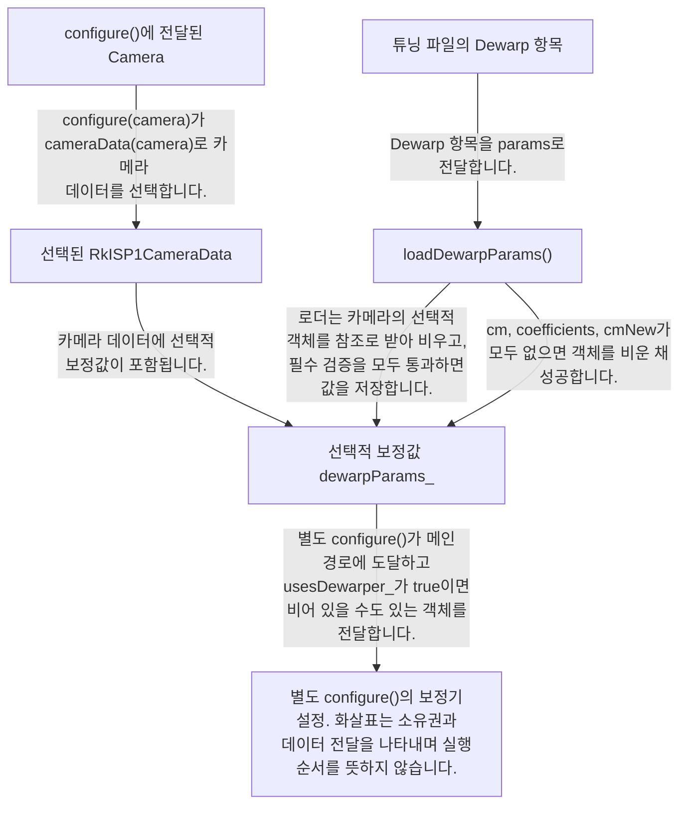
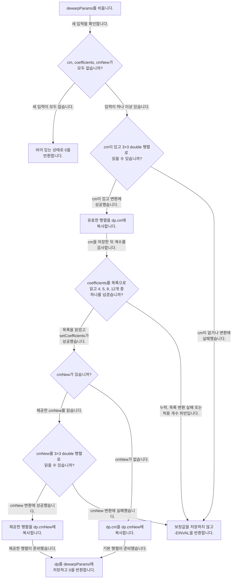
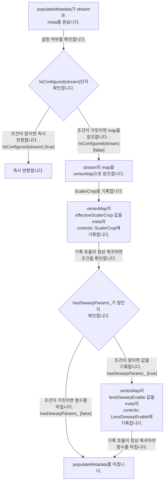

# RKISP1 카메라별 왜곡 보정

**카메라별 보정값의 보관 위치와 설정 시점을 확인한 뒤 튜닝 입력과 커널 지원을 점검하세요.**

| 지금 확인할 내용 | 이동할 절 |
|---|---|
| `RkISP1CameraData`는 카메라별 `dewarpParams_`를 `std::optional<Dw100VertexMap::DewarpParams>` 멤버로 보관합니다. | [카메라별 보정값의 소유권](#카메라별-보정값의-소유권) |
| `ConverterDW100Module::loadDewarpParams`는 먼저 `dewarpParams`를 비웁니다. | [튜닝 입력의 기본값과 오류](#튜닝-입력의-기본값과-오류) |
| `ConverterDW100Module::configure`는 각 출력 설정을 순회하며 해당 스트림의 `vertexMap`에 `inputCfg.size`를 `setInputSize`로, `outputCfg.size`를 `setOutputSize`로, `sensorCrop_`을 `setSensorCrop`으로 순서대로 전달합니다. | [스트림 적용과 실행 확인 범위](#스트림-적용과-실행-확인-범위) |

## 카메라별 보정값의 소유권

`RkISP1CameraData`는 카메라별 `dewarpParams_`를 `std::optional<Dw100VertexMap::DewarpParams>` 멤버로 보관합니다. `RkISP1CameraData::loadTuningFile()`은 `modules` 목록에서 `Dewarp` 항목을 찾아 `loadDewarpParams()`에 이 멤버를 전달하고, 성공하면 `canUseDewarper_`를 참으로 설정한 뒤 0을 반환합니다. 적재 함수가 0이 아닌 값을 반환하면 그 값을 그대로 반환합니다. `src/libcamera/pipeline/rkisp1/rkisp1.cpp:94`, `src/libcamera/pipeline/rkisp1/rkisp1.cpp:434`

<!-- sdd:visual:per-camera-parameters -->
### 카메라별 선택적 보정값의 저장과 전달



[Mermaid 원문](rkisp1-dewarp.per-camera-parameters.mmd)

??? note "그림 근거와 확인 범위"
    선택한 카메라의 선택적 보정값은 어디에 보관되고 튜닝 항목에서 어떻게 채워질 수 있으며, 어떤 조건에서 보정기에 전달됩니까?
    
    소스에 연결한 설계 해석입니다. 자동 연결 검사는 의미 승인이나 기기 실행 검증이 아닙니다.
    
    LLM 그림 초안 · 사람 검토 전
    
    작성 모델: `cli/codex/gpt-6.1-terra high`
    
    | 요소·전이 | 소스 근거 |
    |---|---|
    | <span data-sdd-label-en="Camera supplied to configure()">configure&#40;&#41;에 전달된 Camera</span> | [src/libcamera/pipeline/rkisp1/rkisp1.cpp:914](#source-c164eb4c00d1c1d6) |
    | <span data-sdd-label-en="Selected RkISP1CameraData">선택된 RkISP1CameraData</span> | [src/libcamera/pipeline/rkisp1/rkisp1.cpp:914](#source-c164eb4c00d1c1d6) |
    | <span data-sdd-label-en="Optional calibration value dewarpParams_">선택적 보정값 dewarpParams&#95;</span> | [src/libcamera/pipeline/rkisp1/rkisp1.cpp:94](#source-04546183f68b35f4) |
    | <span data-sdd-label-en="Dewarp entry in the tuning file">튜닝 파일의 Dewarp 항목</span> | [src/libcamera/pipeline/rkisp1/rkisp1.cpp:434](#source-af6210cb39d0385e) |
    | <span data-sdd-label-en="loadDewarpParams()">loadDewarpParams&#40;&#41;</span> | [src/libcamera/converter/converter_dw100.cpp:105](#source-eacff078bd6a9d79) |
    | <span data-sdd-label-en="Dewarper configuration in a separate configure(). Arrows show ownership and data transfer, not execution order.">별도 configure&#40;&#41;의 보정기 설정. 화살표는 소유권과 데이터 전달을 나타내며 실행 순서를 뜻하지 않습니다.</span> | [src/libcamera/pipeline/rkisp1/rkisp1.cpp:914](#source-c164eb4c00d1c1d6) |
    | <span data-sdd-label-en="configure(camera) selects the camera data with cameraData(camera).">configure&#40;camera&#41;가 cameraData&#40;camera&#41;로 카메라 데이터를 선택합니다.</span> | [src/libcamera/pipeline/rkisp1/rkisp1.cpp:914](#source-c164eb4c00d1c1d6) |
    | <span data-sdd-label-en="The camera data contains the optional calibration value.">카메라 데이터에 선택적 보정값이 포함됩니다.</span> | [src/libcamera/pipeline/rkisp1/rkisp1.cpp:94](#source-04546183f68b35f4) |
    | <span data-sdd-label-en="The Dewarp entry is passed as params.">Dewarp 항목을 params로 전달합니다.</span> | [src/libcamera/pipeline/rkisp1/rkisp1.cpp:434](#source-af6210cb39d0385e) |
    | <span data-sdd-label-en="The loader resets the camera&#x27;s optional by reference and stores values when all required validation passes.">로더는 카메라의 선택적 객체를 참조로 받아 비우고, 필수 검증을 모두 통과하면 값을 저장합니다.</span> | [src/libcamera/pipeline/rkisp1/rkisp1.cpp:434](#source-af6210cb39d0385e) · [src/libcamera/converter/converter_dw100.cpp:105](#source-eacff078bd6a9d79) |
    | <span data-sdd-label-en="If cm, coefficients and cmNew are all absent, the loader succeeds with the optional empty.">cm, coefficients, cmNew가 모두 없으면 객체를 비운 채 성공합니다.</span> | [src/libcamera/converter/converter_dw100.cpp:105](#source-eacff078bd6a9d79) |
    | <span data-sdd-label-en="Separate configure() passes the possibly empty optional upon reaching the main path with usesDewarper_ true.">별도 configure&#40;&#41;가 메인 경로에 도달하고 usesDewarper&#95;가 true이면 비어 있을 수도 있는 객체를 전달합니다.</span> | [src/libcamera/pipeline/rkisp1/rkisp1.cpp:914](#source-c164eb4c00d1c1d6) · [src/libcamera/converter/converter_dw100.cpp:105](#source-eacff078bd6a9d79) |
<!-- /sdd:visual:per-camera-parameters -->

`RkISP1CameraData::loadTuningFile()`은 보정기가 없으면 파일을 열지 않고 0을 반환합니다. 파일 열기에 실패하면 파일 오류를 반환하고, YAML 파싱에 실패하면 `-EINVAL`을 반환합니다. `modules`가 없거나 목록에 `Dewarp` 항목이 없으면 0을 반환합니다. `src/libcamera/pipeline/rkisp1/rkisp1.cpp:434`

`PipelineHandlerRkISP1::configure()`는 현재 `camera`에서 `cameraData(camera)`를 가져와 `canUseDewarper_`가 참이고 첫 스트림이 RAW가 아닐 때 `usesDewarper_`를 참으로 설정합니다. 메인 경로 스트림에서 보정기를 사용하면 `dewarper_->configure()`에 현재 카메라 데이터의 `dewarpParams_`를 전달하고, 반환값이 0이 아니면 그 값을 반환합니다. `src/libcamera/pipeline/rkisp1/rkisp1.cpp:914`

근거 원문: [src/libcamera/pipeline/rkisp1/rkisp1.cpp:94](#source-04546183f68b35f4) · [src/libcamera/pipeline/rkisp1/rkisp1.cpp:434](#source-af6210cb39d0385e) · [src/libcamera/pipeline/rkisp1/rkisp1.cpp:914](#source-c164eb4c00d1c1d6)

## 튜닝 입력의 기본값과 오류

`ConverterDW100Module::loadDewarpParams`는 먼저 `dewarpParams`를 비웁니다. `cm`, `coefficients`, `cmNew`가 모두 없으면 `0`을 반환합니다. 하나라도 있으면 `cm`을 3×3 `double` 행렬로 읽어 유효한 값을 `dp.cm`에 저장한 뒤, `coefficients`를 `double` 목록으로 읽어 `setCoefficients`에 넘깁니다. `cm` 또는 `coefficients`가 없거나 읽기에 실패하거나 `setCoefficients`가 오류를 반환하면 `-EINVAL`을 반환합니다. `src/libcamera/converter/converter_dw100.cpp:105`

<!-- sdd:visual:item-parameters -->
### 보정 입력의 기본값·오류·저장 분기



[Mermaid 원문](rkisp1-dewarp.item-parameters.mmd)

??? note "그림 근거와 확인 범위"
    보정 입력이 없거나 잘못됐을 때 무엇을 반환하며, 어떤 조건에서 보정값을 저장합니까?
    
    소스에 연결한 설계 해석입니다. 자동 연결 검사는 의미 승인이나 기기 실행 검증이 아닙니다.
    
    | 요소·전이 | 소스 근거 |
    |---|---|
    | <span data-sdd-label-en="Clear dewarpParams.">dewarpParams를 비웁니다.</span> | [src/libcamera/converter/converter_dw100.cpp:105](#source-eacff078bd6a9d79) |
    | <span data-sdd-label-en="Are cm, coefficients, and cmNew all absent?">cm, coefficients, cmNew가 모두 없습니까?</span> | [src/libcamera/converter/converter_dw100.cpp:105](#source-eacff078bd6a9d79) |
    | <span data-sdd-label-en="Return 0 with the optional empty.">비어 있는 상태로 0을 반환합니다.</span> | [src/libcamera/converter/converter_dw100.cpp:105](#source-eacff078bd6a9d79) |
    | <span data-sdd-label-en="Is cm present and readable as a 3×3 double matrix?">cm이 있고 3×3 double 행렬로 읽을 수 있습니까?</span> | [src/libcamera/converter/converter_dw100.cpp:105](#source-eacff078bd6a9d79) |
    | <span data-sdd-label-en="Copy the valid matrix to dp.cm.">유효한 행렬을 dp.cm에 복사합니다.</span> | [src/libcamera/converter/converter_dw100.cpp:105](#source-eacff078bd6a9d79) |
    | <span data-sdd-label-en="Is coefficients a list that passes the 4, 5, 8, or 12 count check?">coefficients를 목록으로 읽고 4, 5, 8, 12개 중 하나를 넘겼습니까?</span> | [src/libcamera/converter/converter_dw100.cpp:105](#source-eacff078bd6a9d79) · [src/libcamera/converter/converter_dw100_vertexmap.cpp:258](#source-abfd8a7335a891ed) |
    | <span data-sdd-label-en="Is cmNew present?">cmNew가 있습니까?</span> | [src/libcamera/converter/converter_dw100.cpp:105](#source-eacff078bd6a9d79) |
    | <span data-sdd-label-en="Can cmNew be read as a 3×3 double matrix?">cmNew를 3×3 double 행렬로 읽을 수 있습니까?</span> | [src/libcamera/converter/converter_dw100.cpp:105](#source-eacff078bd6a9d79) |
    | <span data-sdd-label-en="Copy dp.cm to dp.cmNew.">dp.cm을 dp.cmNew에 복사합니다.</span> | [src/libcamera/converter/converter_dw100.cpp:105](#source-eacff078bd6a9d79) |
    | <span data-sdd-label-en="Copy the supplied matrix to dp.cmNew.">제공한 행렬을 dp.cmNew에 복사합니다.</span> | [src/libcamera/converter/converter_dw100.cpp:105](#source-eacff078bd6a9d79) |
    | <span data-sdd-label-en="Store dp in dewarpParams and return 0.">dp를 dewarpParams에 저장하고 0을 반환합니다.</span> | [src/libcamera/converter/converter_dw100.cpp:105](#source-eacff078bd6a9d79) |
    | <span data-sdd-label-en="Return -EINVAL with the optional empty.">보정값을 저장하지 않고 -EINVAL을 반환합니다.</span> | [src/libcamera/converter/converter_dw100.cpp:105](#source-eacff078bd6a9d79) |
    | <span data-sdd-label-en="Check the three inputs.">세 입력을 확인합니다.</span> | [src/libcamera/converter/converter_dw100.cpp:105](#source-eacff078bd6a9d79) |
    | <span data-sdd-label-en="All three inputs are absent.">세 입력이 모두 없습니다.</span> | [src/libcamera/converter/converter_dw100.cpp:105](#source-eacff078bd6a9d79) |
    | <span data-sdd-label-en="At least one input is present.">입력이 하나 이상 있습니다.</span> | [src/libcamera/converter/converter_dw100.cpp:105](#source-eacff078bd6a9d79) |
    | <span data-sdd-label-en="cm is present and its conversion succeeded.">cm이 있고 변환에 성공했습니다.</span> | [src/libcamera/converter/converter_dw100.cpp:105](#source-eacff078bd6a9d79) |
    | <span data-sdd-label-en="cm is absent or its conversion failed.">cm이 없거나 변환에 실패했습니다.</span> | [src/libcamera/converter/converter_dw100.cpp:105](#source-eacff078bd6a9d79) |
    | <span data-sdd-label-en="Check the coefficients after storing cm.">cm을 저장한 뒤 계수를 검사합니다.</span> | [src/libcamera/converter/converter_dw100.cpp:105](#source-eacff078bd6a9d79) |
    | <span data-sdd-label-en="The list was read and setCoefficients succeeded.">목록을 읽었고 setCoefficients가 성공했습니다.</span> | [src/libcamera/converter/converter_dw100.cpp:105](#source-eacff078bd6a9d79) · [src/libcamera/converter/converter_dw100_vertexmap.cpp:258](#source-abfd8a7335a891ed) |
    | <span data-sdd-label-en="The list is missing, invalid, or has an unsupported count.">누락, 목록 변환 실패 또는 허용 개수 위반입니다.</span> | [src/libcamera/converter/converter_dw100.cpp:105](#source-eacff078bd6a9d79) · [src/libcamera/converter/converter_dw100_vertexmap.cpp:258](#source-abfd8a7335a891ed) |
    | <span data-sdd-label-en="Read the supplied cmNew.">제공한 cmNew를 읽습니다.</span> | [src/libcamera/converter/converter_dw100.cpp:105](#source-eacff078bd6a9d79) |
    | <span data-sdd-label-en="cmNew is absent.">cmNew가 없습니다.</span> | [src/libcamera/converter/converter_dw100.cpp:105](#source-eacff078bd6a9d79) |
    | <span data-sdd-label-en="The cmNew conversion succeeded.">cmNew 변환에 성공했습니다.</span> | [src/libcamera/converter/converter_dw100.cpp:105](#source-eacff078bd6a9d79) |
    | <span data-sdd-label-en="The cmNew conversion failed.">cmNew 변환에 실패했습니다.</span> | [src/libcamera/converter/converter_dw100.cpp:105](#source-eacff078bd6a9d79) |
    | <span data-sdd-label-en="The default matrix is ready.">기본 행렬이 준비됐습니다.</span> | [src/libcamera/converter/converter_dw100.cpp:105](#source-eacff078bd6a9d79) |
    | <span data-sdd-label-en="The supplied matrix is ready.">제공한 행렬이 준비됐습니다.</span> | [src/libcamera/converter/converter_dw100.cpp:105](#source-eacff078bd6a9d79) |
<!-- /sdd:visual:item-parameters -->

`Dw100VertexMap::DewarpParams::setCoefficients`는 계수의 개수가 4, 5, 8, 12개인지 `if (!(s == 4 || s == 5 || s == 8 || s == 12))`로 검사하고, 다른 개수이면 `-EINVAL`을 반환합니다. `loadDewarpParams`는 `setCoefficients`의 반환값이 0이 아니면 계수가 4개, 5개, 8개 또는 12개여야 한다는 오류를 기록하고 `-EINVAL`을 반환합니다. `src/libcamera/converter/converter_dw100_vertexmap.cpp:258`, `src/libcamera/converter/converter_dw100.cpp:105`

`ConverterDW100Module::loadDewarpParams`는 앞선 검사를 통과한 뒤 `cmNew`가 있으면 이를 3×3 `double` 행렬로 읽어 `dp.cmNew`에 저장하며, 변환에 실패하면 `-EINVAL`을 반환합니다. `cmNew`가 없으면 `dp.cm`을 `dp.cmNew`에 복사합니다. 두 경로에서 처리가 성공하면 `dp`를 `dewarpParams`에 저장한 뒤 `0`을 반환합니다. `src/libcamera/converter/converter_dw100.cpp:105`

근거 원문: [src/libcamera/converter/converter_dw100.cpp:105](#source-eacff078bd6a9d79) · [src/libcamera/converter/converter_dw100_vertexmap.cpp:258](#source-abfd8a7335a891ed)

## 스트림 적용과 실행 확인 범위

`ConverterDW100Module::configure`는 각 출력 설정을 순회하며 해당 스트림의 `vertexMap`에 `inputCfg.size`를 `setInputSize`로, `outputCfg.size`를 `setOutputSize`로, `sensorCrop_`을 `setSensorCrop`으로 순서대로 전달합니다. `ConverterDW100Module::configure`는 출력 스트림을 순회하면서 `dewarpParams`에 값이 있으면 해당 스트림의 `vertexMap.setDewarpParams`를 호출하고 `*dewarpParams`를 전달합니다. `src/libcamera/converter/converter_dw100.cpp:178`

<!-- sdd:visual:per-output-vertex-map -->
### 출력별 맵과 선택적 보정값

```mermaid
flowchart TB
%% sdd:translations {"converter#95;.configure#40;<br/>inputCfg, outputCfgs#41;의 <br/>결과를 ret에 저장합니다.": "The function stores the <br/>result of <br/>converter#95;.configure#40;<br/>inputCfg, outputCfgs#41; in <br/>ret.", "for #40;auto #38;ref : <br/>outputCfgs#41;에서 각 출력을 <br/>순회합니다.": "The function iterates over <br/>each output in for #40;auto <br/>#38;ref : outputCfgs#41;.", "if #40;dewarpParams#41;": "The function checks <br/>dewarpParams: if <br/>#40;dewarpParams#41;.", "if #40;ret#41;": "The function checks ret: if <br/>#40;ret#41;.", "info.update에 true를 <br/>저장합니다.": "The function sets <br/>info.update to true.", "inputBufferCount#95;에 <br/>inputCfg.bufferCount를, <br/>hasDewarpParams#95;에 <br/>dewarpParams.has#95;value#40;#41;를 <br/>저장합니다.": "The function stores <br/>inputCfg.bufferCount in <br/>inputBufferCount#95; and <br/>dewarpParams.has#95;value#40;#41; in <br/>hasDewarpParams#95;.", "ret을 반환합니다.": "The function returns ret.", "vertexMap.setDewarpParams#40;#42;<br/>dewarpParams#41;를 호출합니다.": "The function calls <br/>vertexMap.setDewarpParams#40;#42;<br/>dewarpParams#41;.", "vertexMaps#95;.clear#40;#41;로 기존 <br/>맵을 지웁니다.": "vertexMaps#95;.clear#40;#41; clears <br/>the existing maps.", "각 stream의 info.map에 입력 <br/>크기, 출력 크기와 <br/>sensorCrop#95;을 설정합니다.": "The function sets the input <br/>size, output size, and <br/>sensorCrop#95; on each <br/>stream#39;s info.map.", "거짓이면 보정값 설정을 <br/>건너뜁니다. · dewarpParams <br/>#91;false#93;": "If false, the function <br/>skips setting the dewarp <br/>parameters. · dewarpParams <br/>#91;false#93;", "거짓이면 입력 버퍼 수와 <br/>보정값 유무를 저장합니다. · <br/>ret #91;false#93;": "If false, the function <br/>stores the input buffer <br/>count and parameter <br/>presence. · ret #91;false#93;", "다음 출력이 있는지 <br/>확인합니다.": "The function checks for the <br/>next output.", "맵 설정 호출이 정상 <br/>복귀하면 보정값을 <br/>확인합니다.": "After the map setup calls <br/>return normally, the <br/>function checks the <br/>parameters.", "맵을 지운 뒤 기저 구성을 <br/>호출합니다.": "After clearing the maps, <br/>the function calls the base <br/>configuration.", "모든 출력을 처리하면 0을 <br/>반환합니다. 보정값이 없어도 <br/>성공할 수 있습니다.": "The function returns 0 <br/>after processing all <br/>outputs. It can succeed <br/>without dewarp parameters.", "저장한 뒤 출력을 순회합니다.": "After storing the values, <br/>the function iterates over <br/>the outputs.", "참이면 ret을 반환합니다. · <br/>ret #91;true#93;": "If true, the function <br/>returns ret. · ret #91;true#93;", "참이면 보정값을 설정합니다. <br/>· dewarpParams #91;true#93;": "If true, the function sets <br/>the dewarp parameters. · <br/>dewarpParams #91;true#93;", "처리할 출력이 있으면 해당 <br/>맵을 설정합니다.": "If an output remains, the <br/>function configures its map.", "출력이 없거나 순회가 끝나면 <br/>0을 반환합니다.": "If there are no outputs or <br/>iteration is complete, the <br/>function returns 0.", "호출이 정상 복귀하면 <br/>update를 설정합니다.": "After the call returns <br/>normally, the function sets <br/>update.", "호출이 정상 복귀하면 ret을 <br/>확인합니다.": "After the call returns <br/>normally, the function <br/>checks ret."}
  v_clear["vertexMaps#95;.clear#40;#41;로 기존 <br/>맵을 지웁니다."]
  v_configure["converter#95;.configure#40;<br/>inputCfg, outputCfgs#41;의 <br/>결과를 ret에 저장합니다."]
  v_ret_check{"if #40;ret#41;"}
  v_return_ret["ret을 반환합니다."]
  v_store["inputBufferCount#95;에 <br/>inputCfg.bufferCount를, <br/>hasDewarpParams#95;에 <br/>dewarpParams.has#95;value#40;#41;를 <br/>저장합니다."]
  v_loop{"for #40;auto #38;ref : <br/>outputCfgs#41;에서 각 출력을 <br/>순회합니다."}
  v_map["각 stream의 info.map에 입력 <br/>크기, 출력 크기와 <br/>sensorCrop#95;을 설정합니다."]
  v_params_check{"if #40;dewarpParams#41;"}
  v_set_params["vertexMap.setDewarpParams#40;#42;<br/>dewarpParams#41;를 호출합니다."]
  v_update["info.update에 true를 <br/>저장합니다."]
  v_return_zero["모든 출력을 처리하면 0을 <br/>반환합니다. 보정값이 없어도 <br/>성공할 수 있습니다."]
  v_clear -->|"맵을 지운 뒤 기저 구성을 <br/>호출합니다."| v_configure
  v_configure -->|"호출이 정상 복귀하면 ret을 <br/>확인합니다."| v_ret_check
  v_ret_check -->|"참이면 ret을 반환합니다. · <br/>ret #91;true#93;"| v_return_ret
  v_ret_check -->|"거짓이면 입력 버퍼 수와 <br/>보정값 유무를 저장합니다. · <br/>ret #91;false#93;"| v_store
  v_store -->|"저장한 뒤 출력을 순회합니다."| v_loop
  v_loop -->|"처리할 출력이 있으면 해당 <br/>맵을 설정합니다."| v_map
  v_loop -->|"출력이 없거나 순회가 끝나면 <br/>0을 반환합니다."| v_return_zero
  v_map -->|"맵 설정 호출이 정상 <br/>복귀하면 보정값을 <br/>확인합니다."| v_params_check
  v_params_check -->|"참이면 보정값을 설정합니다. <br/>· dewarpParams #91;true#93;"| v_set_params
  v_params_check -->|"거짓이면 보정값 설정을 <br/>건너뜁니다. · dewarpParams <br/>#91;false#93;"| v_update
  v_set_params -->|"호출이 정상 복귀하면 <br/>update를 설정합니다."| v_update
  v_update -->|"다음 출력이 있는지 <br/>확인합니다."| v_loop
```



[Mermaid 원문](rkisp1-dewarp.per-output-vertex-map.mmd)

??? note "그림 근거와 확인 범위"
    ConverterDW100Module::configure는 기저 구성 결과에 따라 무엇을 반환하며 각 출력의 맵을 어떻게 초기화합니까?
    
    소스에 연결한 설계 해석입니다. 자동 연결 검사는 의미 승인이나 기기 실행 검증이 아닙니다.
    
    LLM 그림 초안 · 사람 검토 전
    
    작성 모델: `cli/codex/gpt-6.1-terra`
    
    | 요소·전이 | 소스 근거 |
    |---|---|
    | <span data-sdd-label-en="vertexMaps_.clear() clears the existing maps.">vertexMaps&#95;.clear&#40;&#41;로 기존 맵을 지웁니다.</span> | [src/libcamera/converter/converter_dw100.cpp:178](#source-25d871212cbd755c) |
    | <span data-sdd-label-en="The function stores the result of converter_.configure(inputCfg, outputCfgs) in ret.">converter&#95;.configure&#40;inputCfg, outputCfgs&#41;의 결과를 ret에 저장합니다.</span> | [src/libcamera/converter/converter_dw100.cpp:178](#source-25d871212cbd755c) |
    | <span data-sdd-label-en="The function checks ret: if (ret).">if &#40;ret&#41;</span> | [src/libcamera/converter/converter_dw100.cpp:178](#source-25d871212cbd755c) |
    | <span data-sdd-label-en="The function returns ret.">ret을 반환합니다.</span> | [src/libcamera/converter/converter_dw100.cpp:178](#source-25d871212cbd755c) |
    | <span data-sdd-label-en="The function stores inputCfg.bufferCount in inputBufferCount_ and dewarpParams.has_value() in hasDewarpParams_.">inputBufferCount&#95;에 inputCfg.bufferCount를, hasDewarpParams&#95;에 dewarpParams.has&#95;value&#40;&#41;를 저장합니다.</span> | [src/libcamera/converter/converter_dw100.cpp:178](#source-25d871212cbd755c) |
    | <span data-sdd-label-en="The function iterates over each output in for (auto &amp;ref : outputCfgs).">for &#40;auto &amp;ref : outputCfgs&#41;에서 각 출력을 순회합니다.</span> | [src/libcamera/converter/converter_dw100.cpp:178](#source-25d871212cbd755c) |
    | <span data-sdd-label-en="The function sets the input size, output size, and sensorCrop_ on each stream&#x27;s info.map.">각 stream의 info.map에 입력 크기, 출력 크기와 sensorCrop&#95;을 설정합니다.</span> | [src/libcamera/converter/converter_dw100.cpp:178](#source-25d871212cbd755c) |
    | <span data-sdd-label-en="The function checks dewarpParams: if (dewarpParams).">if &#40;dewarpParams&#41;</span> | [src/libcamera/converter/converter_dw100.cpp:178](#source-25d871212cbd755c) |
    | <span data-sdd-label-en="The function calls vertexMap.setDewarpParams(*dewarpParams).">vertexMap.setDewarpParams&#40;&#42;dewarpParams&#41;를 호출합니다.</span> | [src/libcamera/converter/converter_dw100.cpp:178](#source-25d871212cbd755c) |
    | <span data-sdd-label-en="The function sets info.update to true.">info.update에 true를 저장합니다.</span> | [src/libcamera/converter/converter_dw100.cpp:178](#source-25d871212cbd755c) |
    | <span data-sdd-label-en="The function returns 0 after processing all outputs. It can succeed without dewarp parameters.">모든 출력을 처리하면 0을 반환합니다. 보정값이 없어도 성공할 수 있습니다.</span> | [src/libcamera/converter/converter_dw100.cpp:178](#source-25d871212cbd755c) |
    | <span data-sdd-label-en="After clearing the maps, the function calls the base configuration.">맵을 지운 뒤 기저 구성을 호출합니다.</span> | [src/libcamera/converter/converter_dw100.cpp:178](#source-25d871212cbd755c) |
    | <span data-sdd-label-en="After the call returns normally, the function checks ret.">호출이 정상 복귀하면 ret을 확인합니다.</span> | [src/libcamera/converter/converter_dw100.cpp:178](#source-25d871212cbd755c) |
    | <span data-sdd-label-en="If true, the function returns ret. · ret [true]">참이면 ret을 반환합니다. · ret &#91;true&#93;</span> | [src/libcamera/converter/converter_dw100.cpp:178](#source-25d871212cbd755c) |
    | <span data-sdd-label-en="If false, the function stores the input buffer count and parameter presence. · ret [false]">거짓이면 입력 버퍼 수와 보정값 유무를 저장합니다. · ret &#91;false&#93;</span> | [src/libcamera/converter/converter_dw100.cpp:178](#source-25d871212cbd755c) |
    | <span data-sdd-label-en="After storing the values, the function iterates over the outputs.">저장한 뒤 출력을 순회합니다.</span> | [src/libcamera/converter/converter_dw100.cpp:178](#source-25d871212cbd755c) |
    | <span data-sdd-label-en="If an output remains, the function configures its map.">처리할 출력이 있으면 해당 맵을 설정합니다.</span> | [src/libcamera/converter/converter_dw100.cpp:178](#source-25d871212cbd755c) |
    | <span data-sdd-label-en="If there are no outputs or iteration is complete, the function returns 0.">출력이 없거나 순회가 끝나면 0을 반환합니다.</span> | [src/libcamera/converter/converter_dw100.cpp:178](#source-25d871212cbd755c) |
    | <span data-sdd-label-en="After the map setup calls return normally, the function checks the parameters.">맵 설정 호출이 정상 복귀하면 보정값을 확인합니다.</span> | [src/libcamera/converter/converter_dw100.cpp:178](#source-25d871212cbd755c) |
    | <span data-sdd-label-en="If true, the function sets the dewarp parameters. · dewarpParams [true]">참이면 보정값을 설정합니다. · dewarpParams &#91;true&#93;</span> | [src/libcamera/converter/converter_dw100.cpp:178](#source-25d871212cbd755c) |
    | <span data-sdd-label-en="If false, the function skips setting the dewarp parameters. · dewarpParams [false]">거짓이면 보정값 설정을 건너뜁니다. · dewarpParams &#91;false&#93;</span> | [src/libcamera/converter/converter_dw100.cpp:178](#source-25d871212cbd755c) |
    | <span data-sdd-label-en="After the call returns normally, the function sets update.">호출이 정상 복귀하면 update를 설정합니다.</span> | [src/libcamera/converter/converter_dw100.cpp:178](#source-25d871212cbd755c) |
    | <span data-sdd-label-en="The function checks for the next output.">다음 출력이 있는지 확인합니다.</span> | [src/libcamera/converter/converter_dw100.cpp:178](#source-25d871212cbd755c) |
<!-- /sdd:visual:per-output-vertex-map -->

<!-- sdd:visual:control-info-and-request-support -->
### 지원 제어와 요청 지원 조건

```mermaid
flowchart TB
%% sdd:translations {"#33;converter#95;.supportsRequests<br/>#40;#41; 조건을 확인합니다.": "Check the <br/>#33;converter#95;.supportsRequests<br/>#40;#41; condition.", "controls::<br/>LensDewarpEnable에 <br/>ControlInfo#40;false, true, <br/>true#41;를 추가합니다.": "Add ControlInfo#40;false, <br/>true, true#41; for <br/>controls::LensDewarpEnable.", "controls::ScalerCrop에 <br/>최솟값 <br/>Rectangle#40;sensorCrop#95;.x, <br/>sensorCrop#95;.y, 1, 1#41;, <br/>최댓값 sensorCrop#95;, 기본값 <br/>sensorCrop#95;를 설정합니다.": "Set controls::ScalerCrop <br/>with minimum <br/>Rectangle#40;sensorCrop#95;.x, <br/>sensorCrop#95;.y, 1, 1#41;, <br/>maximum sensorCrop#95;, and <br/>default sensorCrop#95;.", "hasDewarpParams#95; 조건을 <br/>확인합니다.": "Check the hasDewarpParams#95; <br/>condition.", "isConfigured#40;stream#41; 조건을 <br/>확인합니다.": "Check the <br/>isConfigured#40;stream#41; <br/>condition.", "map.applyLimits#40;#41;를 <br/>호출하고 <br/>effectiveScalerCrop#40;#41;의 <br/>결과를 로컬 <br/>scalerCropDefault에 <br/>저장합니다.": "Call map.applyLimits#40;#41; and <br/>store the result of <br/>effectiveScalerCrop#40;#41; in <br/>local scalerCropDefault.", "scalerCropDefault를 <br/>sensorCrop#95;로 초기화합니다.": "Initialize <br/>scalerCropDefault to <br/>sensorCrop#95;.", "updateControlInfos가 <br/>끝납니다.": "updateControlInfos ends.", "거짓이면 제한 적용을 <br/>건너뜁니다. · <br/>isConfigured#40;stream#41; #91;false#93;": "If false, skip applying the <br/>limits. · <br/>isConfigured#40;stream#41; #91;false#93;", "거짓이면 추가를 건너뜁니다. <br/>· hasDewarpParams#95; #91;false#93;": "If false, skip the <br/>addition. · <br/>hasDewarpParams#95; #91;false#93;", "거짓이면 함수를 끝냅니다. · <br/>#33;converter#95;.supportsRequests<br/>#40;#41; #91;false#93;": "If false, end the function. <br/>· <br/>#33;converter#95;.supportsRequests<br/>#40;#41; #91;false#93;", "로그 호출이 정상 복귀하면 <br/>함수를 끝냅니다.": "After the log call returns <br/>normally, end the function.", "보정값 조건을 확인합니다.": "Check the dewarp parameter <br/>condition.", "스트림 구성을 확인합니다.": "Check the stream <br/>configuration.", "요청 지원 여부를 확인합니다.": "Check request support.", "요청을 지원하지 않아 동적 <br/>구성이 불가능하다는 경고 <br/>로그를 호출합니다.": "Call the warning log <br/>stating that requests are <br/>unsupported and dynamic <br/>configuration is not <br/>possible.", "정상 복귀 후 ScalerCrop을 <br/>설정합니다.": "After normal return, set <br/>ScalerCrop.", "참이면 경고 로그를 <br/>호출합니다. · <br/>#33;converter#95;.supportsRequests<br/>#40;#41; #91;true#93;": "If true, call the warning <br/>log. · <br/>#33;converter#95;.supportsRequests<br/>#40;#41; #91;true#93;", "참이면 제어를 추가합니다. · <br/>hasDewarpParams#95; #91;true#93;": "If true, add the control. · <br/>hasDewarpParams#95; #91;true#93;", "참이면 제한을 적용합니다. · <br/>isConfigured#40;stream#41; #91;true#93;": "If true, apply the limits. <br/>· isConfigured#40;stream#41; <br/>#91;true#93;"}
  v_start["scalerCropDefault를 <br/>sensorCrop#95;로 초기화합니다."]
  v_configured{"isConfigured#40;stream#41; 조건을 <br/>확인합니다."}
  v_limits["map.applyLimits#40;#41;를 <br/>호출하고 <br/>effectiveScalerCrop#40;#41;의 <br/>결과를 로컬 <br/>scalerCropDefault에 <br/>저장합니다."]
  v_crop["controls::ScalerCrop에 <br/>최솟값 <br/>Rectangle#40;sensorCrop#95;.x, <br/>sensorCrop#95;.y, 1, 1#41;, <br/>최댓값 sensorCrop#95;, 기본값 <br/>sensorCrop#95;를 설정합니다."]
  v_dewarp{"hasDewarpParams#95; 조건을 <br/>확인합니다."}
  v_enable["controls::<br/>LensDewarpEnable에 <br/>ControlInfo#40;false, true, <br/>true#41;를 추가합니다."]
  v_requests{"#33;converter#95;.supportsRequests<br/>#40;#41; 조건을 확인합니다."}
  v_warning["요청을 지원하지 않아 동적 <br/>구성이 불가능하다는 경고 <br/>로그를 호출합니다."]
  v_end["updateControlInfos가 <br/>끝납니다."]
  v_start -->|"스트림 구성을 확인합니다."| v_configured
  v_configured -->|"참이면 제한을 적용합니다. · <br/>isConfigured#40;stream#41; #91;true#93;"| v_limits
  v_configured -->|"거짓이면 제한 적용을 <br/>건너뜁니다. · <br/>isConfigured#40;stream#41; #91;false#93;"| v_crop
  v_limits -->|"정상 복귀 후 ScalerCrop을 <br/>설정합니다."| v_crop
  v_crop -->|"보정값 조건을 확인합니다."| v_dewarp
  v_dewarp -->|"참이면 제어를 추가합니다. · <br/>hasDewarpParams#95; #91;true#93;"| v_enable
  v_dewarp -->|"거짓이면 추가를 건너뜁니다. <br/>· hasDewarpParams#95; #91;false#93;"| v_requests
  v_enable -->|"요청 지원 여부를 확인합니다."| v_requests
  v_requests -->|"참이면 경고 로그를 <br/>호출합니다. · <br/>#33;converter#95;.supportsRequests<br/>#40;#41; #91;true#93;"| v_warning
  v_requests -->|"거짓이면 함수를 끝냅니다. · <br/>#33;converter#95;.supportsRequests<br/>#40;#41; #91;false#93;"| v_end
  v_warning -->|"로그 호출이 정상 복귀하면 <br/>함수를 끝냅니다."| v_end
```



[Mermaid 원문](rkisp1-dewarp.control-info-and-request-support.mmd)

??? note "그림 근거와 확인 범위"
    updateControlInfos는 스트림 구성과 보정값에 따라 지원 제어를 어떻게 채우며 요청 미지원 때 무엇을 합니까?
    
    소스에 연결한 설계 해석입니다. 자동 연결 검사는 의미 승인이나 기기 실행 검증이 아닙니다.
    
    LLM 그림 초안 · 사람 검토 전
    
    작성 모델: `cli/codex/gpt-6.1-terra`
    
    | 요소·전이 | 소스 근거 |
    |---|---|
    | <span data-sdd-label-en="Initialize scalerCropDefault to sensorCrop_.">scalerCropDefault를 sensorCrop&#95;로 초기화합니다.</span> | [src/libcamera/converter/converter_dw100.cpp:369](#source-d069b98fadac2d0c) |
    | <span data-sdd-label-en="Check the isConfigured(stream) condition.">isConfigured&#40;stream&#41; 조건을 확인합니다.</span> | [src/libcamera/converter/converter_dw100.cpp:369](#source-d069b98fadac2d0c) |
    | <span data-sdd-label-en="Call map.applyLimits() and store the result of effectiveScalerCrop() in local scalerCropDefault.">map.applyLimits&#40;&#41;를 호출하고 effectiveScalerCrop&#40;&#41;의 결과를 로컬 scalerCropDefault에 저장합니다.</span> | [src/libcamera/converter/converter_dw100.cpp:369](#source-d069b98fadac2d0c) |
    | <span data-sdd-label-en="Set controls::ScalerCrop with minimum Rectangle(sensorCrop_.x, sensorCrop_.y, 1, 1), maximum sensorCrop_, and default sensorCrop_.">controls::ScalerCrop에 최솟값 Rectangle&#40;sensorCrop&#95;.x, sensorCrop&#95;.y, 1, 1&#41;, 최댓값 sensorCrop&#95;, 기본값 sensorCrop&#95;를 설정합니다.</span> | [src/libcamera/converter/converter_dw100.cpp:369](#source-d069b98fadac2d0c) |
    | <span data-sdd-label-en="Check the hasDewarpParams_ condition.">hasDewarpParams&#95; 조건을 확인합니다.</span> | [src/libcamera/converter/converter_dw100.cpp:369](#source-d069b98fadac2d0c) |
    | <span data-sdd-label-en="Add ControlInfo(false, true, true) for controls::LensDewarpEnable.">controls::LensDewarpEnable에 ControlInfo&#40;false, true, true&#41;를 추가합니다.</span> | [src/libcamera/converter/converter_dw100.cpp:369](#source-d069b98fadac2d0c) |
    | <span data-sdd-label-en="Check the !converter_.supportsRequests() condition.">&#33;converter&#95;.supportsRequests&#40;&#41; 조건을 확인합니다.</span> | [src/libcamera/converter/converter_dw100.cpp:369](#source-d069b98fadac2d0c) |
    | <span data-sdd-label-en="Call the warning log stating that requests are unsupported and dynamic configuration is not possible.">요청을 지원하지 않아 동적 구성이 불가능하다는 경고 로그를 호출합니다.</span> | [src/libcamera/converter/converter_dw100.cpp:369](#source-d069b98fadac2d0c) |
    | <span data-sdd-label-en="updateControlInfos ends.">updateControlInfos가 끝납니다.</span> | [src/libcamera/converter/converter_dw100.cpp:369](#source-d069b98fadac2d0c) |
    | <span data-sdd-label-en="Check the stream configuration.">스트림 구성을 확인합니다.</span> | [src/libcamera/converter/converter_dw100.cpp:369](#source-d069b98fadac2d0c) |
    | <span data-sdd-label-en="If true, apply the limits. · isConfigured(stream) [true]">참이면 제한을 적용합니다. · isConfigured&#40;stream&#41; &#91;true&#93;</span> | [src/libcamera/converter/converter_dw100.cpp:369](#source-d069b98fadac2d0c) |
    | <span data-sdd-label-en="If false, skip applying the limits. · isConfigured(stream) [false]">거짓이면 제한 적용을 건너뜁니다. · isConfigured&#40;stream&#41; &#91;false&#93;</span> | [src/libcamera/converter/converter_dw100.cpp:369](#source-d069b98fadac2d0c) |
    | <span data-sdd-label-en="After normal return, set ScalerCrop.">정상 복귀 후 ScalerCrop을 설정합니다.</span> | [src/libcamera/converter/converter_dw100.cpp:369](#source-d069b98fadac2d0c) |
    | <span data-sdd-label-en="Check the dewarp parameter condition.">보정값 조건을 확인합니다.</span> | [src/libcamera/converter/converter_dw100.cpp:369](#source-d069b98fadac2d0c) |
    | <span data-sdd-label-en="If true, add the control. · hasDewarpParams_ [true]">참이면 제어를 추가합니다. · hasDewarpParams&#95; &#91;true&#93;</span> | [src/libcamera/converter/converter_dw100.cpp:369](#source-d069b98fadac2d0c) |
    | <span data-sdd-label-en="If false, skip the addition. · hasDewarpParams_ [false]">거짓이면 추가를 건너뜁니다. · hasDewarpParams&#95; &#91;false&#93;</span> | [src/libcamera/converter/converter_dw100.cpp:369](#source-d069b98fadac2d0c) |
    | <span data-sdd-label-en="Check request support.">요청 지원 여부를 확인합니다.</span> | [src/libcamera/converter/converter_dw100.cpp:369](#source-d069b98fadac2d0c) |
    | <span data-sdd-label-en="If true, call the warning log. · !converter_.supportsRequests() [true]">참이면 경고 로그를 호출합니다. · &#33;converter&#95;.supportsRequests&#40;&#41; &#91;true&#93;</span> | [src/libcamera/converter/converter_dw100.cpp:369](#source-d069b98fadac2d0c) |
    | <span data-sdd-label-en="If false, end the function. · !converter_.supportsRequests() [false]">거짓이면 함수를 끝냅니다. · &#33;converter&#95;.supportsRequests&#40;&#41; &#91;false&#93;</span> | [src/libcamera/converter/converter_dw100.cpp:369](#source-d069b98fadac2d0c) |
    | <span data-sdd-label-en="After the log call returns normally, end the function.">로그 호출이 정상 복귀하면 함수를 끝냅니다.</span> | [src/libcamera/converter/converter_dw100.cpp:369](#source-d069b98fadac2d0c) |
<!-- /sdd:visual:control-info-and-request-support -->

<!-- sdd:visual:stream-control-update -->
### 구성된 스트림의 제어 갱신

```mermaid
flowchart TB
%% sdd:translations {"ConverterDW100Module::<br/>setControls가 제어를 <br/>검사합니다.": "ConverterDW100Module::<br/>setControls checks the <br/>controls.", "ScalerCrop의 crop <br/>optional이 존재합니까?": "Is the crop optional for <br/>ScalerCrop present?", "info.update가 true이고 <br/>running#95;이 참이며 <br/>converter#95;가 요청을 <br/>지원하지 않습니까?": "Is info.update true, <br/>running#95; true, and request <br/>support absent from <br/>converter#95;?", "lensDewarpEnable optional이 <br/>존재합니까? 포함된 bool <br/>값이 false여도 존재할 수 <br/>있습니다.": "Is the lensDewarpEnable <br/>optional present? It can be <br/>present with a false bool <br/>value.", "optional이 없으면 crop을 <br/>검사합니다. · <br/>lensDewarpEnable #91;false#93;": "If the optional is absent, <br/>it checks crop. · <br/>lensDewarpEnable #91;false#93;", "optional이 없으면 요청 <br/>미지원 오류 조건을 <br/>검사합니다. · crop #91;false#93;": "If the optional is absent, <br/>it checks the request <br/>support error condition. · <br/>crop #91;false#93;", "optional이 존재하면 false를 <br/>포함한 값을 전달합니다. · <br/>lensDewarpEnable #91;true#93;": "If the optional is present, <br/>it passes the value, <br/>including false. · <br/>lensDewarpEnable #91;true#93;", "optional이 존재하면 값을 <br/>전달합니다. · crop #91;true#93;": "If the optional is present, <br/>it passes the value. · crop <br/>#91;true#93;", "setLensDewarpEnable#40;#42;<br/>lensDewarpEnable#41;을 <br/>호출하고 info.update를 <br/>true로 설정합니다.": "It calls <br/>setLensDewarpEnable#40;#42;<br/>lensDewarpEnable#41; and sets <br/>info.update to true.", "setScalerCrop#40;#42;crop#41;을 <br/>호출하고 info.update를 <br/>true로 설정합니다.": "It calls <br/>setScalerCrop#40;#42;crop#41; and <br/>sets info.update to true.", "stream의 미구성 여부를 <br/>검사합니다.": "It checks whether stream is <br/>not configured.", "stream이 구성되지 <br/>않았습니까?": "Is stream not configured?", "오류 기록이 정상 복귀하면 <br/>함수가 끝납니다.": "The function ends when <br/>logging the error returns <br/>normally.", "요청을 지원하는 dw100 커널 <br/>드라이버가 필요하다는 <br/>오류를 LOG로 기록합니다. <br/>앞서 갱신한 값은 되돌리지 <br/>않습니다.": "It logs that a dw100 kernel <br/>driver with requests <br/>support is required. It <br/>does not revert earlier <br/>updates.", "조건이 거짓이면 <br/>lensDewarpEnable optional을 <br/>검사합니다. · <br/>#33;isConfigured#40;stream#41; <br/>#91;false#93;": "If the condition is false, <br/>it checks the <br/>lensDewarpEnable optional. <br/>· #33;isConfigured#40;stream#41; <br/>#91;false#93;", "조건이 거짓이면 함수가 <br/>끝납니다. · info.update #38;#38; <br/>running#95; #38;#38; <br/>#33;converter#95;.supportsRequests<br/>#40;#41; #91;false#93;": "If the condition is false, <br/>the function ends. · <br/>info.update #38;#38; running#95; #38;#38; <br/>#33;converter#95;.supportsRequests<br/>#40;#41; #91;false#93;", "조건이 참이면 오류를 <br/>기록합니다. · info.update <br/>#38;#38; running#95; #38;#38; <br/>#33;converter#95;.supportsRequests<br/>#40;#41; #91;true#93;": "If the condition is true, <br/>it logs an error. · <br/>info.update #38;#38; running#95; #38;#38; <br/>#33;converter#95;.supportsRequests<br/>#40;#41; #91;true#93;", "조건이 참이면 즉시 <br/>반환합니다. · <br/>#33;isConfigured#40;stream#41; #91;true#93;": "If the condition is true, <br/>it returns immediately. · <br/>#33;isConfigured#40;stream#41; #91;true#93;", "함수가 끝납니다.": "The function ends.", "함수가 즉시 반환합니다.": "The function returns <br/>immediately.", "호출이 정상 복귀하고 갱신한 <br/>뒤 crop을 검사합니다.": "After the call returns <br/>normally and the update is <br/>set, it checks crop.", "호출이 정상 복귀하고 갱신한 <br/>뒤 오류 조건을 검사합니다.": "After the call returns <br/>normally and the update is <br/>set, it checks the error <br/>condition."}
  v_start["ConverterDW100Module::<br/>setControls가 제어를 <br/>검사합니다."]
  v_configured{"stream이 구성되지 <br/>않았습니까?"}
  v_return["함수가 즉시 반환합니다."]
  v_lens{"lensDewarpEnable optional이 <br/>존재합니까? 포함된 bool <br/>값이 false여도 존재할 수 <br/>있습니다."}
  v_set_lens["setLensDewarpEnable#40;#42;<br/>lensDewarpEnable#41;을 <br/>호출하고 info.update를 <br/>true로 설정합니다."]
  v_crop{"ScalerCrop의 crop <br/>optional이 존재합니까?"}
  v_set_crop["setScalerCrop#40;#42;crop#41;을 <br/>호출하고 info.update를 <br/>true로 설정합니다."]
  v_requests{"info.update가 true이고 <br/>running#95;이 참이며 <br/>converter#95;가 요청을 <br/>지원하지 않습니까?"}
  v_log["요청을 지원하는 dw100 커널 <br/>드라이버가 필요하다는 <br/>오류를 LOG로 기록합니다. <br/>앞서 갱신한 값은 되돌리지 <br/>않습니다."]
  v_finish["함수가 끝납니다."]
  v_start -->|"stream의 미구성 여부를 <br/>검사합니다."| v_configured
  v_configured -->|"조건이 참이면 즉시 <br/>반환합니다. · <br/>#33;isConfigured#40;stream#41; #91;true#93;"| v_return
  v_configured -->|"조건이 거짓이면 <br/>lensDewarpEnable optional을 <br/>검사합니다. · <br/>#33;isConfigured#40;stream#41; <br/>#91;false#93;"| v_lens
  v_lens -->|"optional이 존재하면 false를 <br/>포함한 값을 전달합니다. · <br/>lensDewarpEnable #91;true#93;"| v_set_lens
  v_lens -->|"optional이 없으면 crop을 <br/>검사합니다. · <br/>lensDewarpEnable #91;false#93;"| v_crop
  v_set_lens -->|"호출이 정상 복귀하고 갱신한 <br/>뒤 crop을 검사합니다."| v_crop
  v_crop -->|"optional이 존재하면 값을 <br/>전달합니다. · crop #91;true#93;"| v_set_crop
  v_crop -->|"optional이 없으면 요청 <br/>미지원 오류 조건을 <br/>검사합니다. · crop #91;false#93;"| v_requests
  v_set_crop -->|"호출이 정상 복귀하고 갱신한 <br/>뒤 오류 조건을 검사합니다."| v_requests
  v_requests -->|"조건이 참이면 오류를 <br/>기록합니다. · info.update <br/>#38;#38; running#95; #38;#38; <br/>#33;converter#95;.supportsRequests<br/>#40;#41; #91;true#93;"| v_log
  v_requests -->|"조건이 거짓이면 함수가 <br/>끝납니다. · info.update #38;#38; <br/>running#95; #38;#38; <br/>#33;converter#95;.supportsRequests<br/>#40;#41; #91;false#93;"| v_finish
  v_log -->|"오류 기록이 정상 복귀하면 <br/>함수가 끝납니다."| v_finish
```



[Mermaid 원문](rkisp1-dewarp.stream-control-update.mmd)

??? note "그림 근거와 확인 범위"
    setControls의 optional 제어 존재 검사와 실행 중 요청 미지원 오류 조건은 무엇입니까?
    
    소스에 연결한 설계 해석입니다. 자동 연결 검사는 의미 승인이나 기기 실행 검증이 아닙니다.
    
    LLM 그림 초안 · 사람 검토 전
    
    작성 모델: `cli/codex/gpt-6.1-terra`
    
    | 요소·전이 | 소스 근거 |
    |---|---|
    | <span data-sdd-label-en="ConverterDW100Module::setControls checks the controls.">ConverterDW100Module::setControls가 제어를 검사합니다.</span> | [src/libcamera/converter/converter_dw100.cpp:400](#source-3b37038ea14e4a3f) |
    | <span data-sdd-label-en="Is stream not configured?">stream이 구성되지 않았습니까?</span> | [src/libcamera/converter/converter_dw100.cpp:400](#source-3b37038ea14e4a3f) |
    | <span data-sdd-label-en="The function returns immediately.">함수가 즉시 반환합니다.</span> | [src/libcamera/converter/converter_dw100.cpp:400](#source-3b37038ea14e4a3f) |
    | <span data-sdd-label-en="Is the lensDewarpEnable optional present? It can be present with a false bool value.">lensDewarpEnable optional이 존재합니까? 포함된 bool 값이 false여도 존재할 수 있습니다.</span> | [src/libcamera/converter/converter_dw100.cpp:400](#source-3b37038ea14e4a3f) |
    | <span data-sdd-label-en="It calls setLensDewarpEnable(*lensDewarpEnable) and sets info.update to true.">setLensDewarpEnable&#40;&#42;lensDewarpEnable&#41;을 호출하고 info.update를 true로 설정합니다.</span> | [src/libcamera/converter/converter_dw100.cpp:400](#source-3b37038ea14e4a3f) |
    | <span data-sdd-label-en="Is the crop optional for ScalerCrop present?">ScalerCrop의 crop optional이 존재합니까?</span> | [src/libcamera/converter/converter_dw100.cpp:400](#source-3b37038ea14e4a3f) |
    | <span data-sdd-label-en="It calls setScalerCrop(*crop) and sets info.update to true.">setScalerCrop&#40;&#42;crop&#41;을 호출하고 info.update를 true로 설정합니다.</span> | [src/libcamera/converter/converter_dw100.cpp:400](#source-3b37038ea14e4a3f) |
    | <span data-sdd-label-en="Is info.update true, running_ true, and request support absent from converter_?">info.update가 true이고 running&#95;이 참이며 converter&#95;가 요청을 지원하지 않습니까?</span> | [src/libcamera/converter/converter_dw100.cpp:400](#source-3b37038ea14e4a3f) |
    | <span data-sdd-label-en="It logs that a dw100 kernel driver with requests support is required. It does not revert earlier updates.">요청을 지원하는 dw100 커널 드라이버가 필요하다는 오류를 LOG로 기록합니다. 앞서 갱신한 값은 되돌리지 않습니다.</span> | [src/libcamera/converter/converter_dw100.cpp:400](#source-3b37038ea14e4a3f) |
    | <span data-sdd-label-en="The function ends.">함수가 끝납니다.</span> | [src/libcamera/converter/converter_dw100.cpp:400](#source-3b37038ea14e4a3f) |
    | <span data-sdd-label-en="It checks whether stream is not configured.">stream의 미구성 여부를 검사합니다.</span> | [src/libcamera/converter/converter_dw100.cpp:400](#source-3b37038ea14e4a3f) |
    | <span data-sdd-label-en="If the condition is true, it returns immediately. · !isConfigured(stream) [true]">조건이 참이면 즉시 반환합니다. · &#33;isConfigured&#40;stream&#41; &#91;true&#93;</span> | [src/libcamera/converter/converter_dw100.cpp:400](#source-3b37038ea14e4a3f) |
    | <span data-sdd-label-en="If the condition is false, it checks the lensDewarpEnable optional. · !isConfigured(stream) [false]">조건이 거짓이면 lensDewarpEnable optional을 검사합니다. · &#33;isConfigured&#40;stream&#41; &#91;false&#93;</span> | [src/libcamera/converter/converter_dw100.cpp:400](#source-3b37038ea14e4a3f) |
    | <span data-sdd-label-en="If the optional is present, it passes the value, including false. · lensDewarpEnable [true]">optional이 존재하면 false를 포함한 값을 전달합니다. · lensDewarpEnable &#91;true&#93;</span> | [src/libcamera/converter/converter_dw100.cpp:400](#source-3b37038ea14e4a3f) |
    | <span data-sdd-label-en="If the optional is absent, it checks crop. · lensDewarpEnable [false]">optional이 없으면 crop을 검사합니다. · lensDewarpEnable &#91;false&#93;</span> | [src/libcamera/converter/converter_dw100.cpp:400](#source-3b37038ea14e4a3f) |
    | <span data-sdd-label-en="After the call returns normally and the update is set, it checks crop.">호출이 정상 복귀하고 갱신한 뒤 crop을 검사합니다.</span> | [src/libcamera/converter/converter_dw100.cpp:400](#source-3b37038ea14e4a3f) |
    | <span data-sdd-label-en="If the optional is present, it passes the value. · crop [true]">optional이 존재하면 값을 전달합니다. · crop &#91;true&#93;</span> | [src/libcamera/converter/converter_dw100.cpp:400](#source-3b37038ea14e4a3f) |
    | <span data-sdd-label-en="If the optional is absent, it checks the request support error condition. · crop [false]">optional이 없으면 요청 미지원 오류 조건을 검사합니다. · crop &#91;false&#93;</span> | [src/libcamera/converter/converter_dw100.cpp:400](#source-3b37038ea14e4a3f) |
    | <span data-sdd-label-en="After the call returns normally and the update is set, it checks the error condition.">호출이 정상 복귀하고 갱신한 뒤 오류 조건을 검사합니다.</span> | [src/libcamera/converter/converter_dw100.cpp:400](#source-3b37038ea14e4a3f) |
    | <span data-sdd-label-en="If the condition is true, it logs an error. · info.update &amp;&amp; running_ &amp;&amp; !converter_.supportsRequests() [true]">조건이 참이면 오류를 기록합니다. · info.update &amp;&amp; running&#95; &amp;&amp; &#33;converter&#95;.supportsRequests&#40;&#41; &#91;true&#93;</span> | [src/libcamera/converter/converter_dw100.cpp:400](#source-3b37038ea14e4a3f) |
    | <span data-sdd-label-en="If the condition is false, the function ends. · info.update &amp;&amp; running_ &amp;&amp; !converter_.supportsRequests() [false]">조건이 거짓이면 함수가 끝납니다. · info.update &amp;&amp; running&#95; &amp;&amp; &#33;converter&#95;.supportsRequests&#40;&#41; &#91;false&#93;</span> | [src/libcamera/converter/converter_dw100.cpp:400](#source-3b37038ea14e4a3f) |
    | <span data-sdd-label-en="The function ends when logging the error returns normally.">오류 기록이 정상 복귀하면 함수가 끝납니다.</span> | [src/libcamera/converter/converter_dw100.cpp:400](#source-3b37038ea14e4a3f) |
<!-- /sdd:visual:stream-control-update -->

<!-- sdd:visual:configured-stream-metadata -->
### 스트림 메타데이터의 조건



[Mermaid 원문](rkisp1-dewarp.configured-stream-metadata.mmd)

??? note "그림 근거와 확인 범위"
    populateMetadata는 언제 조기 반환하며 어떤 조건으로 ScalerCrop과 LensDewarpEnable을 기록합니까?
    
    소스에 연결한 설계 해석입니다. 자동 연결 검사는 의미 승인이나 기기 실행 검증이 아닙니다.
    
    LLM 그림 초안 · 사람 검토 전
    
    작성 모델: `cli/codex/gpt-6.1-terra`
    
    | 요소·전이 | 소스 근거 |
    |---|---|
    | <span data-sdd-label-en="populateMetadata receives stream and meta.">populateMetadata가 stream과 meta를 받습니다.</span> | [src/libcamera/converter/converter_dw100.cpp:434](#source-91482028dd941751) |
    | <span data-sdd-label-en="Check whether !isConfigured(stream) is true.">&#33;isConfigured&#40;stream&#41;인지 확인합니다.</span> | [src/libcamera/converter/converter_dw100.cpp:434](#source-91482028dd941751) |
    | <span data-sdd-label-en="Return immediately.">즉시 반환합니다.</span> | [src/libcamera/converter/converter_dw100.cpp:434](#source-91482028dd941751) |
    | <span data-sdd-label-en="Reference the stream&#x27;s map as vertexMap.">stream의 map을 vertexMap으로 참조합니다.</span> | [src/libcamera/converter/converter_dw100.cpp:434](#source-91482028dd941751) |
    | <span data-sdd-label-en="Write the effectiveScalerCrop value from vertexMap to controls::ScalerCrop in meta.">vertexMap의 effectiveScalerCrop 값을 meta의 controls::ScalerCrop에 기록합니다.</span> | [src/libcamera/converter/converter_dw100.cpp:434](#source-91482028dd941751) |
    | <span data-sdd-label-en="Check whether hasDewarpParams_ is true.">hasDewarpParams&#95;가 참인지 확인합니다.</span> | [src/libcamera/converter/converter_dw100.cpp:434](#source-91482028dd941751) |
    | <span data-sdd-label-en="Write the lensDewarpEnable value from vertexMap to controls::LensDewarpEnable in meta.">vertexMap의 lensDewarpEnable 값을 meta의 controls::LensDewarpEnable에 기록합니다.</span> | [src/libcamera/converter/converter_dw100.cpp:434](#source-91482028dd941751) |
    | <span data-sdd-label-en="Finish populateMetadata.">populateMetadata를 마칩니다.</span> | [src/libcamera/converter/converter_dw100.cpp:434](#source-91482028dd941751) |
    | <span data-sdd-label-en="Check whether the stream is configured.">설정 여부를 확인합니다.</span> | [src/libcamera/converter/converter_dw100.cpp:434](#source-91482028dd941751) |
    | <span data-sdd-label-en="Return immediately if the condition is true. · !isConfigured(stream) [true]">조건이 참이면 즉시 반환합니다. · &#33;isConfigured&#40;stream&#41; &#91;true&#93;</span> | [src/libcamera/converter/converter_dw100.cpp:434](#source-91482028dd941751) |
    | <span data-sdd-label-en="Reference the map if the condition is false. · !isConfigured(stream) [false]">조건이 거짓이면 map을 참조합니다. · &#33;isConfigured&#40;stream&#41; &#91;false&#93;</span> | [src/libcamera/converter/converter_dw100.cpp:434](#source-91482028dd941751) |
    | <span data-sdd-label-en="Write ScalerCrop.">ScalerCrop을 기록합니다.</span> | [src/libcamera/converter/converter_dw100.cpp:434](#source-91482028dd941751) |
    | <span data-sdd-label-en="Check the condition if the write call returns normally.">기록 호출이 정상 복귀하면 조건을 확인합니다.</span> | [src/libcamera/converter/converter_dw100.cpp:434](#source-91482028dd941751) |
    | <span data-sdd-label-en="Write the value if the condition is true. · hasDewarpParams_ [true]">조건이 참이면 값을 기록합니다. · hasDewarpParams&#95; &#91;true&#93;</span> | [src/libcamera/converter/converter_dw100.cpp:434](#source-91482028dd941751) |
    | <span data-sdd-label-en="Finish the function if the condition is false. · hasDewarpParams_ [false]">조건이 거짓이면 함수를 마칩니다. · hasDewarpParams&#95; &#91;false&#93;</span> | [src/libcamera/converter/converter_dw100.cpp:434](#source-91482028dd941751) |
    | <span data-sdd-label-en="Finish the function if the write call returns normally.">기록 호출이 정상 복귀하면 함수를 마칩니다.</span> | [src/libcamera/converter/converter_dw100.cpp:434](#source-91482028dd941751) |
<!-- /sdd:visual:configured-stream-metadata -->

<!-- sdd:visual:main-path-dewarp-handoff -->
### 메인 경로의 보정 구성과 crop 전달

```mermaid
flowchart TB
%% sdd:translations {"dewarper#95;-#62;configure가 <br/>반환한 ret를 확인합니다.": "Check ret returned by <br/>dewarper#95;-#62;configure.", "dewarper#95;-#62;configure에 <br/>ispCfg, 출력 구성 { cfg }, <br/>현재 카메라의 <br/>dewarpParams#95;를 전달합니다.": "Pass ispCfg, output <br/>configuration { cfg }, and <br/>the current camera#39;s <br/>dewarpParams#95; to <br/>dewarper#95;-#62;configure.", "dewarper#95;-#62;setTransform에 <br/>cfg.stream#40;#41;과 <br/>config-#62;combinedTransform#40;#41;<br/>을 전달하고 cfg.size의 로컬 <br/>복사본 size를 만듭니다.": "Pass cfg.stream#40;#41; and <br/>config-#62;combinedTransform#40;#41; <br/>to dewarper#95;-#62;setTransform, <br/>then copy cfg.size to local <br/>size.", "dewarper를 사용하면 <br/>복사본을 조정합니다. · <br/>data-#62;usesDewarper#95; #91;true#93;": "Adjust the copy when using <br/>the dewarper. · <br/>data-#62;usesDewarper#95; #91;true#93;", "dewarper를 사용하지 않으면 <br/>복사본을 그대로 전달합니다. <br/>· data-#62;usesDewarper#95; <br/>#91;false#93;": "Pass the copy unchanged <br/>when not using the <br/>dewarper. · <br/>data-#62;usesDewarper#95; #91;false#93;", "ispCfg의 bufferCount를 <br/>kRkISP1MinBufferCount로, <br/>size를 format.size로 <br/>설정하고 stride를 다시 <br/>계산합니다.": "Set ispCfg bufferCount to <br/>kRkISP1MinBufferCount and <br/>size to format.size, then <br/>recalculate stride.", "mainPath#95;.configure에 <br/>ispCfg와 format을 <br/>전달합니다. 이 호출만으로 <br/>전체 Camera 구성이 성공한 <br/>것은 아닙니다.": "Pass ispCfg and format to <br/>mainPath#95;.configure. This <br/>call alone does not mean <br/>the whole Camera <br/>configuration succeeded.", "ret가 0이 아니면 <br/>반환합니다. · ret #91;true#93;": "Return when ret is nonzero. <br/>· ret #91;true#93;", "ret가 0이 아니면 같은 ret를 <br/>반환합니다.": "If ret is nonzero, return <br/>the same ret.", "ret가 0이면 계속합니다. · <br/>ret #91;false#93;": "Continue when ret is zero. <br/>· ret #91;false#93;", "sensorCrop 크기를 로컬 <br/>size의 종횡비에 맞게 <br/>제한하고 <br/>sensorCrop.center#40;#41;에 <br/>중심을 맞춘 crop을 <br/>setControls에 전달합니다.": "Bound sensorCrop size to <br/>the local size aspect ratio <br/>and pass the crop centered <br/>on sensorCrop.center#40;#41; to <br/>setControls.", "setControls 호출 뒤 메인 <br/>경로를 구성합니다.": "Configure the main path <br/>after calling setControls.", "transposeAfterIsp를 <br/>검사합니다. dewarper를 <br/>사용하고 <br/>combinedTransform에 <br/>Transform::Transpose 비트가 <br/>있으면 참입니다.": "Check transposeAfterIsp, <br/>which is true when the <br/>dewarper is used and <br/>combinedTransform has the <br/>Transform::Transpose bit.", "거짓이면 로컬 size를 <br/>전치하지 않습니다. · <br/>transposeAfterIsp #91;false#93;": "Do not transpose the local <br/>size when false. · <br/>transposeAfterIsp #91;false#93;", "기존 usesDewarper#95; 값을 <br/>검사합니다. 이 값은 앞서 <br/>canUseDewarper#95;가 참이고 <br/>isRaw#95;가 거짓일 때 참으로 <br/>설정되었습니다.": "Check the existing <br/>usesDewarper#95; value, set <br/>earlier to true when <br/>canUseDewarper#95; is true and <br/>isRaw#95; is false.", "로컬 size를 한 번 <br/>전치합니다.": "Transpose the local size <br/>once.", "로컬 size의 전치 여부를 <br/>확인합니다.": "Check whether to transpose <br/>the local size.", "반환값을 확인합니다.": "Check the return value.", "복사본을 만든 뒤 기존 사용 <br/>여부를 확인합니다.": "Check the existing usage <br/>value after making the copy.", "센서와 ISP 구성이 성공하고 <br/>cfg가 메인 경로일 때 cfg를 <br/>ispCfg에 복사합니다.": "After sensor and ISP <br/>configuration succeeds, <br/>copy the main-path cfg to <br/>ispCfg.", "전치한 로컬 size를 <br/>사용합니다.": "Use the transposed local <br/>size.", "조정한 복사본을 전달합니다.": "Pass the adjusted copy.", "참이면 로컬 size를 <br/>전치합니다. · <br/>transposeAfterIsp #91;true#93;": "Transpose the local size <br/>when true. · <br/>transposeAfterIsp #91;true#93;"}
  v_copy["센서와 ISP 구성이 성공하고 <br/>cfg가 메인 경로일 때 cfg를 <br/>ispCfg에 복사합니다."]
  v_use_dewarper{"기존 usesDewarper#95; 값을 <br/>검사합니다. 이 값은 앞서 <br/>canUseDewarper#95;가 참이고 <br/>isRaw#95;가 거짓일 때 참으로 <br/>설정되었습니다."}
  v_prepare["ispCfg의 bufferCount를 <br/>kRkISP1MinBufferCount로, <br/>size를 format.size로 <br/>설정하고 stride를 다시 <br/>계산합니다."]
  v_dewarp_configure["dewarper#95;-#62;configure에 <br/>ispCfg, 출력 구성 { cfg }, <br/>현재 카메라의 <br/>dewarpParams#95;를 전달합니다."]
  v_result{"dewarper#95;-#62;configure가 <br/>반환한 ret를 확인합니다."}
  v_return_ret["ret가 0이 아니면 같은 ret를 <br/>반환합니다."]
  v_transform["dewarper#95;-#62;setTransform에 <br/>cfg.stream#40;#41;과 <br/>config-#62;combinedTransform#40;#41;<br/>을 전달하고 cfg.size의 로컬 <br/>복사본 size를 만듭니다."]
  v_transpose_check{"transposeAfterIsp를 <br/>검사합니다. dewarper를 <br/>사용하고 <br/>combinedTransform에 <br/>Transform::Transpose 비트가 <br/>있으면 참입니다."}
  v_transpose["로컬 size를 한 번 <br/>전치합니다."]
  v_crop["sensorCrop 크기를 로컬 <br/>size의 종횡비에 맞게 <br/>제한하고 <br/>sensorCrop.center#40;#41;에 <br/>중심을 맞춘 crop을 <br/>setControls에 전달합니다."]
  v_main_configure["mainPath#95;.configure에 <br/>ispCfg와 format을 <br/>전달합니다. 이 호출만으로 <br/>전체 Camera 구성이 성공한 <br/>것은 아닙니다."]
  v_copy -->|"복사본을 만든 뒤 기존 사용 <br/>여부를 확인합니다."| v_use_dewarper
  v_use_dewarper -->|"dewarper를 사용하면 <br/>복사본을 조정합니다. · <br/>data-#62;usesDewarper#95; #91;true#93;"| v_prepare
  v_use_dewarper -->|"dewarper를 사용하지 않으면 <br/>복사본을 그대로 전달합니다. <br/>· data-#62;usesDewarper#95; <br/>#91;false#93;"| v_main_configure
  v_prepare -->|"조정한 복사본을 전달합니다."| v_dewarp_configure
  v_dewarp_configure -->|"반환값을 확인합니다."| v_result
  v_result -->|"ret가 0이 아니면 <br/>반환합니다. · ret #91;true#93;"| v_return_ret
  v_result -->|"ret가 0이면 계속합니다. · <br/>ret #91;false#93;"| v_transform
  v_transform -->|"로컬 size의 전치 여부를 <br/>확인합니다."| v_transpose_check
  v_transpose_check -->|"참이면 로컬 size를 <br/>전치합니다. · <br/>transposeAfterIsp #91;true#93;"| v_transpose
  v_transpose_check -->|"거짓이면 로컬 size를 <br/>전치하지 않습니다. · <br/>transposeAfterIsp #91;false#93;"| v_crop
  v_transpose -->|"전치한 로컬 size를 <br/>사용합니다."| v_crop
  v_crop -->|"setControls 호출 뒤 메인 <br/>경로를 구성합니다."| v_main_configure
```



[Mermaid 원문](rkisp1-dewarp.main-path-dewarp-handoff.mmd)

??? note "그림 근거와 확인 범위"
    메인 경로에서 dewarper 사용과 구성 반환값은 입력 복사본·출력 구성·보정값·기본 crop 전달을 어떻게 가릅니까?
    
    소스에 연결한 설계 해석입니다. 자동 연결 검사는 의미 승인이나 기기 실행 검증이 아닙니다.
    
    LLM 그림 초안 · 사람 검토 전
    
    작성 모델: `cli/codex/gpt-6.1-terra`
    
    | 요소·전이 | 소스 근거 |
    |---|---|
    | <span data-sdd-label-en="After sensor and ISP configuration succeeds, copy the main-path cfg to ispCfg.">센서와 ISP 구성이 성공하고 cfg가 메인 경로일 때 cfg를 ispCfg에 복사합니다.</span> | [src/libcamera/pipeline/rkisp1/rkisp1.cpp:914](#source-36de5a75453d86c6) |
    | <span data-sdd-label-en="Check the existing usesDewarper_ value, set earlier to true when canUseDewarper_ is true and isRaw_ is false.">기존 usesDewarper&#95; 값을 검사합니다. 이 값은 앞서 canUseDewarper&#95;가 참이고 isRaw&#95;가 거짓일 때 참으로 설정되었습니다.</span> | [src/libcamera/pipeline/rkisp1/rkisp1.cpp:914](#source-36de5a75453d86c6) |
    | <span data-sdd-label-en="Set ispCfg bufferCount to kRkISP1MinBufferCount and size to format.size, then recalculate stride.">ispCfg의 bufferCount를 kRkISP1MinBufferCount로, size를 format.size로 설정하고 stride를 다시 계산합니다.</span> | [src/libcamera/pipeline/rkisp1/rkisp1.cpp:914](#source-36de5a75453d86c6) |
    | <span data-sdd-label-en="Pass ispCfg, output configuration { cfg }, and the current camera&#x27;s dewarpParams_ to dewarper_-&gt;configure.">dewarper&#95;-&gt;configure에 ispCfg, 출력 구성 { cfg }, 현재 카메라의 dewarpParams&#95;를 전달합니다.</span> | [src/libcamera/pipeline/rkisp1/rkisp1.cpp:914](#source-36de5a75453d86c6) |
    | <span data-sdd-label-en="Check ret returned by dewarper_-&gt;configure.">dewarper&#95;-&gt;configure가 반환한 ret를 확인합니다.</span> | [src/libcamera/pipeline/rkisp1/rkisp1.cpp:914](#source-36de5a75453d86c6) |
    | <span data-sdd-label-en="If ret is nonzero, return the same ret.">ret가 0이 아니면 같은 ret를 반환합니다.</span> | [src/libcamera/pipeline/rkisp1/rkisp1.cpp:914](#source-36de5a75453d86c6) |
    | <span data-sdd-label-en="Pass cfg.stream() and config-&gt;combinedTransform() to dewarper_-&gt;setTransform, then copy cfg.size to local size.">dewarper&#95;-&gt;setTransform에 cfg.stream&#40;&#41;과 config-&gt;combinedTransform&#40;&#41;을 전달하고 cfg.size의 로컬 복사본 size를 만듭니다.</span> | [src/libcamera/pipeline/rkisp1/rkisp1.cpp:914](#source-36de5a75453d86c6) |
    | <span data-sdd-label-en="Check transposeAfterIsp, which is true when the dewarper is used and combinedTransform has the Transform::Transpose bit.">transposeAfterIsp를 검사합니다. dewarper를 사용하고 combinedTransform에 Transform::Transpose 비트가 있으면 참입니다.</span> | [src/libcamera/pipeline/rkisp1/rkisp1.cpp:914](#source-36de5a75453d86c6) |
    | <span data-sdd-label-en="Transpose the local size once.">로컬 size를 한 번 전치합니다.</span> | [src/libcamera/pipeline/rkisp1/rkisp1.cpp:914](#source-36de5a75453d86c6) |
    | <span data-sdd-label-en="Bound sensorCrop size to the local size aspect ratio and pass the crop centered on sensorCrop.center() to setControls.">sensorCrop 크기를 로컬 size의 종횡비에 맞게 제한하고 sensorCrop.center&#40;&#41;에 중심을 맞춘 crop을 setControls에 전달합니다.</span> | [src/libcamera/pipeline/rkisp1/rkisp1.cpp:914](#source-36de5a75453d86c6) |
    | <span data-sdd-label-en="Pass ispCfg and format to mainPath_.configure. This call alone does not mean the whole Camera configuration succeeded.">mainPath&#95;.configure에 ispCfg와 format을 전달합니다. 이 호출만으로 전체 Camera 구성이 성공한 것은 아닙니다.</span> | [src/libcamera/pipeline/rkisp1/rkisp1.cpp:914](#source-36de5a75453d86c6) |
    | <span data-sdd-label-en="Check the existing usage value after making the copy.">복사본을 만든 뒤 기존 사용 여부를 확인합니다.</span> | [src/libcamera/pipeline/rkisp1/rkisp1.cpp:914](#source-36de5a75453d86c6) |
    | <span data-sdd-label-en="Adjust the copy when using the dewarper. · data-&gt;usesDewarper_ [true]">dewarper를 사용하면 복사본을 조정합니다. · data-&gt;usesDewarper&#95; &#91;true&#93;</span> | [src/libcamera/pipeline/rkisp1/rkisp1.cpp:914](#source-36de5a75453d86c6) |
    | <span data-sdd-label-en="Pass the copy unchanged when not using the dewarper. · data-&gt;usesDewarper_ [false]">dewarper를 사용하지 않으면 복사본을 그대로 전달합니다. · data-&gt;usesDewarper&#95; &#91;false&#93;</span> | [src/libcamera/pipeline/rkisp1/rkisp1.cpp:914](#source-36de5a75453d86c6) |
    | <span data-sdd-label-en="Pass the adjusted copy.">조정한 복사본을 전달합니다.</span> | [src/libcamera/pipeline/rkisp1/rkisp1.cpp:914](#source-36de5a75453d86c6) |
    | <span data-sdd-label-en="Check the return value.">반환값을 확인합니다.</span> | [src/libcamera/pipeline/rkisp1/rkisp1.cpp:914](#source-36de5a75453d86c6) |
    | <span data-sdd-label-en="Return when ret is nonzero. · ret [true]">ret가 0이 아니면 반환합니다. · ret &#91;true&#93;</span> | [src/libcamera/pipeline/rkisp1/rkisp1.cpp:914](#source-36de5a75453d86c6) |
    | <span data-sdd-label-en="Continue when ret is zero. · ret [false]">ret가 0이면 계속합니다. · ret &#91;false&#93;</span> | [src/libcamera/pipeline/rkisp1/rkisp1.cpp:914](#source-36de5a75453d86c6) |
    | <span data-sdd-label-en="Check whether to transpose the local size.">로컬 size의 전치 여부를 확인합니다.</span> | [src/libcamera/pipeline/rkisp1/rkisp1.cpp:914](#source-36de5a75453d86c6) |
    | <span data-sdd-label-en="Transpose the local size when true. · transposeAfterIsp [true]">참이면 로컬 size를 전치합니다. · transposeAfterIsp &#91;true&#93;</span> | [src/libcamera/pipeline/rkisp1/rkisp1.cpp:914](#source-36de5a75453d86c6) |
    | <span data-sdd-label-en="Do not transpose the local size when false. · transposeAfterIsp [false]">거짓이면 로컬 size를 전치하지 않습니다. · transposeAfterIsp &#91;false&#93;</span> | [src/libcamera/pipeline/rkisp1/rkisp1.cpp:914](#source-36de5a75453d86c6) |
    | <span data-sdd-label-en="Use the transposed local size.">전치한 로컬 size를 사용합니다.</span> | [src/libcamera/pipeline/rkisp1/rkisp1.cpp:914](#source-36de5a75453d86c6) |
    | <span data-sdd-label-en="Configure the main path after calling setControls.">setControls 호출 뒤 메인 경로를 구성합니다.</span> | [src/libcamera/pipeline/rkisp1/rkisp1.cpp:914](#source-36de5a75453d86c6) |
<!-- /sdd:visual:main-path-dewarp-handoff -->

`ConverterDW100Module::updateControlInfos`는 `hasDewarpParams_`가 참이면 `controls::LensDewarpEnable`을 지원 제어로 등록하고 제어 정보의 최솟값, 최댓값, 기본값을 각각 `false`, `true`, `true`로 설정합니다. `ConverterDW100Module::setControls`는 `isConfigured(stream)`이 거짓이면 반환하고 종료합니다. 구성된 스트림에서 `ConverterDW100Module::setControls`는 `info.update`와 `running_`이 참이고 `converter_.supportsRequests()`가 거짓이면 동적 제어에 관한 오류 로그를 기록합니다. `populateMetadata`는 `isConfigured(stream)` 검사에서 스트림이 설정되지 않았으면 즉시 반환합니다. `src/libcamera/converter/converter_dw100.cpp:369`, `src/libcamera/converter/converter_dw100.cpp:402`, `src/libcamera/converter/converter_dw100.cpp:400`, `src/libcamera/converter/converter_dw100.cpp:434`

`ConverterDW100Module::populateMetadata`는 구성된 스트림의 `vertexMap.effectiveScalerCrop()` 값을 `controls::ScalerCrop`에 기록합니다. 이어서 `hasDewarpParams_`가 참이면 `vertexMap.lensDewarpEnable()` 값을 `controls::LensDewarpEnable`에 기록합니다. `src/libcamera/converter/converter_dw100.cpp:441`, `src/libcamera/converter/converter_dw100.cpp:443`

근거 원문: [src/libcamera/converter/converter_dw100.cpp:178](#source-167e93a77fbf4931) · [src/libcamera/converter/converter_dw100.cpp:369](#source-fc0e25ddead912f1) · [src/libcamera/converter/converter_dw100.cpp:434](#source-3a4c4ed7cee81158) · [src/libcamera/converter/converter_dw100.cpp:197](#source-fff6050000b728bd) · [src/libcamera/converter/converter_dw100.cpp:198](#source-a6496a0f6db3636a) · [src/libcamera/converter/converter_dw100.cpp:199](#source-a92725ea0f81f8d7) · [src/libcamera/converter/converter_dw100.cpp:402](#source-ec47236059d2723f) · [src/libcamera/converter/converter_dw100.cpp:441](#source-6fc7fca6e9842fbd) · [src/libcamera/converter/converter_dw100.cpp:443](#source-aebf4a59ba423b05) · [src/libcamera/pipeline/rkisp1/rkisp1.cpp:914](#source-36de5a75453d86c6) · [src/libcamera/converter/converter_dw100.cpp:178](#source-25d871212cbd755c) · [src/libcamera/converter/converter_dw100.cpp:212](#source-3c3967c227d1109c) · [src/libcamera/converter/converter_dw100.cpp:369](#source-d069b98fadac2d0c) · [src/libcamera/converter/converter_dw100.cpp:400](#source-3b37038ea14e4a3f) · [src/libcamera/converter/converter_dw100.cpp:434](#source-91482028dd941751)

??? note "설계 질문과 검증 범위"
    질문별 답변과 근거 연결을 검사했습니다. 의미와 실행 결과는 사람 검토가 필요합니다.
    
    | 설계 질문 | 설명 위치 | 확인 범위 |
    |---|---|---|
    | 여러 카메라의 보정값이 섞이지 않도록 누가 값을 보관하고 전달합니까? | [카메라별 보정값의 소유권](#카메라별-보정값의-소유권) | 코드 근거와 설명 연결 |
    | 보정값이 없거나 일부만 있을 때 어떤 결과를 반환합니까? | [튜닝 입력의 기본값과 오류](#튜닝-입력의-기본값과-오류) | 코드 근거와 설명 연결 |
    | 보정값은 어느 스트림에 적용되고 어떤 실행 조건을 따로 확인해야 합니까? | [스트림 적용과 실행 확인 범위](#스트림-적용과-실행-확인-범위) | 코드 근거와 설명 연결 |

## 소스 근거

같은 발췌는 한 번만 싣습니다. 필요한 원문을 펼쳐 설명과 대조하세요.

<a id="source-04546183f68b35f4"></a>

??? note "소스 근거: src/libcamera/pipeline/rkisp1/rkisp1.cpp:94"
    `src/libcamera/pipeline/rkisp1/rkisp1.cpp:94`에서 시작하는 발췌입니다. 종료 줄은 142이며, 아래 원문을 설명과 대조할 수 있습니다.
    
    SHA-256: `4c9387123443d958220746e355a9e93b30dca2bb4a32b4f4020c938e1a699de1`
    
    ```text
    class RkISP1CameraData : public Camera::Private
    {
    public:
    	RkISP1CameraData(PipelineHandler *pipe, RkISP1MainPath *mainPath,
    			 RkISP1SelfPath *selfPath)
    		: Camera::Private(pipe), frame_(0), frameInfo_(pipe),
    		  mainPath_(mainPath), selfPath_(selfPath),
    		  canUseDewarper_(false), usesDewarper_(false)
    	{
    	}
    
    	PipelineHandlerRkISP1 *pipe();
    	const PipelineHandlerRkISP1 *pipe() const;
    	int loadIPA(unsigned int hwRevision, uint32_t supportedBlocks);
    
    	Stream mainPathStream_;
    	Stream selfPathStream_;
    	std::unique_ptr<CameraSensor> sensor_;
    	std::unique_ptr<DelayedControls> delayedCtrls_;
    	unsigned int frame_;
    	std::vector<IPABuffer> ipaBuffers_;
    	RkISP1Frames frameInfo_;
    
    	RkISP1MainPath *mainPath_;
    	RkISP1SelfPath *selfPath_;
    
    	std::unique_ptr<ipa::rkisp1::IPAProxyRkISP1> ipa_;
    
    	ControlInfoMap ipaControls_;
    
    	/*
    	 * All entities in the pipeline, from the camera sensor to the RKISP1.
    	 */
    	MediaPipeline pipe_;
    
    	bool canUseDewarper_;
    	bool usesDewarper_;
    	std::optional<Dw100VertexMap::DewarpParams> dewarpParams_;
    
    private:
    	void paramsComputed(unsigned int frame, unsigned int bytesused);
    	void setSensorControls(unsigned int frame,
    			       const ControlList &sensorControls);
    
    	void metadataReady(unsigned int frame, const ControlList &metadata);
    	int loadTuningFile(const std::string &file);
    };
    
    class RkISP1CameraConfiguration :
    ```

<a id="source-af6210cb39d0385e"></a>

??? note "소스 근거: src/libcamera/pipeline/rkisp1/rkisp1.cpp:434"
    `src/libcamera/pipeline/rkisp1/rkisp1.cpp:434`에서 시작하는 발췌입니다. 종료 줄은 479이며, 아래 원문을 설명과 대조할 수 있습니다.
    
    SHA-256: `d0fb5eb90b4c6d0df3e90cff142c95b4f7daeddb6d483a4272a5fb07d7dd3fec`
    
    ```text
    int RkISP1CameraData::loadTuningFile(const std::string &path)
    {
    	int ret;
    
    	if (!pipe()->dewarper_)
    		/* Nothing to do without dewarper */
    		return 0;
    
    	LOG(RkISP1, Debug) << "Load tuning file " << path;
    
    	File file(path);
    	if (!file.open(File::OpenModeFlag::ReadOnly)) {
    		ret = file.error();
    		LOG(RkISP1, Error)
    			<< "Failed to open tuning file "
    			<< path << ": " << strerror(-ret);
    		return ret;
    	}
    
    	std::unique_ptr<ValueNode> data = YamlParser::parse(file);
    	if (!data)
    		return -EINVAL;
    
    	if (!data->contains("modules"))
    		return 0;
    
    	const auto &modules = (*data)["modules"].asList();
    	for (const auto &module : modules) {
    		const auto &params = module["Dewarp"];
    		if (!params)
    			continue;
    
    		ret = pipe()->dewarper_->loadDewarpParams(params, dewarpParams_);
    		if (ret)
    			return ret;
    
    		LOG(RkISP1, Info) << "Dw100 dewarper initialized";
    
    		canUseDewarper_ = true;
    		return 0;
    	}
    
    	return 0;
    }
    
    void RkISP1CameraData::paramsComputed(
    ```

<a id="source-c164eb4c00d1c1d6"></a>

??? note "소스 근거: src/libcamera/pipeline/rkisp1/rkisp1.cpp:914"
    `src/libcamera/pipeline/rkisp1/rkisp1.cpp:914`에서 시작하는 발췌입니다. 종료 줄은 1122이며, 아래 원문을 설명과 대조할 수 있습니다.
    
    SHA-256: `85e3aef5f0b623538bedbd13a895c0a08ada48616ab1e9ee8fe1a87882b67ee6`
    
    ```text
    int PipelineHandlerRkISP1::configure(Camera *camera, CameraConfiguration *c)
    {
    	RkISP1CameraConfiguration *config =
    		static_cast<RkISP1CameraConfiguration *>(c);
    	RkISP1CameraData *data = cameraData(camera);
    	CameraSensor *sensor = data->sensor_.get();
    	int ret;
    
    	ret = initLinks(camera, *config);
    	if (ret)
    		return ret;
    
    	const PixelFormat &streamFormat = config->at(0).pixelFormat;
    	const PixelFormatInfo &info = PixelFormatInfo::info(streamFormat);
    	isRaw_ = info.colourEncoding == PixelFormatInfo::ColourEncodingRAW;
    	data->usesDewarper_ = data->canUseDewarper_ && !isRaw_;
    
    	Transform transform = config->combinedTransform();
    	bool transposeAfterIsp = false;
    	if (data->usesDewarper_) {
    		if (!!(transform & Transform::Transpose))
    			transposeAfterIsp = true;
    		transform = Transform::Identity;
    	}
    
    	/*
    	 * Configure the format on the sensor output and propagate it through
    	 * the pipeline.
    	 */
    	V4L2SubdeviceFormat format = config->sensorFormat();
    	LOG(RkISP1, Debug) << "Configuring sensor with " << format;
    
    	if (config->sensorConfig)
    		ret = sensor->applyConfiguration(*config->sensorConfig,
    						 transform,
    						 &format);
    	else
    		ret = sensor->setFormat(&format, transform);
    
    	if (ret < 0)
    		return ret;
    
    	LOG(RkISP1, Debug) << "Sensor configured with " << format;
    
    	/* Propagate format through the internal media pipeline up to the ISP */
    	ret = data->pipe_.configure(sensor, &format);
    	if (ret < 0)
    		return ret;
    
    	LOG(RkISP1, Debug) << "Configuring ISP with : " << format;
    	ret = isp_->setFormat(0, &format);
    	if (ret < 0)
    		return ret;
    
    	Rectangle inputCrop(0, 0, format.size);
    	ret = isp_->setSelection(0, V4L2_SEL_TGT_CROP, &inputCrop);
    	if (ret < 0)
    		return ret;
    
    	LOG(RkISP1, Debug)
    		<< "ISP input pad configured with " << format
    		<< " crop " << inputCrop;
    
    	Rectangle outputCrop = inputCrop;
    
    	/* YUYV8_2X8 is required on the ISP source path pad for YUV output. */
    	if (!isRaw_)
    		format.code = MEDIA_BUS_FMT_YUYV8_2X8;
    
    	/*
    	 * On devices without DUAL_CROP (like the imx8mp) cropping needs to be
    	 * done on the ISP/IS output.
    	 *
    	 * If the dewarper is used, the cropping shall be done by the dewarper.
    	 */
    	if (media_->hwRevision() == RKISP1_V_IMX8MP) {
    		/* imx8mp has only a single path. */
    		const auto &cfg = config->at(0);
    		/*
    		 * If the dewarper is used, all cropping including aspect ratio
    		 * preservation shall be done there. To ensure that the output
    		 * format provided by the ISP is supported by the dewarper, a
    		 * minimal crop still needs to be applied on the ISP output.
    		 *
    		 * \todo It might be possible to allocate bigger buffers
    		 * (aligned to 8 pixels) with a stride matching format.size for
    		 * the ISP. The not-filled border could later be ignored by the
    		 * dewarper. This way we could skip the minimal crop here and
    		 * the MaximumScalerCrop would always match the isp output.
    		 */
    		Size ispCrop;
    		if (data->usesDewarper_)
    			ispCrop = dewarper_->adjustInputSize(cfg.pixelFormat,
    							     format.size);
    		else
    			ispCrop = format.size.boundedToAspectRatio(cfg.size)
    					  .alignedUpTo(2, 2);
    
    		outputCrop = ispCrop.centeredTo(Rectangle(format.size).center());
    		format.size = ispCrop;
    	}
    
    	LOG(RkISP1, Debug)
    		<< "Configuring ISP output pad with " << format
    		<< " crop " << outputCrop;
    
    	ret = isp_->setSelection(2, V4L2_SEL_TGT_CROP, &outputCrop);
    	if (ret < 0)
    		return ret;
    
    	format.colorSpace = config->at(0).colorSpace;
    	ret = isp_->setFormat(2, &format);
    	if (ret < 0)
    		return ret;
    
    	LOG(RkISP1, Debug)
    		<< "ISP output pad configured with " << format
    		<< " crop " << outputCrop;
    
    	IPACameraSensorInfo sensorInfo;
    	ret = data->sensor_->sensorInfo(&sensorInfo);
    	if (ret)
    		return ret;
    
    	/* Apply the actual sensor crop for proper dewarp map calculation. */
    	Rectangle sensorCrop = outputCrop.transformedBetween(
    		inputCrop, sensorInfo.analogCrop);
    	if (data->usesDewarper_)
    		dewarper_->setSensorCrop(sensorCrop);
    	data->properties_.set(properties::ScalerCropMaximum, sensorCrop);
    
    	std::map<unsigned int, IPAStream> streamConfig;
    
    	for (const StreamConfiguration &cfg : *config) {
    		if (cfg.stream() == &data->mainPathStream_) {
    			/*
    			 * To allow for digital zoom, scaling down should happen
    			 * in the dewarper, instead of the resizer. Configure
    			 * the isp output to the same size as the sensor output.
    			 */
    			StreamConfiguration ispCfg = cfg;
    			if (data->usesDewarper_) {
    				ispCfg.bufferCount = kRkISP1MinBufferCount;
    				ispCfg.size = format.size;
    				ispCfg.stride =
    					PixelFormatInfo::info(ispCfg.pixelFormat)
    						.stride(ispCfg.size.width, 0);
    
    				ret = dewarper_->configure(ispCfg, { cfg }, data->dewarpParams_);
    				if (ret)
    					return ret;
    
    				dewarper_->setTransform(cfg.stream(), config->combinedTransform());
    				/*
    				 * Apply a default scaler crop that keeps the
    				 * aspect ratio.
    				 */
    				Size size = cfg.size;
    				if (transposeAfterIsp)
    					size.transpose();
    				size = sensorCrop.size().boundedToAspectRatio(size);
    
    				ControlList ctrls;
    				ctrls.set(controls::ScalerCrop, size.centeredTo(sensorCrop.center()));
    				dewarper_->setControls(cfg.stream(), ctrls);
    			}
    
    			ret = mainPath_.configure(ispCfg, format);
    			streamConfig[0] = IPAStream(cfg.pixelFormat,
    						    cfg.size);
    		} else if (hasSelfPath_) {
    			ret = selfPath_.configure(cfg, format);
    			streamConfig[1] = IPAStream(cfg.pixelFormat,
    						    cfg.size);
    		} else {
    			return -ENODEV;
    		}
    
    		if (ret)
    			return ret;
    	}
    
    	V4L2DeviceFormat paramFormat;
    	paramFormat.fourcc = V4L2PixelFormat(V4L2_META_FMT_RK_ISP1_EXT_PARAMS);
    	ret = param_->setFormat(&paramFormat);
    	if (ret)
    		return ret;
    
    	V4L2DeviceFormat statFormat;
    	statFormat.fourcc = V4L2PixelFormat(V4L2_META_FMT_RK_ISP1_STAT_3A);
    	ret = stat_->setFormat(&statFormat);
    	if (ret)
    		return ret;
    
    	/* Inform IPA of stream configuration and sensor controls. */
    	ipa::rkisp1::IPAConfigInfo ipaConfig{ sensorInfo,
    					      data->sensor_->controls(),
    					      paramFormat.fourcc };
    
    	ret = data->ipa_->configure(ipaConfig, streamConfig, &data->ipaControls_);
    	if (ret) {
    		LOG(RkISP1, Error) << "failed configuring IPA (" << ret << ")";
    		return ret;
    	}
    
    	return updateControls(data);
    }
    
    int PipelineHandlerRkISP1::exportFrameBuffers(
    ```

<a id="source-eacff078bd6a9d79"></a>

??? note "소스 근거: src/libcamera/converter/converter_dw100.cpp:105"
    `src/libcamera/converter/converter_dw100.cpp:105`에서 시작하는 발췌입니다. 종료 줄은 178이며, 아래 원문을 설명과 대조할 수 있습니다.
    
    SHA-256: `5e4f1317cd9611173e6e5b1fa350ab26f28500656037c812909008604ebfb091`
    
    ```text
    int ConverterDW100Module::loadDewarpParams(const ValueNode &params,
    					   std::optional<Dw100VertexMap::DewarpParams> &dewarpParams)
    {
    	Dw100VertexMap::DewarpParams dp;
    	dewarpParams.reset();
    
    	auto &cm = params["cm"];
    	auto &coefficients = params["coefficients"];
    	auto &cmNew = params["cmNew"];
    
    	/* If nothing is provided, the dewarper is still functional */
    	if (!cm && !coefficients && !cmNew)
    		return 0;
    
    	if (!cm) {
    		LOG(Converter, Error) << "Dewarp parameters are missing 'cm' value";
    		return -EINVAL;
    	}
    
    	auto matrix = cm.get<Matrix<double, 3, 3>>();
    	if (!matrix) {
    		LOG(Converter, Error) << "Failed to load 'cm' value";
    		return -EINVAL;
    	}
    
    	dp.cm = *matrix;
    
    	if (!coefficients) {
    		LOG(Converter, Error) << "Dewarp parameters are missing 'coefficients' value";
    		return -EINVAL;
    	}
    
    	const auto coeffs = coefficients.get<std::vector<double>>();
    	if (!coeffs) {
    		LOG(Converter, Error) << "Dewarp parameters 'coefficients' value is not a list";
    		return -EINVAL;
    	}
    
    	int ret = dp.setCoefficients(*coeffs);
    	if (ret) {
    		LOG(Converter, Error)
    			<< "Dewarp 'coefficients' must have 4, 5, 8 or 12 values";
    		return -EINVAL;
    	}
    
    	if (cmNew) {
    		matrix = cmNew.get<Matrix<double, 3, 3>>();
    		if (!matrix) {
    			LOG(Converter, Error) << "Failed to load 'cmNew' value";
    			return -EINVAL;
    		}
    
    		dp.cmNew = *matrix;
    	} else {
    		dp.cmNew = dp.cm;
    	}
    
    	dewarpParams = dp;
    
    	return 0;
    }
    
    /**
     * \brief Configure a the dw100 converter module
     * \param[in] inputCfg Input stream configuration
     * \param[in] outputCfgs A list of output stream configurations
     * \param[in] dewarpParams The lens dewarp parameters to apply
     *
     * Configures the converter for the given input and output stream configurations
     * and an optional set of dewarp parameters.
     *
     * \return 0 on success or a negative error code otherwise
     */
    int ConverterDW100Module::configure(
    ```

<a id="source-abfd8a7335a891ed"></a>

??? note "소스 근거: src/libcamera/converter/converter_dw100_vertexmap.cpp:258"
    `src/libcamera/converter/converter_dw100_vertexmap.cpp:258`에서 시작하는 발췌입니다. 종료 줄은 290이며, 아래 원문을 설명과 대조할 수 있습니다.
    
    SHA-256: `b1a17e4f1ba9764bfd619a46ec1e5089c0120986720f4300e39d0723259d1b20`
    
    ```text
    int Dw100VertexMap::DewarpParams::setCoefficients(std::span<const double> coeffs)
    {
    	size_t s = coeffs.size();
    	if (!(s == 4 || s == 5 || s == 8 || s == 12))
    		return -EINVAL;
    
    	coefficients = {};
    
    	if (s >= 4) {
    		coefficients.k1 = coeffs[0];
    		coefficients.k2 = coeffs[1];
    		coefficients.p1 = coeffs[2];
    		coefficients.p2 = coeffs[3];
    	}
    
    	if (s >= 5)
    		coefficients.k3 = coeffs[4];
    
    	if (s >= 8) {
    		coefficients.k4 = coeffs[5];
    		coefficients.k5 = coeffs[6];
    		coefficients.k6 = coeffs[7];
    	}
    
    	if (s == 12) {
    		coefficients.s1 = coeffs[8];
    		coefficients.s2 = coeffs[9];
    		coefficients.s3 = coeffs[10];
    		coefficients.s4 = coeffs[11];
    	}
    
    	return 0;
    }
    ```

<a id="source-167e93a77fbf4931"></a>

??? note "소스 근거: src/libcamera/converter/converter_dw100.cpp:178"
    `src/libcamera/converter/converter_dw100.cpp:178`에서 시작하는 발췌입니다. 종료 줄은 212이며, 아래 원문을 설명과 대조할 수 있습니다.
    
    SHA-256: `b517243a55de2dab95250c687c7f2aab9fd32b4ed115e3b65b8878daa39b0bc8`
    
    ```text
    int ConverterDW100Module::configure(const StreamConfiguration &inputCfg,
    				    const std::vector<std::reference_wrapper<const StreamConfiguration>>
    					    &outputCfgs,
    				    const std::optional<Dw100VertexMap::DewarpParams> &dewarpParams)
    {
    	int ret;
    
    	vertexMaps_.clear();
    	ret = converter_.configure(inputCfg, outputCfgs);
    	if (ret)
    		return ret;
    
    	inputBufferCount_ = inputCfg.bufferCount;
    	hasDewarpParams_ = dewarpParams.has_value();
    
    	for (auto &ref : outputCfgs) {
    		const auto &outputCfg = ref.get();
    		auto &info = vertexMaps_[outputCfg.stream()];
    		auto &vertexMap = info.map;
    		vertexMap.setInputSize(inputCfg.size);
    		vertexMap.setOutputSize(outputCfg.size);
    		vertexMap.setSensorCrop(sensorCrop_);
    
    		if (dewarpParams)
    			vertexMap.setDewarpParams(*dewarpParams);
    		info.update = true;
    	}
    
    	return 0;
    }
    
    /**
     * \copydoc libcamera::V4L2M2MConverter::isConfigured
     */
    bool ConverterDW100Module::isConfigured(
    ```

<a id="source-fc0e25ddead912f1"></a>

??? note "소스 근거: src/libcamera/converter/converter_dw100.cpp:369"
    `src/libcamera/converter/converter_dw100.cpp:369`에서 시작하는 발췌입니다. 종료 줄은 434이며, 아래 원문을 설명과 대조할 수 있습니다.
    
    SHA-256: `aa6937cbf814f9c7bf5c1dfab84e4d5e0fa96ace063b360484f3858066454e02`
    
    ```text
    void ConverterDW100Module::updateControlInfos(const Stream *stream, ControlInfoMap::Map &controls)
    {
    	ControlValue scalerCropDefault = sensorCrop_;
    
    	if (isConfigured(stream)) {
    		auto &info = vertexMaps_[stream];
    		info.map.applyLimits();
    		scalerCropDefault = info.map.effectiveScalerCrop();
    	}
    
    	controls[&controls::ScalerCrop] = ControlInfo(Rectangle(sensorCrop_.x, sensorCrop_.y, 1, 1),
    						      sensorCrop_, sensorCrop_);
    
    	if (hasDewarpParams_)
    		controls[&controls::LensDewarpEnable] = ControlInfo(false, true, true);
    
    	if (!converter_.supportsRequests())
    		LOG(Converter, Warning)
    			<< "dw100 kernel driver has no requests support."
    			   " Dynamic configuration is not possible.";
    }
    
    /**
     * \brief Set libcamera controls
     * \param[in] stream The stream to update
     * \param[in] controls The controls
     *
     * Looks up all supported controls in \a controls and sets them on stream \a
     * stream. The controls will be applied to the device on the next call to
     * queueBuffers().
     */
    void ConverterDW100Module::setControls(const Stream *stream, const ControlList &controls)
    {
    	if (!isConfigured(stream))
    		return;
    
    	auto &info = vertexMaps_[stream];
    	auto &vertexMap = info.map;
    
    	const auto &lensDewarpEnable = controls.get(controls::LensDewarpEnable);
    	if (lensDewarpEnable) {
    		vertexMap.setLensDewarpEnable(*lensDewarpEnable);
    		info.update = true;
    	}
    
    	const auto &crop = controls.get(controls::ScalerCrop);
    	if (crop) {
    		vertexMap.setScalerCrop(*crop);
    		info.update = true;
    	}
    
    	if (info.update && running_ && !converter_.supportsRequests())
    		LOG(Converter, Error)
    			<< "Dynamically setting dw100 specific controls requires"
    			   " a dw100 kernel driver with requests support";
    }
    
    /**
     * \brief Retrieve updated metadata
     * \param[in] stream The stream
     * \param[in] meta The metadata list
     *
     * This function retrieves the metadata for the provided \a stream and writes it
     * to \a list. It shall be called after queueBuffers().
     */
    void ConverterDW100Module::populateMetadata(
    ```

<a id="source-3a4c4ed7cee81158"></a>

??? note "소스 근거: src/libcamera/converter/converter_dw100.cpp:434"
    `src/libcamera/converter/converter_dw100.cpp:434`에서 시작하는 발췌입니다. 종료 줄은 465이며, 아래 원문을 설명과 대조할 수 있습니다.
    
    SHA-256: `37f3f992d5270f1f7309de486064df8a88ceebdafa81963ddb49872b7e674ecb`
    
    ```text
    void ConverterDW100Module::populateMetadata(const Stream *stream, ControlList &meta)
    {
    	if (!isConfigured(stream))
    		return;
    
    	auto &vertexMap = vertexMaps_[stream].map;
    
    	meta.set(controls::ScalerCrop, vertexMap.effectiveScalerCrop());
    
    	if (hasDewarpParams_)
    		meta.set(controls::LensDewarpEnable, vertexMap.lensDewarpEnable());
    }
    
    /**
     * \var ConverterDW100Module::inputBufferReady
     * \brief A signal emitted when the input frame buffer completes
     */
    
    /**
     * \var ConverterDW100Module::outputBufferReady
     * \brief A signal emitted on each frame buffer completion of the output queue
     */
    
    /**
     * \brief Set sensor crop rectangle
     * \param[in] rect The crop rectangle
     *
     * Set the sensor crop rectangle to \a rect. This rectangle describes the area
     * covered by the input buffers in sensor coordinates. It is used internally
     * to handle the ScalerCrop control and related metadata.
     */
    void ConverterDW100Module::setSensorCrop(
    ```

<a id="source-fff6050000b728bd"></a>

??? note "소스 근거: src/libcamera/converter/converter_dw100.cpp:197"
    `src/libcamera/converter/converter_dw100.cpp:197`에서 시작하는 발췌입니다. 종료 줄은 197이며, 아래 원문을 설명과 대조할 수 있습니다.
    
    SHA-256: `79a73838f65043686ff00e9decb65d5e058c110f8f633815a213b06858cad86c`
    
    ```text
    vertexMap.setInputSize(inputCfg.size);
    ```

<a id="source-a6496a0f6db3636a"></a>

??? note "소스 근거: src/libcamera/converter/converter_dw100.cpp:198"
    `src/libcamera/converter/converter_dw100.cpp:198`에서 시작하는 발췌입니다. 종료 줄은 198이며, 아래 원문을 설명과 대조할 수 있습니다.
    
    SHA-256: `ff8b08a01f0408c265812b9f25f000f48aa90b693ea8464759f4ad5c955cd742`
    
    ```text
    vertexMap.setOutputSize(outputCfg.size);
    ```

<a id="source-a92725ea0f81f8d7"></a>

??? note "소스 근거: src/libcamera/converter/converter_dw100.cpp:199"
    `src/libcamera/converter/converter_dw100.cpp:199`에서 시작하는 발췌입니다. 종료 줄은 199이며, 아래 원문을 설명과 대조할 수 있습니다.
    
    SHA-256: `a9ebf143a526bae7de1baeb9b3e16dbddd4e3b5a9ff2db059bfc1d9f3f5cf3ae`
    
    ```text
    vertexMap.setSensorCrop(sensorCrop_);
    ```

<a id="source-ec47236059d2723f"></a>

??? note "소스 근거: src/libcamera/converter/converter_dw100.cpp:402"
    `src/libcamera/converter/converter_dw100.cpp:402`에서 시작하는 발췌입니다. 종료 줄은 403이며, 아래 원문을 설명과 대조할 수 있습니다.
    
    SHA-256: `c5040e533831af4e7c96d2886389921009cc952c3969afe51bc33668cfcd0045`
    
    ```text
    if (!isConfigured(stream))
    		return;
    ```

<a id="source-6fc7fca6e9842fbd"></a>

??? note "소스 근거: src/libcamera/converter/converter_dw100.cpp:441"
    `src/libcamera/converter/converter_dw100.cpp:441`에서 시작하는 발췌입니다. 종료 줄은 441이며, 아래 원문을 설명과 대조할 수 있습니다.
    
    SHA-256: `0cae7e4a2d9a50beb66d4df9242bb3a720e325445dc4575db4c9b7d4e05126dd`
    
    ```text
    meta.set(controls::ScalerCrop, vertexMap.effectiveScalerCrop());
    ```

<a id="source-aebf4a59ba423b05"></a>

??? note "소스 근거: src/libcamera/converter/converter_dw100.cpp:443"
    `src/libcamera/converter/converter_dw100.cpp:443`에서 시작하는 발췌입니다. 종료 줄은 444이며, 아래 원문을 설명과 대조할 수 있습니다.
    
    SHA-256: `d8b9be0d0d3aa6f450f0317006eb47a5a4564b58869a63257194c410a34c9dd9`
    
    ```text
    if (hasDewarpParams_)
    		meta.set(controls::LensDewarpEnable, vertexMap.lensDewarpEnable());
    ```

<a id="source-36de5a75453d86c6"></a>

??? note "소스 근거: src/libcamera/pipeline/rkisp1/rkisp1.cpp:914"
    `src/libcamera/pipeline/rkisp1/rkisp1.cpp:914`에서 시작하는 발췌입니다. 종료 줄은 1120이며, 아래 원문을 설명과 대조할 수 있습니다.
    
    SHA-256: `5b47ac903184e961b3b117b2c9e06dd6764b3a1b18d34ca7bb86035aa1c067c0`
    
    ```text
    int PipelineHandlerRkISP1::configure(Camera *camera, CameraConfiguration *c)
    {
    	RkISP1CameraConfiguration *config =
    		static_cast<RkISP1CameraConfiguration *>(c);
    	RkISP1CameraData *data = cameraData(camera);
    	CameraSensor *sensor = data->sensor_.get();
    	int ret;
    
    	ret = initLinks(camera, *config);
    	if (ret)
    		return ret;
    
    	const PixelFormat &streamFormat = config->at(0).pixelFormat;
    	const PixelFormatInfo &info = PixelFormatInfo::info(streamFormat);
    	isRaw_ = info.colourEncoding == PixelFormatInfo::ColourEncodingRAW;
    	data->usesDewarper_ = data->canUseDewarper_ && !isRaw_;
    
    	Transform transform = config->combinedTransform();
    	bool transposeAfterIsp = false;
    	if (data->usesDewarper_) {
    		if (!!(transform & Transform::Transpose))
    			transposeAfterIsp = true;
    		transform = Transform::Identity;
    	}
    
    	/*
    	 * Configure the format on the sensor output and propagate it through
    	 * the pipeline.
    	 */
    	V4L2SubdeviceFormat format = config->sensorFormat();
    	LOG(RkISP1, Debug) << "Configuring sensor with " << format;
    
    	if (config->sensorConfig)
    		ret = sensor->applyConfiguration(*config->sensorConfig,
    						 transform,
    						 &format);
    	else
    		ret = sensor->setFormat(&format, transform);
    
    	if (ret < 0)
    		return ret;
    
    	LOG(RkISP1, Debug) << "Sensor configured with " << format;
    
    	/* Propagate format through the internal media pipeline up to the ISP */
    	ret = data->pipe_.configure(sensor, &format);
    	if (ret < 0)
    		return ret;
    
    	LOG(RkISP1, Debug) << "Configuring ISP with : " << format;
    	ret = isp_->setFormat(0, &format);
    	if (ret < 0)
    		return ret;
    
    	Rectangle inputCrop(0, 0, format.size);
    	ret = isp_->setSelection(0, V4L2_SEL_TGT_CROP, &inputCrop);
    	if (ret < 0)
    		return ret;
    
    	LOG(RkISP1, Debug)
    		<< "ISP input pad configured with " << format
    		<< " crop " << inputCrop;
    
    	Rectangle outputCrop = inputCrop;
    
    	/* YUYV8_2X8 is required on the ISP source path pad for YUV output. */
    	if (!isRaw_)
    		format.code = MEDIA_BUS_FMT_YUYV8_2X8;
    
    	/*
    	 * On devices without DUAL_CROP (like the imx8mp) cropping needs to be
    	 * done on the ISP/IS output.
    	 *
    	 * If the dewarper is used, the cropping shall be done by the dewarper.
    	 */
    	if (media_->hwRevision() == RKISP1_V_IMX8MP) {
    		/* imx8mp has only a single path. */
    		const auto &cfg = config->at(0);
    		/*
    		 * If the dewarper is used, all cropping including aspect ratio
    		 * preservation shall be done there. To ensure that the output
    		 * format provided by the ISP is supported by the dewarper, a
    		 * minimal crop still needs to be applied on the ISP output.
    		 *
    		 * \todo It might be possible to allocate bigger buffers
    		 * (aligned to 8 pixels) with a stride matching format.size for
    		 * the ISP. The not-filled border could later be ignored by the
    		 * dewarper. This way we could skip the minimal crop here and
    		 * the MaximumScalerCrop would always match the isp output.
    		 */
    		Size ispCrop;
    		if (data->usesDewarper_)
    			ispCrop = dewarper_->adjustInputSize(cfg.pixelFormat,
    							     format.size);
    		else
    			ispCrop = format.size.boundedToAspectRatio(cfg.size)
    					  .alignedUpTo(2, 2);
    
    		outputCrop = ispCrop.centeredTo(Rectangle(format.size).center());
    		format.size = ispCrop;
    	}
    
    	LOG(RkISP1, Debug)
    		<< "Configuring ISP output pad with " << format
    		<< " crop " << outputCrop;
    
    	ret = isp_->setSelection(2, V4L2_SEL_TGT_CROP, &outputCrop);
    	if (ret < 0)
    		return ret;
    
    	format.colorSpace = config->at(0).colorSpace;
    	ret = isp_->setFormat(2, &format);
    	if (ret < 0)
    		return ret;
    
    	LOG(RkISP1, Debug)
    		<< "ISP output pad configured with " << format
    		<< " crop " << outputCrop;
    
    	IPACameraSensorInfo sensorInfo;
    	ret = data->sensor_->sensorInfo(&sensorInfo);
    	if (ret)
    		return ret;
    
    	/* Apply the actual sensor crop for proper dewarp map calculation. */
    	Rectangle sensorCrop = outputCrop.transformedBetween(
    		inputCrop, sensorInfo.analogCrop);
    	if (data->usesDewarper_)
    		dewarper_->setSensorCrop(sensorCrop);
    	data->properties_.set(properties::ScalerCropMaximum, sensorCrop);
    
    	std::map<unsigned int, IPAStream> streamConfig;
    
    	for (const StreamConfiguration &cfg : *config) {
    		if (cfg.stream() == &data->mainPathStream_) {
    			/*
    			 * To allow for digital zoom, scaling down should happen
    			 * in the dewarper, instead of the resizer. Configure
    			 * the isp output to the same size as the sensor output.
    			 */
    			StreamConfiguration ispCfg = cfg;
    			if (data->usesDewarper_) {
    				ispCfg.bufferCount = kRkISP1MinBufferCount;
    				ispCfg.size = format.size;
    				ispCfg.stride =
    					PixelFormatInfo::info(ispCfg.pixelFormat)
    						.stride(ispCfg.size.width, 0);
    
    				ret = dewarper_->configure(ispCfg, { cfg }, data->dewarpParams_);
    				if (ret)
    					return ret;
    
    				dewarper_->setTransform(cfg.stream(), config->combinedTransform());
    				/*
    				 * Apply a default scaler crop that keeps the
    				 * aspect ratio.
    				 */
    				Size size = cfg.size;
    				if (transposeAfterIsp)
    					size.transpose();
    				size = sensorCrop.size().boundedToAspectRatio(size);
    
    				ControlList ctrls;
    				ctrls.set(controls::ScalerCrop, size.centeredTo(sensorCrop.center()));
    				dewarper_->setControls(cfg.stream(), ctrls);
    			}
    
    			ret = mainPath_.configure(ispCfg, format);
    			streamConfig[0] = IPAStream(cfg.pixelFormat,
    						    cfg.size);
    		} else if (hasSelfPath_) {
    			ret = selfPath_.configure(cfg, format);
    			streamConfig[1] = IPAStream(cfg.pixelFormat,
    						    cfg.size);
    		} else {
    			return -ENODEV;
    		}
    
    		if (ret)
    			return ret;
    	}
    
    	V4L2DeviceFormat paramFormat;
    	paramFormat.fourcc = V4L2PixelFormat(V4L2_META_FMT_RK_ISP1_EXT_PARAMS);
    	ret = param_->setFormat(&paramFormat);
    	if (ret)
    		return ret;
    
    	V4L2DeviceFormat statFormat;
    	statFormat.fourcc = V4L2PixelFormat(V4L2_META_FMT_RK_ISP1_STAT_3A);
    	ret = stat_->setFormat(&statFormat);
    	if (ret)
    		return ret;
    
    	/* Inform IPA of stream configuration and sensor controls. */
    	ipa::rkisp1::IPAConfigInfo ipaConfig{ sensorInfo,
    					      data->sensor_->controls(),
    					      paramFormat.fourcc };
    
    	ret = data->ipa_->configure(ipaConfig, streamConfig, &data->ipaControls_);
    	if (ret) {
    		LOG(RkISP1, Error) << "failed configuring IPA (" << ret << ")";
    		return ret;
    	}
    
    	return updateControls(data);
    }
    ```

<a id="source-25d871212cbd755c"></a>

??? note "소스 근거: src/libcamera/converter/converter_dw100.cpp:178"
    `src/libcamera/converter/converter_dw100.cpp:178`에서 시작하는 발췌입니다. 종료 줄은 207이며, 아래 원문을 설명과 대조할 수 있습니다.
    
    SHA-256: `78dde0742228b34c3f439a9eddb6037b62427aabefc6d5d1cf1cca5ebbb1be07`
    
    ```text
    int ConverterDW100Module::configure(const StreamConfiguration &inputCfg,
    				    const std::vector<std::reference_wrapper<const StreamConfiguration>>
    					    &outputCfgs,
    				    const std::optional<Dw100VertexMap::DewarpParams> &dewarpParams)
    {
    	int ret;
    
    	vertexMaps_.clear();
    	ret = converter_.configure(inputCfg, outputCfgs);
    	if (ret)
    		return ret;
    
    	inputBufferCount_ = inputCfg.bufferCount;
    	hasDewarpParams_ = dewarpParams.has_value();
    
    	for (auto &ref : outputCfgs) {
    		const auto &outputCfg = ref.get();
    		auto &info = vertexMaps_[outputCfg.stream()];
    		auto &vertexMap = info.map;
    		vertexMap.setInputSize(inputCfg.size);
    		vertexMap.setOutputSize(outputCfg.size);
    		vertexMap.setSensorCrop(sensorCrop_);
    
    		if (dewarpParams)
    			vertexMap.setDewarpParams(*dewarpParams);
    		info.update = true;
    	}
    
    	return 0;
    }
    ```

<a id="source-3c3967c227d1109c"></a>

??? note "소스 근거: src/libcamera/converter/converter_dw100.cpp:212"
    `src/libcamera/converter/converter_dw100.cpp:212`에서 시작하는 발췌입니다. 종료 줄은 215이며, 아래 원문을 설명과 대조할 수 있습니다.
    
    SHA-256: `a9101e5798b547dc964f47b0cdc02a663fbac547a8ca9334e92c8f915b399967`
    
    ```text
    bool ConverterDW100Module::isConfigured(const Stream *stream) const
    {
    	return vertexMaps_.find(stream) != vertexMaps_.end();
    }
    ```

<a id="source-d069b98fadac2d0c"></a>

??? note "소스 근거: src/libcamera/converter/converter_dw100.cpp:369"
    `src/libcamera/converter/converter_dw100.cpp:369`에서 시작하는 발췌입니다. 종료 줄은 389이며, 아래 원문을 설명과 대조할 수 있습니다.
    
    SHA-256: `e1b29934e982572d53d59c39d6c378efd91d24852bbca5ca00612947e57d91eb`
    
    ```text
    void ConverterDW100Module::updateControlInfos(const Stream *stream, ControlInfoMap::Map &controls)
    {
    	ControlValue scalerCropDefault = sensorCrop_;
    
    	if (isConfigured(stream)) {
    		auto &info = vertexMaps_[stream];
    		info.map.applyLimits();
    		scalerCropDefault = info.map.effectiveScalerCrop();
    	}
    
    	controls[&controls::ScalerCrop] = ControlInfo(Rectangle(sensorCrop_.x, sensorCrop_.y, 1, 1),
    						      sensorCrop_, sensorCrop_);
    
    	if (hasDewarpParams_)
    		controls[&controls::LensDewarpEnable] = ControlInfo(false, true, true);
    
    	if (!converter_.supportsRequests())
    		LOG(Converter, Warning)
    			<< "dw100 kernel driver has no requests support."
    			   " Dynamic configuration is not possible.";
    }
    ```

<a id="source-3b37038ea14e4a3f"></a>

??? note "소스 근거: src/libcamera/converter/converter_dw100.cpp:400"
    `src/libcamera/converter/converter_dw100.cpp:400`에서 시작하는 발췌입니다. 종료 줄은 424이며, 아래 원문을 설명과 대조할 수 있습니다.
    
    SHA-256: `9103f3c7e936f73ecac9cd744a6fd3d94f6e54e14542d2a4c13e6c417faa8cee`
    
    ```text
    void ConverterDW100Module::setControls(const Stream *stream, const ControlList &controls)
    {
    	if (!isConfigured(stream))
    		return;
    
    	auto &info = vertexMaps_[stream];
    	auto &vertexMap = info.map;
    
    	const auto &lensDewarpEnable = controls.get(controls::LensDewarpEnable);
    	if (lensDewarpEnable) {
    		vertexMap.setLensDewarpEnable(*lensDewarpEnable);
    		info.update = true;
    	}
    
    	const auto &crop = controls.get(controls::ScalerCrop);
    	if (crop) {
    		vertexMap.setScalerCrop(*crop);
    		info.update = true;
    	}
    
    	if (info.update && running_ && !converter_.supportsRequests())
    		LOG(Converter, Error)
    			<< "Dynamically setting dw100 specific controls requires"
    			   " a dw100 kernel driver with requests support";
    }
    ```

<a id="source-91482028dd941751"></a>

??? note "소스 근거: src/libcamera/converter/converter_dw100.cpp:434"
    `src/libcamera/converter/converter_dw100.cpp:434`에서 시작하는 발췌입니다. 종료 줄은 445이며, 아래 원문을 설명과 대조할 수 있습니다.
    
    SHA-256: `c3910ce8099422d783f718ab0fc0de073c5999dd6aa53dfef296cf33fbfb3255`
    
    ```text
    void ConverterDW100Module::populateMetadata(const Stream *stream, ControlList &meta)
    {
    	if (!isConfigured(stream))
    		return;
    
    	auto &vertexMap = vertexMaps_[stream].map;
    
    	meta.set(controls::ScalerCrop, vertexMap.effectiveScalerCrop());
    
    	if (hasDewarpParams_)
    		meta.set(controls::LensDewarpEnable, vertexMap.lensDewarpEnable());
    }
    ```

??? note "근거와 검토 정보"
    - 생성 방식: 추출 사실과 LLM 설명
    - 검증 범위: 표·그림은 facts로 만들고 설명은 LLM이 작성합니다. 인용·문장 및 설정된 구조 검사를 적용합니다.
    - 근거 파일: `include/libcamera/internal/converter.h`, `include/libcamera/internal/converter/converter_dw100.h`, `include/libcamera/internal/converter/converter_dw100_vertexmap.h`, `src/libcamera/converter.cpp`, `src/libcamera/converter/converter_dw100.cpp`, `src/libcamera/converter/converter_dw100_vertexmap.cpp`, `src/libcamera/pipeline/rkisp1/rkisp1.cpp`
    - 근거 수준: 코드 확인 (정적 분석, simple_compdb 구성, commit `c19d05128f`)
    - 자동 검사 (인용·문장 및 설정된 구조 검사): 통과
    - 검토 상태 기록일: 2026-11-12 · 사람 검토 전

다음 단계: [Pipeline Handler](pipeline-handler.md)
