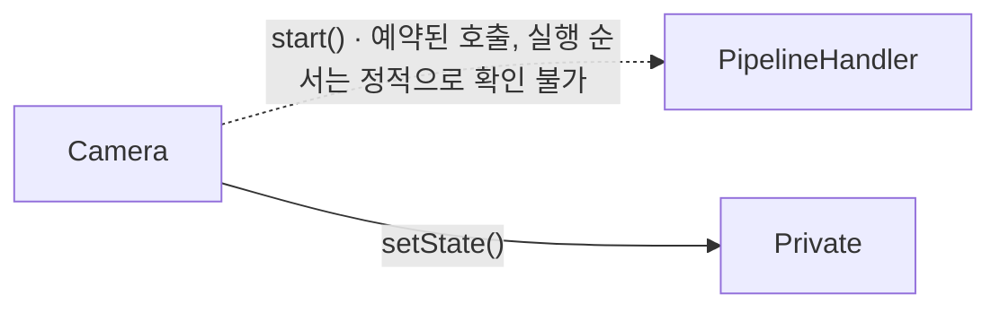

# 캡처 시작

**구성이 끝난 카메라를 시작하고 성공 뒤 요청을 제출할 수 있는 상태인지 확인하세요.**

| 지금 확인할 내용 | 이동할 절 |
|---|---|
| <a id="이-흐름에서-확인할-것"></a>구성이 끝난 카메라를 시작하고 성공 뒤 요청을 제출할 수 있는 상태인지 확인하세요. | [요청을 제출할 캡처 세션을 시작하기](#요청을-제출할-캡처-세션을-시작하기) |

## 요청을 제출할 캡처 세션을 시작하기

`Camera::start()`는 카메라 캡처 세션을 시작하며, 선택적으로 `controls` 목록을 전달할 수 있습니다. 전달된 `controls`는 카메라를 시작하기 전에 적용됩니다. 시작한 뒤에는 애플리케이션이 요청을 카메라에 큐에 넣어 처리하게 할 수 있으며, 처리된 요청은 애플리케이션으로 반환됩니다. 캡처 세션은 `stop()`으로 종료될 때까지 이어집니다. `src/libcamera/camera.cpp:1383`

`start()`는 `camera_operation`에 정의된 `Configured` 상태에서만 호출할 수 있습니다. 호출자는 `start()`를 카메라 상태에 영향을 주는 다른 함수와 동기화해야 합니다. 카메라가 시스템에서 분리된 경우 `-ENODEV`를 반환하며, 카메라가 시작할 수 있는 상태가 아니면 `-EACCES`를 반환합니다. `src/libcamera/camera.cpp:1383`

근거 원문: [src/libcamera/camera.cpp:1383](#source-1bb135021258e6a5)

## 시작 제어값과 파이프라인 결과 반영

`Camera::start`는 `controls`가 있으면 `ControlList copy(*controls);`로 만든 복사본 `copy`를 `patchControlList(copy)`로 전처리하고, 이 복사본을 `invokeMethod`에 전달합니다. `controls`가 `nullptr`이면 복사나 전처리 없이 `nullptr`를 전달합니다. 두 분기 모두 `invokeMethod`로 `PipelineHandler::start`를 `ConnectionTypeBlocking` 연결 타입으로 호출합니다. `PipelineHandler::start` 문서는 이 함수가 `CameraManager` 스레드에서 호출되며, 의도된 호출자는 `Camera` 클래스라고 설명합니다. `src/libcamera/camera.cpp:1400`, `src/libcamera/pipeline_handler.cpp:343`

`Camera::start`에서 `ret`이 0이 아니면 `if (ret) return ret;`에 따라 `ret`을 그대로 반환하고 `d->setState(Private::CameraRunning)`에 도달하지 않습니다. `ret`이 0이면 `d->setState(Private::CameraRunning)`을 호출해 `CameraRunning` 상태로 갱신한 뒤 `return 0;`에 도달합니다. `src/libcamera/camera.cpp:1400`

`ASSERT(d->requestSequence_ == 0);`는 `isAccessAllowed` 검사 블록 뒤, `controls` 분기 앞에서 실행됩니다. 검사식이 거짓이면 `ASSERT`는 Fatal 레벨 오류 메시지를 기록하고 프로그램 실행을 중단하며, `ret`처럼 오류 코드를 반환하는 경로와 다릅니다. `log.h`를 포함하기 전에 `NDEBUG`가 정의되어 있으면 `ASSERT()`는 코드를 생성하지 않습니다. `src/libcamera/camera.cpp:1400`, `src/libcamera/base/log.cpp:1022`

근거 원문: [src/libcamera/camera.cpp:1400](#source-05691b4c81e7ee1c) · [src/libcamera/pipeline_handler.cpp:343](#source-490ad21ef2a56108) · [src/libcamera/base/log.cpp:1022](#source-47a6ef3943a7b53c)

??? note "설계 질문과 검증 범위"
    질문별 답변과 근거 연결을 검사했습니다. 의미와 실행 결과는 사람 검토가 필요합니다.
    
    | 설계 질문 | 설명 위치 | 확인 범위 |
    |---|---|---|
    | Camera::start()의 캡처 세션 시작 목적, 선택 controls가 시작 전에 적용된다는 API 계약과 성공 뒤 요청 제출이 가능하고 stop까지 세션이 이어지는 범위를 설명하세요. Configured 상태 전제, 다른 상태 변경 함수와 호출자의 동기화 의무, 연결 해제·잘못된 상태 오류를 관련 조건과 함께 설명하세요. 숫자 성공 반환과 파이프라인 반환 전파는 다음 절에서만 설명하므로 반복하지 마세요. 두 문단 이내로 작성하세요. | [요청을 제출할 캡처 세션을 시작하기](#요청을-제출할-캡처-세션을-시작하기) | 코드 근거와 설명 연결 |
    | controls가 있으면 복사본을 patchControlList로 전처리하고 없으면 nullptr인 차이를 한 문단에서 설명하세요. 이 두 분기를 묶어 PipelineHandler::start를 ConnectionTypeBlocking으로 호출하고 CameraManager 스레드에서 처리한다는 계약을 설명하세요. ret이 0이 아니면 그대로 반환하여 CameraRunning을 갱신하지 않고 성공일 때만 CameraRunning과 0 반환에 도달하는 흐름을 한 번 설명하세요. requestSequence_==0 ASSERT를 일반 오류 반환과 구분하고, log.h를 포함하기 전에 NDEBUG가 정의되면 ASSERT 코드가 생성되지 않는다는 조건을 소스 계약으로 설명하세요. 소스에 없는 정보가 무엇인지를 설명하는 문단은 쓰지 마세요. 세 문단 이내로 작성하세요. 일반적인 ASSERT 사용 권고는 이 절의 범위에서 제외하고 실제 검사식과 NDEBUG 조건만 설명하세요. 권고를 의무로 바꾸지 마세요. ret 분기는 오류 경로 한 문장과 성공 경로 한 문장으로만 쓰고, 따라서·즉으로 시작하는 결과 요약을 덧붙이지 마세요. | [시작 제어값과 파이프라인 결과 반영](#시작-제어값과-파이프라인-결과-반영) | 코드 근거와 설명 연결 |

## 소스 근거

같은 발췌는 한 번만 싣습니다. 필요한 원문을 펼쳐 설명과 대조하세요.

<a id="source-1bb135021258e6a5"></a>

??? note "소스 근거: src/libcamera/camera.cpp:1383"
    `src/libcamera/camera.cpp:1383`에서 시작하는 발췌입니다. 종료 줄은 1399이며, 아래 원문을 설명과 대조할 수 있습니다.
    
    SHA-256: `9121c6f5bd2e73de134af571dd2a8a2089f052b08739b10519bdf9433ea1b2b9`
    
    ```text
    \brief Start capture from camera
     * \param[in] controls Controls to be applied before starting the Camera
     *
     * Start the camera capture session, optionally providing a list of controls to
     * apply before starting. Once the camera is started the application can queue
     * requests to the camera to process and return to the application until the
     * capture session is terminated with \a stop().
     *
     * \context This function may only be called when the camera is in the
     * Configured state as defined in \ref camera_operation, and shall be
     * synchronized by the caller with other functions that affect the camera
     * state.
     *
     * \return 0 on success or a negative error code otherwise
     * \retval -ENODEV The camera has been disconnected from the system
     * \retval -EACCES The camera is not in a state where it can be started
     */
    ```

<a id="source-05691b4c81e7ee1c"></a>

??? note "소스 근거: src/libcamera/camera.cpp:1400"
    `src/libcamera/camera.cpp:1400`에서 시작하는 발췌입니다. 종료 줄은 1428이며, 아래 원문을 설명과 대조할 수 있습니다.
    
    SHA-256: `a440ed27d1a8c891ff25f542252c50f9fc3040df4cc04346bf771ee8e4e54b73`
    
    ```text
    int Camera::start(const ControlList *controls)
    {
    	Private *const d = _d();
    
    	int ret = d->isAccessAllowed(Private::CameraConfigured);
    	if (ret < 0)
    		return ret;
    
    	LOG(Camera, Debug) << "Starting capture";
    
    	ASSERT(d->requestSequence_ == 0);
    
    	if (controls) {
    		ControlList copy(*controls);
    		patchControlList(copy);
    		ret = d->pipe_->invokeMethod(&PipelineHandler::start,
    					     ConnectionTypeBlocking, this, &copy);
    	} else {
    		ret = d->pipe_->invokeMethod(&PipelineHandler::start,
    					     ConnectionTypeBlocking, this, nullptr);
    	}
    
    	if (ret)
    		return ret;
    
    	d->setState(Private::CameraRunning);
    
    	return 0;
    }
    ```

<a id="source-490ad21ef2a56108"></a>

??? note "소스 근거: src/libcamera/pipeline_handler.cpp:343"
    `src/libcamera/pipeline_handler.cpp:343`에서 시작하는 발췌입니다. 종료 줄은 356이며, 아래 원문을 설명과 대조할 수 있습니다.
    
    SHA-256: `ea0201de61631e8e9551d0c94503e5b000439f9b1a1242dded9abeb9b5870c2e`
    
    ```text
    \fn PipelineHandler::start()
     * \brief Start capturing from a group of streams
     * \param[in] camera The camera to start
     * \param[in] controls Controls to be applied before starting the Camera
     *
     * Start the group of streams that have been configured for capture by
     * \a configure(). The intended caller of this function is the Camera class
     * which will in turn be called from the application to indicate that it has
     * configured the streams and is ready to capture.
     *
     * \context This function is called from the CameraManager thread.
     *
     * \return 0 on success or a negative error code otherwise
     */
    ```

<a id="source-47a6ef3943a7b53c"></a>

??? note "소스 근거: src/libcamera/base/log.cpp:1022"
    `src/libcamera/base/log.cpp:1022`에서 시작하는 발췌입니다. 종료 줄은 1060이며, 아래 원문을 설명과 대조할 수 있습니다.
    
    SHA-256: `52e64d292f59786541e66fe48f5bae65256bdced60c803aa76bf3637083b47b0`
    
    ```text
    \def LOG(category, severity)
     * \hideinitializer
     * \brief Log a message
     * \param[in] category Category (optional)
     * \param[in] severity Severity
     *
     * Return an std::ostream reference to which a message can be logged using the
     * iostream API. The \a category, if specified, sets the message category. When
     * absent the default category is used. The  \a severity controls whether the
     * message is printed or discarded, depending on the log level for the category.
     *
     * If the severity is set to Fatal, execution is aborted and the program
     * terminates immediately after printing the message.
     *
     * \warning Logging from the destructor of a global object, either directly or
     * indirectly, results in undefined behaviour.
     *
     * \todo Allow logging from destructors of global objects to the largest
     * possible extent
     */
    
    /**
     * \def ASSERT(condition)
     * \hideinitializer
     * \brief Abort program execution if assertion fails
     *
     * If \a condition is false, ASSERT() logs an error message with the Fatal log
     * level and aborts program execution.
     *
     * If the macro NDEBUG is defined before including log.h, ASSERT() generates no
     * code.
     *
     * Using conditions that have side effects with ASSERT() is not recommended, as
     * these effects would depend on whether NDEBUG is defined or not. Similarly,
     * ASSERT() should not be used to check for errors that can occur under normal
     * conditions as those checks would then be removed when compiling with NDEBUG.
     */
    
    } /* namespace libcamera */
    ```

## 주요 확인 지점

아래 항목은 추출한 호출에서 고른 코드 탐색 지점입니다. 나열 순서는 실행 순서가 아닙니다.

| 확인할 내용 | 호출 측과 대상 | 구분 | 근거 |
|---|---|---|---|
| 시작 요청 대상 | `Camera` → `PipelineHandler::start()` | 메서드 전달 대상이며 동기·비동기 여부는 호출부에서 확인해야 합니다. | `src/libcamera/camera.cpp:1415`, `src/libcamera/camera.cpp:1418` |
| 상태 반영 | `Camera` → `Private::setState()` | 정적 호출 지점입니다. | `src/libcamera/camera.cpp:1425` |

## 주요 호출 관계

화살표는 호출 측과 대상을 연결합니다. 시간 순서나 모든 경로의 실행을 뜻하지 않습니다. 점선에는 가상 호출 후보·예약 대상 등 확인이 필요한 관계를 표시합니다.



## 추적 범위와 경계

요약의 hide 규칙에 해당하는 호출은 27개입니다. 전체 추적 기록에는 해당 호출도 모두 보존합니다. 기록 번호는 정적 탐색의 식별자이며 실행 순번이 아닙니다.

조건 분기, 반복 횟수와 실제 실행 스레드는 이 호출 목록만으로 확정할 수 없습니다. 가상 호출 후보는 실제 객체에 따라 선택됩니다. 예약 표시는 인자로 전달한 메서드 대상을 뜻하며, 비동기 실행을 보증하지 않습니다. 호출부의 연결 방식과 동기화 계약을 확인해야 합니다.

| 호출 지점 | 후보 또는 예약 대상 | 확인할 경계 | 근거 |
|---|---|---|---|
| `Camera` | `PipelineHandler::start()` | 메서드 전달 대상이며 동기·비동기 여부는 호출부에서 확인해야 합니다. | `src/libcamera/camera.cpp:1415` |
| `Camera` | `PipelineHandler::start()` | 메서드 전달 대상이며 동기·비동기 여부는 호출부에서 확인해야 합니다. | `src/libcamera/camera.cpp:1418` |

추출 통계: 미해결 호출 0개, 예약된 호출 2개입니다.

## 전체 추적 기록

아래 구간을 펼치면 요약에서 제외된 호출까지 확인할 수 있습니다. 이 목록은 추출 깊이 안에서 수집한 기록이며, 소스의 모든 실행 경로를 포함한다는 뜻은 아닙니다.

??? note "추적 기록 1–25 / 48개"

    | 기록 | 호출 측 | 대상 | 구분 | 근거 |
    |---|---|---|---|---|
    | 1 | `Camera` | `Camera::_d()` | 정적 호출 지점입니다. | `src/libcamera/camera.cpp:1402` |
    | 2 | `Camera` | `Private::isAccessAllowed()` | 정적 호출 지점입니다. | `src/libcamera/camera.cpp:1404` |
    | 3 | `Private` | `log::isLogSeverityEnabled()` | 정적 호출 지점입니다. | `src/libcamera/camera.cpp:700` |
    | 4 | `Private` | `LogMessageAbortGuard::LogMessageAbortGuard()` | 정적 호출 지점입니다. | `src/libcamera/camera.cpp:700` |
    | 5 | `Private` | `LogMessage::stream()` | 정적 호출 지점입니다. | `src/libcamera/camera.cpp:700` |
    | 6 | `Private` | `log::_log()` | 정적 호출 지점입니다. | `src/libcamera/camera.cpp:700` |
    | 7 | `log` | `LogMessage::LogMessage()` | 정적 호출 지점입니다. | `src/libcamera/base/log.cpp:990` |
    | 8 | `LogMessage` | `utils::basename()` | 정적 호출 지점입니다. | `src/libcamera/base/log.cpp:858` |
    | 9 | `Private` | `log::isLogSeverityEnabled()` | 정적 호출 지점입니다. | `src/libcamera/camera.cpp:702` |
    | 10 | `Private` | `LogMessageAbortGuard::LogMessageAbortGuard()` | 정적 호출 지점입니다. | `src/libcamera/camera.cpp:702` |
    | 11 | `Private` | `LogMessage::stream()` | 정적 호출 지점입니다. | `src/libcamera/camera.cpp:702` |
    | 12 | `Private` | `log::_log()` | 정적 호출 지점입니다. | `src/libcamera/camera.cpp:702` |
    | 13 | `log` | `LogMessage::LogMessage()` | 정적 호출 지점입니다. | `src/libcamera/base/log.cpp:990` |
    | 14 | `LogMessage` | `utils::basename()` | 정적 호출 지점입니다. | `src/libcamera/base/log.cpp:858` |
    | 15 | `Camera` | `log::isLogSeverityEnabled()` | 정적 호출 지점입니다. | `src/libcamera/camera.cpp:1408` |
    | 16 | `Camera` | `LogMessageAbortGuard::LogMessageAbortGuard()` | 정적 호출 지점입니다. | `src/libcamera/camera.cpp:1408` |
    | 17 | `Camera` | `LogMessage::stream()` | 정적 호출 지점입니다. | `src/libcamera/camera.cpp:1408` |
    | 18 | `Camera` | `log::_log()` | 정적 호출 지점입니다. | `src/libcamera/camera.cpp:1408` |
    | 19 | `log` | `LogMessage::LogMessage()` | 정적 호출 지점입니다. | `src/libcamera/base/log.cpp:990` |
    | 20 | `LogMessage` | `utils::basename()` | 정적 호출 지점입니다. | `src/libcamera/base/log.cpp:858` |
    | 21 | `Camera` | `log::isLogSeverityEnabled()` | 정적 호출 지점입니다. | `src/libcamera/camera.cpp:1410` |
    | 22 | `Camera` | `LogMessageAbortGuard::LogMessageAbortGuard()` | 정적 호출 지점입니다. | `src/libcamera/camera.cpp:1410` |
    | 23 | `Camera` | `LogMessage::stream()` | 정적 호출 지점입니다. | `src/libcamera/camera.cpp:1410` |
    | 24 | `Camera` | `log::_log()` | 정적 호출 지점입니다. | `src/libcamera/camera.cpp:1410` |
    | 25 | `log` | `LogMessage::LogMessage()` | 정적 호출 지점입니다. | `src/libcamera/base/log.cpp:990` |

??? note "추적 기록 26–48 / 48개"

    | 기록 | 호출 측 | 대상 | 구분 | 근거 |
    |---|---|---|---|---|
    | 26 | `LogMessage` | `utils::basename()` | 정적 호출 지점입니다. | `src/libcamera/base/log.cpp:858` |
    | 27 | `Camera` | `ControlList::ControlList()` | 정적 호출 지점입니다. | `src/libcamera/camera.cpp:1413` |
    | 28 | `Camera` | `Camera::patchControlList()` | 정적 호출 지점입니다. | `src/libcamera/camera.cpp:1414` |
    | 29 | `Camera` | `ControlList::get()` | 정적 호출 지점입니다. | `src/libcamera/camera.cpp:1289` |
    | 30 | `Camera` | `ControlInfoMap::count()` | 정적 호출 지점입니다. | `src/libcamera/camera.cpp:1291` |
    | 31 | `ControlInfoMap` | `ControlInfoMap::find()` | 정적 호출 지점입니다. | `src/libcamera/controls.cpp:864` |
    | 32 | `Camera` | `Camera::_d()` | 정적 호출 지점입니다. | `src/libcamera/camera.cpp:1291` |
    | 33 | `Camera` | `ControlId::id()` | 정적 호출 지점입니다. | `src/libcamera/camera.cpp:1291` |
    | 34 | `Camera` | `ControlList::contains()` | 정적 호출 지점입니다. | `src/libcamera/camera.cpp:1292` |
    | 35 | `Camera` | `ControlId::id()` | 정적 호출 지점입니다. | `src/libcamera/camera.cpp:1292` |
    | 36 | `Camera` | `ControlList::set()` | 정적 호출 지점입니다. | `src/libcamera/camera.cpp:1293` |
    | 37 | `Camera` | `ControlInfoMap::count()` | 정적 호출 지점입니다. | `src/libcamera/camera.cpp:1298` |
    | 38 | `ControlInfoMap` | `ControlInfoMap::find()` | 정적 호출 지점입니다. | `src/libcamera/controls.cpp:864` |
    | 39 | `Camera` | `Camera::_d()` | 정적 호출 지점입니다. | `src/libcamera/camera.cpp:1298` |
    | 40 | `Camera` | `ControlId::id()` | 정적 호출 지점입니다. | `src/libcamera/camera.cpp:1298` |
    | 41 | `Camera` | `ControlList::contains()` | 정적 호출 지점입니다. | `src/libcamera/camera.cpp:1299` |
    | 42 | `Camera` | `ControlId::id()` | 정적 호출 지점입니다. | `src/libcamera/camera.cpp:1299` |
    | 43 | `Camera` | `ControlList::set()` | 정적 호출 지점입니다. | `src/libcamera/camera.cpp:1300` |
    | 44 | `Camera` | `Object::invokeMethod()` | 정적 호출 지점입니다. | `src/libcamera/camera.cpp:1415` |
    | 45 | `Camera` | `PipelineHandler::start()` | 메서드 전달 대상이며 동기·비동기 여부는 호출부에서 확인해야 합니다. | `src/libcamera/camera.cpp:1415` |
    | 46 | `Camera` | `Object::invokeMethod()` | 정적 호출 지점입니다. | `src/libcamera/camera.cpp:1418` |
    | 47 | `Camera` | `PipelineHandler::start()` | 메서드 전달 대상이며 동기·비동기 여부는 호출부에서 확인해야 합니다. | `src/libcamera/camera.cpp:1418` |
    | 48 | `Camera` | `Private::setState()` | 정적 호출 지점입니다. | `src/libcamera/camera.cpp:1425` |

??? note "근거와 검토 정보"
    - 생성 방식: 추출 사실과 LLM 설명
    - 검증 범위: 표·그림은 facts로 만들고 설명은 LLM이 작성합니다. 인용·문장 및 설정된 구조 검사를 적용합니다.
    - 근거 파일: `src/libcamera/base/log.cpp`, `src/libcamera/camera.cpp`, `src/libcamera/controls.cpp`, `src/libcamera/pipeline_handler.cpp`
    - 근거 수준: 코드 확인 (정적 분석, simple_compdb 구성, commit `212c689fcf`)
    - 자동 검사 (인용·문장 및 설정된 구조 검사): 통과
    - 검토 상태 기록일: 2026-10-31 · 사람 검토 전

다음 단계: [요청 제출](queue_request.md)
