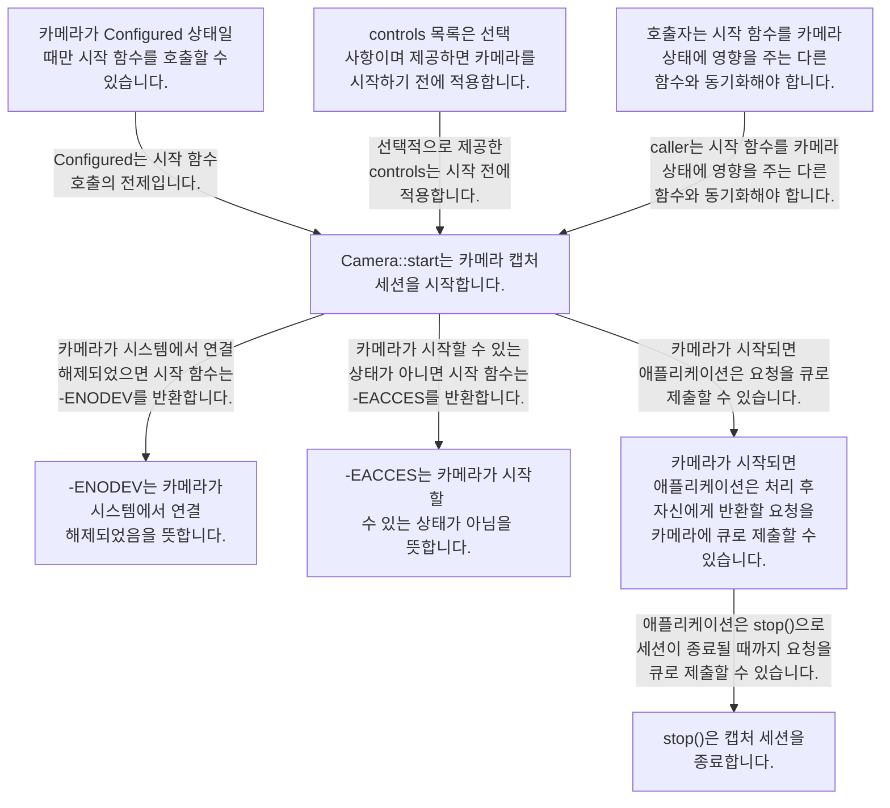
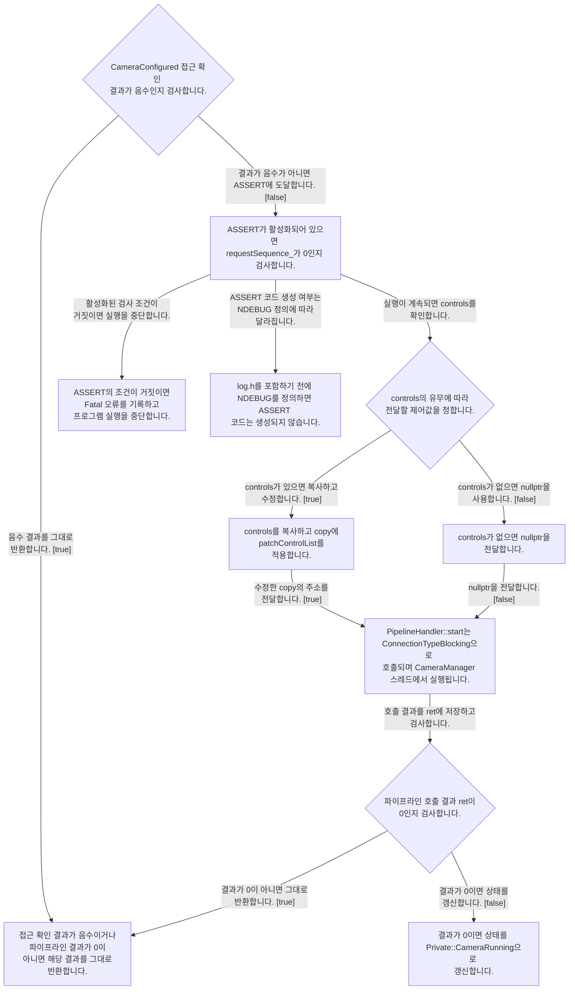
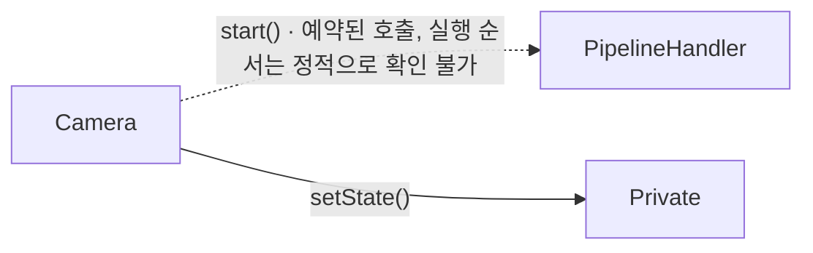

# 캡처 시작

**구성이 끝난 카메라를 시작하고 성공 뒤 요청을 제출할 수 있는 상태인지 확인하세요.**

| 지금 확인할 내용 | 이동할 절 |
|---|---|
| <a id="이-흐름에서-확인할-것"></a>구성이 끝난 카메라를 시작하고 성공 뒤 요청을 제출할 수 있는 상태인지 확인하세요. | [요청을 제출할 캡처 세션을 시작하기](#요청을-제출할-캡처-세션을-시작하기) |

## 요청을 제출할 캡처 세션을 시작하기

`Camera::start()`는 카메라 캡처 세션을 시작하며, 선택적으로 시작 전에 적용할 `controls` 목록을 받습니다. 카메라가 시작되면 애플리케이션은 `stop()`으로 캡처 세션을 종료할 때까지 카메라가 처리하고 애플리케이션에 반환할 요청을 큐에 넣을 수 있습니다. 호출자는 카메라가 `Configured` 상태일 때만 이 함수를 호출해야 하며, 카메라 상태에 영향을 주는 다른 함수와 호출을 동기화해야 합니다. 카메라의 시스템 연결이 해제된 경우 `-ENODEV`를, 시작할 수 없는 상태인 경우 `-EACCES`를 반환합니다. `src/libcamera/camera.cpp:1383`

<!-- sdd:visual:item-session -->
### 요청을 제출할 캡처 세션을 시작하기의 관계와 경계



[Mermaid 원문](camera_start.item-session.mmd)

??? note "그림 근거와 확인 범위"
    Configured 전제와 선택적 제어값, 시작 오류, 요청 제출 및 stop은 캡처 세션에서 어떻게 연결되는가?
    
    소스에 연결한 설계 해석입니다. 자동 연결 검사는 의미 승인이나 기기 실행 검증이 아닙니다.
    
    LLM 그림 초안 · 사람 검토 전
    
    작성 모델: `cli/codex/gpt-6.1-terra`
    
    | 요소·전이 | 소스 근거 |
    |---|---|
    | <span data-sdd-label-en="Camera::start starts a camera capture session.">Camera::start는 카메라 캡처 세션을 시작합니다.</span> | [src/libcamera/camera.cpp:1383](#source-1bb135021258e6a5) |
    | <span data-sdd-label-en="The start function may only be called when the camera is Configured.">카메라가 Configured 상태일 때만 시작 함수를 호출할 수 있습니다.</span> | [src/libcamera/camera.cpp:1383](#source-1bb135021258e6a5) |
    | <span data-sdd-label-en="The controls list is optional and is applied before the camera starts if provided.">controls 목록은 선택 사항이며 제공하면 카메라를 시작하기 전에 적용합니다.</span> | [src/libcamera/camera.cpp:1383](#source-1bb135021258e6a5) |
    | <span data-sdd-label-en="The caller must synchronize the start function with other functions affecting camera state.">호출자는 시작 함수를 카메라 상태에 영향을 주는 다른 함수와 동기화해야 합니다.</span> | [src/libcamera/camera.cpp:1383](#source-1bb135021258e6a5) |
    | <span data-sdd-label-en="-ENODEV means the camera has been disconnected from the system.">-ENODEV는 카메라가 시스템에서 연결 해제되었음을 뜻합니다.</span> | [src/libcamera/camera.cpp:1383](#source-1bb135021258e6a5) |
    | <span data-sdd-label-en="-EACCES means the camera is not in a state where it can be started.">-EACCES는 카메라가 시작할 수 있는 상태가 아님을 뜻합니다.</span> | [src/libcamera/camera.cpp:1383](#source-1bb135021258e6a5) |
    | <span data-sdd-label-en="Once the camera starts, the application can queue requests for processing and return to it.">카메라가 시작되면 애플리케이션은 처리 후 자신에게 반환할 요청을 카메라에 큐로 제출할 수 있습니다.</span> | [src/libcamera/camera.cpp:1383](#source-1bb135021258e6a5) |
    | <span data-sdd-label-en="stop() terminates the capture session.">stop&#40;&#41;은 캡처 세션을 종료합니다.</span> | [src/libcamera/camera.cpp:1383](#source-1bb135021258e6a5) |
    | <span data-sdd-label-en="Configured is a precondition for calling the start function.">Configured는 시작 함수 호출의 전제입니다.</span> | [src/libcamera/camera.cpp:1383](#source-1bb135021258e6a5) |
    | <span data-sdd-label-en="Optional controls are applied before starting.">선택적으로 제공한 controls는 시작 전에 적용합니다.</span> | [src/libcamera/camera.cpp:1383](#source-1bb135021258e6a5) |
    | <span data-sdd-label-en="The caller must synchronize start with other state-affecting functions.">caller는 시작 함수를 카메라 상태에 영향을 주는 다른 함수와 동기화해야 합니다.</span> | [src/libcamera/camera.cpp:1383](#source-1bb135021258e6a5) |
    | <span data-sdd-label-en="The start function returns -ENODEV if the camera is disconnected.">카메라가 시스템에서 연결 해제되었으면 시작 함수는 -ENODEV를 반환합니다.</span> | [src/libcamera/camera.cpp:1383](#source-1bb135021258e6a5) |
    | <span data-sdd-label-en="The start function returns -EACCES if the camera cannot be started.">카메라가 시작할 수 있는 상태가 아니면 시작 함수는 -EACCES를 반환합니다.</span> | [src/libcamera/camera.cpp:1383](#source-1bb135021258e6a5) |
    | <span data-sdd-label-en="Once the camera starts, the application can queue requests.">카메라가 시작되면 애플리케이션은 요청을 큐로 제출할 수 있습니다.</span> | [src/libcamera/camera.cpp:1383](#source-1bb135021258e6a5) |
    | <span data-sdd-label-en="The application can queue requests until stop() ends the session.">애플리케이션은 stop&#40;&#41;으로 세션이 종료될 때까지 요청을 큐로 제출할 수 있습니다.</span> | [src/libcamera/camera.cpp:1383](#source-1bb135021258e6a5) |
<!-- /sdd:visual:item-session -->

근거 원문: [src/libcamera/camera.cpp:1383](#source-1bb135021258e6a5)

## 시작 제어값과 파이프라인 결과 반영

`Camera::start`는 `controls`가 있으면 `ControlList` 복사본을 만들고 `patchControlList`로 전처리한 뒤 그 복사본을 전달하며, 없으면 `nullptr`을 전달합니다. 두 분기 모두 `PipelineHandler::start`를 `ConnectionTypeBlocking`으로 호출하며, 이 함수는 `CameraManager` 스레드에서 호출됩니다. `Camera::start`는 호출 결과인 `ret`이 0이 아니면 `CameraRunning` 상태를 설정하지 않고 `ret`을 그대로 반환합니다. `ret`이 0이면 `CameraRunning` 상태를 설정하고 0을 반환합니다. `src/libcamera/camera.cpp:1400`, `src/libcamera/pipeline_handler.cpp:343`

<!-- sdd:visual:item-activation -->
### 시작 제어값과 파이프라인 결과 반영의 관계와 경계



[Mermaid 원문](camera_start.item-activation.mmd)

??? note "그림 근거와 확인 범위"
    ASSERT, 제어값 분기, blocking 파이프라인 호출과 반환값 분기는 어떻게 원래 오류 반환 또는 CameraRunning 갱신으로 이어지는가?
    
    소스에 연결한 설계 해석입니다. 자동 연결 검사는 의미 승인이나 기기 실행 검증이 아닙니다.
    
    LLM 그림 초안 · 사람 검토 전
    
    작성 모델: `cli/codex/gpt-6.1-terra`
    
    | 요소·전이 | 소스 근거 |
    |---|---|
    | <span data-sdd-label-en="It checks whether the CameraConfigured access result is negative.">CameraConfigured 접근 확인 결과가 음수인지 검사합니다.</span> | [src/libcamera/camera.cpp:1400](#source-05691b4c81e7ee1c) |
    | <span data-sdd-label-en="It returns a negative access result or a nonzero pipeline result unchanged.">접근 확인 결과가 음수이거나 파이프라인 결과가 0이 아니면 해당 결과를 그대로 반환합니다.</span> | [src/libcamera/camera.cpp:1400](#source-05691b4c81e7ee1c) |
    | <span data-sdd-label-en="When enabled, ASSERT checks whether requestSequence_ is zero.">ASSERT가 활성화되어 있으면 requestSequence&#95;가 0인지 검사합니다.</span> | [src/libcamera/camera.cpp:1400](#source-05691b4c81e7ee1c) · [src/libcamera/base/log.cpp:1022](#source-47a6ef3943a7b53c) |
    | <span data-sdd-label-en="If the ASSERT condition is false, it logs a Fatal error and aborts execution.">ASSERT의 조건이 거짓이면 Fatal 오류를 기록하고 프로그램 실행을 중단합니다.</span> | [src/libcamera/base/log.cpp:1022](#source-47a6ef3943a7b53c) |
    | <span data-sdd-label-en="If NDEBUG is defined before including log.h, ASSERT generates no code.">log.h를 포함하기 전에 NDEBUG를 정의하면 ASSERT 코드는 생성되지 않습니다.</span> | [src/libcamera/base/log.cpp:1022](#source-47a6ef3943a7b53c) |
    | <span data-sdd-label-en="It chooses what to pass based on whether controls is present.">controls의 유무에 따라 전달할 제어값을 정합니다.</span> | [src/libcamera/camera.cpp:1400](#source-05691b4c81e7ee1c) |
    | <span data-sdd-label-en="It copies controls and applies patchControlList to copy.">controls를 복사하고 copy에 patchControlList를 적용합니다.</span> | [src/libcamera/camera.cpp:1400](#source-05691b4c81e7ee1c) |
    | <span data-sdd-label-en="It passes nullptr when controls is absent.">controls가 없으면 nullptr을 전달합니다.</span> | [src/libcamera/camera.cpp:1400](#source-05691b4c81e7ee1c) |
    | <span data-sdd-label-en="PipelineHandler::start runs on the CameraManager thread via ConnectionTypeBlocking.">PipelineHandler::start는 ConnectionTypeBlocking으로 호출되며 CameraManager 스레드에서 실행됩니다.</span> | [src/libcamera/camera.cpp:1400](#source-05691b4c81e7ee1c) · [src/libcamera/pipeline_handler.cpp:343](#source-490ad21ef2a56108) |
    | <span data-sdd-label-en="It checks whether the pipeline call result ret is zero.">파이프라인 호출 결과 ret이 0인지 검사합니다.</span> | [src/libcamera/camera.cpp:1400](#source-05691b4c81e7ee1c) |
    | <span data-sdd-label-en="If the result is zero, it sets the state to Private::CameraRunning.">결과가 0이면 상태를 Private::CameraRunning으로 갱신합니다.</span> | [src/libcamera/camera.cpp:1400](#source-05691b4c81e7ee1c) |
    | <span data-sdd-label-en="It returns the negative result unchanged. · ret &lt; 0 [true]">음수 결과를 그대로 반환합니다. · ret &lt; 0 &#91;true&#93;</span> | [src/libcamera/camera.cpp:1400](#source-05691b4c81e7ee1c) |
    | <span data-sdd-label-en="If the result is not negative, execution reaches ASSERT. · ret &lt; 0 [false]">결과가 음수가 아니면 ASSERT에 도달합니다. · ret &lt; 0 &#91;false&#93;</span> | [src/libcamera/camera.cpp:1400](#source-05691b4c81e7ee1c) |
    | <span data-sdd-label-en="If the enabled assertion is false, execution aborts.">활성화된 검사 조건이 거짓이면 실행을 중단합니다.</span> | [src/libcamera/base/log.cpp:1022](#source-47a6ef3943a7b53c) |
    | <span data-sdd-label-en="ASSERT code generation depends on the NDEBUG definition.">ASSERT 코드 생성 여부는 NDEBUG 정의에 따라 달라집니다.</span> | [src/libcamera/base/log.cpp:1022](#source-47a6ef3943a7b53c) |
    | <span data-sdd-label-en="If execution continues, it checks controls.">실행이 계속되면 controls를 확인합니다.</span> | [src/libcamera/camera.cpp:1400](#source-05691b4c81e7ee1c) · [src/libcamera/base/log.cpp:1022](#source-47a6ef3943a7b53c) |
    | <span data-sdd-label-en="If controls is present, it copies and patches it. · controls [true]">controls가 있으면 복사하고 수정합니다. · controls &#91;true&#93;</span> | [src/libcamera/camera.cpp:1400](#source-05691b4c81e7ee1c) |
    | <span data-sdd-label-en="If controls is absent, it uses nullptr. · controls [false]">controls가 없으면 nullptr을 사용합니다. · controls &#91;false&#93;</span> | [src/libcamera/camera.cpp:1400](#source-05691b4c81e7ee1c) |
    | <span data-sdd-label-en="It passes the address of the patched copy. · controls [true]">수정한 copy의 주소를 전달합니다. · controls &#91;true&#93;</span> | [src/libcamera/camera.cpp:1400](#source-05691b4c81e7ee1c) |
    | <span data-sdd-label-en="It passes nullptr. · controls [false]">nullptr을 전달합니다. · controls &#91;false&#93;</span> | [src/libcamera/camera.cpp:1400](#source-05691b4c81e7ee1c) |
    | <span data-sdd-label-en="It stores the call result in ret and checks it.">호출 결과를 ret에 저장하고 검사합니다.</span> | [src/libcamera/camera.cpp:1400](#source-05691b4c81e7ee1c) |
    | <span data-sdd-label-en="If the result is nonzero, it returns it unchanged. · ret [true]">결과가 0이 아니면 그대로 반환합니다. · ret &#91;true&#93;</span> | [src/libcamera/camera.cpp:1400](#source-05691b4c81e7ee1c) |
    | <span data-sdd-label-en="If the result is zero, it updates the state. · ret [false]">결과가 0이면 상태를 갱신합니다. · ret &#91;false&#93;</span> | [src/libcamera/camera.cpp:1400](#source-05691b4c81e7ee1c) |
<!-- /sdd:visual:item-activation -->

`Camera::start`는 `PipelineHandler::start`를 호출하기 전에 `ASSERT(d->requestSequence_ == 0)`을 실행합니다. 이 검사가 실패하면 `ASSERT`는 오류 메시지를 `Fatal` 로그 수준으로 기록하고 프로그램 실행을 중단하며, 일반 오류 반환과는 다르게 동작합니다. `log.h`를 포함하기 전에 `NDEBUG`가 정의되면 `ASSERT`는 코드를 생성하지 않습니다. `src/libcamera/camera.cpp:1400`, `src/libcamera/base/log.cpp:1022`

근거 원문: [src/libcamera/camera.cpp:1400](#source-05691b4c81e7ee1c) · [src/libcamera/pipeline_handler.cpp:343](#source-490ad21ef2a56108) · [src/libcamera/base/log.cpp:1022](#source-47a6ef3943a7b53c)

??? note "설계 질문과 검증 범위"
    질문별 답변과 근거 연결을 검사했습니다. 의미와 실행 결과는 사람 검토가 필요합니다.
    
    | 설계 질문 | 설명 위치 | 확인 범위 |
    |---|---|---|
    | Camera::start()의 캡처 세션 시작 목적, 선택 controls가 시작 전에 적용된다는 API 계약과 성공 뒤 요청 제출이 가능하고 stop까지 세션이 이어지는 범위를 설명하세요. Configured 상태 전제, 다른 상태 변경 함수와 호출자의 동기화 의무, 연결 해제·잘못된 상태 오류를 관련 조건과 함께 설명하세요. 숫자 성공 반환과 파이프라인 반환 전파는 다음 절에서만 설명하므로 반복하지 마세요. 두 문단 이내로 작성하세요. | [요청을 제출할 캡처 세션을 시작하기](#요청을-제출할-캡처-세션을-시작하기) | 코드 근거와 설명 연결 |
    | controls가 있으면 복사본을 patchControlList로 전처리하고 없으면 nullptr인 차이를 한 문단에서 설명하세요. 이 두 분기를 묶어 PipelineHandler::start를 ConnectionTypeBlocking으로 호출하고 CameraManager 스레드에서 처리한다는 계약을 설명하세요. ret이 0이 아니면 그대로 반환하여 CameraRunning을 갱신하지 않고 성공일 때만 CameraRunning과 0 반환에 도달하는 흐름을 한 번 설명하세요. requestSequence_==0 ASSERT를 일반 오류 반환과 구분하고, log.h를 포함하기 전에 NDEBUG가 정의되면 ASSERT 코드가 생성되지 않는다는 조건을 소스 계약으로 설명하세요. 소스에 없는 정보가 무엇인지를 설명하는 문단은 쓰지 마세요. 세 문단 이내로 작성하세요. 일반적인 ASSERT 사용 권고는 이 절의 범위에서 제외하고 실제 검사식과 NDEBUG 조건만 설명하세요. 권고를 의무로 바꾸지 마세요. ret 분기는 오류 경로 한 문장과 성공 경로 한 문장으로만 쓰고, 따라서·즉으로 시작하는 결과 요약을 덧붙이지 마세요. | [시작 제어값과 파이프라인 결과 반영](#시작-제어값과-파이프라인-결과-반영) | 코드 근거와 설명 연결 |

## 소스 근거

같은 발췌는 한 번만 싣습니다. 필요한 원문을 펼쳐 설명과 대조하세요.

<a id="source-1bb135021258e6a5"></a>

??? note "소스 근거: src/libcamera/camera.cpp:1383"
    `src/libcamera/camera.cpp:1383`에서 시작하는 발췌입니다. 종료 줄은 1399이며, 아래 원문을 설명과 대조할 수 있습니다.
    
    SHA-256: `9121c6f5bd2e73de134af571dd2a8a2089f052b08739b10519bdf9433ea1b2b9`
    
    ```text
    \brief Start capture from camera
     * \param[in] controls Controls to be applied before starting the Camera
     *
     * Start the camera capture session, optionally providing a list of controls to
     * apply before starting. Once the camera is started the application can queue
     * requests to the camera to process and return to the application until the
     * capture session is terminated with \a stop().
     *
     * \context This function may only be called when the camera is in the
     * Configured state as defined in \ref camera_operation, and shall be
     * synchronized by the caller with other functions that affect the camera
     * state.
     *
     * \return 0 on success or a negative error code otherwise
     * \retval -ENODEV The camera has been disconnected from the system
     * \retval -EACCES The camera is not in a state where it can be started
     */
    ```

<a id="source-05691b4c81e7ee1c"></a>

??? note "소스 근거: src/libcamera/camera.cpp:1400"
    `src/libcamera/camera.cpp:1400`에서 시작하는 발췌입니다. 종료 줄은 1428이며, 아래 원문을 설명과 대조할 수 있습니다.
    
    SHA-256: `a440ed27d1a8c891ff25f542252c50f9fc3040df4cc04346bf771ee8e4e54b73`
    
    ```text
    int Camera::start(const ControlList *controls)
    {
    	Private *const d = _d();
    
    	int ret = d->isAccessAllowed(Private::CameraConfigured);
    	if (ret < 0)
    		return ret;
    
    	LOG(Camera, Debug) << "Starting capture";
    
    	ASSERT(d->requestSequence_ == 0);
    
    	if (controls) {
    		ControlList copy(*controls);
    		patchControlList(copy);
    		ret = d->pipe_->invokeMethod(&PipelineHandler::start,
    					     ConnectionTypeBlocking, this, &copy);
    	} else {
    		ret = d->pipe_->invokeMethod(&PipelineHandler::start,
    					     ConnectionTypeBlocking, this, nullptr);
    	}
    
    	if (ret)
    		return ret;
    
    	d->setState(Private::CameraRunning);
    
    	return 0;
    }
    ```

<a id="source-490ad21ef2a56108"></a>

??? note "소스 근거: src/libcamera/pipeline_handler.cpp:343"
    `src/libcamera/pipeline_handler.cpp:343`에서 시작하는 발췌입니다. 종료 줄은 356이며, 아래 원문을 설명과 대조할 수 있습니다.
    
    SHA-256: `ea0201de61631e8e9551d0c94503e5b000439f9b1a1242dded9abeb9b5870c2e`
    
    ```text
    \fn PipelineHandler::start()
     * \brief Start capturing from a group of streams
     * \param[in] camera The camera to start
     * \param[in] controls Controls to be applied before starting the Camera
     *
     * Start the group of streams that have been configured for capture by
     * \a configure(). The intended caller of this function is the Camera class
     * which will in turn be called from the application to indicate that it has
     * configured the streams and is ready to capture.
     *
     * \context This function is called from the CameraManager thread.
     *
     * \return 0 on success or a negative error code otherwise
     */
    ```

<a id="source-47a6ef3943a7b53c"></a>

??? note "소스 근거: src/libcamera/base/log.cpp:1022"
    `src/libcamera/base/log.cpp:1022`에서 시작하는 발췌입니다. 종료 줄은 1060이며, 아래 원문을 설명과 대조할 수 있습니다.
    
    SHA-256: `52e64d292f59786541e66fe48f5bae65256bdced60c803aa76bf3637083b47b0`
    
    ```text
    \def LOG(category, severity)
     * \hideinitializer
     * \brief Log a message
     * \param[in] category Category (optional)
     * \param[in] severity Severity
     *
     * Return an std::ostream reference to which a message can be logged using the
     * iostream API. The \a category, if specified, sets the message category. When
     * absent the default category is used. The  \a severity controls whether the
     * message is printed or discarded, depending on the log level for the category.
     *
     * If the severity is set to Fatal, execution is aborted and the program
     * terminates immediately after printing the message.
     *
     * \warning Logging from the destructor of a global object, either directly or
     * indirectly, results in undefined behaviour.
     *
     * \todo Allow logging from destructors of global objects to the largest
     * possible extent
     */
    
    /**
     * \def ASSERT(condition)
     * \hideinitializer
     * \brief Abort program execution if assertion fails
     *
     * If \a condition is false, ASSERT() logs an error message with the Fatal log
     * level and aborts program execution.
     *
     * If the macro NDEBUG is defined before including log.h, ASSERT() generates no
     * code.
     *
     * Using conditions that have side effects with ASSERT() is not recommended, as
     * these effects would depend on whether NDEBUG is defined or not. Similarly,
     * ASSERT() should not be used to check for errors that can occur under normal
     * conditions as those checks would then be removed when compiling with NDEBUG.
     */
    
    } /* namespace libcamera */
    ```

## 주요 확인 지점

아래 항목은 추출한 호출에서 고른 코드 탐색 지점입니다. 나열 순서는 실행 순서가 아닙니다.

| 확인할 내용 | 호출 측과 대상 | 구분 | 근거 |
|---|---|---|---|
| 시작 요청 대상 | `Camera` → `PipelineHandler::start()` | 메서드 전달 대상이며 동기·비동기 여부는 호출부에서 확인해야 합니다. | `src/libcamera/camera.cpp:1415`, `src/libcamera/camera.cpp:1418` |
| 상태 반영 | `Camera` → `Private::setState()` | 정적 호출 지점입니다. | `src/libcamera/camera.cpp:1425` |

## 주요 호출 관계

화살표는 호출 측과 대상을 연결합니다. 시간 순서나 모든 경로의 실행을 뜻하지 않습니다. 점선에는 가상 호출 후보·예약 대상 등 확인이 필요한 관계를 표시합니다.



## 추적 범위와 경계

요약의 hide 규칙에 해당하는 호출은 27개입니다. 전체 추적 기록에는 해당 호출도 모두 보존합니다. 기록 번호는 정적 탐색의 식별자이며 실행 순번이 아닙니다.

조건 분기, 반복 횟수와 실제 실행 스레드는 이 호출 목록만으로 확정할 수 없습니다. 가상 호출 후보는 실제 객체에 따라 선택됩니다. 예약 표시는 인자로 전달한 메서드 대상을 뜻하며, 비동기 실행을 보증하지 않습니다. 호출부의 연결 방식과 동기화 계약을 확인해야 합니다.

| 호출 지점 | 후보 또는 예약 대상 | 확인할 경계 | 근거 |
|---|---|---|---|
| `Camera` | `PipelineHandler::start()` | 메서드 전달 대상이며 동기·비동기 여부는 호출부에서 확인해야 합니다. | `src/libcamera/camera.cpp:1415` |
| `Camera` | `PipelineHandler::start()` | 메서드 전달 대상이며 동기·비동기 여부는 호출부에서 확인해야 합니다. | `src/libcamera/camera.cpp:1418` |

추출 통계: 미해결 호출 0개, 예약된 호출 2개입니다.

## 전체 추적 기록

아래 구간을 펼치면 요약에서 제외된 호출까지 확인할 수 있습니다. 이 목록은 추출 깊이 안에서 수집한 기록이며, 소스의 모든 실행 경로를 포함한다는 뜻은 아닙니다.

??? note "추적 기록 1–25 / 48개"

    | 기록 | 호출 측 | 대상 | 구분 | 근거 |
    |---|---|---|---|---|
    | 1 | `Camera` | `Camera::_d()` | 정적 호출 지점입니다. | `src/libcamera/camera.cpp:1402` |
    | 2 | `Camera` | `Private::isAccessAllowed()` | 정적 호출 지점입니다. | `src/libcamera/camera.cpp:1404` |
    | 3 | `Private` | `log::isLogSeverityEnabled()` | 정적 호출 지점입니다. | `src/libcamera/camera.cpp:700` |
    | 4 | `Private` | `LogMessageAbortGuard::LogMessageAbortGuard()` | 정적 호출 지점입니다. | `src/libcamera/camera.cpp:700` |
    | 5 | `Private` | `LogMessage::stream()` | 정적 호출 지점입니다. | `src/libcamera/camera.cpp:700` |
    | 6 | `Private` | `log::_log()` | 정적 호출 지점입니다. | `src/libcamera/camera.cpp:700` |
    | 7 | `log` | `LogMessage::LogMessage()` | 정적 호출 지점입니다. | `src/libcamera/base/log.cpp:990` |
    | 8 | `LogMessage` | `utils::basename()` | 정적 호출 지점입니다. | `src/libcamera/base/log.cpp:858` |
    | 9 | `Private` | `log::isLogSeverityEnabled()` | 정적 호출 지점입니다. | `src/libcamera/camera.cpp:702` |
    | 10 | `Private` | `LogMessageAbortGuard::LogMessageAbortGuard()` | 정적 호출 지점입니다. | `src/libcamera/camera.cpp:702` |
    | 11 | `Private` | `LogMessage::stream()` | 정적 호출 지점입니다. | `src/libcamera/camera.cpp:702` |
    | 12 | `Private` | `log::_log()` | 정적 호출 지점입니다. | `src/libcamera/camera.cpp:702` |
    | 13 | `log` | `LogMessage::LogMessage()` | 정적 호출 지점입니다. | `src/libcamera/base/log.cpp:990` |
    | 14 | `LogMessage` | `utils::basename()` | 정적 호출 지점입니다. | `src/libcamera/base/log.cpp:858` |
    | 15 | `Camera` | `log::isLogSeverityEnabled()` | 정적 호출 지점입니다. | `src/libcamera/camera.cpp:1408` |
    | 16 | `Camera` | `LogMessageAbortGuard::LogMessageAbortGuard()` | 정적 호출 지점입니다. | `src/libcamera/camera.cpp:1408` |
    | 17 | `Camera` | `LogMessage::stream()` | 정적 호출 지점입니다. | `src/libcamera/camera.cpp:1408` |
    | 18 | `Camera` | `log::_log()` | 정적 호출 지점입니다. | `src/libcamera/camera.cpp:1408` |
    | 19 | `log` | `LogMessage::LogMessage()` | 정적 호출 지점입니다. | `src/libcamera/base/log.cpp:990` |
    | 20 | `LogMessage` | `utils::basename()` | 정적 호출 지점입니다. | `src/libcamera/base/log.cpp:858` |
    | 21 | `Camera` | `log::isLogSeverityEnabled()` | 정적 호출 지점입니다. | `src/libcamera/camera.cpp:1410` |
    | 22 | `Camera` | `LogMessageAbortGuard::LogMessageAbortGuard()` | 정적 호출 지점입니다. | `src/libcamera/camera.cpp:1410` |
    | 23 | `Camera` | `LogMessage::stream()` | 정적 호출 지점입니다. | `src/libcamera/camera.cpp:1410` |
    | 24 | `Camera` | `log::_log()` | 정적 호출 지점입니다. | `src/libcamera/camera.cpp:1410` |
    | 25 | `log` | `LogMessage::LogMessage()` | 정적 호출 지점입니다. | `src/libcamera/base/log.cpp:990` |

??? note "추적 기록 26–48 / 48개"

    | 기록 | 호출 측 | 대상 | 구분 | 근거 |
    |---|---|---|---|---|
    | 26 | `LogMessage` | `utils::basename()` | 정적 호출 지점입니다. | `src/libcamera/base/log.cpp:858` |
    | 27 | `Camera` | `ControlList::ControlList()` | 정적 호출 지점입니다. | `src/libcamera/camera.cpp:1413` |
    | 28 | `Camera` | `Camera::patchControlList()` | 정적 호출 지점입니다. | `src/libcamera/camera.cpp:1414` |
    | 29 | `Camera` | `ControlList::get()` | 정적 호출 지점입니다. | `src/libcamera/camera.cpp:1289` |
    | 30 | `Camera` | `ControlInfoMap::count()` | 정적 호출 지점입니다. | `src/libcamera/camera.cpp:1291` |
    | 31 | `ControlInfoMap` | `ControlInfoMap::find()` | 정적 호출 지점입니다. | `src/libcamera/controls.cpp:864` |
    | 32 | `Camera` | `Camera::_d()` | 정적 호출 지점입니다. | `src/libcamera/camera.cpp:1291` |
    | 33 | `Camera` | `ControlId::id()` | 정적 호출 지점입니다. | `src/libcamera/camera.cpp:1291` |
    | 34 | `Camera` | `ControlList::contains()` | 정적 호출 지점입니다. | `src/libcamera/camera.cpp:1292` |
    | 35 | `Camera` | `ControlId::id()` | 정적 호출 지점입니다. | `src/libcamera/camera.cpp:1292` |
    | 36 | `Camera` | `ControlList::set()` | 정적 호출 지점입니다. | `src/libcamera/camera.cpp:1293` |
    | 37 | `Camera` | `ControlInfoMap::count()` | 정적 호출 지점입니다. | `src/libcamera/camera.cpp:1298` |
    | 38 | `ControlInfoMap` | `ControlInfoMap::find()` | 정적 호출 지점입니다. | `src/libcamera/controls.cpp:864` |
    | 39 | `Camera` | `Camera::_d()` | 정적 호출 지점입니다. | `src/libcamera/camera.cpp:1298` |
    | 40 | `Camera` | `ControlId::id()` | 정적 호출 지점입니다. | `src/libcamera/camera.cpp:1298` |
    | 41 | `Camera` | `ControlList::contains()` | 정적 호출 지점입니다. | `src/libcamera/camera.cpp:1299` |
    | 42 | `Camera` | `ControlId::id()` | 정적 호출 지점입니다. | `src/libcamera/camera.cpp:1299` |
    | 43 | `Camera` | `ControlList::set()` | 정적 호출 지점입니다. | `src/libcamera/camera.cpp:1300` |
    | 44 | `Camera` | `Object::invokeMethod()` | 정적 호출 지점입니다. | `src/libcamera/camera.cpp:1415` |
    | 45 | `Camera` | `PipelineHandler::start()` | 메서드 전달 대상이며 동기·비동기 여부는 호출부에서 확인해야 합니다. | `src/libcamera/camera.cpp:1415` |
    | 46 | `Camera` | `Object::invokeMethod()` | 정적 호출 지점입니다. | `src/libcamera/camera.cpp:1418` |
    | 47 | `Camera` | `PipelineHandler::start()` | 메서드 전달 대상이며 동기·비동기 여부는 호출부에서 확인해야 합니다. | `src/libcamera/camera.cpp:1418` |
    | 48 | `Camera` | `Private::setState()` | 정적 호출 지점입니다. | `src/libcamera/camera.cpp:1425` |

??? note "근거와 검토 정보"
    - 생성 방식: 추출 사실과 LLM 설명
    - 검증 범위: 표·그림은 facts로 만들고 설명은 LLM이 작성합니다. 인용·문장 및 설정된 구조 검사를 적용합니다.
    - 근거 파일: `src/libcamera/base/log.cpp`, `src/libcamera/camera.cpp`, `src/libcamera/controls.cpp`, `src/libcamera/pipeline_handler.cpp`
    - 근거 수준: 코드 확인 (정적 분석, simple_compdb 구성, commit `293d751a81`)
    - 자동 검사 (인용·문장 및 설정된 구조 검사): 통과
    - 검토 상태 기록일: 2026-11-04 · 사람 검토 전

다음 단계: [요청 제출](queue_request.md)
