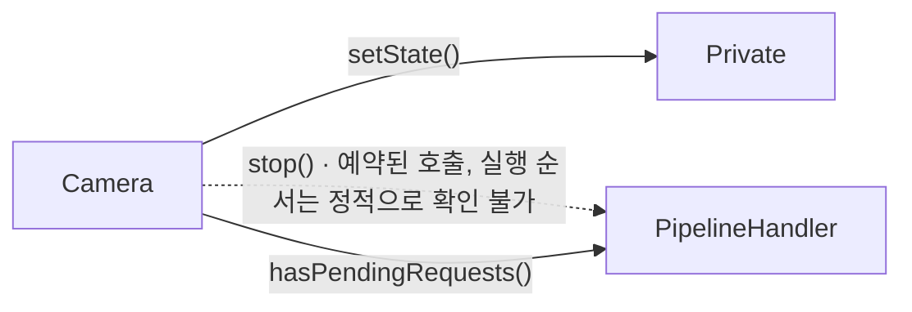

# 캡처 종료 요청

**캡처를 멈추고 대기 요청의 취소 완료와 구성 상태 복귀 조건을 확인하세요.**

| 지금 확인할 내용 | 이동할 절 |
|---|---|
| <a id="이-흐름에서-확인할-것"></a>캡처를 멈추고 대기 요청의 취소 완료와 구성 상태 복귀 조건을 확인하세요. | [캡처를 멈추는 호출과 상태 전제](#캡처를-멈추는-호출과-상태-전제) |

## 캡처를 멈추는 호출과 상태 전제

`Camera::stop()`은 캡처와 요청 처리를 즉시 중지하며, 대기 중인 모든 요청은 취소되어 오류 상태로 동기적으로 완료됩니다. 이 함수는 모든 카메라 상태에서 호출할 수 있으며, 호출자는 카메라 상태에 영향을 주는 다른 함수와 이 호출을 동기화해야 합니다. `src/libcamera/camera.cpp:1431`

<!-- sdd:visual:stop-exact-negated-guard -->
### stop의 상태 검사와 정상 종료

```mermaid
flowchart TB
%% sdd:translations {"0을 반환합니다. 정상 정지는 <br/>촬영과 요청 처리를 즉시 <br/>멈추고, 대기 요청을 취소해 <br/>오류 상태로 동기 완료합니다.": "Return 0. Normal stop <br/>immediately stops capture <br/>and processing and <br/>synchronously completes <br/>cancelled requests in error.", "Camera::stop은 어느 <br/>상태에서나 호출할 수 <br/>있습니다. 호출자는 카메라 <br/>상태에 영향을 주는 다른 <br/>함수와 호출을 동기화해야 <br/>합니다.": "Camera::stop may be called <br/>in any state. The caller <br/>must synchronize it with <br/>other state-affecting <br/>functions.", "CameraRunning으로 접근을 <br/>검사합니다. <br/>allowDisconnected의 <br/>기본값은 false이며, 연결 <br/>해제를 상태보다 먼저 <br/>검사합니다.": "Check access for <br/>CameraRunning. <br/>allowDisconnected defaults <br/>to false, and disconnection <br/>is checked before state.", "PipelineHandler::stop을 <br/>ConnectionTypeBlocking으로 <br/>호출합니다.": "Call PipelineHandler::stop <br/>with ConnectionTypeBlocking.", "검사가 통과하거나 검사 <br/>코드가 없으면 계속합니다.": "Continue if the check <br/>passes or no check code is <br/>generated.", "검사가 통과하거나 검사 <br/>코드가 없으면 상태를 <br/>CameraConfigured로 <br/>설정합니다.": "If the check passes or no <br/>check code is generated, <br/>set the state to <br/>CameraConfigured.", "결과가 음수가 아니면 상태를 <br/>설정합니다. #91;false#93;": "If the result is not <br/>negative, set the state. <br/>#91;false#93;", "결과가 음수이면 그대로 <br/>반환합니다. #91;true#93;": "If the result is negative, <br/>return it unchanged. #91;true#93;", "남은 요청이 없는지 ASSERT로 <br/>검사합니다. log.h를 <br/>포함하기 전에 NDEBUG가 <br/>정의되면 검사 코드가 <br/>생성되지 않습니다.": "ASSERT checks for pending <br/>requests. No check code is <br/>generated if NDEBUG is <br/>defined before including <br/>log.h.", "상태를 설정한 뒤 0을 <br/>반환합니다.": "After setting the state, <br/>return 0.", "상태를 설정한 뒤 정지를 <br/>호출합니다.": "After setting the state, <br/>call stop.", "실행 중이 아니면 0을 <br/>반환합니다. #91;true#93;": "If it is not running, <br/>return 0. #91;true#93;", "실행 중이면 접근을 <br/>검사합니다. #91;false#93;": "If it is running, check <br/>access. #91;false#93;", "접근 검사 결과가 <br/>음수인가요? 연결이 해제되면 <br/>-ENODEV이고, 그렇지 않고 <br/>상태가 맞지 않으면 <br/>-EACCES입니다.": "Is the access result <br/>negative? Disconnection <br/>gives -ENODEV; otherwise, a <br/>state mismatch gives <br/>-EACCES.", "접근 검사 전에 아무 작업 <br/>없이 0을 반환합니다.": "Return 0 without action <br/>before checking access.", "접근 검사가 정상적으로 <br/>반환되면 결과를 확인합니다.": "When the access check <br/>returns normally, check its <br/>result.", "접근 검사에서 받은 음수 <br/>ret을 그대로 반환합니다.": "Return the negative ret <br/>from the access check <br/>unchanged.", "카메라 상태를 <br/>CameraStopping으로 <br/>설정합니다.": "Set the camera state to <br/>CameraStopping.", "카메라가 실행 중이 아닌가요?": "Is the camera not running?", "카메라가 실행 중이 아닌지 <br/>확인합니다.": "Check whether the camera is <br/>not running.", "호출이 정상적으로 반환되면 <br/>ASSERT에 도달합니다.": "When the call returns <br/>normally, execution reaches <br/>ASSERT.", "활성 ASSERT가 실패하면 <br/>프로그램 실행이 중단됩니다.": "If the active ASSERT fails, <br/>program execution aborts.", "활성 검사가 실패하면 실행이 <br/>중단됩니다.": "If the active check fails, <br/>execution aborts."}
  v_stop["Camera::stop은 어느 <br/>상태에서나 호출할 수 <br/>있습니다. 호출자는 카메라 <br/>상태에 영향을 주는 다른 <br/>함수와 호출을 동기화해야 <br/>합니다."]
  v_running{"카메라가 실행 중이 아닌가요?"}
  v_noop["접근 검사 전에 아무 작업 <br/>없이 0을 반환합니다."]
  v_access["CameraRunning으로 접근을 <br/>검사합니다. <br/>allowDisconnected의 <br/>기본값은 false이며, 연결 <br/>해제를 상태보다 먼저 <br/>검사합니다."]
  v_ret{"접근 검사 결과가 <br/>음수인가요? 연결이 해제되면 <br/>-ENODEV이고, 그렇지 않고 <br/>상태가 맞지 않으면 <br/>-EACCES입니다."}
  v_error["접근 검사에서 받은 음수 <br/>ret을 그대로 반환합니다."]
  v_stopping["카메라 상태를 <br/>CameraStopping으로 <br/>설정합니다."]
  v_pipeline["PipelineHandler::stop을 <br/>ConnectionTypeBlocking으로 <br/>호출합니다."]
  v_assert["남은 요청이 없는지 ASSERT로 <br/>검사합니다. log.h를 <br/>포함하기 전에 NDEBUG가 <br/>정의되면 검사 코드가 <br/>생성되지 않습니다."]
  v_abort["활성 ASSERT가 실패하면 <br/>프로그램 실행이 중단됩니다."]
  v_configured["검사가 통과하거나 검사 <br/>코드가 없으면 상태를 <br/>CameraConfigured로 <br/>설정합니다."]
  v_success["0을 반환합니다. 정상 정지는 <br/>촬영과 요청 처리를 즉시 <br/>멈추고, 대기 요청을 취소해 <br/>오류 상태로 동기 완료합니다."]
  v_stop -->|"카메라가 실행 중이 아닌지 <br/>확인합니다."| v_running
  v_running -->|"실행 중이 아니면 0을 <br/>반환합니다. #91;true#93;"| v_noop
  v_running -->|"실행 중이면 접근을 <br/>검사합니다. #91;false#93;"| v_access
  v_access -->|"접근 검사가 정상적으로 <br/>반환되면 결과를 확인합니다."| v_ret
  v_ret -->|"결과가 음수이면 그대로 <br/>반환합니다. #91;true#93;"| v_error
  v_ret -->|"결과가 음수가 아니면 상태를 <br/>설정합니다. #91;false#93;"| v_stopping
  v_stopping -->|"상태를 설정한 뒤 정지를 <br/>호출합니다."| v_pipeline
  v_pipeline -->|"호출이 정상적으로 반환되면 <br/>ASSERT에 도달합니다."| v_assert
  v_assert -->|"활성 검사가 실패하면 실행이 <br/>중단됩니다."| v_abort
  v_assert -->|"검사가 통과하거나 검사 <br/>코드가 없으면 계속합니다."| v_configured
  v_configured -->|"상태를 설정한 뒤 0을 <br/>반환합니다."| v_success
```



[Mermaid 원문](camera_stop.stop-exact-negated-guard.mmd)

??? note "그림 근거와 확인 범위"
    Camera::stop의 부정 상태 조건과 접근 검사 및 정상 정지는 어떤 반환으로 이어집니까?
    
    소스에 연결한 설계 해석입니다. 자동 연결 검사는 의미 승인이나 기기 실행 검증이 아닙니다.
    
    LLM 그림 초안 · 사람 검토 전
    
    작성 모델: `cli/codex/gpt-6.1-terra`
    
    | 요소·전이 | 소스 근거 |
    |---|---|
    | <span data-sdd-label-en="Camera::stop may be called in any state. The caller must synchronize it with other state-affecting functions.">Camera::stop은 어느 상태에서나 호출할 수 있습니다. 호출자는 카메라 상태에 영향을 주는 다른 함수와 호출을 동기화해야 합니다.</span> | [src/libcamera/camera.cpp:1431](#source-ab211927593733cc) |
    | <span data-sdd-label-en="Is the camera not running?">카메라가 실행 중이 아닌가요?</span> | [src/libcamera/camera.cpp:1431](#source-ab211927593733cc) |
    | <span data-sdd-label-en="Return 0 without action before checking access.">접근 검사 전에 아무 작업 없이 0을 반환합니다.</span> | [src/libcamera/camera.cpp:1431](#source-ab211927593733cc) |
    | <span data-sdd-label-en="Check access for CameraRunning. allowDisconnected defaults to false, and disconnection is checked before state.">CameraRunning으로 접근을 검사합니다. allowDisconnected의 기본값은 false이며, 연결 해제를 상태보다 먼저 검사합니다.</span> | [src/libcamera/camera.cpp:1431](#source-ab211927593733cc) · [src/libcamera/camera.cpp:690](#source-43bf991ac670b1aa) · [include/libcamera/internal/camera.h:59](#source-c0ab3b94a184909f) |
    | <span data-sdd-label-en="Is the access result negative? Disconnection gives -ENODEV; otherwise, a state mismatch gives -EACCES.">접근 검사 결과가 음수인가요? 연결이 해제되면 -ENODEV이고, 그렇지 않고 상태가 맞지 않으면 -EACCES입니다.</span> | [src/libcamera/camera.cpp:1431](#source-ab211927593733cc) · [src/libcamera/camera.cpp:690](#source-43bf991ac670b1aa) |
    | <span data-sdd-label-en="Return the negative ret from the access check unchanged.">접근 검사에서 받은 음수 ret을 그대로 반환합니다.</span> | [src/libcamera/camera.cpp:1431](#source-ab211927593733cc) |
    | <span data-sdd-label-en="Set the camera state to CameraStopping.">카메라 상태를 CameraStopping으로 설정합니다.</span> | [src/libcamera/camera.cpp:1431](#source-ab211927593733cc) |
    | <span data-sdd-label-en="Call PipelineHandler::stop with ConnectionTypeBlocking.">PipelineHandler::stop을 ConnectionTypeBlocking으로 호출합니다.</span> | [src/libcamera/camera.cpp:1431](#source-ab211927593733cc) |
    | <span data-sdd-label-en="ASSERT checks for pending requests. No check code is generated if NDEBUG is defined before including log.h.">남은 요청이 없는지 ASSERT로 검사합니다. log.h를 포함하기 전에 NDEBUG가 정의되면 검사 코드가 생성되지 않습니다.</span> | [src/libcamera/camera.cpp:1431](#source-ab211927593733cc) · [src/libcamera/base/log.cpp:1022](#source-47a6ef3943a7b53c) |
    | <span data-sdd-label-en="If the active ASSERT fails, program execution aborts.">활성 ASSERT가 실패하면 프로그램 실행이 중단됩니다.</span> | [src/libcamera/camera.cpp:1431](#source-ab211927593733cc) · [src/libcamera/base/log.cpp:1022](#source-47a6ef3943a7b53c) |
    | <span data-sdd-label-en="If the check passes or no check code is generated, set the state to CameraConfigured.">검사가 통과하거나 검사 코드가 없으면 상태를 CameraConfigured로 설정합니다.</span> | [src/libcamera/camera.cpp:1431](#source-ab211927593733cc) |
    | <span data-sdd-label-en="Return 0. Normal stop immediately stops capture and processing and synchronously completes cancelled requests in error.">0을 반환합니다. 정상 정지는 촬영과 요청 처리를 즉시 멈추고, 대기 요청을 취소해 오류 상태로 동기 완료합니다.</span> | [src/libcamera/camera.cpp:1431](#source-ab211927593733cc) |
    | <span data-sdd-label-en="Check whether the camera is not running.">카메라가 실행 중이 아닌지 확인합니다.</span> | [src/libcamera/camera.cpp:1431](#source-ab211927593733cc) |
    | <span data-sdd-label-en="If it is not running, return 0. · !d-&gt;isRunning() [true]">실행 중이 아니면 0을 반환합니다. · &#33;d-&gt;isRunning&#40;&#41; &#91;true&#93;</span> | [src/libcamera/camera.cpp:1431](#source-ab211927593733cc) |
    | <span data-sdd-label-en="If it is running, check access. · !d-&gt;isRunning() [false]">실행 중이면 접근을 검사합니다. · &#33;d-&gt;isRunning&#40;&#41; &#91;false&#93;</span> | [src/libcamera/camera.cpp:1431](#source-ab211927593733cc) |
    | <span data-sdd-label-en="When the access check returns normally, check its result.">접근 검사가 정상적으로 반환되면 결과를 확인합니다.</span> | [src/libcamera/camera.cpp:1431](#source-ab211927593733cc) |
    | <span data-sdd-label-en="If the result is negative, return it unchanged. · ret &lt; 0 [true]">결과가 음수이면 그대로 반환합니다. · ret &lt; 0 &#91;true&#93;</span> | [src/libcamera/camera.cpp:1431](#source-ab211927593733cc) |
    | <span data-sdd-label-en="If the result is not negative, set the state. · ret &lt; 0 [false]">결과가 음수가 아니면 상태를 설정합니다. · ret &lt; 0 &#91;false&#93;</span> | [src/libcamera/camera.cpp:1431](#source-ab211927593733cc) |
    | <span data-sdd-label-en="After setting the state, call stop.">상태를 설정한 뒤 정지를 호출합니다.</span> | [src/libcamera/camera.cpp:1431](#source-ab211927593733cc) |
    | <span data-sdd-label-en="When the call returns normally, execution reaches ASSERT.">호출이 정상적으로 반환되면 ASSERT에 도달합니다.</span> | [src/libcamera/camera.cpp:1431](#source-ab211927593733cc) |
    | <span data-sdd-label-en="If the active check fails, execution aborts.">활성 검사가 실패하면 실행이 중단됩니다.</span> | [src/libcamera/base/log.cpp:1022](#source-47a6ef3943a7b53c) |
    | <span data-sdd-label-en="Continue if the check passes or no check code is generated.">검사가 통과하거나 검사 코드가 없으면 계속합니다.</span> | [src/libcamera/camera.cpp:1431](#source-ab211927593733cc) |
    | <span data-sdd-label-en="After setting the state, return 0.">상태를 설정한 뒤 0을 반환합니다.</span> | [src/libcamera/camera.cpp:1431](#source-ab211927593733cc) |
<!-- /sdd:visual:stop-exact-negated-guard -->

`Camera::stop()`에서 `isRunning()`이 거짓이면 아무 작업도 하지 않고 `0`을 반환합니다. 참이면 `isAccessAllowed(CameraRunning)`을 호출하고, 결과가 음수이면 해당 오류를 그대로 반환합니다. 이 접근 검사는 연결이 끊겼으면 상태 비교에 앞서 `-ENODEV`를 반환하고, 연결이 끊기지 않았으며 현재 상태가 요구 상태와 다르면 `-EACCES`를 반환합니다. `src/libcamera/camera.cpp:1431`, `src/libcamera/camera.cpp:685`, `src/libcamera/camera.cpp:690`, `include/libcamera/internal/camera.h:59`

접근 검사를 통과한 `Camera::stop()`은 상태를 `CameraStopping`으로 설정하고 `ConnectionTypeBlocking`으로 `PipelineHandler::stop`을 호출한 뒤, 대기 요청이 없음을 `ASSERT`로 검사합니다. `log.h`를 포함하기 전에 `NDEBUG`가 정의되면 이 검사는 코드를 생성하지 않습니다. 이어서 상태를 `CameraConfigured`로 설정하고 `0`을 반환합니다. `src/libcamera/camera.cpp:1431`, `src/libcamera/base/log.cpp:1022`

근거 원문: [src/libcamera/camera.cpp:1431](#source-ab211927593733cc) · [src/libcamera/camera.cpp:685](#source-b15196c6a2884255) · [src/libcamera/camera.cpp:690](#source-43bf991ac670b1aa) · [src/libcamera/base/log.cpp:1022](#source-47a6ef3943a7b53c) · [src/libcamera/camera.cpp:709](#source-0840d2509c9e395b) · [include/libcamera/internal/camera.h:59](#source-c0ab3b94a184909f)

## 장치 종료 뒤 대기 요청을 취소하는 순서

`PipelineHandler::stop`은 `CameraManager` 스레드에서 호출되며, `waitingRequests_`를 별도 큐로 옮긴 뒤 `stopDevice()`를 호출합니다. 이렇게 옮겨 `stopDevice()` 안에서 `completeRequest()`가 호출될 때 대기 요청이 다시 큐에 들어가지 않게 합니다. 장치 종료 뒤에는 별도 큐의 요청을 순서대로 꺼내 `cancelRequest()` 대신 `cancel()`과 `doQueueRequest()`를 호출합니다. 원문 주석에 따르면 이 경로는 요청에 시퀀스 번호를 주고 `queuedRequests_`에 잠시 추가해 `completeRequest()`에서 올바르게 완료하도록 합니다. `src/libcamera/pipeline_handler.cpp:359`

<!-- sdd:visual:pending-buffer-cancellation -->
### 버퍼별 취소 통지와 내부 정리

```mermaid
flowchart TB
%% sdd:translations {"ASSERT는 요청 상태가 <br/>RequestPending인지 <br/>검사합니다. 활성 검사가 <br/>실패하면 Fatal 오류를 <br/>기록하고 프로그램을 <br/>중단합니다.": "ASSERT checks for <br/>RequestPending. An active <br/>failure logs a Fatal error <br/>and aborts the program.", "Request::Private::cancel은 <br/>대기 중인 요청을 취소합니다.": "Request::Private::cancel <br/>cancels a queued request.", "cancel에서 ASSERT를 <br/>검사합니다.": "cancel evaluates ASSERT.", "doCancelRequest는 각 대기 <br/>버퍼에 이 작업을 반복합니다.": "doCancelRequest repeats <br/>this work for each pending <br/>buffer.", "pending#95;의 각 buffer에서 <br/>cancel을 호출한 뒤 <br/>camera#95;의 bufferCompleted <br/>신호를 request와 buffer를 <br/>인자로 내보냅니다.": "For each buffer in <br/>pending#95;, call cancel, then <br/>emit camera#95;#39;s <br/>bufferCompleted signal with <br/>request and buffer.", "timer#95;를 reset합니다. <br/>reset이 정상 반환하면 <br/>doCancelRequest와 cancel도 <br/>정상 반환합니다.": "Reset timer#95;. If reset <br/>returns normally, <br/>doCancelRequest and cancel <br/>also return normally.", "검사가 통과하거나 코드에서 <br/>제외되면 doCancelRequest를 <br/>호출합니다. log.h를 <br/>포함하기 전에 NDEBUG가 <br/>정의되면 ASSERT 코드는 <br/>생성되지 않습니다.": "Call doCancelRequest if the <br/>check passes or is omitted. <br/>ASSERT emits no code if <br/>NDEBUG is defined before <br/>including log.h.", "검사가 통과하거나 코드에서 <br/>제외되면 호출합니다.": "Call it if the check passes <br/>or is omitted.", "두 clear가 정상 반환하면 <br/>timer#95;를 reset합니다.": "Reset timer#95; if both clear <br/>calls return normally.", "모든 대기 버퍼를 처리한 뒤 <br/>정리합니다.": "Clean up after all pending <br/>buffers are handled.", "모든 버퍼를 처리한 뒤 <br/>cancelled#95;를 true로 <br/>설정하고 pending#95;을 clear한 <br/>다음 notifiers#95;를 <br/>clear합니다.": "After all buffers are <br/>handled, set cancelled#95; to <br/>true, clear pending#95;, and <br/>then clear notifiers#95;."}
  v_cancel["Request::Private::cancel은 <br/>대기 중인 요청을 취소합니다."]
  v_assert["ASSERT는 요청 상태가 <br/>RequestPending인지 <br/>검사합니다. 활성 검사가 <br/>실패하면 Fatal 오류를 <br/>기록하고 프로그램을 <br/>중단합니다."]
  v_do_cancel["검사가 통과하거나 코드에서 <br/>제외되면 doCancelRequest를 <br/>호출합니다. log.h를 <br/>포함하기 전에 NDEBUG가 <br/>정의되면 ASSERT 코드는 <br/>생성되지 않습니다."]
  v_buffers["pending#95;의 각 buffer에서 <br/>cancel을 호출한 뒤 <br/>camera#95;의 bufferCompleted <br/>신호를 request와 buffer를 <br/>인자로 내보냅니다."]
  v_cleanup["모든 버퍼를 처리한 뒤 <br/>cancelled#95;를 true로 <br/>설정하고 pending#95;을 clear한 <br/>다음 notifiers#95;를 <br/>clear합니다."]
  v_timer["timer#95;를 reset합니다. <br/>reset이 정상 반환하면 <br/>doCancelRequest와 cancel도 <br/>정상 반환합니다."]
  v_cancel -->|"cancel에서 ASSERT를 <br/>검사합니다."| v_assert
  v_assert -->|"검사가 통과하거나 코드에서 <br/>제외되면 호출합니다."| v_do_cancel
  v_do_cancel -->|"doCancelRequest는 각 대기 <br/>버퍼에 이 작업을 반복합니다."| v_buffers
  v_buffers -->|"모든 대기 버퍼를 처리한 뒤 <br/>정리합니다."| v_cleanup
  v_cleanup -->|"두 clear가 정상 반환하면 <br/>timer#95;를 reset합니다."| v_timer
```



[Mermaid 원문](camera_stop.pending-buffer-cancellation.mmd)

??? note "그림 근거와 확인 범위"
    Request 취소는 각 pending 버퍼를 어떻게 알리고 cancelled_와 대기 자원을 어떻게 정리합니까?
    
    소스에 연결한 설계 해석입니다. 자동 연결 검사는 의미 승인이나 기기 실행 검증이 아닙니다.
    
    LLM 그림 초안 · 사람 검토 전
    
    작성 모델: `cli/codex/gpt-6.1-terra`
    
    | 요소·전이 | 소스 근거 |
    |---|---|
    | <span data-sdd-label-en="Request::Private::cancel cancels a queued request.">Request::Private::cancel은 대기 중인 요청을 취소합니다.</span> | [src/libcamera/request.cpp:139](#source-3ebd0788c14a6f51) |
    | <span data-sdd-label-en="ASSERT checks for RequestPending. An active failure logs a Fatal error and aborts the program.">ASSERT는 요청 상태가 RequestPending인지 검사합니다. 활성 검사가 실패하면 Fatal 오류를 기록하고 프로그램을 중단합니다.</span> | [src/libcamera/request.cpp:139](#source-3ebd0788c14a6f51) · [src/libcamera/base/log.cpp:1022](#source-47a6ef3943a7b53c) |
    | <span data-sdd-label-en="Call doCancelRequest if the check passes or is omitted. ASSERT emits no code if NDEBUG is defined before including log.h.">검사가 통과하거나 코드에서 제외되면 doCancelRequest를 호출합니다. log.h를 포함하기 전에 NDEBUG가 정의되면 ASSERT 코드는 생성되지 않습니다.</span> | [src/libcamera/request.cpp:139](#source-3ebd0788c14a6f51) · [src/libcamera/base/log.cpp:1022](#source-47a6ef3943a7b53c) |
    | <span data-sdd-label-en="For each buffer in pending_, call cancel, then emit camera_&#x27;s bufferCompleted signal with request and buffer.">pending&#95;의 각 buffer에서 cancel을 호출한 뒤 camera&#95;의 bufferCompleted 신호를 request와 buffer를 인자로 내보냅니다.</span> | [src/libcamera/request.cpp:139](#source-3ebd0788c14a6f51) |
    | <span data-sdd-label-en="After all buffers are handled, set cancelled_ to true, clear pending_, and then clear notifiers_.">모든 버퍼를 처리한 뒤 cancelled&#95;를 true로 설정하고 pending&#95;을 clear한 다음 notifiers&#95;를 clear합니다.</span> | [src/libcamera/request.cpp:139](#source-3ebd0788c14a6f51) |
    | <span data-sdd-label-en="Reset timer_. If reset returns normally, doCancelRequest and cancel also return normally.">timer&#95;를 reset합니다. reset이 정상 반환하면 doCancelRequest와 cancel도 정상 반환합니다.</span> | [src/libcamera/request.cpp:139](#source-3ebd0788c14a6f51) |
    | <span data-sdd-label-en="cancel evaluates ASSERT.">cancel에서 ASSERT를 검사합니다.</span> | [src/libcamera/request.cpp:139](#source-3ebd0788c14a6f51) |
    | <span data-sdd-label-en="Call it if the check passes or is omitted.">검사가 통과하거나 코드에서 제외되면 호출합니다.</span> | [src/libcamera/request.cpp:139](#source-3ebd0788c14a6f51) |
    | <span data-sdd-label-en="doCancelRequest repeats this work for each pending buffer.">doCancelRequest는 각 대기 버퍼에 이 작업을 반복합니다.</span> | [src/libcamera/request.cpp:139](#source-3ebd0788c14a6f51) |
    | <span data-sdd-label-en="Clean up after all pending buffers are handled.">모든 대기 버퍼를 처리한 뒤 정리합니다.</span> | [src/libcamera/request.cpp:139](#source-3ebd0788c14a6f51) |
    | <span data-sdd-label-en="Reset timer_ if both clear calls return normally.">두 clear가 정상 반환하면 timer&#95;를 reset합니다.</span> | [src/libcamera/request.cpp:139](#source-3ebd0788c14a6f51) |
<!-- /sdd:visual:pending-buffer-cancellation -->

<!-- sdd:visual:pipeline-stop-waiting-cancellation -->
### 파이프라인 정지와 대기 요청 취소

```mermaid
flowchart TB
%% sdd:translations {"completeRequest는 요청을 <br/>제출 순서로 애플리케이션에 <br/>반환하며, 완료된 요청에 <br/>대한 호출 순서에는 제약이 <br/>없습니다.": "completeRequest returns <br/>requests to the application <br/>in submission order; calls <br/>on complete requests have <br/>no ordering constraint.", "doCancelRequest는 각 대기 <br/>버퍼를 취소하고 카메라의 <br/>bufferCompleted를 각 버퍼에 <br/>대해 emit한 뒤 cancelled#95;를 <br/>true로 설정하고 pending#95;와 <br/>notifiers#95;를 비우고 <br/>timer#95;를 초기화합니다.": "doCancelRequest cancels <br/>pending buffers, emits <br/>camera#39;s bufferCompleted <br/>for each, sets cancelled#95; <br/>true, clears pending#95; and <br/>notifiers#95;, then resets <br/>timer#95;.", "doCancelRequest와 cancel이 <br/>정상 복귀하면 같은 요청을 <br/>doQueueRequest에 넘깁니다.": "After doCancelRequest and <br/>cancel return normally, <br/>pass the same request to <br/>doQueueRequest.", "doQueueRequest가 정상 <br/>복귀하면 로컬 큐 반복으로 <br/>돌아갑니다.": "Return to the local queue <br/>loop if doQueueRequest <br/>returns normally.", "doQueueRequest는 카메라의 <br/>queuedRequests#95;에 요청을 <br/>추가하고 현재 <br/>requestSequence#95;를 요청의 <br/>sequence#95;에 저장한 뒤 <br/>카메라 카운터를 <br/>증가시킵니다.": "doQueueRequest adds the <br/>request to camera#39;s <br/>queuedRequests#95;, stores its <br/>requestSequence#95; in <br/>sequence#95;, then increments <br/>the camera counter.", "front로 요청을 가져와 <br/>pop으로 제거한 뒤 그 요청의 <br/>Private cancel을 직접 <br/>호출합니다.": "Take the request with <br/>front, remove it with pop, <br/>and directly call its <br/>Private cancel.", "stopDevice가 정상 복귀하면 <br/>반복을 시작합니다.": "Start the loop if <br/>stopDevice returns normally.", "stopDevice를 호출해 <br/>파이프라인을 멈추고 큐에 든 <br/>요청이 완료되게 합니다. <br/>실제 장치 정지는 이 <br/>호출만으로 검증되지 <br/>않습니다.": "stopDevice is called to <br/>stop the pipeline and let <br/>queued requests complete; <br/>this call alone does not <br/>verify device stop.", "waitingRequests#95;를 로컬 <br/>큐로 옮겨 stopDevice 내부의 <br/>completeRequest 때문에 대기 <br/>요청이 다시 큐에 들어가지 <br/>않게 합니다.": "swap moves waitingRequests#95; <br/>to a local queue so <br/>stopDevice#39;s <br/>completeRequest cannot <br/>cause them to be requeued.", "로컬 waitingRequests에 <br/>요청이 남아 있습니까?": "Does the local <br/>waitingRequests queue <br/>contain a request?", "로컬 큐가 비면 진행합니다. <br/>#91;false#93;": "Proceed when the local <br/>queue is empty. #91;false#93;", "분리한 뒤 호출합니다.": "Call it after separating <br/>the requests.", "요청의 cancelled#95;가 <br/>설정되어 있습니까?": "Is the request#39;s cancelled#95; <br/>set?", "요청이 남아 있으면 <br/>처리합니다. #91;true#93;": "Process a request if one <br/>remains. #91;true#93;", "이 호출에는 완료 순서 <br/>계약이 적용됩니다.": "The completion ordering <br/>contract applies to this <br/>call.", "이미 취소되어 있으면 <br/>완료합니다. #91;true#93;": "Complete the request if it <br/>is already cancelled. #91;true#93;", "추적과 순번 처리를 마친 뒤 <br/>검사합니다.": "Check after tracking and <br/>sequence assignment.", "취소된 요청은 <br/>queueRequestDevice 대신 <br/>completeRequest로 <br/>전달됩니다.": "The cancelled request goes <br/>to completeRequest instead <br/>of queueRequestDevice.", "호출자는 CameraManager <br/>스레드에서 <br/>completeRequest를 호출해야 <br/>하며, 반환된 뒤에는 그 <br/>요청에 접근하면 안 됩니다.": "The caller must invoke <br/>completeRequest on the <br/>CameraManager thread and <br/>must not access the request <br/>after it returns.", "호출자는 이 의무도 지켜야 <br/>합니다.": "The caller must also follow <br/>these duties.", "활성 ASSERT는 카메라의 <br/>queuedRequests#95;와 <br/>waitingRequests#95;가 비었는지 <br/>검사하며 실패하면 <br/>중단합니다. 검사 코드는 <br/>제외될 수 있습니다.": "Enabled ASSERTs check that <br/>camera#39;s queuedRequests#95; <br/>and waitingRequests#95; are <br/>empty and abort on failure; <br/>assertions may be compiled <br/>out.", "활성 ASSERT를 통과했거나 <br/>검사 코드가 제외되면 <br/>카메라의 requestSequence#95;를 <br/>0으로 초기화합니다.": "After enabled ASSERTs pass, <br/>or if they are compiled <br/>out, reset camera#39;s <br/>requestSequence#95; to zero.", "활성 RequestPending <br/>ASSERT를 통과하거나 검사 <br/>코드가 제외되면 호출합니다.": "Call it if the enabled <br/>RequestPending ASSERT <br/>passes or its check is <br/>compiled out.", "활성 검사를 통과했거나 검사 <br/>코드가 제외되면 진행합니다.": "Proceed if enabled checks <br/>pass or the checks are <br/>compiled out."}
  v_swap["waitingRequests#95;를 로컬 <br/>큐로 옮겨 stopDevice 내부의 <br/>completeRequest 때문에 대기 <br/>요청이 다시 큐에 들어가지 <br/>않게 합니다."]
  v_device["stopDevice를 호출해 <br/>파이프라인을 멈추고 큐에 든 <br/>요청이 완료되게 합니다. <br/>실제 장치 정지는 이 <br/>호출만으로 검증되지 <br/>않습니다."]
  v_loop{"로컬 waitingRequests에 <br/>요청이 남아 있습니까?"}
  v_cancel["front로 요청을 가져와 <br/>pop으로 제거한 뒤 그 요청의 <br/>Private cancel을 직접 <br/>호출합니다."]
  v_docancel["doCancelRequest는 각 대기 <br/>버퍼를 취소하고 카메라의 <br/>bufferCompleted를 각 버퍼에 <br/>대해 emit한 뒤 cancelled#95;를 <br/>true로 설정하고 pending#95;와 <br/>notifiers#95;를 비우고 <br/>timer#95;를 초기화합니다."]
  v_queue["doQueueRequest는 카메라의 <br/>queuedRequests#95;에 요청을 <br/>추가하고 현재 <br/>requestSequence#95;를 요청의 <br/>sequence#95;에 저장한 뒤 <br/>카메라 카운터를 <br/>증가시킵니다."]
  v_cancelled{"요청의 cancelled#95;가 <br/>설정되어 있습니까?"}
  v_complete["취소된 요청은 <br/>queueRequestDevice 대신 <br/>completeRequest로 <br/>전달됩니다."]
  v_assert["활성 ASSERT는 카메라의 <br/>queuedRequests#95;와 <br/>waitingRequests#95;가 비었는지 <br/>검사하며 실패하면 <br/>중단합니다. 검사 코드는 <br/>제외될 수 있습니다."]
  v_reset["활성 ASSERT를 통과했거나 <br/>검사 코드가 제외되면 <br/>카메라의 requestSequence#95;를 <br/>0으로 초기화합니다."]
  v_contract["completeRequest는 요청을 <br/>제출 순서로 애플리케이션에 <br/>반환하며, 완료된 요청에 <br/>대한 호출 순서에는 제약이 <br/>없습니다."]
  v_duty["호출자는 CameraManager <br/>스레드에서 <br/>completeRequest를 호출해야 <br/>하며, 반환된 뒤에는 그 <br/>요청에 접근하면 안 됩니다."]
  v_swap -->|"분리한 뒤 호출합니다."| v_device
  v_device -->|"stopDevice가 정상 복귀하면 <br/>반복을 시작합니다."| v_loop
  v_loop -->|"요청이 남아 있으면 <br/>처리합니다. #91;true#93;"| v_cancel
  v_cancel -->|"활성 RequestPending <br/>ASSERT를 통과하거나 검사 <br/>코드가 제외되면 호출합니다."| v_docancel
  v_queue -->|"추적과 순번 처리를 마친 뒤 <br/>검사합니다."| v_cancelled
  v_cancelled -->|"이미 취소되어 있으면 <br/>완료합니다. #91;true#93;"| v_complete
  v_complete -->|"doQueueRequest가 정상 <br/>복귀하면 로컬 큐 반복으로 <br/>돌아갑니다."| v_loop
  v_loop -->|"로컬 큐가 비면 진행합니다. <br/>#91;false#93;"| v_assert
  v_assert -->|"활성 검사를 통과했거나 검사 <br/>코드가 제외되면 진행합니다."| v_reset
  v_complete -->|"이 호출에는 완료 순서 <br/>계약이 적용됩니다."| v_contract
  v_contract -->|"호출자는 이 의무도 지켜야 <br/>합니다."| v_duty
  v_docancel -->|"doCancelRequest와 cancel이 <br/>정상 복귀하면 같은 요청을 <br/>doQueueRequest에 넘깁니다."| v_queue
```



[Mermaid 원문](camera_stop.pipeline-stop-waiting-cancellation.mmd)

??? note "그림 근거와 확인 범위"
    정지는 대기 큐를 어떻게 분리하고 stopDevice 뒤 취소 요청을 순번과 함께 완료합니까?
    
    소스에 연결한 설계 해석입니다. 자동 연결 검사는 의미 승인이나 기기 실행 검증이 아닙니다.
    
    | 요소·전이 | 소스 근거 |
    |---|---|
    | <span data-sdd-label-en="swap moves waitingRequests_ to a local queue so stopDevice&#x27;s completeRequest cannot cause them to be requeued.">waitingRequests&#95;를 로컬 큐로 옮겨 stopDevice 내부의 completeRequest 때문에 대기 요청이 다시 큐에 들어가지 않게 합니다.</span> | [src/libcamera/pipeline_handler.cpp:359](#source-b607480871fd84c9) |
    | <span data-sdd-label-en="stopDevice is called to stop the pipeline and let queued requests complete; this call alone does not verify device stop.">stopDevice를 호출해 파이프라인을 멈추고 큐에 든 요청이 완료되게 합니다. 실제 장치 정지는 이 호출만으로 검증되지 않습니다.</span> | [src/libcamera/pipeline_handler.cpp:359](#source-b607480871fd84c9) |
    | <span data-sdd-label-en="Does the local waitingRequests queue contain a request?">로컬 waitingRequests에 요청이 남아 있습니까?</span> | [src/libcamera/pipeline_handler.cpp:359](#source-b607480871fd84c9) |
    | <span data-sdd-label-en="Take the request with front, remove it with pop, and directly call its Private cancel.">front로 요청을 가져와 pop으로 제거한 뒤 그 요청의 Private cancel을 직접 호출합니다.</span> | [src/libcamera/pipeline_handler.cpp:359](#source-b607480871fd84c9) |
    | <span data-sdd-label-en="doCancelRequest cancels pending buffers, emits camera&#x27;s bufferCompleted for each, sets cancelled_ true, clears pending_ and notifiers_, then resets timer_.">doCancelRequest는 각 대기 버퍼를 취소하고 카메라의 bufferCompleted를 각 버퍼에 대해 emit한 뒤 cancelled&#95;를 true로 설정하고 pending&#95;와 notifiers&#95;를 비우고 timer&#95;를 초기화합니다.</span> | [src/libcamera/request.cpp:139](#source-3ebd0788c14a6f51) |
    | <span data-sdd-label-en="doQueueRequest adds the request to camera&#x27;s queuedRequests_, stores its requestSequence_ in sequence_, then increments the camera counter.">doQueueRequest는 카메라의 queuedRequests&#95;에 요청을 추가하고 현재 requestSequence&#95;를 요청의 sequence&#95;에 저장한 뒤 카메라 카운터를 증가시킵니다.</span> | [src/libcamera/pipeline_handler.cpp:359](#source-b607480871fd84c9) · [src/libcamera/pipeline_handler.cpp:483](#source-7348e9b4af985eb2) |
    | <span data-sdd-label-en="Is the request&#x27;s cancelled_ set?">요청의 cancelled&#95;가 설정되어 있습니까?</span> | [src/libcamera/pipeline_handler.cpp:483](#source-7348e9b4af985eb2) |
    | <span data-sdd-label-en="The cancelled request goes to completeRequest instead of queueRequestDevice.">취소된 요청은 queueRequestDevice 대신 completeRequest로 전달됩니다.</span> | [src/libcamera/pipeline_handler.cpp:483](#source-7348e9b4af985eb2) |
    | <span data-sdd-label-en="Enabled ASSERTs check that camera&#x27;s queuedRequests_ and waitingRequests_ are empty and abort on failure; assertions may be compiled out.">활성 ASSERT는 카메라의 queuedRequests&#95;와 waitingRequests&#95;가 비었는지 검사하며 실패하면 중단합니다. 검사 코드는 제외될 수 있습니다.</span> | [src/libcamera/pipeline_handler.cpp:359](#source-b607480871fd84c9) · [src/libcamera/base/log.cpp:1022](#source-47a6ef3943a7b53c) |
    | <span data-sdd-label-en="After enabled ASSERTs pass, or if they are compiled out, reset camera&#x27;s requestSequence_ to zero.">활성 ASSERT를 통과했거나 검사 코드가 제외되면 카메라의 requestSequence&#95;를 0으로 초기화합니다.</span> | [src/libcamera/pipeline_handler.cpp:359](#source-b607480871fd84c9) · [src/libcamera/base/log.cpp:1022](#source-47a6ef3943a7b53c) |
    | <span data-sdd-label-en="completeRequest returns requests to the application in submission order; calls on complete requests have no ordering constraint.">completeRequest는 요청을 제출 순서로 애플리케이션에 반환하며, 완료된 요청에 대한 호출 순서에는 제약이 없습니다.</span> | [src/libcamera/pipeline_handler.cpp:571](#source-2d8f7d0a25996e09) |
    | <span data-sdd-label-en="The caller must invoke completeRequest on the CameraManager thread and must not access the request after it returns.">호출자는 CameraManager 스레드에서 completeRequest를 호출해야 하며, 반환된 뒤에는 그 요청에 접근하면 안 됩니다.</span> | [src/libcamera/pipeline_handler.cpp:571](#source-2d8f7d0a25996e09) |
    | <span data-sdd-label-en="Call it after separating the requests.">분리한 뒤 호출합니다.</span> | [src/libcamera/pipeline_handler.cpp:359](#source-b607480871fd84c9) |
    | <span data-sdd-label-en="Start the loop if stopDevice returns normally.">stopDevice가 정상 복귀하면 반복을 시작합니다.</span> | [src/libcamera/pipeline_handler.cpp:359](#source-b607480871fd84c9) |
    | <span data-sdd-label-en="Process a request if one remains. · !waitingRequests.empty() [true]">요청이 남아 있으면 처리합니다. · &#33;waitingRequests.empty&#40;&#41; &#91;true&#93;</span> | [src/libcamera/pipeline_handler.cpp:359](#source-b607480871fd84c9) |
    | <span data-sdd-label-en="Call it if the enabled RequestPending ASSERT passes or its check is compiled out.">활성 RequestPending ASSERT를 통과하거나 검사 코드가 제외되면 호출합니다.</span> | [src/libcamera/request.cpp:139](#source-3ebd0788c14a6f51) · [src/libcamera/base/log.cpp:1022](#source-47a6ef3943a7b53c) |
    | <span data-sdd-label-en="Check after tracking and sequence assignment.">추적과 순번 처리를 마친 뒤 검사합니다.</span> | [src/libcamera/pipeline_handler.cpp:483](#source-7348e9b4af985eb2) |
    | <span data-sdd-label-en="Complete the request if it is already cancelled. · request-&gt;_d()-&gt;cancelled_ [true]">이미 취소되어 있으면 완료합니다. · request-&gt;&#95;d&#40;&#41;-&gt;cancelled&#95; &#91;true&#93;</span> | [src/libcamera/pipeline_handler.cpp:483](#source-7348e9b4af985eb2) |
    | <span data-sdd-label-en="Return to the local queue loop if doQueueRequest returns normally.">doQueueRequest가 정상 복귀하면 로컬 큐 반복으로 돌아갑니다.</span> | [src/libcamera/pipeline_handler.cpp:359](#source-b607480871fd84c9) |
    | <span data-sdd-label-en="Proceed when the local queue is empty. · !waitingRequests.empty() [false]">로컬 큐가 비면 진행합니다. · &#33;waitingRequests.empty&#40;&#41; &#91;false&#93;</span> | [src/libcamera/pipeline_handler.cpp:359](#source-b607480871fd84c9) |
    | <span data-sdd-label-en="Proceed if enabled checks pass or the checks are compiled out.">활성 검사를 통과했거나 검사 코드가 제외되면 진행합니다.</span> | [src/libcamera/pipeline_handler.cpp:359](#source-b607480871fd84c9) · [src/libcamera/base/log.cpp:1022](#source-47a6ef3943a7b53c) |
    | <span data-sdd-label-en="The completion ordering contract applies to this call.">이 호출에는 완료 순서 계약이 적용됩니다.</span> | [src/libcamera/pipeline_handler.cpp:571](#source-2d8f7d0a25996e09) |
    | <span data-sdd-label-en="The caller must also follow these duties.">호출자는 이 의무도 지켜야 합니다.</span> | [src/libcamera/pipeline_handler.cpp:571](#source-2d8f7d0a25996e09) |
    | <span data-sdd-label-en="After doCancelRequest and cancel return normally, pass the same request to doQueueRequest.">doCancelRequest와 cancel이 정상 복귀하면 같은 요청을 doQueueRequest에 넘깁니다.</span> | [src/libcamera/request.cpp:139](#source-3ebd0788c14a6f51) · [src/libcamera/pipeline_handler.cpp:359](#source-b607480871fd84c9) |
<!-- /sdd:visual:pipeline-stop-waiting-cancellation -->

`Request::Private::cancel()`은 `RequestPending` 상태를 단언한 뒤 `doCancelRequest()`를 호출합니다. `doCancelRequest()`는 각 `pending_` 버퍼를 취소하고 `bufferCompleted` 신호를 보낸 뒤 `cancelled_`를 `true`로 설정하고 `pending_`과 `notifiers_`를 비우며 `timer_`를 재설정합니다. 이어서 `doQueueRequest()`는 요청을 카메라 데이터의 `queuedRequests_`에 추가하고 `sequence_`를 부여합니다. 요청의 `cancelled_`가 참이면 `completeRequest()`를 호출하고 반환하므로 `queueRequestDevice()`를 호출하지 않습니다. `src/libcamera/request.cpp:139`, `src/libcamera/pipeline_handler.cpp:483`, `src/libcamera/pipeline_handler.cpp:359`

`PipelineHandler::stop`은 대기 요청 처리를 마친 뒤 `queuedRequests_`와 `waitingRequests_`가 비어 있는지 각각 `ASSERT`로 확인하고 `requestSequence_`를 0으로 설정합니다. `src/libcamera/pipeline_handler.cpp:359`

근거 원문: [src/libcamera/pipeline_handler.cpp:359](#source-b607480871fd84c9) · [src/libcamera/pipeline_handler.cpp:483](#source-7348e9b4af985eb2) · [src/libcamera/base/log.cpp:1022](#source-47a6ef3943a7b53c) · [src/libcamera/request.cpp:139](#source-3ebd0788c14a6f51) · [src/libcamera/pipeline_handler.cpp:571](#source-2d8f7d0a25996e09)

??? note "설계 질문과 검증 범위"
    질문별 답변과 근거 연결을 검사했습니다. 의미와 실행 결과는 사람 검토가 필요합니다.
    
    | 설계 질문 | 설명 위치 | 확인 범위 |
    |---|---|---|
    | Camera::stop의 캡처·요청 처리 종료 목적, 대기 요청의 동기 취소 완료 API 계약과 호출자의 상태 변경 동기화 의무를 첫 문단에서 설명하세요. 반환값은 일반 성공 요약으로 되풀이하지 말고, isRunning 거짓인 no-op, Running 경로 접근 오류, 정상 종료의 각 코드 분기를 설명할 때 조건과 함께 포함하세요. CameraStopping 전환·ConnectionTypeBlocking 호출·대기 요청 ASSERT·CameraConfigured 설정을 정상 경로로 연결하세요. ASSERT는 log.h를 포함하기 전에 NDEBUG가 정의되면 코드가 생성되지 않는 검사라는 조건을 보존하세요. 이전 상태를 추정하여 되돌린다고 쓰지 말고 코드가 지정한 상태로 설정한다고 설명하세요. 세 문단 이내로 작성하세요. | [캡처를 멈추는 호출과 상태 전제](#캡처를-멈추는-호출과-상태-전제) | 코드 근거와 설명 연결 |
    | PipelineHandler::stop이 CameraManager 스레드에서 waitingRequests_를 별도 큐로 옮겨 stopDevice 중 재큐잉을 피하고 장치 종료 뒤 대기 요청을 취소하는 순서를 설명하세요. Request::Private::cancel과 doCancelRequest가 pending 버퍼 취소·bufferCompleted 통지·cancelled_=true·pending 정리를 수행한 뒤 doQueueRequest가 카메라 데이터의 queuedRequests_·sequence_를 부여하고 cancelled_이면 completeRequest로 반환하는 경로를 원본 함수에서 연결하세요. 이 경로에서 장치 큐잉을 하지 않는 조건을 정확히 설명하세요. cancelRequest 대신 이 경로를 쓰는 순서 보존 이유는 원문 주석에 있는 범위에서만 설명하세요. 마지막 두 큐 ASSERT와 requestSequence_=0을 함께 설명하되 NDEBUG에 대한 설명은 앞 절에서 했으므로 반복하지 마세요. 세 문단 이내로 작성하세요. | [장치 종료 뒤 대기 요청을 취소하는 순서](#장치-종료-뒤-대기-요청을-취소하는-순서) | 코드 근거와 설명 연결 |

## 소스 근거

같은 발췌는 한 번만 싣습니다. 필요한 원문을 펼쳐 설명과 대조하세요.

<a id="source-ab211927593733cc"></a>

??? note "소스 근거: src/libcamera/camera.cpp:1431"
    `src/libcamera/camera.cpp:1431`에서 시작하는 발췌입니다. 종료 줄은 1472이며, 아래 원문을 설명과 대조할 수 있습니다.
    
    SHA-256: `d3691f925a9ed8100ce594a991375316de2b189a59e68e636819514bf58ad8d5`
    
    ```text
    \brief Stop capture from camera
     *
     * This function stops capturing and processing requests immediately. All
     * pending requests are cancelled and complete synchronously in an error state.
     *
     * \context This function may be called in any camera state as defined in \ref
     * camera_operation, and shall be synchronized by the caller with other
     * functions that affect the camera state. If called when the camera isn't
     * running, it is a no-op.
     *
     * \return 0 on success or a negative error code otherwise
     * \retval -ENODEV The camera has been disconnected from the system
     * \retval -EACCES The camera is not running so can't be stopped
     */
    int Camera::stop()
    {
    	Private *const d = _d();
    
    	/*
    	 * \todo Make calling stop() when not in 'Running' part of the state
    	 * machine rather than take this shortcut
    	 */
    	if (!d->isRunning())
    		return 0;
    
    	int ret = d->isAccessAllowed(Private::CameraRunning);
    	if (ret < 0)
    		return ret;
    
    	LOG(Camera, Debug) << "Stopping capture";
    
    	d->setState(Private::CameraStopping);
    
    	d->pipe_->invokeMethod(&PipelineHandler::stop, ConnectionTypeBlocking,
    			       this);
    
    	ASSERT(!d->pipe_->hasPendingRequests(this));
    
    	d->setState(Private::CameraConfigured);
    
    	return 0;
    }
    ```

<a id="source-b15196c6a2884255"></a>

??? note "소스 근거: src/libcamera/camera.cpp:685"
    `src/libcamera/camera.cpp:685`에서 시작하는 발췌입니다. 종료 줄은 688이며, 아래 원문을 설명과 대조할 수 있습니다.
    
    SHA-256: `523daa7ca4fc35a940268922acbf8cf1ca3000833527c0c43c5952e9001f704d`
    
    ```text
    bool Camera::Private::isRunning() const
    {
    	return state_.load(std::memory_order_acquire) == CameraRunning;
    }
    ```

<a id="source-43bf991ac670b1aa"></a>

??? note "소스 근거: src/libcamera/camera.cpp:690"
    `src/libcamera/camera.cpp:690`에서 시작하는 발췌입니다. 종료 줄은 707이며, 아래 원문을 설명과 대조할 수 있습니다.
    
    SHA-256: `eda58d39ca207e5943afd21f4d2439316a5afdb0d3d19c7a40800658db295899`
    
    ```text
    int Camera::Private::isAccessAllowed(State state, bool allowDisconnected,
    				     const char *from) const
    {
    	if (!allowDisconnected && disconnected_)
    		return -ENODEV;
    
    	State currentState = state_.load(std::memory_order_acquire);
    	if (currentState == state)
    		return 0;
    
    	ASSERT(static_cast<unsigned int>(state) < std::size(camera_state_names));
    
    	LOG(Camera, Error) << "Camera in " << camera_state_names[currentState]
    			   << " state trying " << from << "() requiring state "
    			   << camera_state_names[state];
    
    	return -EACCES;
    }
    ```

<a id="source-47a6ef3943a7b53c"></a>

??? note "소스 근거: src/libcamera/base/log.cpp:1022"
    `src/libcamera/base/log.cpp:1022`에서 시작하는 발췌입니다. 종료 줄은 1060이며, 아래 원문을 설명과 대조할 수 있습니다.
    
    SHA-256: `52e64d292f59786541e66fe48f5bae65256bdced60c803aa76bf3637083b47b0`
    
    ```text
    \def LOG(category, severity)
     * \hideinitializer
     * \brief Log a message
     * \param[in] category Category (optional)
     * \param[in] severity Severity
     *
     * Return an std::ostream reference to which a message can be logged using the
     * iostream API. The \a category, if specified, sets the message category. When
     * absent the default category is used. The  \a severity controls whether the
     * message is printed or discarded, depending on the log level for the category.
     *
     * If the severity is set to Fatal, execution is aborted and the program
     * terminates immediately after printing the message.
     *
     * \warning Logging from the destructor of a global object, either directly or
     * indirectly, results in undefined behaviour.
     *
     * \todo Allow logging from destructors of global objects to the largest
     * possible extent
     */
    
    /**
     * \def ASSERT(condition)
     * \hideinitializer
     * \brief Abort program execution if assertion fails
     *
     * If \a condition is false, ASSERT() logs an error message with the Fatal log
     * level and aborts program execution.
     *
     * If the macro NDEBUG is defined before including log.h, ASSERT() generates no
     * code.
     *
     * Using conditions that have side effects with ASSERT() is not recommended, as
     * these effects would depend on whether NDEBUG is defined or not. Similarly,
     * ASSERT() should not be used to check for errors that can occur under normal
     * conditions as those checks would then be removed when compiling with NDEBUG.
     */
    
    } /* namespace libcamera */
    ```

<a id="source-0840d2509c9e395b"></a>

??? note "소스 근거: src/libcamera/camera.cpp:709"
    `src/libcamera/camera.cpp:709`에서 시작하는 발췌입니다. 종료 줄은 730이며, 아래 원문을 설명과 대조할 수 있습니다.
    
    SHA-256: `d04dbcf64bf95e8e89669e5c85602d590cd8d6530e44cd275cee39348d644b8f`
    
    ```text
    int Camera::Private::isAccessAllowed(State low, State high,
    				     bool allowDisconnected,
    				     const char *from) const
    {
    	if (!allowDisconnected && disconnected_)
    		return -ENODEV;
    
    	State currentState = state_.load(std::memory_order_acquire);
    	if (currentState >= low && currentState <= high)
    		return 0;
    
    	ASSERT(static_cast<unsigned int>(low) < std::size(camera_state_names) &&
    	       static_cast<unsigned int>(high) < std::size(camera_state_names));
    
    	LOG(Camera, Error) << "Camera in " << camera_state_names[currentState]
    			   << " state trying " << from
    			   << "() requiring state between "
    			   << camera_state_names[low] << " and "
    			   << camera_state_names[high];
    
    	return -EACCES;
    }
    ```

<a id="source-c0ab3b94a184909f"></a>

??? note "소스 근거: include/libcamera/internal/camera.h:59"
    `include/libcamera/internal/camera.h:59`에서 시작하는 발췌입니다. 종료 줄은 65이며, 아래 원문을 설명과 대조할 수 있습니다.
    
    SHA-256: `61976e2a42ea559a873f8f33b895b1b932f1b96c0c201bef55a72d304cfa039a`
    
    ```text
    int isAccessAllowed(State state, bool allowDisconnected = false,
    			    const char *from = __builtin_FUNCTION()) const;
    	int isAccessAllowed(State low, State high,
    			    bool allowDisconnected = false,
    			    const char *from = __builtin_FUNCTION()) const;
    
    	void disconnect();
    ```

<a id="source-b607480871fd84c9"></a>

??? note "소스 근거: src/libcamera/pipeline_handler.cpp:359"
    `src/libcamera/pipeline_handler.cpp:359`에서 시작하는 발췌입니다. 종료 줄은 402이며, 아래 원문을 설명과 대조할 수 있습니다.
    
    SHA-256: `956220c79c4d6c71b49e6af0c06af322f392187b2b7ffbcfb272d03b5b8c5442`
    
    ```text
    \brief Stop capturing from all running streams and cancel pending requests
     * \param[in] camera The camera to stop
     *
     * This function stops capturing and processing requests immediately. All
     * pending requests are cancelled and complete immediately in an error state.
     *
     * \context This function is called from the CameraManager thread.
     */
    void PipelineHandler::stop(Camera *camera)
    {
    	/*
    	 * Take all waiting requests so that they are not requeued in response
    	 * to completeRequest() being called inside stopDevice(). Cancel them
    	 * after the device to keep them in order.
    	 */
    	Camera::Private *data = camera->_d();
    	std::queue<Request *> waitingRequests;
    	waitingRequests.swap(data->waitingRequests_);
    
    	/* Stop the pipeline handler and let the queued requests complete. */
    	stopDevice(camera);
    
    	/* Cancel and signal as complete all waiting requests. */
    	while (!waitingRequests.empty()) {
    		Request *request = waitingRequests.front();
    		waitingRequests.pop();
    
    		/*
    		 * Cancel all requests by marking them as cancelled and calling
    		 * doQueueRequest() instead of cancelRequest(). This ensures
    		 * that the requests get a sequence number and are temporarily
    		 * added to queuedRequests_ so they can be properly completed in
    		 * completeRequest().
    		 */
    		request->_d()->cancel();
    		doQueueRequest(request);
    	}
    
    	/* Make sure no requests are pending. */
    	ASSERT(data->queuedRequests_.empty());
    	ASSERT(data->waitingRequests_.empty());
    
    	data->requestSequence_ = 0;
    }
    ```

<a id="source-7348e9b4af985eb2"></a>

??? note "소스 근거: src/libcamera/pipeline_handler.cpp:483"
    `src/libcamera/pipeline_handler.cpp:483`에서 시작하는 발췌입니다. 종료 줄은 501이며, 아래 원문을 설명과 대조할 수 있습니다.
    
    SHA-256: `fbd3ed6fe295b1cdd82d6ce420a30695986e43199347f92ac2545fe0e7831da8`
    
    ```text
    void PipelineHandler::doQueueRequest(Request *request)
    {
    	LIBCAMERA_TRACEPOINT(request_device_queue, request);
    
    	Camera *camera = request->_d()->camera();
    	Camera::Private *data = camera->_d();
    	data->queuedRequests_.push_back(request);
    
    	request->_d()->sequence_ = data->requestSequence_++;
    
    	if (request->_d()->cancelled_) {
    		completeRequest(request);
    		return;
    	}
    
    	int ret = queueRequestDevice(camera, request);
    	if (ret)
    		cancelRequest(request);
    }
    ```

<a id="source-3ebd0788c14a6f51"></a>

??? note "소스 근거: src/libcamera/request.cpp:139"
    `src/libcamera/request.cpp:139`에서 시작하는 발췌입니다. 종료 줄은 170이며, 아래 원문을 설명과 대조할 수 있습니다.
    
    SHA-256: `2ebca1d1d70536890988dda71397aa6d74337bedfa357851d4dd87cedc502544`
    
    ```text
    void Request::Private::doCancelRequest()
    {
    	Request *request = _o<Request>();
    
    	for (FrameBuffer *buffer : pending_) {
    		buffer->_d()->cancel();
    		camera_->bufferCompleted.emit(request, buffer);
    	}
    
    	cancelled_ = true;
    	pending_.clear();
    	notifiers_.clear();
    	timer_.reset();
    }
    
    /**
     * \brief Cancel a queued request
     *
     * Mark the request and its associated buffers as cancelled and complete it.
     *
     * Set each pending buffer in error state and emit the buffer completion signal
     * before completing the Request.
     */
    void Request::Private::cancel()
    {
    	LIBCAMERA_TRACEPOINT(request_cancel, this);
    
    	Request *request = _o<Request>();
    	ASSERT(request->status() == RequestPending);
    
    	doCancelRequest();
    }
    ```

<a id="source-2d8f7d0a25996e09"></a>

??? note "소스 근거: src/libcamera/pipeline_handler.cpp:571"
    `src/libcamera/pipeline_handler.cpp:571`에서 시작하는 발췌입니다. 종료 줄은 604이며, 아래 원문을 설명과 대조할 수 있습니다.
    
    SHA-256: `b250ffb8ca77d7fd55df385a63f73ffa5b5fba5bbff4c79f5bd5edd8278fb6ee`
    
    ```text
    \brief Signal request completion
     * \param[in] request The request that has completed
     *
     * The pipeline handler shall call this function to notify the \a camera that
     * the request has completed. The request is no longer managed by the pipeline
     * handler and shall not be accessed once this function returns.
     *
     * This function ensures that requests will be returned to the application in
     * submission order, the pipeline handler may call it on any complete request
     * without any ordering constraint.
     *
     * \context This function shall be called from the CameraManager thread.
     */
    void PipelineHandler::completeRequest(Request *request)
    {
    	Camera *camera = request->_d()->camera();
    
    	request->_d()->complete();
    
    	Camera::Private *data = camera->_d();
    
    	while (!data->queuedRequests_.empty()) {
    		Request *req = data->queuedRequests_.front();
    		if (req->status() == Request::RequestPending)
    			break;
    
    		ASSERT(!req->hasPendingBuffers());
    		data->queuedRequests_.pop_front();
    		camera->requestComplete(req);
    	}
    
    	/* Allow any waiting requests to be queued to the pipeline. */
    	doQueueRequests(camera);
    }
    ```

## 주요 확인 지점

아래 항목은 추출한 호출에서 고른 코드 탐색 지점입니다. 나열 순서는 실행 순서가 아닙니다.

| 확인할 내용 | 호출 측과 대상 | 구분 | 근거 |
|---|---|---|---|
| 종료 상태 반영 | `Camera` → `Private::setState()` | 정적 호출 지점입니다. | `src/libcamera/camera.cpp:1462`, `src/libcamera/camera.cpp:1469` |
| 파이프라인 종료 대상 | `Camera` → `PipelineHandler::stop()` | 메서드 전달 대상이며 동기·비동기 여부는 호출부에서 확인해야 합니다. | `src/libcamera/camera.cpp:1464` |
| 종료 뒤 대기 요청 확인 | `Camera` → `PipelineHandler::hasPendingRequests()` | 정적 호출 지점입니다. | `src/libcamera/camera.cpp:1467` |

## 주요 호출 관계

화살표는 호출 측과 대상을 연결합니다. 시간 순서나 모든 경로의 실행을 뜻하지 않습니다. 점선에는 가상 호출 후보·예약 대상 등 확인이 필요한 관계를 표시합니다.



## 추적 범위와 경계

요약의 hide 규칙에 해당하는 호출은 26개입니다. 전체 추적 기록에는 해당 호출도 모두 보존합니다. 기록 번호는 정적 탐색의 식별자이며 실행 순번이 아닙니다.

조건 분기, 반복 횟수와 실제 실행 스레드는 이 호출 목록만으로 확정할 수 없습니다. 가상 호출 후보는 실제 객체에 따라 선택됩니다. 예약 표시는 인자로 전달한 메서드 대상을 뜻하며, 비동기 실행을 보증하지 않습니다. 호출부의 연결 방식과 동기화 계약을 확인해야 합니다.

| 호출 지점 | 후보 또는 예약 대상 | 확인할 경계 | 근거 |
|---|---|---|---|
| `Camera` | `PipelineHandler::stop()` | 메서드 전달 대상이며 동기·비동기 여부는 호출부에서 확인해야 합니다. | `src/libcamera/camera.cpp:1464` |

추출 통계: 미해결 호출 0개, 예약된 호출 1개입니다.

## 전체 추적 기록

아래 구간을 펼치면 요약에서 제외된 호출까지 확인할 수 있습니다. 이 목록은 추출 깊이 안에서 수집한 기록이며, 소스의 모든 실행 경로를 포함한다는 뜻은 아닙니다.

??? note "추적 기록 1–25 / 33개"

    | 기록 | 호출 측 | 대상 | 구분 | 근거 |
    |---|---|---|---|---|
    | 1 | `Camera` | `Camera::_d()` | 정적 호출 지점입니다. | `src/libcamera/camera.cpp:1447` |
    | 2 | `Camera` | `Private::isRunning()` | 정적 호출 지점입니다. | `src/libcamera/camera.cpp:1453` |
    | 3 | `Camera` | `Private::isAccessAllowed()` | 정적 호출 지점입니다. | `src/libcamera/camera.cpp:1456` |
    | 4 | `Private` | `log::isLogSeverityEnabled()` | 정적 호출 지점입니다. | `src/libcamera/camera.cpp:700` |
    | 5 | `Private` | `LogMessageAbortGuard::LogMessageAbortGuard()` | 정적 호출 지점입니다. | `src/libcamera/camera.cpp:700` |
    | 6 | `Private` | `LogMessage::stream()` | 정적 호출 지점입니다. | `src/libcamera/camera.cpp:700` |
    | 7 | `Private` | `log::_log()` | 정적 호출 지점입니다. | `src/libcamera/camera.cpp:700` |
    | 8 | `log` | `LogMessage::LogMessage()` | 정적 호출 지점입니다. | `src/libcamera/base/log.cpp:990` |
    | 9 | `LogMessage` | `utils::basename()` | 정적 호출 지점입니다. | `src/libcamera/base/log.cpp:858` |
    | 10 | `Private` | `log::isLogSeverityEnabled()` | 정적 호출 지점입니다. | `src/libcamera/camera.cpp:702` |
    | 11 | `Private` | `LogMessageAbortGuard::LogMessageAbortGuard()` | 정적 호출 지점입니다. | `src/libcamera/camera.cpp:702` |
    | 12 | `Private` | `LogMessage::stream()` | 정적 호출 지점입니다. | `src/libcamera/camera.cpp:702` |
    | 13 | `Private` | `log::_log()` | 정적 호출 지점입니다. | `src/libcamera/camera.cpp:702` |
    | 14 | `log` | `LogMessage::LogMessage()` | 정적 호출 지점입니다. | `src/libcamera/base/log.cpp:990` |
    | 15 | `LogMessage` | `utils::basename()` | 정적 호출 지점입니다. | `src/libcamera/base/log.cpp:858` |
    | 16 | `Camera` | `log::isLogSeverityEnabled()` | 정적 호출 지점입니다. | `src/libcamera/camera.cpp:1460` |
    | 17 | `Camera` | `LogMessageAbortGuard::LogMessageAbortGuard()` | 정적 호출 지점입니다. | `src/libcamera/camera.cpp:1460` |
    | 18 | `Camera` | `LogMessage::stream()` | 정적 호출 지점입니다. | `src/libcamera/camera.cpp:1460` |
    | 19 | `Camera` | `log::_log()` | 정적 호출 지점입니다. | `src/libcamera/camera.cpp:1460` |
    | 20 | `log` | `LogMessage::LogMessage()` | 정적 호출 지점입니다. | `src/libcamera/base/log.cpp:990` |
    | 21 | `LogMessage` | `utils::basename()` | 정적 호출 지점입니다. | `src/libcamera/base/log.cpp:858` |
    | 22 | `Camera` | `Private::setState()` | 정적 호출 지점입니다. | `src/libcamera/camera.cpp:1462` |
    | 23 | `Camera` | `Object::invokeMethod()` | 정적 호출 지점입니다. | `src/libcamera/camera.cpp:1464` |
    | 24 | `Camera` | `PipelineHandler::stop()` | 메서드 전달 대상이며 동기·비동기 여부는 호출부에서 확인해야 합니다. | `src/libcamera/camera.cpp:1464` |
    | 25 | `Camera` | `PipelineHandler::hasPendingRequests()` | 정적 호출 지점입니다. | `src/libcamera/camera.cpp:1467` |

??? note "추적 기록 26–33 / 33개"

    | 기록 | 호출 측 | 대상 | 구분 | 근거 |
    |---|---|---|---|---|
    | 26 | `PipelineHandler` | `Camera::_d()` | 정적 호출 지점입니다. | `src/libcamera/pipeline_handler.cpp:424` |
    | 27 | `Camera` | `log::isLogSeverityEnabled()` | 정적 호출 지점입니다. | `src/libcamera/camera.cpp:1467` |
    | 28 | `Camera` | `LogMessageAbortGuard::LogMessageAbortGuard()` | 정적 호출 지점입니다. | `src/libcamera/camera.cpp:1467` |
    | 29 | `Camera` | `LogMessage::stream()` | 정적 호출 지점입니다. | `src/libcamera/camera.cpp:1467` |
    | 30 | `Camera` | `log::_log()` | 정적 호출 지점입니다. | `src/libcamera/camera.cpp:1467` |
    | 31 | `log` | `LogMessage::LogMessage()` | 정적 호출 지점입니다. | `src/libcamera/base/log.cpp:990` |
    | 32 | `LogMessage` | `utils::basename()` | 정적 호출 지점입니다. | `src/libcamera/base/log.cpp:858` |
    | 33 | `Camera` | `Private::setState()` | 정적 호출 지점입니다. | `src/libcamera/camera.cpp:1469` |

??? note "근거와 검토 정보"
    - 생성 방식: 추출 사실과 LLM 설명
    - 검증 범위: 표·그림은 facts로 만들고 설명은 LLM이 작성합니다. 인용·문장 및 설정된 구조 검사를 적용합니다.
    - 근거 파일: `include/libcamera/internal/camera.h`, `src/libcamera/base/log.cpp`, `src/libcamera/camera.cpp`, `src/libcamera/pipeline_handler.cpp`, `src/libcamera/request.cpp`
    - 근거 수준: 코드 확인 (정적 분석, simple_compdb 구성, commit `c19d05128f`)
    - 자동 검사 (인용·문장 및 설정된 구조 검사): 통과
    - 검토 상태 기록일: 2026-11-12 · 사람 검토 전

다음 단계: [핵심 시나리오](index.md)
