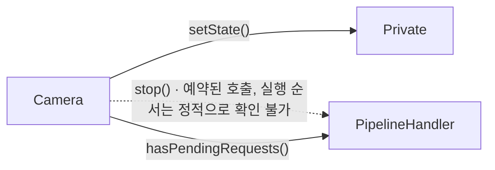

# 캡처 종료 요청

**캡처를 멈추고 대기 요청의 취소 완료와 구성 상태 복귀 조건을 확인하세요.**

| 지금 확인할 내용 | 이동할 절 |
|---|---|
| <a id="이-흐름에서-확인할-것"></a>캡처를 멈추고 대기 요청의 취소 완료와 구성 상태 복귀 조건을 확인하세요. | [캡처를 멈추는 호출과 상태 전제](#캡처를-멈추는-호출과-상태-전제) |

## 캡처를 멈추는 호출과 상태 전제

`Camera::stop()`은 카메라의 캡처와 요청 처리를 즉시 멈추는 함수입니다. 문서에 따르면 대기 중인 모든 요청은 취소되고 오류 상태로 동기적으로 완료됩니다. 이 함수는 `camera_operation`에 정의된 어떤 카메라 상태에서도 호출될 수 있습니다. 다만 `stop()`은 카메라 상태에 영향을 주는 다른 함수와 호출자가 동기화해야 합니다. `src/libcamera/camera.cpp:1431`

`d->isRunning()`이 거짓이면 `stop()`은 아무 작업도 하지 않고 `return 0;`으로 바로 반환합니다. 코드 주석의 todo 항목은 `Running` 상태 밖에서 `stop()`을 호출할 때 이 단축 경로 대신 상태 기계 경로를 쓰도록 바꾸는 작업이 남아 있음을 나타냅니다. `isRunning()`이 참이면 `d->isAccessAllowed(Private::CameraRunning)`를 호출하고, 결과가 음수이면 `stop()`은 그 값을 그대로 반환합니다. `isAccessAllowed`는 `disconnected_`가 참이고 `allowDisconnected`가 거짓이면 `-ENODEV`를, 현재 상태가 요청한 상태와 다르면 `-EACCES`를 반환합니다. `src/libcamera/camera.cpp:1431`, `src/libcamera/camera.cpp:685`, `src/libcamera/camera.cpp:690`

`isRunning()`과 접근 검사를 통과하면 `d->setState(Private::CameraStopping)`으로 상태를 `CameraStopping`으로 설정합니다. 이어서 `d->pipe_->invokeMethod(&PipelineHandler::stop, ConnectionTypeBlocking, this)`로 `PipelineHandler::stop`을 호출하고, `ASSERT(!d->pipe_->hasPendingRequests(this))`로 대기 요청이 없는지 검사합니다. `ASSERT`는 `log.h`를 포함하기 전에 `NDEBUG`가 정의되면 코드를 생성하지 않으며, 조건이 거짓이면 Fatal 로그를 남기고 프로그램 실행을 중단합니다. 검사가 끝나면 `d->setState(Private::CameraConfigured)`로 상태를 `CameraConfigured`로 설정하고 `return 0;`으로 정상 종료합니다. `src/libcamera/camera.cpp:1431`, `src/libcamera/base/log.cpp:1022`

근거 원문: [src/libcamera/camera.cpp:1431](#source-ab211927593733cc) · [src/libcamera/camera.cpp:685](#source-b15196c6a2884255) · [src/libcamera/camera.cpp:690](#source-43bf991ac670b1aa) · [src/libcamera/base/log.cpp:1022](#source-47a6ef3943a7b53c)

## 장치 종료 뒤 대기 요청을 취소하는 순서

`PipelineHandler::stop`은 문서 주석상 `CameraManager` 스레드에서 호출됩니다. 이 함수는 `camera->_d()`의 `waitingRequests_`를 지역 변수 `waitingRequests`로 `swap`으로 옮긴 뒤 `stopDevice(camera)`를 호출합니다. 주석에 따르면 대기 요청을 먼저 옮기는 이유는 `stopDevice()` 안의 `completeRequest()` 호출로 요청이 다시 큐에 들어가지 않도록 하기 위함이고, 대기 요청은 장치를 멈춘 뒤에 취소해 순서를 유지합니다. `src/libcamera/pipeline_handler.cpp:359`

`stop`의 반복문은 `waitingRequests`에서 요청을 하나씩 꺼내 `Request::Private::cancel()`을 호출한 뒤 `doQueueRequest()`를 호출합니다. `cancel()`은 `doCancelRequest()`를 호출하고, 이 함수는 pending 버퍼마다 버퍼를 취소하고 `bufferCompleted` 신호를 내보낸 뒤 `cancelled_`를 `true`로 설정하고 `pending_`, `notifiers_`, `timer_`를 정리합니다. `doQueueRequest()`는 `camera->_d()`의 `queuedRequests_`에 요청을 넣고, `requestSequence_` 값을 요청의 `sequence_`에 부여한 뒤 카운터를 1 올립니다. `cancelled_`가 `true`이면 `queueRequestDevice()`를 호출하지 않고 `completeRequest()`를 호출한 뒤 반환하며, `cancelled_`가 `false`일 때만 `queueRequestDevice()`를 호출하고 반환값이 0이 아니면 `cancelRequest()`를 호출합니다. `src/libcamera/pipeline_handler.cpp:483`, `src/libcamera/request.cpp:139`, `src/libcamera/pipeline_handler.cpp:359`

주석에 따르면 `cancelRequest()` 대신 `doQueueRequest()`를 쓰는 이유는 요청에 sequence 번호를 부여하고 `queuedRequests_`에 임시로 넣어 `completeRequest()`에서 올바르게 완료되도록 하기 위함입니다. 반복문 뒤의 두 `ASSERT`는 주석에 따르면 대기 중인 요청이 없는지 `queuedRequests_`와 `waitingRequests_`로 확인하며, 마지막으로 `data->requestSequence_`를 `0`으로 초기화합니다. `src/libcamera/pipeline_handler.cpp:359`

근거 원문: [src/libcamera/pipeline_handler.cpp:359](#source-b607480871fd84c9) · [src/libcamera/pipeline_handler.cpp:483](#source-7348e9b4af985eb2) · [src/libcamera/base/log.cpp:1022](#source-47a6ef3943a7b53c) · [src/libcamera/request.cpp:139](#source-3ebd0788c14a6f51)

??? note "설계 질문과 검증 범위"
    질문별 답변과 근거 연결을 검사했습니다. 의미와 실행 결과는 사람 검토가 필요합니다.
    
    | 설계 질문 | 설명 위치 | 확인 범위 |
    |---|---|---|
    | Camera::stop의 캡처·요청 처리 종료 목적, 대기 요청의 동기 취소 완료 API 계약과 호출자의 상태 변경 동기화 의무를 첫 문단에서 설명하세요. 반환값은 일반 성공 요약으로 되풀이하지 말고, isRunning 거짓인 no-op, Running 경로 접근 오류, 정상 종료의 각 코드 분기를 설명할 때 조건과 함께 포함하세요. CameraStopping 전환·ConnectionTypeBlocking 호출·대기 요청 ASSERT·CameraConfigured 설정을 정상 경로로 연결하세요. ASSERT는 log.h를 포함하기 전에 NDEBUG가 정의되면 코드가 생성되지 않는 검사라는 조건을 보존하세요. 이전 상태를 추정하여 되돌린다고 쓰지 말고 코드가 지정한 상태로 설정한다고 설명하세요. 세 문단 이내로 작성하세요. | [캡처를 멈추는 호출과 상태 전제](#캡처를-멈추는-호출과-상태-전제) | 코드 근거와 설명 연결 |
    | PipelineHandler::stop이 CameraManager 스레드에서 waitingRequests_를 별도 큐로 옮겨 stopDevice 중 재큐잉을 피하고 장치 종료 뒤 대기 요청을 취소하는 순서를 설명하세요. Request::Private::cancel과 doCancelRequest가 pending 버퍼 취소·bufferCompleted 통지·cancelled_=true·pending 정리를 수행한 뒤 doQueueRequest가 카메라 데이터의 queuedRequests_·sequence_를 부여하고 cancelled_이면 completeRequest로 반환하는 경로를 원본 함수에서 연결하세요. 이 경로에서 장치 큐잉을 하지 않는 조건을 정확히 설명하세요. cancelRequest 대신 이 경로를 쓰는 순서 보존 이유는 원문 주석에 있는 범위에서만 설명하세요. 마지막 두 큐 ASSERT와 requestSequence_=0을 함께 설명하되 NDEBUG에 대한 설명은 앞 절에서 했으므로 반복하지 마세요. 세 문단 이내로 작성하세요. | [장치 종료 뒤 대기 요청을 취소하는 순서](#장치-종료-뒤-대기-요청을-취소하는-순서) | 코드 근거와 설명 연결 |

## 소스 근거

같은 발췌는 한 번만 싣습니다. 필요한 원문을 펼쳐 설명과 대조하세요.

<a id="source-ab211927593733cc"></a>

??? note "소스 근거: src/libcamera/camera.cpp:1431"
    `src/libcamera/camera.cpp:1431`에서 시작하는 발췌입니다. 종료 줄은 1472이며, 아래 원문을 설명과 대조할 수 있습니다.
    
    SHA-256: `d3691f925a9ed8100ce594a991375316de2b189a59e68e636819514bf58ad8d5`
    
    ```text
    \brief Stop capture from camera
     *
     * This function stops capturing and processing requests immediately. All
     * pending requests are cancelled and complete synchronously in an error state.
     *
     * \context This function may be called in any camera state as defined in \ref
     * camera_operation, and shall be synchronized by the caller with other
     * functions that affect the camera state. If called when the camera isn't
     * running, it is a no-op.
     *
     * \return 0 on success or a negative error code otherwise
     * \retval -ENODEV The camera has been disconnected from the system
     * \retval -EACCES The camera is not running so can't be stopped
     */
    int Camera::stop()
    {
    	Private *const d = _d();
    
    	/*
    	 * \todo Make calling stop() when not in 'Running' part of the state
    	 * machine rather than take this shortcut
    	 */
    	if (!d->isRunning())
    		return 0;
    
    	int ret = d->isAccessAllowed(Private::CameraRunning);
    	if (ret < 0)
    		return ret;
    
    	LOG(Camera, Debug) << "Stopping capture";
    
    	d->setState(Private::CameraStopping);
    
    	d->pipe_->invokeMethod(&PipelineHandler::stop, ConnectionTypeBlocking,
    			       this);
    
    	ASSERT(!d->pipe_->hasPendingRequests(this));
    
    	d->setState(Private::CameraConfigured);
    
    	return 0;
    }
    ```

<a id="source-b15196c6a2884255"></a>

??? note "소스 근거: src/libcamera/camera.cpp:685"
    `src/libcamera/camera.cpp:685`에서 시작하는 발췌입니다. 종료 줄은 688이며, 아래 원문을 설명과 대조할 수 있습니다.
    
    SHA-256: `523daa7ca4fc35a940268922acbf8cf1ca3000833527c0c43c5952e9001f704d`
    
    ```text
    bool Camera::Private::isRunning() const
    {
    	return state_.load(std::memory_order_acquire) == CameraRunning;
    }
    ```

<a id="source-43bf991ac670b1aa"></a>

??? note "소스 근거: src/libcamera/camera.cpp:690"
    `src/libcamera/camera.cpp:690`에서 시작하는 발췌입니다. 종료 줄은 707이며, 아래 원문을 설명과 대조할 수 있습니다.
    
    SHA-256: `eda58d39ca207e5943afd21f4d2439316a5afdb0d3d19c7a40800658db295899`
    
    ```text
    int Camera::Private::isAccessAllowed(State state, bool allowDisconnected,
    				     const char *from) const
    {
    	if (!allowDisconnected && disconnected_)
    		return -ENODEV;
    
    	State currentState = state_.load(std::memory_order_acquire);
    	if (currentState == state)
    		return 0;
    
    	ASSERT(static_cast<unsigned int>(state) < std::size(camera_state_names));
    
    	LOG(Camera, Error) << "Camera in " << camera_state_names[currentState]
    			   << " state trying " << from << "() requiring state "
    			   << camera_state_names[state];
    
    	return -EACCES;
    }
    ```

<a id="source-47a6ef3943a7b53c"></a>

??? note "소스 근거: src/libcamera/base/log.cpp:1022"
    `src/libcamera/base/log.cpp:1022`에서 시작하는 발췌입니다. 종료 줄은 1060이며, 아래 원문을 설명과 대조할 수 있습니다.
    
    SHA-256: `52e64d292f59786541e66fe48f5bae65256bdced60c803aa76bf3637083b47b0`
    
    ```text
    \def LOG(category, severity)
     * \hideinitializer
     * \brief Log a message
     * \param[in] category Category (optional)
     * \param[in] severity Severity
     *
     * Return an std::ostream reference to which a message can be logged using the
     * iostream API. The \a category, if specified, sets the message category. When
     * absent the default category is used. The  \a severity controls whether the
     * message is printed or discarded, depending on the log level for the category.
     *
     * If the severity is set to Fatal, execution is aborted and the program
     * terminates immediately after printing the message.
     *
     * \warning Logging from the destructor of a global object, either directly or
     * indirectly, results in undefined behaviour.
     *
     * \todo Allow logging from destructors of global objects to the largest
     * possible extent
     */
    
    /**
     * \def ASSERT(condition)
     * \hideinitializer
     * \brief Abort program execution if assertion fails
     *
     * If \a condition is false, ASSERT() logs an error message with the Fatal log
     * level and aborts program execution.
     *
     * If the macro NDEBUG is defined before including log.h, ASSERT() generates no
     * code.
     *
     * Using conditions that have side effects with ASSERT() is not recommended, as
     * these effects would depend on whether NDEBUG is defined or not. Similarly,
     * ASSERT() should not be used to check for errors that can occur under normal
     * conditions as those checks would then be removed when compiling with NDEBUG.
     */
    
    } /* namespace libcamera */
    ```

<a id="source-b607480871fd84c9"></a>

??? note "소스 근거: src/libcamera/pipeline_handler.cpp:359"
    `src/libcamera/pipeline_handler.cpp:359`에서 시작하는 발췌입니다. 종료 줄은 402이며, 아래 원문을 설명과 대조할 수 있습니다.
    
    SHA-256: `956220c79c4d6c71b49e6af0c06af322f392187b2b7ffbcfb272d03b5b8c5442`
    
    ```text
    \brief Stop capturing from all running streams and cancel pending requests
     * \param[in] camera The camera to stop
     *
     * This function stops capturing and processing requests immediately. All
     * pending requests are cancelled and complete immediately in an error state.
     *
     * \context This function is called from the CameraManager thread.
     */
    void PipelineHandler::stop(Camera *camera)
    {
    	/*
    	 * Take all waiting requests so that they are not requeued in response
    	 * to completeRequest() being called inside stopDevice(). Cancel them
    	 * after the device to keep them in order.
    	 */
    	Camera::Private *data = camera->_d();
    	std::queue<Request *> waitingRequests;
    	waitingRequests.swap(data->waitingRequests_);
    
    	/* Stop the pipeline handler and let the queued requests complete. */
    	stopDevice(camera);
    
    	/* Cancel and signal as complete all waiting requests. */
    	while (!waitingRequests.empty()) {
    		Request *request = waitingRequests.front();
    		waitingRequests.pop();
    
    		/*
    		 * Cancel all requests by marking them as cancelled and calling
    		 * doQueueRequest() instead of cancelRequest(). This ensures
    		 * that the requests get a sequence number and are temporarily
    		 * added to queuedRequests_ so they can be properly completed in
    		 * completeRequest().
    		 */
    		request->_d()->cancel();
    		doQueueRequest(request);
    	}
    
    	/* Make sure no requests are pending. */
    	ASSERT(data->queuedRequests_.empty());
    	ASSERT(data->waitingRequests_.empty());
    
    	data->requestSequence_ = 0;
    }
    ```

<a id="source-7348e9b4af985eb2"></a>

??? note "소스 근거: src/libcamera/pipeline_handler.cpp:483"
    `src/libcamera/pipeline_handler.cpp:483`에서 시작하는 발췌입니다. 종료 줄은 501이며, 아래 원문을 설명과 대조할 수 있습니다.
    
    SHA-256: `fbd3ed6fe295b1cdd82d6ce420a30695986e43199347f92ac2545fe0e7831da8`
    
    ```text
    void PipelineHandler::doQueueRequest(Request *request)
    {
    	LIBCAMERA_TRACEPOINT(request_device_queue, request);
    
    	Camera *camera = request->_d()->camera();
    	Camera::Private *data = camera->_d();
    	data->queuedRequests_.push_back(request);
    
    	request->_d()->sequence_ = data->requestSequence_++;
    
    	if (request->_d()->cancelled_) {
    		completeRequest(request);
    		return;
    	}
    
    	int ret = queueRequestDevice(camera, request);
    	if (ret)
    		cancelRequest(request);
    }
    ```

<a id="source-3ebd0788c14a6f51"></a>

??? note "소스 근거: src/libcamera/request.cpp:139"
    `src/libcamera/request.cpp:139`에서 시작하는 발췌입니다. 종료 줄은 170이며, 아래 원문을 설명과 대조할 수 있습니다.
    
    SHA-256: `2ebca1d1d70536890988dda71397aa6d74337bedfa357851d4dd87cedc502544`
    
    ```text
    void Request::Private::doCancelRequest()
    {
    	Request *request = _o<Request>();
    
    	for (FrameBuffer *buffer : pending_) {
    		buffer->_d()->cancel();
    		camera_->bufferCompleted.emit(request, buffer);
    	}
    
    	cancelled_ = true;
    	pending_.clear();
    	notifiers_.clear();
    	timer_.reset();
    }
    
    /**
     * \brief Cancel a queued request
     *
     * Mark the request and its associated buffers as cancelled and complete it.
     *
     * Set each pending buffer in error state and emit the buffer completion signal
     * before completing the Request.
     */
    void Request::Private::cancel()
    {
    	LIBCAMERA_TRACEPOINT(request_cancel, this);
    
    	Request *request = _o<Request>();
    	ASSERT(request->status() == RequestPending);
    
    	doCancelRequest();
    }
    ```

## 주요 확인 지점

아래 항목은 추출한 호출에서 고른 코드 탐색 지점입니다. 나열 순서는 실행 순서가 아닙니다.

| 확인할 내용 | 호출 측과 대상 | 구분 | 근거 |
|---|---|---|---|
| 종료 상태 반영 | `Camera` → `Private::setState()` | 정적 호출 지점입니다. | `src/libcamera/camera.cpp:1462`, `src/libcamera/camera.cpp:1469` |
| 파이프라인 종료 대상 | `Camera` → `PipelineHandler::stop()` | 메서드 전달 대상이며 동기·비동기 여부는 호출부에서 확인해야 합니다. | `src/libcamera/camera.cpp:1464` |
| 종료 뒤 대기 요청 확인 | `Camera` → `PipelineHandler::hasPendingRequests()` | 정적 호출 지점입니다. | `src/libcamera/camera.cpp:1467` |

## 주요 호출 관계

화살표는 호출 측과 대상을 연결합니다. 시간 순서나 모든 경로의 실행을 뜻하지 않습니다. 점선에는 가상 호출 후보·예약 대상 등 확인이 필요한 관계를 표시합니다.



## 추적 범위와 경계

요약의 hide 규칙에 해당하는 호출은 26개입니다. 전체 추적 기록에는 해당 호출도 모두 보존합니다. 기록 번호는 정적 탐색의 식별자이며 실행 순번이 아닙니다.

조건 분기, 반복 횟수와 실제 실행 스레드는 이 호출 목록만으로 확정할 수 없습니다. 가상 호출 후보는 실제 객체에 따라 선택됩니다. 예약 표시는 인자로 전달한 메서드 대상을 뜻하며, 비동기 실행을 보증하지 않습니다. 호출부의 연결 방식과 동기화 계약을 확인해야 합니다.

| 호출 지점 | 후보 또는 예약 대상 | 확인할 경계 | 근거 |
|---|---|---|---|
| `Camera` | `PipelineHandler::stop()` | 메서드 전달 대상이며 동기·비동기 여부는 호출부에서 확인해야 합니다. | `src/libcamera/camera.cpp:1464` |

추출 통계: 미해결 호출 0개, 예약된 호출 1개입니다.

## 전체 추적 기록

아래 구간을 펼치면 요약에서 제외된 호출까지 확인할 수 있습니다. 이 목록은 추출 깊이 안에서 수집한 기록이며, 소스의 모든 실행 경로를 포함한다는 뜻은 아닙니다.

??? note "추적 기록 1–25 / 33개"

    | 기록 | 호출 측 | 대상 | 구분 | 근거 |
    |---|---|---|---|---|
    | 1 | `Camera` | `Camera::_d()` | 정적 호출 지점입니다. | `src/libcamera/camera.cpp:1447` |
    | 2 | `Camera` | `Private::isRunning()` | 정적 호출 지점입니다. | `src/libcamera/camera.cpp:1453` |
    | 3 | `Camera` | `Private::isAccessAllowed()` | 정적 호출 지점입니다. | `src/libcamera/camera.cpp:1456` |
    | 4 | `Private` | `log::isLogSeverityEnabled()` | 정적 호출 지점입니다. | `src/libcamera/camera.cpp:700` |
    | 5 | `Private` | `LogMessageAbortGuard::LogMessageAbortGuard()` | 정적 호출 지점입니다. | `src/libcamera/camera.cpp:700` |
    | 6 | `Private` | `LogMessage::stream()` | 정적 호출 지점입니다. | `src/libcamera/camera.cpp:700` |
    | 7 | `Private` | `log::_log()` | 정적 호출 지점입니다. | `src/libcamera/camera.cpp:700` |
    | 8 | `log` | `LogMessage::LogMessage()` | 정적 호출 지점입니다. | `src/libcamera/base/log.cpp:990` |
    | 9 | `LogMessage` | `utils::basename()` | 정적 호출 지점입니다. | `src/libcamera/base/log.cpp:858` |
    | 10 | `Private` | `log::isLogSeverityEnabled()` | 정적 호출 지점입니다. | `src/libcamera/camera.cpp:702` |
    | 11 | `Private` | `LogMessageAbortGuard::LogMessageAbortGuard()` | 정적 호출 지점입니다. | `src/libcamera/camera.cpp:702` |
    | 12 | `Private` | `LogMessage::stream()` | 정적 호출 지점입니다. | `src/libcamera/camera.cpp:702` |
    | 13 | `Private` | `log::_log()` | 정적 호출 지점입니다. | `src/libcamera/camera.cpp:702` |
    | 14 | `log` | `LogMessage::LogMessage()` | 정적 호출 지점입니다. | `src/libcamera/base/log.cpp:990` |
    | 15 | `LogMessage` | `utils::basename()` | 정적 호출 지점입니다. | `src/libcamera/base/log.cpp:858` |
    | 16 | `Camera` | `log::isLogSeverityEnabled()` | 정적 호출 지점입니다. | `src/libcamera/camera.cpp:1460` |
    | 17 | `Camera` | `LogMessageAbortGuard::LogMessageAbortGuard()` | 정적 호출 지점입니다. | `src/libcamera/camera.cpp:1460` |
    | 18 | `Camera` | `LogMessage::stream()` | 정적 호출 지점입니다. | `src/libcamera/camera.cpp:1460` |
    | 19 | `Camera` | `log::_log()` | 정적 호출 지점입니다. | `src/libcamera/camera.cpp:1460` |
    | 20 | `log` | `LogMessage::LogMessage()` | 정적 호출 지점입니다. | `src/libcamera/base/log.cpp:990` |
    | 21 | `LogMessage` | `utils::basename()` | 정적 호출 지점입니다. | `src/libcamera/base/log.cpp:858` |
    | 22 | `Camera` | `Private::setState()` | 정적 호출 지점입니다. | `src/libcamera/camera.cpp:1462` |
    | 23 | `Camera` | `Object::invokeMethod()` | 정적 호출 지점입니다. | `src/libcamera/camera.cpp:1464` |
    | 24 | `Camera` | `PipelineHandler::stop()` | 메서드 전달 대상이며 동기·비동기 여부는 호출부에서 확인해야 합니다. | `src/libcamera/camera.cpp:1464` |
    | 25 | `Camera` | `PipelineHandler::hasPendingRequests()` | 정적 호출 지점입니다. | `src/libcamera/camera.cpp:1467` |

??? note "추적 기록 26–33 / 33개"

    | 기록 | 호출 측 | 대상 | 구분 | 근거 |
    |---|---|---|---|---|
    | 26 | `PipelineHandler` | `Camera::_d()` | 정적 호출 지점입니다. | `src/libcamera/pipeline_handler.cpp:424` |
    | 27 | `Camera` | `log::isLogSeverityEnabled()` | 정적 호출 지점입니다. | `src/libcamera/camera.cpp:1467` |
    | 28 | `Camera` | `LogMessageAbortGuard::LogMessageAbortGuard()` | 정적 호출 지점입니다. | `src/libcamera/camera.cpp:1467` |
    | 29 | `Camera` | `LogMessage::stream()` | 정적 호출 지점입니다. | `src/libcamera/camera.cpp:1467` |
    | 30 | `Camera` | `log::_log()` | 정적 호출 지점입니다. | `src/libcamera/camera.cpp:1467` |
    | 31 | `log` | `LogMessage::LogMessage()` | 정적 호출 지점입니다. | `src/libcamera/base/log.cpp:990` |
    | 32 | `LogMessage` | `utils::basename()` | 정적 호출 지점입니다. | `src/libcamera/base/log.cpp:858` |
    | 33 | `Camera` | `Private::setState()` | 정적 호출 지점입니다. | `src/libcamera/camera.cpp:1469` |

??? note "근거와 검토 정보"
    - 생성 방식: 추출 사실과 LLM 설명
    - 검증 범위: 표·그림은 facts로 만들고 설명은 LLM이 작성합니다. 인용·문장 및 설정된 구조 검사를 적용합니다.
    - 근거 파일: `src/libcamera/base/log.cpp`, `src/libcamera/camera.cpp`, `src/libcamera/pipeline_handler.cpp`, `src/libcamera/request.cpp`
    - 근거 수준: 코드 확인 (정적 분석, simple_compdb 구성, commit `212c689fcf`)
    - 자동 검사 (인용·문장 및 설정된 구조 검사): 통과
    - 검토 상태 기록일: 2026-10-31 · 사람 검토 전

다음 단계: [핵심 시나리오](index.md)
