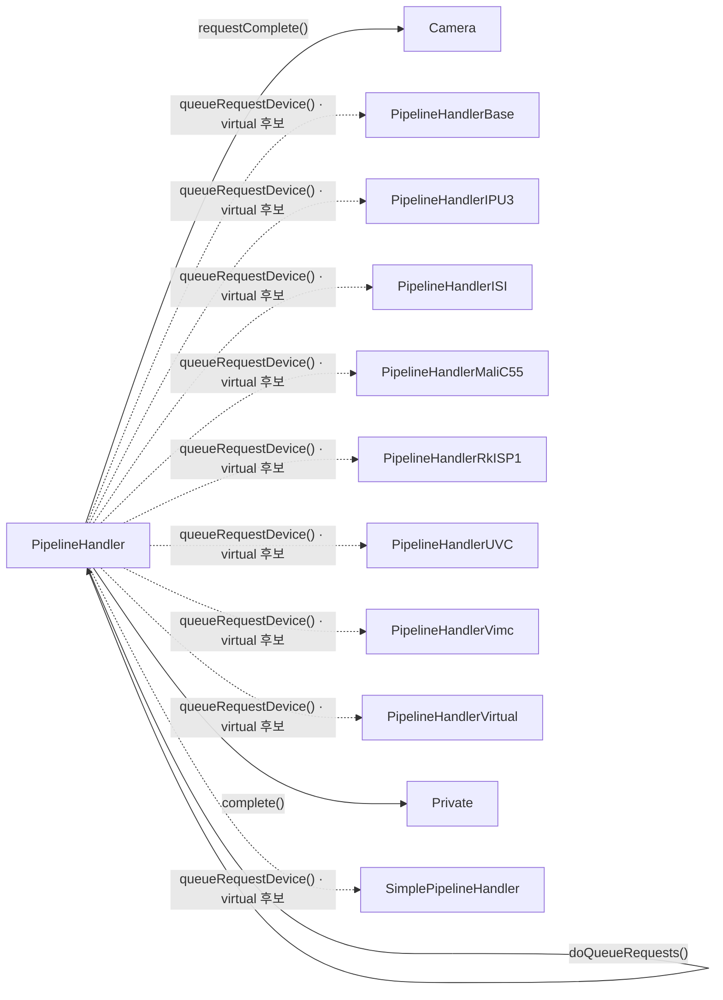

# 요청 완료 통지

**버퍼 완료와 요청 완료를 구분하고 제출 순서대로 돌아오는 알림과 접근 종료 책임을 확인하세요.**

| 지금 확인할 내용 | 이동할 절 |
|---|---|
| <a id="이-흐름에서-확인할-것"></a>버퍼 완료와 요청 완료를 구분하고 제출 순서대로 돌아오는 알림과 접근 종료 책임을 확인하세요. | [요청 완료를 알릴 책임과 접근 종료](#요청-완료를-알릴-책임과-접근-종료) |

## 요청 완료를 알릴 책임과 접근 종료

`completeRequest`는 파이프라인 핸들러가 완료된 `request`를 `camera`에 알릴 때 쓰는 함수입니다. 핸들러는 이 함수를 `CameraManager` 스레드에서 호출해야 합니다. 함수가 반환된 뒤에는 핸들러가 해당 `request`를 더 이상 관리하지 않으며, 그 `request`에 접근해서는 안 됩니다. `src/libcamera/pipeline_handler.cpp:571`

`completeBuffer`로 요청의 마지막 버퍼를 완료해도 요청은 자동으로 완료되지 않습니다. 요청은 `completeRequest()`로 명시적으로 완료해야 합니다. 핸들러는 완료된 요청을 순서 제약 없이 임의의 순서로 `completeRequest`에 전달할 수 있으며, 이때도 앱에 반환되는 요청 순서는 제출 순서로 보장됩니다. `src/libcamera/pipeline_handler.cpp:547`, `src/libcamera/pipeline_handler.cpp:571`

근거 원문: [src/libcamera/pipeline_handler.cpp:571](#source-fc411ef7c16f9e55) · [src/libcamera/pipeline_handler.cpp:547](#source-4c7b87eaff217a5f)

## 대기 요청을 확인하고 앱으로 알리는 경로

`Request::Private::complete()`는 먼저 `ASSERT(request->status() == RequestPending)`와 `ASSERT(!hasPendingBuffers())`로 요청이 `RequestPending` 상태이고 대기 버퍼가 없는지 확인합니다. 그다음 `request->status_`를 `cancelled_`가 참이면 `RequestCancelled`로, 거짓이면 `RequestComplete`로 설정합니다. 이 `ASSERT`는 `log.h`를 포함하기 전에 `NDEBUG`가 정의되면 코드를 생성하지 않으므로, 그런 빌드에서는 이 검사가 수행되지 않습니다. `src/libcamera/request.cpp:125`, `src/libcamera/base/log.cpp:1022`

`PipelineHandler::completeRequest()`는 `queuedRequests_`가 빌 때까지 반복하며 맨 앞 요청을 `front()`로 확인합니다. 맨 앞 요청의 `status()`가 `RequestPending`이면 `break`로 반복문을 빠져나가고 `pop_front()`를 호출하지 않으며 `camera->requestComplete()`도 호출하지 않습니다. `RequestPending`이 아니면 `ASSERT(!req->hasPendingBuffers())`를 확인한 뒤 `data->queuedRequests_.pop_front()`로 요청을 큐에서 제거하고 `camera->requestComplete(req)`를 호출합니다. 여기서 `break`는 요청을 취소하지 않고 반복문만 빠져나갑니다. `src/libcamera/pipeline_handler.cpp:584`

`Camera::requestComplete()`는 `_d()->isAccessAllowed(Private::CameraStopping, Private::CameraRunning, true)`를 호출해 현재 상태가 `CameraStopping`부터 `CameraRunning` 사이인지 검사합니다. `allowDisconnected` 인자가 `true`이므로 연결이 끊긴 카메라도 `-ENODEV` 검사로 막지 않으며, 상태가 범위 안이면 `0`을, 범위 밖이면 `-EACCES`를 반환합니다. 반환값이 0이 아니면 `LOG(Camera, Fatal)`이 `Trying to complete a request when stopped`를 출력하고, Fatal 로그는 실행을 중단합니다. 반환값이 0이면 `requestCompleted.emit(request)`로 완료된 요청을 애플리케이션에 알립니다. `src/libcamera/camera.cpp:1475`, `src/libcamera/camera.cpp:709`, `src/libcamera/base/log.cpp:1022`

반복문이 끝난 뒤 `PipelineHandler::completeRequest()`는 `doQueueRequests(camera)`를 무조건 호출합니다. 이 호출은 `break`로 반복문을 빠져나간 경우에도 실행되며, 주석에 따르면 대기 중인 요청을 파이프라인에 큐잉하도록 허용하는 역할을 합니다. `src/libcamera/pipeline_handler.cpp:584`

근거 원문: [src/libcamera/pipeline_handler.cpp:584](#source-695328706c4e6d8e) · [src/libcamera/camera.cpp:1475](#source-10493c434ca1f81c) · [src/libcamera/camera.cpp:709](#source-0840d2509c9e395b) · [src/libcamera/request.cpp:125](#source-df36eeb30bb5a348) · [src/libcamera/base/log.cpp:1022](#source-47a6ef3943a7b53c)

??? note "설계 질문과 검증 범위"
    질문별 답변과 근거 연결을 검사했습니다. 의미와 실행 결과는 사람 검토가 필요합니다.
    
    | 설계 질문 | 설명 위치 | 확인 범위 |
    |---|---|---|
    | PipelineHandler::completeRequest의 목적, CameraManager 스레드 호출 의무와 반환 뒤 핸들러의 요청 접근 금지를 첫 문단에서 함께 설명하세요. 둘째 문단에서는 마지막 completeBuffer만으로 요청이 자동 완료되지 않아 명시적인 요청 완료가 필요하며, 핸들러가 완료된 요청을 임의 순서로 통지해도 앱 반환은 제출 순서를 보존하는 계약을 설명하세요. completeRequest 호출 의무나 소유권을 별도 문단에서 반복하지 마세요. | [요청 완료를 알릴 책임과 접근 종료](#요청-완료를-알릴-책임과-접근-종료) | 코드 근거와 설명 연결 |
    | Request::Private::complete의 RequestPending·대기 버퍼 ASSERT와 cancelled_에 따른 RequestCancelled/RequestComplete 갱신을 설명하세요. PipelineHandler::completeRequest의 queuedRequests_ 맨 앞이 RequestPending이면 break하고 pop하지 않는 경로와, Pending이 아니면 대기 버퍼 ASSERT·pop_front·Camera::requestComplete로 진행하는 경로를 같은 문단에서 대조하세요. Camera::requestComplete의 CameraStopping부터 CameraRunning까지 상태 검사와 allowDisconnected=true를 설명하고 허용 상태에서 requestCompleted.emit으로 알리는 경로와 범위 밖 Fatal 로그에 따른 실행 중단을 구분하세요. ASSERT는 log.h 포함 전에 NDEBUG가 정의되면 코드가 생성되지 않는 검사임을 한 번 설명하세요. 정상 경로에서 루프 뒤 doQueueRequests가 대기 요청 큐잉을 허용하는 역할을 마지막 한 문단으로 설명하세요. 새 결과의 조건을 이해하는 데 필요한 짧은 참조는 허용하되 같은 결과의 전체 설명을 반복하지 마세요. doQueueRequests 구현의 발췌 범위 안내나 별도 확인 요청은 쓰지 말고 호출 역할만 설명하세요. 네 문단 이내로 작성하세요. | [대기 요청을 확인하고 앱으로 알리는 경로](#대기-요청을-확인하고-앱으로-알리는-경로) | 코드 근거와 설명 연결 |

## 소스 근거

같은 발췌는 한 번만 싣습니다. 필요한 원문을 펼쳐 설명과 대조하세요.

<a id="source-fc411ef7c16f9e55"></a>

??? note "소스 근거: src/libcamera/pipeline_handler.cpp:571"
    `src/libcamera/pipeline_handler.cpp:571`에서 시작하는 발췌입니다. 종료 줄은 583이며, 아래 원문을 설명과 대조할 수 있습니다.
    
    SHA-256: `9a0ed4d736b974c075804a539949762c99c31dc1c6ad62f7185af6f1b9c6e741`
    
    ```text
    \brief Signal request completion
     * \param[in] request The request that has completed
     *
     * The pipeline handler shall call this function to notify the \a camera that
     * the request has completed. The request is no longer managed by the pipeline
     * handler and shall not be accessed once this function returns.
     *
     * This function ensures that requests will be returned to the application in
     * submission order, the pipeline handler may call it on any complete request
     * without any ordering constraint.
     *
     * \context This function shall be called from the CameraManager thread.
     */
    ```

<a id="source-4c7b87eaff217a5f"></a>

??? note "소스 근거: src/libcamera/pipeline_handler.cpp:547"
    `src/libcamera/pipeline_handler.cpp:547`에서 시작하는 발췌입니다. 종료 줄은 568이며, 아래 원문을 설명과 대조할 수 있습니다.
    
    SHA-256: `2ac611d3ff5edaf4e1f140f09f9bbe2f9304b41b9e198beb46a5660e5f195282`
    
    ```text
    \brief Complete a buffer for a request
     * \param[in] request The request the buffer belongs to
     * \param[in] buffer The buffer that has completed
     *
     * This function shall be called by pipeline handlers to signal completion of
     * the \a buffer part of the \a request. It notifies applications of buffer
     * completion and updates the request's internal buffer tracking. The request
     * is not completed automatically when the last buffer completes to give
     * pipeline handlers a chance to perform any operation that may still be
     * needed. They shall complete requests explicitly with completeRequest().
     *
     * \context This function shall be called from the CameraManager thread.
     *
     * \return True if all buffers contained in the request have completed, false
     * otherwise
     */
    bool PipelineHandler::completeBuffer(Request *request, FrameBuffer *buffer)
    {
    	Camera *camera = request->_d()->camera();
    	camera->bufferCompleted.emit(request, buffer);
    	return request->_d()->completeBuffer(buffer);
    }
    ```

<a id="source-695328706c4e6d8e"></a>

??? note "소스 근거: src/libcamera/pipeline_handler.cpp:584"
    `src/libcamera/pipeline_handler.cpp:584`에서 시작하는 발췌입니다. 종료 줄은 604이며, 아래 원문을 설명과 대조할 수 있습니다.
    
    SHA-256: `06aba06c3d636ad21e1409ac329ab9c3853776a2eef8ca443acbb49c8893e90b`
    
    ```text
    void PipelineHandler::completeRequest(Request *request)
    {
    	Camera *camera = request->_d()->camera();
    
    	request->_d()->complete();
    
    	Camera::Private *data = camera->_d();
    
    	while (!data->queuedRequests_.empty()) {
    		Request *req = data->queuedRequests_.front();
    		if (req->status() == Request::RequestPending)
    			break;
    
    		ASSERT(!req->hasPendingBuffers());
    		data->queuedRequests_.pop_front();
    		camera->requestComplete(req);
    	}
    
    	/* Allow any waiting requests to be queued to the pipeline. */
    	doQueueRequests(camera);
    }
    ```

<a id="source-10493c434ca1f81c"></a>

??? note "소스 근거: src/libcamera/camera.cpp:1475"
    `src/libcamera/camera.cpp:1475`에서 시작하는 발췌입니다. 종료 줄은 1489이며, 아래 원문을 설명과 대조할 수 있습니다.
    
    SHA-256: `9e8e2a873ef95a0b778292f2da2da90ec0b5ef5b312ffe88b7298d3aed624c47`
    
    ```text
    \brief Handle request completion and notify application
     * \param[in] request The request that has completed
     *
     * This function is called by the pipeline handler to notify the camera that
     * the request has completed. It emits the requestCompleted signal.
     */
    void Camera::requestComplete(Request *request)
    {
    	/* Disconnected cameras are still able to complete requests. */
    	if (_d()->isAccessAllowed(Private::CameraStopping, Private::CameraRunning,
    				  true))
    		LOG(Camera, Fatal) << "Trying to complete a request when stopped";
    
    	requestCompleted.emit(request);
    }
    ```

<a id="source-0840d2509c9e395b"></a>

??? note "소스 근거: src/libcamera/camera.cpp:709"
    `src/libcamera/camera.cpp:709`에서 시작하는 발췌입니다. 종료 줄은 730이며, 아래 원문을 설명과 대조할 수 있습니다.
    
    SHA-256: `d04dbcf64bf95e8e89669e5c85602d590cd8d6530e44cd275cee39348d644b8f`
    
    ```text
    int Camera::Private::isAccessAllowed(State low, State high,
    				     bool allowDisconnected,
    				     const char *from) const
    {
    	if (!allowDisconnected && disconnected_)
    		return -ENODEV;
    
    	State currentState = state_.load(std::memory_order_acquire);
    	if (currentState >= low && currentState <= high)
    		return 0;
    
    	ASSERT(static_cast<unsigned int>(low) < std::size(camera_state_names) &&
    	       static_cast<unsigned int>(high) < std::size(camera_state_names));
    
    	LOG(Camera, Error) << "Camera in " << camera_state_names[currentState]
    			   << " state trying " << from
    			   << "() requiring state between "
    			   << camera_state_names[low] << " and "
    			   << camera_state_names[high];
    
    	return -EACCES;
    }
    ```

<a id="source-df36eeb30bb5a348"></a>

??? note "소스 근거: src/libcamera/request.cpp:125"
    `src/libcamera/request.cpp:125`에서 시작하는 발췌입니다. 종료 줄은 137이며, 아래 원문을 설명과 대조할 수 있습니다.
    
    SHA-256: `045f2e5cc0e38ea289081014b5a245bbff80c5d3ecc255ed620a1e5d486ba8ec`
    
    ```text
    void Request::Private::complete()
    {
    	Request *request = _o<Request>();
    
    	ASSERT(request->status() == RequestPending);
    	ASSERT(!hasPendingBuffers());
    
    	request->status_ = cancelled_ ? RequestCancelled : RequestComplete;
    
    	LOG(Request, Debug) << request->toString();
    
    	LIBCAMERA_TRACEPOINT(request_complete, this);
    }
    ```

<a id="source-47a6ef3943a7b53c"></a>

??? note "소스 근거: src/libcamera/base/log.cpp:1022"
    `src/libcamera/base/log.cpp:1022`에서 시작하는 발췌입니다. 종료 줄은 1060이며, 아래 원문을 설명과 대조할 수 있습니다.
    
    SHA-256: `52e64d292f59786541e66fe48f5bae65256bdced60c803aa76bf3637083b47b0`
    
    ```text
    \def LOG(category, severity)
     * \hideinitializer
     * \brief Log a message
     * \param[in] category Category (optional)
     * \param[in] severity Severity
     *
     * Return an std::ostream reference to which a message can be logged using the
     * iostream API. The \a category, if specified, sets the message category. When
     * absent the default category is used. The  \a severity controls whether the
     * message is printed or discarded, depending on the log level for the category.
     *
     * If the severity is set to Fatal, execution is aborted and the program
     * terminates immediately after printing the message.
     *
     * \warning Logging from the destructor of a global object, either directly or
     * indirectly, results in undefined behaviour.
     *
     * \todo Allow logging from destructors of global objects to the largest
     * possible extent
     */
    
    /**
     * \def ASSERT(condition)
     * \hideinitializer
     * \brief Abort program execution if assertion fails
     *
     * If \a condition is false, ASSERT() logs an error message with the Fatal log
     * level and aborts program execution.
     *
     * If the macro NDEBUG is defined before including log.h, ASSERT() generates no
     * code.
     *
     * Using conditions that have side effects with ASSERT() is not recommended, as
     * these effects would depend on whether NDEBUG is defined or not. Similarly,
     * ASSERT() should not be used to check for errors that can occur under normal
     * conditions as those checks would then be removed when compiling with NDEBUG.
     */
    
    } /* namespace libcamera */
    ```

## 주요 확인 지점

아래 항목은 추출한 호출에서 고른 코드 탐색 지점입니다. 나열 순서는 실행 순서가 아닙니다.

| 확인할 내용 | 호출 측과 대상 | 구분 | 근거 |
|---|---|---|---|
| 완료 처리 | `PipelineHandler` → `Private::complete()` | 정적 호출 지점입니다. | `src/libcamera/pipeline_handler.cpp:588` |
| 완료 통지 | `PipelineHandler` → `Camera::requestComplete()` | 정적 호출 지점입니다. | `src/libcamera/pipeline_handler.cpp:599` |
| 대기 요청 처리 | `PipelineHandler` → `PipelineHandler::doQueueRequests()` | 정적 호출 지점입니다. | `src/libcamera/pipeline_handler.cpp:603` |
| 하드웨어별 큐잉 후보 | `PipelineHandler` → `PipelineHandlerISI::queueRequestDevice()`<br>`PipelineHandler` → `PipelineHandlerIPU3::queueRequestDevice()`<br>`PipelineHandler` → `PipelineHandlerMaliC55::queueRequestDevice()`<br>`PipelineHandler` → `PipelineHandlerRkISP1::queueRequestDevice()`<br>`PipelineHandler` → `PipelineHandlerBase::queueRequestDevice()`<br>`PipelineHandler` → `SimplePipelineHandler::queueRequestDevice()`<br>`PipelineHandler` → `PipelineHandlerUVC::queueRequestDevice()`<br>`PipelineHandler` → `PipelineHandlerVimc::queueRequestDevice()`<br>`PipelineHandler` → `PipelineHandlerVirtual::queueRequestDevice()` | 동적 디스패치 후보이며 실제 대상은 확인이 필요합니다. | `src/libcamera/pipeline_handler.cpp:498` |

## 주요 호출 관계

화살표는 호출 측과 대상을 연결합니다. 시간 순서나 모든 경로의 실행을 뜻하지 않습니다. 점선에는 가상 호출 후보·예약 대상 등 확인이 필요한 관계를 표시합니다.



## 추적 범위와 경계

요약의 hide 규칙에 해당하는 호출은 63개입니다. 전체 추적 기록에는 해당 호출도 모두 보존합니다. 기록 번호는 정적 탐색의 식별자이며 실행 순번이 아닙니다.

조건 분기, 반복 횟수와 실제 실행 스레드는 이 호출 목록만으로 확정할 수 없습니다. 가상 호출 후보는 실제 객체에 따라 선택됩니다. 예약 표시는 인자로 전달한 메서드 대상을 뜻하며, 비동기 실행을 보증하지 않습니다. 호출부의 연결 방식과 동기화 계약을 확인해야 합니다.

| 호출 지점 | 후보 또는 예약 대상 | 확인할 경계 | 근거 |
|---|---|---|---|
| `PipelineHandler` | `PipelineHandlerISI::queueRequestDevice()`<br>`PipelineHandlerIPU3::queueRequestDevice()`<br>`PipelineHandlerMaliC55::queueRequestDevice()`<br>`PipelineHandlerRkISP1::queueRequestDevice()`<br>`PipelineHandlerBase::queueRequestDevice()`<br>`SimplePipelineHandler::queueRequestDevice()`<br>`PipelineHandlerUVC::queueRequestDevice()`<br>`PipelineHandlerVimc::queueRequestDevice()`<br>`PipelineHandlerVirtual::queueRequestDevice()` | 동적 디스패치 후보이며 실제 대상은 확인이 필요합니다. | `src/libcamera/pipeline_handler.cpp:498` |

## 전체 추적 기록

아래 구간을 펼치면 요약에서 제외된 호출까지 확인할 수 있습니다. 이 목록은 추출 깊이 안에서 수집한 기록이며, 소스의 모든 실행 경로를 포함한다는 뜻은 아닙니다.

??? note "추적 기록 1–25 / 126개"

    | 기록 | 호출 측 | 대상 | 구분 | 근거 |
    |---|---|---|---|---|
    | 1 | `PipelineHandler` | `Private::camera()` | 정적 호출 지점입니다. | `src/libcamera/pipeline_handler.cpp:586` |
    | 2 | `PipelineHandler` | `Request::_d()` | 정적 호출 지점입니다. | `src/libcamera/pipeline_handler.cpp:586` |
    | 3 | `PipelineHandler` | `Private::complete()` | 정적 호출 지점입니다. | `src/libcamera/pipeline_handler.cpp:588` |
    | 4 | `Private` | `Private::_o()` | 정적 호출 지점입니다. | `src/libcamera/request.cpp:127` |
    | 5 | `Private` | `Request::status()` | 정적 호출 지점입니다. | `src/libcamera/request.cpp:129` |
    | 6 | `Private` | `log::isLogSeverityEnabled()` | 정적 호출 지점입니다. | `src/libcamera/request.cpp:129` |
    | 7 | `Private` | `LogMessageAbortGuard::LogMessageAbortGuard()` | 정적 호출 지점입니다. | `src/libcamera/request.cpp:129` |
    | 8 | `Private` | `LogMessage::stream()` | 정적 호출 지점입니다. | `src/libcamera/request.cpp:129` |
    | 9 | `Private` | `log::_log()` | 정적 호출 지점입니다. | `src/libcamera/request.cpp:129` |
    | 10 | `log` | `LogMessage::LogMessage()` | 정적 호출 지점입니다. | `src/libcamera/base/log.cpp:990` |
    | 11 | `LogMessage` | `utils::basename()` | 정적 호출 지점입니다. | `src/libcamera/base/log.cpp:858` |
    | 12 | `Private` | `Private::hasPendingBuffers()` | 정적 호출 지점입니다. | `src/libcamera/request.cpp:130` |
    | 13 | `Private` | `log::isLogSeverityEnabled()` | 정적 호출 지점입니다. | `src/libcamera/request.cpp:130` |
    | 14 | `Private` | `LogMessageAbortGuard::LogMessageAbortGuard()` | 정적 호출 지점입니다. | `src/libcamera/request.cpp:130` |
    | 15 | `Private` | `LogMessage::stream()` | 정적 호출 지점입니다. | `src/libcamera/request.cpp:130` |
    | 16 | `Private` | `log::_log()` | 정적 호출 지점입니다. | `src/libcamera/request.cpp:130` |
    | 17 | `log` | `LogMessage::LogMessage()` | 정적 호출 지점입니다. | `src/libcamera/base/log.cpp:990` |
    | 18 | `LogMessage` | `utils::basename()` | 정적 호출 지점입니다. | `src/libcamera/base/log.cpp:858` |
    | 19 | `Private` | `log::isLogSeverityEnabled()` | 정적 호출 지점입니다. | `src/libcamera/request.cpp:134` |
    | 20 | `Private` | `LogMessageAbortGuard::LogMessageAbortGuard()` | 정적 호출 지점입니다. | `src/libcamera/request.cpp:134` |
    | 21 | `Private` | `LogMessage::stream()` | 정적 호출 지점입니다. | `src/libcamera/request.cpp:134` |
    | 22 | `Private` | `log::_log()` | 정적 호출 지점입니다. | `src/libcamera/request.cpp:134` |
    | 23 | `log` | `LogMessage::LogMessage()` | 정적 호출 지점입니다. | `src/libcamera/base/log.cpp:990` |
    | 24 | `LogMessage` | `utils::basename()` | 정적 호출 지점입니다. | `src/libcamera/base/log.cpp:858` |
    | 25 | `Private` | `Request::toString()` | 정적 호출 지점입니다. | `src/libcamera/request.cpp:134` |

??? note "추적 기록 26–50 / 126개"

    | 기록 | 호출 측 | 대상 | 구분 | 근거 |
    |---|---|---|---|---|
    | 26 | `Request` | `request::operator<<()` | 정적 호출 지점입니다. | `src/libcamera/request.cpp:592` |
    | 27 | `request` | `Request::sequence()` | 정적 호출 지점입니다. | `src/libcamera/request.cpp:609` |
    | 28 | `request` | `Request::status()` | 정적 호출 지점입니다. | `src/libcamera/request.cpp:609` |
    | 29 | `request` | `Request::_d()` | 정적 호출 지점입니다. | `src/libcamera/request.cpp:610` |
    | 30 | `request` | `Request::buffers()` | 정적 호출 지점입니다. | `src/libcamera/request.cpp:610` |
    | 31 | `request` | `Request::cookie()` | 정적 호출 지점입니다. | `src/libcamera/request.cpp:611` |
    | 32 | `PipelineHandler` | `Request::_d()` | 정적 호출 지점입니다. | `src/libcamera/pipeline_handler.cpp:588` |
    | 33 | `PipelineHandler` | `Camera::_d()` | 정적 호출 지점입니다. | `src/libcamera/pipeline_handler.cpp:590` |
    | 34 | `PipelineHandler` | `Request::status()` | 정적 호출 지점입니다. | `src/libcamera/pipeline_handler.cpp:594` |
    | 35 | `PipelineHandler` | `Request::hasPendingBuffers()` | 정적 호출 지점입니다. | `src/libcamera/pipeline_handler.cpp:597` |
    | 36 | `Request` | `Private::hasPendingBuffers()` | 정적 호출 지점입니다. | `src/libcamera/request.cpp:578` |
    | 37 | `Request` | `Request::_d()` | 정적 호출 지점입니다. | `src/libcamera/request.cpp:578` |
    | 38 | `PipelineHandler` | `log::isLogSeverityEnabled()` | 정적 호출 지점입니다. | `src/libcamera/pipeline_handler.cpp:597` |
    | 39 | `PipelineHandler` | `LogMessageAbortGuard::LogMessageAbortGuard()` | 정적 호출 지점입니다. | `src/libcamera/pipeline_handler.cpp:597` |
    | 40 | `PipelineHandler` | `LogMessage::stream()` | 정적 호출 지점입니다. | `src/libcamera/pipeline_handler.cpp:597` |
    | 41 | `PipelineHandler` | `log::_log()` | 정적 호출 지점입니다. | `src/libcamera/pipeline_handler.cpp:597` |
    | 42 | `log` | `LogMessage::LogMessage()` | 정적 호출 지점입니다. | `src/libcamera/base/log.cpp:990` |
    | 43 | `LogMessage` | `utils::basename()` | 정적 호출 지점입니다. | `src/libcamera/base/log.cpp:858` |
    | 44 | `PipelineHandler` | `Camera::requestComplete()` | 정적 호출 지점입니다. | `src/libcamera/pipeline_handler.cpp:599` |
    | 45 | `Camera` | `Private::isAccessAllowed()` | 정적 호출 지점입니다. | `src/libcamera/camera.cpp:1484` |
    | 46 | `Private` | `log::isLogSeverityEnabled()` | 정적 호출 지점입니다. | `src/libcamera/camera.cpp:720` |
    | 47 | `Private` | `LogMessageAbortGuard::LogMessageAbortGuard()` | 정적 호출 지점입니다. | `src/libcamera/camera.cpp:720` |
    | 48 | `Private` | `LogMessage::stream()` | 정적 호출 지점입니다. | `src/libcamera/camera.cpp:720` |
    | 49 | `Private` | `log::_log()` | 정적 호출 지점입니다. | `src/libcamera/camera.cpp:720` |
    | 50 | `log` | `LogMessage::LogMessage()` | 정적 호출 지점입니다. | `src/libcamera/base/log.cpp:990` |

??? note "추적 기록 51–75 / 126개"

    | 기록 | 호출 측 | 대상 | 구분 | 근거 |
    |---|---|---|---|---|
    | 51 | `Private` | `log::isLogSeverityEnabled()` | 정적 호출 지점입니다. | `src/libcamera/camera.cpp:723` |
    | 52 | `Private` | `LogMessageAbortGuard::LogMessageAbortGuard()` | 정적 호출 지점입니다. | `src/libcamera/camera.cpp:723` |
    | 53 | `Private` | `LogMessage::stream()` | 정적 호출 지점입니다. | `src/libcamera/camera.cpp:723` |
    | 54 | `Private` | `log::_log()` | 정적 호출 지점입니다. | `src/libcamera/camera.cpp:723` |
    | 55 | `log` | `LogMessage::LogMessage()` | 정적 호출 지점입니다. | `src/libcamera/base/log.cpp:990` |
    | 56 | `Camera` | `Camera::_d()` | 정적 호출 지점입니다. | `src/libcamera/camera.cpp:1484` |
    | 57 | `Camera` | `log::isLogSeverityEnabled()` | 정적 호출 지점입니다. | `src/libcamera/camera.cpp:1486` |
    | 58 | `Camera` | `LogMessageAbortGuard::LogMessageAbortGuard()` | 정적 호출 지점입니다. | `src/libcamera/camera.cpp:1486` |
    | 59 | `Camera` | `LogMessage::stream()` | 정적 호출 지점입니다. | `src/libcamera/camera.cpp:1486` |
    | 60 | `Camera` | `log::_log()` | 정적 호출 지점입니다. | `src/libcamera/camera.cpp:1486` |
    | 61 | `log` | `LogMessage::LogMessage()` | 정적 호출 지점입니다. | `src/libcamera/base/log.cpp:990` |
    | 62 | `LogMessage` | `utils::basename()` | 정적 호출 지점입니다. | `src/libcamera/base/log.cpp:858` |
    | 63 | `Camera` | `Signal::emit()` | 정적 호출 지점입니다. | `src/libcamera/camera.cpp:1488` |
    | 64 | `PipelineHandler` | `PipelineHandler::doQueueRequests()` | 정적 호출 지점입니다. | `src/libcamera/pipeline_handler.cpp:603` |
    | 65 | `PipelineHandler` | `Camera::_d()` | 정적 호출 지점입니다. | `src/libcamera/pipeline_handler.cpp:511` |
    | 66 | `PipelineHandler` | `Request::_d()` | 정적 호출 지점입니다. | `src/libcamera/pipeline_handler.cpp:517` |
    | 67 | `PipelineHandler` | `PipelineHandler::doQueueRequest()` | 정적 호출 지점입니다. | `src/libcamera/pipeline_handler.cpp:525` |
    | 68 | `PipelineHandler` | `Private::camera()` | 정적 호출 지점입니다. | `src/libcamera/pipeline_handler.cpp:487` |
    | 69 | `PipelineHandler` | `Request::_d()` | 정적 호출 지점입니다. | `src/libcamera/pipeline_handler.cpp:487` |
    | 70 | `PipelineHandler` | `Camera::_d()` | 정적 호출 지점입니다. | `src/libcamera/pipeline_handler.cpp:488` |
    | 71 | `PipelineHandler` | `Request::_d()` | 정적 호출 지점입니다. | `src/libcamera/pipeline_handler.cpp:491` |
    | 72 | `PipelineHandler` | `Request::_d()` | 정적 호출 지점입니다. | `src/libcamera/pipeline_handler.cpp:493` |
    | 73 | `PipelineHandler` | `PipelineHandler::completeRequest()` | 정적 호출 지점입니다. | `src/libcamera/pipeline_handler.cpp:494` |
    | 74 | `PipelineHandler` | `PipelineHandlerISI::queueRequestDevice()` | 동적 디스패치 후보이며 실제 대상은 확인이 필요합니다. | `src/libcamera/pipeline_handler.cpp:498` |
    | 75 | `PipelineHandlerISI` | `Request::buffers()` | 정적 호출 지점입니다. | `src/libcamera/pipeline/imx8-isi/imx8-isi.cpp:958` |

??? note "추적 기록 76–100 / 126개"

    | 기록 | 호출 측 | 대상 | 구분 | 근거 |
    |---|---|---|---|---|
    | 76 | `PipelineHandlerISI` | `PipelineHandlerISI::pipeFromStream()` | 정적 호출 지점입니다. | `src/libcamera/pipeline/imx8-isi/imx8-isi.cpp:959` |
    | 77 | `PipelineHandlerISI` | `V4L2VideoDevice::queueBuffer()` | 정적 호출 지점입니다. | `src/libcamera/pipeline/imx8-isi/imx8-isi.cpp:961` |
    | 78 | `PipelineHandler` | `PipelineHandlerIPU3::queueRequestDevice()` | 동적 디스패치 후보이며 실제 대상은 확인이 필요합니다. | `src/libcamera/pipeline_handler.cpp:498` |
    | 79 | `PipelineHandlerIPU3` | `PipelineHandlerIPU3::cameraData()` | 정적 호출 지점입니다. | `src/libcamera/pipeline/ipu3/ipu3.cpp:840` |
    | 80 | `PipelineHandlerIPU3` | `IPU3CameraData::queuePendingRequests()` | 정적 호출 지점입니다. | `src/libcamera/pipeline/ipu3/ipu3.cpp:843` |
    | 81 | `PipelineHandler` | `PipelineHandlerMaliC55::queueRequestDevice()` | 동적 디스패치 후보이며 실제 대상은 확인이 필요합니다. | `src/libcamera/pipeline_handler.cpp:498` |
    | 82 | `PipelineHandlerMaliC55` | `PipelineHandlerMaliC55::cameraData()` | 정적 호출 지점입니다. | `src/libcamera/pipeline/mali-c55/mali-c55.cpp:1563` |
    | 83 | `PipelineHandlerMaliC55` | `PipelineHandlerMaliC55::queueRequestToCru()` | 정적 호출 지점입니다. | `src/libcamera/pipeline/mali-c55/mali-c55.cpp:1570` |
    | 84 | `PipelineHandlerMaliC55` | `MaliC55FrameInfo::MaliC55FrameInfo()` | 정적 호출 지점입니다. | `src/libcamera/pipeline/mali-c55/mali-c55.cpp:1577` |
    | 85 | `PipelineHandlerMaliC55` | `MaliC55FrameInfo::operator=()` | 정적 호출 지점입니다. | `src/libcamera/pipeline/mali-c55/mali-c55.cpp:1584` |
    | 86 | `PipelineHandlerMaliC55` | `Request::sequence()` | 정적 호출 지점입니다. | `src/libcamera/pipeline/mali-c55/mali-c55.cpp:1584` |
    | 87 | `PipelineHandlerMaliC55` | `Request::buffers()` | 정적 호출 지점입니다. | `src/libcamera/pipeline/mali-c55/mali-c55.cpp:1586` |
    | 88 | `PipelineHandlerMaliC55` | `PipelineHandlerMaliC55::pipeFromStream()` | 정적 호출 지점입니다. | `src/libcamera/pipeline/mali-c55/mali-c55.cpp:1587` |
    | 89 | `PipelineHandlerMaliC55` | `V4L2VideoDevice::queueBuffer()` | 정적 호출 지점입니다. | `src/libcamera/pipeline/mali-c55/mali-c55.cpp:1589` |
    | 90 | `PipelineHandlerMaliC55` | `PipelineHandlerMaliC55::prepareFrameInfo()` | 정적 호출 지점입니다. | `src/libcamera/pipeline/mali-c55/mali-c55.cpp:1595` |
    | 91 | `PipelineHandlerMaliC55` | `log::isLogSeverityEnabled()` | 정적 호출 지점입니다. | `src/libcamera/pipeline/mali-c55/mali-c55.cpp:1596` |
    | 92 | `PipelineHandlerMaliC55` | `LogMessageAbortGuard::LogMessageAbortGuard()` | 정적 호출 지점입니다. | `src/libcamera/pipeline/mali-c55/mali-c55.cpp:1596` |
    | 93 | `PipelineHandlerMaliC55` | `LogMessage::stream()` | 정적 호출 지점입니다. | `src/libcamera/pipeline/mali-c55/mali-c55.cpp:1596` |
    | 94 | `PipelineHandlerMaliC55` | `log::_log()` | 정적 호출 지점입니다. | `src/libcamera/pipeline/mali-c55/mali-c55.cpp:1596` |
    | 95 | `PipelineHandlerMaliC55` | `Request::sequence()` | 정적 호출 지점입니다. | `src/libcamera/pipeline/mali-c55/mali-c55.cpp:1598` |
    | 96 | `PipelineHandlerMaliC55` | `Request::controls()` | 정적 호출 지점입니다. | `src/libcamera/pipeline/mali-c55/mali-c55.cpp:1598` |
    | 97 | `PipelineHandlerMaliC55` | `Request::sequence()` | 정적 호출 지점입니다. | `src/libcamera/pipeline/mali-c55/mali-c55.cpp:1599` |
    | 98 | `PipelineHandlerMaliC55` | `FrameBuffer::cookie()` | 정적 호출 지점입니다. | `src/libcamera/pipeline/mali-c55/mali-c55.cpp:1600` |
    | 99 | `PipelineHandler` | `PipelineHandlerRkISP1::queueRequestDevice()` | 동적 디스패치 후보이며 실제 대상은 확인이 필요합니다. | `src/libcamera/pipeline_handler.cpp:498` |
    | 100 | `PipelineHandlerRkISP1` | `PipelineHandlerRkISP1::cameraData()` | 정적 호출 지점입니다. | `src/libcamera/pipeline/rkisp1/rkisp1.cpp:1343` |

??? note "추적 기록 101–125 / 126개"

    | 기록 | 호출 측 | 대상 | 구분 | 근거 |
    |---|---|---|---|---|
    | 101 | `PipelineHandlerRkISP1` | `RkISP1Frames::create()` | 정적 호출 지점입니다. | `src/libcamera/pipeline/rkisp1/rkisp1.cpp:1345` |
    | 102 | `PipelineHandlerRkISP1` | `Request::controls()` | 정적 호출 지점입니다. | `src/libcamera/pipeline/rkisp1/rkisp1.cpp:1349` |
    | 103 | `PipelineHandlerRkISP1` | `RkISP1Path::queueBuffer()` | 정적 호출 지점입니다. | `src/libcamera/pipeline/rkisp1/rkisp1.cpp:1352` |
    | 104 | `PipelineHandlerRkISP1` | `RkISP1Path::queueBuffer()` | 정적 호출 지점입니다. | `src/libcamera/pipeline/rkisp1/rkisp1.cpp:1355` |
    | 105 | `PipelineHandlerRkISP1` | `FrameBuffer::cookie()` | 정적 호출 지점입니다. | `src/libcamera/pipeline/rkisp1/rkisp1.cpp:1358` |
    | 106 | `PipelineHandler` | `PipelineHandlerBase::queueRequestDevice()` | 동적 디스패치 후보이며 실제 대상은 확인이 필요합니다. | `src/libcamera/pipeline_handler.cpp:498` |
    | 107 | `PipelineHandlerBase` | `PipelineHandlerBase::cameraData()` | 정적 호출 지점입니다. | `src/libcamera/pipeline/rpi/common/pipeline_base.cpp:757` |
    | 108 | `PipelineHandlerBase` | `CameraData::isRunning()` | 정적 호출 지점입니다. | `src/libcamera/pipeline/rpi/common/pipeline_base.cpp:759` |
    | 109 | `PipelineHandlerBase` | `log::isLogSeverityEnabled()` | 정적 호출 지점입니다. | `src/libcamera/pipeline/rpi/common/pipeline_base.cpp:762` |
    | 110 | `PipelineHandlerBase` | `LogMessageAbortGuard::LogMessageAbortGuard()` | 정적 호출 지점입니다. | `src/libcamera/pipeline/rpi/common/pipeline_base.cpp:762` |
    | 111 | `PipelineHandlerBase` | `LogMessage::stream()` | 정적 호출 지점입니다. | `src/libcamera/pipeline/rpi/common/pipeline_base.cpp:762` |
    | 112 | `PipelineHandlerBase` | `log::_log()` | 정적 호출 지점입니다. | `src/libcamera/pipeline/rpi/common/pipeline_base.cpp:762` |
    | 113 | `PipelineHandlerBase` | `Request::sequence()` | 정적 호출 지점입니다. | `src/libcamera/pipeline/rpi/common/pipeline_base.cpp:763` |
    | 114 | `PipelineHandlerBase` | `Flags::operator!()` | 정적 호출 지점입니다. | `src/libcamera/pipeline/rpi/common/pipeline_base.cpp:767` |
    | 115 | `PipelineHandlerBase` | `Flags::operator&()` | 정적 호출 지점입니다. | `src/libcamera/pipeline/rpi/common/pipeline_base.cpp:767` |
    | 116 | `PipelineHandlerBase` | `Stream::getFlags()` | 정적 호출 지점입니다. | `src/libcamera/pipeline/rpi/common/pipeline_base.cpp:767` |
    | 117 | `PipelineHandlerBase` | `Request::findBuffer()` | 정적 호출 지점입니다. | `src/libcamera/pipeline/rpi/common/pipeline_base.cpp:770` |
    | 118 | `PipelineHandlerBase` | `Stream::getBufferId()` | 정적 호출 지점입니다. | `src/libcamera/pipeline/rpi/common/pipeline_base.cpp:771` |
    | 119 | `PipelineHandlerBase` | `Stream::setExportedBuffer()` | 정적 호출 지점입니다. | `src/libcamera/pipeline/rpi/common/pipeline_base.cpp:777` |
    | 120 | `PipelineHandlerBase` | `Stream::queueBuffer()` | 정적 호출 지점입니다. | `src/libcamera/pipeline/rpi/common/pipeline_base.cpp:791` |
    | 121 | `PipelineHandlerBase` | `CameraData::handleState()` | 정적 호출 지점입니다. | `src/libcamera/pipeline/rpi/common/pipeline_base.cpp:798` |
    | 122 | `PipelineHandler` | `SimplePipelineHandler::queueRequestDevice()` | 동적 디스패치 후보이며 실제 대상은 확인이 필요합니다. | `src/libcamera/pipeline_handler.cpp:498` |
    | 123 | `PipelineHandler` | `PipelineHandlerUVC::queueRequestDevice()` | 동적 디스패치 후보이며 실제 대상은 확인이 필요합니다. | `src/libcamera/pipeline_handler.cpp:498` |
    | 124 | `PipelineHandler` | `PipelineHandlerVimc::queueRequestDevice()` | 동적 디스패치 후보이며 실제 대상은 확인이 필요합니다. | `src/libcamera/pipeline_handler.cpp:498` |
    | 125 | `PipelineHandler` | `PipelineHandlerVirtual::queueRequestDevice()` | 동적 디스패치 후보이며 실제 대상은 확인이 필요합니다. | `src/libcamera/pipeline_handler.cpp:498` |

??? note "추적 기록 126–126 / 126개"

    | 기록 | 호출 측 | 대상 | 구분 | 근거 |
    |---|---|---|---|---|
    | 126 | `PipelineHandler` | `PipelineHandler::cancelRequest()` | 정적 호출 지점입니다. | `src/libcamera/pipeline_handler.cpp:500` |

??? note "근거와 검토 정보"
    - 생성 방식: 추출 사실과 LLM 설명
    - 검증 범위: 표·그림은 facts로 만들고 설명은 LLM이 작성합니다. 인용·문장 및 설정된 구조 검사를 적용합니다.
    - 근거 파일: `src/libcamera/base/log.cpp`, `src/libcamera/camera.cpp`, `src/libcamera/pipeline/imx8-isi/imx8-isi.cpp`, `src/libcamera/pipeline/ipu3/ipu3.cpp`, `src/libcamera/pipeline/mali-c55/mali-c55.cpp`, `src/libcamera/pipeline/rkisp1/rkisp1.cpp`, `src/libcamera/pipeline/rpi/common/pipeline_base.cpp`, `src/libcamera/pipeline_handler.cpp`, `src/libcamera/request.cpp`
    - 근거 수준: 코드 확인 (정적 분석, simple_compdb 구성, commit `212c689fcf`)
    - 자동 검사 (인용·문장 및 설정된 구조 검사): 통과
    - 검토 상태 기록일: 2026-10-31 · 사람 검토 전

다음 단계: [캡처 종료 요청](camera_stop.md)
