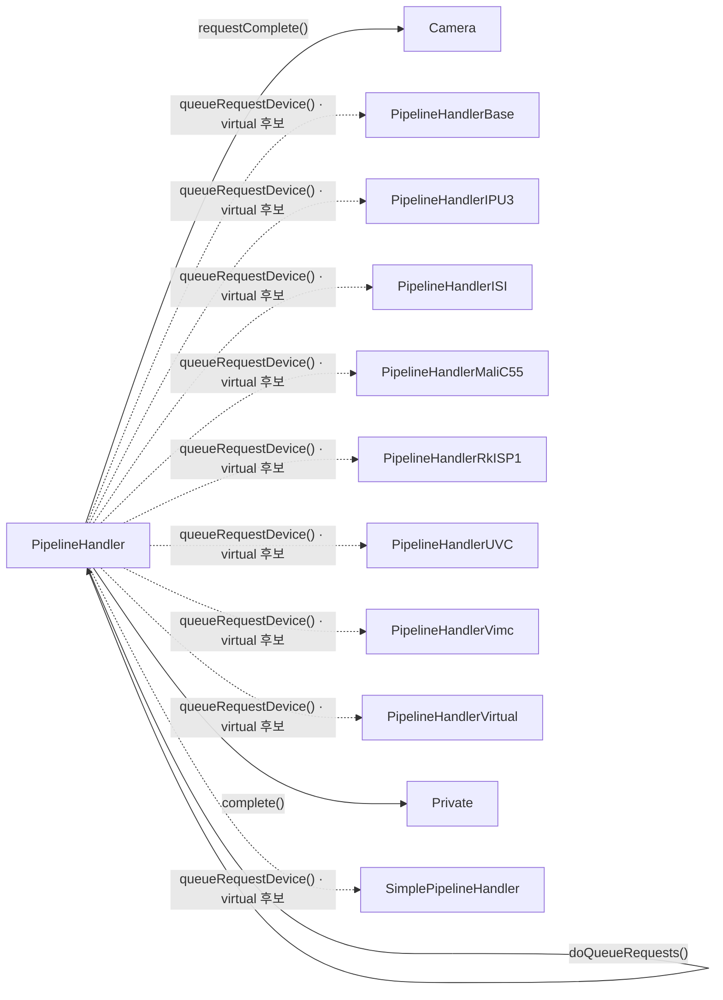

# 요청 완료 통지 (PipelineHandler::completeRequest)

**`PipelineHandler::completeRequest(Request *)` 의 주요 호출과 추적 경계를 확인한 뒤 필요한 상세 기록을 펼쳐 보세요.**

| 지금 확인할 내용 | 이동할 절 |
|---|---|
| 이 흐름에서 확인할 것 절을 확인합니다. | [이 흐름에서 확인할 것](#이-흐름에서-확인할-것) |
| 주요 확인 지점 절을 확인합니다. | [주요 확인 지점](#주요-확인-지점) |
| 주요 호출 관계 절을 확인합니다. | [주요 호출 관계](#주요-호출-관계) |
| 추적 범위와 경계 절을 확인합니다. | [추적 범위와 경계](#추적-범위와-경계) |
| 전체 추적 기록 절을 확인합니다. | [전체 추적 기록](#전체-추적-기록) |

## 이 흐름에서 확인할 것

`PipelineHandler::completeRequest(Request *)`에서 시작한 정적 탐색으로 호출 기록 139개를 수집했습니다. 주요 확인 지점 4개를 아래 표와 관계도에 표시합니다. 선택한 지점의 근거를 먼저 확인하고, 필요한 호출은 전체 추적 기록에서 찾아보세요.

가상 호출 후보·예약 대상 등 확인이 필요한 경계 기록이 20개 있습니다. 추적 범위와 경계 표에서 후보를 구분한 뒤 실제 객체와 연결 방식을 확인해야 합니다.

## 주요 확인 지점

아래 항목은 추출한 호출에서 고른 코드 탐색 지점입니다. 나열 순서는 실행 순서가 아닙니다.

| 확인할 내용 | 호출 측과 대상 | 구분 | 근거 |
|---|---|---|---|
| 완료 처리 | `PipelineHandler` → `Private::complete()` | 정적 호출 지점입니다. | `src/libcamera/pipeline_handler.cpp:588` |
| 완료 통지 | `PipelineHandler` → `Camera::requestComplete()` | 정적 호출 지점입니다. | `src/libcamera/pipeline_handler.cpp:599` |
| 대기 요청 처리 | `PipelineHandler` → `PipelineHandler::doQueueRequests()` | 정적 호출 지점입니다. | `src/libcamera/pipeline_handler.cpp:603` |
| 하드웨어별 큐잉 후보 | `PipelineHandler` → `PipelineHandlerISI::queueRequestDevice()` `PipelineHandler` → `PipelineHandlerIPU3::queueRequestDevice()` `PipelineHandler` → `PipelineHandlerMaliC55::queueRequestDevice()` `PipelineHandler` → `PipelineHandlerRkISP1::queueRequestDevice()` `PipelineHandler` → `PipelineHandlerBase::queueRequestDevice()` `PipelineHandler` → `SimplePipelineHandler::queueRequestDevice()` `PipelineHandler` → `PipelineHandlerUVC::queueRequestDevice()` `PipelineHandler` → `PipelineHandlerVimc::queueRequestDevice()` `PipelineHandler` → `PipelineHandlerVirtual::queueRequestDevice()` | 동적 디스패치 후보이며 실제 대상은 확인이 필요합니다. | `src/libcamera/pipeline_handler.cpp:498` |

## 주요 호출 관계

화살표는 호출 측과 대상을 연결합니다. 시간 순서나 모든 경로의 실행을 뜻하지 않습니다. 점선에는 가상 호출 후보·예약 대상 등 확인이 필요한 관계를 표시합니다.

## 추적 범위와 경계

facts에 기록된 호출은 139개이며, 요약의 hide 규칙에 해당하는 호출은 65개입니다. 전체 추적 기록에는 해당 호출도 모두 보존합니다. 기록 번호는 정적 탐색의 식별자이며 실행 순번이 아닙니다.

조건 분기, 반복 횟수와 실제 실행 스레드는 이 호출 목록만으로 확정할 수 없습니다. 가상 호출 후보는 실제 객체에 따라 선택됩니다. 예약 표시는 인자로 전달한 메서드 대상을 뜻하며, 비동기 실행을 보증하지 않습니다. 호출부의 연결 방식과 동기화 계약을 확인해야 합니다.

| 호출 지점 | 후보 또는 예약 대상 | 확인할 경계 | 근거 |
|---|---|---|---|
| `PipelineHandler` | `PipelineHandlerISI::queueRequestDevice()` `PipelineHandlerIPU3::queueRequestDevice()` `PipelineHandlerMaliC55::queueRequestDevice()` `PipelineHandlerRkISP1::queueRequestDevice()` `PipelineHandlerBase::queueRequestDevice()` `SimplePipelineHandler::queueRequestDevice()` `PipelineHandlerUVC::queueRequestDevice()` `PipelineHandlerVimc::queueRequestDevice()` `PipelineHandlerVirtual::queueRequestDevice()` | 동적 디스패치 후보이며 실제 대상은 확인이 필요합니다. | `src/libcamera/pipeline_handler.cpp:498` |
| `PipelineHandlerMaliC55` | `IPAProxyMaliC55Threaded::queueRequest()` `IPAProxyMaliC55Isolated::queueRequest()` `IPAMaliC55::queueRequest()` | 동적 디스패치 후보이며 실제 대상은 확인이 필요합니다. | `src/libcamera/pipeline/mali-c55/mali-c55.cpp:1598` |
| `PipelineHandlerMaliC55` | `IPAProxyMaliC55Threaded::fillParams()` `IPAProxyMaliC55Isolated::fillParams()` | 동적 디스패치 후보이며 실제 대상은 확인이 필요합니다. | `src/libcamera/pipeline/mali-c55/mali-c55.cpp:1599` |
| `PipelineHandlerRkISP1` | `IPAProxyRkISP1Threaded::queueRequest()` `IPAProxyRkISP1Isolated::queueRequest()` `IPARkISP1::queueRequest()` | 동적 디스패치 후보이며 실제 대상은 확인이 필요합니다. | `src/libcamera/pipeline/rkisp1/rkisp1.cpp:1349` |
| `PipelineHandlerRkISP1` | `IPAProxyRkISP1Threaded::computeParams()` `IPAProxyRkISP1Isolated::computeParams()` `IPARkISP1::computeParams()` | 동적 디스패치 후보이며 실제 대상은 확인이 필요합니다. | `src/libcamera/pipeline/rkisp1/rkisp1.cpp:1357` |

## 전체 추적 기록

아래 구간을 펼치면 요약에서 제외된 호출까지 확인할 수 있습니다. 이 목록은 추출 깊이 안에서 수집한 기록이며, 소스의 모든 실행 경로를 포함한다는 뜻은 아닙니다.

??? note "추적 기록 1–25 / 139개"

    | 기록 | 호출 측 | 대상 | 구분 | 근거 |
    |---|---|---|---|---|
    | 1 | `PipelineHandler` | `Private::camera()` | 정적 호출 지점입니다. | `src/libcamera/pipeline_handler.cpp:586` |
    | 2 | `PipelineHandler` | `Request::_d()` | 정적 호출 지점입니다. | `src/libcamera/pipeline_handler.cpp:586` |
    | 3 | `PipelineHandler` | `Private::complete()` | 정적 호출 지점입니다. | `src/libcamera/pipeline_handler.cpp:588` |
    | 4 | `Private` | `Private::_o()` | 정적 호출 지점입니다. | `src/libcamera/request.cpp:127` |
    | 5 | `Private` | `Request::status()` | 정적 호출 지점입니다. | `src/libcamera/request.cpp:129` |
    | 6 | `Private` | `log::isLogSeverityEnabled()` | 정적 호출 지점입니다. | `src/libcamera/request.cpp:129` |
    | 7 | `Private` | `LogMessageAbortGuard::LogMessageAbortGuard()` | 정적 호출 지점입니다. | `src/libcamera/request.cpp:129` |
    | 8 | `Private` | `LogMessage::stream()` | 정적 호출 지점입니다. | `src/libcamera/request.cpp:129` |
    | 9 | `Private` | `log::_log()` | 정적 호출 지점입니다. | `src/libcamera/request.cpp:129` |
    | 10 | `log` | `LogMessage::LogMessage()` | 정적 호출 지점입니다. | `src/libcamera/base/log.cpp:990` |
    | 11 | `LogMessage` | `utils::basename()` | 정적 호출 지점입니다. | `src/libcamera/base/log.cpp:858` |
    | 12 | `Private` | `Private::hasPendingBuffers()` | 정적 호출 지점입니다. | `src/libcamera/request.cpp:130` |
    | 13 | `Private` | `log::isLogSeverityEnabled()` | 정적 호출 지점입니다. | `src/libcamera/request.cpp:130` |
    | 14 | `Private` | `LogMessageAbortGuard::LogMessageAbortGuard()` | 정적 호출 지점입니다. | `src/libcamera/request.cpp:130` |
    | 15 | `Private` | `LogMessage::stream()` | 정적 호출 지점입니다. | `src/libcamera/request.cpp:130` |
    | 16 | `Private` | `log::_log()` | 정적 호출 지점입니다. | `src/libcamera/request.cpp:130` |
    | 17 | `log` | `LogMessage::LogMessage()` | 정적 호출 지점입니다. | `src/libcamera/base/log.cpp:990` |
    | 18 | `LogMessage` | `utils::basename()` | 정적 호출 지점입니다. | `src/libcamera/base/log.cpp:858` |
    | 19 | `Private` | `log::isLogSeverityEnabled()` | 정적 호출 지점입니다. | `src/libcamera/request.cpp:134` |
    | 20 | `Private` | `LogMessageAbortGuard::LogMessageAbortGuard()` | 정적 호출 지점입니다. | `src/libcamera/request.cpp:134` |
    | 21 | `Private` | `LogMessage::stream()` | 정적 호출 지점입니다. | `src/libcamera/request.cpp:134` |
    | 22 | `Private` | `log::_log()` | 정적 호출 지점입니다. | `src/libcamera/request.cpp:134` |
    | 23 | `log` | `LogMessage::LogMessage()` | 정적 호출 지점입니다. | `src/libcamera/base/log.cpp:990` |
    | 24 | `LogMessage` | `utils::basename()` | 정적 호출 지점입니다. | `src/libcamera/base/log.cpp:858` |
    | 25 | `Private` | `Request::toString()` | 정적 호출 지점입니다. | `src/libcamera/request.cpp:134` |

??? note "추적 기록 26–50 / 139개"

    | 기록 | 호출 측 | 대상 | 구분 | 근거 |
    |---|---|---|---|---|
    | 26 | `Request` | `request::operator<<()` | 정적 호출 지점입니다. | `src/libcamera/request.cpp:592` |
    | 27 | `request` | `Request::sequence()` | 정적 호출 지점입니다. | `src/libcamera/request.cpp:609` |
    | 28 | `request` | `Request::status()` | 정적 호출 지점입니다. | `src/libcamera/request.cpp:609` |
    | 29 | `request` | `Request::_d()` | 정적 호출 지점입니다. | `src/libcamera/request.cpp:610` |
    | 30 | `request` | `Request::buffers()` | 정적 호출 지점입니다. | `src/libcamera/request.cpp:610` |
    | 31 | `request` | `Request::cookie()` | 정적 호출 지점입니다. | `src/libcamera/request.cpp:611` |
    | 32 | `Private` | `tracepoints::unused()` | 정적 호출 지점입니다. | `src/libcamera/request.cpp:136` |
    | 33 | `PipelineHandler` | `Request::_d()` | 정적 호출 지점입니다. | `src/libcamera/pipeline_handler.cpp:588` |
    | 34 | `PipelineHandler` | `Camera::_d()` | 정적 호출 지점입니다. | `src/libcamera/pipeline_handler.cpp:590` |
    | 35 | `PipelineHandler` | `Request::status()` | 정적 호출 지점입니다. | `src/libcamera/pipeline_handler.cpp:594` |
    | 36 | `PipelineHandler` | `Request::hasPendingBuffers()` | 정적 호출 지점입니다. | `src/libcamera/pipeline_handler.cpp:597` |
    | 37 | `Request` | `Private::hasPendingBuffers()` | 정적 호출 지점입니다. | `src/libcamera/request.cpp:578` |
    | 38 | `Request` | `Request::_d()` | 정적 호출 지점입니다. | `src/libcamera/request.cpp:578` |
    | 39 | `PipelineHandler` | `log::isLogSeverityEnabled()` | 정적 호출 지점입니다. | `src/libcamera/pipeline_handler.cpp:597` |
    | 40 | `PipelineHandler` | `LogMessageAbortGuard::LogMessageAbortGuard()` | 정적 호출 지점입니다. | `src/libcamera/pipeline_handler.cpp:597` |
    | 41 | `PipelineHandler` | `LogMessage::stream()` | 정적 호출 지점입니다. | `src/libcamera/pipeline_handler.cpp:597` |
    | 42 | `PipelineHandler` | `log::_log()` | 정적 호출 지점입니다. | `src/libcamera/pipeline_handler.cpp:597` |
    | 43 | `log` | `LogMessage::LogMessage()` | 정적 호출 지점입니다. | `src/libcamera/base/log.cpp:990` |
    | 44 | `LogMessage` | `utils::basename()` | 정적 호출 지점입니다. | `src/libcamera/base/log.cpp:858` |
    | 45 | `PipelineHandler` | `Camera::requestComplete()` | 정적 호출 지점입니다. | `src/libcamera/pipeline_handler.cpp:599` |
    | 46 | `Camera` | `Private::isAccessAllowed()` | 정적 호출 지점입니다. | `src/libcamera/camera.cpp:1484` |
    | 47 | `Private` | `log::isLogSeverityEnabled()` | 정적 호출 지점입니다. | `src/libcamera/camera.cpp:720` |
    | 48 | `Private` | `LogMessageAbortGuard::LogMessageAbortGuard()` | 정적 호출 지점입니다. | `src/libcamera/camera.cpp:720` |
    | 49 | `Private` | `LogMessage::stream()` | 정적 호출 지점입니다. | `src/libcamera/camera.cpp:720` |
    | 50 | `Private` | `log::_log()` | 정적 호출 지점입니다. | `src/libcamera/camera.cpp:720` |

??? note "추적 기록 51–75 / 139개"

    | 기록 | 호출 측 | 대상 | 구분 | 근거 |
    |---|---|---|---|---|
    | 51 | `log` | `LogMessage::LogMessage()` | 정적 호출 지점입니다. | `src/libcamera/base/log.cpp:990` |
    | 52 | `Private` | `log::isLogSeverityEnabled()` | 정적 호출 지점입니다. | `src/libcamera/camera.cpp:723` |
    | 53 | `Private` | `LogMessageAbortGuard::LogMessageAbortGuard()` | 정적 호출 지점입니다. | `src/libcamera/camera.cpp:723` |
    | 54 | `Private` | `LogMessage::stream()` | 정적 호출 지점입니다. | `src/libcamera/camera.cpp:723` |
    | 55 | `Private` | `log::_log()` | 정적 호출 지점입니다. | `src/libcamera/camera.cpp:723` |
    | 56 | `log` | `LogMessage::LogMessage()` | 정적 호출 지점입니다. | `src/libcamera/base/log.cpp:990` |
    | 57 | `Camera` | `Camera::_d()` | 정적 호출 지점입니다. | `src/libcamera/camera.cpp:1484` |
    | 58 | `Camera` | `log::isLogSeverityEnabled()` | 정적 호출 지점입니다. | `src/libcamera/camera.cpp:1486` |
    | 59 | `Camera` | `LogMessageAbortGuard::LogMessageAbortGuard()` | 정적 호출 지점입니다. | `src/libcamera/camera.cpp:1486` |
    | 60 | `Camera` | `LogMessage::stream()` | 정적 호출 지점입니다. | `src/libcamera/camera.cpp:1486` |
    | 61 | `Camera` | `log::_log()` | 정적 호출 지점입니다. | `src/libcamera/camera.cpp:1486` |
    | 62 | `log` | `LogMessage::LogMessage()` | 정적 호출 지점입니다. | `src/libcamera/base/log.cpp:990` |
    | 63 | `LogMessage` | `utils::basename()` | 정적 호출 지점입니다. | `src/libcamera/base/log.cpp:858` |
    | 64 | `Camera` | `Signal::emit()` | 정적 호출 지점입니다. | `src/libcamera/camera.cpp:1488` |
    | 65 | `PipelineHandler` | `PipelineHandler::doQueueRequests()` | 정적 호출 지점입니다. | `src/libcamera/pipeline_handler.cpp:603` |
    | 66 | `PipelineHandler` | `Camera::_d()` | 정적 호출 지점입니다. | `src/libcamera/pipeline_handler.cpp:511` |
    | 67 | `PipelineHandler` | `Request::_d()` | 정적 호출 지점입니다. | `src/libcamera/pipeline_handler.cpp:517` |
    | 68 | `PipelineHandler` | `PipelineHandler::doQueueRequest()` | 정적 호출 지점입니다. | `src/libcamera/pipeline_handler.cpp:525` |
    | 69 | `PipelineHandler` | `tracepoints::unused()` | 정적 호출 지점입니다. | `src/libcamera/pipeline_handler.cpp:485` |
    | 70 | `PipelineHandler` | `Private::camera()` | 정적 호출 지점입니다. | `src/libcamera/pipeline_handler.cpp:487` |
    | 71 | `PipelineHandler` | `Request::_d()` | 정적 호출 지점입니다. | `src/libcamera/pipeline_handler.cpp:487` |
    | 72 | `PipelineHandler` | `Camera::_d()` | 정적 호출 지점입니다. | `src/libcamera/pipeline_handler.cpp:488` |
    | 73 | `PipelineHandler` | `Request::_d()` | 정적 호출 지점입니다. | `src/libcamera/pipeline_handler.cpp:491` |
    | 74 | `PipelineHandler` | `Request::_d()` | 정적 호출 지점입니다. | `src/libcamera/pipeline_handler.cpp:493` |
    | 75 | `PipelineHandler` | `PipelineHandler::completeRequest()` | 정적 호출 지점입니다. | `src/libcamera/pipeline_handler.cpp:494` |

??? note "추적 기록 76–100 / 139개"

    | 기록 | 호출 측 | 대상 | 구분 | 근거 |
    |---|---|---|---|---|
    | 76 | `PipelineHandler` | `PipelineHandlerISI::queueRequestDevice()` | 동적 디스패치 후보이며 실제 대상은 확인이 필요합니다. | `src/libcamera/pipeline_handler.cpp:498` |
    | 77 | `PipelineHandlerISI` | `Request::buffers()` | 정적 호출 지점입니다. | `src/libcamera/pipeline/imx8-isi/imx8-isi.cpp:958` |
    | 78 | `PipelineHandlerISI` | `PipelineHandlerISI::pipeFromStream()` | 정적 호출 지점입니다. | `src/libcamera/pipeline/imx8-isi/imx8-isi.cpp:959` |
    | 79 | `PipelineHandlerISI` | `V4L2VideoDevice::queueBuffer()` | 정적 호출 지점입니다. | `src/libcamera/pipeline/imx8-isi/imx8-isi.cpp:961` |
    | 80 | `PipelineHandler` | `PipelineHandlerIPU3::queueRequestDevice()` | 동적 디스패치 후보이며 실제 대상은 확인이 필요합니다. | `src/libcamera/pipeline_handler.cpp:498` |
    | 81 | `PipelineHandlerIPU3` | `PipelineHandlerIPU3::cameraData()` | 정적 호출 지점입니다. | `src/libcamera/pipeline/ipu3/ipu3.cpp:840` |
    | 82 | `PipelineHandlerIPU3` | `IPU3CameraData::queuePendingRequests()` | 정적 호출 지점입니다. | `src/libcamera/pipeline/ipu3/ipu3.cpp:843` |
    | 83 | `PipelineHandler` | `PipelineHandlerMaliC55::queueRequestDevice()` | 동적 디스패치 후보이며 실제 대상은 확인이 필요합니다. | `src/libcamera/pipeline_handler.cpp:498` |
    | 84 | `PipelineHandlerMaliC55` | `PipelineHandlerMaliC55::cameraData()` | 정적 호출 지점입니다. | `src/libcamera/pipeline/mali-c55/mali-c55.cpp:1563` |
    | 85 | `PipelineHandlerMaliC55` | `PipelineHandlerMaliC55::queueRequestToCru()` | 정적 호출 지점입니다. | `src/libcamera/pipeline/mali-c55/mali-c55.cpp:1570` |
    | 86 | `PipelineHandlerMaliC55` | `MaliC55FrameInfo::MaliC55FrameInfo()` | 정적 호출 지점입니다. | `src/libcamera/pipeline/mali-c55/mali-c55.cpp:1577` |
    | 87 | `PipelineHandlerMaliC55` | `MaliC55FrameInfo::operator=()` | 정적 호출 지점입니다. | `src/libcamera/pipeline/mali-c55/mali-c55.cpp:1584` |
    | 88 | `PipelineHandlerMaliC55` | `Request::sequence()` | 정적 호출 지점입니다. | `src/libcamera/pipeline/mali-c55/mali-c55.cpp:1584` |
    | 89 | `PipelineHandlerMaliC55` | `Request::buffers()` | 정적 호출 지점입니다. | `src/libcamera/pipeline/mali-c55/mali-c55.cpp:1586` |
    | 90 | `PipelineHandlerMaliC55` | `PipelineHandlerMaliC55::pipeFromStream()` | 정적 호출 지점입니다. | `src/libcamera/pipeline/mali-c55/mali-c55.cpp:1587` |
    | 91 | `PipelineHandlerMaliC55` | `V4L2VideoDevice::queueBuffer()` | 정적 호출 지점입니다. | `src/libcamera/pipeline/mali-c55/mali-c55.cpp:1589` |
    | 92 | `PipelineHandlerMaliC55` | `PipelineHandlerMaliC55::prepareFrameInfo()` | 정적 호출 지점입니다. | `src/libcamera/pipeline/mali-c55/mali-c55.cpp:1595` |
    | 93 | `PipelineHandlerMaliC55` | `log::isLogSeverityEnabled()` | 정적 호출 지점입니다. | `src/libcamera/pipeline/mali-c55/mali-c55.cpp:1596` |
    | 94 | `PipelineHandlerMaliC55` | `LogMessageAbortGuard::LogMessageAbortGuard()` | 정적 호출 지점입니다. | `src/libcamera/pipeline/mali-c55/mali-c55.cpp:1596` |
    | 95 | `PipelineHandlerMaliC55` | `LogMessage::stream()` | 정적 호출 지점입니다. | `src/libcamera/pipeline/mali-c55/mali-c55.cpp:1596` |
    | 96 | `PipelineHandlerMaliC55` | `log::_log()` | 정적 호출 지점입니다. | `src/libcamera/pipeline/mali-c55/mali-c55.cpp:1596` |
    | 97 | `PipelineHandlerMaliC55` | `IPAProxyMaliC55Threaded::queueRequest()` | 동적 디스패치 후보이며 실제 대상은 확인이 필요합니다. | `src/libcamera/pipeline/mali-c55/mali-c55.cpp:1598` |
    | 98 | `PipelineHandlerMaliC55` | `IPAProxyMaliC55Isolated::queueRequest()` | 동적 디스패치 후보이며 실제 대상은 확인이 필요합니다. | `src/libcamera/pipeline/mali-c55/mali-c55.cpp:1598` |
    | 99 | `PipelineHandlerMaliC55` | `IPAMaliC55::queueRequest()` | 동적 디스패치 후보이며 실제 대상은 확인이 필요합니다. | `src/libcamera/pipeline/mali-c55/mali-c55.cpp:1598` |
    | 100 | `PipelineHandlerMaliC55` | `Request::sequence()` | 정적 호출 지점입니다. | `src/libcamera/pipeline/mali-c55/mali-c55.cpp:1598` |

??? note "추적 기록 101–125 / 139개"

    | 기록 | 호출 측 | 대상 | 구분 | 근거 |
    |---|---|---|---|---|
    | 101 | `PipelineHandlerMaliC55` | `Request::controls()` | 정적 호출 지점입니다. | `src/libcamera/pipeline/mali-c55/mali-c55.cpp:1598` |
    | 102 | `PipelineHandlerMaliC55` | `IPAProxyMaliC55Threaded::fillParams()` | 동적 디스패치 후보이며 실제 대상은 확인이 필요합니다. | `src/libcamera/pipeline/mali-c55/mali-c55.cpp:1599` |
    | 103 | `PipelineHandlerMaliC55` | `IPAProxyMaliC55Isolated::fillParams()` | 동적 디스패치 후보이며 실제 대상은 확인이 필요합니다. | `src/libcamera/pipeline/mali-c55/mali-c55.cpp:1599` |
    | 104 | `PipelineHandlerMaliC55` | `Request::sequence()` | 정적 호출 지점입니다. | `src/libcamera/pipeline/mali-c55/mali-c55.cpp:1599` |
    | 105 | `PipelineHandlerMaliC55` | `FrameBuffer::cookie()` | 정적 호출 지점입니다. | `src/libcamera/pipeline/mali-c55/mali-c55.cpp:1600` |
    | 106 | `PipelineHandler` | `PipelineHandlerRkISP1::queueRequestDevice()` | 동적 디스패치 후보이며 실제 대상은 확인이 필요합니다. | `src/libcamera/pipeline_handler.cpp:498` |
    | 107 | `PipelineHandlerRkISP1` | `PipelineHandlerRkISP1::cameraData()` | 정적 호출 지점입니다. | `src/libcamera/pipeline/rkisp1/rkisp1.cpp:1343` |
    | 108 | `PipelineHandlerRkISP1` | `RkISP1Frames::create()` | 정적 호출 지점입니다. | `src/libcamera/pipeline/rkisp1/rkisp1.cpp:1345` |
    | 109 | `PipelineHandlerRkISP1` | `IPAProxyRkISP1Threaded::queueRequest()` | 동적 디스패치 후보이며 실제 대상은 확인이 필요합니다. | `src/libcamera/pipeline/rkisp1/rkisp1.cpp:1349` |
    | 110 | `PipelineHandlerRkISP1` | `IPAProxyRkISP1Isolated::queueRequest()` | 동적 디스패치 후보이며 실제 대상은 확인이 필요합니다. | `src/libcamera/pipeline/rkisp1/rkisp1.cpp:1349` |
    | 111 | `PipelineHandlerRkISP1` | `IPARkISP1::queueRequest()` | 동적 디스패치 후보이며 실제 대상은 확인이 필요합니다. | `src/libcamera/pipeline/rkisp1/rkisp1.cpp:1349` |
    | 112 | `PipelineHandlerRkISP1` | `Request::controls()` | 정적 호출 지점입니다. | `src/libcamera/pipeline/rkisp1/rkisp1.cpp:1349` |
    | 113 | `PipelineHandlerRkISP1` | `RkISP1Path::queueBuffer()` | 정적 호출 지점입니다. | `src/libcamera/pipeline/rkisp1/rkisp1.cpp:1352` |
    | 114 | `PipelineHandlerRkISP1` | `RkISP1Path::queueBuffer()` | 정적 호출 지점입니다. | `src/libcamera/pipeline/rkisp1/rkisp1.cpp:1355` |
    | 115 | `PipelineHandlerRkISP1` | `IPAProxyRkISP1Threaded::computeParams()` | 동적 디스패치 후보이며 실제 대상은 확인이 필요합니다. | `src/libcamera/pipeline/rkisp1/rkisp1.cpp:1357` |
    | 116 | `PipelineHandlerRkISP1` | `IPAProxyRkISP1Isolated::computeParams()` | 동적 디스패치 후보이며 실제 대상은 확인이 필요합니다. | `src/libcamera/pipeline/rkisp1/rkisp1.cpp:1357` |
    | 117 | `PipelineHandlerRkISP1` | `IPARkISP1::computeParams()` | 동적 디스패치 후보이며 실제 대상은 확인이 필요합니다. | `src/libcamera/pipeline/rkisp1/rkisp1.cpp:1357` |
    | 118 | `PipelineHandlerRkISP1` | `FrameBuffer::cookie()` | 정적 호출 지점입니다. | `src/libcamera/pipeline/rkisp1/rkisp1.cpp:1358` |
    | 119 | `PipelineHandler` | `PipelineHandlerBase::queueRequestDevice()` | 동적 디스패치 후보이며 실제 대상은 확인이 필요합니다. | `src/libcamera/pipeline_handler.cpp:498` |
    | 120 | `PipelineHandlerBase` | `PipelineHandlerBase::cameraData()` | 정적 호출 지점입니다. | `src/libcamera/pipeline/rpi/common/pipeline_base.cpp:757` |
    | 121 | `PipelineHandlerBase` | `CameraData::isRunning()` | 정적 호출 지점입니다. | `src/libcamera/pipeline/rpi/common/pipeline_base.cpp:759` |
    | 122 | `PipelineHandlerBase` | `log::isLogSeverityEnabled()` | 정적 호출 지점입니다. | `src/libcamera/pipeline/rpi/common/pipeline_base.cpp:762` |
    | 123 | `PipelineHandlerBase` | `LogMessageAbortGuard::LogMessageAbortGuard()` | 정적 호출 지점입니다. | `src/libcamera/pipeline/rpi/common/pipeline_base.cpp:762` |
    | 124 | `PipelineHandlerBase` | `LogMessage::stream()` | 정적 호출 지점입니다. | `src/libcamera/pipeline/rpi/common/pipeline_base.cpp:762` |
    | 125 | `PipelineHandlerBase` | `log::_log()` | 정적 호출 지점입니다. | `src/libcamera/pipeline/rpi/common/pipeline_base.cpp:762` |

??? note "추적 기록 126–139 / 139개"

    | 기록 | 호출 측 | 대상 | 구분 | 근거 |
    |---|---|---|---|---|
    | 126 | `PipelineHandlerBase` | `Request::sequence()` | 정적 호출 지점입니다. | `src/libcamera/pipeline/rpi/common/pipeline_base.cpp:763` |
    | 127 | `PipelineHandlerBase` | `Flags::operator!()` | 정적 호출 지점입니다. | `src/libcamera/pipeline/rpi/common/pipeline_base.cpp:767` |
    | 128 | `PipelineHandlerBase` | `Flags::operator&()` | 정적 호출 지점입니다. | `src/libcamera/pipeline/rpi/common/pipeline_base.cpp:767` |
    | 129 | `PipelineHandlerBase` | `Stream::getFlags()` | 정적 호출 지점입니다. | `src/libcamera/pipeline/rpi/common/pipeline_base.cpp:767` |
    | 130 | `PipelineHandlerBase` | `Request::findBuffer()` | 정적 호출 지점입니다. | `src/libcamera/pipeline/rpi/common/pipeline_base.cpp:770` |
    | 131 | `PipelineHandlerBase` | `Stream::getBufferId()` | 정적 호출 지점입니다. | `src/libcamera/pipeline/rpi/common/pipeline_base.cpp:771` |
    | 132 | `PipelineHandlerBase` | `Stream::setExportedBuffer()` | 정적 호출 지점입니다. | `src/libcamera/pipeline/rpi/common/pipeline_base.cpp:777` |
    | 133 | `PipelineHandlerBase` | `Stream::queueBuffer()` | 정적 호출 지점입니다. | `src/libcamera/pipeline/rpi/common/pipeline_base.cpp:791` |
    | 134 | `PipelineHandlerBase` | `CameraData::handleState()` | 정적 호출 지점입니다. | `src/libcamera/pipeline/rpi/common/pipeline_base.cpp:798` |
    | 135 | `PipelineHandler` | `SimplePipelineHandler::queueRequestDevice()` | 동적 디스패치 후보이며 실제 대상은 확인이 필요합니다. | `src/libcamera/pipeline_handler.cpp:498` |
    | 136 | `PipelineHandler` | `PipelineHandlerUVC::queueRequestDevice()` | 동적 디스패치 후보이며 실제 대상은 확인이 필요합니다. | `src/libcamera/pipeline_handler.cpp:498` |
    | 137 | `PipelineHandler` | `PipelineHandlerVimc::queueRequestDevice()` | 동적 디스패치 후보이며 실제 대상은 확인이 필요합니다. | `src/libcamera/pipeline_handler.cpp:498` |
    | 138 | `PipelineHandler` | `PipelineHandlerVirtual::queueRequestDevice()` | 동적 디스패치 후보이며 실제 대상은 확인이 필요합니다. | `src/libcamera/pipeline_handler.cpp:498` |
    | 139 | `PipelineHandler` | `PipelineHandler::cancelRequest()` | 정적 호출 지점입니다. | `src/libcamera/pipeline_handler.cpp:500` |

??? note "근거와 검토 정보"
    - 생성 방식: 추출 호출로 만든 시나리오
    - 검증 범위: 주요 호출과 경계를 facts에서 구성하고 전체 추적 기록을 보존합니다. 실행 순서를 추정하지 않습니다.
    - 근거 파일: `src/libcamera/base/log.cpp`, `src/libcamera/camera.cpp`, `src/libcamera/pipeline/imx8-isi/imx8-isi.cpp`, `src/libcamera/pipeline/ipu3/ipu3.cpp`, `src/libcamera/pipeline/mali-c55/mali-c55.cpp`, `src/libcamera/pipeline/rkisp1/rkisp1.cpp`, `src/libcamera/pipeline/rpi/common/pipeline_base.cpp`, `src/libcamera/pipeline_handler.cpp`, `src/libcamera/request.cpp`
    - 근거 수준: 코드 확인 (정적 분석, simple_compdb 구성, commit `960713a8f9`)
    - 자동 검사 (인용·문장 및 설정된 구조 검사): 통과
    - 검토 상태 기록일: 2026-10-26 · 사람 검토 전

다음 단계: [캡처 종료 요청 (Camera::stop)](camera_stop.md)
