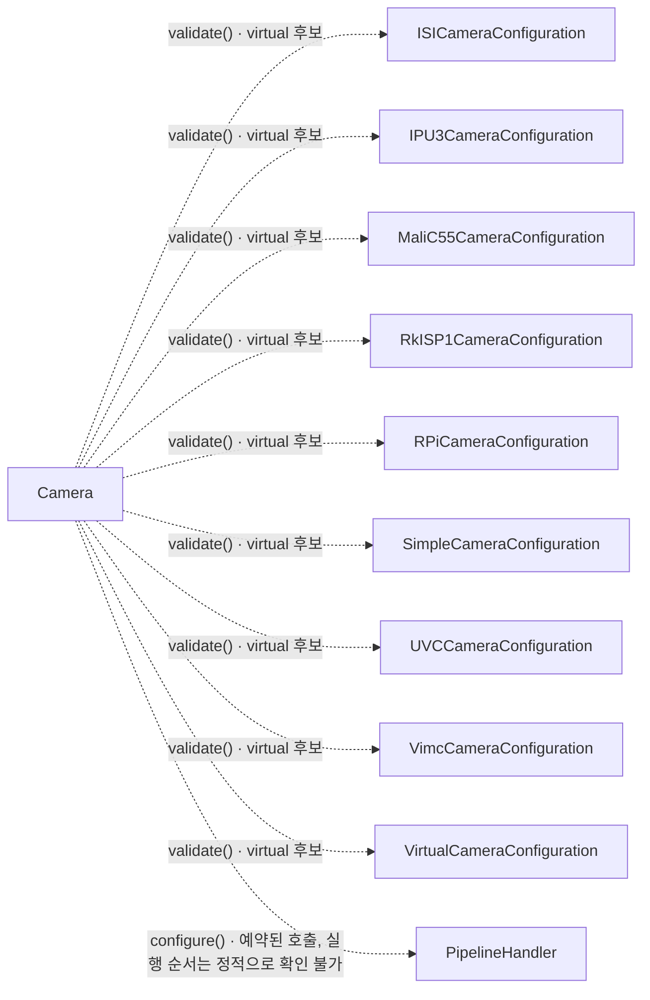

# 스트림 구성 (Camera::configure)

**`Camera::configure(CameraConfiguration *)` 의 주요 호출과 추적 경계를 확인한 뒤 필요한 상세 기록을 펼쳐 보세요.**

| 지금 확인할 내용 | 이동할 절 |
|---|---|
| 이 흐름에서 확인할 것 절을 확인합니다. | [이 흐름에서 확인할 것](#이-흐름에서-확인할-것) |
| 주요 확인 지점 절을 확인합니다. | [주요 확인 지점](#주요-확인-지점) |
| 주요 호출 관계 절을 확인합니다. | [주요 호출 관계](#주요-호출-관계) |
| 추적 범위와 경계 절을 확인합니다. | [추적 범위와 경계](#추적-범위와-경계) |
| 전체 추적 기록 절을 확인합니다. | [전체 추적 기록](#전체-추적-기록) |

## 이 흐름에서 확인할 것

`Camera::configure(CameraConfiguration *)`에서 시작한 정적 탐색으로 호출 기록 185개를 수집했습니다. 주요 확인 지점 2개를 아래 표와 관계도에 표시합니다. 선택한 지점의 근거를 먼저 확인하고, 필요한 호출은 전체 추적 기록에서 찾아보세요.

가상 호출 후보·예약 대상 등 확인이 필요한 경계 기록이 17개 있습니다. 추적 범위와 경계 표에서 후보를 구분한 뒤 실제 객체와 연결 방식을 확인해야 합니다.

## 주요 확인 지점

아래 항목은 추출한 호출에서 고른 코드 탐색 지점입니다. 나열 순서는 실행 순서가 아닙니다.

| 확인할 내용 | 호출 측과 대상 | 구분 | 근거 |
|---|---|---|---|
| 구성 검증 | `Camera` → `ISICameraConfiguration::validate()` `Camera` → `IPU3CameraConfiguration::validate()` `Camera` → `MaliC55CameraConfiguration::validate()` `Camera` → `RkISP1CameraConfiguration::validate()` `Camera` → `RPiCameraConfiguration::validate()` `Camera` → `SimpleCameraConfiguration::validate()` `Camera` → `UVCCameraConfiguration::validate()` `Camera` → `VimcCameraConfiguration::validate()` `Camera` → `VirtualCameraConfiguration::validate()` | 동적 디스패치 후보이며 실제 대상은 확인이 필요합니다. | `src/libcamera/camera.cpp:1203` |
| 파이프라인 구성 대상 | `Camera` → `PipelineHandler::configure()` | 메서드 전달 대상이며 동기·비동기 여부는 호출부에서 확인해야 합니다. | `src/libcamera/camera.cpp:1218` |

## 주요 호출 관계

화살표는 호출 측과 대상을 연결합니다. 시간 순서나 모든 경로의 실행을 뜻하지 않습니다. 점선에는 가상 호출 후보·예약 대상 등 확인이 필요한 관계를 표시합니다.

## 추적 범위와 경계

facts에 기록된 호출은 185개이며, 요약의 hide 규칙에 해당하는 호출은 107개입니다. 전체 추적 기록에는 해당 호출도 모두 보존합니다. 기록 번호는 정적 탐색의 식별자이며 실행 순번이 아닙니다.

조건 분기, 반복 횟수와 실제 실행 스레드는 이 호출 목록만으로 확정할 수 없습니다. 가상 호출 후보는 실제 객체에 따라 선택됩니다. 예약 표시는 인자로 전달한 메서드 대상을 뜻하며, 비동기 실행을 보증하지 않습니다. 호출부의 연결 방식과 동기화 계약을 확인해야 합니다.

| 호출 지점 | 후보 또는 예약 대상 | 확인할 경계 | 근거 |
|---|---|---|---|
| `Camera` | `ISICameraConfiguration::validate()` `IPU3CameraConfiguration::validate()` `MaliC55CameraConfiguration::validate()` `RkISP1CameraConfiguration::validate()` `RPiCameraConfiguration::validate()` `SimpleCameraConfiguration::validate()` `UVCCameraConfiguration::validate()` `VimcCameraConfiguration::validate()` `VirtualCameraConfiguration::validate()` | 동적 디스패치 후보이며 실제 대상은 확인이 필요합니다. | `src/libcamera/camera.cpp:1203` |
| `ISICameraConfiguration` | `CameraSensorLegacy::resolution()` `CameraSensorRaw::resolution()` | 동적 디스패치 후보이며 실제 대상은 확인이 필요합니다. | `src/libcamera/pipeline/imx8-isi/imx8-isi.cpp:523` |
| `ISICameraData` | `CameraSensorLegacy::mbusCodes()` `CameraSensorRaw::mbusCodes()` | 동적 디스패치 후보이며 실제 대상은 확인이 필요합니다. | `src/libcamera/pipeline/imx8-isi/imx8-isi.cpp:185` |
| `ISICameraData` | `?::rawFormat()` | 정적 추적 불가 | `src/libcamera/pipeline/imx8-isi/imx8-isi.cpp:237` |
| `ISICameraConfiguration` | `CameraSensorLegacy::sizes()` `CameraSensorRaw::sizes()` | 동적 디스패치 후보이며 실제 대상은 확인이 필요합니다. | `src/libcamera/pipeline/imx8-isi/imx8-isi.cpp:575` |
| `Camera` | `PipelineHandler::configure()` | 메서드 전달 대상이며 동기·비동기 여부는 호출부에서 확인해야 합니다. | `src/libcamera/camera.cpp:1218` |

추출 통계: 미해결 호출 1개, 예약된 호출 1개입니다.

## 전체 추적 기록

아래 구간을 펼치면 요약에서 제외된 호출까지 확인할 수 있습니다. 이 목록은 추출 깊이 안에서 수집한 기록이며, 소스의 모든 실행 경로를 포함한다는 뜻은 아닙니다.

??? note "추적 기록 1–25 / 185개"

    | 기록 | 호출 측 | 대상 | 구분 | 근거 |
    |---|---|---|---|---|
    | 1 | `Camera` | `Camera::_d()` | 정적 호출 지점입니다. | `src/libcamera/camera.cpp:1193` |
    | 2 | `Camera` | `Private::isAccessAllowed()` | 정적 호출 지점입니다. | `src/libcamera/camera.cpp:1195` |
    | 3 | `Private` | `log::isLogSeverityEnabled()` | 정적 호출 지점입니다. | `src/libcamera/camera.cpp:720` |
    | 4 | `Private` | `LogMessageAbortGuard::LogMessageAbortGuard()` | 정적 호출 지점입니다. | `src/libcamera/camera.cpp:720` |
    | 5 | `Private` | `LogMessage::stream()` | 정적 호출 지점입니다. | `src/libcamera/camera.cpp:720` |
    | 6 | `Private` | `log::_log()` | 정적 호출 지점입니다. | `src/libcamera/camera.cpp:720` |
    | 7 | `log` | `LogMessage::LogMessage()` | 정적 호출 지점입니다. | `src/libcamera/base/log.cpp:990` |
    | 8 | `LogMessage` | `utils::basename()` | 정적 호출 지점입니다. | `src/libcamera/base/log.cpp:858` |
    | 9 | `Private` | `log::isLogSeverityEnabled()` | 정적 호출 지점입니다. | `src/libcamera/camera.cpp:723` |
    | 10 | `Private` | `LogMessageAbortGuard::LogMessageAbortGuard()` | 정적 호출 지점입니다. | `src/libcamera/camera.cpp:723` |
    | 11 | `Private` | `LogMessage::stream()` | 정적 호출 지점입니다. | `src/libcamera/camera.cpp:723` |
    | 12 | `Private` | `log::_log()` | 정적 호출 지점입니다. | `src/libcamera/camera.cpp:723` |
    | 13 | `log` | `LogMessage::LogMessage()` | 정적 호출 지점입니다. | `src/libcamera/base/log.cpp:990` |
    | 14 | `LogMessage` | `utils::basename()` | 정적 호출 지점입니다. | `src/libcamera/base/log.cpp:858` |
    | 15 | `Camera` | `StreamConfiguration::setStream()` | 정적 호출 지점입니다. | `src/libcamera/camera.cpp:1201` |
    | 16 | `Camera` | `ISICameraConfiguration::validate()` | 동적 디스패치 후보이며 실제 대상은 확인이 필요합니다. | `src/libcamera/camera.cpp:1203` |
    | 17 | `ISICameraConfiguration` | `CameraSensorLegacy::resolution()` | 동적 디스패치 후보이며 실제 대상은 확인이 필요합니다. | `src/libcamera/pipeline/imx8-isi/imx8-isi.cpp:523` |
    | 18 | `CameraSensorLegacy` | `Size::Size()` | 정적 호출 지점입니다. | `src/libcamera/sensor/camera_sensor_legacy.cpp:715` |
    | 19 | `CameraSensorLegacy` | `Rectangle::size()` | 정적 호출 지점입니다. | `src/libcamera/sensor/camera_sensor_legacy.cpp:715` |
    | 20 | `Rectangle` | `Size::Size()` | 정적 호출 지점입니다. | `include/libcamera/geometry.h:290` |
    | 21 | `ISICameraConfiguration` | `CameraSensorRaw::resolution()` | 동적 디스패치 후보이며 실제 대상은 확인이 필요합니다. | `src/libcamera/pipeline/imx8-isi/imx8-isi.cpp:523` |
    | 22 | `CameraSensorRaw` | `Size::Size()` | 정적 호출 지점입니다. | `src/libcamera/sensor/camera_sensor_raw.cpp:777` |
    | 23 | `CameraSensorRaw` | `Rectangle::size()` | 정적 호출 지점입니다. | `src/libcamera/sensor/camera_sensor_raw.cpp:777` |
    | 24 | `Rectangle` | `Size::Size()` | 정적 호출 지점입니다. | `include/libcamera/geometry.h:290` |
    | 25 | `ISICameraConfiguration` | `PixelFormatInfo::PixelFormatInfo()` | 정적 호출 지점입니다. | `src/libcamera/pipeline/imx8-isi/imx8-isi.cpp:528` |

??? note "추적 기록 26–50 / 185개"

    | 기록 | 호출 측 | 대상 | 구분 | 근거 |
    |---|---|---|---|---|
    | 26 | `ISICameraConfiguration` | `PixelFormatInfo::info()` | 정적 호출 지점입니다. | `src/libcamera/pipeline/imx8-isi/imx8-isi.cpp:528` |
    | 27 | `PixelFormatInfo` | `log::isLogSeverityEnabled()` | 정적 호출 지점입니다. | `src/libcamera/formats.cpp:1006` |
    | 28 | `PixelFormatInfo` | `utils::operator<<()` | 정적 호출 지점입니다. | `src/libcamera/formats.cpp:1006` |
    | 29 | `PixelFormatInfo` | `LogMessageAbortGuard::LogMessageAbortGuard()` | 정적 호출 지점입니다. | `src/libcamera/formats.cpp:1006` |
    | 30 | `PixelFormatInfo` | `LogMessage::stream()` | 정적 호출 지점입니다. | `src/libcamera/formats.cpp:1006` |
    | 31 | `PixelFormatInfo` | `log::_log()` | 정적 호출 지점입니다. | `src/libcamera/formats.cpp:1006` |
    | 32 | `log` | `LogMessage::LogMessage()` | 정적 호출 지점입니다. | `src/libcamera/base/log.cpp:990` |
    | 33 | `PixelFormatInfo` | `utils::hex()` | 정적 호출 지점입니다. | `src/libcamera/formats.cpp:1008` |
    | 34 | `PixelFormatInfo` | `PixelFormat::fourcc()` | 정적 호출 지점입니다. | `src/libcamera/formats.cpp:1008` |
    | 35 | `ISICameraConfiguration` | `ISICameraConfiguration::validateRaw()` | 정적 호출 지점입니다. | `src/libcamera/pipeline/imx8-isi/imx8-isi.cpp:532` |
    | 36 | `ISICameraConfiguration` | `PixelFormat::PixelFormat()` | 정적 호출 지점입니다. | `src/libcamera/pipeline/imx8-isi/imx8-isi.cpp:375` |
    | 37 | `ISICameraConfiguration` | `ISICameraData::getRawMediaBusFormat()` | 정적 호출 지점입니다. | `src/libcamera/pipeline/imx8-isi/imx8-isi.cpp:377` |
    | 38 | `ISICameraData` | `CameraSensorLegacy::mbusCodes()` | 동적 디스패치 후보이며 실제 대상은 확인이 필요합니다. | `src/libcamera/pipeline/imx8-isi/imx8-isi.cpp:185` |
    | 39 | `ISICameraData` | `CameraSensorRaw::mbusCodes()` | 동적 디스패치 후보이며 실제 대상은 확인이 필요합니다. | `src/libcamera/pipeline/imx8-isi/imx8-isi.cpp:185` |
    | 40 | `ISICameraData` | `log::isLogSeverityEnabled()` | 정적 호출 지점입니다. | `src/libcamera/pipeline/imx8-isi/imx8-isi.cpp:216` |
    | 41 | `ISICameraData` | `LogMessageAbortGuard::LogMessageAbortGuard()` | 정적 호출 지점입니다. | `src/libcamera/pipeline/imx8-isi/imx8-isi.cpp:216` |
    | 42 | `ISICameraData` | `LogMessage::stream()` | 정적 호출 지점입니다. | `src/libcamera/pipeline/imx8-isi/imx8-isi.cpp:216` |
    | 43 | `ISICameraData` | `log::_log()` | 정적 호출 지점입니다. | `src/libcamera/pipeline/imx8-isi/imx8-isi.cpp:216` |
    | 44 | `ISICameraData` | `PixelFormat::operator=()` | 정적 호출 지점입니다. | `src/libcamera/pipeline/imx8-isi/imx8-isi.cpp:226` |
    | 45 | `ISICameraData` | `PixelFormat::PixelFormat()` | 정적 호출 지점입니다. | `src/libcamera/pipeline/imx8-isi/imx8-isi.cpp:226` |
    | 46 | `ISICameraData` | `BayerFormat::fromMbusCode()` | 정적 호출 지점입니다. | `src/libcamera/pipeline/imx8-isi/imx8-isi.cpp:230` |
    | 47 | `ISICameraData` | `BayerFormat::isValid()` | 정적 호출 지점입니다. | `src/libcamera/pipeline/imx8-isi/imx8-isi.cpp:231` |
    | 48 | `ISICameraData` | `?::rawFormat()` | 정적 추적 불가 | `src/libcamera/pipeline/imx8-isi/imx8-isi.cpp:237` |
    | 49 | `ISICameraData` | `log::isLogSeverityEnabled()` | 정적 호출 지점입니다. | `src/libcamera/pipeline/imx8-isi/imx8-isi.cpp:241` |
    | 50 | `ISICameraData` | `bayer_format::operator<<()` | 정적 호출 지점입니다. | `src/libcamera/pipeline/imx8-isi/imx8-isi.cpp:241` |

??? note "추적 기록 51–75 / 185개"

    | 기록 | 호출 측 | 대상 | 구분 | 근거 |
    |---|---|---|---|---|
    | 51 | `ISICameraData` | `LogMessageAbortGuard::LogMessageAbortGuard()` | 정적 호출 지점입니다. | `src/libcamera/pipeline/imx8-isi/imx8-isi.cpp:241` |
    | 52 | `ISICameraData` | `LogMessage::stream()` | 정적 호출 지점입니다. | `src/libcamera/pipeline/imx8-isi/imx8-isi.cpp:241` |
    | 53 | `ISICameraData` | `log::_log()` | 정적 호출 지점입니다. | `src/libcamera/pipeline/imx8-isi/imx8-isi.cpp:241` |
    | 54 | `ISICameraData` | `PixelFormat::operator=()` | 정적 호출 지점입니다. | `src/libcamera/pipeline/imx8-isi/imx8-isi.cpp:249` |
    | 55 | `ISICameraData` | `PixelFormat::isValid()` | 정적 호출 지점입니다. | `src/libcamera/pipeline/imx8-isi/imx8-isi.cpp:254` |
    | 56 | `ISICameraData` | `log::isLogSeverityEnabled()` | 정적 호출 지점입니다. | `src/libcamera/pipeline/imx8-isi/imx8-isi.cpp:255` |
    | 57 | `ISICameraData` | `LogMessageAbortGuard::LogMessageAbortGuard()` | 정적 호출 지점입니다. | `src/libcamera/pipeline/imx8-isi/imx8-isi.cpp:255` |
    | 58 | `ISICameraData` | `LogMessage::stream()` | 정적 호출 지점입니다. | `src/libcamera/pipeline/imx8-isi/imx8-isi.cpp:255` |
    | 59 | `ISICameraData` | `log::_log()` | 정적 호출 지점입니다. | `src/libcamera/pipeline/imx8-isi/imx8-isi.cpp:255` |
    | 60 | `ISICameraConfiguration` | `log::isLogSeverityEnabled()` | 정적 호출 지점입니다. | `src/libcamera/pipeline/imx8-isi/imx8-isi.cpp:379` |
    | 61 | `ISICameraConfiguration` | `pixel_format::operator<<()` | 정적 호출 지점입니다. | `src/libcamera/pipeline/imx8-isi/imx8-isi.cpp:379` |
    | 62 | `pixel_format` | `PixelFormat::toString()` | 정적 호출 지점입니다. | `src/libcamera/pixel_format.cpp:151` |
    | 63 | `ISICameraConfiguration` | `LogMessageAbortGuard::LogMessageAbortGuard()` | 정적 호출 지점입니다. | `src/libcamera/pipeline/imx8-isi/imx8-isi.cpp:379` |
    | 64 | `ISICameraConfiguration` | `LogMessage::stream()` | 정적 호출 지점입니다. | `src/libcamera/pipeline/imx8-isi/imx8-isi.cpp:379` |
    | 65 | `ISICameraConfiguration` | `log::_log()` | 정적 호출 지점입니다. | `src/libcamera/pipeline/imx8-isi/imx8-isi.cpp:379` |
    | 66 | `log` | `LogMessage::LogMessage()` | 정적 호출 지점입니다. | `src/libcamera/base/log.cpp:990` |
    | 67 | `ISICameraConfiguration` | `PixelFormat::operator!=()` | 정적 호출 지점입니다. | `src/libcamera/pipeline/imx8-isi/imx8-isi.cpp:384` |
    | 68 | `PixelFormat` | `PixelFormat::operator==()` | 정적 호출 지점입니다. | `include/libcamera/pixel_format.h:30` |
    | 69 | `ISICameraConfiguration` | `log::isLogSeverityEnabled()` | 정적 호출 지점입니다. | `src/libcamera/pipeline/imx8-isi/imx8-isi.cpp:385` |
    | 70 | `ISICameraConfiguration` | `pixel_format::operator<<()` | 정적 호출 지점입니다. | `src/libcamera/pipeline/imx8-isi/imx8-isi.cpp:385` |
    | 71 | `pixel_format` | `PixelFormat::toString()` | 정적 호출 지점입니다. | `src/libcamera/pixel_format.cpp:151` |
    | 72 | `ISICameraConfiguration` | `LogMessageAbortGuard::LogMessageAbortGuard()` | 정적 호출 지점입니다. | `src/libcamera/pipeline/imx8-isi/imx8-isi.cpp:385` |
    | 73 | `ISICameraConfiguration` | `LogMessage::stream()` | 정적 호출 지점입니다. | `src/libcamera/pipeline/imx8-isi/imx8-isi.cpp:385` |
    | 74 | `ISICameraConfiguration` | `log::_log()` | 정적 호출 지점입니다. | `src/libcamera/pipeline/imx8-isi/imx8-isi.cpp:385` |
    | 75 | `log` | `LogMessage::LogMessage()` | 정적 호출 지점입니다. | `src/libcamera/base/log.cpp:990` |

??? note "추적 기록 76–100 / 185개"

    | 기록 | 호출 측 | 대상 | 구분 | 근거 |
    |---|---|---|---|---|
    | 76 | `ISICameraConfiguration` | `PixelFormat::operator=()` | 정적 호출 지점입니다. | `src/libcamera/pipeline/imx8-isi/imx8-isi.cpp:387` |
    | 77 | `ISICameraConfiguration` | `Size::Size()` | 정적 호출 지점입니다. | `src/libcamera/pipeline/imx8-isi/imx8-isi.cpp:392` |
    | 78 | `ISICameraConfiguration` | `Size::boundTo()` | 정적 호출 지점입니다. | `src/libcamera/pipeline/imx8-isi/imx8-isi.cpp:393` |
    | 79 | `ISICameraConfiguration` | `geometry::operator!=()` | 정적 호출 지점입니다. | `src/libcamera/pipeline/imx8-isi/imx8-isi.cpp:394` |
    | 80 | `geometry` | `geometry::operator==()` | 정적 호출 지점입니다. | `include/libcamera/geometry.h:184` |
    | 81 | `ISICameraConfiguration` | `log::isLogSeverityEnabled()` | 정적 호출 지점입니다. | `src/libcamera/pipeline/imx8-isi/imx8-isi.cpp:395` |
    | 82 | `ISICameraConfiguration` | `geometry::operator<<()` | 정적 호출 지점입니다. | `src/libcamera/pipeline/imx8-isi/imx8-isi.cpp:395` |
    | 83 | `ISICameraConfiguration` | `LogMessageAbortGuard::LogMessageAbortGuard()` | 정적 호출 지점입니다. | `src/libcamera/pipeline/imx8-isi/imx8-isi.cpp:395` |
    | 84 | `ISICameraConfiguration` | `LogMessage::stream()` | 정적 호출 지점입니다. | `src/libcamera/pipeline/imx8-isi/imx8-isi.cpp:395` |
    | 85 | `ISICameraConfiguration` | `log::_log()` | 정적 호출 지점입니다. | `src/libcamera/pipeline/imx8-isi/imx8-isi.cpp:395` |
    | 86 | `log` | `LogMessage::LogMessage()` | 정적 호출 지점입니다. | `src/libcamera/base/log.cpp:990` |
    | 87 | `ISICameraConfiguration` | `enumerate_iterator::operator*()` | 정적 호출 지점입니다. | `src/libcamera/pipeline/imx8-isi/imx8-isi.cpp:401` |
    | 88 | `ISICameraConfiguration` | `utils::enumerate()` | 정적 호출 지점입니다. | `src/libcamera/pipeline/imx8-isi/imx8-isi.cpp:401` |
    | 89 | `ISICameraConfiguration` | `log::isLogSeverityEnabled()` | 정적 호출 지점입니다. | `src/libcamera/pipeline/imx8-isi/imx8-isi.cpp:403` |
    | 90 | `ISICameraConfiguration` | `LogMessageAbortGuard::LogMessageAbortGuard()` | 정적 호출 지점입니다. | `src/libcamera/pipeline/imx8-isi/imx8-isi.cpp:403` |
    | 91 | `ISICameraConfiguration` | `LogMessage::stream()` | 정적 호출 지점입니다. | `src/libcamera/pipeline/imx8-isi/imx8-isi.cpp:403` |
    | 92 | `ISICameraConfiguration` | `log::_log()` | 정적 호출 지점입니다. | `src/libcamera/pipeline/imx8-isi/imx8-isi.cpp:403` |
    | 93 | `log` | `LogMessage::LogMessage()` | 정적 호출 지점입니다. | `src/libcamera/base/log.cpp:990` |
    | 94 | `ISICameraConfiguration` | `StreamConfiguration::toString()` | 정적 호출 지점입니다. | `src/libcamera/pipeline/imx8-isi/imx8-isi.cpp:403` |
    | 95 | `StreamConfiguration` | `stream::operator<<()` | 정적 호출 지점입니다. | `src/libcamera/stream.cpp:396` |
    | 96 | `ISICameraConfiguration` | `PixelFormat::PixelFormat()` | 정적 호출 지점입니다. | `src/libcamera/pipeline/imx8-isi/imx8-isi.cpp:404` |
    | 97 | `ISICameraConfiguration` | `Size::Size()` | 정적 호출 지점입니다. | `src/libcamera/pipeline/imx8-isi/imx8-isi.cpp:405` |
    | 98 | `ISICameraConfiguration` | `PixelFormat::operator=()` | 정적 호출 지점입니다. | `src/libcamera/pipeline/imx8-isi/imx8-isi.cpp:407` |
    | 99 | `ISICameraConfiguration` | `Size::operator=()` | 정적 호출 지점입니다. | `src/libcamera/pipeline/imx8-isi/imx8-isi.cpp:408` |
    | 100 | `ISICameraConfiguration` | `PixelFormat::operator!=()` | 정적 호출 지점입니다. | `src/libcamera/pipeline/imx8-isi/imx8-isi.cpp:410` |

??? note "추적 기록 101–125 / 185개"

    | 기록 | 호출 측 | 대상 | 구분 | 근거 |
    |---|---|---|---|---|
    | 101 | `PixelFormat` | `PixelFormat::operator==()` | 정적 호출 지점입니다. | `include/libcamera/pixel_format.h:30` |
    | 102 | `ISICameraConfiguration` | `geometry::operator!=()` | 정적 호출 지점입니다. | `src/libcamera/pipeline/imx8-isi/imx8-isi.cpp:410` |
    | 103 | `geometry` | `geometry::operator==()` | 정적 호출 지점입니다. | `include/libcamera/geometry.h:184` |
    | 104 | `ISICameraConfiguration` | `log::isLogSeverityEnabled()` | 정적 호출 지점입니다. | `src/libcamera/pipeline/imx8-isi/imx8-isi.cpp:411` |
    | 105 | `ISICameraConfiguration` | `LogMessageAbortGuard::LogMessageAbortGuard()` | 정적 호출 지점입니다. | `src/libcamera/pipeline/imx8-isi/imx8-isi.cpp:411` |
    | 106 | `ISICameraConfiguration` | `LogMessage::stream()` | 정적 호출 지점입니다. | `src/libcamera/pipeline/imx8-isi/imx8-isi.cpp:411` |
    | 107 | `ISICameraConfiguration` | `log::_log()` | 정적 호출 지점입니다. | `src/libcamera/pipeline/imx8-isi/imx8-isi.cpp:411` |
    | 108 | `log` | `LogMessage::LogMessage()` | 정적 호출 지점입니다. | `src/libcamera/base/log.cpp:990` |
    | 109 | `ISICameraConfiguration` | `StreamConfiguration::toString()` | 정적 호출 지점입니다. | `src/libcamera/pipeline/imx8-isi/imx8-isi.cpp:412` |
    | 110 | `StreamConfiguration` | `stream::operator<<()` | 정적 호출 지점입니다. | `src/libcamera/stream.cpp:396` |
    | 111 | `ISICameraConfiguration` | `PixelFormatInfo::info()` | 정적 호출 지점입니다. | `src/libcamera/pipeline/imx8-isi/imx8-isi.cpp:416` |
    | 112 | `PixelFormatInfo` | `log::isLogSeverityEnabled()` | 정적 호출 지점입니다. | `src/libcamera/formats.cpp:1006` |
    | 113 | `PixelFormatInfo` | `utils::operator<<()` | 정적 호출 지점입니다. | `src/libcamera/formats.cpp:1006` |
    | 114 | `PixelFormatInfo` | `LogMessageAbortGuard::LogMessageAbortGuard()` | 정적 호출 지점입니다. | `src/libcamera/formats.cpp:1006` |
    | 115 | `PixelFormatInfo` | `LogMessage::stream()` | 정적 호출 지점입니다. | `src/libcamera/formats.cpp:1006` |
    | 116 | `PixelFormatInfo` | `log::_log()` | 정적 호출 지점입니다. | `src/libcamera/formats.cpp:1006` |
    | 117 | `PixelFormatInfo` | `utils::hex()` | 정적 호출 지점입니다. | `src/libcamera/formats.cpp:1008` |
    | 118 | `PixelFormatInfo` | `PixelFormat::fourcc()` | 정적 호출 지점입니다. | `src/libcamera/formats.cpp:1008` |
    | 119 | `ISICameraConfiguration` | `PixelFormatInfo::stride()` | 정적 호출 지점입니다. | `src/libcamera/pipeline/imx8-isi/imx8-isi.cpp:417` |
    | 120 | `PixelFormatInfo` | `PixelFormatInfo::isValid()` | 정적 호출 지점입니다. | `src/libcamera/formats.cpp:1073` |
    | 121 | `PixelFormatInfo` | `log::isLogSeverityEnabled()` | 정적 호출 지점입니다. | `src/libcamera/formats.cpp:1074` |
    | 122 | `PixelFormatInfo` | `LogMessageAbortGuard::LogMessageAbortGuard()` | 정적 호출 지점입니다. | `src/libcamera/formats.cpp:1074` |
    | 123 | `PixelFormatInfo` | `LogMessage::stream()` | 정적 호출 지점입니다. | `src/libcamera/formats.cpp:1074` |
    | 124 | `PixelFormatInfo` | `log::_log()` | 정적 호출 지점입니다. | `src/libcamera/formats.cpp:1074` |
    | 125 | `PixelFormatInfo` | `log::isLogSeverityEnabled()` | 정적 호출 지점입니다. | `src/libcamera/formats.cpp:1079` |

??? note "추적 기록 126–150 / 185개"

    | 기록 | 호출 측 | 대상 | 구분 | 근거 |
    |---|---|---|---|---|
    | 126 | `PixelFormatInfo` | `LogMessageAbortGuard::LogMessageAbortGuard()` | 정적 호출 지점입니다. | `src/libcamera/formats.cpp:1079` |
    | 127 | `PixelFormatInfo` | `LogMessage::stream()` | 정적 호출 지점입니다. | `src/libcamera/formats.cpp:1079` |
    | 128 | `PixelFormatInfo` | `log::_log()` | 정적 호출 지점입니다. | `src/libcamera/formats.cpp:1079` |
    | 129 | `ISICameraConfiguration` | `PixelFormatInfo::frameSize()` | 정적 호출 지점입니다. | `src/libcamera/pipeline/imx8-isi/imx8-isi.cpp:418` |
    | 130 | `ISICameraConfiguration` | `StreamConfiguration::setStream()` | 정적 호출 지점입니다. | `src/libcamera/pipeline/imx8-isi/imx8-isi.cpp:422` |
    | 131 | `ISICameraConfiguration` | `ISICameraConfiguration::validateYuv()` | 정적 호출 지점입니다. | `src/libcamera/pipeline/imx8-isi/imx8-isi.cpp:534` |
    | 132 | `ISICameraConfiguration` | `Size::Size()` | 정적 호출 지점입니다. | `src/libcamera/pipeline/imx8-isi/imx8-isi.cpp:551` |
    | 133 | `ISICameraConfiguration` | `geometry::operator>()` | 정적 호출 지점입니다. | `src/libcamera/pipeline/imx8-isi/imx8-isi.cpp:553` |
    | 134 | `ISICameraConfiguration` | `Size::operator=()` | 정적 호출 지점입니다. | `src/libcamera/pipeline/imx8-isi/imx8-isi.cpp:554` |
    | 135 | `ISICameraConfiguration` | `PixelFormat::PixelFormat()` | 정적 호출 지점입니다. | `src/libcamera/pipeline/imx8-isi/imx8-isi.cpp:557` |
    | 136 | `ISICameraConfiguration` | `ISICameraData::getMediaBusFormat()` | 정적 호출 지점입니다. | `src/libcamera/pipeline/imx8-isi/imx8-isi.cpp:560` |
    | 137 | `ISICameraConfiguration` | `Size::operator=()` | 정적 호출 지점입니다. | `src/libcamera/pipeline/imx8-isi/imx8-isi.cpp:561` |
    | 138 | `ISICameraConfiguration` | `log::isLogSeverityEnabled()` | 정적 호출 지점입니다. | `src/libcamera/pipeline/imx8-isi/imx8-isi.cpp:563` |
    | 139 | `ISICameraConfiguration` | `v4l2_subdevice::operator<<()` | 정적 호출 지점입니다. | `src/libcamera/pipeline/imx8-isi/imx8-isi.cpp:563` |
    | 140 | `ISICameraConfiguration` | `LogMessageAbortGuard::LogMessageAbortGuard()` | 정적 호출 지점입니다. | `src/libcamera/pipeline/imx8-isi/imx8-isi.cpp:563` |
    | 141 | `ISICameraConfiguration` | `LogMessage::stream()` | 정적 호출 지점입니다. | `src/libcamera/pipeline/imx8-isi/imx8-isi.cpp:563` |
    | 142 | `ISICameraConfiguration` | `log::_log()` | 정적 호출 지점입니다. | `src/libcamera/pipeline/imx8-isi/imx8-isi.cpp:563` |
    | 143 | `ISICameraConfiguration` | `CameraSensorLegacy::sizes()` | 동적 디스패치 후보이며 실제 대상은 확인이 필요합니다. | `src/libcamera/pipeline/imx8-isi/imx8-isi.cpp:575` |
    | 144 | `ISICameraConfiguration` | `CameraSensorRaw::sizes()` | 동적 디스패치 후보이며 실제 대상은 확인이 필요합니다. | `src/libcamera/pipeline/imx8-isi/imx8-isi.cpp:575` |
    | 145 | `ISICameraConfiguration` | `Size::Size()` | 정적 호출 지점입니다. | `src/libcamera/pipeline/imx8-isi/imx8-isi.cpp:576` |
    | 146 | `ISICameraConfiguration` | `Size::operator=()` | 정적 호출 지점입니다. | `src/libcamera/pipeline/imx8-isi/imx8-isi.cpp:588` |
    | 147 | `ISICameraConfiguration` | `Size::isNull()` | 정적 호출 지점입니다. | `src/libcamera/pipeline/imx8-isi/imx8-isi.cpp:596` |
    | 148 | `ISICameraConfiguration` | `log::isLogSeverityEnabled()` | 정적 호출 지점입니다. | `src/libcamera/pipeline/imx8-isi/imx8-isi.cpp:597` |
    | 149 | `ISICameraConfiguration` | `LogMessageAbortGuard::LogMessageAbortGuard()` | 정적 호출 지점입니다. | `src/libcamera/pipeline/imx8-isi/imx8-isi.cpp:597` |
    | 150 | `ISICameraConfiguration` | `LogMessage::stream()` | 정적 호출 지점입니다. | `src/libcamera/pipeline/imx8-isi/imx8-isi.cpp:597` |

??? note "추적 기록 151–175 / 185개"

    | 기록 | 호출 측 | 대상 | 구분 | 근거 |
    |---|---|---|---|---|
    | 151 | `ISICameraConfiguration` | `log::_log()` | 정적 호출 지점입니다. | `src/libcamera/pipeline/imx8-isi/imx8-isi.cpp:597` |
    | 152 | `ISICameraConfiguration` | `Size::operator=()` | 정적 호출 지점입니다. | `src/libcamera/pipeline/imx8-isi/imx8-isi.cpp:602` |
    | 153 | `ISICameraConfiguration` | `log::isLogSeverityEnabled()` | 정적 호출 지점입니다. | `src/libcamera/pipeline/imx8-isi/imx8-isi.cpp:604` |
    | 154 | `ISICameraConfiguration` | `v4l2_subdevice::operator<<()` | 정적 호출 지점입니다. | `src/libcamera/pipeline/imx8-isi/imx8-isi.cpp:604` |
    | 155 | `ISICameraConfiguration` | `LogMessageAbortGuard::LogMessageAbortGuard()` | 정적 호출 지점입니다. | `src/libcamera/pipeline/imx8-isi/imx8-isi.cpp:604` |
    | 156 | `ISICameraConfiguration` | `LogMessage::stream()` | 정적 호출 지점입니다. | `src/libcamera/pipeline/imx8-isi/imx8-isi.cpp:604` |
    | 157 | `ISICameraConfiguration` | `log::_log()` | 정적 호출 지점입니다. | `src/libcamera/pipeline/imx8-isi/imx8-isi.cpp:604` |
    | 158 | `Camera` | `IPU3CameraConfiguration::validate()` | 동적 디스패치 후보이며 실제 대상은 확인이 필요합니다. | `src/libcamera/camera.cpp:1203` |
    | 159 | `Camera` | `MaliC55CameraConfiguration::validate()` | 동적 디스패치 후보이며 실제 대상은 확인이 필요합니다. | `src/libcamera/camera.cpp:1203` |
    | 160 | `Camera` | `RkISP1CameraConfiguration::validate()` | 동적 디스패치 후보이며 실제 대상은 확인이 필요합니다. | `src/libcamera/camera.cpp:1203` |
    | 161 | `Camera` | `RPiCameraConfiguration::validate()` | 동적 디스패치 후보이며 실제 대상은 확인이 필요합니다. | `src/libcamera/camera.cpp:1203` |
    | 162 | `Camera` | `SimpleCameraConfiguration::validate()` | 동적 디스패치 후보이며 실제 대상은 확인이 필요합니다. | `src/libcamera/camera.cpp:1203` |
    | 163 | `Camera` | `UVCCameraConfiguration::validate()` | 동적 디스패치 후보이며 실제 대상은 확인이 필요합니다. | `src/libcamera/camera.cpp:1203` |
    | 164 | `Camera` | `VimcCameraConfiguration::validate()` | 동적 디스패치 후보이며 실제 대상은 확인이 필요합니다. | `src/libcamera/camera.cpp:1203` |
    | 165 | `Camera` | `VirtualCameraConfiguration::validate()` | 동적 디스패치 후보이며 실제 대상은 확인이 필요합니다. | `src/libcamera/camera.cpp:1203` |
    | 166 | `Camera` | `log::isLogSeverityEnabled()` | 정적 호출 지점입니다. | `src/libcamera/camera.cpp:1204` |
    | 167 | `Camera` | `LogMessageAbortGuard::LogMessageAbortGuard()` | 정적 호출 지점입니다. | `src/libcamera/camera.cpp:1204` |
    | 168 | `Camera` | `LogMessage::stream()` | 정적 호출 지점입니다. | `src/libcamera/camera.cpp:1204` |
    | 169 | `Camera` | `log::_log()` | 정적 호출 지점입니다. | `src/libcamera/camera.cpp:1204` |
    | 170 | `Camera` | `CameraConfiguration::size()` | 정적 호출 지점입니다. | `src/libcamera/camera.cpp:1211` |
    | 171 | `Camera` | `CameraConfiguration::at()` | 정적 호출 지점입니다. | `src/libcamera/camera.cpp:1212` |
    | 172 | `Camera` | `StreamConfiguration::toString()` | 정적 호출 지점입니다. | `src/libcamera/camera.cpp:1213` |
    | 173 | `Camera` | `log::isLogSeverityEnabled()` | 정적 호출 지점입니다. | `src/libcamera/camera.cpp:1216` |
    | 174 | `Camera` | `LogMessageAbortGuard::LogMessageAbortGuard()` | 정적 호출 지점입니다. | `src/libcamera/camera.cpp:1216` |
    | 175 | `Camera` | `LogMessage::stream()` | 정적 호출 지점입니다. | `src/libcamera/camera.cpp:1216` |

??? note "추적 기록 176–185 / 185개"

    | 기록 | 호출 측 | 대상 | 구분 | 근거 |
    |---|---|---|---|---|
    | 176 | `Camera` | `log::_log()` | 정적 호출 지점입니다. | `src/libcamera/camera.cpp:1216` |
    | 177 | `Camera` | `Object::invokeMethod()` | 정적 호출 지점입니다. | `src/libcamera/camera.cpp:1218` |
    | 178 | `Camera` | `PipelineHandler::configure()` | 메서드 전달 대상이며 동기·비동기 여부는 호출부에서 확인해야 합니다. | `src/libcamera/camera.cpp:1218` |
    | 179 | `Camera` | `StreamConfiguration::stream()` | 정적 호출 지점입니다. | `src/libcamera/camera.cpp:1225` |
    | 180 | `Camera` | `log::isLogSeverityEnabled()` | 정적 호출 지점입니다. | `src/libcamera/camera.cpp:1227` |
    | 181 | `Camera` | `LogMessageAbortGuard::LogMessageAbortGuard()` | 정적 호출 지점입니다. | `src/libcamera/camera.cpp:1227` |
    | 182 | `Camera` | `LogMessage::stream()` | 정적 호출 지점입니다. | `src/libcamera/camera.cpp:1227` |
    | 183 | `Camera` | `log::_log()` | 정적 호출 지점입니다. | `src/libcamera/camera.cpp:1227` |
    | 184 | `Camera` | `StreamConfiguration::operator=()` | 정적 호출 지점입니다. | `src/libcamera/camera.cpp:1233` |
    | 185 | `Camera` | `Private::setState()` | 정적 호출 지점입니다. | `src/libcamera/camera.cpp:1237` |

??? note "근거와 검토 정보"
    - 생성 방식: 추출 호출로 만든 시나리오
    - 검증 범위: 주요 호출과 경계를 facts에서 구성하고 전체 추적 기록을 보존합니다. 실행 순서를 추정하지 않습니다.
    - 근거 파일: `include/libcamera/geometry.h`, `include/libcamera/pixel_format.h`, `src/libcamera/base/log.cpp`, `src/libcamera/camera.cpp`, `src/libcamera/formats.cpp`, `src/libcamera/pipeline/imx8-isi/imx8-isi.cpp`, `src/libcamera/pixel_format.cpp`, `src/libcamera/sensor/camera_sensor_legacy.cpp`, `src/libcamera/sensor/camera_sensor_raw.cpp`, `src/libcamera/stream.cpp`
    - 근거 수준: 코드 확인 (정적 분석, simple_compdb 구성, commit `960713a8f9`)
    - 자동 검사 (인용·문장 및 설정된 구조 검사): 통과
    - 검토 상태 기록일: 2026-10-26 · 사람 검토 전

다음 단계: [캡처 시작 (Camera::start)](camera_start.md)
