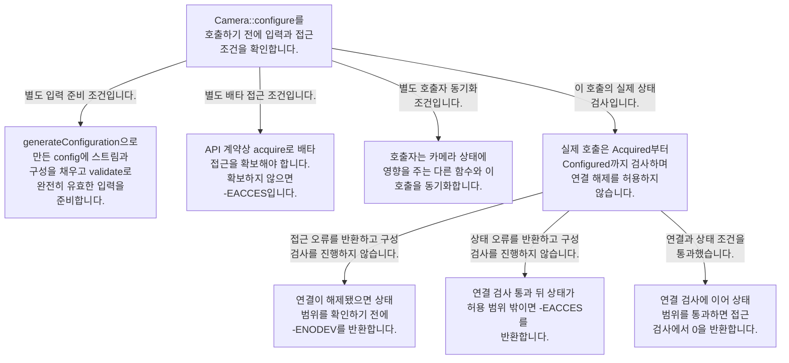
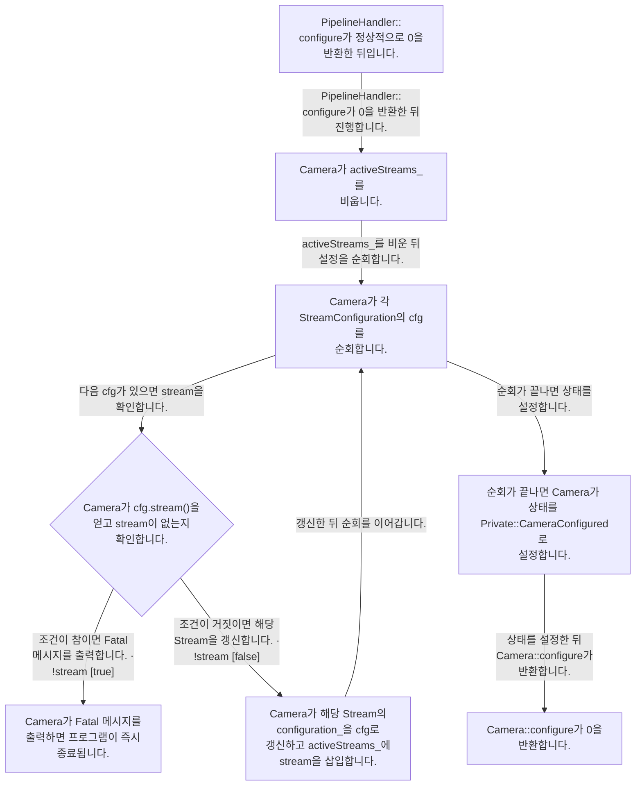
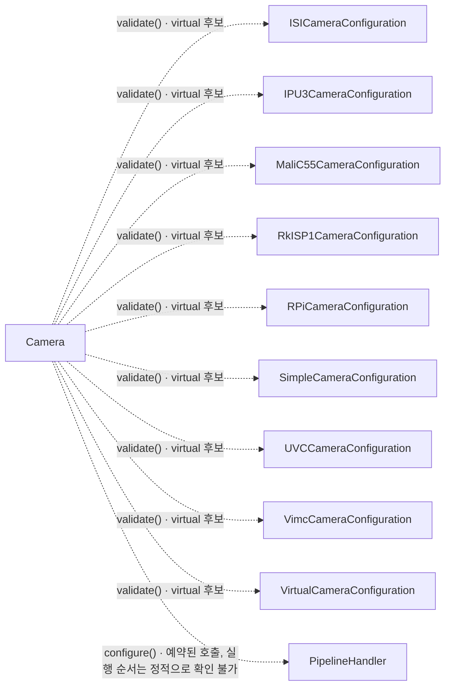

# 스트림 구성

**캡처 전에 유효한 스트림 구성을 적용하고 실패 조건과 연결된 Stream을 확인하세요.**

| 지금 확인할 내용 | 이동할 절 |
|---|---|
| <a id="이-흐름에서-확인할-것"></a>캡처 전에 유효한 스트림 구성을 적용하고 실패 조건과 연결된 Stream을 확인하세요. | [캡처 전에 준비할 스트림 구성](#캡처-전에-준비할-스트림-구성) |

## 캡처 전에 준비할 스트림 구성

`Camera::configure()`는 캡처 전에 캡처에 사용할 스트림 그룹과 각 스트림의 구성을 설정합니다. 호출자는 `generateConfiguration()`으로 구성을 만들고 `config`에 사용할 스트림과 구성을 채운 뒤 `CameraConfiguration::validate()`로 조정합니다. `Camera::configure()`에는 완전히 유효한 구성이 필요합니다. `src/libcamera/camera.cpp:1163`

<!-- sdd:visual:configuration-prerequisite-map -->
### 구성 호출의 입력과 접근 조건



[Mermaid 원문](configure.configuration-prerequisite-map.mmd)

??? note "그림 근거와 확인 범위"
    캡처 전에 어떤 구성을 준비하고 어떤 배타 접근·상태·동기화 조건을 충족합니까?
    
    소스에 연결한 설계 해석입니다. 자동 연결 검사는 의미 승인이나 기기 실행 검증이 아닙니다.
    
    | 요소·전이 | 소스 근거 |
    |---|---|
    | <span data-sdd-label-en="Check the input and access prerequisites before calling Camera::configure.">Camera::configure를 호출하기 전에 입력과 접근 조건을 확인합니다.</span> | [src/libcamera/camera.cpp:1163](#source-72be07b9f03d4034) · [src/libcamera/camera.cpp:1191](#source-104cfe232814f03c) |
    | <span data-sdd-label-en="Fill the config from generateConfiguration with stream settings and prepare a fully valid input with validate.">generateConfiguration으로 만든 config에 스트림과 구성을 채우고 validate로 완전히 유효한 입력을 준비합니다.</span> | [src/libcamera/camera.cpp:1163](#source-72be07b9f03d4034) |
    | <span data-sdd-label-en="The API requires exclusive access through acquire and documents -EACCES otherwise.">API 계약상 acquire로 배타 접근을 확보해야 합니다. 확보하지 않으면 -EACCES입니다.</span> | [src/libcamera/camera.cpp:1163](#source-72be07b9f03d4034) |
    | <span data-sdd-label-en="The caller synchronizes this call with other functions that affect camera state.">호출자는 카메라 상태에 영향을 주는 다른 함수와 이 호출을 동기화합니다.</span> | [src/libcamera/camera.cpp:1163](#source-72be07b9f03d4034) |
    | <span data-sdd-label-en="The call checks Acquired through Configured and disallows disconnection.">실제 호출은 Acquired부터 Configured까지 검사하며 연결 해제를 허용하지 않습니다.</span> | [src/libcamera/camera.cpp:1191](#source-104cfe232814f03c) · [include/libcamera/internal/camera.h:61](#source-ce7310b26757525b) |
    | <span data-sdd-label-en="If disconnected, return -ENODEV before checking the state range.">연결이 해제됐으면 상태 범위를 확인하기 전에 -ENODEV를 반환합니다.</span> | [src/libcamera/camera.cpp:709](#source-0840d2509c9e395b) |
    | <span data-sdd-label-en="After the disconnection check, a state outside the allowed range returns -EACCES.">연결 검사 통과 뒤 상태가 허용 범위 밖이면 -EACCES를 반환합니다.</span> | [src/libcamera/camera.cpp:709](#source-0840d2509c9e395b) |
    | <span data-sdd-label-en="If the disconnection and state checks pass, the access check returns 0.">연결 검사에 이어 상태 범위를 통과하면 접근 검사에서 0을 반환합니다.</span> | [src/libcamera/camera.cpp:709](#source-0840d2509c9e395b) · [src/libcamera/camera.cpp:1191](#source-104cfe232814f03c) |
    | <span data-sdd-label-en="This is the input prerequisite.">별도 입력 준비 조건입니다.</span> | [src/libcamera/camera.cpp:1163](#source-72be07b9f03d4034) · [src/libcamera/camera.cpp:1191](#source-104cfe232814f03c) |
    | <span data-sdd-label-en="This is the separate exclusive-access requirement.">별도 배타 접근 조건입니다.</span> | [src/libcamera/camera.cpp:1163](#source-72be07b9f03d4034) · [src/libcamera/camera.cpp:1191](#source-104cfe232814f03c) |
    | <span data-sdd-label-en="This is the separate caller synchronization requirement.">별도 호출자 동기화 조건입니다.</span> | [src/libcamera/camera.cpp:1163](#source-72be07b9f03d4034) · [src/libcamera/camera.cpp:1191](#source-104cfe232814f03c) |
    | <span data-sdd-label-en="This is the call&#x27;s actual state check.">이 호출의 실제 상태 검사입니다.</span> | [src/libcamera/camera.cpp:1163](#source-72be07b9f03d4034) · [src/libcamera/camera.cpp:1191](#source-104cfe232814f03c) · [include/libcamera/internal/camera.h:61](#source-ce7310b26757525b) |
    | <span data-sdd-label-en="Return the access error before validating the configuration.">접근 오류를 반환하고 구성 검사를 진행하지 않습니다.</span> | [src/libcamera/camera.cpp:1191](#source-104cfe232814f03c) · [include/libcamera/internal/camera.h:61](#source-ce7310b26757525b) · [src/libcamera/camera.cpp:709](#source-0840d2509c9e395b) |
    | <span data-sdd-label-en="Return the state error before validating the configuration.">상태 오류를 반환하고 구성 검사를 진행하지 않습니다.</span> | [src/libcamera/camera.cpp:1191](#source-104cfe232814f03c) · [include/libcamera/internal/camera.h:61](#source-ce7310b26757525b) · [src/libcamera/camera.cpp:709](#source-0840d2509c9e395b) |
    | <span data-sdd-label-en="The disconnection and state checks pass.">연결과 상태 조건을 통과했습니다.</span> | [src/libcamera/camera.cpp:1191](#source-104cfe232814f03c) · [include/libcamera/internal/camera.h:61](#source-ce7310b26757525b) · [src/libcamera/camera.cpp:709](#source-0840d2509c9e395b) |
<!-- /sdd:visual:configuration-prerequisite-map -->

호출자는 `Camera::configure()`를 호출하기 전에 `acquire()`로 카메라에 대한 배타 접근을 확보해야 합니다. 이 함수는 카메라가 `Acquired` 또는 `Configured` 상태일 때만 호출해야 하며, 호출자는 카메라 상태에 영향을 주는 다른 함수와 호출을 동기화해야 합니다. 배타 접근이 확보되지 않았거나 카메라가 구성할 수 있는 상태가 아니면 `-EACCES`가 반환됩니다. 카메라 연결이 해제된 경우에는 `-ENODEV`가 반환됩니다. `src/libcamera/camera.cpp:1163`, `include/libcamera/internal/camera.h:61`, `src/libcamera/camera.cpp:709`, `src/libcamera/camera.cpp:1191`

근거 원문: [src/libcamera/camera.cpp:1163](#source-72be07b9f03d4034) · [src/libcamera/camera.cpp:323](#source-2b31e92e3fb3f083) · [src/libcamera/camera.cpp:709](#source-0840d2509c9e395b) · [include/libcamera/internal/camera.h:61](#source-ce7310b26757525b) · [src/libcamera/camera.cpp:1191](#source-104cfe232814f03c)

## 구성 적용과 성공 상태를 확인할 위치

`Camera::configure()`는 접근 상태 검사에서 음수 오류가 나면 그 값을 반환합니다. 검사를 통과하면 각 `StreamConfiguration`의 이전 스트림 연결을 `nullptr`로 비운 뒤 `validate()`를 검사하고, 결과가 `Valid`가 아니면 `-EINVAL`을 반환합니다. `Camera::configure()`는 유효한 설정에 대해 `PipelineHandler::configure`를 `ConnectionTypeBlocking`으로 호출하고, 반환값이 0이 아니면 그 값을 그대로 반환합니다. API 계약은 함수가 반환될 때 `config`의 각 `StreamConfiguration`이 `Stream` 인스턴스와 연결되며 `stream()`으로 이를 가져올 수 있다고 설명합니다. `src/libcamera/camera.cpp:1191`, `src/libcamera/camera.cpp:1183`

<!-- sdd:visual:configure-validation-before-pipeline -->
### 구성 적용 전의 검사와 파이프라인 결과

```mermaid
flowchart TB
%% sdd:translations {"activeStreams#95;.clear#40;#41;와 <br/>이어지는 별도 스트림 연결 <br/>검사로 진행합니다. 이는 <br/>전체 함수의 성공 반환이 <br/>아닙니다.": "Continue to <br/>activeStreams#95;.clear#40;#41; and <br/>the separate stream <br/>connection check. This is <br/>not the function#39;s <br/>successful return.", "config-#62;validate#40;#41;가 반환한 <br/>상태가 <br/>CameraConfiguration::<br/>Valid와 다른가요?": "Did config-#62;validate#40;#41; <br/>return a status other than <br/>CameraConfiguration::Valid?", "invokeMethod로 <br/>PipelineHandler::<br/>configure를 <br/>ConnectionTypeBlocking으로 <br/>호출합니다.": "Call <br/>PipelineHandler::configure <br/>through invokeMethod with <br/>ConnectionTypeBlocking.", "isAccessAllowed#40;Private::<br/>CameraAcquired, <br/>Private::<br/>CameraConfigured#41;를 <br/>호출합니다. 접근 결과가 <br/>음수인가요?": "Call <br/>isAccessAllowed#40;Private::<br/>CameraAcquired, <br/>Private::CameraConfigured#41;. <br/>Is the access result <br/>negative?", "ret이 거짓이면 다음 검사로 <br/>진행합니다. #91;false#93;": "If ret is false, continue <br/>to the next check. #91;false#93;", "ret이 참이면 ret을 <br/>반환합니다. #91;true#93;": "If ret is true, return ret. <br/>#91;true#93;", "validate#40;#41;의 결과가 <br/>CameraConfiguration::<br/>Valid가 아니므로 -EINVAL을 <br/>반환합니다.": "Return -EINVAL because <br/>validate#40;#41; returned a <br/>status other than <br/>CameraConfiguration::Valid.", "각 연결을 초기화한 뒤 <br/>검증합니다.": "Validate after resetting <br/>each connection.", "기존 #42;config의 각 cfg에서 <br/>cfg.setStream#40;nullptr#41;을 <br/>호출해 연결을 초기화합니다.": "Call cfg.setStream#40;nullptr#41; <br/>for each cfg in the <br/>existing #42;config to reset <br/>its connection.", "로그를 출력한 뒤 <br/>파이프라인을 호출합니다.": "Call the pipeline after <br/>outputting the log.", "반환 상태가 <br/>CameraConfiguration::<br/>Valid가 아니면 -EINVAL을 <br/>반환합니다. #91;true#93;": "If the returned status is <br/>not <br/>CameraConfiguration::Valid, <br/>return -EINVAL. #91;true#93;", "반환 상태가 <br/>CameraConfiguration::<br/>Valid이면 로그를 <br/>준비합니다. #91;false#93;": "If the returned status is <br/>CameraConfiguration::Valid, <br/>prepare the log. #91;false#93;", "스트림 구성 로그를 준비하고 <br/>출력합니다.": "Prepare and output the <br/>stream configuration log.", "접근 결과 ret을 반환합니다.": "Return the access result <br/>ret.", "접근 결과가 음수가 아니면 <br/>연결을 초기화합니다. #91;false#93;": "If the access result is not <br/>negative, reset the <br/>connections. #91;false#93;", "접근 결과가 음수이면 ret을 <br/>반환합니다. #91;true#93;": "If the access result is <br/>negative, return ret. #91;true#93;", "파이프라인 호출의 반환값 <br/>ret을 반환합니다.": "Return the pipeline call#39;s <br/>return value ret.", "파이프라인 호출의 반환값 <br/>ret이 참인가요?": "Is the pipeline call#39;s <br/>return value ret true?", "호출 결과를 검사합니다.": "Check the call result."}
  v_access{"isAccessAllowed#40;Private::<br/>CameraAcquired, <br/>Private::<br/>CameraConfigured#41;를 <br/>호출합니다. 접근 결과가 <br/>음수인가요?"}
  v_access_return["접근 결과 ret을 반환합니다."]
  v_reset["기존 #42;config의 각 cfg에서 <br/>cfg.setStream#40;nullptr#41;을 <br/>호출해 연결을 초기화합니다."]
  v_validation{"config-#62;validate#40;#41;가 반환한 <br/>상태가 <br/>CameraConfiguration::<br/>Valid와 다른가요?"}
  v_validation_return["validate#40;#41;의 결과가 <br/>CameraConfiguration::<br/>Valid가 아니므로 -EINVAL을 <br/>반환합니다."]
  v_log["스트림 구성 로그를 준비하고 <br/>출력합니다."]
  v_pipeline["invokeMethod로 <br/>PipelineHandler::<br/>configure를 <br/>ConnectionTypeBlocking으로 <br/>호출합니다."]
  v_pipeline_check{"파이프라인 호출의 반환값 <br/>ret이 참인가요?"}
  v_pipeline_return["파이프라인 호출의 반환값 <br/>ret을 반환합니다."]
  v_next["activeStreams#95;.clear#40;#41;와 <br/>이어지는 별도 스트림 연결 <br/>검사로 진행합니다. 이는 <br/>전체 함수의 성공 반환이 <br/>아닙니다."]
  v_access -->|"접근 결과가 음수이면 ret을 <br/>반환합니다. #91;true#93;"| v_access_return
  v_access -->|"접근 결과가 음수가 아니면 <br/>연결을 초기화합니다. #91;false#93;"| v_reset
  v_reset -->|"각 연결을 초기화한 뒤 <br/>검증합니다."| v_validation
  v_validation -->|"반환 상태가 <br/>CameraConfiguration::<br/>Valid가 아니면 -EINVAL을 <br/>반환합니다. #91;true#93;"| v_validation_return
  v_validation -->|"반환 상태가 <br/>CameraConfiguration::<br/>Valid이면 로그를 <br/>준비합니다. #91;false#93;"| v_log
  v_log -->|"로그를 출력한 뒤 <br/>파이프라인을 호출합니다."| v_pipeline
  v_pipeline -->|"호출 결과를 검사합니다."| v_pipeline_check
  v_pipeline_check -->|"ret이 참이면 ret을 <br/>반환합니다. #91;true#93;"| v_pipeline_return
  v_pipeline_check -->|"ret이 거짓이면 다음 검사로 <br/>진행합니다. #91;false#93;"| v_next
```



[Mermaid 원문](configure.configure-validation-before-pipeline.mmd)

??? note "그림 근거와 확인 범위"
    Camera::configure의 접근 검사·스트림 연결 초기화·검증·파이프라인 반환 검사는 어떤 순서입니까?
    
    소스에 연결한 설계 해석입니다. 자동 연결 검사는 의미 승인이나 기기 실행 검증이 아닙니다.
    
    LLM 그림 초안 · 사람 검토 전
    
    작성 모델: `cli/codex/gpt-6.1-terra`
    
    | 요소·전이 | 소스 근거 |
    |---|---|
    | <span data-sdd-label-en="Call isAccessAllowed(Private::CameraAcquired, Private::CameraConfigured). Is the access result negative?">isAccessAllowed&#40;Private::CameraAcquired, Private::CameraConfigured&#41;를 호출합니다. 접근 결과가 음수인가요?</span> | [src/libcamera/camera.cpp:1191](#source-603af0dd7fa357d0) |
    | <span data-sdd-label-en="Return the access result ret.">접근 결과 ret을 반환합니다.</span> | [src/libcamera/camera.cpp:1191](#source-603af0dd7fa357d0) |
    | <span data-sdd-label-en="Call cfg.setStream(nullptr) for each cfg in the existing *config to reset its connection.">기존 &#42;config의 각 cfg에서 cfg.setStream&#40;nullptr&#41;을 호출해 연결을 초기화합니다.</span> | [src/libcamera/camera.cpp:1191](#source-603af0dd7fa357d0) |
    | <span data-sdd-label-en="Did config-&gt;validate() return a status other than CameraConfiguration::Valid?">config-&gt;validate&#40;&#41;가 반환한 상태가 CameraConfiguration::Valid와 다른가요?</span> | [src/libcamera/camera.cpp:1191](#source-603af0dd7fa357d0) |
    | <span data-sdd-label-en="Return -EINVAL because validate() returned a status other than CameraConfiguration::Valid.">validate&#40;&#41;의 결과가 CameraConfiguration::Valid가 아니므로 -EINVAL을 반환합니다.</span> | [src/libcamera/camera.cpp:1191](#source-603af0dd7fa357d0) |
    | <span data-sdd-label-en="Prepare and output the stream configuration log.">스트림 구성 로그를 준비하고 출력합니다.</span> | [src/libcamera/camera.cpp:1191](#source-603af0dd7fa357d0) |
    | <span data-sdd-label-en="Call PipelineHandler::configure through invokeMethod with ConnectionTypeBlocking.">invokeMethod로 PipelineHandler::configure를 ConnectionTypeBlocking으로 호출합니다.</span> | [src/libcamera/camera.cpp:1191](#source-603af0dd7fa357d0) |
    | <span data-sdd-label-en="Is the pipeline call&#x27;s return value ret true?">파이프라인 호출의 반환값 ret이 참인가요?</span> | [src/libcamera/camera.cpp:1191](#source-603af0dd7fa357d0) |
    | <span data-sdd-label-en="Return the pipeline call&#x27;s return value ret.">파이프라인 호출의 반환값 ret을 반환합니다.</span> | [src/libcamera/camera.cpp:1191](#source-603af0dd7fa357d0) |
    | <span data-sdd-label-en="Continue to activeStreams_.clear() and the separate stream connection check. This is not the function&#x27;s successful return.">activeStreams&#95;.clear&#40;&#41;와 이어지는 별도 스트림 연결 검사로 진행합니다. 이는 전체 함수의 성공 반환이 아닙니다.</span> | [src/libcamera/camera.cpp:1191](#source-603af0dd7fa357d0) |
    | <span data-sdd-label-en="If the access result is negative, return ret. · ret &lt; 0 [true]">접근 결과가 음수이면 ret을 반환합니다. · ret &lt; 0 &#91;true&#93;</span> | [src/libcamera/camera.cpp:1191](#source-603af0dd7fa357d0) |
    | <span data-sdd-label-en="If the access result is not negative, reset the connections. · ret &lt; 0 [false]">접근 결과가 음수가 아니면 연결을 초기화합니다. · ret &lt; 0 &#91;false&#93;</span> | [src/libcamera/camera.cpp:1191](#source-603af0dd7fa357d0) |
    | <span data-sdd-label-en="Validate after resetting each connection.">각 연결을 초기화한 뒤 검증합니다.</span> | [src/libcamera/camera.cpp:1191](#source-603af0dd7fa357d0) |
    | <span data-sdd-label-en="If the returned status is not CameraConfiguration::Valid, return -EINVAL. · config-&gt;validate() != CameraConfiguration::Valid [true]">반환 상태가 CameraConfiguration::Valid가 아니면 -EINVAL을 반환합니다. · config-&gt;validate&#40;&#41; &#33;= CameraConfiguration::Valid &#91;true&#93;</span> | [src/libcamera/camera.cpp:1191](#source-603af0dd7fa357d0) |
    | <span data-sdd-label-en="If the returned status is CameraConfiguration::Valid, prepare the log. · config-&gt;validate() != CameraConfiguration::Valid [false]">반환 상태가 CameraConfiguration::Valid이면 로그를 준비합니다. · config-&gt;validate&#40;&#41; &#33;= CameraConfiguration::Valid &#91;false&#93;</span> | [src/libcamera/camera.cpp:1191](#source-603af0dd7fa357d0) |
    | <span data-sdd-label-en="Call the pipeline after outputting the log.">로그를 출력한 뒤 파이프라인을 호출합니다.</span> | [src/libcamera/camera.cpp:1191](#source-603af0dd7fa357d0) |
    | <span data-sdd-label-en="Check the call result.">호출 결과를 검사합니다.</span> | [src/libcamera/camera.cpp:1191](#source-603af0dd7fa357d0) |
    | <span data-sdd-label-en="If ret is true, return ret. · ret [true]">ret이 참이면 ret을 반환합니다. · ret &#91;true&#93;</span> | [src/libcamera/camera.cpp:1191](#source-603af0dd7fa357d0) |
    | <span data-sdd-label-en="If ret is false, continue to the next check. · ret [false]">ret이 거짓이면 다음 검사로 진행합니다. · ret &#91;false&#93;</span> | [src/libcamera/camera.cpp:1191](#source-603af0dd7fa357d0) |
<!-- /sdd:visual:configure-validation-before-pipeline -->

<!-- sdd:visual:configure-stream-list-once -->
### 스트림 목록의 일회 초기화와 성공 상태



[Mermaid 원문](configure.configure-stream-list-once.mmd)

??? note "그림 근거와 확인 범위"
    파이프라인 구성 성공 뒤 activeStreams_ 초기화와 각 StreamConfiguration 갱신 및 성공 상태는 어떻게 이어집니까?
    
    소스에 연결한 설계 해석입니다. 자동 연결 검사는 의미 승인이나 기기 실행 검증이 아닙니다.
    
    LLM 그림 초안 · 사람 검토 전
    
    작성 모델: `cli/codex/gpt-6.1-terra`
    
    | 요소·전이 | 소스 근거 |
    |---|---|
    | <span data-sdd-label-en="PipelineHandler::configure has returned normally with 0.">PipelineHandler::configure가 정상적으로 0을 반환한 뒤입니다.</span> | [src/libcamera/camera.cpp:1191](#source-603af0dd7fa357d0) |
    | <span data-sdd-label-en="Camera clears activeStreams_.">Camera가 activeStreams&#95;를 비웁니다.</span> | [src/libcamera/camera.cpp:1191](#source-603af0dd7fa357d0) |
    | <span data-sdd-label-en="Camera iterates over each StreamConfiguration as cfg.">Camera가 각 StreamConfiguration의 cfg를 순회합니다.</span> | [src/libcamera/camera.cpp:1191](#source-603af0dd7fa357d0) |
    | <span data-sdd-label-en="Camera obtains cfg.stream() and checks whether stream is absent.">Camera가 cfg.stream&#40;&#41;을 얻고 stream이 없는지 확인합니다.</span> | [src/libcamera/camera.cpp:1191](#source-603af0dd7fa357d0) |
    | <span data-sdd-label-en="When Camera prints the Fatal message, the program terminates immediately.">Camera가 Fatal 메시지를 출력하면 프로그램이 즉시 종료됩니다.</span> | [src/libcamera/camera.cpp:1191](#source-603af0dd7fa357d0) · [src/libcamera/base/log.cpp:1022](#source-47a6ef3943a7b53c) |
    | <span data-sdd-label-en="Camera updates the Stream configuration_ from cfg and inserts stream into activeStreams_.">Camera가 해당 Stream의 configuration&#95;을 cfg로 갱신하고 activeStreams&#95;에 stream을 삽입합니다.</span> | [src/libcamera/camera.cpp:1191](#source-603af0dd7fa357d0) |
    | <span data-sdd-label-en="After the loop, Camera sets the state to Private::CameraConfigured.">순회가 끝나면 Camera가 상태를 Private::CameraConfigured로 설정합니다.</span> | [src/libcamera/camera.cpp:1191](#source-603af0dd7fa357d0) |
    | <span data-sdd-label-en="Camera::configure returns 0.">Camera::configure가 0을 반환합니다.</span> | [src/libcamera/camera.cpp:1191](#source-603af0dd7fa357d0) |
    | <span data-sdd-label-en="Execution continues after PipelineHandler::configure returns 0.">PipelineHandler::configure가 0을 반환한 뒤 진행합니다.</span> | [src/libcamera/camera.cpp:1191](#source-603af0dd7fa357d0) |
    | <span data-sdd-label-en="Camera iterates over the configurations after clearing activeStreams_.">activeStreams&#95;를 비운 뒤 설정을 순회합니다.</span> | [src/libcamera/camera.cpp:1191](#source-603af0dd7fa357d0) |
    | <span data-sdd-label-en="Camera checks stream when there is another cfg.">다음 cfg가 있으면 stream을 확인합니다.</span> | [src/libcamera/camera.cpp:1191](#source-603af0dd7fa357d0) |
    | <span data-sdd-label-en="If the condition is true, Camera prints a Fatal message. · !stream [true]">조건이 참이면 Fatal 메시지를 출력합니다. · &#33;stream &#91;true&#93;</span> | [src/libcamera/camera.cpp:1191](#source-603af0dd7fa357d0) |
    | <span data-sdd-label-en="If the condition is false, Camera updates the Stream. · !stream [false]">조건이 거짓이면 해당 Stream을 갱신합니다. · &#33;stream &#91;false&#93;</span> | [src/libcamera/camera.cpp:1191](#source-603af0dd7fa357d0) |
    | <span data-sdd-label-en="Camera continues the loop after the update.">갱신한 뒤 순회를 이어갑니다.</span> | [src/libcamera/camera.cpp:1191](#source-603af0dd7fa357d0) |
    | <span data-sdd-label-en="Camera sets the state when the loop ends.">순회가 끝나면 상태를 설정합니다.</span> | [src/libcamera/camera.cpp:1191](#source-603af0dd7fa357d0) |
    | <span data-sdd-label-en="Camera::configure returns after setting the state.">상태를 설정한 뒤 Camera::configure가 반환합니다.</span> | [src/libcamera/camera.cpp:1191](#source-603af0dd7fa357d0) |
<!-- /sdd:visual:configure-stream-list-once -->

`Camera::configure()`는 파이프라인 호출이 성공하면 `activeStreams_`를 비우고 각 설정의 `cfg.stream()`을 확인합니다. 스트림이 없으면 `Fatal` 로그 경로에 들어가며, `LOG` 계약에 따라 메시지를 출력한 직후 실행이 중단되고 프로그램이 종료됩니다. 모든 설정에 스트림이 있으면 `Camera::configure()`는 각 스트림의 `configuration_`을 해당 설정으로 갱신하고 `activeStreams_`에 추가합니다. 이후 상태를 `CameraConfigured`로 설정하고 `0`을 반환합니다. `src/libcamera/camera.cpp:1191`, `src/libcamera/base/log.cpp:1022`

근거 원문: [src/libcamera/camera.cpp:1191](#source-603af0dd7fa357d0) · [src/libcamera/base/log.cpp:1022](#source-47a6ef3943a7b53c) · [src/libcamera/camera.cpp:1183](#source-5296d50aed1a3be0)

??? note "설계 질문과 검증 범위"
    질문별 답변과 근거 연결을 검사했습니다. 의미와 실행 결과는 사람 검토가 필요합니다.
    
    | 설계 질문 | 설명 위치 | 확인 범위 |
    |---|---|---|
    | Camera::configure()의 캡처 전 스트림 구성 목적과 호출자가 config를 채우고 generateConfiguration·validate로 준비하는 일을 설명하세요. 완전히 유효한 구성이 필요하다는 전제는 짧게 쓰고 validate 실패의 코드 분기·반환값은 다음 절에서 설명합니다. acquire로 확보할 배타 접근과 Acquired/Configured 상태, 상태 변경 함수와 호출자의 동기화 의무 및 -EACCES 조건을 관련된 한 문단으로 묶으세요. 연결 해제의 -ENODEV는 한 번만 설명하세요. 오류 목록이나 성공/실패 반환값 요약을 마지막에 다시 나열하지 마세요. 세 문단 이내로 작성하세요. | [캡처 전에 준비할 스트림 구성](#캡처-전에-준비할-스트림-구성) | 코드 근거와 설명 연결 |
    | Camera::configure()가 이전 stream 연결을 비운 뒤 validate()==Valid를 검사하고 유효하지 않으면 -EINVAL을 반환하는 순서를 설명하세요. PipelineHandler::configure를 ConnectionTypeBlocking으로 호출하고 오류면 그대로 반환하는 경로를 설명하세요. 이 호출이 성공한 뒤에도 cfg.stream이 없으면 Fatal 로그 경로에 들어간다는 조건을 구체적으로 서술하세요. API의 Stream 연계 계약과 코드의 성공 뒤 누락 검사를 함께 읽되, 소스가 특정 설계 용어를 명시하는지를 평가하는 문장은 쓰지 마세요. LOG의 문서 계약에 따라 Fatal이 실행을 중단하므로 뒤의 clear/return 코드를 복구 경로로 서술하지 마세요. 모든 stream이 있으면 configuration_·activeStreams_·CameraConfigured를 갱신하고 0을 반환하는 성공 경로를 설명하세요. 네 문단 이내로 작성하세요. ConnectionTypeBlocking은 호출 설명에 한 번만 포함하고 같은 호출 유형을 별도 문장으로 다시 풀이하지 마세요. | [구성 적용과 성공 상태를 확인할 위치](#구성-적용과-성공-상태를-확인할-위치) | 코드 근거와 설명 연결 |

## 소스 근거

같은 발췌는 한 번만 싣습니다. 필요한 원문을 펼쳐 설명과 대조하세요.

<a id="source-72be07b9f03d4034"></a>

??? note "소스 근거: src/libcamera/camera.cpp:1163"
    `src/libcamera/camera.cpp:1163`에서 시작하는 발췌입니다. 종료 줄은 1190이며, 아래 원문을 설명과 대조할 수 있습니다.
    
    SHA-256: `df8c93cd701c8dd65d498d666f63dd166c4470902f254be8a251bf3f6b8f761d`
    
    ```text
    \brief Configure the camera prior to capture
     * \param[in] config The camera configurations to setup
     *
     * Prior to starting capture, the camera must be configured to select a
     * group of streams to be involved in the capture and their configuration.
     * The caller specifies which streams are to be involved and their configuration
     * by populating \a config.
     *
     * The configuration is created by generateConfiguration(), and adjusted by the
     * caller with CameraConfiguration::validate(). This function only accepts fully
     * valid configurations and returns an error if \a config is not valid.
     *
     * Exclusive access to the camera shall be ensured by a call to acquire() prior
     * to calling this function, otherwise an -EACCES error will be returned.
     *
     * \context This function may only be called when the camera is in the Acquired
     * or Configured state as defined in \ref camera_operation, and shall be
     * synchronized by the caller with other functions that affect the camera
     * state.
     *
     * Upon return the StreamConfiguration entries in \a config are associated with
     * Stream instances which can be retrieved with StreamConfiguration::stream().
     *
     * \return 0 on success or a negative error code otherwise
     * \retval -ENODEV The camera has been disconnected from the system
     * \retval -EACCES The camera is not in a state where it can be configured
     * \retval -EINVAL The configuration is not valid
     */
    ```

<a id="source-2b31e92e3fb3f083"></a>

??? note "소스 근거: src/libcamera/camera.cpp:323"
    `src/libcamera/camera.cpp:323`에서 시작하는 발췌입니다. 종료 줄은 346이며, 아래 원문을 설명과 대조할 수 있습니다.
    
    SHA-256: `86bf9109257512866bf70a5d42cd3da29c70d851d871f0e496058141ba377623`
    
    ```text
    \fn CameraConfiguration::validate()
     * \brief Validate and possibly adjust the camera configuration
     *
     * This function adjusts the camera configuration to the closest valid
     * configuration and returns the validation status.
     *
     * \todo Define exactly when to return each status code. Should stream
     * parameters set to 0 by the caller be adjusted without returning Adjusted ?
     * This would potentially be useful for applications but would get in the way
     * in Camera::configure(). Do we need an extra status code to signal this ?
     *
     * \todo Handle validation of buffers count when refactoring the buffers API.
     *
     * \return A CameraConfiguration::Status value that describes the validation
     * status.
     * \retval CameraConfiguration::Invalid The configuration is invalid and can't
     * be adjusted. This may only occur in extreme cases such as when the
     * configuration is empty.
     * \retval CameraConfiguration::Adjusted The configuration has been adjusted
     * and is now valid. Parameters may have changed for any stream, and stream
     * configurations may have been removed. The caller shall check the
     * configuration carefully.
     * \retval CameraConfiguration::Valid The configuration was already valid and
     * hasn't been adjusted.
    ```

<a id="source-0840d2509c9e395b"></a>

??? note "소스 근거: src/libcamera/camera.cpp:709"
    `src/libcamera/camera.cpp:709`에서 시작하는 발췌입니다. 종료 줄은 730이며, 아래 원문을 설명과 대조할 수 있습니다.
    
    SHA-256: `d04dbcf64bf95e8e89669e5c85602d590cd8d6530e44cd275cee39348d644b8f`
    
    ```text
    int Camera::Private::isAccessAllowed(State low, State high,
    				     bool allowDisconnected,
    				     const char *from) const
    {
    	if (!allowDisconnected && disconnected_)
    		return -ENODEV;
    
    	State currentState = state_.load(std::memory_order_acquire);
    	if (currentState >= low && currentState <= high)
    		return 0;
    
    	ASSERT(static_cast<unsigned int>(low) < std::size(camera_state_names) &&
    	       static_cast<unsigned int>(high) < std::size(camera_state_names));
    
    	LOG(Camera, Error) << "Camera in " << camera_state_names[currentState]
    			   << " state trying " << from
    			   << "() requiring state between "
    			   << camera_state_names[low] << " and "
    			   << camera_state_names[high];
    
    	return -EACCES;
    }
    ```

<a id="source-ce7310b26757525b"></a>

??? note "소스 근거: include/libcamera/internal/camera.h:61"
    `include/libcamera/internal/camera.h:61`에서 시작하는 발췌입니다. 종료 줄은 63이며, 아래 원문을 설명과 대조할 수 있습니다.
    
    SHA-256: `de8b9aceb9f90513ee8f246a8e96d7d6e48b58b68038a26bfd8e50ba286183e2`
    
    ```text
    int isAccessAllowed(State low, State high,
    			    bool allowDisconnected = false,
    			    const char *from = __builtin_FUNCTION()) const;
    ```

<a id="source-104cfe232814f03c"></a>

??? note "소스 근거: src/libcamera/camera.cpp:1191"
    `src/libcamera/camera.cpp:1191`에서 시작하는 발췌입니다. 종료 줄은 1206이며, 아래 원문을 설명과 대조할 수 있습니다.
    
    SHA-256: `e3da158ab68ff445cbbb048ad83ebff21ef19910f85951e63b8ece07ff52104e`
    
    ```text
    int Camera::configure(CameraConfiguration *config)
    {
    	Private *const d = _d();
    
    	int ret = d->isAccessAllowed(Private::CameraAcquired,
    				     Private::CameraConfigured);
    	if (ret < 0)
    		return ret;
    
    	for (auto &cfg : *config)
    		cfg.setStream(nullptr);
    
    	if (config->validate() != CameraConfiguration::Valid) {
    		LOG(Camera, Error)
    			<< "Can't configure camera with invalid configuration";
    		return -EINVAL;
    ```

<a id="source-603af0dd7fa357d0"></a>

??? note "소스 근거: src/libcamera/camera.cpp:1191"
    `src/libcamera/camera.cpp:1191`에서 시작하는 발췌입니다. 종료 줄은 1240이며, 아래 원문을 설명과 대조할 수 있습니다.
    
    SHA-256: `ff6ceda14768503bdfe753d462853457743d5b46a80e0808a97375632403cd36`
    
    ```text
    int Camera::configure(CameraConfiguration *config)
    {
    	Private *const d = _d();
    
    	int ret = d->isAccessAllowed(Private::CameraAcquired,
    				     Private::CameraConfigured);
    	if (ret < 0)
    		return ret;
    
    	for (auto &cfg : *config)
    		cfg.setStream(nullptr);
    
    	if (config->validate() != CameraConfiguration::Valid) {
    		LOG(Camera, Error)
    			<< "Can't configure camera with invalid configuration";
    		return -EINVAL;
    	}
    
    	std::ostringstream msg("configuring streams:", std::ios_base::ate);
    
    	for (unsigned int index = 0; index < config->size(); ++index) {
    		StreamConfiguration &cfg = config->at(index);
    		msg << " (" << index << ") " << cfg.toString();
    	}
    
    	LOG(Camera, Info) << msg.str();
    
    	ret = d->pipe_->invokeMethod(&PipelineHandler::configure,
    				     ConnectionTypeBlocking, this, config);
    	if (ret)
    		return ret;
    
    	d->activeStreams_.clear();
    	for (const StreamConfiguration &cfg : *config) {
    		Stream *stream = cfg.stream();
    		if (!stream) {
    			LOG(Camera, Fatal)
    				<< "Pipeline handler failed to update stream configuration";
    			d->activeStreams_.clear();
    			return -EINVAL;
    		}
    
    		stream->configuration_ = cfg;
    		d->activeStreams_.insert(stream);
    	}
    
    	d->setState(Private::CameraConfigured);
    
    	return 0;
    }
    ```

<a id="source-47a6ef3943a7b53c"></a>

??? note "소스 근거: src/libcamera/base/log.cpp:1022"
    `src/libcamera/base/log.cpp:1022`에서 시작하는 발췌입니다. 종료 줄은 1060이며, 아래 원문을 설명과 대조할 수 있습니다.
    
    SHA-256: `52e64d292f59786541e66fe48f5bae65256bdced60c803aa76bf3637083b47b0`
    
    ```text
    \def LOG(category, severity)
     * \hideinitializer
     * \brief Log a message
     * \param[in] category Category (optional)
     * \param[in] severity Severity
     *
     * Return an std::ostream reference to which a message can be logged using the
     * iostream API. The \a category, if specified, sets the message category. When
     * absent the default category is used. The  \a severity controls whether the
     * message is printed or discarded, depending on the log level for the category.
     *
     * If the severity is set to Fatal, execution is aborted and the program
     * terminates immediately after printing the message.
     *
     * \warning Logging from the destructor of a global object, either directly or
     * indirectly, results in undefined behaviour.
     *
     * \todo Allow logging from destructors of global objects to the largest
     * possible extent
     */
    
    /**
     * \def ASSERT(condition)
     * \hideinitializer
     * \brief Abort program execution if assertion fails
     *
     * If \a condition is false, ASSERT() logs an error message with the Fatal log
     * level and aborts program execution.
     *
     * If the macro NDEBUG is defined before including log.h, ASSERT() generates no
     * code.
     *
     * Using conditions that have side effects with ASSERT() is not recommended, as
     * these effects would depend on whether NDEBUG is defined or not. Similarly,
     * ASSERT() should not be used to check for errors that can occur under normal
     * conditions as those checks would then be removed when compiling with NDEBUG.
     */
    
    } /* namespace libcamera */
    ```

<a id="source-5296d50aed1a3be0"></a>

??? note "소스 근거: src/libcamera/camera.cpp:1183"
    `src/libcamera/camera.cpp:1183`에서 시작하는 발췌입니다. 종료 줄은 1184이며, 아래 원문을 설명과 대조할 수 있습니다.
    
    SHA-256: `7c6d3ef93e52639d7dc41b838e17c708fa6861da3e50c7593d803beb3f7c49d1`
    
    ```text
     * Upon return the StreamConfiguration entries in \a config are associated with
     * Stream instances which can be retrieved with StreamConfiguration::stream().
    ```

## 주요 확인 지점

아래 항목은 추출한 호출에서 고른 코드 탐색 지점입니다. 나열 순서는 실행 순서가 아닙니다.

| 확인할 내용 | 호출 측과 대상 | 구분 | 근거 |
|---|---|---|---|
| 구성 검증 | `Camera` → `ISICameraConfiguration::validate()`<br>`Camera` → `IPU3CameraConfiguration::validate()`<br>`Camera` → `MaliC55CameraConfiguration::validate()`<br>`Camera` → `RkISP1CameraConfiguration::validate()`<br>`Camera` → `RPiCameraConfiguration::validate()`<br>`Camera` → `SimpleCameraConfiguration::validate()`<br>`Camera` → `UVCCameraConfiguration::validate()`<br>`Camera` → `VimcCameraConfiguration::validate()`<br>`Camera` → `VirtualCameraConfiguration::validate()` | 동적 디스패치 후보이며 실제 대상은 확인이 필요합니다. | `src/libcamera/camera.cpp:1203` |
| 파이프라인 구성 대상 | `Camera` → `PipelineHandler::configure()` | 메서드 전달 대상이며 동기·비동기 여부는 호출부에서 확인해야 합니다. | `src/libcamera/camera.cpp:1218` |

## 주요 호출 관계

화살표는 호출 측과 대상을 연결합니다. 시간 순서나 모든 경로의 실행을 뜻하지 않습니다. 점선에는 가상 호출 후보·예약 대상 등 확인이 필요한 관계를 표시합니다.



## 추적 범위와 경계

요약의 hide 규칙에 해당하는 호출은 107개입니다. 전체 추적 기록에는 해당 호출도 모두 보존합니다. 기록 번호는 정적 탐색의 식별자이며 실행 순번이 아닙니다.

조건 분기, 반복 횟수와 실제 실행 스레드는 이 호출 목록만으로 확정할 수 없습니다. 가상 호출 후보는 실제 객체에 따라 선택됩니다. 예약 표시는 인자로 전달한 메서드 대상을 뜻하며, 비동기 실행을 보증하지 않습니다. 호출부의 연결 방식과 동기화 계약을 확인해야 합니다.

| 호출 지점 | 후보 또는 예약 대상 | 확인할 경계 | 근거 |
|---|---|---|---|
| `Camera` | `ISICameraConfiguration::validate()`<br>`IPU3CameraConfiguration::validate()`<br>`MaliC55CameraConfiguration::validate()`<br>`RkISP1CameraConfiguration::validate()`<br>`RPiCameraConfiguration::validate()`<br>`SimpleCameraConfiguration::validate()`<br>`UVCCameraConfiguration::validate()`<br>`VimcCameraConfiguration::validate()`<br>`VirtualCameraConfiguration::validate()` | 동적 디스패치 후보이며 실제 대상은 확인이 필요합니다. | `src/libcamera/camera.cpp:1203` |
| `ISICameraConfiguration` | `CameraSensorLegacy::resolution()`<br>`CameraSensorRaw::resolution()` | 동적 디스패치 후보이며 실제 대상은 확인이 필요합니다. | `src/libcamera/pipeline/imx8-isi/imx8-isi.cpp:523` |
| `ISICameraData` | `CameraSensorLegacy::mbusCodes()`<br>`CameraSensorRaw::mbusCodes()` | 동적 디스패치 후보이며 실제 대상은 확인이 필요합니다. | `src/libcamera/pipeline/imx8-isi/imx8-isi.cpp:185` |
| `ISICameraData` | `?::rawFormat()` | 정적 추적 불가 | `src/libcamera/pipeline/imx8-isi/imx8-isi.cpp:237` |
| `ISICameraConfiguration` | `CameraSensorLegacy::sizes()`<br>`CameraSensorRaw::sizes()` | 동적 디스패치 후보이며 실제 대상은 확인이 필요합니다. | `src/libcamera/pipeline/imx8-isi/imx8-isi.cpp:575` |
| `Camera` | `PipelineHandler::configure()` | 메서드 전달 대상이며 동기·비동기 여부는 호출부에서 확인해야 합니다. | `src/libcamera/camera.cpp:1218` |

추출 통계: 미해결 호출 1개, 예약된 호출 1개입니다.

## 전체 추적 기록

아래 구간을 펼치면 요약에서 제외된 호출까지 확인할 수 있습니다. 이 목록은 추출 깊이 안에서 수집한 기록이며, 소스의 모든 실행 경로를 포함한다는 뜻은 아닙니다.

??? note "추적 기록 1–25 / 185개"

    | 기록 | 호출 측 | 대상 | 구분 | 근거 |
    |---|---|---|---|---|
    | 1 | `Camera` | `Camera::_d()` | 정적 호출 지점입니다. | `src/libcamera/camera.cpp:1193` |
    | 2 | `Camera` | `Private::isAccessAllowed()` | 정적 호출 지점입니다. | `src/libcamera/camera.cpp:1195` |
    | 3 | `Private` | `log::isLogSeverityEnabled()` | 정적 호출 지점입니다. | `src/libcamera/camera.cpp:720` |
    | 4 | `Private` | `LogMessageAbortGuard::LogMessageAbortGuard()` | 정적 호출 지점입니다. | `src/libcamera/camera.cpp:720` |
    | 5 | `Private` | `LogMessage::stream()` | 정적 호출 지점입니다. | `src/libcamera/camera.cpp:720` |
    | 6 | `Private` | `log::_log()` | 정적 호출 지점입니다. | `src/libcamera/camera.cpp:720` |
    | 7 | `log` | `LogMessage::LogMessage()` | 정적 호출 지점입니다. | `src/libcamera/base/log.cpp:990` |
    | 8 | `LogMessage` | `utils::basename()` | 정적 호출 지점입니다. | `src/libcamera/base/log.cpp:858` |
    | 9 | `Private` | `log::isLogSeverityEnabled()` | 정적 호출 지점입니다. | `src/libcamera/camera.cpp:723` |
    | 10 | `Private` | `LogMessageAbortGuard::LogMessageAbortGuard()` | 정적 호출 지점입니다. | `src/libcamera/camera.cpp:723` |
    | 11 | `Private` | `LogMessage::stream()` | 정적 호출 지점입니다. | `src/libcamera/camera.cpp:723` |
    | 12 | `Private` | `log::_log()` | 정적 호출 지점입니다. | `src/libcamera/camera.cpp:723` |
    | 13 | `log` | `LogMessage::LogMessage()` | 정적 호출 지점입니다. | `src/libcamera/base/log.cpp:990` |
    | 14 | `LogMessage` | `utils::basename()` | 정적 호출 지점입니다. | `src/libcamera/base/log.cpp:858` |
    | 15 | `Camera` | `StreamConfiguration::setStream()` | 정적 호출 지점입니다. | `src/libcamera/camera.cpp:1201` |
    | 16 | `Camera` | `ISICameraConfiguration::validate()` | 동적 디스패치 후보이며 실제 대상은 확인이 필요합니다. | `src/libcamera/camera.cpp:1203` |
    | 17 | `ISICameraConfiguration` | `CameraSensorLegacy::resolution()` | 동적 디스패치 후보이며 실제 대상은 확인이 필요합니다. | `src/libcamera/pipeline/imx8-isi/imx8-isi.cpp:523` |
    | 18 | `CameraSensorLegacy` | `Size::Size()` | 정적 호출 지점입니다. | `src/libcamera/sensor/camera_sensor_legacy.cpp:715` |
    | 19 | `CameraSensorLegacy` | `Rectangle::size()` | 정적 호출 지점입니다. | `src/libcamera/sensor/camera_sensor_legacy.cpp:715` |
    | 20 | `Rectangle` | `Size::Size()` | 정적 호출 지점입니다. | `include/libcamera/geometry.h:290` |
    | 21 | `ISICameraConfiguration` | `CameraSensorRaw::resolution()` | 동적 디스패치 후보이며 실제 대상은 확인이 필요합니다. | `src/libcamera/pipeline/imx8-isi/imx8-isi.cpp:523` |
    | 22 | `CameraSensorRaw` | `Size::Size()` | 정적 호출 지점입니다. | `src/libcamera/sensor/camera_sensor_raw.cpp:777` |
    | 23 | `CameraSensorRaw` | `Rectangle::size()` | 정적 호출 지점입니다. | `src/libcamera/sensor/camera_sensor_raw.cpp:777` |
    | 24 | `Rectangle` | `Size::Size()` | 정적 호출 지점입니다. | `include/libcamera/geometry.h:290` |
    | 25 | `ISICameraConfiguration` | `PixelFormatInfo::PixelFormatInfo()` | 정적 호출 지점입니다. | `src/libcamera/pipeline/imx8-isi/imx8-isi.cpp:528` |

??? note "추적 기록 26–50 / 185개"

    | 기록 | 호출 측 | 대상 | 구분 | 근거 |
    |---|---|---|---|---|
    | 26 | `ISICameraConfiguration` | `PixelFormatInfo::info()` | 정적 호출 지점입니다. | `src/libcamera/pipeline/imx8-isi/imx8-isi.cpp:528` |
    | 27 | `PixelFormatInfo` | `log::isLogSeverityEnabled()` | 정적 호출 지점입니다. | `src/libcamera/formats.cpp:1006` |
    | 28 | `PixelFormatInfo` | `utils::operator<<()` | 정적 호출 지점입니다. | `src/libcamera/formats.cpp:1006` |
    | 29 | `PixelFormatInfo` | `LogMessageAbortGuard::LogMessageAbortGuard()` | 정적 호출 지점입니다. | `src/libcamera/formats.cpp:1006` |
    | 30 | `PixelFormatInfo` | `LogMessage::stream()` | 정적 호출 지점입니다. | `src/libcamera/formats.cpp:1006` |
    | 31 | `PixelFormatInfo` | `log::_log()` | 정적 호출 지점입니다. | `src/libcamera/formats.cpp:1006` |
    | 32 | `log` | `LogMessage::LogMessage()` | 정적 호출 지점입니다. | `src/libcamera/base/log.cpp:990` |
    | 33 | `PixelFormatInfo` | `utils::hex()` | 정적 호출 지점입니다. | `src/libcamera/formats.cpp:1008` |
    | 34 | `PixelFormatInfo` | `PixelFormat::fourcc()` | 정적 호출 지점입니다. | `src/libcamera/formats.cpp:1008` |
    | 35 | `ISICameraConfiguration` | `ISICameraConfiguration::validateRaw()` | 정적 호출 지점입니다. | `src/libcamera/pipeline/imx8-isi/imx8-isi.cpp:532` |
    | 36 | `ISICameraConfiguration` | `PixelFormat::PixelFormat()` | 정적 호출 지점입니다. | `src/libcamera/pipeline/imx8-isi/imx8-isi.cpp:375` |
    | 37 | `ISICameraConfiguration` | `ISICameraData::getRawMediaBusFormat()` | 정적 호출 지점입니다. | `src/libcamera/pipeline/imx8-isi/imx8-isi.cpp:377` |
    | 38 | `ISICameraData` | `CameraSensorLegacy::mbusCodes()` | 동적 디스패치 후보이며 실제 대상은 확인이 필요합니다. | `src/libcamera/pipeline/imx8-isi/imx8-isi.cpp:185` |
    | 39 | `ISICameraData` | `CameraSensorRaw::mbusCodes()` | 동적 디스패치 후보이며 실제 대상은 확인이 필요합니다. | `src/libcamera/pipeline/imx8-isi/imx8-isi.cpp:185` |
    | 40 | `ISICameraData` | `log::isLogSeverityEnabled()` | 정적 호출 지점입니다. | `src/libcamera/pipeline/imx8-isi/imx8-isi.cpp:216` |
    | 41 | `ISICameraData` | `LogMessageAbortGuard::LogMessageAbortGuard()` | 정적 호출 지점입니다. | `src/libcamera/pipeline/imx8-isi/imx8-isi.cpp:216` |
    | 42 | `ISICameraData` | `LogMessage::stream()` | 정적 호출 지점입니다. | `src/libcamera/pipeline/imx8-isi/imx8-isi.cpp:216` |
    | 43 | `ISICameraData` | `log::_log()` | 정적 호출 지점입니다. | `src/libcamera/pipeline/imx8-isi/imx8-isi.cpp:216` |
    | 44 | `ISICameraData` | `PixelFormat::operator=()` | 정적 호출 지점입니다. | `src/libcamera/pipeline/imx8-isi/imx8-isi.cpp:226` |
    | 45 | `ISICameraData` | `PixelFormat::PixelFormat()` | 정적 호출 지점입니다. | `src/libcamera/pipeline/imx8-isi/imx8-isi.cpp:226` |
    | 46 | `ISICameraData` | `BayerFormat::fromMbusCode()` | 정적 호출 지점입니다. | `src/libcamera/pipeline/imx8-isi/imx8-isi.cpp:230` |
    | 47 | `ISICameraData` | `BayerFormat::isValid()` | 정적 호출 지점입니다. | `src/libcamera/pipeline/imx8-isi/imx8-isi.cpp:231` |
    | 48 | `ISICameraData` | `?::rawFormat()` | 정적 추적 불가 | `src/libcamera/pipeline/imx8-isi/imx8-isi.cpp:237` |
    | 49 | `ISICameraData` | `log::isLogSeverityEnabled()` | 정적 호출 지점입니다. | `src/libcamera/pipeline/imx8-isi/imx8-isi.cpp:241` |
    | 50 | `ISICameraData` | `bayer_format::operator<<()` | 정적 호출 지점입니다. | `src/libcamera/pipeline/imx8-isi/imx8-isi.cpp:241` |

??? note "추적 기록 51–75 / 185개"

    | 기록 | 호출 측 | 대상 | 구분 | 근거 |
    |---|---|---|---|---|
    | 51 | `ISICameraData` | `LogMessageAbortGuard::LogMessageAbortGuard()` | 정적 호출 지점입니다. | `src/libcamera/pipeline/imx8-isi/imx8-isi.cpp:241` |
    | 52 | `ISICameraData` | `LogMessage::stream()` | 정적 호출 지점입니다. | `src/libcamera/pipeline/imx8-isi/imx8-isi.cpp:241` |
    | 53 | `ISICameraData` | `log::_log()` | 정적 호출 지점입니다. | `src/libcamera/pipeline/imx8-isi/imx8-isi.cpp:241` |
    | 54 | `ISICameraData` | `PixelFormat::operator=()` | 정적 호출 지점입니다. | `src/libcamera/pipeline/imx8-isi/imx8-isi.cpp:249` |
    | 55 | `ISICameraData` | `PixelFormat::isValid()` | 정적 호출 지점입니다. | `src/libcamera/pipeline/imx8-isi/imx8-isi.cpp:254` |
    | 56 | `ISICameraData` | `log::isLogSeverityEnabled()` | 정적 호출 지점입니다. | `src/libcamera/pipeline/imx8-isi/imx8-isi.cpp:255` |
    | 57 | `ISICameraData` | `LogMessageAbortGuard::LogMessageAbortGuard()` | 정적 호출 지점입니다. | `src/libcamera/pipeline/imx8-isi/imx8-isi.cpp:255` |
    | 58 | `ISICameraData` | `LogMessage::stream()` | 정적 호출 지점입니다. | `src/libcamera/pipeline/imx8-isi/imx8-isi.cpp:255` |
    | 59 | `ISICameraData` | `log::_log()` | 정적 호출 지점입니다. | `src/libcamera/pipeline/imx8-isi/imx8-isi.cpp:255` |
    | 60 | `ISICameraConfiguration` | `log::isLogSeverityEnabled()` | 정적 호출 지점입니다. | `src/libcamera/pipeline/imx8-isi/imx8-isi.cpp:379` |
    | 61 | `ISICameraConfiguration` | `pixel_format::operator<<()` | 정적 호출 지점입니다. | `src/libcamera/pipeline/imx8-isi/imx8-isi.cpp:379` |
    | 62 | `pixel_format` | `PixelFormat::toString()` | 정적 호출 지점입니다. | `src/libcamera/pixel_format.cpp:151` |
    | 63 | `ISICameraConfiguration` | `LogMessageAbortGuard::LogMessageAbortGuard()` | 정적 호출 지점입니다. | `src/libcamera/pipeline/imx8-isi/imx8-isi.cpp:379` |
    | 64 | `ISICameraConfiguration` | `LogMessage::stream()` | 정적 호출 지점입니다. | `src/libcamera/pipeline/imx8-isi/imx8-isi.cpp:379` |
    | 65 | `ISICameraConfiguration` | `log::_log()` | 정적 호출 지점입니다. | `src/libcamera/pipeline/imx8-isi/imx8-isi.cpp:379` |
    | 66 | `log` | `LogMessage::LogMessage()` | 정적 호출 지점입니다. | `src/libcamera/base/log.cpp:990` |
    | 67 | `ISICameraConfiguration` | `PixelFormat::operator!=()` | 정적 호출 지점입니다. | `src/libcamera/pipeline/imx8-isi/imx8-isi.cpp:384` |
    | 68 | `PixelFormat` | `PixelFormat::operator==()` | 정적 호출 지점입니다. | `include/libcamera/pixel_format.h:30` |
    | 69 | `ISICameraConfiguration` | `log::isLogSeverityEnabled()` | 정적 호출 지점입니다. | `src/libcamera/pipeline/imx8-isi/imx8-isi.cpp:385` |
    | 70 | `ISICameraConfiguration` | `pixel_format::operator<<()` | 정적 호출 지점입니다. | `src/libcamera/pipeline/imx8-isi/imx8-isi.cpp:385` |
    | 71 | `pixel_format` | `PixelFormat::toString()` | 정적 호출 지점입니다. | `src/libcamera/pixel_format.cpp:151` |
    | 72 | `ISICameraConfiguration` | `LogMessageAbortGuard::LogMessageAbortGuard()` | 정적 호출 지점입니다. | `src/libcamera/pipeline/imx8-isi/imx8-isi.cpp:385` |
    | 73 | `ISICameraConfiguration` | `LogMessage::stream()` | 정적 호출 지점입니다. | `src/libcamera/pipeline/imx8-isi/imx8-isi.cpp:385` |
    | 74 | `ISICameraConfiguration` | `log::_log()` | 정적 호출 지점입니다. | `src/libcamera/pipeline/imx8-isi/imx8-isi.cpp:385` |
    | 75 | `log` | `LogMessage::LogMessage()` | 정적 호출 지점입니다. | `src/libcamera/base/log.cpp:990` |

??? note "추적 기록 76–100 / 185개"

    | 기록 | 호출 측 | 대상 | 구분 | 근거 |
    |---|---|---|---|---|
    | 76 | `ISICameraConfiguration` | `PixelFormat::operator=()` | 정적 호출 지점입니다. | `src/libcamera/pipeline/imx8-isi/imx8-isi.cpp:387` |
    | 77 | `ISICameraConfiguration` | `Size::Size()` | 정적 호출 지점입니다. | `src/libcamera/pipeline/imx8-isi/imx8-isi.cpp:392` |
    | 78 | `ISICameraConfiguration` | `Size::boundTo()` | 정적 호출 지점입니다. | `src/libcamera/pipeline/imx8-isi/imx8-isi.cpp:393` |
    | 79 | `ISICameraConfiguration` | `geometry::operator!=()` | 정적 호출 지점입니다. | `src/libcamera/pipeline/imx8-isi/imx8-isi.cpp:394` |
    | 80 | `geometry` | `geometry::operator==()` | 정적 호출 지점입니다. | `include/libcamera/geometry.h:184` |
    | 81 | `ISICameraConfiguration` | `log::isLogSeverityEnabled()` | 정적 호출 지점입니다. | `src/libcamera/pipeline/imx8-isi/imx8-isi.cpp:395` |
    | 82 | `ISICameraConfiguration` | `geometry::operator<<()` | 정적 호출 지점입니다. | `src/libcamera/pipeline/imx8-isi/imx8-isi.cpp:395` |
    | 83 | `ISICameraConfiguration` | `LogMessageAbortGuard::LogMessageAbortGuard()` | 정적 호출 지점입니다. | `src/libcamera/pipeline/imx8-isi/imx8-isi.cpp:395` |
    | 84 | `ISICameraConfiguration` | `LogMessage::stream()` | 정적 호출 지점입니다. | `src/libcamera/pipeline/imx8-isi/imx8-isi.cpp:395` |
    | 85 | `ISICameraConfiguration` | `log::_log()` | 정적 호출 지점입니다. | `src/libcamera/pipeline/imx8-isi/imx8-isi.cpp:395` |
    | 86 | `log` | `LogMessage::LogMessage()` | 정적 호출 지점입니다. | `src/libcamera/base/log.cpp:990` |
    | 87 | `ISICameraConfiguration` | `enumerate_iterator::operator*()` | 정적 호출 지점입니다. | `src/libcamera/pipeline/imx8-isi/imx8-isi.cpp:401` |
    | 88 | `ISICameraConfiguration` | `utils::enumerate()` | 정적 호출 지점입니다. | `src/libcamera/pipeline/imx8-isi/imx8-isi.cpp:401` |
    | 89 | `ISICameraConfiguration` | `log::isLogSeverityEnabled()` | 정적 호출 지점입니다. | `src/libcamera/pipeline/imx8-isi/imx8-isi.cpp:403` |
    | 90 | `ISICameraConfiguration` | `LogMessageAbortGuard::LogMessageAbortGuard()` | 정적 호출 지점입니다. | `src/libcamera/pipeline/imx8-isi/imx8-isi.cpp:403` |
    | 91 | `ISICameraConfiguration` | `LogMessage::stream()` | 정적 호출 지점입니다. | `src/libcamera/pipeline/imx8-isi/imx8-isi.cpp:403` |
    | 92 | `ISICameraConfiguration` | `log::_log()` | 정적 호출 지점입니다. | `src/libcamera/pipeline/imx8-isi/imx8-isi.cpp:403` |
    | 93 | `log` | `LogMessage::LogMessage()` | 정적 호출 지점입니다. | `src/libcamera/base/log.cpp:990` |
    | 94 | `ISICameraConfiguration` | `StreamConfiguration::toString()` | 정적 호출 지점입니다. | `src/libcamera/pipeline/imx8-isi/imx8-isi.cpp:403` |
    | 95 | `StreamConfiguration` | `stream::operator<<()` | 정적 호출 지점입니다. | `src/libcamera/stream.cpp:396` |
    | 96 | `ISICameraConfiguration` | `PixelFormat::PixelFormat()` | 정적 호출 지점입니다. | `src/libcamera/pipeline/imx8-isi/imx8-isi.cpp:404` |
    | 97 | `ISICameraConfiguration` | `Size::Size()` | 정적 호출 지점입니다. | `src/libcamera/pipeline/imx8-isi/imx8-isi.cpp:405` |
    | 98 | `ISICameraConfiguration` | `PixelFormat::operator=()` | 정적 호출 지점입니다. | `src/libcamera/pipeline/imx8-isi/imx8-isi.cpp:407` |
    | 99 | `ISICameraConfiguration` | `Size::operator=()` | 정적 호출 지점입니다. | `src/libcamera/pipeline/imx8-isi/imx8-isi.cpp:408` |
    | 100 | `ISICameraConfiguration` | `PixelFormat::operator!=()` | 정적 호출 지점입니다. | `src/libcamera/pipeline/imx8-isi/imx8-isi.cpp:410` |

??? note "추적 기록 101–125 / 185개"

    | 기록 | 호출 측 | 대상 | 구분 | 근거 |
    |---|---|---|---|---|
    | 101 | `PixelFormat` | `PixelFormat::operator==()` | 정적 호출 지점입니다. | `include/libcamera/pixel_format.h:30` |
    | 102 | `ISICameraConfiguration` | `geometry::operator!=()` | 정적 호출 지점입니다. | `src/libcamera/pipeline/imx8-isi/imx8-isi.cpp:410` |
    | 103 | `geometry` | `geometry::operator==()` | 정적 호출 지점입니다. | `include/libcamera/geometry.h:184` |
    | 104 | `ISICameraConfiguration` | `log::isLogSeverityEnabled()` | 정적 호출 지점입니다. | `src/libcamera/pipeline/imx8-isi/imx8-isi.cpp:411` |
    | 105 | `ISICameraConfiguration` | `LogMessageAbortGuard::LogMessageAbortGuard()` | 정적 호출 지점입니다. | `src/libcamera/pipeline/imx8-isi/imx8-isi.cpp:411` |
    | 106 | `ISICameraConfiguration` | `LogMessage::stream()` | 정적 호출 지점입니다. | `src/libcamera/pipeline/imx8-isi/imx8-isi.cpp:411` |
    | 107 | `ISICameraConfiguration` | `log::_log()` | 정적 호출 지점입니다. | `src/libcamera/pipeline/imx8-isi/imx8-isi.cpp:411` |
    | 108 | `log` | `LogMessage::LogMessage()` | 정적 호출 지점입니다. | `src/libcamera/base/log.cpp:990` |
    | 109 | `ISICameraConfiguration` | `StreamConfiguration::toString()` | 정적 호출 지점입니다. | `src/libcamera/pipeline/imx8-isi/imx8-isi.cpp:412` |
    | 110 | `StreamConfiguration` | `stream::operator<<()` | 정적 호출 지점입니다. | `src/libcamera/stream.cpp:396` |
    | 111 | `ISICameraConfiguration` | `PixelFormatInfo::info()` | 정적 호출 지점입니다. | `src/libcamera/pipeline/imx8-isi/imx8-isi.cpp:416` |
    | 112 | `PixelFormatInfo` | `log::isLogSeverityEnabled()` | 정적 호출 지점입니다. | `src/libcamera/formats.cpp:1006` |
    | 113 | `PixelFormatInfo` | `utils::operator<<()` | 정적 호출 지점입니다. | `src/libcamera/formats.cpp:1006` |
    | 114 | `PixelFormatInfo` | `LogMessageAbortGuard::LogMessageAbortGuard()` | 정적 호출 지점입니다. | `src/libcamera/formats.cpp:1006` |
    | 115 | `PixelFormatInfo` | `LogMessage::stream()` | 정적 호출 지점입니다. | `src/libcamera/formats.cpp:1006` |
    | 116 | `PixelFormatInfo` | `log::_log()` | 정적 호출 지점입니다. | `src/libcamera/formats.cpp:1006` |
    | 117 | `PixelFormatInfo` | `utils::hex()` | 정적 호출 지점입니다. | `src/libcamera/formats.cpp:1008` |
    | 118 | `PixelFormatInfo` | `PixelFormat::fourcc()` | 정적 호출 지점입니다. | `src/libcamera/formats.cpp:1008` |
    | 119 | `ISICameraConfiguration` | `PixelFormatInfo::stride()` | 정적 호출 지점입니다. | `src/libcamera/pipeline/imx8-isi/imx8-isi.cpp:417` |
    | 120 | `PixelFormatInfo` | `PixelFormatInfo::isValid()` | 정적 호출 지점입니다. | `src/libcamera/formats.cpp:1073` |
    | 121 | `PixelFormatInfo` | `log::isLogSeverityEnabled()` | 정적 호출 지점입니다. | `src/libcamera/formats.cpp:1074` |
    | 122 | `PixelFormatInfo` | `LogMessageAbortGuard::LogMessageAbortGuard()` | 정적 호출 지점입니다. | `src/libcamera/formats.cpp:1074` |
    | 123 | `PixelFormatInfo` | `LogMessage::stream()` | 정적 호출 지점입니다. | `src/libcamera/formats.cpp:1074` |
    | 124 | `PixelFormatInfo` | `log::_log()` | 정적 호출 지점입니다. | `src/libcamera/formats.cpp:1074` |
    | 125 | `PixelFormatInfo` | `log::isLogSeverityEnabled()` | 정적 호출 지점입니다. | `src/libcamera/formats.cpp:1079` |

??? note "추적 기록 126–150 / 185개"

    | 기록 | 호출 측 | 대상 | 구분 | 근거 |
    |---|---|---|---|---|
    | 126 | `PixelFormatInfo` | `LogMessageAbortGuard::LogMessageAbortGuard()` | 정적 호출 지점입니다. | `src/libcamera/formats.cpp:1079` |
    | 127 | `PixelFormatInfo` | `LogMessage::stream()` | 정적 호출 지점입니다. | `src/libcamera/formats.cpp:1079` |
    | 128 | `PixelFormatInfo` | `log::_log()` | 정적 호출 지점입니다. | `src/libcamera/formats.cpp:1079` |
    | 129 | `ISICameraConfiguration` | `PixelFormatInfo::frameSize()` | 정적 호출 지점입니다. | `src/libcamera/pipeline/imx8-isi/imx8-isi.cpp:418` |
    | 130 | `ISICameraConfiguration` | `StreamConfiguration::setStream()` | 정적 호출 지점입니다. | `src/libcamera/pipeline/imx8-isi/imx8-isi.cpp:422` |
    | 131 | `ISICameraConfiguration` | `ISICameraConfiguration::validateYuv()` | 정적 호출 지점입니다. | `src/libcamera/pipeline/imx8-isi/imx8-isi.cpp:534` |
    | 132 | `ISICameraConfiguration` | `Size::Size()` | 정적 호출 지점입니다. | `src/libcamera/pipeline/imx8-isi/imx8-isi.cpp:551` |
    | 133 | `ISICameraConfiguration` | `geometry::operator>()` | 정적 호출 지점입니다. | `src/libcamera/pipeline/imx8-isi/imx8-isi.cpp:553` |
    | 134 | `ISICameraConfiguration` | `Size::operator=()` | 정적 호출 지점입니다. | `src/libcamera/pipeline/imx8-isi/imx8-isi.cpp:554` |
    | 135 | `ISICameraConfiguration` | `PixelFormat::PixelFormat()` | 정적 호출 지점입니다. | `src/libcamera/pipeline/imx8-isi/imx8-isi.cpp:557` |
    | 136 | `ISICameraConfiguration` | `ISICameraData::getMediaBusFormat()` | 정적 호출 지점입니다. | `src/libcamera/pipeline/imx8-isi/imx8-isi.cpp:560` |
    | 137 | `ISICameraConfiguration` | `Size::operator=()` | 정적 호출 지점입니다. | `src/libcamera/pipeline/imx8-isi/imx8-isi.cpp:561` |
    | 138 | `ISICameraConfiguration` | `log::isLogSeverityEnabled()` | 정적 호출 지점입니다. | `src/libcamera/pipeline/imx8-isi/imx8-isi.cpp:563` |
    | 139 | `ISICameraConfiguration` | `v4l2_subdevice::operator<<()` | 정적 호출 지점입니다. | `src/libcamera/pipeline/imx8-isi/imx8-isi.cpp:563` |
    | 140 | `ISICameraConfiguration` | `LogMessageAbortGuard::LogMessageAbortGuard()` | 정적 호출 지점입니다. | `src/libcamera/pipeline/imx8-isi/imx8-isi.cpp:563` |
    | 141 | `ISICameraConfiguration` | `LogMessage::stream()` | 정적 호출 지점입니다. | `src/libcamera/pipeline/imx8-isi/imx8-isi.cpp:563` |
    | 142 | `ISICameraConfiguration` | `log::_log()` | 정적 호출 지점입니다. | `src/libcamera/pipeline/imx8-isi/imx8-isi.cpp:563` |
    | 143 | `ISICameraConfiguration` | `CameraSensorLegacy::sizes()` | 동적 디스패치 후보이며 실제 대상은 확인이 필요합니다. | `src/libcamera/pipeline/imx8-isi/imx8-isi.cpp:575` |
    | 144 | `ISICameraConfiguration` | `CameraSensorRaw::sizes()` | 동적 디스패치 후보이며 실제 대상은 확인이 필요합니다. | `src/libcamera/pipeline/imx8-isi/imx8-isi.cpp:575` |
    | 145 | `ISICameraConfiguration` | `Size::Size()` | 정적 호출 지점입니다. | `src/libcamera/pipeline/imx8-isi/imx8-isi.cpp:576` |
    | 146 | `ISICameraConfiguration` | `Size::operator=()` | 정적 호출 지점입니다. | `src/libcamera/pipeline/imx8-isi/imx8-isi.cpp:588` |
    | 147 | `ISICameraConfiguration` | `Size::isNull()` | 정적 호출 지점입니다. | `src/libcamera/pipeline/imx8-isi/imx8-isi.cpp:596` |
    | 148 | `ISICameraConfiguration` | `log::isLogSeverityEnabled()` | 정적 호출 지점입니다. | `src/libcamera/pipeline/imx8-isi/imx8-isi.cpp:597` |
    | 149 | `ISICameraConfiguration` | `LogMessageAbortGuard::LogMessageAbortGuard()` | 정적 호출 지점입니다. | `src/libcamera/pipeline/imx8-isi/imx8-isi.cpp:597` |
    | 150 | `ISICameraConfiguration` | `LogMessage::stream()` | 정적 호출 지점입니다. | `src/libcamera/pipeline/imx8-isi/imx8-isi.cpp:597` |

??? note "추적 기록 151–175 / 185개"

    | 기록 | 호출 측 | 대상 | 구분 | 근거 |
    |---|---|---|---|---|
    | 151 | `ISICameraConfiguration` | `log::_log()` | 정적 호출 지점입니다. | `src/libcamera/pipeline/imx8-isi/imx8-isi.cpp:597` |
    | 152 | `ISICameraConfiguration` | `Size::operator=()` | 정적 호출 지점입니다. | `src/libcamera/pipeline/imx8-isi/imx8-isi.cpp:602` |
    | 153 | `ISICameraConfiguration` | `log::isLogSeverityEnabled()` | 정적 호출 지점입니다. | `src/libcamera/pipeline/imx8-isi/imx8-isi.cpp:604` |
    | 154 | `ISICameraConfiguration` | `v4l2_subdevice::operator<<()` | 정적 호출 지점입니다. | `src/libcamera/pipeline/imx8-isi/imx8-isi.cpp:604` |
    | 155 | `ISICameraConfiguration` | `LogMessageAbortGuard::LogMessageAbortGuard()` | 정적 호출 지점입니다. | `src/libcamera/pipeline/imx8-isi/imx8-isi.cpp:604` |
    | 156 | `ISICameraConfiguration` | `LogMessage::stream()` | 정적 호출 지점입니다. | `src/libcamera/pipeline/imx8-isi/imx8-isi.cpp:604` |
    | 157 | `ISICameraConfiguration` | `log::_log()` | 정적 호출 지점입니다. | `src/libcamera/pipeline/imx8-isi/imx8-isi.cpp:604` |
    | 158 | `Camera` | `IPU3CameraConfiguration::validate()` | 동적 디스패치 후보이며 실제 대상은 확인이 필요합니다. | `src/libcamera/camera.cpp:1203` |
    | 159 | `Camera` | `MaliC55CameraConfiguration::validate()` | 동적 디스패치 후보이며 실제 대상은 확인이 필요합니다. | `src/libcamera/camera.cpp:1203` |
    | 160 | `Camera` | `RkISP1CameraConfiguration::validate()` | 동적 디스패치 후보이며 실제 대상은 확인이 필요합니다. | `src/libcamera/camera.cpp:1203` |
    | 161 | `Camera` | `RPiCameraConfiguration::validate()` | 동적 디스패치 후보이며 실제 대상은 확인이 필요합니다. | `src/libcamera/camera.cpp:1203` |
    | 162 | `Camera` | `SimpleCameraConfiguration::validate()` | 동적 디스패치 후보이며 실제 대상은 확인이 필요합니다. | `src/libcamera/camera.cpp:1203` |
    | 163 | `Camera` | `UVCCameraConfiguration::validate()` | 동적 디스패치 후보이며 실제 대상은 확인이 필요합니다. | `src/libcamera/camera.cpp:1203` |
    | 164 | `Camera` | `VimcCameraConfiguration::validate()` | 동적 디스패치 후보이며 실제 대상은 확인이 필요합니다. | `src/libcamera/camera.cpp:1203` |
    | 165 | `Camera` | `VirtualCameraConfiguration::validate()` | 동적 디스패치 후보이며 실제 대상은 확인이 필요합니다. | `src/libcamera/camera.cpp:1203` |
    | 166 | `Camera` | `log::isLogSeverityEnabled()` | 정적 호출 지점입니다. | `src/libcamera/camera.cpp:1204` |
    | 167 | `Camera` | `LogMessageAbortGuard::LogMessageAbortGuard()` | 정적 호출 지점입니다. | `src/libcamera/camera.cpp:1204` |
    | 168 | `Camera` | `LogMessage::stream()` | 정적 호출 지점입니다. | `src/libcamera/camera.cpp:1204` |
    | 169 | `Camera` | `log::_log()` | 정적 호출 지점입니다. | `src/libcamera/camera.cpp:1204` |
    | 170 | `Camera` | `CameraConfiguration::size()` | 정적 호출 지점입니다. | `src/libcamera/camera.cpp:1211` |
    | 171 | `Camera` | `CameraConfiguration::at()` | 정적 호출 지점입니다. | `src/libcamera/camera.cpp:1212` |
    | 172 | `Camera` | `StreamConfiguration::toString()` | 정적 호출 지점입니다. | `src/libcamera/camera.cpp:1213` |
    | 173 | `Camera` | `log::isLogSeverityEnabled()` | 정적 호출 지점입니다. | `src/libcamera/camera.cpp:1216` |
    | 174 | `Camera` | `LogMessageAbortGuard::LogMessageAbortGuard()` | 정적 호출 지점입니다. | `src/libcamera/camera.cpp:1216` |
    | 175 | `Camera` | `LogMessage::stream()` | 정적 호출 지점입니다. | `src/libcamera/camera.cpp:1216` |

??? note "추적 기록 176–185 / 185개"

    | 기록 | 호출 측 | 대상 | 구분 | 근거 |
    |---|---|---|---|---|
    | 176 | `Camera` | `log::_log()` | 정적 호출 지점입니다. | `src/libcamera/camera.cpp:1216` |
    | 177 | `Camera` | `Object::invokeMethod()` | 정적 호출 지점입니다. | `src/libcamera/camera.cpp:1218` |
    | 178 | `Camera` | `PipelineHandler::configure()` | 메서드 전달 대상이며 동기·비동기 여부는 호출부에서 확인해야 합니다. | `src/libcamera/camera.cpp:1218` |
    | 179 | `Camera` | `StreamConfiguration::stream()` | 정적 호출 지점입니다. | `src/libcamera/camera.cpp:1225` |
    | 180 | `Camera` | `log::isLogSeverityEnabled()` | 정적 호출 지점입니다. | `src/libcamera/camera.cpp:1227` |
    | 181 | `Camera` | `LogMessageAbortGuard::LogMessageAbortGuard()` | 정적 호출 지점입니다. | `src/libcamera/camera.cpp:1227` |
    | 182 | `Camera` | `LogMessage::stream()` | 정적 호출 지점입니다. | `src/libcamera/camera.cpp:1227` |
    | 183 | `Camera` | `log::_log()` | 정적 호출 지점입니다. | `src/libcamera/camera.cpp:1227` |
    | 184 | `Camera` | `StreamConfiguration::operator=()` | 정적 호출 지점입니다. | `src/libcamera/camera.cpp:1233` |
    | 185 | `Camera` | `Private::setState()` | 정적 호출 지점입니다. | `src/libcamera/camera.cpp:1237` |

??? note "근거와 검토 정보"
    - 생성 방식: 추출 사실과 LLM 설명
    - 검증 범위: 표·그림은 facts로 만들고 설명은 LLM이 작성합니다. 인용·문장 및 설정된 구조 검사를 적용합니다.
    - 근거 파일: `include/libcamera/geometry.h`, `include/libcamera/internal/camera.h`, `include/libcamera/pixel_format.h`, `src/libcamera/base/log.cpp`, `src/libcamera/camera.cpp`, `src/libcamera/formats.cpp`, `src/libcamera/pipeline/imx8-isi/imx8-isi.cpp`, `src/libcamera/pixel_format.cpp`, `src/libcamera/sensor/camera_sensor_legacy.cpp`, `src/libcamera/sensor/camera_sensor_raw.cpp`, `src/libcamera/stream.cpp`
    - 근거 수준: 코드 확인 (정적 분석, simple_compdb 구성, commit `c19d05128f`)
    - 자동 검사 (인용·문장 및 설정된 구조 검사): 통과
    - 검토 상태 기록일: 2026-11-12 · 사람 검토 전

다음 단계: [캡처 시작](camera_start.md)
