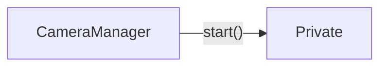

# 카메라 탐색

**관리자 시작의 성공·실패를 확인한 뒤 탐색된 카메라를 사용하세요.**

| 지금 확인할 내용 | 이동할 절 |
|---|---|
| <a id="이-흐름에서-확인할-것"></a>관리자 시작의 성공·실패를 확인한 뒤 탐색된 카메라를 사용하세요. | [탐색을 시작하고 카메라를 사용할 시점](#탐색을-시작하고-카메라를-사용할-시점) |

## 탐색을 시작하고 카메라를 사용할 시점

`CameraManager::start()`은 카메라 관리자를 시작하고 시스템에 있는 모든 장치를 열거합니다. 시작이 확인된 뒤에는 사용자가 시스템의 카메라 목록을 조회하고 카메라와 상호작용할 수 있습니다. 이 사용 가능 범위는 카메라 관리자가 중지되거나 카메라가 시스템에서 분리될 때까지 유지됩니다. `src/libcamera/camera_manager.cpp:329`

근거 원문: [src/libcamera/camera_manager.cpp:329](#source-027ec5bea3fe0dfa)

## 관리자 스레드의 초기화와 실패 처리

`CameraManager::Private::start()`은 먼저 `Thread::start()`로 스레드를 시작합니다. `MutexLocker`로 `mutex_`를 잠근 블록에서 `initialized_`가 참이 될 때까지 `cv_.wait`로 기다린 뒤 `status_` 값을 `status`에 복사합니다. `status`가 0보다 작으면 `exit()`과 `wait()`를 차례로 호출한 뒤 `status`를 반환하고, 그렇지 않으면 `0`을 반환합니다. `src/libcamera/camera_manager.cpp:46`

`CameraManager::Private::run()`은 먼저 `init()`을 호출하고 반환값을 `ret`에 저장합니다. `mutex_`를 잠근 뒤 `status_`에 `ret`을 쓰고 `initialized_`를 `true`로 설정한 다음 `mutex_.unlock()`으로 잠금을 해제합니다. `mutex_.unlock()`이 끝난 뒤 `cv_.notify_one()`을 호출하며, 이 알림은 잠금 구간에 포함되지 않습니다. `ret`이 0보다 작으면 `cleanup()`을 호출하고 반환하며, 그렇지 않으면 `exec()`을 호출한 뒤 `cleanup()`을 호출합니다. `src/libcamera/camera_manager.cpp:71`

`CameraManager::Private::init()`은 `DeviceEnumerator::create()`로 `enumerator_`를 만듭니다. `enumerator_`가 없거나 `enumerator_->enumerate()`의 결과가 0이 아니면 `-ENODEV`를 반환합니다. 그렇지 않으면 `createPipelineHandlers()`를 호출하고, `enumerator_->devicesAdded`에 `Private::createPipelineHandlers`를 연결한 뒤 `0`을 반환합니다. `src/libcamera/camera_manager.cpp:94`

근거 원문: [src/libcamera/camera_manager.cpp:46](#source-a4d912d45af5ed8a) · [src/libcamera/camera_manager.cpp:71](#source-5bd9506aae245794) · [src/libcamera/camera_manager.cpp:94](#source-9290be142dcb4257)

??? note "설계 질문과 검증 범위"
    질문별 답변과 근거 연결을 검사했습니다. 의미와 실행 결과는 사람 검토가 필요합니다.
    
    | 설계 질문 | 설명 위치 | 확인 범위 |
    |---|---|---|
    | CameraManager::start()이 장치를 열거하는 목적과 시작이 확인된 뒤 카메라를 사용할 수 있는 범위를 두 짧은 문단으로 설명하세요. 관리자 중지 또는 카메라 분리 조건을 보존하세요. 숫자 반환값과 내부 대기·실패 처리는 다음 절에서만 설명하므로 이 절에서는 반복하지 마세요. | [탐색을 시작하고 카메라를 사용할 시점](#탐색을-시작하고-카메라를-사용할-시점) | 코드 근거와 설명 연결 |
    | Private::start()의 Thread::start·초기화 대기·status_ 복사와 음수 실패 시 exit/wait/상태 반환 및 성공 반환을 한 문단으로 설명하세요. run()의 초기화 결과 전달, 실패 cleanup과 성공 exec 뒤 cleanup을 둘째 문단에서 설명하세요. init()의 enumerator 생성·열거 실패 -ENODEV와 성공 createPipelineHandlers 및 devicesAdded 연결을 마지막 한 문단으로 묶으세요. 함수별 결과를 한 번씩만 설명하고 소스에 없는 보장이나 작업 보고를 붙이지 마세요. mutex_.unlock()이 끝난 뒤 cv_.notify_one()을 호출한다는 순서를 별도 문장으로 명시하고, 알림을 잠금 구간에 포함시키지 마세요. | [관리자 스레드의 초기화와 실패 처리](#관리자-스레드의-초기화와-실패-처리) | 코드 근거와 설명 연결 |

## 소스 근거

같은 발췌는 한 번만 싣습니다. 필요한 원문을 펼쳐 설명과 대조하세요.

<a id="source-027ec5bea3fe0dfa"></a>

??? note "소스 근거: src/libcamera/camera_manager.cpp:329"
    `src/libcamera/camera_manager.cpp:329`에서 시작하는 발췌입니다. 종료 줄은 337이며, 아래 원문을 설명과 대조할 수 있습니다.
    
    SHA-256: `2a4a445a45564c5df07c3d58252d4ee685195eb169bf1db475e00a2f81edab06`
    
    ```text
    \brief Start the camera manager
     *
     * Start the camera manager and enumerate all devices in the system. Once
     * the start has been confirmed the user is free to list and otherwise
     * interact with cameras in the system until either the camera manager
     * is stopped or the camera is unplugged from the system.
     *
     * \return 0 on success or a negative error code otherwise
     */
    ```

<a id="source-a4d912d45af5ed8a"></a>

??? note "소스 근거: src/libcamera/camera_manager.cpp:46"
    `src/libcamera/camera_manager.cpp:46`에서 시작하는 발췌입니다. 종료 줄은 69이며, 아래 원문을 설명과 대조할 수 있습니다.
    
    SHA-256: `89896bcb55bd900a3a96065af0cf2627c0f80233169c4c39da922bea341c06b7`
    
    ```text
    int CameraManager::Private::start()
    {
    	int status;
    
    	/* Start the thread and wait for initialization to complete. */
    	Thread::start();
    
    	{
    		MutexLocker locker(mutex_);
    		cv_.wait(locker, [&]() LIBCAMERA_TSA_REQUIRES(mutex_) {
    			return initialized_;
    		});
    		status = status_;
    	}
    
    	/* If a failure happened during initialization, stop the thread. */
    	if (status < 0) {
    		exit();
    		wait();
    		return status;
    	}
    
    	return 0;
    }
    ```

<a id="source-5bd9506aae245794"></a>

??? note "소스 근거: src/libcamera/camera_manager.cpp:71"
    `src/libcamera/camera_manager.cpp:71`에서 시작하는 발췌입니다. 종료 줄은 92이며, 아래 원문을 설명과 대조할 수 있습니다.
    
    SHA-256: `99f2565470c1a03de3fa75aef000454121aa8135d5ebacd6e5e9a4f8961c07aa`
    
    ```text
    void CameraManager::Private::run()
    {
    	LOG(Camera, Debug) << "Starting camera manager";
    
    	int ret = init();
    
    	mutex_.lock();
    	status_ = ret;
    	initialized_ = true;
    	mutex_.unlock();
    	cv_.notify_one();
    
    	if (ret < 0) {
    		cleanup();
    		return;
    	}
    
    	/* Now start processing events and messages. */
    	exec();
    
    	cleanup();
    }
    ```

<a id="source-9290be142dcb4257"></a>

??? note "소스 근거: src/libcamera/camera_manager.cpp:94"
    `src/libcamera/camera_manager.cpp:94`에서 시작하는 발췌입니다. 종료 줄은 107이며, 아래 원문을 설명과 대조할 수 있습니다.
    
    SHA-256: `8e85184e2eacbf523477a4c87d878c17069fa18f3358f39501fcaaca8e3dbffe`
    
    ```text
    int CameraManager::Private::init()
    {
    	CameraManager *const o = LIBCAMERA_O_PTR();
    	ipaManager_ = std::make_unique<IPAManager>(*o);
    
    	enumerator_ = DeviceEnumerator::create();
    	if (!enumerator_ || enumerator_->enumerate())
    		return -ENODEV;
    
    	createPipelineHandlers();
    	enumerator_->devicesAdded.connect(this, &Private::createPipelineHandlers);
    
    	return 0;
    }
    ```

## 주요 확인 지점

아래 항목은 추출한 호출에서 고른 코드 탐색 지점입니다. 나열 순서는 실행 순서가 아닙니다.

| 확인할 내용 | 호출 측과 대상 | 구분 | 근거 |
|---|---|---|---|
| 관리자 시작 | `CameraManager` → `Private::start()` | 정적 호출 지점입니다. | `src/libcamera/camera_manager.cpp:342` |

## 주요 호출 관계

화살표는 호출 측과 대상을 연결합니다. 시간 순서나 모든 경로의 실행을 뜻하지 않습니다. 점선에는 가상 호출 후보·예약 대상 등 확인이 필요한 관계를 표시합니다.



## 추적 범위와 경계

요약의 hide 규칙에 해당하는 호출은 17개입니다. 전체 추적 기록에는 해당 호출도 모두 보존합니다. 기록 번호는 정적 탐색의 식별자이며 실행 순번이 아닙니다.

조건 분기, 반복 횟수와 실제 실행 스레드는 이 호출 목록만으로 확정할 수 없습니다. 가상 호출 후보는 실제 객체에 따라 선택됩니다. 예약 표시는 인자로 전달한 메서드 대상을 뜻하며, 비동기 실행을 보증하지 않습니다. 호출부의 연결 방식과 동기화 계약을 확인해야 합니다.

| 호출 지점 | 후보 또는 예약 대상 | 확인할 경계 | 근거 |
|---|---|---|---|
| `Thread` | `Thread::startThread()` | 메서드 전달 대상이며 동기·비동기 여부는 호출부에서 확인해야 합니다. | `src/libcamera/base/thread.cpp:264` |
| `Thread` | `EventDispatcherPoll::interrupt()` | 동적 디스패치 후보이며 실제 대상은 확인이 필요합니다. | `src/libcamera/base/thread.cpp:386` |

추출 통계: 미해결 호출 0개, 예약된 호출 1개입니다.

## 전체 추적 기록

아래 구간을 펼치면 요약에서 제외된 호출까지 확인할 수 있습니다. 이 목록은 추출 깊이 안에서 수집한 기록이며, 소스의 모든 실행 경로를 포함한다는 뜻은 아닙니다.

??? note "추적 기록 1–25 / 33개"

    | 기록 | 호출 측 | 대상 | 구분 | 근거 |
    |---|---|---|---|---|
    | 1 | `CameraManager` | `log::isLogSeverityEnabled()` | 정적 호출 지점입니다. | `src/libcamera/camera_manager.cpp:340` |
    | 2 | `CameraManager` | `LogMessageAbortGuard::LogMessageAbortGuard()` | 정적 호출 지점입니다. | `src/libcamera/camera_manager.cpp:340` |
    | 3 | `CameraManager` | `LogMessage::stream()` | 정적 호출 지점입니다. | `src/libcamera/camera_manager.cpp:340` |
    | 4 | `CameraManager` | `log::_log()` | 정적 호출 지점입니다. | `src/libcamera/camera_manager.cpp:340` |
    | 5 | `log` | `LogMessage::LogMessage()` | 정적 호출 지점입니다. | `src/libcamera/base/log.cpp:990` |
    | 6 | `LogMessage` | `utils::basename()` | 정적 호출 지점입니다. | `src/libcamera/base/log.cpp:858` |
    | 7 | `CameraManager` | `Private::start()` | 정적 호출 지점입니다. | `src/libcamera/camera_manager.cpp:342` |
    | 8 | `Private` | `Thread::start()` | 정적 호출 지점입니다. | `src/libcamera/camera_manager.cpp:51` |
    | 9 | `Thread` | `MutexLocker::MutexLocker()` | 정적 호출 지점입니다. | `src/libcamera/base/thread.cpp:255` |
    | 10 | `Thread` | `Thread::startThread()` | 메서드 전달 대상이며 동기·비동기 여부는 호출부에서 확인해야 합니다. | `src/libcamera/base/thread.cpp:264` |
    | 11 | `Thread` | `Thread::setThreadAffinityInternal()` | 정적 호출 지점입니다. | `src/libcamera/base/thread.cpp:266` |
    | 12 | `Private` | `MutexLocker::MutexLocker()` | 정적 호출 지점입니다. | `src/libcamera/camera_manager.cpp:54` |
    | 13 | `Private` | `ConditionVariable::wait()` | 정적 호출 지점입니다. | `src/libcamera/camera_manager.cpp:55` |
    | 14 | `Private` | `Thread::exit()` | 정적 호출 지점입니다. | `src/libcamera/camera_manager.cpp:63` |
    | 15 | `Thread` | `EventDispatcherPoll::interrupt()` | 동적 디스패치 후보이며 실제 대상은 확인이 필요합니다. | `src/libcamera/base/thread.cpp:386` |
    | 16 | `EventDispatcherPoll` | `UniqueFD::get()` | 정적 호출 지점입니다. | `src/libcamera/base/event_dispatcher_poll.cpp:177` |
    | 17 | `EventDispatcherPoll` | `log::isLogSeverityEnabled()` | 정적 호출 지점입니다. | `src/libcamera/base/event_dispatcher_poll.cpp:181` |
    | 18 | `EventDispatcherPoll` | `LogMessageAbortGuard::LogMessageAbortGuard()` | 정적 호출 지점입니다. | `src/libcamera/base/event_dispatcher_poll.cpp:181` |
    | 19 | `EventDispatcherPoll` | `LogMessage::stream()` | 정적 호출 지점입니다. | `src/libcamera/base/event_dispatcher_poll.cpp:181` |
    | 20 | `EventDispatcherPoll` | `log::_log()` | 정적 호출 지점입니다. | `src/libcamera/base/event_dispatcher_poll.cpp:181` |
    | 21 | `Private` | `Thread::wait()` | 정적 호출 지점입니다. | `src/libcamera/camera_manager.cpp:64` |
    | 22 | `Thread` | `MutexLocker::MutexLocker()` | 정적 호출 지점입니다. | `src/libcamera/base/thread.cpp:407` |
    | 23 | `Thread` | `ConditionVariable::wait()` | 정적 호출 지점입니다. | `src/libcamera/base/thread.cpp:414` |
    | 24 | `Thread` | `(lambda at src/libcamera/base/thread.cpp:409:21)::(lambda at src/libcamera/base/thread.cpp:409:21)()` | 정적 호출 지점입니다. | `src/libcamera/base/thread.cpp:414` |
    | 25 | `Thread` | `ConditionVariable::wait_for()` | 정적 호출 지점입니다. | `src/libcamera/base/thread.cpp:416` |

??? note "추적 기록 26–33 / 33개"

    | 기록 | 호출 측 | 대상 | 구분 | 근거 |
    |---|---|---|---|---|
    | 26 | `Thread` | `(lambda at src/libcamera/base/thread.cpp:409:21)::(lambda at src/libcamera/base/thread.cpp:409:21)()` | 정적 호출 지점입니다. | `src/libcamera/base/thread.cpp:417` |
    | 27 | `CameraManager` | `CameraManager::_d()` | 정적 호출 지점입니다. | `src/libcamera/camera_manager.cpp:342` |
    | 28 | `CameraManager` | `log::isLogSeverityEnabled()` | 정적 호출 지점입니다. | `src/libcamera/camera_manager.cpp:344` |
    | 29 | `CameraManager` | `LogMessageAbortGuard::LogMessageAbortGuard()` | 정적 호출 지점입니다. | `src/libcamera/camera_manager.cpp:344` |
    | 30 | `CameraManager` | `LogMessage::stream()` | 정적 호출 지점입니다. | `src/libcamera/camera_manager.cpp:344` |
    | 31 | `CameraManager` | `log::_log()` | 정적 호출 지점입니다. | `src/libcamera/camera_manager.cpp:344` |
    | 32 | `log` | `LogMessage::LogMessage()` | 정적 호출 지점입니다. | `src/libcamera/base/log.cpp:990` |
    | 33 | `LogMessage` | `utils::basename()` | 정적 호출 지점입니다. | `src/libcamera/base/log.cpp:858` |

??? note "근거와 검토 정보"
    - 생성 방식: 추출 사실과 LLM 설명
    - 검증 범위: 표·그림은 facts로 만들고 설명은 LLM이 작성합니다. 인용·문장 및 설정된 구조 검사를 적용합니다.
    - 근거 파일: `src/libcamera/base/event_dispatcher_poll.cpp`, `src/libcamera/base/log.cpp`, `src/libcamera/base/thread.cpp`, `src/libcamera/camera_manager.cpp`
    - 근거 수준: 코드 확인 (정적 분석, simple_compdb 구성, commit `212c689fcf`)
    - 자동 검사 (인용·문장 및 설정된 구조 검사): 통과
    - 검토 상태 기록일: 2026-10-31 · 사람 검토 전

다음 단계: [스트림 구성](configure.md)
