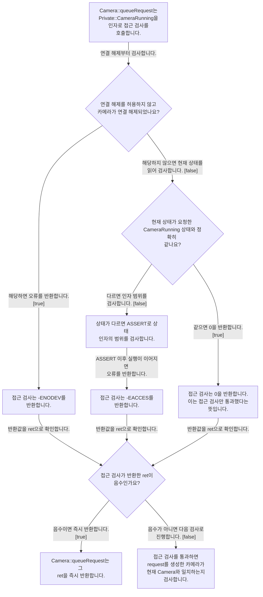
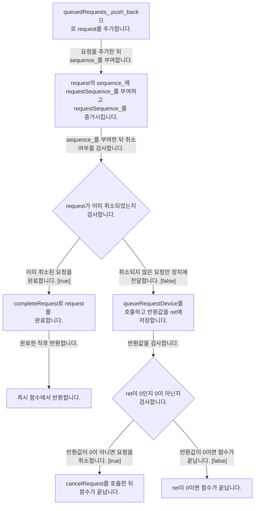
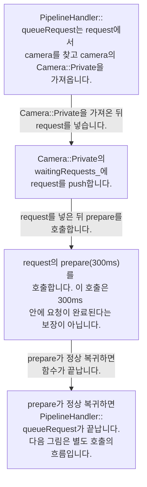
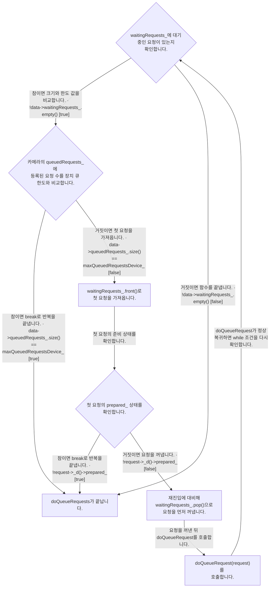
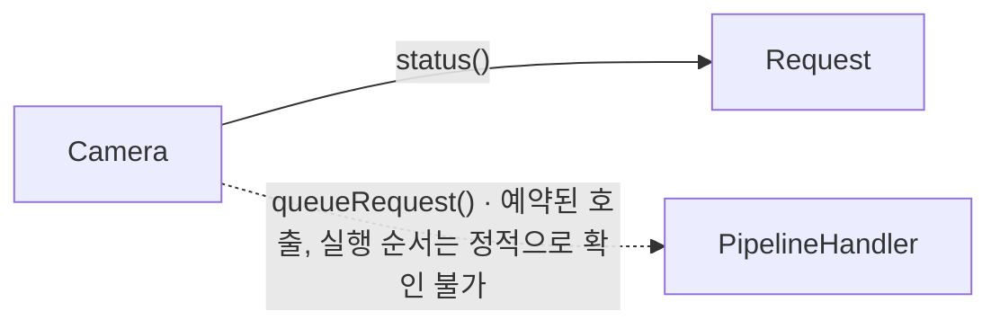

# 요청 제출

**시작된 카메라에 유효한 요청을 제출하고 완료 알림은 별도로 확인하세요.**

| 지금 확인할 내용 | 이동할 절 |
|---|---|
| <a id="이-흐름에서-확인할-것"></a>시작된 카메라에 유효한 요청을 제출하고 완료 알림은 별도로 확인하세요. | [요청을 제출하기 전에 갖출 조건](#요청을-제출하기-전에-갖출-조건) |

## 요청을 제출하기 전에 갖출 조건

`Camera::queueRequest()`는 캡처할 요청을 카메라에 접수합니다. 이 함수는 thread-safe이며 호출자는 카메라가 Running 상태일 때만 호출해야 합니다. 카메라 연결이 끊겼으면 `-ENODEV`를 반환하고, 연결이 유지된 상태에서 Running 상태가 아니면 `-EACCES`를 반환합니다. `src/libcamera/camera.cpp:1308`, `src/libcamera/camera.cpp:690`, `include/libcamera/internal/camera.h:59`

<!-- sdd:visual:queue-access-helper -->
### 요청 제출의 접근 검사



[Mermaid 원문](queue_request.queue-access-helper.mmd)

??? note "그림 근거와 확인 범위"
    queueRequest의 첫 접근 검사는 어떤 순서로 연결 해제와 Running 상태를 검사하며, 이 검사에서 반환한 0은 무엇을 뜻합니까?
    
    소스에 연결한 설계 해석입니다. 자동 연결 검사는 의미 승인이나 기기 실행 검증이 아닙니다.
    
    | 요소·전이 | 소스 근거 |
    |---|---|
    | <span data-sdd-label-en="Camera::queueRequest calls the access check with Private::CameraRunning.">Camera::queueRequest는 Private::CameraRunning을 인자로 접근 검사를 호출합니다.</span> | [src/libcamera/camera.cpp:1308](#source-3c1e4a3c695a8890) |
    | <span data-sdd-label-en="Is disconnection disallowed and the camera disconnected?">연결 해제를 허용하지 않고 카메라가 연결 해제되었나요?</span> | [src/libcamera/camera.cpp:690](#source-43bf991ac670b1aa) · [include/libcamera/internal/camera.h:59](#source-c0ab3b94a184909f) |
    | <span data-sdd-label-en="The access check returns -ENODEV.">접근 검사는 -ENODEV를 반환합니다.</span> | [src/libcamera/camera.cpp:690](#source-43bf991ac670b1aa) |
    | <span data-sdd-label-en="Does the current state exactly match the requested CameraRunning state?">현재 상태가 요청한 CameraRunning 상태와 정확히 같나요?</span> | [src/libcamera/camera.cpp:1308](#source-3c1e4a3c695a8890) · [src/libcamera/camera.cpp:690](#source-43bf991ac670b1aa) |
    | <span data-sdd-label-en="The access check returns 0. This means only that the access check passed.">접근 검사는 0을 반환합니다. 이는 접근 검사만 통과했다는 뜻입니다.</span> | [src/libcamera/camera.cpp:690](#source-43bf991ac670b1aa) · [src/libcamera/camera.cpp:1308](#source-3c1e4a3c695a8890) |
    | <span data-sdd-label-en="If the states differ, an ASSERT checks the range of the state argument.">상태가 다르면 ASSERT로 상태 인자의 범위를 검사합니다.</span> | [src/libcamera/camera.cpp:690](#source-43bf991ac670b1aa) · [src/libcamera/camera.cpp:1308](#source-3c1e4a3c695a8890) |
    | <span data-sdd-label-en="The access check returns -EACCES.">접근 검사는 -EACCES를 반환합니다.</span> | [src/libcamera/camera.cpp:690](#source-43bf991ac670b1aa) |
    | <span data-sdd-label-en="Is the ret returned by the access check negative?">접근 검사가 반환한 ret이 음수인가요?</span> | [src/libcamera/camera.cpp:1308](#source-3c1e4a3c695a8890) |
    | <span data-sdd-label-en="Camera::queueRequest immediately returns that ret.">Camera::queueRequest는 그 ret을 즉시 반환합니다.</span> | [src/libcamera/camera.cpp:1308](#source-3c1e4a3c695a8890) |
    | <span data-sdd-label-en="After the access check passes, the function checks whether the camera that created request matches the current Camera.">접근 검사를 통과하면 request를 생성한 카메라가 현재 Camera와 일치하는지 검사합니다.</span> | [src/libcamera/camera.cpp:1308](#source-3c1e4a3c695a8890) |
    | <span data-sdd-label-en="The check examines disconnection first.">연결 해제부터 검사합니다.</span> | [src/libcamera/camera.cpp:1308](#source-3c1e4a3c695a8890) · [src/libcamera/camera.cpp:690](#source-43bf991ac670b1aa) · [include/libcamera/internal/camera.h:59](#source-c0ab3b94a184909f) |
    | <span data-sdd-label-en="If so, the check returns an error. · !allowDisconnected &amp;&amp; disconnected_ [true]">해당하면 오류를 반환합니다. · &#33;allowDisconnected &amp;&amp; disconnected&#95; &#91;true&#93;</span> | [src/libcamera/camera.cpp:690](#source-43bf991ac670b1aa) |
    | <span data-sdd-label-en="Otherwise, the check reads and examines the current state. · !allowDisconnected &amp;&amp; disconnected_ [false]">해당하지 않으면 현재 상태를 읽어 검사합니다. · &#33;allowDisconnected &amp;&amp; disconnected&#95; &#91;false&#93;</span> | [src/libcamera/camera.cpp:690](#source-43bf991ac670b1aa) |
    | <span data-sdd-label-en="If they match, the check returns 0. · currentState == state [true]">같으면 0을 반환합니다. · currentState == state &#91;true&#93;</span> | [src/libcamera/camera.cpp:690](#source-43bf991ac670b1aa) |
    | <span data-sdd-label-en="If they differ, the check examines the argument range. · currentState == state [false]">다르면 인자 범위를 검사합니다. · currentState == state &#91;false&#93;</span> | [src/libcamera/camera.cpp:690](#source-43bf991ac670b1aa) |
    | <span data-sdd-label-en="If execution continues after the ASSERT, return the error.">ASSERT 이후 실행이 이어지면 오류를 반환합니다.</span> | [src/libcamera/camera.cpp:690](#source-43bf991ac670b1aa) |
    | <span data-sdd-label-en="The caller checks the return value as ret.">반환값을 ret으로 확인합니다.</span> | [src/libcamera/camera.cpp:690](#source-43bf991ac670b1aa) · [src/libcamera/camera.cpp:1308](#source-3c1e4a3c695a8890) |
    | <span data-sdd-label-en="The caller checks the return value as ret.">반환값을 ret으로 확인합니다.</span> | [src/libcamera/camera.cpp:690](#source-43bf991ac670b1aa) · [src/libcamera/camera.cpp:1308](#source-3c1e4a3c695a8890) |
    | <span data-sdd-label-en="The caller checks the return value as ret.">반환값을 ret으로 확인합니다.</span> | [src/libcamera/camera.cpp:690](#source-43bf991ac670b1aa) · [src/libcamera/camera.cpp:1308](#source-3c1e4a3c695a8890) |
    | <span data-sdd-label-en="If it is negative, the function returns it immediately. · ret &lt; 0 [true]">음수이면 즉시 반환합니다. · ret &lt; 0 &#91;true&#93;</span> | [src/libcamera/camera.cpp:1308](#source-3c1e4a3c695a8890) |
    | <span data-sdd-label-en="If it is not negative, the function proceeds to the next check. · ret &lt; 0 [false]">음수가 아니면 다음 검사로 진행합니다. · ret &lt; 0 &#91;false&#93;</span> | [src/libcamera/camera.cpp:1308](#source-3c1e4a3c695a8890) |
<!-- /sdd:visual:queue-access-helper -->

<!-- sdd:visual:queue-acceptance-exact-guards -->
### 요청 제출의 실제 거절 조건

```mermaid
flowchart TB
%% sdd:translations {"-EINVAL을 반환합니다.": "Return -EINVAL.", "-EXDEV를 반환합니다.": "Return -EXDEV.", "Camera::queueRequest는 접수 <br/>성공으로 0을 반환합니다. <br/>촬영 완료는 <br/>requestCompleted로 알립니다.": "Camera::queueRequest <br/>returns 0 for acceptance; <br/>requestCompleted signals <br/>completion.", "CameraRunning 접근 검사 <br/>결과가 음수인가요?": "Is the CameraRunning access <br/>check result negative?", "invokeMethod가 정상 <br/>복귀하면 0을 반환합니다.": "When invokeMethod returns <br/>normally, return 0.", "invokeMethod를 <br/>ConnectionTypeQueued로 <br/>호출해 <br/>PipelineHandler::<br/>queueRequest 호출을 <br/>예약합니다.": "Use invokeMethod with <br/>ConnectionTypeQueued to <br/>queue <br/>PipelineHandler::<br/>queueRequest.", "patchControlList로 요청의 <br/>컨트롤을 사전 처리합니다.": "Pre-process the request <br/>controls with <br/>patchControlList.", "거짓이고 다음 버퍼가 있으면 <br/>그 stream을 검사합니다. <br/>#91;false#93;": "If false and another buffer <br/>remains, check its stream. <br/>#91;false#93;", "거짓이고 모든 버퍼를 <br/>검사했다면 사전 처리합니다. <br/>#91;false#93;": "If false and all buffers <br/>have been checked, <br/>pre-process controls. <br/>#91;false#93;", "거짓이면 각 버퍼의 stream을 <br/>검사합니다. #91;false#93;": "If false, check each <br/>buffer#39;s stream. #91;false#93;", "거짓이면 버퍼 목록을 <br/>검사합니다. #91;false#93;": "If false, check the buffer <br/>list. #91;false#93;", "거짓이면 상태를 검사합니다. <br/>#91;false#93;": "If false, check the status. <br/>#91;false#93;", "거짓이면 요청의 카메라를 <br/>검사합니다. #91;false#93;": "If false, check the request <br/>camera. #91;false#93;", "거짓이면 컨트롤을 <br/>검사합니다. #91;false#93;": "If false, check the <br/>controls. #91;false#93;", "사전 처리가 정상 복귀하면 <br/>호출을 예약합니다.": "When pre-processing returns <br/>normally, queue the call.", "요청 컨트롤의 infoMap이 <br/>카메라 controls의 주소와 <br/>다른가요?": "Is the request controls <br/>infoMap different from the <br/>camera controls address?", "요청을 만든 카메라가 이 <br/>카메라와 다른가요?": "Is the camera that created <br/>the request different from <br/>this camera?", "요청의 버퍼 목록이 비어 <br/>있나요? 호출자는 큐에 넣기 <br/>전에 캡처 버퍼를 요청에 <br/>적어도 하나 추가해야 합니다.": "Are request buffers empty? <br/>The caller must add at <br/>least one capture buffer <br/>before queuing.", "요청의 상태가 <br/>Request::RequestPending과 <br/>다른가요?": "Is the request status <br/>different from <br/>Request::RequestPending?", "접근 검사에서 받은 오류를 <br/>그대로 반환합니다.": "Return the error received <br/>from the access check <br/>unchanged.", "참이면 -EINVAL을 <br/>반환합니다. #91;true#93;": "If true, return -EINVAL. <br/>#91;true#93;", "참이면 -EXDEV를 반환합니다. <br/>#91;true#93;": "If true, return -EXDEV. <br/>#91;true#93;", "참이면 받은 오류를 <br/>반환합니다. #91;true#93;": "If true, return the <br/>received error. #91;true#93;", "현재 버퍼의 stream을 <br/>activeStreams#95;에서 찾지 <br/>못했나요? 모든 버퍼를 <br/>검사합니다.": "Is the current buffer#39;s <br/>stream absent from <br/>activeStreams#95;? Check every <br/>buffer."}
  v_access{"CameraRunning 접근 검사 <br/>결과가 음수인가요?"}
  v_access_error["접근 검사에서 받은 오류를 <br/>그대로 반환합니다."]
  v_camera{"요청을 만든 카메라가 이 <br/>카메라와 다른가요?"}
  v_exdev["-EXDEV를 반환합니다."]
  v_status{"요청의 상태가 <br/>Request::RequestPending과 <br/>다른가요?"}
  v_controls{"요청 컨트롤의 infoMap이 <br/>카메라 controls의 주소와 <br/>다른가요?"}
  v_buffers{"요청의 버퍼 목록이 비어 <br/>있나요? 호출자는 큐에 넣기 <br/>전에 캡처 버퍼를 요청에 <br/>적어도 하나 추가해야 합니다."}
  v_stream{"현재 버퍼의 stream을 <br/>activeStreams#95;에서 찾지 <br/>못했나요? 모든 버퍼를 <br/>검사합니다."}
  v_invalid["-EINVAL을 반환합니다."]
  v_patch["patchControlList로 요청의 <br/>컨트롤을 사전 처리합니다."]
  v_invoke["invokeMethod를 <br/>ConnectionTypeQueued로 <br/>호출해 <br/>PipelineHandler::<br/>queueRequest 호출을 <br/>예약합니다."]
  v_success["Camera::queueRequest는 접수 <br/>성공으로 0을 반환합니다. <br/>촬영 완료는 <br/>requestCompleted로 알립니다."]
  v_access -->|"참이면 받은 오류를 <br/>반환합니다. #91;true#93;"| v_access_error
  v_access -->|"거짓이면 요청의 카메라를 <br/>검사합니다. #91;false#93;"| v_camera
  v_camera -->|"참이면 -EXDEV를 반환합니다. <br/>#91;true#93;"| v_exdev
  v_camera -->|"거짓이면 상태를 검사합니다. <br/>#91;false#93;"| v_status
  v_status -->|"참이면 -EINVAL을 <br/>반환합니다. #91;true#93;"| v_invalid
  v_status -->|"거짓이면 컨트롤을 <br/>검사합니다. #91;false#93;"| v_controls
  v_controls -->|"참이면 -EINVAL을 <br/>반환합니다. #91;true#93;"| v_invalid
  v_controls -->|"거짓이면 버퍼 목록을 <br/>검사합니다. #91;false#93;"| v_buffers
  v_buffers -->|"참이면 -EINVAL을 <br/>반환합니다. #91;true#93;"| v_invalid
  v_buffers -->|"거짓이면 각 버퍼의 stream을 <br/>검사합니다. #91;false#93;"| v_stream
  v_stream -->|"참이면 -EINVAL을 <br/>반환합니다. #91;true#93;"| v_invalid
  v_stream -->|"거짓이고 다음 버퍼가 있으면 <br/>그 stream을 검사합니다. <br/>#91;false#93;"| v_stream
  v_stream -->|"거짓이고 모든 버퍼를 <br/>검사했다면 사전 처리합니다. <br/>#91;false#93;"| v_patch
  v_patch -->|"사전 처리가 정상 복귀하면 <br/>호출을 예약합니다."| v_invoke
  v_invoke -->|"invokeMethod가 정상 <br/>복귀하면 0을 반환합니다."| v_success
```



[Mermaid 원문](queue_request.queue-acceptance-exact-guards.mmd)

??? note "그림 근거와 확인 범위"
    접근 검사 통과 뒤 Camera::queueRequest는 요청·컨트롤·버퍼·스트림을 어떤 순서로 검사하고 언제 큐 전달을 접수합니까?
    
    소스에 연결한 설계 해석입니다. 자동 연결 검사는 의미 승인이나 기기 실행 검증이 아닙니다.
    
    LLM 그림 초안 · 사람 검토 전
    
    작성 모델: `cli/codex/gpt-6.1-terra`
    
    | 요소·전이 | 소스 근거 |
    |---|---|
    | <span data-sdd-label-en="Is the CameraRunning access check result negative?">CameraRunning 접근 검사 결과가 음수인가요?</span> | [src/libcamera/camera.cpp:1308](#source-3c1e4a3c695a8890) |
    | <span data-sdd-label-en="Return the error received from the access check unchanged.">접근 검사에서 받은 오류를 그대로 반환합니다.</span> | [src/libcamera/camera.cpp:1308](#source-3c1e4a3c695a8890) |
    | <span data-sdd-label-en="Is the camera that created the request different from this camera?">요청을 만든 카메라가 이 카메라와 다른가요?</span> | [src/libcamera/camera.cpp:1308](#source-3c1e4a3c695a8890) |
    | <span data-sdd-label-en="Return -EXDEV.">-EXDEV를 반환합니다.</span> | [src/libcamera/camera.cpp:1308](#source-3c1e4a3c695a8890) |
    | <span data-sdd-label-en="Is the request status different from Request::RequestPending?">요청의 상태가 Request::RequestPending과 다른가요?</span> | [src/libcamera/camera.cpp:1308](#source-3c1e4a3c695a8890) |
    | <span data-sdd-label-en="Is the request controls infoMap different from the camera controls address?">요청 컨트롤의 infoMap이 카메라 controls의 주소와 다른가요?</span> | [src/libcamera/camera.cpp:1308](#source-3c1e4a3c695a8890) |
    | <span data-sdd-label-en="Are request buffers empty? The caller must add at least one capture buffer before queuing.">요청의 버퍼 목록이 비어 있나요? 호출자는 큐에 넣기 전에 캡처 버퍼를 요청에 적어도 하나 추가해야 합니다.</span> | [src/libcamera/camera.cpp:1308](#source-3c1e4a3c695a8890) |
    | <span data-sdd-label-en="Is the current buffer&#x27;s stream absent from activeStreams_? Check every buffer.">현재 버퍼의 stream을 activeStreams&#95;에서 찾지 못했나요? 모든 버퍼를 검사합니다.</span> | [src/libcamera/camera.cpp:1308](#source-3c1e4a3c695a8890) |
    | <span data-sdd-label-en="Return -EINVAL.">-EINVAL을 반환합니다.</span> | [src/libcamera/camera.cpp:1308](#source-3c1e4a3c695a8890) |
    | <span data-sdd-label-en="Pre-process the request controls with patchControlList.">patchControlList로 요청의 컨트롤을 사전 처리합니다.</span> | [src/libcamera/camera.cpp:1308](#source-3c1e4a3c695a8890) |
    | <span data-sdd-label-en="Use invokeMethod with ConnectionTypeQueued to queue PipelineHandler::queueRequest.">invokeMethod를 ConnectionTypeQueued로 호출해 PipelineHandler::queueRequest 호출을 예약합니다.</span> | [src/libcamera/camera.cpp:1308](#source-3c1e4a3c695a8890) |
    | <span data-sdd-label-en="Camera::queueRequest returns 0 for acceptance; requestCompleted signals completion.">Camera::queueRequest는 접수 성공으로 0을 반환합니다. 촬영 완료는 requestCompleted로 알립니다.</span> | [src/libcamera/camera.cpp:1308](#source-3c1e4a3c695a8890) |
    | <span data-sdd-label-en="If true, return the received error. · ret &lt; 0 [true]">참이면 받은 오류를 반환합니다. · ret &lt; 0 &#91;true&#93;</span> | [src/libcamera/camera.cpp:1308](#source-3c1e4a3c695a8890) |
    | <span data-sdd-label-en="If false, check the request camera. · ret &lt; 0 [false]">거짓이면 요청의 카메라를 검사합니다. · ret &lt; 0 &#91;false&#93;</span> | [src/libcamera/camera.cpp:1308](#source-3c1e4a3c695a8890) |
    | <span data-sdd-label-en="If true, return -EXDEV. · request-&gt;_d()-&gt;camera() != this [true]">참이면 -EXDEV를 반환합니다. · request-&gt;&#95;d&#40;&#41;-&gt;camera&#40;&#41; &#33;= this &#91;true&#93;</span> | [src/libcamera/camera.cpp:1308](#source-3c1e4a3c695a8890) |
    | <span data-sdd-label-en="If false, check the status. · request-&gt;_d()-&gt;camera() != this [false]">거짓이면 상태를 검사합니다. · request-&gt;&#95;d&#40;&#41;-&gt;camera&#40;&#41; &#33;= this &#91;false&#93;</span> | [src/libcamera/camera.cpp:1308](#source-3c1e4a3c695a8890) |
    | <span data-sdd-label-en="If true, return -EINVAL. · request-&gt;status() != Request::RequestPending [true]">참이면 -EINVAL을 반환합니다. · request-&gt;status&#40;&#41; &#33;= Request::RequestPending &#91;true&#93;</span> | [src/libcamera/camera.cpp:1308](#source-3c1e4a3c695a8890) |
    | <span data-sdd-label-en="If false, check the controls. · request-&gt;status() != Request::RequestPending [false]">거짓이면 컨트롤을 검사합니다. · request-&gt;status&#40;&#41; &#33;= Request::RequestPending &#91;false&#93;</span> | [src/libcamera/camera.cpp:1308](#source-3c1e4a3c695a8890) |
    | <span data-sdd-label-en="If true, return -EINVAL. · request-&gt;controls().infoMap() != &amp;controls() [true]">참이면 -EINVAL을 반환합니다. · request-&gt;controls&#40;&#41;.infoMap&#40;&#41; &#33;= &amp;controls&#40;&#41; &#91;true&#93;</span> | [src/libcamera/camera.cpp:1308](#source-3c1e4a3c695a8890) |
    | <span data-sdd-label-en="If false, check the buffer list. · request-&gt;controls().infoMap() != &amp;controls() [false]">거짓이면 버퍼 목록을 검사합니다. · request-&gt;controls&#40;&#41;.infoMap&#40;&#41; &#33;= &amp;controls&#40;&#41; &#91;false&#93;</span> | [src/libcamera/camera.cpp:1308](#source-3c1e4a3c695a8890) |
    | <span data-sdd-label-en="If true, return -EINVAL. · request-&gt;buffers().empty() [true]">참이면 -EINVAL을 반환합니다. · request-&gt;buffers&#40;&#41;.empty&#40;&#41; &#91;true&#93;</span> | [src/libcamera/camera.cpp:1308](#source-3c1e4a3c695a8890) |
    | <span data-sdd-label-en="If false, check each buffer&#x27;s stream. · request-&gt;buffers().empty() [false]">거짓이면 각 버퍼의 stream을 검사합니다. · request-&gt;buffers&#40;&#41;.empty&#40;&#41; &#91;false&#93;</span> | [src/libcamera/camera.cpp:1308](#source-3c1e4a3c695a8890) |
    | <span data-sdd-label-en="If true, return -EINVAL. · d-&gt;activeStreams_.find(stream) == d-&gt;activeStreams_.end() [true]">참이면 -EINVAL을 반환합니다. · d-&gt;activeStreams&#95;.find&#40;stream&#41; == d-&gt;activeStreams&#95;.end&#40;&#41; &#91;true&#93;</span> | [src/libcamera/camera.cpp:1308](#source-3c1e4a3c695a8890) |
    | <span data-sdd-label-en="If false and another buffer remains, check its stream. · d-&gt;activeStreams_.find(stream) == d-&gt;activeStreams_.end() [false]">거짓이고 다음 버퍼가 있으면 그 stream을 검사합니다. · d-&gt;activeStreams&#95;.find&#40;stream&#41; == d-&gt;activeStreams&#95;.end&#40;&#41; &#91;false&#93;</span> | [src/libcamera/camera.cpp:1308](#source-3c1e4a3c695a8890) |
    | <span data-sdd-label-en="If false and all buffers have been checked, pre-process controls. · d-&gt;activeStreams_.find(stream) == d-&gt;activeStreams_.end() [false]">거짓이고 모든 버퍼를 검사했다면 사전 처리합니다. · d-&gt;activeStreams&#95;.find&#40;stream&#41; == d-&gt;activeStreams&#95;.end&#40;&#41; &#91;false&#93;</span> | [src/libcamera/camera.cpp:1308](#source-3c1e4a3c695a8890) |
    | <span data-sdd-label-en="When pre-processing returns normally, queue the call.">사전 처리가 정상 복귀하면 호출을 예약합니다.</span> | [src/libcamera/camera.cpp:1308](#source-3c1e4a3c695a8890) |
    | <span data-sdd-label-en="When invokeMethod returns normally, return 0.">invokeMethod가 정상 복귀하면 0을 반환합니다.</span> | [src/libcamera/camera.cpp:1308](#source-3c1e4a3c695a8890) |
<!-- /sdd:visual:queue-acceptance-exact-guards -->

`Camera::queueRequest()`는 요청을 만든 카메라가 자신과 다르면 `-EXDEV`를 반환합니다. 요청 상태가 `RequestPending`이 아니거나 `controls().infoMap()`이 카메라의 `controls()` 주소와 다르면 `-EINVAL`을 반환합니다. 버퍼가 없거나 요청의 버퍼에 연결된 스트림이 `activeStreams_`에 없어도 `-EINVAL`을 반환합니다. `src/libcamera/camera.cpp:1308`

애플리케이션은 `createRequest()`로 만든 요청을 접수하기 전에 캡처 버퍼를 하나 이상 채워야 합니다. 검사를 통과한 `Camera::queueRequest()`는 `patchControlList()`를 호출하고 `PipelineHandler::queueRequest()`를 큐 방식으로 호출한 뒤 `0`을 반환합니다. 요청이 접수된 후 카메라는 `requestCompleted` 신호로 완료를 알립니다. `src/libcamera/camera.cpp:1308`

근거 원문: [src/libcamera/camera.cpp:1308](#source-3c1e4a3c695a8890) · [src/libcamera/camera.cpp:690](#source-43bf991ac670b1aa) · [include/libcamera/internal/camera.h:59](#source-c0ab3b94a184909f)

## 큐로 전달된 요청의 준비와 실패

`Camera::queueRequest`는 `patchControlList`로 요청의 `AeEnable`을 전처리한 뒤 `ConnectionTypeQueued`를 사용해 `PipelineHandler::queueRequest`에 요청을 전달합니다. 카메라 상태는 함수가 끝날 때까지 바뀔 수 있으며, `PipelineHandler::queueRequest`가 이 상태 변경을 처리하므로 이 부분에는 잠금이 필요하지 않습니다. `CameraManager` 스레드에서 호출되는 `PipelineHandler::queueRequest`는 요청을 `waitingRequests_`에 넣은 뒤 `prepare(300ms)`를 시작합니다. 소스 주석에 따르면 준비 단계에서 요청이 실패하면 해당 요청을 취소합니다. `src/libcamera/camera.cpp:1373`, `src/libcamera/pipeline_handler.cpp:447`

<!-- sdd:visual:dispatch-device-errors -->
### 장치 큐 전달과 취소의 분기



[Mermaid 원문](queue_request.dispatch-device-errors.mmd)

??? note "그림 근거와 확인 범위"
    doQueueRequest는 queuedRequests_와 sequence_를 어떤 순서로 갱신하며, 이미 취소된 요청 또는 queueRequestDevice의 0/0이 아닌 반환을 어떻게 처리합니까?
    
    소스에 연결한 설계 해석입니다. 자동 연결 검사는 의미 승인이나 기기 실행 검증이 아닙니다.
    
    LLM 그림 초안 · 사람 검토 전
    
    작성 모델: `cli/codex/gpt-6.1-terra`
    
    | 요소·전이 | 소스 근거 |
    |---|---|
    | <span data-sdd-label-en="Add request with queuedRequests_.push_back.">queuedRequests&#95;.push&#95;back으로 request를 추가합니다.</span> | [src/libcamera/pipeline_handler.cpp:483](#source-7348e9b4af985eb2) |
    | <span data-sdd-label-en="Assign requestSequence_ to request&#x27;s sequence_ and increment requestSequence_.">request의 sequence&#95;에 requestSequence&#95;를 부여하고 requestSequence&#95;를 증가시킵니다.</span> | [src/libcamera/pipeline_handler.cpp:483](#source-7348e9b4af985eb2) |
    | <span data-sdd-label-en="Check whether request is already cancelled.">request가 이미 취소되었는지 검사합니다.</span> | [src/libcamera/pipeline_handler.cpp:483](#source-7348e9b4af985eb2) |
    | <span data-sdd-label-en="Complete request with completeRequest.">completeRequest로 request를 완료합니다.</span> | [src/libcamera/pipeline_handler.cpp:483](#source-7348e9b4af985eb2) |
    | <span data-sdd-label-en="Return from the function immediately.">즉시 함수에서 반환합니다.</span> | [src/libcamera/pipeline_handler.cpp:483](#source-7348e9b4af985eb2) |
    | <span data-sdd-label-en="Call queueRequestDevice and store its return value in ret.">queueRequestDevice를 호출하고 반환값을 ret에 저장합니다.</span> | [src/libcamera/pipeline_handler.cpp:483](#source-7348e9b4af985eb2) |
    | <span data-sdd-label-en="Check whether ret is zero or nonzero.">ret이 0인지 0이 아닌지 검사합니다.</span> | [src/libcamera/pipeline_handler.cpp:483](#source-7348e9b4af985eb2) |
    | <span data-sdd-label-en="Call cancelRequest, then the function ends.">cancelRequest를 호출한 뒤 함수가 끝납니다.</span> | [src/libcamera/pipeline_handler.cpp:483](#source-7348e9b4af985eb2) |
    | <span data-sdd-label-en="If ret is zero, the function ends.">ret이 0이면 함수가 끝납니다.</span> | [src/libcamera/pipeline_handler.cpp:483](#source-7348e9b4af985eb2) |
    | <span data-sdd-label-en="Assign sequence_ after adding the request.">요청을 추가한 뒤 sequence&#95;를 부여합니다.</span> | [src/libcamera/pipeline_handler.cpp:483](#source-7348e9b4af985eb2) |
    | <span data-sdd-label-en="Check for cancellation after assigning sequence_.">sequence&#95;를 부여한 뒤 취소 여부를 검사합니다.</span> | [src/libcamera/pipeline_handler.cpp:483](#source-7348e9b4af985eb2) |
    | <span data-sdd-label-en="Complete the already cancelled request. · request-&gt;_d()-&gt;cancelled_ [true]">이미 취소된 요청을 완료합니다. · request-&gt;&#95;d&#40;&#41;-&gt;cancelled&#95; &#91;true&#93;</span> | [src/libcamera/pipeline_handler.cpp:483](#source-7348e9b4af985eb2) |
    | <span data-sdd-label-en="Return immediately after completing it.">완료한 직후 반환합니다.</span> | [src/libcamera/pipeline_handler.cpp:483](#source-7348e9b4af985eb2) |
    | <span data-sdd-label-en="Pass only a request that is not cancelled to the device. · request-&gt;_d()-&gt;cancelled_ [false]">취소되지 않은 요청만 장치에 전달합니다. · request-&gt;&#95;d&#40;&#41;-&gt;cancelled&#95; &#91;false&#93;</span> | [src/libcamera/pipeline_handler.cpp:483](#source-7348e9b4af985eb2) |
    | <span data-sdd-label-en="Check the return value.">반환값을 검사합니다.</span> | [src/libcamera/pipeline_handler.cpp:483](#source-7348e9b4af985eb2) |
    | <span data-sdd-label-en="Cancel the request if the return value is nonzero. · ret [true]">반환값이 0이 아니면 요청을 취소합니다. · ret &#91;true&#93;</span> | [src/libcamera/pipeline_handler.cpp:483](#source-7348e9b4af985eb2) |
    | <span data-sdd-label-en="The function ends if the return value is zero. · ret [false]">반환값이 0이면 함수가 끝납니다. · ret &#91;false&#93;</span> | [src/libcamera/pipeline_handler.cpp:483](#source-7348e9b4af985eb2) |
<!-- /sdd:visual:dispatch-device-errors -->

<!-- sdd:visual:queue-insert-prepare-only -->
### 대기 큐 삽입과 준비 호출



[Mermaid 원문](queue_request.queue-insert-prepare-only.mmd)

??? note "그림 근거와 확인 범위"
    PipelineHandler::queueRequest 자체는 요청을 어디에 넣고 어떤 준비 함수를 호출합니까?
    
    소스에 연결한 설계 해석입니다. 자동 연결 검사는 의미 승인이나 기기 실행 검증이 아닙니다.
    
    LLM 그림 초안 · 사람 검토 전
    
    작성 모델: `cli/codex/gpt-6.1-terra`
    
    | 요소·전이 | 소스 근거 |
    |---|---|
    | <span data-sdd-label-en="PipelineHandler::queueRequest finds camera from request and gets its Camera::Private.">PipelineHandler::queueRequest는 request에서 camera를 찾고 camera의 Camera::Private을 가져옵니다.</span> | [src/libcamera/pipeline_handler.cpp:447](#source-5493b66ef420047f) |
    | <span data-sdd-label-en="It pushes request into waitingRequests_ in Camera::Private.">Camera::Private의 waitingRequests&#95;에 request를 push합니다.</span> | [src/libcamera/pipeline_handler.cpp:447](#source-5493b66ef420047f) |
    | <span data-sdd-label-en="It calls prepare(300ms) on request; the call does not guarantee completion within 300ms.">request의 prepare&#40;300ms&#41;를 호출합니다. 이 호출은 300ms 안에 요청이 완료된다는 보장이 아닙니다.</span> | [src/libcamera/pipeline_handler.cpp:447](#source-5493b66ef420047f) |
    | <span data-sdd-label-en="After prepare returns normally, PipelineHandler::queueRequest ends. The next diagram shows a separate call.">prepare가 정상 복귀하면 PipelineHandler::queueRequest가 끝납니다. 다음 그림은 별도 호출의 흐름입니다.</span> | [src/libcamera/pipeline_handler.cpp:447](#source-5493b66ef420047f) |
    | <span data-sdd-label-en="After getting Camera::Private, it inserts request.">Camera::Private을 가져온 뒤 request를 넣습니다.</span> | [src/libcamera/pipeline_handler.cpp:447](#source-5493b66ef420047f) |
    | <span data-sdd-label-en="After inserting request, it calls prepare.">request를 넣은 뒤 prepare를 호출합니다.</span> | [src/libcamera/pipeline_handler.cpp:447](#source-5493b66ef420047f) |
    | <span data-sdd-label-en="The function ends when prepare returns normally.">prepare가 정상 복귀하면 함수가 끝납니다.</span> | [src/libcamera/pipeline_handler.cpp:447](#source-5493b66ef420047f) |
<!-- /sdd:visual:queue-insert-prepare-only -->

<!-- sdd:visual:prepared-queue-dispatch-loop -->
### 준비된 대기 요청의 장치 전달 검사



[Mermaid 원문](queue_request.prepared-queue-dispatch-loop.mmd)

??? note "그림 근거와 확인 범위"
    doQueueRequests 호출은 대기 큐·장치 큐 한도·준비 여부를 어떤 순서로 검사하고 요청을 꺼냅니까?
    
    소스에 연결한 설계 해석입니다. 자동 연결 검사는 의미 승인이나 기기 실행 검증이 아닙니다.
    
    | 요소·전이 | 소스 근거 |
    |---|---|
    | <span data-sdd-label-en="Check whether waitingRequests_ has a waiting request.">waitingRequests&#95;에 대기 중인 요청이 있는지 확인합니다.</span> | [src/libcamera/pipeline_handler.cpp:509](#source-9bef16708cb3efe3) |
    | <span data-sdd-label-en="Compare the number of requests in queuedRequests_ with the device queue limit.">카메라의 queuedRequests&#95;에 등록된 요청 수를 장치 큐 한도와 비교합니다.</span> | [src/libcamera/pipeline_handler.cpp:509](#source-9bef16708cb3efe3) |
    | <span data-sdd-label-en="Get the first request with waitingRequests_.front().">waitingRequests&#95;.front&#40;&#41;로 첫 요청을 가져옵니다.</span> | [src/libcamera/pipeline_handler.cpp:509](#source-9bef16708cb3efe3) |
    | <span data-sdd-label-en="Check the first request&#x27;s prepared_ state.">첫 요청의 prepared&#95; 상태를 확인합니다.</span> | [src/libcamera/pipeline_handler.cpp:509](#source-9bef16708cb3efe3) |
    | <span data-sdd-label-en="First remove the request with waitingRequests_.pop() in case of reentry.">재진입에 대비해 waitingRequests&#95;.pop&#40;&#41;으로 요청을 먼저 꺼냅니다.</span> | [src/libcamera/pipeline_handler.cpp:509](#source-9bef16708cb3efe3) |
    | <span data-sdd-label-en="Call doQueueRequest(request).">doQueueRequest&#40;request&#41;를 호출합니다.</span> | [src/libcamera/pipeline_handler.cpp:509](#source-9bef16708cb3efe3) |
    | <span data-sdd-label-en="doQueueRequests ends.">doQueueRequests가 끝납니다.</span> | [src/libcamera/pipeline_handler.cpp:509](#source-9bef16708cb3efe3) |
    | <span data-sdd-label-en="If true, compare the size with the limit. · !data-&gt;waitingRequests_.empty() [true]">참이면 크기와 한도 값을 비교합니다. · &#33;data-&gt;waitingRequests&#95;.empty&#40;&#41; &#91;true&#93;</span> | [src/libcamera/pipeline_handler.cpp:509](#source-9bef16708cb3efe3) |
    | <span data-sdd-label-en="If false, end the function. · !data-&gt;waitingRequests_.empty() [false]">거짓이면 함수를 끝냅니다. · &#33;data-&gt;waitingRequests&#95;.empty&#40;&#41; &#91;false&#93;</span> | [src/libcamera/pipeline_handler.cpp:509](#source-9bef16708cb3efe3) |
    | <span data-sdd-label-en="If true, end the loop with break. · data-&gt;queuedRequests_.size() == maxQueuedRequestsDevice_ [true]">참이면 break로 반복을 끝냅니다. · data-&gt;queuedRequests&#95;.size&#40;&#41; == maxQueuedRequestsDevice&#95; &#91;true&#93;</span> | [src/libcamera/pipeline_handler.cpp:509](#source-9bef16708cb3efe3) |
    | <span data-sdd-label-en="If false, get the first request. · data-&gt;queuedRequests_.size() == maxQueuedRequestsDevice_ [false]">거짓이면 첫 요청을 가져옵니다. · data-&gt;queuedRequests&#95;.size&#40;&#41; == maxQueuedRequestsDevice&#95; &#91;false&#93;</span> | [src/libcamera/pipeline_handler.cpp:509](#source-9bef16708cb3efe3) |
    | <span data-sdd-label-en="Check the first request&#x27;s readiness.">첫 요청의 준비 상태를 확인합니다.</span> | [src/libcamera/pipeline_handler.cpp:509](#source-9bef16708cb3efe3) |
    | <span data-sdd-label-en="If true, end the loop with break. · !request-&gt;_d()-&gt;prepared_ [true]">참이면 break로 반복을 끝냅니다. · &#33;request-&gt;&#95;d&#40;&#41;-&gt;prepared&#95; &#91;true&#93;</span> | [src/libcamera/pipeline_handler.cpp:509](#source-9bef16708cb3efe3) |
    | <span data-sdd-label-en="If false, remove the request. · !request-&gt;_d()-&gt;prepared_ [false]">거짓이면 요청을 꺼냅니다. · &#33;request-&gt;&#95;d&#40;&#41;-&gt;prepared&#95; &#91;false&#93;</span> | [src/libcamera/pipeline_handler.cpp:509](#source-9bef16708cb3efe3) |
    | <span data-sdd-label-en="Call doQueueRequest after removing the request.">요청을 꺼낸 뒤 doQueueRequest를 호출합니다.</span> | [src/libcamera/pipeline_handler.cpp:509](#source-9bef16708cb3efe3) |
    | <span data-sdd-label-en="When doQueueRequest returns normally, check the while condition again.">doQueueRequest가 정상 복귀하면 while 조건을 다시 확인합니다.</span> | [src/libcamera/pipeline_handler.cpp:509](#source-9bef16708cb3efe3) |
<!-- /sdd:visual:prepared-queue-dispatch-loop -->

`doQueueRequests`는 대기 큐가 비어 있지 않은 동안 카메라 데이터의 `queuedRequests_` 크기가 `maxQueuedRequestsDevice_`와 같거나 맨 앞 요청의 `prepared_`가 거짓이면 반복을 멈춥니다. 그 외에는 맨 앞 요청을 대기 큐에서 먼저 꺼낸 뒤 `doQueueRequest`에 넘기므로 준비된 요청을 순서대로 처리합니다. `src/libcamera/pipeline_handler.cpp:509`

`doQueueRequest`는 요청을 카메라 데이터의 `queuedRequests_`에 추가하고 카메라 데이터의 `requestSequence_` 값을 요청의 `sequence_`에 대입한 뒤 카메라 데이터의 `requestSequence_`를 증가시킵니다. 요청의 `cancelled_`가 참이면 `completeRequest`를 호출하고 반환합니다. 그렇지 않으면 `queueRequestDevice`를 호출하고 반환값이 0이 아닐 때 `cancelRequest`를 호출합니다. `src/libcamera/pipeline_handler.cpp:483`

근거 원문: [src/libcamera/camera.cpp:1373](#source-997ecce495182b6b) · [src/libcamera/pipeline_handler.cpp:447](#source-5493b66ef420047f) · [src/libcamera/pipeline_handler.cpp:483](#source-7348e9b4af985eb2) · [src/libcamera/pipeline_handler.cpp:509](#source-9bef16708cb3efe3)

??? note "설계 질문과 검증 범위"
    질문별 답변과 근거 연결을 검사했습니다. 의미와 실행 결과는 사람 검토가 필요합니다.
    
    | 설계 질문 | 설명 위치 | 확인 범위 |
    |---|---|---|
    | Camera::queueRequest()의 캡처용 요청 접수 목적과 Running 상태·thread-safe 계약 및 연결/상태 오류 -ENODEV/-EACCES를 한 번 설명하세요. 요청을 만든 카메라 불일치 -EXDEV, RequestPending·controls infoMap·버퍼 존재·활성 스트림 검사에 따른 -EINVAL을 조건별로 설명하세요. 반환값 0과 requestCompleted 신호에 의한 요청 완료 알림을 구분하되 같은 상태나 오류 목록을 다시 요약하지 마세요. 세 문단 이내로 작성하세요. | [요청을 제출하기 전에 갖출 조건](#요청을-제출하기-전에-갖출-조건) | 코드 근거와 설명 연결 |
    | Camera::queueRequest의 patchControlList 및 ConnectionTypeQueued 전달, 상태 변경을 PipelineHandler가 처리한다는 주석의 범위를 설명하세요. PipelineHandler::queueRequest가 CameraManager 스레드에서 waitingRequests_에 넣고 prepare(300ms)하는 흐름, 준비/하드웨어 큐잉 실패 취소와 maxQueuedRequestsDevice_까지 준비 순서대로 넘기는 조건을 설명하세요. 대기 큐 앞의 미준비 요청 또는 장치 한도에서 멈추고, doQueueRequest가 카메라 데이터의 queuedRequests_와 sequence_를 갱신하며 cancelled_이면 completeRequest, 장치 큐잉 오류면 cancelRequest인 분기를 구분하세요. 각 문단은 한 가지 독자 과업을 설명하고, 같은 결과나 반환값을 다시 풀어 쓰지 마세요. 소스 한 줄마다 문단을 만들지 마세요. 아래 절에서 설명하는 내부 구현을 미확인 한계로 반복하지 마세요. | [큐로 전달된 요청의 준비와 실패](#큐로-전달된-요청의-준비와-실패) | 코드 근거와 설명 연결 |

## 소스 근거

같은 발췌는 한 번만 싣습니다. 필요한 원문을 펼쳐 설명과 대조하세요.

<a id="source-3c1e4a3c695a8890"></a>

??? note "소스 근거: src/libcamera/camera.cpp:1308"
    `src/libcamera/camera.cpp:1308`에서 시작하는 발췌입니다. 종료 줄은 1380이며, 아래 원문을 설명과 대조할 수 있습니다.
    
    SHA-256: `7f775e92fe4ad43798ec85c6dba7e2b8bba7d189e554cb9300d2475891a1764a`
    
    ```text
    \brief Queue a request to the camera
     * \param[in] request The request to queue to the camera
     *
     * This function queues a \a request to the camera for capture.
     *
     * After allocating the request with createRequest(), the application shall
     * fill it with at least one capture buffer before queuing it. Requests that
     * contain no buffers are invalid and are rejected without being queued.
     *
     * Once the request has been queued, the camera will notify its completion
     * through the \ref requestCompleted signal.
     *
     * \context This function is \threadsafe. It may only be called when the camera
     * is in the Running state as defined in \ref camera_operation.
     *
     * \return 0 on success or a negative error code otherwise
     * \retval -ENODEV The camera has been disconnected from the system
     * \retval -EACCES The camera is not running so requests can't be queued
     * \retval -EXDEV The request does not belong to this camera
     * \retval -EINVAL The request is invalid
     * \retval -ENOMEM No buffer memory was available to handle the request
     */
    int Camera::queueRequest(Request *request)
    {
    	Private *const d = _d();
    
    	int ret = d->isAccessAllowed(Private::CameraRunning);
    	if (ret < 0)
    		return ret;
    
    	/* Requests can only be queued to the camera that created them. */
    	if (request->_d()->camera() != this) {
    		LOG(Camera, Error) << "Request was not created by this camera";
    		return -EXDEV;
    	}
    
    	if (request->status() != Request::RequestPending) {
    		LOG(Camera, Error) << request->toString() << " is not valid";
    		return -EINVAL;
    	}
    
    	/* Make sure the Request has a valid control list. */
    	if (request->controls().infoMap() != &controls()) {
    		LOG(Camera, Error) << "Overwriting Request::controls() is not allowed";
    		return -EINVAL;
    	}
    
    	/*
    	 * The camera state may change until the end of the function. No locking
    	 * is however needed as PipelineHandler::queueRequest() will handle
    	 * this.
    	 */
    
    	if (request->buffers().empty()) {
    		LOG(Camera, Error) << "Request contains no buffers";
    		return -EINVAL;
    	}
    
    	for (const auto &[stream, buffer] : request->buffers()) {
    		if (d->activeStreams_.find(stream) == d->activeStreams_.end()) {
    			LOG(Camera, Error) << "Invalid request";
    			return -EINVAL;
    		}
    	}
    
    	/* Pre-process AeEnable. */
    	patchControlList(request->controls());
    
    	d->pipe_->invokeMethod(&PipelineHandler::queueRequest,
    			       ConnectionTypeQueued, request);
    
    	return 0;
    }
    ```

<a id="source-43bf991ac670b1aa"></a>

??? note "소스 근거: src/libcamera/camera.cpp:690"
    `src/libcamera/camera.cpp:690`에서 시작하는 발췌입니다. 종료 줄은 707이며, 아래 원문을 설명과 대조할 수 있습니다.
    
    SHA-256: `eda58d39ca207e5943afd21f4d2439316a5afdb0d3d19c7a40800658db295899`
    
    ```text
    int Camera::Private::isAccessAllowed(State state, bool allowDisconnected,
    				     const char *from) const
    {
    	if (!allowDisconnected && disconnected_)
    		return -ENODEV;
    
    	State currentState = state_.load(std::memory_order_acquire);
    	if (currentState == state)
    		return 0;
    
    	ASSERT(static_cast<unsigned int>(state) < std::size(camera_state_names));
    
    	LOG(Camera, Error) << "Camera in " << camera_state_names[currentState]
    			   << " state trying " << from << "() requiring state "
    			   << camera_state_names[state];
    
    	return -EACCES;
    }
    ```

<a id="source-c0ab3b94a184909f"></a>

??? note "소스 근거: include/libcamera/internal/camera.h:59"
    `include/libcamera/internal/camera.h:59`에서 시작하는 발췌입니다. 종료 줄은 65이며, 아래 원문을 설명과 대조할 수 있습니다.
    
    SHA-256: `61976e2a42ea559a873f8f33b895b1b932f1b96c0c201bef55a72d304cfa039a`
    
    ```text
    int isAccessAllowed(State state, bool allowDisconnected = false,
    			    const char *from = __builtin_FUNCTION()) const;
    	int isAccessAllowed(State low, State high,
    			    bool allowDisconnected = false,
    			    const char *from = __builtin_FUNCTION()) const;
    
    	void disconnect();
    ```

<a id="source-997ecce495182b6b"></a>

??? note "소스 근거: src/libcamera/camera.cpp:1373"
    `src/libcamera/camera.cpp:1373`에서 시작하는 발췌입니다. 종료 줄은 1380이며, 아래 원문을 설명과 대조할 수 있습니다.
    
    SHA-256: `e45022d3fce2d8886d9ff5afa6e10f4c6687e85b7eec1ed64af80c775e36e030`
    
    ```text
    /* Pre-process AeEnable. */
    	patchControlList(request->controls());
    
    	d->pipe_->invokeMethod(&PipelineHandler::queueRequest,
    			       ConnectionTypeQueued, request);
    
    	return 0;
    }
    ```

<a id="source-5493b66ef420047f"></a>

??? note "소스 근거: src/libcamera/pipeline_handler.cpp:447"
    `src/libcamera/pipeline_handler.cpp:447`에서 시작하는 발췌입니다. 종료 줄은 478이며, 아래 원문을 설명과 대조할 수 있습니다.
    
    SHA-256: `7bc050721f49ab7e95fd95627a35b21026512d193d48bf886273b1ac0dc1b7ab`
    
    ```text
    \fn PipelineHandler::queueRequest()
     * \brief Queue a request
     * \param[in] request The request to queue
     *
     * This function queues a capture request to the pipeline handler for
     * processing. The request is first added to the internal list of waiting
     * requests which have to be prepared to make sure they are ready for being
     * queued to the pipeline handler.
     *
     * The queue of waiting requests is iterated and up to \a
     * maxQueuedRequestsDevice_ prepared requests are passed to the pipeline handler
     * in the same order they have been queued by calling this function.
     *
     * If a Request fails during the preparation phase or if the pipeline handler
     * fails in queuing the request to the hardware the request is cancelled.
     *
     * Keeping track of queued requests ensures automatic completion of all requests
     * when the pipeline handler is stopped with stop(). Request completion shall be
     * signalled by the pipeline handler using the completeRequest() function.
     *
     * \context This function is called from the CameraManager thread.
     */
    void PipelineHandler::queueRequest(Request *request)
    {
    	LIBCAMERA_TRACEPOINT(request_queue, request);
    
    	Camera *camera = request->_d()->camera();
    	Camera::Private *data = camera->_d();
    	data->waitingRequests_.push(request);
    
    	request->_d()->prepare(300ms);
    }
    ```

<a id="source-7348e9b4af985eb2"></a>

??? note "소스 근거: src/libcamera/pipeline_handler.cpp:483"
    `src/libcamera/pipeline_handler.cpp:483`에서 시작하는 발췌입니다. 종료 줄은 501이며, 아래 원문을 설명과 대조할 수 있습니다.
    
    SHA-256: `fbd3ed6fe295b1cdd82d6ce420a30695986e43199347f92ac2545fe0e7831da8`
    
    ```text
    void PipelineHandler::doQueueRequest(Request *request)
    {
    	LIBCAMERA_TRACEPOINT(request_device_queue, request);
    
    	Camera *camera = request->_d()->camera();
    	Camera::Private *data = camera->_d();
    	data->queuedRequests_.push_back(request);
    
    	request->_d()->sequence_ = data->requestSequence_++;
    
    	if (request->_d()->cancelled_) {
    		completeRequest(request);
    		return;
    	}
    
    	int ret = queueRequestDevice(camera, request);
    	if (ret)
    		cancelRequest(request);
    }
    ```

<a id="source-9bef16708cb3efe3"></a>

??? note "소스 근거: src/libcamera/pipeline_handler.cpp:509"
    `src/libcamera/pipeline_handler.cpp:509`에서 시작하는 발췌입니다. 종료 줄은 527이며, 아래 원문을 설명과 대조할 수 있습니다.
    
    SHA-256: `2bcae42fd283195880204cc5f4cfa46a3cb50981efd559abfebb1f8c163f920a`
    
    ```text
    void PipelineHandler::doQueueRequests(Camera *camera)
    {
    	Camera::Private *data = camera->_d();
    	while (!data->waitingRequests_.empty()) {
    		if (data->queuedRequests_.size() == maxQueuedRequestsDevice_)
    			break;
    
    		Request *request = data->waitingRequests_.front();
    		if (!request->_d()->prepared_)
    			break;
    
    		/*
    		 * Pop the request first, in case doQueueRequests() is called
    		 * recursively from within doQueueRequest()
    		 */
    		data->waitingRequests_.pop();
    		doQueueRequest(request);
    	}
    }
    ```

## 주요 확인 지점

아래 항목은 추출한 호출에서 고른 코드 탐색 지점입니다. 나열 순서는 실행 순서가 아닙니다.

| 확인할 내용 | 호출 측과 대상 | 구분 | 근거 |
|---|---|---|---|
| 요청 상태 확인 | `Camera` → `Request::status()` | 정적 호출 지점입니다. | `src/libcamera/camera.cpp:1344` |
| 요청 제출 대상 | `Camera` → `PipelineHandler::queueRequest()` | 메서드 전달 대상이며 동기·비동기 여부는 호출부에서 확인해야 합니다. | `src/libcamera/camera.cpp:1376` |

## 주요 호출 관계

화살표는 호출 측과 대상을 연결합니다. 시간 순서나 모든 경로의 실행을 뜻하지 않습니다. 점선에는 가상 호출 후보·예약 대상 등 확인이 필요한 관계를 표시합니다.



## 추적 범위와 경계

요약의 hide 규칙에 해당하는 호출은 51개입니다. 전체 추적 기록에는 해당 호출도 모두 보존합니다. 기록 번호는 정적 탐색의 식별자이며 실행 순번이 아닙니다.

조건 분기, 반복 횟수와 실제 실행 스레드는 이 호출 목록만으로 확정할 수 없습니다. 가상 호출 후보는 실제 객체에 따라 선택됩니다. 예약 표시는 인자로 전달한 메서드 대상을 뜻하며, 비동기 실행을 보증하지 않습니다. 호출부의 연결 방식과 동기화 계약을 확인해야 합니다.

| 호출 지점 | 후보 또는 예약 대상 | 확인할 경계 | 근거 |
|---|---|---|---|
| `Camera` | `PipelineHandler::queueRequest()` | 메서드 전달 대상이며 동기·비동기 여부는 호출부에서 확인해야 합니다. | `src/libcamera/camera.cpp:1376` |

추출 통계: 미해결 호출 0개, 예약된 호출 1개입니다.

## 전체 추적 기록

아래 구간을 펼치면 요약에서 제외된 호출까지 확인할 수 있습니다. 이 목록은 추출 깊이 안에서 수집한 기록이며, 소스의 모든 실행 경로를 포함한다는 뜻은 아닙니다.

??? note "추적 기록 1–25 / 80개"

    | 기록 | 호출 측 | 대상 | 구분 | 근거 |
    |---|---|---|---|---|
    | 1 | `Camera` | `Camera::_d()` | 정적 호출 지점입니다. | `src/libcamera/camera.cpp:1332` |
    | 2 | `Camera` | `Private::isAccessAllowed()` | 정적 호출 지점입니다. | `src/libcamera/camera.cpp:1334` |
    | 3 | `Private` | `log::isLogSeverityEnabled()` | 정적 호출 지점입니다. | `src/libcamera/camera.cpp:700` |
    | 4 | `Private` | `LogMessageAbortGuard::LogMessageAbortGuard()` | 정적 호출 지점입니다. | `src/libcamera/camera.cpp:700` |
    | 5 | `Private` | `LogMessage::stream()` | 정적 호출 지점입니다. | `src/libcamera/camera.cpp:700` |
    | 6 | `Private` | `log::_log()` | 정적 호출 지점입니다. | `src/libcamera/camera.cpp:700` |
    | 7 | `log` | `LogMessage::LogMessage()` | 정적 호출 지점입니다. | `src/libcamera/base/log.cpp:990` |
    | 8 | `LogMessage` | `utils::basename()` | 정적 호출 지점입니다. | `src/libcamera/base/log.cpp:858` |
    | 9 | `Private` | `log::isLogSeverityEnabled()` | 정적 호출 지점입니다. | `src/libcamera/camera.cpp:702` |
    | 10 | `Private` | `LogMessageAbortGuard::LogMessageAbortGuard()` | 정적 호출 지점입니다. | `src/libcamera/camera.cpp:702` |
    | 11 | `Private` | `LogMessage::stream()` | 정적 호출 지점입니다. | `src/libcamera/camera.cpp:702` |
    | 12 | `Private` | `log::_log()` | 정적 호출 지점입니다. | `src/libcamera/camera.cpp:702` |
    | 13 | `log` | `LogMessage::LogMessage()` | 정적 호출 지점입니다. | `src/libcamera/base/log.cpp:990` |
    | 14 | `LogMessage` | `utils::basename()` | 정적 호출 지점입니다. | `src/libcamera/base/log.cpp:858` |
    | 15 | `Camera` | `Private::camera()` | 정적 호출 지점입니다. | `src/libcamera/camera.cpp:1339` |
    | 16 | `Camera` | `Request::_d()` | 정적 호출 지점입니다. | `src/libcamera/camera.cpp:1339` |
    | 17 | `Camera` | `log::isLogSeverityEnabled()` | 정적 호출 지점입니다. | `src/libcamera/camera.cpp:1340` |
    | 18 | `Camera` | `LogMessageAbortGuard::LogMessageAbortGuard()` | 정적 호출 지점입니다. | `src/libcamera/camera.cpp:1340` |
    | 19 | `Camera` | `LogMessage::stream()` | 정적 호출 지점입니다. | `src/libcamera/camera.cpp:1340` |
    | 20 | `Camera` | `log::_log()` | 정적 호출 지점입니다. | `src/libcamera/camera.cpp:1340` |
    | 21 | `log` | `LogMessage::LogMessage()` | 정적 호출 지점입니다. | `src/libcamera/base/log.cpp:990` |
    | 22 | `LogMessage` | `utils::basename()` | 정적 호출 지점입니다. | `src/libcamera/base/log.cpp:858` |
    | 23 | `Camera` | `Request::status()` | 정적 호출 지점입니다. | `src/libcamera/camera.cpp:1344` |
    | 24 | `Camera` | `log::isLogSeverityEnabled()` | 정적 호출 지점입니다. | `src/libcamera/camera.cpp:1345` |
    | 25 | `Camera` | `LogMessageAbortGuard::LogMessageAbortGuard()` | 정적 호출 지점입니다. | `src/libcamera/camera.cpp:1345` |

??? note "추적 기록 26–50 / 80개"

    | 기록 | 호출 측 | 대상 | 구분 | 근거 |
    |---|---|---|---|---|
    | 26 | `Camera` | `LogMessage::stream()` | 정적 호출 지점입니다. | `src/libcamera/camera.cpp:1345` |
    | 27 | `Camera` | `log::_log()` | 정적 호출 지점입니다. | `src/libcamera/camera.cpp:1345` |
    | 28 | `log` | `LogMessage::LogMessage()` | 정적 호출 지점입니다. | `src/libcamera/base/log.cpp:990` |
    | 29 | `LogMessage` | `utils::basename()` | 정적 호출 지점입니다. | `src/libcamera/base/log.cpp:858` |
    | 30 | `Camera` | `Request::toString()` | 정적 호출 지점입니다. | `src/libcamera/camera.cpp:1345` |
    | 31 | `Request` | `request::operator<<()` | 정적 호출 지점입니다. | `src/libcamera/request.cpp:592` |
    | 32 | `request` | `Request::sequence()` | 정적 호출 지점입니다. | `src/libcamera/request.cpp:609` |
    | 33 | `Request` | `Request::_d()` | 정적 호출 지점입니다. | `src/libcamera/request.cpp:548` |
    | 34 | `request` | `Request::status()` | 정적 호출 지점입니다. | `src/libcamera/request.cpp:609` |
    | 35 | `request` | `Request::_d()` | 정적 호출 지점입니다. | `src/libcamera/request.cpp:610` |
    | 36 | `request` | `Request::buffers()` | 정적 호출 지점입니다. | `src/libcamera/request.cpp:610` |
    | 37 | `request` | `Request::cookie()` | 정적 호출 지점입니다. | `src/libcamera/request.cpp:611` |
    | 38 | `Camera` | `ControlList::infoMap()` | 정적 호출 지점입니다. | `src/libcamera/camera.cpp:1350` |
    | 39 | `Camera` | `Request::controls()` | 정적 호출 지점입니다. | `src/libcamera/camera.cpp:1350` |
    | 40 | `Camera` | `Camera::controls()` | 정적 호출 지점입니다. | `src/libcamera/camera.cpp:1350` |
    | 41 | `Camera` | `Camera::_d()` | 정적 호출 지점입니다. | `src/libcamera/camera.cpp:1075` |
    | 42 | `Camera` | `log::isLogSeverityEnabled()` | 정적 호출 지점입니다. | `src/libcamera/camera.cpp:1351` |
    | 43 | `Camera` | `LogMessageAbortGuard::LogMessageAbortGuard()` | 정적 호출 지점입니다. | `src/libcamera/camera.cpp:1351` |
    | 44 | `Camera` | `LogMessage::stream()` | 정적 호출 지점입니다. | `src/libcamera/camera.cpp:1351` |
    | 45 | `Camera` | `log::_log()` | 정적 호출 지점입니다. | `src/libcamera/camera.cpp:1351` |
    | 46 | `log` | `LogMessage::LogMessage()` | 정적 호출 지점입니다. | `src/libcamera/base/log.cpp:990` |
    | 47 | `LogMessage` | `utils::basename()` | 정적 호출 지점입니다. | `src/libcamera/base/log.cpp:858` |
    | 48 | `Camera` | `Request::buffers()` | 정적 호출 지점입니다. | `src/libcamera/camera.cpp:1361` |
    | 49 | `Camera` | `log::isLogSeverityEnabled()` | 정적 호출 지점입니다. | `src/libcamera/camera.cpp:1362` |
    | 50 | `Camera` | `LogMessageAbortGuard::LogMessageAbortGuard()` | 정적 호출 지점입니다. | `src/libcamera/camera.cpp:1362` |

??? note "추적 기록 51–75 / 80개"

    | 기록 | 호출 측 | 대상 | 구분 | 근거 |
    |---|---|---|---|---|
    | 51 | `Camera` | `LogMessage::stream()` | 정적 호출 지점입니다. | `src/libcamera/camera.cpp:1362` |
    | 52 | `Camera` | `log::_log()` | 정적 호출 지점입니다. | `src/libcamera/camera.cpp:1362` |
    | 53 | `log` | `LogMessage::LogMessage()` | 정적 호출 지점입니다. | `src/libcamera/base/log.cpp:990` |
    | 54 | `LogMessage` | `utils::basename()` | 정적 호출 지점입니다. | `src/libcamera/base/log.cpp:858` |
    | 55 | `Camera` | `Request::buffers()` | 정적 호출 지점입니다. | `src/libcamera/camera.cpp:1366` |
    | 56 | `Camera` | `log::isLogSeverityEnabled()` | 정적 호출 지점입니다. | `src/libcamera/camera.cpp:1368` |
    | 57 | `Camera` | `LogMessageAbortGuard::LogMessageAbortGuard()` | 정적 호출 지점입니다. | `src/libcamera/camera.cpp:1368` |
    | 58 | `Camera` | `LogMessage::stream()` | 정적 호출 지점입니다. | `src/libcamera/camera.cpp:1368` |
    | 59 | `Camera` | `log::_log()` | 정적 호출 지점입니다. | `src/libcamera/camera.cpp:1368` |
    | 60 | `log` | `LogMessage::LogMessage()` | 정적 호출 지점입니다. | `src/libcamera/base/log.cpp:990` |
    | 61 | `LogMessage` | `utils::basename()` | 정적 호출 지점입니다. | `src/libcamera/base/log.cpp:858` |
    | 62 | `Camera` | `Camera::patchControlList()` | 정적 호출 지점입니다. | `src/libcamera/camera.cpp:1374` |
    | 63 | `Camera` | `ControlList::get()` | 정적 호출 지점입니다. | `src/libcamera/camera.cpp:1289` |
    | 64 | `Camera` | `ControlInfoMap::count()` | 정적 호출 지점입니다. | `src/libcamera/camera.cpp:1291` |
    | 65 | `ControlInfoMap` | `ControlInfoMap::find()` | 정적 호출 지점입니다. | `src/libcamera/controls.cpp:864` |
    | 66 | `Camera` | `Camera::_d()` | 정적 호출 지점입니다. | `src/libcamera/camera.cpp:1291` |
    | 67 | `Camera` | `ControlId::id()` | 정적 호출 지점입니다. | `src/libcamera/camera.cpp:1291` |
    | 68 | `Camera` | `ControlList::contains()` | 정적 호출 지점입니다. | `src/libcamera/camera.cpp:1292` |
    | 69 | `Camera` | `ControlId::id()` | 정적 호출 지점입니다. | `src/libcamera/camera.cpp:1292` |
    | 70 | `Camera` | `ControlList::set()` | 정적 호출 지점입니다. | `src/libcamera/camera.cpp:1293` |
    | 71 | `Camera` | `ControlInfoMap::count()` | 정적 호출 지점입니다. | `src/libcamera/camera.cpp:1298` |
    | 72 | `ControlInfoMap` | `ControlInfoMap::find()` | 정적 호출 지점입니다. | `src/libcamera/controls.cpp:864` |
    | 73 | `Camera` | `Camera::_d()` | 정적 호출 지점입니다. | `src/libcamera/camera.cpp:1298` |
    | 74 | `Camera` | `ControlId::id()` | 정적 호출 지점입니다. | `src/libcamera/camera.cpp:1298` |
    | 75 | `Camera` | `ControlList::contains()` | 정적 호출 지점입니다. | `src/libcamera/camera.cpp:1299` |

??? note "추적 기록 76–80 / 80개"

    | 기록 | 호출 측 | 대상 | 구분 | 근거 |
    |---|---|---|---|---|
    | 76 | `Camera` | `ControlId::id()` | 정적 호출 지점입니다. | `src/libcamera/camera.cpp:1299` |
    | 77 | `Camera` | `ControlList::set()` | 정적 호출 지점입니다. | `src/libcamera/camera.cpp:1300` |
    | 78 | `Camera` | `Request::controls()` | 정적 호출 지점입니다. | `src/libcamera/camera.cpp:1374` |
    | 79 | `Camera` | `Object::invokeMethod()` | 정적 호출 지점입니다. | `src/libcamera/camera.cpp:1376` |
    | 80 | `Camera` | `PipelineHandler::queueRequest()` | 메서드 전달 대상이며 동기·비동기 여부는 호출부에서 확인해야 합니다. | `src/libcamera/camera.cpp:1376` |

??? note "근거와 검토 정보"
    - 생성 방식: 추출 사실과 LLM 설명
    - 검증 범위: 표·그림은 facts로 만들고 설명은 LLM이 작성합니다. 인용·문장 및 설정된 구조 검사를 적용합니다.
    - 근거 파일: `include/libcamera/internal/camera.h`, `src/libcamera/base/log.cpp`, `src/libcamera/camera.cpp`, `src/libcamera/controls.cpp`, `src/libcamera/pipeline_handler.cpp`, `src/libcamera/request.cpp`
    - 근거 수준: 코드 확인 (정적 분석, simple_compdb 구성, commit `c19d05128f`)
    - 자동 검사 (인용·문장 및 설정된 구조 검사): 통과
    - 검토 상태 기록일: 2026-11-12 · 사람 검토 전

다음 단계: [요청 완료 통지](complete_request.md)
