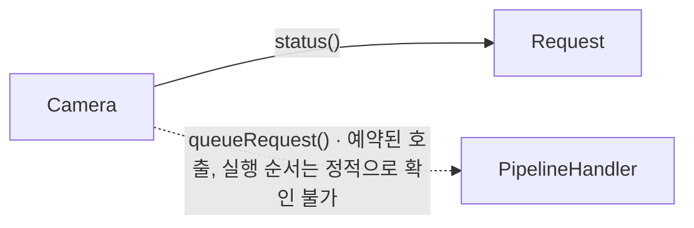

# 요청 제출

**시작된 카메라에 유효한 요청을 제출하고 완료 알림은 별도로 확인하세요.**

| 지금 확인할 내용 | 이동할 절 |
|---|---|
| <a id="이-흐름에서-확인할-것"></a>시작된 카메라에 유효한 요청을 제출하고 완료 알림은 별도로 확인하세요. | [요청을 제출하기 전에 갖출 조건](#요청을-제출하기-전에-갖출-조건) |

## 요청을 제출하기 전에 갖출 조건

`Camera::queueRequest()`는 캡처를 위해 요청을 카메라에 큐잉하는 함수입니다. 이 함수는 thread-safe 함수로 정의되어 있으며, 카메라가 Running 상태일 때만 호출할 수 있습니다. 함수는 `d->isAccessAllowed(Private::CameraRunning)`의 반환값이 음수이면 그 값을 그대로 반환합니다. `Camera::Private::isAccessAllowed()`는 연결이 끊긴 카메라에서 `allowDisconnected`가 거짓이면 `-ENODEV`를 반환하고, 현재 `state_`가 인자로 받은 상태와 다르면 `-EACCES`를 반환합니다. `src/libcamera/camera.cpp:1308`, `src/libcamera/camera.cpp:690`

`request->_d()->camera()`가 `this`와 다르면 `-EXDEV`를 반환하고 파이프라인 호출로 넘어가지 않습니다. 이 검사 뒤에는 `request->status()`가 `Request::RequestPending`이 아니거나 `request->controls().infoMap()`이 `&controls()`와 다르면 `-EINVAL`을 반환합니다. 또한 `request->buffers()`가 비어 있거나 그 안의 stream 중 하나라도 `d->activeStreams_`에 없으면 `-EINVAL`을 반환합니다. `src/libcamera/camera.cpp:1308`

모든 검사를 통과하면 `Camera::queueRequest()`는 `pipe_->invokeMethod(&PipelineHandler::queueRequest, ConnectionTypeQueued, request)`를 호출한 뒤 `0`을 반환합니다. 따라서 반환값 `0`은 요청이 파이프라인 쪽으로 넘겨졌다는 뜻이며, 요청 완료를 뜻하지는 않습니다. 요청이 큐에 들어간 뒤 카메라는 `requestCompleted` 신호로 완료를 알립니다. `src/libcamera/camera.cpp:1308`

근거 원문: [src/libcamera/camera.cpp:1308](#source-3c1e4a3c695a8890) · [src/libcamera/camera.cpp:690](#source-43bf991ac670b1aa)

## 큐로 전달된 요청의 준비와 실패

`Camera::queueRequest()`는 `patchControlList(request->controls())`를 호출해 주석대로 `AeEnable`을 전처리한 뒤, `d->pipe_->invokeMethod()`에 `ConnectionTypeQueued`를 지정해 `PipelineHandler::queueRequest`에 `request`를 넘깁니다. 요청 검사 사이의 주석은 카메라 상태가 함수가 끝날 때까지 바뀔 수 있다고 적고 있으며, 잠금이 필요하지 않은 이유로 상태 변경을 `PipelineHandler::queueRequest()`가 처리한다고 설명합니다. `src/libcamera/camera.cpp:1373`

주석에 따르면 이 함수는 `CameraManager` 스레드에서 호출됩니다. `PipelineHandler::queueRequest`는 `camera->_d()`의 `waitingRequests_`에 `request`를 넣은 뒤, `request->_d()->prepare(300ms)`를 호출해 준비를 시작합니다. 주석은 준비 단계에서 `Request`가 실패하거나 파이프라인 핸들러가 하드웨어 큐잉에 실패하면 요청이 취소된다고 적고 있습니다. `src/libcamera/pipeline_handler.cpp:447`

`doQueueRequests`는 `waitingRequests_`가 빌 때까지 반복합니다. `queuedRequests_`의 크기가 `maxQueuedRequestsDevice_`와 같으면 반복을 중단하고, 맨 앞 요청의 `prepared_`가 거짓이면 그 요청을 꺼내지 않고 중단합니다. 조건을 통과한 요청은 `pop()`으로 꺼낸 뒤 `doQueueRequest`에 넘기며, 주석에 따르면 먼저 꺼내는 이유는 `doQueueRequest()` 안에서 `doQueueRequests()`가 재귀 호출될 수 있기 때문입니다. `src/libcamera/pipeline_handler.cpp:509`

`doQueueRequest`는 `camera->_d()`로 얻은 `Camera::Private` 데이터의 `queuedRequests_` 끝에 요청을 추가합니다. 이어서 요청의 `sequence_`에 현재 `requestSequence_` 값을 할당한 뒤 `requestSequence_`를 1 증가시킵니다. 요청의 `cancelled_`가 참이면 `completeRequest(request)`를 호출하고 바로 반환하여 `queueRequestDevice`를 호출하지 않습니다. 그렇지 않으면 `queueRequestDevice(camera, request)`를 호출하고, 반환값이 0이 아니면 `cancelRequest(request)`로 요청을 취소합니다. `src/libcamera/pipeline_handler.cpp:483`

근거 원문: [src/libcamera/camera.cpp:1373](#source-997ecce495182b6b) · [src/libcamera/pipeline_handler.cpp:447](#source-5493b66ef420047f) · [src/libcamera/pipeline_handler.cpp:483](#source-7348e9b4af985eb2) · [src/libcamera/pipeline_handler.cpp:509](#source-9bef16708cb3efe3)

??? note "설계 질문과 검증 범위"
    질문별 답변과 근거 연결을 검사했습니다. 의미와 실행 결과는 사람 검토가 필요합니다.
    
    | 설계 질문 | 설명 위치 | 확인 범위 |
    |---|---|---|
    | Camera::queueRequest()의 캡처용 요청 접수 목적과 Running 상태·thread-safe 계약 및 연결/상태 오류 -ENODEV/-EACCES를 한 번 설명하세요. 요청을 만든 카메라 불일치 -EXDEV, RequestPending·controls infoMap·버퍼 존재·활성 스트림 검사에 따른 -EINVAL을 조건별로 설명하세요. 반환값 0과 requestCompleted 신호에 의한 요청 완료 알림을 구분하되 같은 상태나 오류 목록을 다시 요약하지 마세요. 세 문단 이내로 작성하세요. | [요청을 제출하기 전에 갖출 조건](#요청을-제출하기-전에-갖출-조건) | 코드 근거와 설명 연결 |
    | Camera::queueRequest의 patchControlList 및 ConnectionTypeQueued 전달, 상태 변경을 PipelineHandler가 처리한다는 주석의 범위를 설명하세요. PipelineHandler::queueRequest가 CameraManager 스레드에서 waitingRequests_에 넣고 prepare(300ms)하는 흐름, 준비/하드웨어 큐잉 실패 취소와 maxQueuedRequestsDevice_까지 준비 순서대로 넘기는 조건을 설명하세요. 대기 큐 앞의 미준비 요청 또는 장치 한도에서 멈추고, doQueueRequest가 카메라 데이터의 queuedRequests_와 sequence_를 갱신하며 cancelled_이면 completeRequest, 장치 큐잉 오류면 cancelRequest인 분기를 구분하세요. 각 문단은 한 가지 독자 과업을 설명하고, 같은 결과나 반환값을 다시 풀어 쓰지 마세요. 소스 한 줄마다 문단을 만들지 마세요. 아래 절에서 설명하는 내부 구현을 미확인 한계로 반복하지 마세요. | [큐로 전달된 요청의 준비와 실패](#큐로-전달된-요청의-준비와-실패) | 코드 근거와 설명 연결 |

## 소스 근거

같은 발췌는 한 번만 싣습니다. 필요한 원문을 펼쳐 설명과 대조하세요.

<a id="source-3c1e4a3c695a8890"></a>

??? note "소스 근거: src/libcamera/camera.cpp:1308"
    `src/libcamera/camera.cpp:1308`에서 시작하는 발췌입니다. 종료 줄은 1380이며, 아래 원문을 설명과 대조할 수 있습니다.
    
    SHA-256: `7f775e92fe4ad43798ec85c6dba7e2b8bba7d189e554cb9300d2475891a1764a`
    
    ```text
    \brief Queue a request to the camera
     * \param[in] request The request to queue to the camera
     *
     * This function queues a \a request to the camera for capture.
     *
     * After allocating the request with createRequest(), the application shall
     * fill it with at least one capture buffer before queuing it. Requests that
     * contain no buffers are invalid and are rejected without being queued.
     *
     * Once the request has been queued, the camera will notify its completion
     * through the \ref requestCompleted signal.
     *
     * \context This function is \threadsafe. It may only be called when the camera
     * is in the Running state as defined in \ref camera_operation.
     *
     * \return 0 on success or a negative error code otherwise
     * \retval -ENODEV The camera has been disconnected from the system
     * \retval -EACCES The camera is not running so requests can't be queued
     * \retval -EXDEV The request does not belong to this camera
     * \retval -EINVAL The request is invalid
     * \retval -ENOMEM No buffer memory was available to handle the request
     */
    int Camera::queueRequest(Request *request)
    {
    	Private *const d = _d();
    
    	int ret = d->isAccessAllowed(Private::CameraRunning);
    	if (ret < 0)
    		return ret;
    
    	/* Requests can only be queued to the camera that created them. */
    	if (request->_d()->camera() != this) {
    		LOG(Camera, Error) << "Request was not created by this camera";
    		return -EXDEV;
    	}
    
    	if (request->status() != Request::RequestPending) {
    		LOG(Camera, Error) << request->toString() << " is not valid";
    		return -EINVAL;
    	}
    
    	/* Make sure the Request has a valid control list. */
    	if (request->controls().infoMap() != &controls()) {
    		LOG(Camera, Error) << "Overwriting Request::controls() is not allowed";
    		return -EINVAL;
    	}
    
    	/*
    	 * The camera state may change until the end of the function. No locking
    	 * is however needed as PipelineHandler::queueRequest() will handle
    	 * this.
    	 */
    
    	if (request->buffers().empty()) {
    		LOG(Camera, Error) << "Request contains no buffers";
    		return -EINVAL;
    	}
    
    	for (const auto &[stream, buffer] : request->buffers()) {
    		if (d->activeStreams_.find(stream) == d->activeStreams_.end()) {
    			LOG(Camera, Error) << "Invalid request";
    			return -EINVAL;
    		}
    	}
    
    	/* Pre-process AeEnable. */
    	patchControlList(request->controls());
    
    	d->pipe_->invokeMethod(&PipelineHandler::queueRequest,
    			       ConnectionTypeQueued, request);
    
    	return 0;
    }
    ```

<a id="source-43bf991ac670b1aa"></a>

??? note "소스 근거: src/libcamera/camera.cpp:690"
    `src/libcamera/camera.cpp:690`에서 시작하는 발췌입니다. 종료 줄은 707이며, 아래 원문을 설명과 대조할 수 있습니다.
    
    SHA-256: `eda58d39ca207e5943afd21f4d2439316a5afdb0d3d19c7a40800658db295899`
    
    ```text
    int Camera::Private::isAccessAllowed(State state, bool allowDisconnected,
    				     const char *from) const
    {
    	if (!allowDisconnected && disconnected_)
    		return -ENODEV;
    
    	State currentState = state_.load(std::memory_order_acquire);
    	if (currentState == state)
    		return 0;
    
    	ASSERT(static_cast<unsigned int>(state) < std::size(camera_state_names));
    
    	LOG(Camera, Error) << "Camera in " << camera_state_names[currentState]
    			   << " state trying " << from << "() requiring state "
    			   << camera_state_names[state];
    
    	return -EACCES;
    }
    ```

<a id="source-997ecce495182b6b"></a>

??? note "소스 근거: src/libcamera/camera.cpp:1373"
    `src/libcamera/camera.cpp:1373`에서 시작하는 발췌입니다. 종료 줄은 1380이며, 아래 원문을 설명과 대조할 수 있습니다.
    
    SHA-256: `e45022d3fce2d8886d9ff5afa6e10f4c6687e85b7eec1ed64af80c775e36e030`
    
    ```text
    /* Pre-process AeEnable. */
    	patchControlList(request->controls());
    
    	d->pipe_->invokeMethod(&PipelineHandler::queueRequest,
    			       ConnectionTypeQueued, request);
    
    	return 0;
    }
    ```

<a id="source-5493b66ef420047f"></a>

??? note "소스 근거: src/libcamera/pipeline_handler.cpp:447"
    `src/libcamera/pipeline_handler.cpp:447`에서 시작하는 발췌입니다. 종료 줄은 478이며, 아래 원문을 설명과 대조할 수 있습니다.
    
    SHA-256: `7bc050721f49ab7e95fd95627a35b21026512d193d48bf886273b1ac0dc1b7ab`
    
    ```text
    \fn PipelineHandler::queueRequest()
     * \brief Queue a request
     * \param[in] request The request to queue
     *
     * This function queues a capture request to the pipeline handler for
     * processing. The request is first added to the internal list of waiting
     * requests which have to be prepared to make sure they are ready for being
     * queued to the pipeline handler.
     *
     * The queue of waiting requests is iterated and up to \a
     * maxQueuedRequestsDevice_ prepared requests are passed to the pipeline handler
     * in the same order they have been queued by calling this function.
     *
     * If a Request fails during the preparation phase or if the pipeline handler
     * fails in queuing the request to the hardware the request is cancelled.
     *
     * Keeping track of queued requests ensures automatic completion of all requests
     * when the pipeline handler is stopped with stop(). Request completion shall be
     * signalled by the pipeline handler using the completeRequest() function.
     *
     * \context This function is called from the CameraManager thread.
     */
    void PipelineHandler::queueRequest(Request *request)
    {
    	LIBCAMERA_TRACEPOINT(request_queue, request);
    
    	Camera *camera = request->_d()->camera();
    	Camera::Private *data = camera->_d();
    	data->waitingRequests_.push(request);
    
    	request->_d()->prepare(300ms);
    }
    ```

<a id="source-7348e9b4af985eb2"></a>

??? note "소스 근거: src/libcamera/pipeline_handler.cpp:483"
    `src/libcamera/pipeline_handler.cpp:483`에서 시작하는 발췌입니다. 종료 줄은 501이며, 아래 원문을 설명과 대조할 수 있습니다.
    
    SHA-256: `fbd3ed6fe295b1cdd82d6ce420a30695986e43199347f92ac2545fe0e7831da8`
    
    ```text
    void PipelineHandler::doQueueRequest(Request *request)
    {
    	LIBCAMERA_TRACEPOINT(request_device_queue, request);
    
    	Camera *camera = request->_d()->camera();
    	Camera::Private *data = camera->_d();
    	data->queuedRequests_.push_back(request);
    
    	request->_d()->sequence_ = data->requestSequence_++;
    
    	if (request->_d()->cancelled_) {
    		completeRequest(request);
    		return;
    	}
    
    	int ret = queueRequestDevice(camera, request);
    	if (ret)
    		cancelRequest(request);
    }
    ```

<a id="source-9bef16708cb3efe3"></a>

??? note "소스 근거: src/libcamera/pipeline_handler.cpp:509"
    `src/libcamera/pipeline_handler.cpp:509`에서 시작하는 발췌입니다. 종료 줄은 527이며, 아래 원문을 설명과 대조할 수 있습니다.
    
    SHA-256: `2bcae42fd283195880204cc5f4cfa46a3cb50981efd559abfebb1f8c163f920a`
    
    ```text
    void PipelineHandler::doQueueRequests(Camera *camera)
    {
    	Camera::Private *data = camera->_d();
    	while (!data->waitingRequests_.empty()) {
    		if (data->queuedRequests_.size() == maxQueuedRequestsDevice_)
    			break;
    
    		Request *request = data->waitingRequests_.front();
    		if (!request->_d()->prepared_)
    			break;
    
    		/*
    		 * Pop the request first, in case doQueueRequests() is called
    		 * recursively from within doQueueRequest()
    		 */
    		data->waitingRequests_.pop();
    		doQueueRequest(request);
    	}
    }
    ```

## 주요 확인 지점

아래 항목은 추출한 호출에서 고른 코드 탐색 지점입니다. 나열 순서는 실행 순서가 아닙니다.

| 확인할 내용 | 호출 측과 대상 | 구분 | 근거 |
|---|---|---|---|
| 요청 상태 확인 | `Camera` → `Request::status()` | 정적 호출 지점입니다. | `src/libcamera/camera.cpp:1344` |
| 요청 제출 대상 | `Camera` → `PipelineHandler::queueRequest()` | 메서드 전달 대상이며 동기·비동기 여부는 호출부에서 확인해야 합니다. | `src/libcamera/camera.cpp:1376` |

## 주요 호출 관계

화살표는 호출 측과 대상을 연결합니다. 시간 순서나 모든 경로의 실행을 뜻하지 않습니다. 점선에는 가상 호출 후보·예약 대상 등 확인이 필요한 관계를 표시합니다.



## 추적 범위와 경계

요약의 hide 규칙에 해당하는 호출은 51개입니다. 전체 추적 기록에는 해당 호출도 모두 보존합니다. 기록 번호는 정적 탐색의 식별자이며 실행 순번이 아닙니다.

조건 분기, 반복 횟수와 실제 실행 스레드는 이 호출 목록만으로 확정할 수 없습니다. 가상 호출 후보는 실제 객체에 따라 선택됩니다. 예약 표시는 인자로 전달한 메서드 대상을 뜻하며, 비동기 실행을 보증하지 않습니다. 호출부의 연결 방식과 동기화 계약을 확인해야 합니다.

| 호출 지점 | 후보 또는 예약 대상 | 확인할 경계 | 근거 |
|---|---|---|---|
| `Camera` | `PipelineHandler::queueRequest()` | 메서드 전달 대상이며 동기·비동기 여부는 호출부에서 확인해야 합니다. | `src/libcamera/camera.cpp:1376` |

추출 통계: 미해결 호출 0개, 예약된 호출 1개입니다.

## 전체 추적 기록

아래 구간을 펼치면 요약에서 제외된 호출까지 확인할 수 있습니다. 이 목록은 추출 깊이 안에서 수집한 기록이며, 소스의 모든 실행 경로를 포함한다는 뜻은 아닙니다.

??? note "추적 기록 1–25 / 80개"

    | 기록 | 호출 측 | 대상 | 구분 | 근거 |
    |---|---|---|---|---|
    | 1 | `Camera` | `Camera::_d()` | 정적 호출 지점입니다. | `src/libcamera/camera.cpp:1332` |
    | 2 | `Camera` | `Private::isAccessAllowed()` | 정적 호출 지점입니다. | `src/libcamera/camera.cpp:1334` |
    | 3 | `Private` | `log::isLogSeverityEnabled()` | 정적 호출 지점입니다. | `src/libcamera/camera.cpp:700` |
    | 4 | `Private` | `LogMessageAbortGuard::LogMessageAbortGuard()` | 정적 호출 지점입니다. | `src/libcamera/camera.cpp:700` |
    | 5 | `Private` | `LogMessage::stream()` | 정적 호출 지점입니다. | `src/libcamera/camera.cpp:700` |
    | 6 | `Private` | `log::_log()` | 정적 호출 지점입니다. | `src/libcamera/camera.cpp:700` |
    | 7 | `log` | `LogMessage::LogMessage()` | 정적 호출 지점입니다. | `src/libcamera/base/log.cpp:990` |
    | 8 | `LogMessage` | `utils::basename()` | 정적 호출 지점입니다. | `src/libcamera/base/log.cpp:858` |
    | 9 | `Private` | `log::isLogSeverityEnabled()` | 정적 호출 지점입니다. | `src/libcamera/camera.cpp:702` |
    | 10 | `Private` | `LogMessageAbortGuard::LogMessageAbortGuard()` | 정적 호출 지점입니다. | `src/libcamera/camera.cpp:702` |
    | 11 | `Private` | `LogMessage::stream()` | 정적 호출 지점입니다. | `src/libcamera/camera.cpp:702` |
    | 12 | `Private` | `log::_log()` | 정적 호출 지점입니다. | `src/libcamera/camera.cpp:702` |
    | 13 | `log` | `LogMessage::LogMessage()` | 정적 호출 지점입니다. | `src/libcamera/base/log.cpp:990` |
    | 14 | `LogMessage` | `utils::basename()` | 정적 호출 지점입니다. | `src/libcamera/base/log.cpp:858` |
    | 15 | `Camera` | `Private::camera()` | 정적 호출 지점입니다. | `src/libcamera/camera.cpp:1339` |
    | 16 | `Camera` | `Request::_d()` | 정적 호출 지점입니다. | `src/libcamera/camera.cpp:1339` |
    | 17 | `Camera` | `log::isLogSeverityEnabled()` | 정적 호출 지점입니다. | `src/libcamera/camera.cpp:1340` |
    | 18 | `Camera` | `LogMessageAbortGuard::LogMessageAbortGuard()` | 정적 호출 지점입니다. | `src/libcamera/camera.cpp:1340` |
    | 19 | `Camera` | `LogMessage::stream()` | 정적 호출 지점입니다. | `src/libcamera/camera.cpp:1340` |
    | 20 | `Camera` | `log::_log()` | 정적 호출 지점입니다. | `src/libcamera/camera.cpp:1340` |
    | 21 | `log` | `LogMessage::LogMessage()` | 정적 호출 지점입니다. | `src/libcamera/base/log.cpp:990` |
    | 22 | `LogMessage` | `utils::basename()` | 정적 호출 지점입니다. | `src/libcamera/base/log.cpp:858` |
    | 23 | `Camera` | `Request::status()` | 정적 호출 지점입니다. | `src/libcamera/camera.cpp:1344` |
    | 24 | `Camera` | `log::isLogSeverityEnabled()` | 정적 호출 지점입니다. | `src/libcamera/camera.cpp:1345` |
    | 25 | `Camera` | `LogMessageAbortGuard::LogMessageAbortGuard()` | 정적 호출 지점입니다. | `src/libcamera/camera.cpp:1345` |

??? note "추적 기록 26–50 / 80개"

    | 기록 | 호출 측 | 대상 | 구분 | 근거 |
    |---|---|---|---|---|
    | 26 | `Camera` | `LogMessage::stream()` | 정적 호출 지점입니다. | `src/libcamera/camera.cpp:1345` |
    | 27 | `Camera` | `log::_log()` | 정적 호출 지점입니다. | `src/libcamera/camera.cpp:1345` |
    | 28 | `log` | `LogMessage::LogMessage()` | 정적 호출 지점입니다. | `src/libcamera/base/log.cpp:990` |
    | 29 | `LogMessage` | `utils::basename()` | 정적 호출 지점입니다. | `src/libcamera/base/log.cpp:858` |
    | 30 | `Camera` | `Request::toString()` | 정적 호출 지점입니다. | `src/libcamera/camera.cpp:1345` |
    | 31 | `Request` | `request::operator<<()` | 정적 호출 지점입니다. | `src/libcamera/request.cpp:592` |
    | 32 | `request` | `Request::sequence()` | 정적 호출 지점입니다. | `src/libcamera/request.cpp:609` |
    | 33 | `Request` | `Request::_d()` | 정적 호출 지점입니다. | `src/libcamera/request.cpp:548` |
    | 34 | `request` | `Request::status()` | 정적 호출 지점입니다. | `src/libcamera/request.cpp:609` |
    | 35 | `request` | `Request::_d()` | 정적 호출 지점입니다. | `src/libcamera/request.cpp:610` |
    | 36 | `request` | `Request::buffers()` | 정적 호출 지점입니다. | `src/libcamera/request.cpp:610` |
    | 37 | `request` | `Request::cookie()` | 정적 호출 지점입니다. | `src/libcamera/request.cpp:611` |
    | 38 | `Camera` | `ControlList::infoMap()` | 정적 호출 지점입니다. | `src/libcamera/camera.cpp:1350` |
    | 39 | `Camera` | `Request::controls()` | 정적 호출 지점입니다. | `src/libcamera/camera.cpp:1350` |
    | 40 | `Camera` | `Camera::controls()` | 정적 호출 지점입니다. | `src/libcamera/camera.cpp:1350` |
    | 41 | `Camera` | `Camera::_d()` | 정적 호출 지점입니다. | `src/libcamera/camera.cpp:1075` |
    | 42 | `Camera` | `log::isLogSeverityEnabled()` | 정적 호출 지점입니다. | `src/libcamera/camera.cpp:1351` |
    | 43 | `Camera` | `LogMessageAbortGuard::LogMessageAbortGuard()` | 정적 호출 지점입니다. | `src/libcamera/camera.cpp:1351` |
    | 44 | `Camera` | `LogMessage::stream()` | 정적 호출 지점입니다. | `src/libcamera/camera.cpp:1351` |
    | 45 | `Camera` | `log::_log()` | 정적 호출 지점입니다. | `src/libcamera/camera.cpp:1351` |
    | 46 | `log` | `LogMessage::LogMessage()` | 정적 호출 지점입니다. | `src/libcamera/base/log.cpp:990` |
    | 47 | `LogMessage` | `utils::basename()` | 정적 호출 지점입니다. | `src/libcamera/base/log.cpp:858` |
    | 48 | `Camera` | `Request::buffers()` | 정적 호출 지점입니다. | `src/libcamera/camera.cpp:1361` |
    | 49 | `Camera` | `log::isLogSeverityEnabled()` | 정적 호출 지점입니다. | `src/libcamera/camera.cpp:1362` |
    | 50 | `Camera` | `LogMessageAbortGuard::LogMessageAbortGuard()` | 정적 호출 지점입니다. | `src/libcamera/camera.cpp:1362` |

??? note "추적 기록 51–75 / 80개"

    | 기록 | 호출 측 | 대상 | 구분 | 근거 |
    |---|---|---|---|---|
    | 51 | `Camera` | `LogMessage::stream()` | 정적 호출 지점입니다. | `src/libcamera/camera.cpp:1362` |
    | 52 | `Camera` | `log::_log()` | 정적 호출 지점입니다. | `src/libcamera/camera.cpp:1362` |
    | 53 | `log` | `LogMessage::LogMessage()` | 정적 호출 지점입니다. | `src/libcamera/base/log.cpp:990` |
    | 54 | `LogMessage` | `utils::basename()` | 정적 호출 지점입니다. | `src/libcamera/base/log.cpp:858` |
    | 55 | `Camera` | `Request::buffers()` | 정적 호출 지점입니다. | `src/libcamera/camera.cpp:1366` |
    | 56 | `Camera` | `log::isLogSeverityEnabled()` | 정적 호출 지점입니다. | `src/libcamera/camera.cpp:1368` |
    | 57 | `Camera` | `LogMessageAbortGuard::LogMessageAbortGuard()` | 정적 호출 지점입니다. | `src/libcamera/camera.cpp:1368` |
    | 58 | `Camera` | `LogMessage::stream()` | 정적 호출 지점입니다. | `src/libcamera/camera.cpp:1368` |
    | 59 | `Camera` | `log::_log()` | 정적 호출 지점입니다. | `src/libcamera/camera.cpp:1368` |
    | 60 | `log` | `LogMessage::LogMessage()` | 정적 호출 지점입니다. | `src/libcamera/base/log.cpp:990` |
    | 61 | `LogMessage` | `utils::basename()` | 정적 호출 지점입니다. | `src/libcamera/base/log.cpp:858` |
    | 62 | `Camera` | `Camera::patchControlList()` | 정적 호출 지점입니다. | `src/libcamera/camera.cpp:1374` |
    | 63 | `Camera` | `ControlList::get()` | 정적 호출 지점입니다. | `src/libcamera/camera.cpp:1289` |
    | 64 | `Camera` | `ControlInfoMap::count()` | 정적 호출 지점입니다. | `src/libcamera/camera.cpp:1291` |
    | 65 | `ControlInfoMap` | `ControlInfoMap::find()` | 정적 호출 지점입니다. | `src/libcamera/controls.cpp:864` |
    | 66 | `Camera` | `Camera::_d()` | 정적 호출 지점입니다. | `src/libcamera/camera.cpp:1291` |
    | 67 | `Camera` | `ControlId::id()` | 정적 호출 지점입니다. | `src/libcamera/camera.cpp:1291` |
    | 68 | `Camera` | `ControlList::contains()` | 정적 호출 지점입니다. | `src/libcamera/camera.cpp:1292` |
    | 69 | `Camera` | `ControlId::id()` | 정적 호출 지점입니다. | `src/libcamera/camera.cpp:1292` |
    | 70 | `Camera` | `ControlList::set()` | 정적 호출 지점입니다. | `src/libcamera/camera.cpp:1293` |
    | 71 | `Camera` | `ControlInfoMap::count()` | 정적 호출 지점입니다. | `src/libcamera/camera.cpp:1298` |
    | 72 | `ControlInfoMap` | `ControlInfoMap::find()` | 정적 호출 지점입니다. | `src/libcamera/controls.cpp:864` |
    | 73 | `Camera` | `Camera::_d()` | 정적 호출 지점입니다. | `src/libcamera/camera.cpp:1298` |
    | 74 | `Camera` | `ControlId::id()` | 정적 호출 지점입니다. | `src/libcamera/camera.cpp:1298` |
    | 75 | `Camera` | `ControlList::contains()` | 정적 호출 지점입니다. | `src/libcamera/camera.cpp:1299` |

??? note "추적 기록 76–80 / 80개"

    | 기록 | 호출 측 | 대상 | 구분 | 근거 |
    |---|---|---|---|---|
    | 76 | `Camera` | `ControlId::id()` | 정적 호출 지점입니다. | `src/libcamera/camera.cpp:1299` |
    | 77 | `Camera` | `ControlList::set()` | 정적 호출 지점입니다. | `src/libcamera/camera.cpp:1300` |
    | 78 | `Camera` | `Request::controls()` | 정적 호출 지점입니다. | `src/libcamera/camera.cpp:1374` |
    | 79 | `Camera` | `Object::invokeMethod()` | 정적 호출 지점입니다. | `src/libcamera/camera.cpp:1376` |
    | 80 | `Camera` | `PipelineHandler::queueRequest()` | 메서드 전달 대상이며 동기·비동기 여부는 호출부에서 확인해야 합니다. | `src/libcamera/camera.cpp:1376` |

??? note "근거와 검토 정보"
    - 생성 방식: 추출 사실과 LLM 설명
    - 검증 범위: 표·그림은 facts로 만들고 설명은 LLM이 작성합니다. 인용·문장 및 설정된 구조 검사를 적용합니다.
    - 근거 파일: `src/libcamera/base/log.cpp`, `src/libcamera/camera.cpp`, `src/libcamera/controls.cpp`, `src/libcamera/pipeline_handler.cpp`, `src/libcamera/request.cpp`
    - 근거 수준: 코드 확인 (정적 분석, simple_compdb 구성, commit `212c689fcf`)
    - 자동 검사 (인용·문장 및 설정된 구조 검사): 통과
    - 검토 상태 기록일: 2026-10-31 · 사람 검토 전

다음 단계: [요청 완료 통지](complete_request.md)
