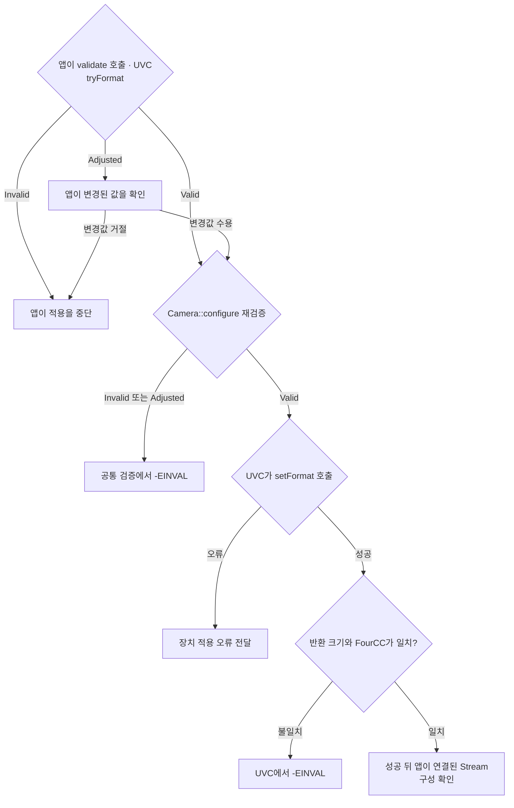

# USB UVC 뷰파인더 스트림 구성

**USB UVC 카메라에 뷰파인더 스트림 하나를 요청하고, 앱에서 받은 값과 장치에서 적용한 값을 확인하세요.**


## 요청한 640×480 뷰파인더는 어디에서 달라지나요?

앱은 `Camera::generateConfiguration()`으로 `Viewfinder` 구성 하나를 만들고 기본 크기와 픽셀 포맷을 확인한 뒤, 예시로 640×480을 요청하고 `validate()`를 호출해야 합니다. UVC 검증은 `tryFormat`을 시험하며 장치 열기나 시험이 실패하면 `Invalid`를 반환합니다. `Adjusted`는 구성이 조정되어 유효해졌다는 뜻이며 어느 스트림의 매개변수든 바뀌거나 스트림 구성이 제거되었을 수 있으므로, 앱은 검증 후 크기와 픽셀 포맷을 읽고 변경을 받아들일지 판단해야 합니다. 이후 `Camera::configure()`는 접근이 허용되면 스트림 연결을 지우고 다시 검증하며, 결과가 `Valid`가 아니면 `-EINVAL`을 반환합니다. `Documentation/guides/application-developer.rst:167`, `Documentation/guides/application-developer.rst:195`, `src/libcamera/pipeline/uvcvideo/uvcvideo.cpp:139`, `src/libcamera/camera.cpp:323`, `src/libcamera/camera.cpp:1191`

<!-- sdd:visual:uvc-viewfinder-format-checks -->
### UVC 뷰파인더의 구성 검증과 장치 적용



<span data-sdd-label-en="The application decides whether to proceed with the values produced by validation. When applying the format, the UVC handler compares the returned size and FourCC.">앱은 검증이 바꾼 값을 확인해 적용할지 결정합니다. 장치 적용 때는 UVC 핸들러가 반환된 크기와 FourCC를 비교합니다.</span> <a data-sdd-caption-source="true" href="https://github.com/TTolsun/libcamera-sdd/blob/adfa719f8ed67d18fd8a0739fc088a1f8b9e7252/src/libcamera/camera.cpp#L343"><code>camera.cpp:343</code></a> · <a data-sdd-caption-source="true" href="https://github.com/TTolsun/libcamera-sdd/blob/adfa719f8ed67d18fd8a0739fc088a1f8b9e7252/src/libcamera/pipeline/uvcvideo/uvcvideo.cpp#L275"><code>uvcvideo.cpp:275</code></a>

[Mermaid 원문](uvc-viewfinder-configuration.uvc-viewfinder-format-checks.mmd)

??? note "그림 근거와 확인 범위"
    어디에서 값을 다시 확인하고 어디에서 오류로 반환합니까?
    
    소스에 연결한 설계 해석입니다. 자동 연결 검사는 의미 승인이나 기기 실행 검증이 아닙니다.
    
    | 요소·전이 | 소스 근거 |
    |---|---|
    | <span data-sdd-label-en="App calls validate · UVC tryFormat">앱이 validate 호출 · UVC tryFormat</span> | [src/libcamera/pipeline/uvcvideo/uvcvideo.cpp:139](#source-f9631255f305fb92) |
    | <span data-sdd-label-en="App checks the adjusted values">앱이 변경된 값을 확인</span> | [src/libcamera/camera.cpp:323](#source-2b31e92e3fb3f083) |
    | <span data-sdd-label-en="App stops before applying">앱이 적용을 중단</span> | [src/libcamera/pipeline/uvcvideo/uvcvideo.cpp:139](#source-f9631255f305fb92) · [src/libcamera/camera.cpp:323](#source-2b31e92e3fb3f083) |
    | <span data-sdd-label-en="Camera::configure revalidates">Camera::configure 재검증</span> | [src/libcamera/camera.cpp:1191](#source-603af0dd7fa357d0) |
    | <span data-sdd-label-en="Common validation returns -EINVAL">공통 검증에서 -EINVAL</span> | [src/libcamera/camera.cpp:1191](#source-603af0dd7fa357d0) |
    | <span data-sdd-label-en="UVC calls setFormat">UVC가 setFormat 호출</span> | [src/libcamera/pipeline/uvcvideo/uvcvideo.cpp:261](#source-be07a7077dd3d924) · [src/libcamera/v4l2_videodevice.cpp:849](#source-c073a10f1abc63b6) |
    | <span data-sdd-label-en="Forward the format-setting error">장치 적용 오류 전달</span> | [src/libcamera/pipeline/uvcvideo/uvcvideo.cpp:261](#source-be07a7077dd3d924) |
    | <span data-sdd-label-en="Do the returned size and FourCC match?">반환 크기와 FourCC가 일치?</span> | [src/libcamera/pipeline/uvcvideo/uvcvideo.cpp:261](#source-be07a7077dd3d924) |
    | <span data-sdd-label-en="UVC returns -EINVAL">UVC에서 -EINVAL</span> | [src/libcamera/pipeline/uvcvideo/uvcvideo.cpp:261](#source-be07a7077dd3d924) |
    | <span data-sdd-label-en="App reads the linked Stream configuration on success">성공 뒤 앱이 연결된 Stream 구성 확인</span> | [src/libcamera/pipeline/uvcvideo/uvcvideo.cpp:261](#source-be07a7077dd3d924) · [src/libcamera/camera.cpp:1191](#source-603af0dd7fa357d0) · [src/libcamera/stream.cpp:483](#source-d8739fc139164c42) |
    | <span data-sdd-label-en="Adjusted">Adjusted</span> | [src/libcamera/camera.cpp:323](#source-2b31e92e3fb3f083) |
    | <span data-sdd-label-en="Invalid">Invalid</span> | [src/libcamera/pipeline/uvcvideo/uvcvideo.cpp:139](#source-f9631255f305fb92) |
    | <span data-sdd-label-en="Valid">Valid</span> | [src/libcamera/camera.cpp:1191](#source-603af0dd7fa357d0) |
    | <span data-sdd-label-en="Accept changes">변경값 수용</span> | [src/libcamera/camera.cpp:323](#source-2b31e92e3fb3f083) · [src/libcamera/camera.cpp:1191](#source-603af0dd7fa357d0) |
    | <span data-sdd-label-en="Decline changes">변경값 거절</span> | [src/libcamera/camera.cpp:323](#source-2b31e92e3fb3f083) |
    | <span data-sdd-label-en="Valid">Valid</span> | [src/libcamera/camera.cpp:1191](#source-603af0dd7fa357d0) · [src/libcamera/pipeline/uvcvideo/uvcvideo.cpp:261](#source-be07a7077dd3d924) |
    | <span data-sdd-label-en="Invalid or Adjusted">Invalid 또는 Adjusted</span> | [src/libcamera/camera.cpp:1191](#source-603af0dd7fa357d0) |
    | <span data-sdd-label-en="Error">오류</span> | [src/libcamera/pipeline/uvcvideo/uvcvideo.cpp:261](#source-be07a7077dd3d924) |
    | <span data-sdd-label-en="Success">성공</span> | [src/libcamera/pipeline/uvcvideo/uvcvideo.cpp:261](#source-be07a7077dd3d924) |
    | <span data-sdd-label-en="Mismatch">불일치</span> | [src/libcamera/pipeline/uvcvideo/uvcvideo.cpp:261](#source-be07a7077dd3d924) |
    | <span data-sdd-label-en="Match">일치</span> | [src/libcamera/pipeline/uvcvideo/uvcvideo.cpp:261](#source-be07a7077dd3d924) · [src/libcamera/camera.cpp:1191](#source-603af0dd7fa357d0) |
<!-- /sdd:visual:uvc-viewfinder-format-checks -->

`tryFormat`은 형식을 시험하고, `PipelineHandlerUVC::configure()`의 `setFormat`은 형식을 장치에 실제로 적용하고 적용된 값을 반환합니다. UVC 구성은 검증된 크기와 FourCC가 장치에서 반환한 값과 같은지 대조하며, `setFormat`이 실패하면 그 오류를 반환하고 값이 다르면 `-EINVAL`을 반환합니다. 성공하면 UVC 구성은 스트림을 연결하고 공통 `Camera::configure()`는 검증된 스트림 구성을 연결된 스트림에 복사하므로, 앱은 `Stream::configuration()`에서 활성 구성을 읽을 수 있습니다. 대상 장치에서는 검증 전후의 크기와 픽셀 포맷, 적용 시도의 크기와 FourCC 및 반환값을 확인합니다. `src/libcamera/pipeline/uvcvideo/uvcvideo.cpp:139`, `src/libcamera/pipeline/uvcvideo/uvcvideo.cpp:261`, `src/libcamera/v4l2_videodevice.cpp:849`, `src/libcamera/camera.cpp:1191`, `src/libcamera/stream.cpp:483`

근거 원문: [Documentation/guides/application-developer.rst:167](#source-fa38f671a1d155da) · [Documentation/guides/application-developer.rst:195](#source-8e1f5d84ca64a38b) · [Documentation/guides/application-developer.rst:222](#source-480691defaa3d64b) · [src/libcamera/camera.cpp:323](#source-2b31e92e3fb3f083) · [src/libcamera/camera.cpp:1191](#source-603af0dd7fa357d0) · [src/libcamera/stream.cpp:483](#source-d8739fc139164c42) · [src/libcamera/pipeline/uvcvideo/uvcvideo.cpp:139](#source-f9631255f305fb92) · [src/libcamera/pipeline/uvcvideo/uvcvideo.cpp:237](#source-472189bfe0703702) · [src/libcamera/pipeline/uvcvideo/uvcvideo.cpp:261](#source-be07a7077dd3d924) · [src/libcamera/v4l2_videodevice.cpp:849](#source-c073a10f1abc63b6)

??? note "설계 질문과 검증 범위"
    질문별 답변과 근거 연결을 검사했습니다. 의미와 실행 결과는 사람 검토가 필요합니다.
    
    | 설계 질문 | 설명 위치 | 확인 범위 |
    |---|---|---|
    | USB UVC에 뷰파인더 스트림 하나를 640×480으로 요청하면 앱과 장치에서 어떤 값을 확인합니까? | [요청한 640×480 뷰파인더는 어디에서 달라지나요?](#요청한-640480-뷰파인더는-어디에서-달라지나요) | 코드 근거와 설명 연결 |

## 소스 근거

같은 발췌는 한 번만 싣습니다. 필요한 원문을 펼쳐 설명과 대조하세요.

<a id="source-fa38f671a1d155da"></a>

??? note "소스 근거: Documentation/guides/application-developer.rst:167"
    `Documentation/guides/application-developer.rst:167`에서 시작하는 발췌입니다. 종료 줄은 185이며, 아래 원문을 설명과 대조할 수 있습니다.
    
    SHA-256: `4c979423c6366a0c6d46d9b4254987ba40da86687ebd4c225c51a12952d2b8ff`
    
    ```text
    In the example application, create a new configuration variable and use the
    ``Camera::generateConfiguration`` function to produce a ``CameraConfiguration``
    for the single ``StreamRole::Viewfinder`` role.
    
    .. code:: cpp
    
       std::unique_ptr<CameraConfiguration> config = camera->generateConfiguration( { StreamRole::Viewfinder } );
    
    The generated ``CameraConfiguration`` has a ``StreamConfiguration`` instance for
    each ``StreamRole`` the application requested. Each of these has a default size
    and format that the camera assigned, and a list of supported pixel formats and
    sizes.
    
    The code below accesses the first and only ``StreamConfiguration`` item in the
    ``CameraConfiguration`` and outputs its parameters to standard output.
    
    .. code:: cpp
    
       StreamConfiguration &streamConfig = config->at(0);
    ```

<a id="source-8e1f5d84ca64a38b"></a>

??? note "소스 근거: Documentation/guides/application-developer.rst:195"
    `Documentation/guides/application-developer.rst:195`에서 시작하는 발췌입니다. 종료 줄은 211이며, 아래 원문을 설명과 대조할 수 있습니다.
    
    SHA-256: `8622777258c395784a04059b948b8ba00f3e130df6260b7002adb2d5b5f36ddd`
    
    ```text
    With an initialized ``CameraConfiguration``, an application can make changes to
    the parameters it contains, for example, to change the width and height, use the
    following code:
    
    .. code:: cpp
    
       streamConfig.size.width = 640;
       streamConfig.size.height = 480;
    
    If an application changes any parameters, it must validate the configuration
    before applying it to the camera using the ``CameraConfiguration::validate()``
    function. If the new values are not supported by the ``Camera`` device, the
    validation process adjusts the parameters to what it considers to be the closest
    supported values.
    
    The ``validate`` function returns a :doxy-pub:`CameraConfiguration::Status`
    which applications shall check to see if the Pipeline Handler adjusted the
    ```

<a id="source-480691defaa3d64b"></a>

??? note "소스 근거: Documentation/guides/application-developer.rst:222"
    `Documentation/guides/application-developer.rst:222`에서 시작하는 발췌입니다. 종료 줄은 228이며, 아래 원문을 설명과 대조할 수 있습니다.
    
    SHA-256: `3ed668fb4de7253b807b4bbf5b17375861a56b8a311fb0588115cc7eea2b49cb`
    
    ```text
    For this example application, the code below prints the adjusted values to
    standard out.
    
    .. code:: cpp
    
       config->validate();
       std::cout << "Validated viewfinder configuration is
    ```

<a id="source-2b31e92e3fb3f083"></a>

??? note "소스 근거: src/libcamera/camera.cpp:323"
    `src/libcamera/camera.cpp:323`에서 시작하는 발췌입니다. 종료 줄은 346이며, 아래 원문을 설명과 대조할 수 있습니다.
    
    SHA-256: `86bf9109257512866bf70a5d42cd3da29c70d851d871f0e496058141ba377623`
    
    ```text
    \fn CameraConfiguration::validate()
     * \brief Validate and possibly adjust the camera configuration
     *
     * This function adjusts the camera configuration to the closest valid
     * configuration and returns the validation status.
     *
     * \todo Define exactly when to return each status code. Should stream
     * parameters set to 0 by the caller be adjusted without returning Adjusted ?
     * This would potentially be useful for applications but would get in the way
     * in Camera::configure(). Do we need an extra status code to signal this ?
     *
     * \todo Handle validation of buffers count when refactoring the buffers API.
     *
     * \return A CameraConfiguration::Status value that describes the validation
     * status.
     * \retval CameraConfiguration::Invalid The configuration is invalid and can't
     * be adjusted. This may only occur in extreme cases such as when the
     * configuration is empty.
     * \retval CameraConfiguration::Adjusted The configuration has been adjusted
     * and is now valid. Parameters may have changed for any stream, and stream
     * configurations may have been removed. The caller shall check the
     * configuration carefully.
     * \retval CameraConfiguration::Valid The configuration was already valid and
     * hasn't been adjusted.
    ```

<a id="source-603af0dd7fa357d0"></a>

??? note "소스 근거: src/libcamera/camera.cpp:1191"
    `src/libcamera/camera.cpp:1191`에서 시작하는 발췌입니다. 종료 줄은 1240이며, 아래 원문을 설명과 대조할 수 있습니다.
    
    SHA-256: `ff6ceda14768503bdfe753d462853457743d5b46a80e0808a97375632403cd36`
    
    ```text
    int Camera::configure(CameraConfiguration *config)
    {
    	Private *const d = _d();
    
    	int ret = d->isAccessAllowed(Private::CameraAcquired,
    				     Private::CameraConfigured);
    	if (ret < 0)
    		return ret;
    
    	for (auto &cfg : *config)
    		cfg.setStream(nullptr);
    
    	if (config->validate() != CameraConfiguration::Valid) {
    		LOG(Camera, Error)
    			<< "Can't configure camera with invalid configuration";
    		return -EINVAL;
    	}
    
    	std::ostringstream msg("configuring streams:", std::ios_base::ate);
    
    	for (unsigned int index = 0; index < config->size(); ++index) {
    		StreamConfiguration &cfg = config->at(index);
    		msg << " (" << index << ") " << cfg.toString();
    	}
    
    	LOG(Camera, Info) << msg.str();
    
    	ret = d->pipe_->invokeMethod(&PipelineHandler::configure,
    				     ConnectionTypeBlocking, this, config);
    	if (ret)
    		return ret;
    
    	d->activeStreams_.clear();
    	for (const StreamConfiguration &cfg : *config) {
    		Stream *stream = cfg.stream();
    		if (!stream) {
    			LOG(Camera, Fatal)
    				<< "Pipeline handler failed to update stream configuration";
    			d->activeStreams_.clear();
    			return -EINVAL;
    		}
    
    		stream->configuration_ = cfg;
    		d->activeStreams_.insert(stream);
    	}
    
    	d->setState(Private::CameraConfigured);
    
    	return 0;
    }
    ```

<a id="source-d8739fc139164c42"></a>

??? note "소스 근거: src/libcamera/stream.cpp:483"
    `src/libcamera/stream.cpp:483`에서 시작하는 발췌입니다. 종료 줄은 485이며, 아래 원문을 설명과 대조할 수 있습니다.
    
    SHA-256: `3eb085cd58d1f1912392208e4a1fd6526d5fefdf597defc79f3a718152203a35`
    
    ```text
    \fn Stream::configuration()
     * \brief Retrieve the active configuration of the stream
     * \return The active configuration of the stream
    ```

<a id="source-f9631255f305fb92"></a>

??? note "소스 근거: src/libcamera/pipeline/uvcvideo/uvcvideo.cpp:139"
    `src/libcamera/pipeline/uvcvideo/uvcvideo.cpp:139`에서 시작하는 발췌입니다. 종료 줄은 228이며, 아래 원문을 설명과 대조할 수 있습니다.
    
    SHA-256: `0aa2dad19ebf8758da23af411ff5e8983d194b5566eb48902b915288aceb52e4`
    
    ```text
    CameraConfiguration::Status UVCCameraConfiguration::validate()
    {
    	Status status = Valid;
    
    	if (config_.empty())
    		return Invalid;
    
    	if (sensorConfig)
    		return Invalid;
    
    	if (orientation != Orientation::Rotate0) {
    		orientation = Orientation::Rotate0;
    		status = Adjusted;
    	}
    
    	/* Cap the number of entries to the available streams. */
    	if (config_.size() > 1) {
    		config_.resize(1);
    		status = Adjusted;
    	}
    
    	StreamConfiguration &cfg = config_[0];
    	const StreamFormats &formats = cfg.formats();
    	const PixelFormat pixelFormat = cfg.pixelFormat;
    	const Size size = cfg.size;
    
    	const std::vector<PixelFormat> pixelFormats = formats.pixelformats();
    	auto iter = std::find(pixelFormats.begin(), pixelFormats.end(), pixelFormat);
    	if (iter == pixelFormats.end()) {
    		cfg.pixelFormat = pixelFormats.front();
    		LOG(UVC, Debug)
    			<< "Adjusting pixel format from " << pixelFormat
    			<< " to " << cfg.pixelFormat;
    		status = Adjusted;
    	}
    
    	const std::vector<Size> &formatSizes = formats.sizes(cfg.pixelFormat);
    	cfg.size = formatSizes.front();
    	for (const Size &formatsSize : formatSizes) {
    		if (formatsSize > size)
    			break;
    
    		cfg.size = formatsSize;
    	}
    
    	if (cfg.size != size) {
    		LOG(UVC, Debug)
    			<< "Adjusting size from " << size << " to " << cfg.size;
    		status = Adjusted;
    	}
    
    	cfg.bufferCount = 4;
    
    	V4L2DeviceFormat format;
    	format.fourcc = data_->video_->toV4L2PixelFormat(cfg.pixelFormat);
    	format.size = cfg.size;
    
    	/*
    	 * For power-consumption reasons video_ is closed when the camera is not
    	 * acquired. Open it here if necessary.
    	 */
    	{
    		bool opened = false;
    
    		MutexLocker locker(data_->openLock_);
    
    		if (!data_->video_->isOpen()) {
    			int ret = data_->video_->open();
    			if (ret)
    				return Invalid;
    
    			opened = true;
    		}
    
    		int ret = data_->video_->tryFormat(&format);
    		if (opened)
    			data_->video_->close();
    		if (ret)
    			return Invalid;
    	}
    
    	cfg.stride = format.planes[0].bpl;
    	cfg.frameSize = format.planes[0].size;
    
    	if (cfg.colorSpace != format.colorSpace) {
    		cfg.colorSpace = format.colorSpace;
    		status = Adjusted;
    	}
    
    	return status;
    ```

<a id="source-472189bfe0703702"></a>

??? note "소스 근거: src/libcamera/pipeline/uvcvideo/uvcvideo.cpp:237"
    `src/libcamera/pipeline/uvcvideo/uvcvideo.cpp:237`에서 시작하는 발췌입니다. 종료 줄은 259이며, 아래 원문을 설명과 대조할 수 있습니다.
    
    SHA-256: `22b1012c12a6a470a68df096c8e06de88ceadb99939282daea8ffddfb98d7f9e`
    
    ```text
    PipelineHandlerUVC::generateConfiguration(Camera *camera,
    					  std::span<const StreamRole> roles)
    {
    	UVCCameraData *data = cameraData(camera);
    	std::unique_ptr<CameraConfiguration> config =
    		std::make_unique<UVCCameraConfiguration>(data);
    
    	if (roles.empty())
    		return config;
    
    	StreamFormats formats(data->formats_);
    	StreamConfiguration cfg(formats);
    
    	cfg.pixelFormat = formats.pixelformats().front();
    	cfg.size = formats.sizes(cfg.pixelFormat).back();
    	cfg.bufferCount = 4;
    
    	config->addConfiguration(cfg);
    
    	config->validate();
    
    	return config;
    }
    ```

<a id="source-be07a7077dd3d924"></a>

??? note "소스 근거: src/libcamera/pipeline/uvcvideo/uvcvideo.cpp:261"
    `src/libcamera/pipeline/uvcvideo/uvcvideo.cpp:261`에서 시작하는 발췌입니다. 종료 줄은 282이며, 아래 원문을 설명과 대조할 수 있습니다.
    
    SHA-256: `826ac6a4484d5becacb65c669f4f122fadbbc0e92e1f128d67490a07a33ec0cb`
    
    ```text
    int PipelineHandlerUVC::configure(Camera *camera, CameraConfiguration *config)
    {
    	UVCCameraData *data = cameraData(camera);
    	StreamConfiguration &cfg = config->at(0);
    	int ret;
    
    	V4L2DeviceFormat format;
    	format.fourcc = data->video_->toV4L2PixelFormat(cfg.pixelFormat);
    	format.size = cfg.size;
    
    	ret = data->video_->setFormat(&format);
    	if (ret)
    		return ret;
    
    	if (format.size != cfg.size ||
    	    format.fourcc != data->video_->toV4L2PixelFormat(cfg.pixelFormat))
    		return -EINVAL;
    
    	cfg.setStream(&data->stream_);
    
    	return 0;
    }
    ```

<a id="source-c073a10f1abc63b6"></a>

??? note "소스 근거: src/libcamera/v4l2_videodevice.cpp:849"
    `src/libcamera/v4l2_videodevice.cpp:849`에서 시작하는 발췌입니다. 종료 줄은 887이며, 아래 원문을 설명과 대조할 수 있습니다.
    
    SHA-256: `9af0934ba2b90c413087e374e9b67b49768f06adeb723a56ce45abe73a8814c9`
    
    ```text
    \brief Configure an image format on the V4L2 video device
     * \param[inout] format The image format to apply to the video device
     *
     * Apply the supplied \a format to the video device, and return the actually
     * applied format parameters, as \ref V4L2VideoDevice::getFormat would do.
     *
     * \return 0 on success or a negative error code otherwise
     */
    int V4L2VideoDevice::setFormat(V4L2DeviceFormat *format)
    {
    	int ret;
    
    	switch (bufferType_) {
    	case V4L2_BUF_TYPE_VIDEO_CAPTURE:
    	case V4L2_BUF_TYPE_VIDEO_OUTPUT:
    		ret = trySetFormatSingleplane(format, true);
    		break;
    	case V4L2_BUF_TYPE_VIDEO_CAPTURE_MPLANE:
    	case V4L2_BUF_TYPE_VIDEO_OUTPUT_MPLANE:
    		ret = trySetFormatMultiplane(format, true);
    		break;
    	case V4L2_BUF_TYPE_META_CAPTURE:
    	case V4L2_BUF_TYPE_META_OUTPUT:
    		ret = trySetFormatMeta(format, true);
    		break;
    	default:
    		ret = -EINVAL;
    		break;
    	}
    
    	/* Cache the set format on success. */
    	if (ret)
    		return ret;
    
    	format_ = *format;
    	formatInfo_ = &PixelFormatInfo::info(format_.fourcc);
    
    	return 0;
    }
    ```

??? note "근거와 검토 정보"
    - 생성 방식: 추출 사실과 LLM 설명
    - 검증 범위: 표·그림은 facts로 만들고 설명은 LLM이 작성합니다. 인용·문장 및 설정된 구조 검사를 적용합니다.
    - 근거 파일: `Documentation/guides/application-developer.rst`, `src/libcamera/camera.cpp`, `src/libcamera/pipeline/uvcvideo/uvcvideo.cpp`, `src/libcamera/stream.cpp`, `src/libcamera/v4l2_videodevice.cpp`
    - 근거 수준: 코드 확인 (정적 분석, simple_compdb 구성, commit `adfa719f8e`)
    - 자동 검사 (인용·문장 및 설정된 구조 검사): 통과
    - 검토 상태 기록일: 2026-11-23 · 사람 검토 전

다음 단계: [시스템 개요](../overview.md)
