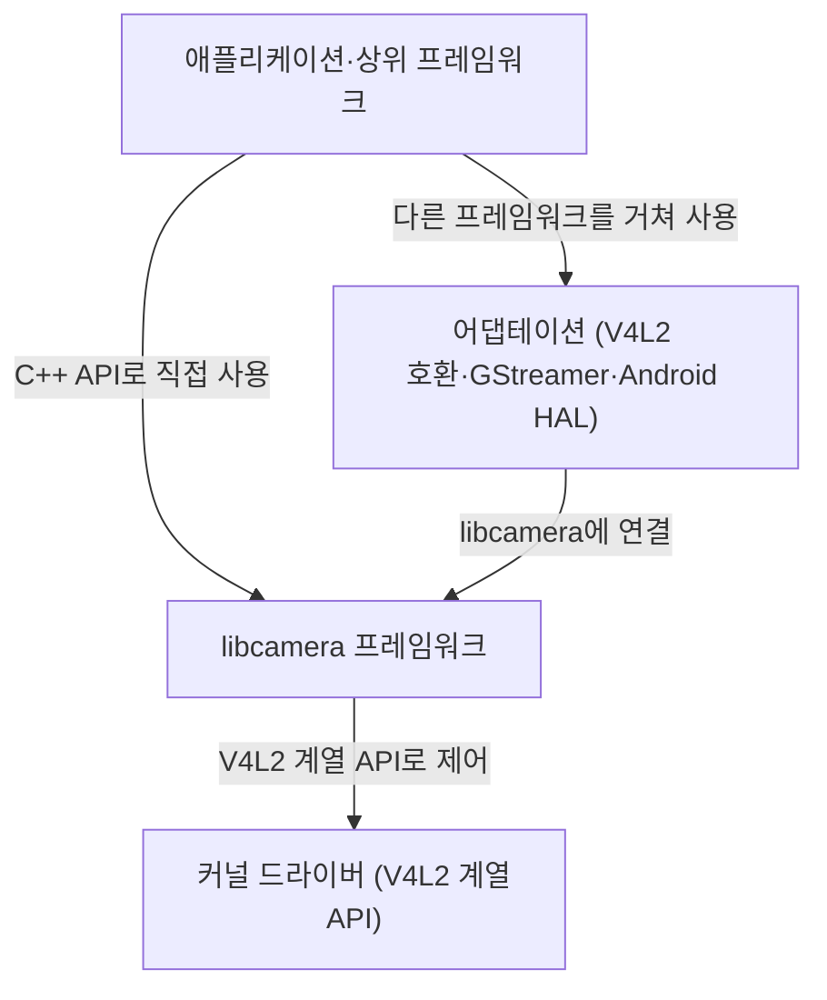

# 이 프로젝트가 하는 일

**이 프로젝트가 무엇을 받아 무엇을 내놓는지, 어느 계층·팀과 맞닿아 있는지 짧게 확인하세요.**

| 지금 확인할 내용 | 이동할 절 |
|---|---|
| libcamera는 Linux, Android, ChromeOS를 위한 오픈 소스 복합 카메라 지원 라이브러리입니다. | [하는 일](#하는-일) |
| 커널 드라이버는 카메라 하드웨어를 제어하고, Linux 커널의 V4L2 API(프로그램이 장치를 다루는 인터페이스) 계열인 Media `Controller` API, V4L2 Video `Device` API, V4L2 Subdev API를 통해 사용자 공간에 저수준 인터페이스를 제공합니다. | [받는 것](#받는-것) |
| libcamera는 애플리케이션이 카메라 장치를 제어할 수 있도록 네이티브 C++ API를 제공합니다. | [내놓는 것](#내놓는-것) |
| 애플리케이션(사용자가 사용하는 응용 프로그램)과 상위 프레임워크(응용 프로그램을 지원하는 상위 수준의 소프트웨어 기반)는 libcamera 프레임워크 또는 libcamera를 적용한 형태를 기반으로 하며, libcamera 프로젝트의 범위 밖에 있습니다. | [다른 팀·계층과의 경계](#다른-팀계층과의-경계) |

## 하는 일

libcamera는 Linux, Android, ChromeOS를 위한 오픈 소스 복합 카메라 지원 라이브러리입니다. Linux 커널 장치 드라이버와 연결되고 개발자에게 직관적인 API를 제공해, Linux 시스템에서 복합 카메라로 이미지를 캡처하는 과정의 복잡성을 줄입니다. `Documentation/introduction.rst:10`

<!-- sdd:visual:camera-stack -->
### 카메라 스택의 네 계층

애플리케이션에서 카메라 하드웨어까지 어떤 계층을 지납니까? 지원 기종이나 성능을 보장하는 그림은 아닙니다.



[Mermaid 원문](team-overview.camera-stack.mmd)

??? note "그림 근거와 확인 범위"
    소스에 연결한 설계 해석입니다. 자동 연결 검사는 의미 승인이나 기기 실행 검증이 아닙니다.
    
    | 요소·전이 | 소스 근거 |
    |---|---|
    | 애플리케이션·상위 프레임워크 | [Documentation/introduction.rst:137](#source-e3b563f549a8c46d) |
    | 어댑테이션 (V4L2 호환·GStreamer·Android HAL) | [Documentation/introduction.rst:137](#source-e3b563f549a8c46d) |
    | libcamera 프레임워크 | [Documentation/introduction.rst:137](#source-e3b563f549a8c46d) |
    | 커널 드라이버 (V4L2 계열 API) | [Documentation/introduction.rst:137](#source-e3b563f549a8c46d) |
    | C++ API로 직접 사용 | [Documentation/introduction.rst:137](#source-e3b563f549a8c46d) |
    | 다른 프레임워크를 거쳐 사용 | [Documentation/introduction.rst:137](#source-e3b563f549a8c46d) |
    | libcamera에 연결 | [Documentation/introduction.rst:137](#source-e3b563f549a8c46d) |
    | V4L2 계열 API로 제어 | [Documentation/introduction.rst:137](#source-e3b563f549a8c46d) |
<!-- /sdd:visual:camera-stack -->

드라이버를 사용해 동작하는 카메라 스택을 제공할 책임은 userspace에 있습니다. 벤더는 일반적으로 이를 각자 구현하며, 응용 프로그램 개발자를 위한 공통 아키텍처나 API는 없습니다. 하드웨어 파이프라인과 커널 API에서의 표현이 서로 다르므로 맞춤 처리가 필요한 경우가 많습니다. `Documentation/introduction.rst:35`

libcamera는 Linux 기반 시스템에 완전한 카메라 스택을 제공합니다. 카메라에서 원하는 결과를 얻기 위해 커널 API를 통해 수행하는 하드웨어 설정과 이미지 제어 알고리즘 관련 작업을 추상화하여 개발자가 간단하고 일관된 방법으로 다룰 수 있게 합니다. 카메라 스택은 아래에서 위로 커널 드라이버, libcamera 프레임워크, libcamera 적응 계층, 애플리케이션·상위 프레임워크의 네 계층으로 구성됩니다. `Documentation/introduction.rst:45`, `Documentation/introduction.rst:137`

근거 원문: [Documentation/introduction.rst:10](#source-34fda84500757231) · [Documentation/introduction.rst:35](#source-de476c940b030e4a) · [Documentation/introduction.rst:45](#source-f350cabac0db8343) · [Documentation/introduction.rst:137](#source-e3b563f549a8c46d)

## 받는 것

커널 드라이버는 카메라 하드웨어를 제어하고, Linux 커널의 V4L2 API(프로그램이 장치를 다루는 인터페이스) 계열인 Media `Controller` API, V4L2 Video `Device` API, V4L2 Subdev API를 통해 사용자 공간에 저수준 인터페이스를 제공합니다. libcamera가 카메라 제어를 위해 아래 계층에서 구체적으로 무엇을 받는지는 확인되지 않습니다. 카메라 관리자인 `Camera` Manager는 libcamera가 지원하는 카메라를 열거하고, 각 카메라를 관리할 Pipeline Handler를 생성합니다. `Camera` Manager는 애플리케이션마다 하나만 실행되며, 한 번에 하나의 애플리케이션만 카메라 장치의 제어권을 갖도록 합니다. `Documentation/introduction.rst:139`, `Documentation/libcamera_architecture.rst:60`

근거 원문: [Documentation/introduction.rst:139](#source-e93209ecbe248c51) · [Documentation/libcamera_architecture.rst:60](#source-64bdc114ca74bd2c)

## 내놓는 것

libcamera는 애플리케이션이 카메라 장치를 제어할 수 있도록 네이티브 C++ API를 제공합니다. 선택적인 언어 바인딩을 사용하면 다른 프로그래밍 언어에서도 libcamera와 연결할 수 있습니다. `Documentation/introduction.rst:144`

libcamera adaptation은 다른 프레임워크에서 libcamera와 연결되는 구성 요소를 통칭합니다. 예로는 V4L2 호환 계층, gstreamer의 libcamera 요소, libcamera를 기반으로 하는 Android 카메라 하드웨어 추상화 계층(HAL) 구현이 있습니다. 이 구성 요소들은 libcamera 프로젝트의 별도 소스 저장소에 있거나 각 프로젝트의 저장소로 이동할 수 있습니다. `Documentation/introduction.rst:153`

근거 원문: [Documentation/introduction.rst:144](#source-d47b8630f593cf3c) · [Documentation/libcamera_architecture.rst:72](#source-611760d3be65ec8c) · [Documentation/introduction.rst:153](#source-72dfdf22c79d4609)

## 다른 팀·계층과의 경계

애플리케이션(사용자가 사용하는 응용 프로그램)과 상위 프레임워크(응용 프로그램을 지원하는 상위 수준의 소프트웨어 기반)는 libcamera 프레임워크 또는 libcamera를 적용한 형태를 기반으로 하며, libcamera 프로젝트의 범위 밖에 있습니다. `Documentation/introduction.rst:163`

장치 제조사는 libcamera 코드베이스의 일부인 Pipeline Handler를 업스트림에 기여해야 합니다. Pipeline Handler는 스트림 설정을 바탕으로 장치의 카메라 처리 경로를 구성하고, 필요한 경우 실행과 일정을 관리하며 `Camera` 인스턴스를 생성하고 장치와의 상호작용을 담당합니다. 장치 제조사는 CPU에서 자동 노출·자동 화이트 밸런스·자동 초점 등의 알고리즘을 실행하고 상위 계층의 매개변수에 따라 하드웨어 이미지 처리를 제어하는 IPA `Module`을 별도로 제공할 수 있습니다. libcamera에 포함된 IPA `Module`에는 자유 소프트웨어 라이선스가 적용되며, 외부 모듈은 libcamera 프로젝트의 소스 코드를 포함하지 않는 경우 비공개 소스 라이선스로 배포할 수 있습니다. `Documentation/libcamera_architecture.rst:87`, `Documentation/libcamera_architecture.rst:109`, `Documentation/introduction.rst:200`

근거 원문: [Documentation/introduction.rst:163](#source-9e653b8ff755db78) · [Documentation/libcamera_architecture.rst:87](#source-8bd888bd0473995e) · [Documentation/libcamera_architecture.rst:109](#source-1f130cc8640ef810) · [Documentation/introduction.rst:200](#source-341442e08591ef50)

??? note "설계 질문과 검증 범위"
    질문별 답변과 근거 연결을 검사했습니다. 의미와 실행 결과는 사람 검토가 필요합니다.
    
    | 설계 질문 | 설명 위치 | 확인 범위 |
    |---|---|---|
    | 이 프로젝트는 무엇을 하며 누구의 어떤 문제를 풉니까? | [하는 일](#하는-일) | 코드 근거와 설명 연결 |
    | 이 프로젝트는 무엇을 입력으로 받습니까? | [받는 것](#받는-것) | 코드 근거와 설명 연결 |
    | 이 프로젝트는 무엇을 결과로 내놓습니까? | [내놓는 것](#내놓는-것) | 코드 근거와 설명 연결 |
    | 어느 계층·팀과 책임이 나뉩니까? | [다른 팀·계층과의 경계](#다른-팀계층과의-경계) | 코드 근거와 설명 연결 |

## 소스 근거

같은 발췌는 한 번만 싣습니다. 필요한 원문을 펼쳐 설명과 대조하세요.

<a id="source-34fda84500757231"></a>

??? note "소스 근거: Documentation/introduction.rst:10"
    `Documentation/introduction.rst:10`에서 시작하는 발췌입니다. 종료 줄은 13이며, 아래 원문을 설명과 대조할 수 있습니다.
    
    SHA-256: `84621541899cba7430b844bc03d13fc8e6f3f03e7c30556df0bf1cd11007494c`
    
    ```text
    libcamera is an open source complex camera support library for Linux, Android
    and ChromeOS. The library interfaces with Linux kernel device drivers and
    provides an intuitive API to developers in order to simplify the complexity
    involved in capturing images from complex cameras on Linux systems.
    ```

<a id="source-de476c940b030e4a"></a>

??? note "소스 근거: Documentation/introduction.rst:35"
    `Documentation/introduction.rst:35`에서 시작하는 발췌입니다. 종료 줄은 40이며, 아래 원문을 설명과 대조할 수 있습니다.
    
    SHA-256: `0c6b72f4ffe9e608101639096b5597a61f41f776e4f5ac4aaa43229c744db3f0`
    
    ```text
    The usage of these drivers to provide a functioning camera stack is a
    responsibility that lies in userspace, and is commonly implemented separately
    by vendors without a common architecture or API for application developers. This
    adds a lot of complexity to the task, particularly when considering that the
    differences in hardware pipelines and their representation in the kernel's APIs
    often necessitate bespoke handling.
    ```

<a id="source-f350cabac0db8343"></a>

??? note "소스 근거: Documentation/introduction.rst:45"
    `Documentation/introduction.rst:45`에서 시작하는 발췌입니다. 종료 줄은 49이며, 아래 원문을 설명과 대조할 수 있습니다.
    
    SHA-256: `56f623776b7eab9511de1f32c1f3080c4eab37239185f5134db6b2644760b1f5`
    
    ```text
    libcamera provides a complete camera stack for Linux-based systems to abstract
    the configuration of hardware and image control algorithms required to obtain
    desirable results from the camera through the kernel's APIs, reducing those
    operations to a simple and consistent method for developers. In short instead of
    having to deal with this:
    ```

<a id="source-e3b563f549a8c46d"></a>

??? note "소스 근거: Documentation/introduction.rst:137"
    `Documentation/introduction.rst:137`에서 시작하는 발췌입니다. 종료 줄은 165이며, 아래 원문을 설명과 대조할 수 있습니다.
    
    SHA-256: `750a623b45ad76fbd899b56427ad76ef91bdc922497972317df868fe538c3b03`
    
    ```text
    The camera stack comprises four software layers. From bottom to top:
    
    * The kernel drivers control the camera hardware and expose a
      low-level interface to userspace through the Linux kernel V4L2
      family of APIs (Media Controller API, V4L2 Video Device API and
      V4L2 Subdev API).
    
    * The libcamera framework is the core part of the stack. It
      handles all control of the camera devices in its core component,
      libcamera, and exposes a native C++ API to upper layers. Optional
      language bindings allow interfacing to libcamera from other
      programming languages.
    
      Those components live in the same source code repository and
      all together constitute the libcamera framework.
    
    * The libcamera adaptation is an umbrella term designating the
      components that interface to libcamera in other frameworks.
      Notable examples are a V4L2 compatibility layer, a gstreamer
      libcamera element, and an Android camera HAL implementation based
      on libcamera.
    
      Those components can live in the libcamera project source code
      in separate repositories, or move to their respective project's
      repository (for instance the gstreamer libcamera element).
    
    * The applications and upper level frameworks are based on the
      libcamera framework or libcamera adaptation, and are outside of
      the scope of the libcamera project.
    ```

<a id="source-e93209ecbe248c51"></a>

??? note "소스 근거: Documentation/introduction.rst:139"
    `Documentation/introduction.rst:139`에서 시작하는 발췌입니다. 종료 줄은 142이며, 아래 원문을 설명과 대조할 수 있습니다.
    
    SHA-256: `33d991f6b824d355da564d0c328fb633374964b7dfee2b8e68b450cb29a80efa`
    
    ```text
    * The kernel drivers control the camera hardware and expose a
      low-level interface to userspace through the Linux kernel V4L2
      family of APIs (Media Controller API, V4L2 Video Device API and
      V4L2 Subdev API).
    ```

<a id="source-64bdc114ca74bd2c"></a>

??? note "소스 근거: Documentation/libcamera_architecture.rst:60"
    `Documentation/libcamera_architecture.rst:60`에서 시작하는 발췌입니다. 종료 줄은 67이며, 아래 원문을 설명과 대조할 수 있습니다.
    
    SHA-256: `bd036b31d192ef7504f07202ebcbc475e23b8b4387bf322ddf529accbbb786a7`
    
    ```text
    The Camera Manager enumerates cameras and instantiates Pipeline Handlers to
      manage each Camera that libcamera supports. The Camera Manager supports
      hotplug detection and notification events when supported by the underlying
      kernel devices.
    
      There is only ever one instance of the Camera Manager running per application.
      Each application's instance of the Camera Manager ensures that only a single
      application can take control of a camera device at once.
    ```

<a id="source-d47b8630f593cf3c"></a>

??? note "소스 근거: Documentation/introduction.rst:144"
    `Documentation/introduction.rst:144`에서 시작하는 발췌입니다. 종료 줄은 151이며, 아래 원문을 설명과 대조할 수 있습니다.
    
    SHA-256: `69bc145221729420c980f5fe5887a43497e96b41eb16fa12ed7fdef01ccfdb97`
    
    ```text
    * The libcamera framework is the core part of the stack. It
      handles all control of the camera devices in its core component,
      libcamera, and exposes a native C++ API to upper layers. Optional
      language bindings allow interfacing to libcamera from other
      programming languages.
    
      Those components live in the same source code repository and
      all together constitute the libcamera framework.
    ```

<a id="source-611760d3be65ec8c"></a>

??? note "소스 근거: Documentation/libcamera_architecture.rst:72"
    `Documentation/libcamera_architecture.rst:72`에서 시작하는 발췌입니다. 종료 줄은 82이며, 아래 원문을 설명과 대조할 수 있습니다.
    
    SHA-256: `d64fa7a71ca69a53433d250a2fd8f59a0beed2578980eee658d8dfb44a7513ee`
    
    ```text
    The Camera class represents a single item of camera hardware that is capable
      of producing one or more image streams, and provides the API to interact with
      the underlying device.
    
      If a system has multiple instances of the same hardware attached, each has its
      own instance of the camera class.
    
      The API exposes full control of the device to upper layers of libcamera through
      the public API, making it the highest level object libcamera exposes, and the
      object that all other API operations interact with from configuration to
      capture.
    ```

<a id="source-72dfdf22c79d4609"></a>

??? note "소스 근거: Documentation/introduction.rst:153"
    `Documentation/introduction.rst:153`에서 시작하는 발췌입니다. 종료 줄은 161이며, 아래 원문을 설명과 대조할 수 있습니다.
    
    SHA-256: `684ccb39cfc9bebf3125bd79b4b2f847de806a34261a9bcac9216bda52f1f99d`
    
    ```text
    * The libcamera adaptation is an umbrella term designating the
      components that interface to libcamera in other frameworks.
      Notable examples are a V4L2 compatibility layer, a gstreamer
      libcamera element, and an Android camera HAL implementation based
      on libcamera.
    
      Those components can live in the libcamera project source code
      in separate repositories, or move to their respective project's
      repository (for instance the gstreamer libcamera element).
    ```

<a id="source-9e653b8ff755db78"></a>

??? note "소스 근거: Documentation/introduction.rst:163"
    `Documentation/introduction.rst:163`에서 시작하는 발췌입니다. 종료 줄은 165이며, 아래 원문을 설명과 대조할 수 있습니다.
    
    SHA-256: `e8a1fc73a04b4feadbf1c6ca5d820f482b4eaaebfafec27a74612e2189b01c7c`
    
    ```text
    * The applications and upper level frameworks are based on the
      libcamera framework or libcamera adaptation, and are outside of
      the scope of the libcamera project.
    ```

<a id="source-8bd888bd0473995e"></a>

??? note "소스 근거: Documentation/libcamera_architecture.rst:87"
    `Documentation/libcamera_architecture.rst:87`에서 시작하는 발췌입니다. 종료 줄은 102이며, 아래 원문을 설명과 대조할 수 있습니다.
    
    SHA-256: `868d392c7f94391d196168c05db330a1f07da72687d94f7b5a6ffaf1d6dee988`
    
    ```text
    The Pipeline Handler manages the complex pipelines exposed by the kernel
      drivers through the Media Controller and V4L2 APIs. It abstracts pipeline
      handling to hide device-specific details from the rest of the library, and
      implements both pipeline configuration based on stream configuration, and
      pipeline runtime execution and scheduling when needed by the device.
    
      The Pipeline Handler lives in the same process as the rest of the library, and
      has access to all helpers and kernel camera-related devices.
    
      Hardware abstraction is handled by device specific Pipeline Handlers which are
      derived from the Pipeline Handler base class allowing commonality to be shared
      among the implementations.
    
      Derived pipeline handlers create Camera device instances based on the devices
      they detect and support on the running system, and are responsible for
      managing the interactions with a camera device.
    ```

<a id="source-1f130cc8640ef810"></a>

??? note "소스 근거: Documentation/libcamera_architecture.rst:109"
    `Documentation/libcamera_architecture.rst:109`에서 시작하는 발췌입니다. 종료 줄은 118이며, 아래 원문을 설명과 대조할 수 있습니다.
    
    SHA-256: `f0858f8576140aaf8b57ac5d757e8be0910218fb68d85b4704fe9275e2683a28`
    
    ```text
    Together with the hardware image processing and hardware statistics
      collection, the Image Processing Algorithms (IPA) implement 3A (Auto-Exposure,
      Auto-White Balance and Auto-Focus) and other algorithms. They run on the CPU
      and control hardware image processing based on the parameters supplied by
      upper layers, closing the control loop of the ISP.
    
      IPAs are loaded as external plugins named IPA Modules. IPA Modules can be
      part of the libcamera code base or provided externally by camera vendors.
      In-tree IPA modules are covered by the same license as the rest of libcamera,
      external IPA modules can be open-source or closed-source.
    ```

<a id="source-341442e08591ef50"></a>

??? note "소스 근거: Documentation/introduction.rst:200"
    `Documentation/introduction.rst:200`에서 시작하는 발췌입니다. 종료 줄은 204이며, 아래 원문을 설명과 대조할 수 있습니다.
    
    SHA-256: `ef0482e955d8c625e622517f8a1bd58e9fcc321770a02c19aa241cdc485bb623`
    
    ```text
    Handlers are a part of the libcamera code base and need to be contributed
    upstream by device vendors. IPA modules included in libcamera are covered by a
    free software license, however third-parties may develop IPA modules outside of
    libcamera and distribute them under a closed-source license, provided they do
    not include source code from the libcamera project.
    ```

??? note "근거와 검토 정보"
    - 생성 방식: 추출 사실과 LLM 설명
    - 검증 범위: 표·그림은 facts로 만들고 설명은 LLM이 작성합니다. 인용·문장 및 설정된 구조 검사를 적용합니다.
    - 근거 파일: `Documentation/introduction.rst`, `Documentation/libcamera_architecture.rst`, `include/libcamera/camera.h`, `include/libcamera/camera_manager.h`, `include/libcamera/internal/pipeline_handler.h`, `src/libcamera/camera.cpp`, `src/libcamera/camera_manager.cpp`, `src/libcamera/pipeline_handler.cpp`
    - 근거 수준: 코드 확인 (정적 분석, simple_compdb 구성, commit `212c689fcf`)
    - 자동 검사 (인용·문장 및 설정된 구조 검사): 통과
    - 검토 상태 기록일: 2026-10-30 · 사람 검토 전

다음 단계: [시스템 개요](overview.md)
