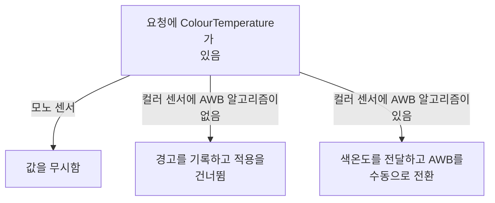

# 색온도 요청과 메타데이터를 구분하기

**색온도 값을 요청에 넣는 조건과 실제 프레임의 메타데이터가 나타내는 값을 확인하세요.**


## ColourTemperature 요청과 결과

`ColourTemperature`은 `inout` 제어값으로 프레임의 색온도를 켈빈 단위로 나타내며, 요청에는 AWB가 비활성화된 경우에만 적용할 수 있습니다. 프레임 처리에 사용한 `ColourTemperature`은 메타데이터에 보고됩니다. 요청에 `ColourTemperature`을 설정하고 `ColourGains`를 설정하지 않으면 구현체는 지정된 색온도를 바탕으로 `ColourGains`를 계산하고 설정해야 합니다. `ColourTemperature`이 직접 설정되거나 `ColourGains` 설정을 통해 간접적으로 설정되고 `ColourCorrectionMatrix`가 설정되지 않으면, `ColourCorrectionMatrix`는 `ColourTemperature`을 바탕으로 갱신됩니다. `src/libcamera/control_ids_core.yaml:603`

<!-- sdd:visual:rpi-awb-branches -->
### Raspberry Pi의 색온도 요청 분기



[Mermaid 원문](colour-temperature.rpi-awb-branches.mmd)

??? note "그림 근거와 확인 범위"
    Raspberry Pi IPA는 색온도 값을 받으면 언제 적용합니까?
    
    소스에 연결한 설계 해석입니다. 자동 연결 검사는 의미 승인이나 기기 실행 검증이 아닙니다.
    
    | 요소·전이 | 소스 근거 |
    |---|---|
    | <span data-sdd-label-en="Request contains ColourTemperature">요청에 ColourTemperature가 있음</span> | [src/ipa/rpi/common/ipa_base.cpp:922](#source-89a050db0c9f481c) |
    | <span data-sdd-label-en="Value ignored">값을 무시함</span> | [src/ipa/rpi/common/ipa_base.cpp:922](#source-89a050db0c9f481c) |
    | <span data-sdd-label-en="Warning logged and application skipped">경고를 기록하고 적용을 건너뜀</span> | [src/ipa/rpi/common/ipa_base.cpp:922](#source-89a050db0c9f481c) |
    | <span data-sdd-label-en="Set temperature and switch AWB to manual">색온도를 전달하고 AWB를 수동으로 전환</span> | [src/ipa/rpi/common/ipa_base.cpp:922](#source-89a050db0c9f481c) |
    | <span data-sdd-label-en="Monochrome sensor">모노 센서</span> | [src/ipa/rpi/common/ipa_base.cpp:922](#source-89a050db0c9f481c) |
    | <span data-sdd-label-en="Colour sensor without AWB algorithm">컬러 센서에 AWB 알고리즘이 없음</span> | [src/ipa/rpi/common/ipa_base.cpp:922](#source-89a050db0c9f481c) |
    | <span data-sdd-label-en="Colour sensor with AWB algorithm">컬러 센서에 AWB 알고리즘이 있음</span> | [src/ipa/rpi/common/ipa_base.cpp:922](#source-89a050db0c9f481c) |
<!-- /sdd:visual:rpi-awb-branches -->

Raspberry Pi IPA의 요청 처리 코드는 `ColourTemperature`이 있으면 모노 센서에서 해당 제어값을 조용히 무시합니다. AWB 알고리즘을 찾지 못하면 경고를 기록하고 해당 처리를 끝냅니다. 그 외에는 AWB 알고리즘의 `setColourTemperature()`를 호출한 뒤 `awbEnabled_`를 `false`로 설정하여 AWB를 수동 모드로 전환합니다. 메타데이터 처리 코드는 `awb.status`가 있으면 그 상태의 `temperatureK`를 `ColourTemperature` 메타데이터로 설정합니다. `src/ipa/rpi/common/ipa_base.cpp:922`, `src/ipa/rpi/common/ipa_base.cpp:1556`

근거 원문: [src/libcamera/control_ids_core.yaml:603](#source-d3108f17b82d0b49) · [src/ipa/rpi/common/ipa_base.cpp:922](#source-89a050db0c9f481c) · [src/ipa/rpi/common/ipa_base.cpp:1556](#source-b162436961ceca50)

??? note "설계 질문과 검증 범위"
    질문별 답변과 근거 연결을 검사했습니다. 의미와 실행 결과는 사람 검토가 필요합니다.
    
    | 설계 질문 | 설명 위치 | 확인 범위 |
    |---|---|---|
    | ColourTemperature의 inout 방향이 요청 입력과 프레임 메타데이터에서 무엇을 의미합니까? AWB 조건, 함께 지정하지 않은 ColourGains와 ColourCorrectionMatrix 처리, Raspberry Pi IPA가 요청 값을 건너뛰거나 적용하는 조건을 설명하세요. | [ColourTemperature 요청과 결과](#colourtemperature-요청과-결과) | 코드 근거와 설명 연결 |

## 소스 근거

같은 발췌는 한 번만 싣습니다. 필요한 원문을 펼쳐 설명과 대조하세요.

<a id="source-d3108f17b82d0b49"></a>

??? note "소스 근거: src/libcamera/control_ids_core.yaml:603"
    `src/libcamera/control_ids_core.yaml:603`에서 시작하는 발췌입니다. 종료 줄은 624이며, 아래 원문을 설명과 대조할 수 있습니다.
    
    SHA-256: `88d918f272cfe013114d36d9fe244120ed99ec7bc21a01e5235d403a752d2580`
    
    ```text
      - ColourTemperature:
          type: int32_t
          direction: inout
          description: |
            ColourTemperature of the frame, in kelvin.
    
            ColourTemperature can only be applied in a Request when the AWB is
            disabled.
    
            If ColourTemperature is set in a request but ColourGains is not, the
            implementation shall calculate and set the ColourGains based on the
            given ColourTemperature. If ColourTemperature is set (either directly,
            or indirectly by setting ColourGains) but ColourCorrectionMatrix is not,
            the ColourCorrectionMatrix is updated based on the ColourTemperature.
    
            The ColourTemperature used to process the frame is reported in metadata.
    
            \sa AwbEnable
            \sa ColourCorrectionMatrix
            \sa ColourGains
    
      - Saturation:
    ```

<a id="source-89a050db0c9f481c"></a>

??? note "소스 근거: src/ipa/rpi/common/ipa_base.cpp:922"
    `src/ipa/rpi/common/ipa_base.cpp:922`에서 시작하는 발췌입니다. 종료 줄은 945이며, 아래 원문을 설명과 대조할 수 있습니다.
    
    SHA-256: `76ca45fd660615f583ca4502c7c3dcce4cc95ca517f86ad4038ed57bb8188505`
    
    ```text
    const auto colourTemperature = controls.get(controls::ColourTemperature);
    	if (colourTemperature)
    		do {
    			/* Silently ignore this control for a mono sensor. */
    			if (monoSensor_)
    				break;
    
    			auto temperatureK = *colourTemperature;
    			RPiController::AwbAlgorithm *awb = dynamic_cast<RPiController::AwbAlgorithm *>(
    				controller_.getAlgorithm("awb"));
    			if (!awb) {
    				LOG(IPARPI, Warning)
    					<< "Could not set COLOUR_TEMPERATURE - no AWB algorithm";
    				break;
    			}
    
    			awb->setColourTemperature(temperatureK);
    			awbEnabled_ = false; /* doing this puts AWB into manual mode */
    
    			/* This metadata will get reported back automatically. */
    			break;
    		} while (false);
    
    	/* Iterate over controls */
    ```

<a id="source-b162436961ceca50"></a>

??? note "소스 근거: src/ipa/rpi/common/ipa_base.cpp:1556"
    `src/ipa/rpi/common/ipa_base.cpp:1556`에서 시작하는 발췌입니다. 종료 줄은 1563이며, 아래 원문을 설명과 대조할 수 있습니다.
    
    SHA-256: `67b7df55c1cbd610014091a35a5074aaf3adb72628b0a47ea55fa32902e41c28`
    
    ```text
    AwbStatus *awbStatus = rpiMetadata.getLocked<AwbStatus>("awb.status");
    	if (awbStatus) {
    		libcameraMetadata_.set(controls::ColourGains, { static_cast<float>(awbStatus->gainR),
    								static_cast<float>(awbStatus->gainB) });
    		libcameraMetadata_.set(controls::ColourTemperature, awbStatus->temperatureK);
    	}
    
    	BlackLevelStatus *blackLevelStatus
    ```

??? note "근거와 검토 정보"
    - 생성 방식: 추출 사실과 LLM 설명
    - 검증 범위: 표·그림은 facts로 만들고 설명은 LLM이 작성합니다. 인용·문장 및 설정된 구조 검사를 적용합니다.
    - 근거 파일: `src/ipa/rpi/common/ipa_base.cpp`, `src/libcamera/control_ids_core.yaml`
    - 근거 수준: 코드 확인 (정적 분석, simple_compdb 구성, commit `da6a6ed33e`)
    - 자동 검사 (인용·문장 및 설정된 구조 검사): 통과
    - 검토 상태 기록일: 2026-11-13 · 사람 검토 전

다음 단계: [관련 소스와 설명](https://github.com/TTolsun/libcamera-sdd/blob/da6a6ed33ed0ab305f10b6f8b44736150d39cef4/src/libcamera/control_ids_core.yaml#L603)
