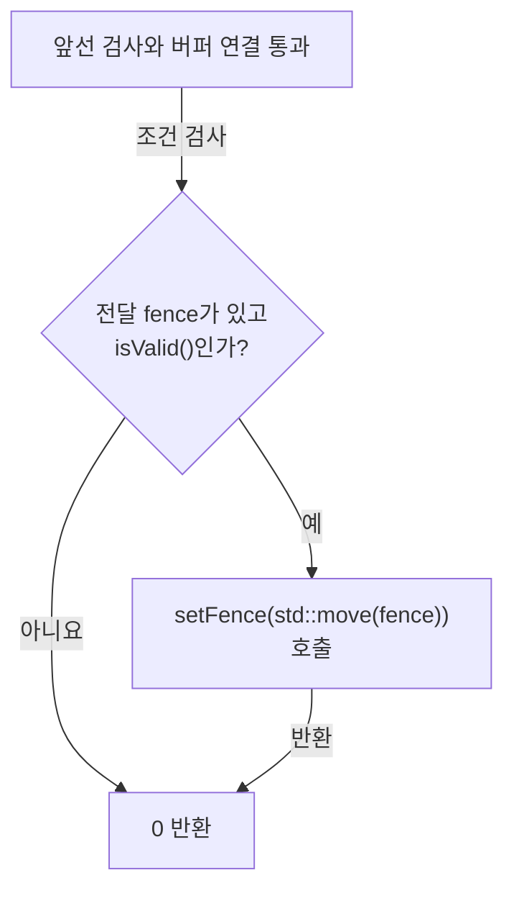

# addBuffer의 전달 fence 조건

**전달 fence가 버퍼로 이동하는 조건을 확인합니다.**


## 전달 fence의 이동 조건

`Request::addBuffer()`는 세 거절 검사를 통과한 뒤 `fence && fence->isValid()`가 참이면 `setFence(std::move(fence))`를 호출해 전달받은 `fence`를 버퍼로 이동합니다. 전달받은 `fence`가 null이거나 유효하지 않으면 이 분기를 실행하지 않습니다. `src/libcamera/request.cpp:475`

<!-- sdd:visual:fence-transfer -->
### 전달 fence의 조건부 이동



[Mermaid 원문](camera-requests.fence-transfer.mmd)

??? note "그림 근거와 확인 범위"
    Request::addBuffer()에서 세 거절 검사를 통과한 뒤 전달받은 fence를 어떤 조건에서 버퍼로 이동합니까? fence && fence->isValid()와 setFence(std::move(fence))를 연결하고 null 또는 유효하지 않은 전달 fence에서는 이 분기를 실행하지 않는다는 점을 설명하세요. 앞선 거절 조건의 전체 설명과 실패 시 소유권·기기 동작은 제외하세요.
    
    소스에 연결한 설계 해석입니다. 자동 연결 검사는 의미 승인이나 기기 실행 검증이 아닙니다.
    
    | 요소·전이 | 소스 근거 |
    |---|---|
    | <span data-sdd-label-en="Earlier checks and buffer linking passed">앞선 검사와 버퍼 연결 통과</span> | [src/libcamera/request.cpp:475](#source-605100b059a6864d) |
    | <span data-sdd-label-en="Is a supplied fence present and valid?">전달 fence가 있고 isValid&#40;&#41;인가?</span> | [src/libcamera/request.cpp:475](#source-605100b059a6864d) |
    | <span data-sdd-label-en="Call setFence(std::move(fence))">setFence&#40;std::move&#40;fence&#41;&#41; 호출</span> | [src/libcamera/request.cpp:475](#source-605100b059a6864d) |
    | <span data-sdd-label-en="Return 0">0 반환</span> | [src/libcamera/request.cpp:475](#source-605100b059a6864d) |
    | <span data-sdd-label-en="Check condition">조건 검사</span> | [src/libcamera/request.cpp:475](#source-605100b059a6864d) |
    | <span data-sdd-label-en="Yes">예</span> | [src/libcamera/request.cpp:475](#source-605100b059a6864d) |
    | <span data-sdd-label-en="No">아니요</span> | [src/libcamera/request.cpp:475](#source-605100b059a6864d) |
    | <span data-sdd-label-en="Return">반환</span> | [src/libcamera/request.cpp:475](#source-605100b059a6864d) |
<!-- /sdd:visual:fence-transfer -->

근거 원문: [src/libcamera/request.cpp:475](#source-605100b059a6864d)

??? note "설계 질문과 검증 범위"
    질문별 답변과 근거 연결을 검사했습니다. 의미와 실행 결과는 사람 검토가 필요합니다.
    
    | 설계 질문 | 설명 위치 | 확인 범위 |
    |---|---|---|
    | Request::addBuffer()에서 세 거절 검사를 통과한 뒤 전달받은 fence를 어떤 조건에서 버퍼로 이동합니까? fence && fence->isValid()와 setFence(std::move(fence))를 연결하고 null 또는 유효하지 않은 전달 fence에서는 이 분기를 실행하지 않는다는 점을 설명하세요. 앞선 거절 조건의 전체 설명과 실패 시 소유권·기기 동작은 제외하세요. | [전달 fence의 이동 조건](#전달-fence의-이동-조건) | 코드 근거와 설명 연결 |

## 소스 근거

같은 발췌는 한 번만 싣습니다. 필요한 원문을 펼쳐 설명과 대조하세요.

<a id="source-605100b059a6864d"></a>

??? note "소스 근거: src/libcamera/request.cpp:475"
    `src/libcamera/request.cpp:475`에서 시작하는 발췌입니다. 종료 줄은 505이며, 아래 원문을 설명과 대조할 수 있습니다.
    
    SHA-256: `c1c0b55f2925856df843fa155a14bb07eb616f52b6bde75cd3b0b5a4ab03b64a`
    
    ```text
    int Request::addBuffer(const Stream *stream, FrameBuffer *buffer,
    		       std::unique_ptr<Fence> &&fence)
    {
    	if (!stream) {
    		LOG(Request, Error) << "Invalid stream reference";
    		return -EINVAL;
    	}
    
    	/*
    	 * Make sure the fence has been extracted from the buffer
    	 * to avoid waiting on a stale fence.
    	 */
    	if (buffer->_d()->fence()) {
    		LOG(Request, Error) << "Can't add buffer that still references a fence";
    		return -EEXIST;
    	}
    
    	auto [it, inserted] = bufferMap_.try_emplace(stream, buffer);
    	if (!inserted) {
    		LOG(Request, Error) << "FrameBuffer already set for stream";
    		return -EEXIST;
    	}
    
    	buffer->_d()->setRequest(this);
    	_d()->pending_.insert(buffer);
    
    	if (fence && fence->isValid())
    		buffer->_d()->setFence(std::move(fence));
    
    	return 0;
    }
    ```

??? note "근거와 검토 정보"
    - 생성 방식: 추출 사실과 LLM 설명
    - 검증 범위: 표·그림은 facts로 만들고 설명은 LLM이 작성합니다. 인용·문장 및 설정된 구조 검사를 적용합니다.
    - 근거 파일: `src/libcamera/request.cpp`
    - 근거 수준: 코드 확인 (정적 분석, simple_compdb 구성, commit `293d751a81`)
    - 자동 검사 (인용·문장 및 설정된 구조 검사): 통과
    - 검토 상태 기록일: 2026-11-05 · 사람 검토 전
