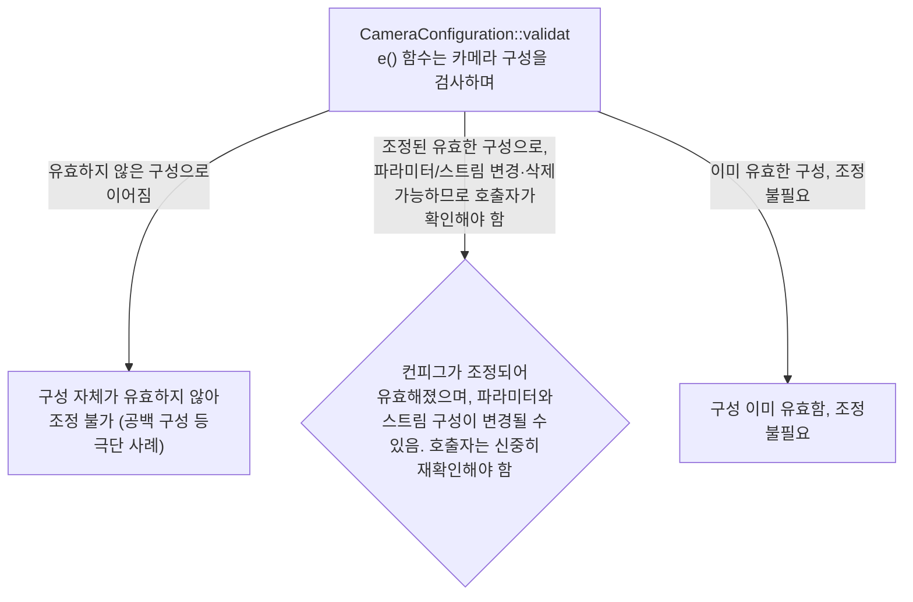
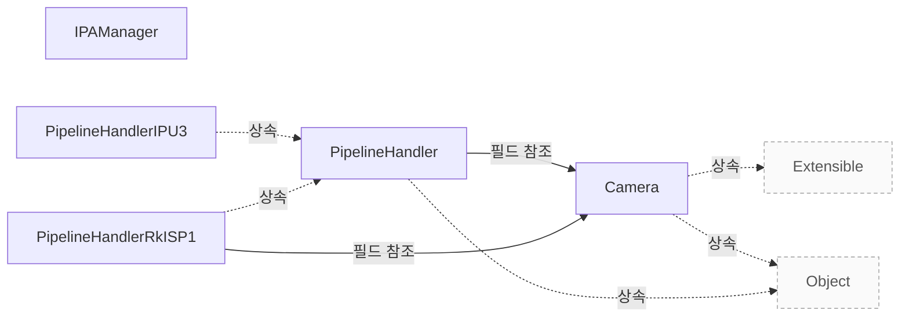

# 지원 범위와 검증

**지원 조건과 구성 제약을 확인하고 제품 도입 전에 검증할 범위를 정하세요.**

| 지금 확인할 내용 | 이동할 절 |
|---|---|
| 제품이 무엇이고 어디까지 지원하는지, 공통 설계가 구현자에게 해 주는 일을 확인하고 도입할 범위를 판단하세요. | [libcamera 제품 개요](vendor-overview.md) |
| 연동 순서와 구현 책임을 확인하고 설정·요청·정지 계약을 적용하세요. | [연동 가이드](vendor-integration.md) |
| 파이프라인 구현이 지켜야 하는 구성·요청·완료·종료 계약을 확인하세요. | [Pipeline Handler](pipeline-handler.md) |

## 지원 조건과 제약

`CameraConfiguration::Invalid`은 설정이 유효하지 않아 조정할 수 없는 상태를 의미하며, 이는 설정이 빈 것과 같은 극단적인 경우에만 발생할 수 있습니다. `CameraConfiguration::Adjusted`는 구성이 조정되었음을 나타내며 조정 후에 유효한 상태임을 의미합니다. `CameraConfiguration::validate()` 함수는 각 스트림의 파라미터가 변경되었을 수 있으며(any stream), 스트림 구성이 제거되었을 수도 있습니다(stream configurations removed). `CameraConfiguration::Adjusted` 가 반환되면 호출자는 `configuration`을 주의 깊게 확인해야 합니다. `src/libcamera/camera.cpp:338`, `src/libcamera/camera.cpp:341`, `src/libcamera/camera.cpp:342`, `src/libcamera/camera.cpp:343`

<!-- sdd:visual:validation-results -->
### validate() 결과별 호출자의 책임

validate()의 Invalid·Adjusted·Valid는 무엇을 뜻하며, Adjusted이면 호출자는 무엇을 다시 확인해야 합니까?

LLM 그림 초안 · 사람 검토 전

작성 모델: `cli/hermes/qwen3.5:9b-ctx64k`



[Mermaid 원문](vendor-assurance.validation-results.mmd)

??? note "그림 근거와 확인 범위"
    소스에 연결한 설계 해석입니다. 자동 연결 검사는 의미 승인이나 기기 실행 검증이 아닙니다.
    
    | 요소·전이 | 소스 근거 |
    |---|---|
    | CameraConfiguration::validate() 함수는 카메라 구성을 검사하며 | [src/libcamera/camera.cpp:323](#source-2b31e92e3fb3f083) |
    | 구성 자체가 유효하지 않아 조정 불가 (공백 구성 등 극단 사례) | [src/libcamera/camera.cpp:323](#source-2b31e92e3fb3f083) |
    | 컨피그가 조정되어 유효해졌으며, 파라미터와 스트림 구성이 변경될 수 있음. 호출자는 신중히 재확인해야 함 | [src/libcamera/camera.cpp:323](#source-2b31e92e3fb3f083) |
    | 구성 이미 유효함, 조정 불필요 | [src/libcamera/camera.cpp:323](#source-2b31e92e3fb3f083) |
    | 유효하지 않은 구성으로 이어짐 | [src/libcamera/camera.cpp:323](#source-2b31e92e3fb3f083) |
    | 조정된 유효한 구성으로, 파라미터/스트림 변경·삭제 가능하므로 호출자가 확인해야 함 | [src/libcamera/camera.cpp:323](#source-2b31e92e3fb3f083) |
    | 이미 유효한 구성, 조정 불필요 | [src/libcamera/camera.cpp:323](#source-2b31e92e3fb3f083) |
<!-- /sdd:visual:validation-results -->

`CameraConfiguration::validate()` 가 `CameraConfiguration::Valid`를 반환하면 원래 구성은 이미 유효했으며 어떤 파라미터도 조정되지 않았습니다. `generateConfiguration`은 요청된 역할 목록이 충족될 수 있으면 유효한 `CameraConfiguration`을 반환하고, 그렇지 않으면 null 을 반환합니다. `PipelineHandler::configure()` 에 입력된 구성에는 `CameraConfiguration::validate()` 로 검증되었음이 보장되며, 구현자는 추가 검증을 수행해서는 안 됩니다. `PipelineHandler::configure()` 함수는 성공 시 0 을, 실패 시 음수 오류 코드를 반환해야 하며, 입력 검증은 완료되어도 구성이 성공함을 보장하지 않습니다. `src/libcamera/camera.cpp:323`, `src/libcamera/pipeline_handler.cpp:289`, `src/libcamera/pipeline_handler.cpp:304`, `src/libcamera/pipeline_handler.cpp:313`

근거 원문: [src/libcamera/camera.cpp:338](#source-60ab47044c6107c5) · [src/libcamera/camera.cpp:343](#source-e5758fc43bf244cd) · [src/libcamera/camera.cpp:323](#source-2b31e92e3fb3f083) · [src/libcamera/pipeline_handler.cpp:289](#source-4abbe39594a1bd27) · [src/libcamera/pipeline_handler.cpp:304](#source-31c5407347b4d0d8) · [src/libcamera/pipeline_handler.cpp:313](#source-f87ceb096b9f931d) · [src/libcamera/camera.cpp:341](#source-8b6aa81367245db5) · [src/libcamera/camera.cpp:342](#source-e13fede0aa40ada1)

## 성능 근거를 읽는 기준

`DebayerCpu`의 내장 벤치마크는 통계 수집과 디베이어 처리에 소요되는 시간만을 측정하며, 프레임 캡처나 출력에 드는 시간은 포함하지 않습니다. Software ISP 파이프라인을 사용하는 `cam` 또는 `qcam`를 실행하면 내장 벤치마크가 반드시 실행되어 처리 시간(통계 수집 및 Debayer링)과 관련된 측정이 이루어집니다. `Documentation/software-isp-benchmarking.rst:15`

근거 원문: [Documentation/software-isp-benchmarking.rst:15](#source-551d2b5944a36d19)

??? note "설계 질문과 검증 범위"
    질문별 답변과 근거 연결을 검사했습니다. 의미와 실행 결과는 사람 검토가 필요합니다.
    
    | 설계 질문 | 설명 위치 | 확인 범위 |
    |---|---|---|
    | 지원 전제와 제약은 무엇이며 별도 검증할 항목은 무엇입니까? | [지원 조건과 제약](#지원-조건과-제약) | 코드 근거와 설명 연결 |
    | 참고 벤치마크가 측정하는 범위와 별도 제품 검증 범위는 무엇입니까? | [성능 근거를 읽는 기준](#성능-근거를-읽는-기준) | 코드 근거와 설명 연결 |

## 소스 근거

같은 발췌는 한 번만 싣습니다. 필요한 원문을 펼쳐 설명과 대조하세요.

<a id="source-60ab47044c6107c5"></a>

??? note "소스 근거: src/libcamera/camera.cpp:338"
    `src/libcamera/camera.cpp:338`에서 시작하는 발췌입니다. 종료 줄은 340이며, 아래 원문을 설명과 대조할 수 있습니다.
    
    SHA-256: `2247db4a7b9353362f9df6c84aaa5c2810dec4eaaae4b3b36d19c57e427f5790`
    
    ```text
    \retval CameraConfiguration::Invalid The configuration is invalid and can't
     * be adjusted. This may only occur in extreme cases such as when the
     * configuration is empty.
    ```

<a id="source-e5758fc43bf244cd"></a>

??? note "소스 근거: src/libcamera/camera.cpp:343"
    `src/libcamera/camera.cpp:343`에서 시작하는 발췌입니다. 종료 줄은 344이며, 아래 원문을 설명과 대조할 수 있습니다.
    
    SHA-256: `f2efdb13d4f1bd8dd432fb0badb987eab0cc484fe8ecb30b7ea9d47c0126590c`
    
    ```text
    The caller shall check the
     * configuration carefully.
    ```

<a id="source-2b31e92e3fb3f083"></a>

??? note "소스 근거: src/libcamera/camera.cpp:323"
    `src/libcamera/camera.cpp:323`에서 시작하는 발췌입니다. 종료 줄은 346이며, 아래 원문을 설명과 대조할 수 있습니다.
    
    SHA-256: `86bf9109257512866bf70a5d42cd3da29c70d851d871f0e496058141ba377623`
    
    ```text
    \fn CameraConfiguration::validate()
     * \brief Validate and possibly adjust the camera configuration
     *
     * This function adjusts the camera configuration to the closest valid
     * configuration and returns the validation status.
     *
     * \todo Define exactly when to return each status code. Should stream
     * parameters set to 0 by the caller be adjusted without returning Adjusted ?
     * This would potentially be useful for applications but would get in the way
     * in Camera::configure(). Do we need an extra status code to signal this ?
     *
     * \todo Handle validation of buffers count when refactoring the buffers API.
     *
     * \return A CameraConfiguration::Status value that describes the validation
     * status.
     * \retval CameraConfiguration::Invalid The configuration is invalid and can't
     * be adjusted. This may only occur in extreme cases such as when the
     * configuration is empty.
     * \retval CameraConfiguration::Adjusted The configuration has been adjusted
     * and is now valid. Parameters may have changed for any stream, and stream
     * configurations may have been removed. The caller shall check the
     * configuration carefully.
     * \retval CameraConfiguration::Valid The configuration was already valid and
     * hasn't been adjusted.
    ```

<a id="source-4abbe39594a1bd27"></a>

??? note "소스 근거: src/libcamera/pipeline_handler.cpp:289"
    `src/libcamera/pipeline_handler.cpp:289`에서 시작하는 발췌입니다. 종료 줄은 290이며, 아래 원문을 설명과 대조할 수 있습니다.
    
    SHA-256: `b86c8678b02e96936d80626cefebf3811b6a991b459074e51c9f0e08457ff369`
    
    ```text
    \return A valid CameraConfiguration if the requested roles can be satisfied,
     * or a null pointer otherwise.
    ```

<a id="source-31c5407347b4d0d8"></a>

??? note "소스 근거: src/libcamera/pipeline_handler.cpp:304"
    `src/libcamera/pipeline_handler.cpp:304`에서 시작하는 발췌입니다. 종료 줄은 306이며, 아래 원문을 설명과 대조할 수 있습니다.
    
    SHA-256: `625bd787da81f9407ba9e746d4939d93b7172a26642429bcfd3300aa6187675f`
    
    ```text
    The configuration is guaranteed to have been validated with
     * CameraConfiguration::validate(). The pipeline handler implementation shall
     * not perform further validation
    ```

<a id="source-f87ceb096b9f931d"></a>

??? note "소스 근거: src/libcamera/pipeline_handler.cpp:313"
    `src/libcamera/pipeline_handler.cpp:313`에서 시작하는 발췌입니다. 종료 줄은 315이며, 아래 원문을 설명과 대조할 수 있습니다.
    
    SHA-256: `6e139b3c50660a7111d84bd00cfd17078b8b45d4a07688fa64b2d8af9ce52a22`
    
    ```text
    \context This function is called from the CameraManager thread.
     *
     * \return 0 on success or a negative error code otherwise
    ```

<a id="source-8b6aa81367245db5"></a>

??? note "소스 근거: src/libcamera/camera.cpp:341"
    `src/libcamera/camera.cpp:341`에서 시작하는 발췌입니다. 종료 줄은 342이며, 아래 원문을 설명과 대조할 수 있습니다.
    
    SHA-256: `bc530fdf77cefda77bfd8ae1cadf7df4edea81ddfce01bef24867681b29655f6`
    
    ```text
    \retval CameraConfiguration::Adjusted The configuration has been adjusted
     * and is now valid.
    ```

<a id="source-e13fede0aa40ada1"></a>

??? note "소스 근거: src/libcamera/camera.cpp:342"
    `src/libcamera/camera.cpp:342`에서 시작하는 발췌입니다. 종료 줄은 343이며, 아래 원문을 설명과 대조할 수 있습니다.
    
    SHA-256: `7c0debb896b6072c0bc59cf3589fbc49b607f915d96f30182d4e02038b94c156`
    
    ```text
    Parameters may have changed for any stream, and stream
     * configurations may have been removed.
    ```

<a id="source-551d2b5944a36d19"></a>

??? note "소스 근거: Documentation/software-isp-benchmarking.rst:15"
    `Documentation/software-isp-benchmarking.rst:15`에서 시작하는 발췌입니다. 종료 줄은 20이며, 아래 원문을 설명과 대조할 수 있습니다.
    
    SHA-256: `907d979f60258b4572a0557b6054ec814990084ca3e69a291317855a3b27084d`
    
    ```text
    The DebayerCpu class has a builtin benchmark. This benchmark measures the time
    spent on processing (collecting statistics and debayering) only, it does not
    measure the time spent on capturing or outputting the frames.
    
    The builtin benchmark always runs. So this can be used by simply running "cam"
    or "qcam" with a pipeline using the Software ISP.
    ```


<!-- sdd:class-diagram -->
## 클래스 관계

화살표의 글자는 추출한 관계를 나타내며, 점선은 상속입니다. 화살표는 참조 대상 또는 기반 클래스를 향합니다. 호출 순서를 뜻하지 않습니다.


<!-- /sdd:class-diagram -->

??? note "근거와 검토 정보"
    - 생성 방식: 추출 사실과 LLM 설명
    - 검증 범위: 표·그림은 facts로 만들고 설명은 LLM이 작성합니다. 인용·문장 및 설정된 구조 검사를 적용합니다.
    - 근거 파일: `Documentation/software-isp-benchmarking.rst`, `include/libcamera/camera.h`, `include/libcamera/internal/ipa_manager.h`, `include/libcamera/internal/pipeline_handler.h`, `src/libcamera/camera.cpp`, `src/libcamera/ipa_manager.cpp`, `src/libcamera/pipeline/ipu3/ipu3.cpp`, `src/libcamera/pipeline/rkisp1/rkisp1.cpp`, `src/libcamera/pipeline_handler.cpp`
    - 근거 수준: 코드 확인 (정적 분석, simple_compdb 구성, commit `2c4b67c079`)
    - 자동 검사 (인용·문장 및 설정된 구조 검사): 통과
    - 검토 상태 기록일: 2026-10-27 · 사람 검토 전

다음 단계: [요청 처리와 문제 진단](request-lifecycle.md)
