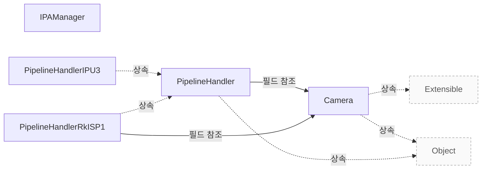

# 지원 범위와 검증

**지원 조건과 구성 제약을 확인하고 제품 도입 전에 검증할 범위를 정하세요.**

| 지금 확인할 내용 | 이동할 절 |
|---|---|
| libcamera 제품 개요에서 필요한 내용을 확인합니다. | [libcamera 제품 개요](vendor-overview.md) |
| 연동 가이드에서 필요한 내용을 확인합니다. | [연동 가이드](vendor-integration.md) |
| 장치별 파이프라인을 구현합니다. | [Pipeline Handler](pipeline-handler.md) |

## 지원 조건과 제약

`CameraConfiguration::validate()`의 Invalid는 구성이 유효하지 않고 유효한 구성으로 조정할 수도 없다는 뜻입니다. 원문은 구성이 비어 있는 경우와 같은 극단적인 상황에서만 발생할 수 있다고 설명합니다. `src/libcamera/camera.cpp:323`

<!-- sdd:visual:validation-results -->
### validate() 결과별 호출자의 책임

validate()의 Invalid·Adjusted·Valid는 무엇을 뜻하며, Adjusted이면 호출자는 무엇을 다시 확인해야 합니까?

LLM 그림 초안 · 사람 검토 전

작성 모델: `ollama/qwen3.5:9b`

```mermaid
flowchart TB
%% sdd:translations {"Adjusted: 구성이 조정되어 유효해졌습니다. 스트림 파라미터가 변경되었을 수 있고, 스트림 구성이 삭제되었을 수 있습니다. 호출자는 구성을 주의 깊게 확인해야 합니다.": "Adjusted: The configuration has been adjusted and is now valid. Parameters may have changed for any stream, and stream configurations may have been removed. The caller shall check the configuration carefully.", "CameraConfiguration::validate 가 호출자의 구성을 검증하고 조정합니다.": "CameraConfiguration::validate validates and adjusts the caller&#x27;s configuration.", "Invalid: 구성이 유효하지 않으며 조정할 수 없습니다. 빈 구성 등 극단적인 경우에만 발생할 수 있습니다.": "Invalid: The configuration is invalid and can&#x27;t be adjusted. This may only occur in extreme cases such as when the configuration is empty.", "Valid: 구성은 이미 유효했으며 조정되지 않았습니다.": "Valid: The configuration was already valid and hasn&#x27;t been adjusted.", "유효하지 않은 경우": "If invalid", "이미 유효한 경우": "If already valid", "조정된 경우 (파라미터 변경 또는 스트림 삭제 가능)": "If adjusted (parameters may have changed or streams removed)"}
  v_n0["CameraConfiguration::validate 가 호출자의 구성을 검증하고 조정합니다."]
  v_n1["Invalid: 구성이 유효하지 않으며 조정할 수 없습니다. 빈 구성 등 극단적인 경우에만 발생할 수 있습니다."]
  v_n2["Adjusted: 구성이 조정되어 유효해졌습니다. 스트림 파라미터가 변경되었을 수 있고, 스트림 구성이 삭제되었을 수 있습니다. 호출자는 구성을 주의 깊게 확인해야 합니다."]
  v_n3["Valid: 구성은 이미 유효했으며 조정되지 않았습니다."]
  v_n0 -->|"유효하지 않은 경우"| v_n1
  v_n0 -->|"조정된 경우 (파라미터 변경 또는 스트림 삭제 가능)"| v_n2
  v_n0 -->|"이미 유효한 경우"| v_n3
```



[Mermaid 원문](vendor-assurance.validation-results.mmd)

??? note "그림 근거와 확인 범위"
    소스에 연결한 설계 해석입니다. 자동 연결 검사는 의미 승인이나 기기 실행 검증이 아닙니다.
    
    | 요소·전이 | 소스 근거 |
    |---|---|
    | CameraConfiguration::validate 가 호출자의 구성을 검증하고 조정합니다. | [src/libcamera/camera.cpp:323](#source-94f2509b53d23e8f) |
    | Invalid: 구성이 유효하지 않으며 조정할 수 없습니다. 빈 구성 등 극단적인 경우에만 발생할 수 있습니다. | [src/libcamera/camera.cpp:323](#source-94f2509b53d23e8f) |
    | Adjusted: 구성이 조정되어 유효해졌습니다. 스트림 파라미터가 변경되었을 수 있고, 스트림 구성이 삭제되었을 수 있습니다. 호출자는 구성을 주의 깊게 확인해야 합니다. | [src/libcamera/camera.cpp:323](#source-94f2509b53d23e8f) |
    | Valid: 구성은 이미 유효했으며 조정되지 않았습니다. | [src/libcamera/camera.cpp:323](#source-94f2509b53d23e8f) |
    | 유효하지 않은 경우 | [src/libcamera/camera.cpp:323](#source-94f2509b53d23e8f) |
    | 조정된 경우 (파라미터 변경 또는 스트림 삭제 가능) | [src/libcamera/camera.cpp:323](#source-94f2509b53d23e8f) |
    | 이미 유효한 경우 | [src/libcamera/camera.cpp:323](#source-94f2509b53d23e8f) |
<!-- /sdd:visual:validation-results -->

`CameraConfiguration::Adjusted`이면 구성이 조정되어 유효해진 상태입니다. 스트림 파라미터가 변경되거나 스트림 구성이 제거되었을 수 있으므로 호출자는 조정된 구성을 주의 깊게 확인해야 합니다. `src/libcamera/camera.cpp:323`

`CameraConfiguration::Valid`는 구성이 원래부터 유효했고 조정되지 않았다는 뜻입니다. `src/libcamera/camera.cpp:323`

generateConfiguration()은 roles로 받은 스트림 용도를 충족할 수 있으면 유효한 구성을 반환하고, 그렇지 않으면 null 포인터를 반환합니다. 호출자는 반환된 구성에서 선택된 스트림과 기본 파라미터를 살펴볼 수 있습니다. `src/libcamera/pipeline_handler.cpp:271`

configure()는 validate()로 검증된 구성을 입력으로 받는 계약입니다. 성공하면 0을, 실패하면 음수 오류 코드를 반환하므로 입력 구성의 유효성과 실제 구성 성공을 구분해야 합니다. `src/libcamera/pipeline_handler.cpp:271`

근거 원문: [src/libcamera/camera.cpp:323](#source-94f2509b53d23e8f) · [src/libcamera/pipeline_handler.cpp:271](#source-a8c6266a0b690eef)

## 성능 근거를 읽는 기준

`DebayerCpu`의 내장 벤치마크는 통계 수집과 디베이어 처리에 걸리는 시간을 측정합니다. 프레임의 캡처와 출력 시간은 측정 범위에서 제외되므로 이 자료를 전체 영상 처리 지연으로 해석할 수는 없습니다. `Documentation/software-isp-benchmarking.rst:15`

upstream 문서에 따르면 내장 벤치마크는 항상 실행되므로 Software ISP를 사용하는 파이프라인에서 cam 또는 qcam을 실행하여 이용할 수 있습니다. 이 근거는 측정 절차이며 이 문서에서 대상 제품을 측정한 결과가 아닙니다. `Documentation/software-isp-benchmarking.rst:15`

근거 원문: [Documentation/software-isp-benchmarking.rst:15](#source-9c8139bcb89eab5b)

??? note "설계 질문과 검증 범위"
    질문별 답변과 근거 연결을 검사했습니다. 의미와 실행 결과는 사람 검토가 필요합니다.
    
    | 설계 질문 | 설명 위치 | 확인 범위 |
    |---|---|---|
    | 지원 전제와 제약은 무엇이며 별도 검증할 항목은 무엇입니까? | [지원 조건과 제약](#지원-조건과-제약) | 코드 근거와 설명 연결 |
    | 참고 벤치마크가 측정하는 범위와 별도 제품 검증 범위는 무엇입니까? | [성능 근거를 읽는 기준](#성능-근거를-읽는-기준) | 코드 근거와 설명 연결 |

## 소스 근거

같은 발췌는 한 번만 싣습니다. 필요한 원문을 펼쳐 설명과 대조하세요.

<a id="source-94f2509b53d23e8f"></a>

??? note "소스 근거: src/libcamera/camera.cpp:323"
    `src/libcamera/camera.cpp:323`에서 시작하는 발췌입니다. 종료 줄은 347이며, 아래 원문을 설명과 대조할 수 있습니다.
    
    SHA-256: `bc000ee568d90f13e6946b7574d1a92290270b8594bd9449dd54458ba6ac64e3`
    
    ```text
    \fn CameraConfiguration::validate()
     * \brief Validate and possibly adjust the camera configuration
     *
     * This function adjusts the camera configuration to the closest valid
     * configuration and returns the validation status.
     *
     * \todo Define exactly when to return each status code. Should stream
     * parameters set to 0 by the caller be adjusted without returning Adjusted ?
     * This would potentially be useful for applications but would get in the way
     * in Camera::configure(). Do we need an extra status code to signal this ?
     *
     * \todo Handle validation of buffers count when refactoring the buffers API.
     *
     * \return A CameraConfiguration::Status value that describes the validation
     * status.
     * \retval CameraConfiguration::Invalid The configuration is invalid and can't
     * be adjusted. This may only occur in extreme cases such as when the
     * configuration is empty.
     * \retval CameraConfiguration::Adjusted The configuration has been adjusted
     * and is now valid. Parameters may have changed for any stream, and stream
     * configurations may have been removed. The caller shall check the
     * configuration carefully.
     * \retval CameraConfiguration::Valid The configuration was already valid and
     * hasn't been adjusted.
     */
    ```

<a id="source-a8c6266a0b690eef"></a>

??? note "소스 근거: src/libcamera/pipeline_handler.cpp:271"
    `src/libcamera/pipeline_handler.cpp:271`에서 시작하는 발췌입니다. 종료 줄은 316이며, 아래 원문을 설명과 대조할 수 있습니다.
    
    SHA-256: `deb7d008a4a0483ec93bf6e74d74e1b7dbc993f5c719208d039bb2ff22665b74`
    
    ```text
    \fn PipelineHandler::generateConfiguration()
     * \brief Generate a camera configuration for a specified camera
     * \param[in] camera The camera to generate a default configuration for
     * \param[in] roles A list of stream roles
     *
     * Generate a default configuration for the \a camera for a specified list of
     * stream roles. The caller shall populate the \a roles with the use-cases it
     * wishes to fetch the default configuration for. The returned configuration
     * can then be examined by the caller to learn about the selected streams and
     * their default parameters.
     *
     * The intended companion to this is \a configure() which can be used to change
     * the group of streams parameters.
     *
     * \context This function may be called from any thread and shall be
     * \threadsafe. It shall not modify the state of the \a camera in the pipeline
     * handler.
     *
     * \return A valid CameraConfiguration if the requested roles can be satisfied,
     * or a null pointer otherwise.
     */
    
    /**
     * \fn PipelineHandler::configure()
     * \brief Configure a group of streams for capture
     * \param[in] camera The camera to configure
     * \param[in] config The camera configurations to setup
     *
     * Configure the specified group of streams for \a camera according to the
     * configuration specified in \a config. The intended caller of this interface
     * is the Camera class which will receive configuration to apply from the
     * application.
     *
     * The configuration is guaranteed to have been validated with
     * CameraConfiguration::validate(). The pipeline handler implementation shall
     * not perform further validation and may rely on any custom field stored in its
     * custom CameraConfiguration derived class.
     *
     * When configuring the camera the pipeline handler shall associate a Stream
     * instance to each StreamConfiguration entry in the CameraConfiguration using
     * the StreamConfiguration::setStream() function.
     *
     * \context This function is called from the CameraManager thread.
     *
     * \return 0 on success or a negative error code otherwise
     */
    ```

<a id="source-9c8139bcb89eab5b"></a>

??? note "소스 근거: Documentation/software-isp-benchmarking.rst:15"
    `Documentation/software-isp-benchmarking.rst:15`에서 시작하는 발췌입니다. 종료 줄은 22이며, 아래 원문을 설명과 대조할 수 있습니다.
    
    SHA-256: `01df160bfdc79d4dd48c5e5316a7f3744ea6333454ab939c474cf739490984a3`
    
    ```text
    The DebayerCpu class has a builtin benchmark. This benchmark measures the time
    spent on processing (collecting statistics and debayering) only, it does not
    measure the time spent on capturing or outputting the frames.
    
    The builtin benchmark always runs. So this can be used by simply running "cam"
    or "qcam" with a pipeline using the Software ISP.
    
    When it runs it will skip
    ```


<!-- sdd:class-diagram -->
## 클래스 관계

화살표의 글자는 추출한 관계를 나타내며, 점선은 상속입니다. 화살표는 참조 대상 또는 기반 클래스를 향합니다. 호출 순서를 뜻하지 않습니다.


<!-- /sdd:class-diagram -->

??? note "근거와 검토 정보"
    - 생성 방식: 추출 사실과 LLM 설명
    - 검증 범위: 표·그림은 facts로 만들고 설명은 LLM이 작성합니다. 인용·문장 및 설정된 구조 검사를 적용합니다.
    - 근거 파일: `Documentation/software-isp-benchmarking.rst`, `include/libcamera/camera.h`, `include/libcamera/internal/ipa_manager.h`, `include/libcamera/internal/pipeline_handler.h`, `src/libcamera/camera.cpp`, `src/libcamera/ipa_manager.cpp`, `src/libcamera/pipeline/ipu3/ipu3.cpp`, `src/libcamera/pipeline/rkisp1/rkisp1.cpp`, `src/libcamera/pipeline_handler.cpp`
    - 근거 수준: 코드 확인 (정적 분석, simple_compdb 구성, commit `2c4b67c079`)
    - 자동 검사 (인용·문장 및 설정된 구조 검사): 통과
    - 검토 상태 기록일: 2026-10-25 · 사람 검토 전

다음 단계: [요청 처리와 문제 진단](request-lifecycle.md)
