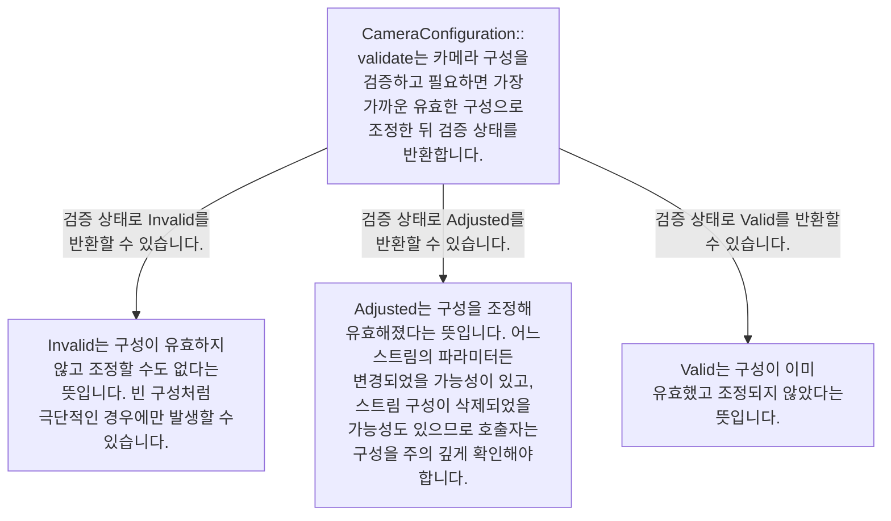
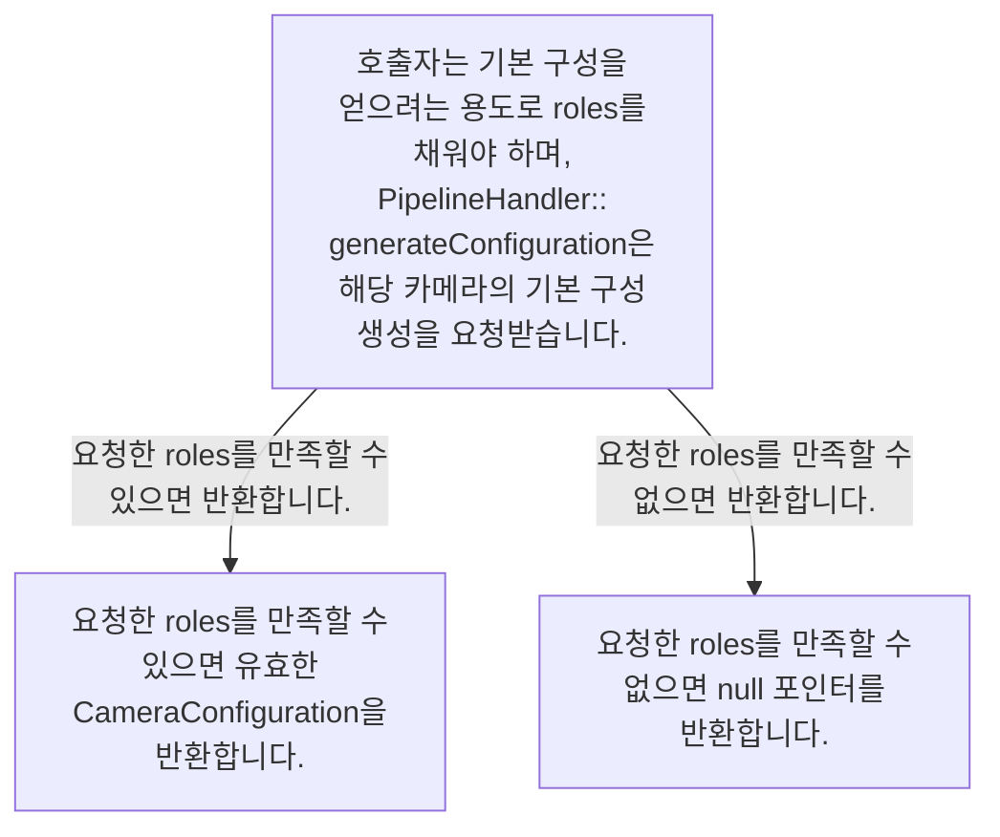
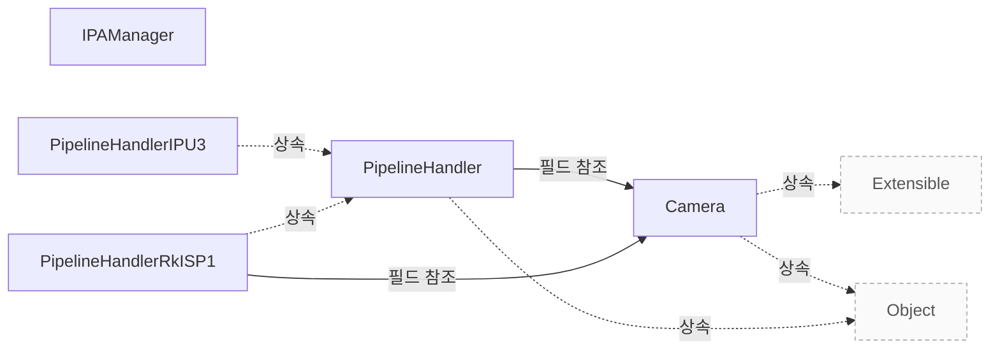

# 지원 범위와 검증

**지원 조건과 구성 제약을 확인하고 제품 도입 전에 검증할 범위를 정하세요.**

| 지금 확인할 내용 | 이동할 절 |
|---|---|
| 제품이 무엇이고 어디까지 지원하는지, 공통 설계가 구현자에게 해 주는 일을 확인하고 도입할 범위를 판단하세요. | [libcamera 제품 개요](vendor-overview.md) |
| 연동 순서와 구현 책임을 확인하고 설정·요청·정지 계약을 적용하세요. | [연동 가이드](vendor-integration.md) |
| 파이프라인 구현이 지켜야 하는 구성·요청·완료·종료 계약을 확인하세요. | [Pipeline Handler](pipeline-handler.md) |

## 지원 조건과 제약

`CameraConfiguration::Invalid`는 구성이 유효하지 않고 조정할 수 없음을 뜻하며, 구성이 비어 있는 경우와 같은 극단적인 경우에만 발생할 수 있습니다. `CameraConfiguration::Adjusted`는 구성이 조정되었으며 조정 후 유효함을 나타냅니다. `CameraConfiguration::validate()`가 `CameraConfiguration::Adjusted`를 반환한 경우 어느 스트림의 파라미터든 바뀌었을 수 있고 일부 스트림만 바뀌었을 수도 있으며, 스트림 구성이 삭제되었을 수도 있습니다. `CameraConfiguration::Adjusted`일 때 호출자는 구성을 주의 깊게 확인해야 합니다. `src/libcamera/camera.cpp:338`, `src/libcamera/camera.cpp:341`, `src/libcamera/camera.cpp:342`, `src/libcamera/camera.cpp:343`

<!-- sdd:visual:validation-results -->
### validate() 결과별 호출자의 책임



[Mermaid 원문](vendor-assurance.validation-results.mmd)

??? note "그림 근거와 확인 범위"
    validate()의 Invalid·Adjusted·Valid는 무엇을 뜻하며, Adjusted이면 호출자는 무엇을 다시 확인해야 합니까?
    
    소스에 연결한 설계 해석입니다. 자동 연결 검사는 의미 승인이나 기기 실행 검증이 아닙니다.
    
    LLM 그림 초안 · 사람 검토 전
    
    작성 모델: `cli/codex/gpt-6.1-terra`
    
    | 요소·전이 | 소스 근거 |
    |---|---|
    | <span data-sdd-label-en="CameraConfiguration::validate validates the camera configuration, may adjust it to the closest valid configuration, and returns the validation status.">CameraConfiguration::validate는 카메라 구성을 검증하고 필요하면 가장 가까운 유효한 구성으로 조정한 뒤 검증 상태를 반환합니다.</span> | [src/libcamera/camera.cpp:323](#source-2b31e92e3fb3f083) |
    | <span data-sdd-label-en="Invalid means the configuration is invalid and cannot be adjusted. It may occur only in extreme cases, such as an empty configuration.">Invalid는 구성이 유효하지 않고 조정할 수도 없다는 뜻입니다. 빈 구성처럼 극단적인 경우에만 발생할 수 있습니다.</span> | [src/libcamera/camera.cpp:323](#source-2b31e92e3fb3f083) |
    | <span data-sdd-label-en="Adjusted means the configuration was adjusted and is now valid. Parameters for any stream may have changed, and stream configurations may have been removed, so the caller must carefully check the configuration.">Adjusted는 구성을 조정해 유효해졌다는 뜻입니다. 어느 스트림의 파라미터든 변경되었을 가능성이 있고, 스트림 구성이 삭제되었을 가능성도 있으므로 호출자는 구성을 주의 깊게 확인해야 합니다.</span> | [src/libcamera/camera.cpp:323](#source-2b31e92e3fb3f083) |
    | <span data-sdd-label-en="Valid means the configuration was already valid and was not adjusted.">Valid는 구성이 이미 유효했고 조정되지 않았다는 뜻입니다.</span> | [src/libcamera/camera.cpp:323](#source-2b31e92e3fb3f083) |
    | <span data-sdd-label-en="It may return Invalid as the validation status.">검증 상태로 Invalid를 반환할 수 있습니다.</span> | [src/libcamera/camera.cpp:323](#source-2b31e92e3fb3f083) |
    | <span data-sdd-label-en="It may return Adjusted as the validation status.">검증 상태로 Adjusted를 반환할 수 있습니다.</span> | [src/libcamera/camera.cpp:323](#source-2b31e92e3fb3f083) |
    | <span data-sdd-label-en="It may return Valid as the validation status.">검증 상태로 Valid를 반환할 수 있습니다.</span> | [src/libcamera/camera.cpp:323](#source-2b31e92e3fb3f083) |
<!-- /sdd:visual:validation-results -->

<!-- sdd:visual:configuration-contract-validity -->
### 역할 기반 구성 생성의 반환 계약



[Mermaid 원문](vendor-assurance.configuration-contract-validity.mmd)

??? note "그림 근거와 확인 범위"
    PipelineHandler::generateConfiguration은 요청한 roles를 만족할 수 있을 때와 없을 때 무엇을 반환합니까?
    
    소스에 연결한 설계 해석입니다. 자동 연결 검사는 의미 승인이나 기기 실행 검증이 아닙니다.
    
    LLM 그림 초안 · 사람 검토 전
    
    작성 모델: `cli/codex/gpt-6.1-terra`
    
    | 요소·전이 | 소스 근거 |
    |---|---|
    | <span data-sdd-label-en="The caller must populate roles with the intended use cases; PipelineHandler::generateConfiguration is asked to generate a default configuration for the camera.">호출자는 기본 구성을 얻으려는 용도로 roles를 채워야 하며, PipelineHandler::generateConfiguration은 해당 카메라의 기본 구성 생성을 요청받습니다.</span> | [src/libcamera/pipeline_handler.cpp:271](#source-23ff032cd1152d56) |
    | <span data-sdd-label-en="If the requested roles can be satisfied, it returns a valid CameraConfiguration.">요청한 roles를 만족할 수 있으면 유효한 CameraConfiguration을 반환합니다.</span> | [src/libcamera/pipeline_handler.cpp:271](#source-23ff032cd1152d56) |
    | <span data-sdd-label-en="If the requested roles cannot be satisfied, it returns a null pointer.">요청한 roles를 만족할 수 없으면 null 포인터를 반환합니다.</span> | [src/libcamera/pipeline_handler.cpp:271](#source-23ff032cd1152d56) |
    | <span data-sdd-label-en="It returns this if the requested roles can be satisfied.">요청한 roles를 만족할 수 있으면 반환합니다.</span> | [src/libcamera/pipeline_handler.cpp:271](#source-23ff032cd1152d56) |
    | <span data-sdd-label-en="It returns this if the requested roles cannot be satisfied.">요청한 roles를 만족할 수 없으면 반환합니다.</span> | [src/libcamera/pipeline_handler.cpp:271](#source-23ff032cd1152d56) |
<!-- /sdd:visual:configuration-contract-validity -->

`CameraConfiguration::validate()`가 `CameraConfiguration::Valid`를 반환하면 원래 구성이 이미 유효했고 조정되지 않았음을 뜻합니다. `PipelineHandler::generateConfiguration()`은 `roles`로 요청한 스트림 역할을 충족할 수 있으면 유효한 `CameraConfiguration`을 반환하고, 충족할 수 없으면 `null` 포인터를 반환합니다. `PipelineHandler::configure()`에 전달되는 설정은 `CameraConfiguration::validate()`로 검증되어 있음이 보장되므로, 파이프라인 핸들러 구현자는 추가 검증을 해서는 안 됩니다. `PipelineHandler::configure()` 구현자는 구성에 성공하면 `0`을, 실패하면 음수 오류 코드를 반환해야 합니다. `src/libcamera/camera.cpp:323`, `src/libcamera/pipeline_handler.cpp:271`, `src/libcamera/pipeline_handler.cpp:304`, `src/libcamera/pipeline_handler.cpp:313`

근거 원문: [src/libcamera/camera.cpp:338](#source-60ab47044c6107c5) · [src/libcamera/camera.cpp:343](#source-e5758fc43bf244cd) · [src/libcamera/camera.cpp:323](#source-2b31e92e3fb3f083) · [src/libcamera/pipeline_handler.cpp:289](#source-4abbe39594a1bd27) · [src/libcamera/pipeline_handler.cpp:304](#source-31c5407347b4d0d8) · [src/libcamera/pipeline_handler.cpp:313](#source-f87ceb096b9f931d) · [src/libcamera/camera.cpp:341](#source-8b6aa81367245db5) · [src/libcamera/camera.cpp:342](#source-e13fede0aa40ada1) · [src/libcamera/pipeline_handler.cpp:271](#source-23ff032cd1152d56)

## 성능 근거를 읽는 기준

`DebayerCpu`의 내장 벤치마크는 통계를 수집하고 디베이어링하는 처리에 걸린 시간만 측정합니다. 프레임 캡처와 출력에 걸린 시간은 측정하지 않습니다. 이 벤치마크는 `Software ISP`를 사용하는 파이프라인에서 `cam` 또는 `qcam`을 실행하여 사용할 수 있습니다. `Documentation/software-isp-benchmarking.rst:15`

근거 원문: [Documentation/software-isp-benchmarking.rst:15](#source-551d2b5944a36d19)

??? note "설계 질문과 검증 범위"
    질문별 답변과 근거 연결을 검사했습니다. 의미와 실행 결과는 사람 검토가 필요합니다.
    
    | 설계 질문 | 설명 위치 | 확인 범위 |
    |---|---|---|
    | 지원 전제와 제약은 무엇이며 별도 검증할 항목은 무엇입니까? | [지원 조건과 제약](#지원-조건과-제약) | 코드 근거와 설명 연결 |
    | 참고 벤치마크가 측정하는 범위와 별도 제품 검증 범위는 무엇입니까? | [성능 근거를 읽는 기준](#성능-근거를-읽는-기준) | 코드 근거와 설명 연결 |

## 소스 근거

같은 발췌는 한 번만 싣습니다. 필요한 원문을 펼쳐 설명과 대조하세요.

<a id="source-60ab47044c6107c5"></a>

??? note "소스 근거: src/libcamera/camera.cpp:338"
    `src/libcamera/camera.cpp:338`에서 시작하는 발췌입니다. 종료 줄은 340이며, 아래 원문을 설명과 대조할 수 있습니다.
    
    SHA-256: `2247db4a7b9353362f9df6c84aaa5c2810dec4eaaae4b3b36d19c57e427f5790`
    
    ```text
    \retval CameraConfiguration::Invalid The configuration is invalid and can't
     * be adjusted. This may only occur in extreme cases such as when the
     * configuration is empty.
    ```

<a id="source-e5758fc43bf244cd"></a>

??? note "소스 근거: src/libcamera/camera.cpp:343"
    `src/libcamera/camera.cpp:343`에서 시작하는 발췌입니다. 종료 줄은 344이며, 아래 원문을 설명과 대조할 수 있습니다.
    
    SHA-256: `f2efdb13d4f1bd8dd432fb0badb987eab0cc484fe8ecb30b7ea9d47c0126590c`
    
    ```text
    The caller shall check the
     * configuration carefully.
    ```

<a id="source-2b31e92e3fb3f083"></a>

??? note "소스 근거: src/libcamera/camera.cpp:323"
    `src/libcamera/camera.cpp:323`에서 시작하는 발췌입니다. 종료 줄은 346이며, 아래 원문을 설명과 대조할 수 있습니다.
    
    SHA-256: `86bf9109257512866bf70a5d42cd3da29c70d851d871f0e496058141ba377623`
    
    ```text
    \fn CameraConfiguration::validate()
     * \brief Validate and possibly adjust the camera configuration
     *
     * This function adjusts the camera configuration to the closest valid
     * configuration and returns the validation status.
     *
     * \todo Define exactly when to return each status code. Should stream
     * parameters set to 0 by the caller be adjusted without returning Adjusted ?
     * This would potentially be useful for applications but would get in the way
     * in Camera::configure(). Do we need an extra status code to signal this ?
     *
     * \todo Handle validation of buffers count when refactoring the buffers API.
     *
     * \return A CameraConfiguration::Status value that describes the validation
     * status.
     * \retval CameraConfiguration::Invalid The configuration is invalid and can't
     * be adjusted. This may only occur in extreme cases such as when the
     * configuration is empty.
     * \retval CameraConfiguration::Adjusted The configuration has been adjusted
     * and is now valid. Parameters may have changed for any stream, and stream
     * configurations may have been removed. The caller shall check the
     * configuration carefully.
     * \retval CameraConfiguration::Valid The configuration was already valid and
     * hasn't been adjusted.
    ```

<a id="source-4abbe39594a1bd27"></a>

??? note "소스 근거: src/libcamera/pipeline_handler.cpp:289"
    `src/libcamera/pipeline_handler.cpp:289`에서 시작하는 발췌입니다. 종료 줄은 290이며, 아래 원문을 설명과 대조할 수 있습니다.
    
    SHA-256: `b86c8678b02e96936d80626cefebf3811b6a991b459074e51c9f0e08457ff369`
    
    ```text
    \return A valid CameraConfiguration if the requested roles can be satisfied,
     * or a null pointer otherwise.
    ```

<a id="source-31c5407347b4d0d8"></a>

??? note "소스 근거: src/libcamera/pipeline_handler.cpp:304"
    `src/libcamera/pipeline_handler.cpp:304`에서 시작하는 발췌입니다. 종료 줄은 306이며, 아래 원문을 설명과 대조할 수 있습니다.
    
    SHA-256: `625bd787da81f9407ba9e746d4939d93b7172a26642429bcfd3300aa6187675f`
    
    ```text
    The configuration is guaranteed to have been validated with
     * CameraConfiguration::validate(). The pipeline handler implementation shall
     * not perform further validation
    ```

<a id="source-f87ceb096b9f931d"></a>

??? note "소스 근거: src/libcamera/pipeline_handler.cpp:313"
    `src/libcamera/pipeline_handler.cpp:313`에서 시작하는 발췌입니다. 종료 줄은 315이며, 아래 원문을 설명과 대조할 수 있습니다.
    
    SHA-256: `6e139b3c50660a7111d84bd00cfd17078b8b45d4a07688fa64b2d8af9ce52a22`
    
    ```text
    \context This function is called from the CameraManager thread.
     *
     * \return 0 on success or a negative error code otherwise
    ```

<a id="source-8b6aa81367245db5"></a>

??? note "소스 근거: src/libcamera/camera.cpp:341"
    `src/libcamera/camera.cpp:341`에서 시작하는 발췌입니다. 종료 줄은 342이며, 아래 원문을 설명과 대조할 수 있습니다.
    
    SHA-256: `bc530fdf77cefda77bfd8ae1cadf7df4edea81ddfce01bef24867681b29655f6`
    
    ```text
    \retval CameraConfiguration::Adjusted The configuration has been adjusted
     * and is now valid.
    ```

<a id="source-e13fede0aa40ada1"></a>

??? note "소스 근거: src/libcamera/camera.cpp:342"
    `src/libcamera/camera.cpp:342`에서 시작하는 발췌입니다. 종료 줄은 343이며, 아래 원문을 설명과 대조할 수 있습니다.
    
    SHA-256: `7c0debb896b6072c0bc59cf3589fbc49b607f915d96f30182d4e02038b94c156`
    
    ```text
    Parameters may have changed for any stream, and stream
     * configurations may have been removed.
    ```

<a id="source-23ff032cd1152d56"></a>

??? note "소스 근거: src/libcamera/pipeline_handler.cpp:271"
    `src/libcamera/pipeline_handler.cpp:271`에서 시작하는 발췌입니다. 종료 줄은 291이며, 아래 원문을 설명과 대조할 수 있습니다.
    
    SHA-256: `c1f4cc7aeedfc57e2bc5ebd6825a77f605173b44f7fde564aebc01bb013119cf`
    
    ```text
    \fn PipelineHandler::generateConfiguration()
     * \brief Generate a camera configuration for a specified camera
     * \param[in] camera The camera to generate a default configuration for
     * \param[in] roles A list of stream roles
     *
     * Generate a default configuration for the \a camera for a specified list of
     * stream roles. The caller shall populate the \a roles with the use-cases it
     * wishes to fetch the default configuration for. The returned configuration
     * can then be examined by the caller to learn about the selected streams and
     * their default parameters.
     *
     * The intended companion to this is \a configure() which can be used to change
     * the group of streams parameters.
     *
     * \context This function may be called from any thread and shall be
     * \threadsafe. It shall not modify the state of the \a camera in the pipeline
     * handler.
     *
     * \return A valid CameraConfiguration if the requested roles can be satisfied,
     * or a null pointer otherwise.
     */
    ```

<a id="source-551d2b5944a36d19"></a>

??? note "소스 근거: Documentation/software-isp-benchmarking.rst:15"
    `Documentation/software-isp-benchmarking.rst:15`에서 시작하는 발췌입니다. 종료 줄은 20이며, 아래 원문을 설명과 대조할 수 있습니다.
    
    SHA-256: `907d979f60258b4572a0557b6054ec814990084ca3e69a291317855a3b27084d`
    
    ```text
    The DebayerCpu class has a builtin benchmark. This benchmark measures the time
    spent on processing (collecting statistics and debayering) only, it does not
    measure the time spent on capturing or outputting the frames.
    
    The builtin benchmark always runs. So this can be used by simply running "cam"
    or "qcam" with a pipeline using the Software ISP.
    ```


<!-- sdd:class-diagram -->
## 클래스 관계

화살표의 글자는 추출한 관계를 나타내며, 점선은 상속입니다. 화살표는 참조 대상 또는 기반 클래스를 향합니다. 호출 순서를 뜻하지 않습니다.


<!-- /sdd:class-diagram -->

??? note "근거와 검토 정보"
    - 생성 방식: 추출 사실과 LLM 설명
    - 검증 범위: 표·그림은 facts로 만들고 설명은 LLM이 작성합니다. 인용·문장 및 설정된 구조 검사를 적용합니다.
    - 근거 파일: `Documentation/software-isp-benchmarking.rst`, `include/libcamera/camera.h`, `include/libcamera/internal/ipa_manager.h`, `include/libcamera/internal/pipeline_handler.h`, `src/libcamera/camera.cpp`, `src/libcamera/ipa_manager.cpp`, `src/libcamera/pipeline/ipu3/ipu3.cpp`, `src/libcamera/pipeline/rkisp1/rkisp1.cpp`, `src/libcamera/pipeline_handler.cpp`
    - 근거 수준: 코드 확인 (정적 분석, simple_compdb 구성, commit `293d751a81`)
    - 자동 검사 (인용·문장 및 설정된 구조 검사): 통과
    - 검토 상태 기록일: 2026-11-05 · 사람 검토 전

다음 단계: [요청 처리와 문제 진단](request-lifecycle.md)
