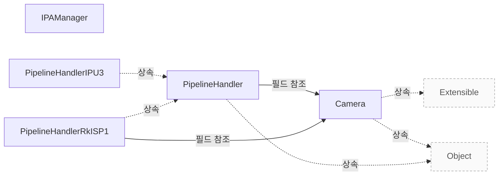

# 연동 가이드

**연동 순서와 구현 책임을 확인하고 설정·요청·정지 계약을 적용하세요.**

| 지금 확인할 내용 | 이동할 절 |
|---|---|
| libcamera 제품 개요에서 필요한 내용을 확인합니다. | [libcamera 제품 개요](vendor-overview.md) |
| 지원 범위와 검증에서 필요한 내용을 확인합니다. | [지원 범위와 검증](vendor-assurance.md) |
| 장치별 파이프라인을 구현합니다. | [Pipeline Handler](pipeline-handler.md) |

## 연동 순서와 책임

애플리케이션 연동은 카메라 확보, 구성, 시작, 요청 처리, 정지, 해제 순서로 진행합니다. `Camera`를 해제하기 전에는 시작과 정지를 여러 번 수행하거나 다시 구성할 수 있습니다. `Camera`의 상태 변경 함수는 일반적으로 서로 동기화되지 않으므로 필요한 동기화는 호출자가 담당합니다. `src/libcamera/camera.cpp:752`

하드웨어를 추가하는 Vendor는 `PipelineHandler::match()`를 구현해 한 파이프라인에 필요한 장치를 확보하고 `Camera`를 `CameraManager`에 등록합니다. 필요한 장치를 모두 확보하지 못하면 확보한 장치를 해제하고 false를 반환해야 합니다. 애플리케이션의 카메라 사용 순서와 장치 구현자의 등록 책임은 구분해야 합니다. `src/libcamera/pipeline_handler.cpp:86`

근거 원문: [src/libcamera/camera.cpp:752](#source-8264067114dccdee) · [src/libcamera/pipeline_handler.cpp:86](#source-5bbd41c1e725138c)

## 하드웨어와 공통 계층의 경계

`CameraManager`는 `CameraManager` 스레드에서 `PipelineHandler::match()`를 호출합니다. 구현자는 한 파이프라인에 필요한 미디어 장치를 확보하고 하나 이상의 `Camera`를 생성해 `CameraManager`에 등록해야 합니다. `src/libcamera/pipeline_handler.cpp:86`

`PipelineHandler::match()`는 필요한 모든 장치를 찾으면 `MediaDevice::acquire()`로 확보하고 `Camera`를 내부에 보관한 뒤 true를 반환해야 합니다. 장치를 모두 찾지 못하면 아무 장치도 확보하지 않거나 이미 확보한 장치를 `MediaDevice::release()`로 해제한 뒤 false를 반환해야 합니다. `src/libcamera/pipeline_handler.cpp:86`

`PipelineHandler::match()`가 true를 반환하면 새 파이프라인 핸들러 인스턴스에서 매칭을 다시 시도합니다. 여러 파이프라인 인스턴스가 있는 시스템에서는 한 호출이 한 인스턴스의 장치만 확보하고, 호환되는 장치가 소진될 때까지 이 과정이 이어집니다. `src/libcamera/pipeline_handler.cpp:86`

근거 원문: [src/libcamera/pipeline_handler.cpp:86](#source-5bbd41c1e725138c)

## 구현할 설정 인터페이스

`PipelineHandler::generateConfiguration()`의 호출자는 camera와 원하는 스트림 용도 목록인 roles를 전달합니다. 구현자는 용도를 충족하는 유효한 `CameraConfiguration`을 반환하거나, 충족할 수 없으면 null 포인터를 반환해야 합니다. 이 함수는 어느 스레드에서 호출해도 안전해야 하며 파이프라인 안의 카메라 상태를 변경해서는 안 됩니다. `src/libcamera/pipeline_handler.cpp:271`

`PipelineHandler::configure()`는 `CameraManager` 스레드에서 호출되며, 애플리케이션의 구성을 `Camera`를 통해 전달받습니다. 입력은 `CameraConfiguration::validate()`로 이미 검증되었으므로 구현자는 추가 검증을 하지 않고, 파생 구성 클래스에 저장된 사용자 정의 필드를 이용할 수 있습니다. `src/libcamera/pipeline_handler.cpp:271`

`PipelineHandler::configure()`의 구현자는 각 `StreamConfiguration` 항목에 `StreamConfiguration::setStream()`으로 `Stream`을 연결해야 합니다. 성공 시 0을 반환하고 실패 시 음수 오류 코드를 반환해야 합니다. `src/libcamera/pipeline_handler.cpp:271`

근거 원문: [src/libcamera/pipeline_handler.cpp:271](#source-c81d81d5cce53ab8)

## 요청을 장치에 전달하고 반환하기

`PipelineHandler::queueRequestDevice()`는 스트림에 연결된 버퍼와 파라미터를 담은 요청을 받습니다. 구현자는 해당 버퍼에 캡처되는 프레임에 요청 파라미터가 적용되도록 장치를 설정해야 합니다. `CameraManager` 스레드에서 호출되며 성공 시 0, 실패 시 음수 오류 코드를 반환하는 계약입니다. `src/libcamera/pipeline_handler.cpp:530`

`PipelineHandler::completeBuffer()`는 버퍼 완료를 애플리케이션에 알리고 요청 내부의 버퍼 추적을 갱신합니다. 모든 버퍼가 완료되면 true를 반환하지만 마지막 버퍼의 완료가 요청을 자동 완료하지는 않습니다. 구현자는 남은 처리를 마친 뒤 completeRequest()를 명시적으로 호출해야 하며, completeBuffer()도 `CameraManager` 스레드에서 호출해야 합니다. `src/libcamera/pipeline_handler.cpp:547`

근거 원문: [src/libcamera/pipeline_handler.cpp:530](#source-bc9c2a42b4251ab0) · [src/libcamera/pipeline_handler.cpp:547](#source-ca3f659653ce3f6a)

## IPA 모듈 선택과 실패 조건

`IPAManager::createIPA()`는 이름과 최소·최대 버전으로 module()을 호출해 모듈을 찾습니다. 모듈을 찾지 못하면 nullptr를 반환합니다. `include/libcamera/internal/ipa_manager.h:35`

`IPAManager::createIPA()`는 isSignatureValid()가 참이면 Threaded 프록시를, 거짓이면 Isolated 프록시를 생성합니다. 서명 판정이 거짓이라는 이유만으로 바로 실패하지는 않습니다. `include/libcamera/internal/ipa_manager.h:35`

`IPAManager::createIPA()`는 생성된 프록시의 isValid()가 거짓이면 오류를 기록하고 nullptr를 반환합니다. 유효하면 생성된 프록시를 반환합니다. `include/libcamera/internal/ipa_manager.h:35`

근거 원문: [include/libcamera/internal/ipa_manager.h:35](#source-1bc92c4993a1c4dc)

## 정지와 오류 처리의 책임

`PipelineHandler::stop()`은 먼저 준비 대기 요청을 별도 큐로 옮긴 뒤 stopDevice()를 호출합니다. stopDevice() 안에서 completeRequest()가 호출되어도 대기 요청이 다시 장치로 제출되지 않도록 하는 순서입니다. `src/libcamera/pipeline_handler.cpp:359`

장치별 `PipelineHandler::stopDevice()`는 캡처와 요청 처리를 중단하고, 남은 요청을 취소하여 오류 상태로 완료해야 합니다. 이 계약은 각 장치 구현에서 지켜야 할 의무입니다. `src/libcamera/pipeline_handler.cpp:359`

`PipelineHandler::stop()`은 장치 정지 후 별도 큐의 대기 요청을 취소하고 doQueueRequest()로 넘깁니다. 이 경로는 요청에 순번을 부여하고 queuedRequests_에 잠시 넣어 completeRequest()로 순서에 맞게 완료하기 위한 처리입니다. `src/libcamera/pipeline_handler.cpp:359`

`PipelineHandler::stop()`은 queuedRequests_와 waitingRequests_가 비었는지 ASSERT로 확인한 뒤 requestSequence_를 0으로 되돌립니다. 이 검사가 있다는 사실만으로 모든 장치 구현의 종료 동작이 검증되었다고 볼 수는 없습니다. `src/libcamera/pipeline_handler.cpp:359`

근거 원문: [src/libcamera/pipeline_handler.cpp:359](#source-eefd1bbecb1aad0a)

## 구현 뒤 확인할 계약과 실행 한계

장치 구현자는 `PipelineHandler::completeRequest()`가 반환된 뒤 해당 요청에 접근해서는 안 됩니다. 이 시점부터 요청은 파이프라인 핸들러가 관리하지 않으므로, 연동 검증에서는 완료 통지 후 요청을 사용하는 경로가 없는지 확인해야 합니다. `src/libcamera/pipeline_handler.cpp:571`

`PipelineHandler::completeRequest()`는 완료된 요청을 어떤 순서로 받아도 애플리케이션에는 제출 순서대로 돌려주는 계약입니다. `CameraManager` 스레드에서 호출해야 하며, 장치별 완료 순서가 바뀌는 경우에도 반환 순서가 유지되는지는 별도 실행 확인 대상입니다. 이 문서는 해당 기기의 실행 시험 결과를 제공하지 않습니다. `src/libcamera/pipeline_handler.cpp:571`

근거 원문: [src/libcamera/pipeline_handler.cpp:571](#source-7ac40780a56ae3a9)

??? note "설계 질문과 검증 범위"
    질문별 답변과 근거 연결을 검사했습니다. 의미와 실행 결과는 사람 검토가 필요합니다.
    
    | 설계 질문 | 설명 위치 | 확인 범위 |
    |---|---|---|
    | 연동을 시작할 순서와 제공 측·Vendor의 구현 책임은 무엇입니까? | [연동 순서와 책임](#연동-순서와-책임) | 코드 근거와 설명 연결 |
    | 하드웨어의 장치 매칭과 카메라 등록은 누가 구현합니까? | [하드웨어와 공통 계층의 경계](#하드웨어와-공통-계층의-경계) | 코드 근거와 설명 연결 |
    | 스트림 구성 구현은 어떤 입력과 출력 계약을 지킵니까? | [구현할 설정 인터페이스](#구현할-설정-인터페이스) | 코드 근거와 설명 연결 |
    | 공통 큐와 하드웨어 구현은 요청 처리 책임을 어떻게 나눕니까? | [요청을 장치에 전달하고 반환하기](#요청을-장치에-전달하고-반환하기) | 코드 근거와 설명 연결 |
    | IPA 모듈과 실행 방식은 어떻게 선택되며 언제 생성에 실패합니까? | [IPA 모듈 선택과 실패 조건](#ipa-모듈-선택과-실패-조건) | 코드 근거와 설명 연결 |
    | 정지 시 공통 코드와 하드웨어 구현은 무엇을 끝내야 합니까? | [정지와 오류 처리의 책임](#정지와-오류-처리의-책임) | 코드 근거와 설명 연결 |
    | 코드 계약과 별도 실행 검증 항목은 무엇입니까? | [구현 뒤 확인할 계약과 실행 한계](#구현-뒤-확인할-계약과-실행-한계) | 코드 근거와 설명 연결 |

## 소스 근거

같은 발췌는 한 번만 싣습니다. 필요한 원문을 펼쳐 설명과 대조하세요.

<a id="source-8264067114dccdee"></a>

??? note "소스 근거: src/libcamera/camera.cpp:752"
    `src/libcamera/camera.cpp:752`에서 시작하는 발췌입니다. 종료 줄은 784이며, 아래 원문을 설명과 대조할 수 있습니다.
    
    SHA-256: `325c2af6569c185be1bc686e1fb6d161782dcbc8db34a0fbb719cff005ba7625`
    
    ```text
    \class Camera
     * \brief Camera device
     *
     * \todo Add documentation for camera start timings. What exactly does the
     * camera expect the pipeline handler to do when start() is called?
     *
     * The Camera class models a camera capable of producing one or more image
     * streams from a single image source. It provides the main interface to
     * configuring and controlling the device, and capturing image streams. It is
     * the central object exposed by libcamera.
     *
     * To support the central nature of Camera objects, libcamera manages the
     * lifetime of camera instances with std::shared_ptr<>. Instances shall be
     * created with the create() function which returns a shared pointer. The
     * Camera constructors and destructor are private, to prevent instances from
     * being constructed and destroyed manually.
     *
     * \section camera_operation Operating the Camera
     *
     * An application needs to perform a sequence of operations on a camera before
     * it is ready to process requests. The camera needs to be acquired and
     * configured to prepare the camera for capture. Once started the camera can
     * process requests until it is stopped. When an application is done with a
     * camera, the camera needs to be released.
     *
     * An application may start and stop a camera multiple times as long as it is
     * not released. The camera may also be reconfigured.
     *
     * Functions that affect the camera state as defined below are generally not
     * synchronized with each other by the Camera class. The caller is responsible
     * for ensuring their synchronization if necessary.
     *
     * \subsection Camera States
    ```

<a id="source-5bbd41c1e725138c"></a>

??? note "소스 근거: src/libcamera/pipeline_handler.cpp:86"
    `src/libcamera/pipeline_handler.cpp:86`에서 시작하는 발췌입니다. 종료 줄은 119이며, 아래 원문을 설명과 대조할 수 있습니다.
    
    SHA-256: `7dde6563cf6bda32f38f4c1fb3ef0443502432236a0222d4f811b3fa71f3fc05`
    
    ```text
    \fn PipelineHandler::match(DeviceEnumerator *enumerator)
     * \brief Match media devices and create camera instances
     * \param[in] enumerator The enumerator providing all media devices found in the
     * system
     *
     * This function is the main entry point of the pipeline handler. It is called
     * by the camera manager with the \a enumerator passed as an argument. It shall
     * acquire from the \a enumerator all the media devices it needs for a single
     * pipeline, create one or multiple Camera instances and register them with the
     * camera manager.
     *
     * If all media devices needed by the pipeline handler are found, they must all
     * be acquired by a call to MediaDevice::acquire(). This function shall then
     * create the corresponding Camera instances, store them internally, and return
     * true. Otherwise it shall not acquire any media device (or shall release all
     * the media devices is has acquired by calling MediaDevice::release()) and
     * return false.
     *
     * If multiple instances of a pipeline are available in the system, the
     * PipelineHandler class will be instantiated once per instance, and its match()
     * function called for every instance. Each call shall acquire media devices for
     * one pipeline instance, until all compatible media devices are exhausted.
     *
     * If this function returns true, a new instance of the pipeline handler will
     * be created and its match() function called.
     *
     * \context This function is called from the CameraManager thread.
     *
     * \return true if media devices have been acquired and camera instances
     * created, or false otherwise
     */
    
    /**
     * \brief Search and acquire a MediaDevice
    ```

<a id="source-c81d81d5cce53ab8"></a>

??? note "소스 근거: src/libcamera/pipeline_handler.cpp:271"
    `src/libcamera/pipeline_handler.cpp:271`에서 시작하는 발췌입니다. 종료 줄은 319이며, 아래 원문을 설명과 대조할 수 있습니다.
    
    SHA-256: `5284e6062c894a77328b372676c42c1c97a4a01f9b2dccc4d09c83b2578b0e20`
    
    ```text
    \fn PipelineHandler::generateConfiguration()
     * \brief Generate a camera configuration for a specified camera
     * \param[in] camera The camera to generate a default configuration for
     * \param[in] roles A list of stream roles
     *
     * Generate a default configuration for the \a camera for a specified list of
     * stream roles. The caller shall populate the \a roles with the use-cases it
     * wishes to fetch the default configuration for. The returned configuration
     * can then be examined by the caller to learn about the selected streams and
     * their default parameters.
     *
     * The intended companion to this is \a configure() which can be used to change
     * the group of streams parameters.
     *
     * \context This function may be called from any thread and shall be
     * \threadsafe. It shall not modify the state of the \a camera in the pipeline
     * handler.
     *
     * \return A valid CameraConfiguration if the requested roles can be satisfied,
     * or a null pointer otherwise.
     */
    
    /**
     * \fn PipelineHandler::configure()
     * \brief Configure a group of streams for capture
     * \param[in] camera The camera to configure
     * \param[in] config The camera configurations to setup
     *
     * Configure the specified group of streams for \a camera according to the
     * configuration specified in \a config. The intended caller of this interface
     * is the Camera class which will receive configuration to apply from the
     * application.
     *
     * The configuration is guaranteed to have been validated with
     * CameraConfiguration::validate(). The pipeline handler implementation shall
     * not perform further validation and may rely on any custom field stored in its
     * custom CameraConfiguration derived class.
     *
     * When configuring the camera the pipeline handler shall associate a Stream
     * instance to each StreamConfiguration entry in the CameraConfiguration using
     * the StreamConfiguration::setStream() function.
     *
     * \context This function is called from the CameraManager thread.
     *
     * \return 0 on success or a negative error code otherwise
     */
    
    /**
     * \fn PipelineHandler::exportFrameBuffers()
    ```

<a id="source-bc9c2a42b4251ab0"></a>

??? note "소스 근거: src/libcamera/pipeline_handler.cpp:530"
    `src/libcamera/pipeline_handler.cpp:530`에서 시작하는 발췌입니다. 종료 줄은 547이며, 아래 원문을 설명과 대조할 수 있습니다.
    
    SHA-256: `7d7f109ecf4060457991bc81649c0ee7f886ede0a6c0140152f06e70e1d84f00`
    
    ```text
    \fn PipelineHandler::queueRequestDevice()
     * \brief Queue a request to the device
     * \param[in] camera The camera to queue the request to
     * \param[in] request The request to queue
     *
     * This function queues a capture request to the device for processing. The
     * request contains a set of buffers associated with streams and a set of
     * parameters. The pipeline handler shall program the device to ensure that the
     * parameters will be applied to the frames captured in the buffers provided in
     * the request.
     *
     * \context This function is called from the CameraManager thread.
     *
     * \return 0 on success or a negative error code otherwise
     */
    
    /**
     * \brief Complete a buffer for a request
    ```

<a id="source-ca3f659653ce3f6a"></a>

??? note "소스 근거: src/libcamera/pipeline_handler.cpp:547"
    `src/libcamera/pipeline_handler.cpp:547`에서 시작하는 발췌입니다. 종료 줄은 563이며, 아래 원문을 설명과 대조할 수 있습니다.
    
    SHA-256: `49b0139e3f0f620c0a3c044caf699179753dddf1b896d48de417c338bbae6a22`
    
    ```text
    \brief Complete a buffer for a request
     * \param[in] request The request the buffer belongs to
     * \param[in] buffer The buffer that has completed
     *
     * This function shall be called by pipeline handlers to signal completion of
     * the \a buffer part of the \a request. It notifies applications of buffer
     * completion and updates the request's internal buffer tracking. The request
     * is not completed automatically when the last buffer completes to give
     * pipeline handlers a chance to perform any operation that may still be
     * needed. They shall complete requests explicitly with completeRequest().
     *
     * \context This function shall be called from the CameraManager thread.
     *
     * \return True if all buffers contained in the request have completed, false
     * otherwise
     */
    bool PipelineHandler::completeBuffer
    ```

<a id="source-1bc92c4993a1c4dc"></a>

??? note "소스 근거: include/libcamera/internal/ipa_manager.h:35"
    `include/libcamera/internal/ipa_manager.h:35`에서 시작하는 발췌입니다. 종료 줄은 56이며, 아래 원문을 설명과 대조할 수 있습니다.
    
    SHA-256: `a8677961db1bb04a435196457a57d7f77bfdce934023d68a657a72bf3d468abf`
    
    ```text
    template<typename T>
    	std::unique_ptr<T> createIPA(const char *name, uint32_t minVersion,
    				     uint32_t maxVersion)
    	{
    		IPAModule *m = module(name, minVersion, maxVersion);
    		if (!m)
    			return nullptr;
    
    		auto proxy = [&]() -> std::unique_ptr<T> {
    			if (isSignatureValid(m))
    				return std::make_unique<typename T::Threaded>(m, cm_);
    			else
    				return std::make_unique<typename T::Isolated>(m, cm_);
    		}();
    
    		if (!proxy->isValid()) {
    			LOG(IPAManager, Error) << "Failed to load proxy";
    			return nullptr;
    		}
    
    		return proxy;
    	}
    ```

<a id="source-eefd1bbecb1aad0a"></a>

??? note "소스 근거: src/libcamera/pipeline_handler.cpp:359"
    `src/libcamera/pipeline_handler.cpp:359`에서 시작하는 발췌입니다. 종료 줄은 414이며, 아래 원문을 설명과 대조할 수 있습니다.
    
    SHA-256: `108b1bea5a8314ba57213d15c1e3ba01abe2b3f8a9e0e1e1281864b5492c7304`
    
    ```text
    \brief Stop capturing from all running streams and cancel pending requests
     * \param[in] camera The camera to stop
     *
     * This function stops capturing and processing requests immediately. All
     * pending requests are cancelled and complete immediately in an error state.
     *
     * \context This function is called from the CameraManager thread.
     */
    void PipelineHandler::stop(Camera *camera)
    {
    	/*
    	 * Take all waiting requests so that they are not requeued in response
    	 * to completeRequest() being called inside stopDevice(). Cancel them
    	 * after the device to keep them in order.
    	 */
    	Camera::Private *data = camera->_d();
    	std::queue<Request *> waitingRequests;
    	waitingRequests.swap(data->waitingRequests_);
    
    	/* Stop the pipeline handler and let the queued requests complete. */
    	stopDevice(camera);
    
    	/* Cancel and signal as complete all waiting requests. */
    	while (!waitingRequests.empty()) {
    		Request *request = waitingRequests.front();
    		waitingRequests.pop();
    
    		/*
    		 * Cancel all requests by marking them as cancelled and calling
    		 * doQueueRequest() instead of cancelRequest(). This ensures
    		 * that the requests get a sequence number and are temporarily
    		 * added to queuedRequests_ so they can be properly completed in
    		 * completeRequest().
    		 */
    		request->_d()->cancel();
    		doQueueRequest(request);
    	}
    
    	/* Make sure no requests are pending. */
    	ASSERT(data->queuedRequests_.empty());
    	ASSERT(data->waitingRequests_.empty());
    
    	data->requestSequence_ = 0;
    }
    
    /**
     * \fn PipelineHandler::stopDevice()
     * \brief Stop capturing from all running streams
     * \param[in] camera The camera to stop
     *
     * This function stops capturing and processing requests immediately. All
     * pending requests are cancelled and complete immediately in an error state.
     */
    
    /**
     * \brief Determine if the camera has any requests pending
    ```

<a id="source-7ac40780a56ae3a9"></a>

??? note "소스 근거: src/libcamera/pipeline_handler.cpp:571"
    `src/libcamera/pipeline_handler.cpp:571`에서 시작하는 발췌입니다. 종료 줄은 584이며, 아래 원문을 설명과 대조할 수 있습니다.
    
    SHA-256: `25903b4c6a305017b96bfe9117fe2b7b917b51fbeb2fd21139700b1fbf6a4fe2`
    
    ```text
    \brief Signal request completion
     * \param[in] request The request that has completed
     *
     * The pipeline handler shall call this function to notify the \a camera that
     * the request has completed. The request is no longer managed by the pipeline
     * handler and shall not be accessed once this function returns.
     *
     * This function ensures that requests will be returned to the application in
     * submission order, the pipeline handler may call it on any complete request
     * without any ordering constraint.
     *
     * \context This function shall be called from the CameraManager thread.
     */
    void PipelineHandler::completeRequest
    ```


<!-- sdd:class-diagram -->
## 클래스 관계

화살표의 글자는 추출한 관계를 나타내며, 점선은 상속입니다. 화살표는 참조 대상 또는 기반 클래스를 향합니다. 호출 순서를 뜻하지 않습니다.


<!-- /sdd:class-diagram -->

??? note "근거와 검토 정보"
    - 생성 방식: 추출 사실과 LLM 설명
    - 검증 범위: 표·그림은 facts로 만들고 설명은 LLM이 작성합니다. 인용·문장 및 설정된 구조 검사를 적용합니다.
    - 근거 파일: `include/libcamera/camera.h`, `include/libcamera/internal/ipa_manager.h`, `include/libcamera/internal/pipeline_handler.h`, `src/libcamera/camera.cpp`, `src/libcamera/ipa_manager.cpp`, `src/libcamera/pipeline/ipu3/ipu3.cpp`, `src/libcamera/pipeline/rkisp1/rkisp1.cpp`, `src/libcamera/pipeline_handler.cpp`
    - 근거 수준: 코드 확인 (정적 분석, simple_compdb 구성, commit `2c4b67c079`)
    - 자동 검사 (인용·문장 및 설정된 구조 검사): 통과
    - 검토 상태 기록일: 2026-10-25 · 사람 검토 전

다음 단계: [지원 범위와 검증](vendor-assurance.md)
