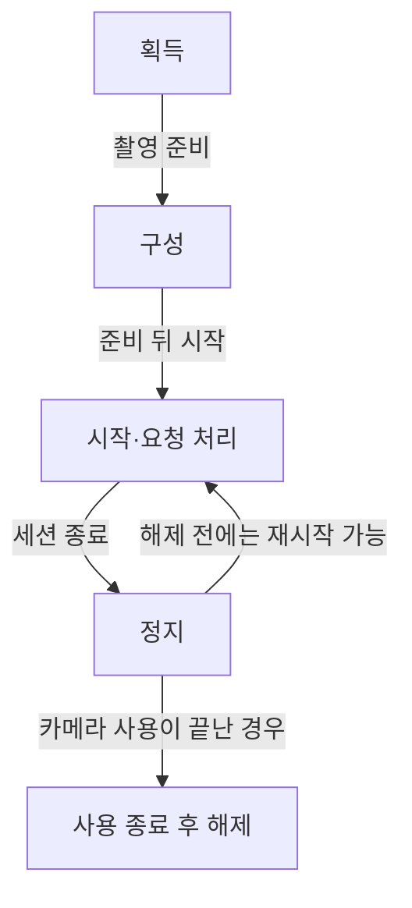
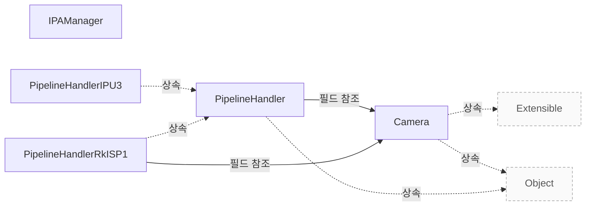

# 연동 가이드

**연동 순서와 구현 책임을 확인하고 설정·요청·정지 계약을 적용하세요.**

| 지금 확인할 내용 | 이동할 절 |
|---|---|
| 제품이 무엇이고 어디까지 지원하는지, 공통 설계가 구현자에게 해 주는 일을 확인하고 도입할 범위를 판단하세요. | [libcamera 제품 개요](vendor-overview.md) |
| 지원 조건과 구성 제약을 확인하고 제품 도입 전에 검증할 범위를 정하세요. | [지원 범위와 검증](vendor-assurance.md) |
| 파이프라인 구현이 지켜야 하는 구성·요청·완료·종료 계약을 확인하세요. | [Pipeline Handler](pipeline-handler.md) |

## 연동 순서와 책임

애플리케이션은 촬영을 준비하기 위해 카메라를 확보하고 구성한 뒤 시작해야 하며, 시작된 카메라는 정지할 때까지 요청을 처리할 수 있고, 애플리케이션은 사용을 마치면 카메라를 해제해야 합니다. 애플리케이션은 카메라를 해제하지 않은 동안 여러 번 시작하고 정지할 수 있으며, 카메라를 재구성할 수도 있습니다. `Camera` 클래스는 카메라 상태에 영향을 주는 함수들을 일반적으로 서로 동기화하지 않으므로, 필요한 경우 호출자가 이 함수들의 동기화를 책임져야 합니다. `src/libcamera/camera.cpp:771`, `src/libcamera/camera.cpp:777`, `src/libcamera/camera.cpp:780`

<!-- sdd:visual:integration-stages -->
### 획득부터 해제까지의 연동 순서

애플리케이션의 세션 준비와 종료 순서입니다. 시작·정지는 해제 전까지 반복할 수 있습니다.



[Mermaid 원문](vendor-integration.integration-stages.mmd)

??? note "그림 근거와 확인 범위"
    소스에 연결한 설계 해석입니다. 자동 연결 검사는 의미 승인이나 기기 실행 검증이 아닙니다.
    
    | 요소·전이 | 소스 근거 |
    |---|---|
    | 획득 | [src/libcamera/camera.cpp:771](#source-2683b4a5a1dbfee9) |
    | 구성 | [src/libcamera/camera.cpp:771](#source-2683b4a5a1dbfee9) |
    | 시작·요청 처리 | [src/libcamera/camera.cpp:771](#source-2683b4a5a1dbfee9) |
    | 정지 | [src/libcamera/camera.cpp:771](#source-2683b4a5a1dbfee9) |
    | 사용 종료 후 해제 | [src/libcamera/camera.cpp:771](#source-2683b4a5a1dbfee9) |
    | 촬영 준비 | [src/libcamera/camera.cpp:771](#source-2683b4a5a1dbfee9) |
    | 준비 뒤 시작 | [src/libcamera/camera.cpp:771](#source-2683b4a5a1dbfee9) |
    | 세션 종료 | [src/libcamera/camera.cpp:771](#source-2683b4a5a1dbfee9) |
    | 카메라 사용이 끝난 경우 | [src/libcamera/camera.cpp:771](#source-2683b4a5a1dbfee9) |
    | 해제 전에는 재시작 가능 | [src/libcamera/camera.cpp:777](#source-948bd80fa1136291) |
<!-- /sdd:visual:integration-stages -->

근거 원문: [src/libcamera/camera.cpp:771](#source-2683b4a5a1dbfee9) · [src/libcamera/camera.cpp:780](#source-cc6c66b57cf028e6) · [src/libcamera/camera.cpp:777](#source-948bd80fa1136291) · [src/libcamera/camera.cpp:1032](#source-492118d913b10361)

## 하드웨어와 공통 계층의 경계

`PipelineHandler::match()` 구현자는 단일 파이프라인에 필요한 모든 미디어 장치를 찾으면 `MediaDevice::acquire()`를 호출해 장치를 모두 확보한 뒤 해당 `Camera` 인스턴스를 하나 이상 생성하고 내부에 저장하며 카메라 매니저에 등록한 후 `true`를 반환해야 합니다. `PipelineHandler::match()` 구현자는 필요한 미디어 장치를 모두 찾지 못한 경우 아직 장치를 확보하지 않았다면 어떤 미디어 장치도 확보해서는 안 되며, 이미 일부를 확보했다면 확보한 장치를 모두 `MediaDevice::release()`로 해제하고 `false`를 반환해야 합니다. `PipelineHandler::match()`는 `CameraManager` 스레드에서 호출되며, `true`를 반환하면 새 `PipelineHandler` 인스턴스가 생성되고 그 인스턴스의 `match()`가 호출됩니다. `src/libcamera/pipeline_handler.cpp:91`, `src/libcamera/pipeline_handler.cpp:97`, `src/libcamera/pipeline_handler.cpp:109`

근거 원문: [src/libcamera/pipeline_handler.cpp:91](#source-5109302527925a6a) · [src/libcamera/pipeline_handler.cpp:109](#source-1afff120b5d66b3c) · [src/libcamera/pipeline_handler.cpp:97](#source-293bf5d4775550d0)

## 구현할 설정 인터페이스

`generateConfiguration` 호출자는 기본 구성을 가져오려는 사용 사례를 `roles`에 채워야 합니다. `generateConfiguration()`이 반환하는 구성에는 선택된 스트림과 각 스트림의 기본 파라미터 정보가 포함됩니다. `PipelineHandler::generateConfiguration()`은 요청된 `roles`를 충족할 수 있으면 유효한 `CameraConfiguration`을 반환해야 하고, 그렇지 않으면 `null` 포인터를 반환해야 합니다. `PipelineHandler::generateConfiguration()`은 어떤 스레드에서든 호출될 수 있으므로, 구현은 스레드 안전성을 갖춰야 합니다. `src/libcamera/pipeline_handler.cpp:276`, `src/libcamera/pipeline_handler.cpp:289`, `src/libcamera/pipeline_handler.cpp:285`

`PipelineHandler::generateConfiguration()` 구현자는 파이프라인 핸들러 내의 `camera` 상태를 변경해서는 안 됩니다. `PipelineHandler::configure()`에 전달되는 설정은 `CameraConfiguration::validate()`로 검증된 상태가 보장되므로, 파이프라인 핸들러 구현은 추가 검증을 해서는 안 됩니다. `PipelineHandler::configure()`의 구현은 자체 `CameraConfiguration` 파생 클래스에 저장된 모든 사용자 정의 필드에 의존할 수 있습니다. `PipelineHandler::configure()` 구현자는 카메라를 구성할 때 `StreamConfiguration::setStream()`을 사용하여 `CameraConfiguration`의 각 `StreamConfiguration` 항목에 `Stream` 인스턴스를 연결해야 합니다. `src/libcamera/pipeline_handler.cpp:286`, `src/libcamera/pipeline_handler.cpp:304`, `src/libcamera/pipeline_handler.cpp:306`, `src/libcamera/pipeline_handler.cpp:309`

`PipelineHandler::configure()`는 `CameraManager` 스레드에서 호출되며, 구현은 성공하면 `0`을 반환하고 실패하면 음수 오류 코드를 반환해야 합니다. `src/libcamera/pipeline_handler.cpp:313`

근거 원문: [src/libcamera/pipeline_handler.cpp:276](#source-924d43ea4bcaf94b) · [src/libcamera/pipeline_handler.cpp:289](#source-4abbe39594a1bd27) · [src/libcamera/pipeline_handler.cpp:285](#source-2eae247c4c37371c) · [src/libcamera/pipeline_handler.cpp:304](#source-31c5407347b4d0d8) · [src/libcamera/pipeline_handler.cpp:309](#source-f3cf94b1dc7b9457) · [src/libcamera/pipeline_handler.cpp:313](#source-f87ceb096b9f931d) · [src/libcamera/pipeline_handler.cpp:306](#source-71079779113f431c) · [src/libcamera/pipeline_handler.cpp:286](#source-25fb9495d4ab94a1)

## 요청을 장치에 전달하고 반환하기

`queueRequestDevice` 구현자는 스트림에 연결된 버퍼 집합과 파라미터 집합을 담은 요청을 처리할 때, 요청에 제공된 버퍼에 캡처된 프레임에 해당 파라미터가 적용되도록 장치를 설정해야 합니다. `queueRequestDevice` 구현자는 성공하면 `0`을, 실패하면 음수 오류 코드를 반환해야 합니다. `PipelineHandler::queueRequestDevice()`는 `CameraManager` 스레드에서 호출됩니다. `src/libcamera/pipeline_handler.cpp:535`, `src/libcamera/pipeline_handler.cpp:541`

파이프라인 핸들러는 요청의 버퍼 완료를 알리기 위해 `CameraManager` 스레드에서 `completeBuffer()`를 호출해야 합니다. 이 함수는 애플리케이션에 버퍼 완료를 통지하고 요청 내부의 버퍼 추적 정보를 갱신합니다. 마지막 버퍼가 완료되어도 요청은 자동으로 완료되지 않으므로 파이프라인 핸들러는 `completeRequest()`를 명시적으로 호출해 요청을 완료해야 합니다. `src/libcamera/pipeline_handler.cpp:551`, `src/libcamera/pipeline_handler.cpp:558`, `src/libcamera/pipeline_handler.cpp:553`, `src/libcamera/pipeline_handler.cpp:556`

근거 원문: [src/libcamera/pipeline_handler.cpp:535](#source-a9ed7dcbf54ccaff) · [src/libcamera/pipeline_handler.cpp:541](#source-974203a2566eb6a7) · [src/libcamera/pipeline_handler.cpp:551](#source-2c79d29bf7fe6699) · [src/libcamera/pipeline_handler.cpp:553](#source-7b871a70bfc9aa8f) · [src/libcamera/pipeline_handler.cpp:558](#source-699c5b0f43c595cf) · [src/libcamera/pipeline_handler.cpp:556](#source-e1c3bfd748ad8a33)

## IPA 모듈 선택과 실패 조건

`createIPA`는 `module`을 호출할 때 이름을 나타내는 `name`, 최소 버전을 나타내는 `minVersion`, 최대 버전을 나타내는 `maxVersion`을 순서대로 전달합니다. `IPAManager::module`은 모듈을 순회하며 이름과 허용 버전 범위에 대해 첫 `match`가 있으면 해당 모듈을 반환하고 검색을 끝냅니다. 끝까지 일치하는 모듈이 없으면 `nullptr`을 반환합니다. `createIPA`는 `module`의 결과를 `m`에 받고, `!m`이면 `nullptr`을 반환합니다. `include/libcamera/internal/ipa_manager.h:39`, `src/libcamera/ipa_manager.cpp:249`

`createIPA` 내부 람다는 `isSignatureValid(m)`이 참이면 `T::Threaded` 객체를 생성하고, 거짓이면 `T::Isolated` 객체를 생성합니다. `createIPA`는 생성한 프록시의 `isValid` 검사에 실패하면 오류 메시지 `Failed to load proxy`를 기록하고 `nullptr`을 반환합니다. `createIPA`는 생성한 프록시가 유효성 검사를 통과하면 해당 프록시를 반환합니다. `include/libcamera/internal/ipa_manager.h:43`, `include/libcamera/internal/ipa_manager.h:50`

근거 원문: [include/libcamera/internal/ipa_manager.h:43](#source-6dc4133d5797f19b) · [include/libcamera/internal/ipa_manager.h:39](#source-88cede73f337db67) · [include/libcamera/internal/ipa_manager.h:39](#source-da860180dc9199e6) · [include/libcamera/internal/ipa_manager.h:50](#source-aeda44574107042a) · [src/libcamera/ipa_manager.cpp:249](#source-f61e5a9ff79a97a8)

## 정지와 오류 처리의 책임

`PipelineHandler::stop()`은 먼저 `waitingRequests.swap(data->waitingRequests_)`를 호출한 다음 `stopDevice(camera)`를 호출합니다. `PipelineHandler::stop()`은 `stopDevice()` 내부에서 `completeRequest()`가 호출될 때 대기 요청이 다시 큐에 들어가지 않도록 모든 대기 요청을 따로 옮깁니다. `stopDevice()` 구현자는 실행 중인 모든 스트림의 캡처와 요청 처리를 즉시 중단하고, 해당 장치의 미완료 요청을 모두 취소해 즉시 오류 상태로 완료해야 합니다. `src/libcamera/pipeline_handler.cpp:367`, `src/libcamera/pipeline_handler.cpp:370`, `src/libcamera/pipeline_handler.cpp:405`

`PipelineHandler::stop()`은 `stopDevice()`를 호출한 뒤 대기 요청을 차례로 취소하고 `doQueueRequest()`에 전달하며, 이 경로에서 요청에 순번을 부여하고 `completeRequest()`에서 완료할 수 있도록 `queuedRequests_`에 일시적으로 추가합니다. `PipelineHandler::stop()`은 대기 요청을 처리한 뒤 두 `ASSERT`로 `queuedRequests_`와 `waitingRequests_`가 비어 있는지 확인하고 `requestSequence_`에 `0`을 저장합니다. `src/libcamera/pipeline_handler.cpp:367`

근거 원문: [src/libcamera/pipeline_handler.cpp:367](#source-1cc522721d2c5142) · [src/libcamera/pipeline_handler.cpp:405](#source-a1eeb263fc114d2f) · [src/libcamera/pipeline_handler.cpp:367](#source-7097caa35d0e97c8) · [src/libcamera/pipeline_handler.cpp:370](#source-486f3f81acba3c1f)

## 구현 뒤 확인할 계약과 실행 한계

파이프라인 핸들러는 `completeRequest`가 반환된 뒤에는 더 이상 관리하지 않는 해당 요청에 접근해서는 안 됩니다. 파이프라인 핸들러는 완료된 요청을 순서 제약 없이 `completeRequest`에 전달할 수 있으며, 이 함수는 요청을 제출 순서대로 애플리케이션에 반환합니다. 파이프라인 핸들러는 `completeRequest`를 `CameraManager` 스레드에서 호출해야 합니다. `src/libcamera/pipeline_handler.cpp:571`, `src/libcamera/pipeline_handler.cpp:578`, `src/libcamera/pipeline_handler.cpp:582`

근거 원문: [src/libcamera/pipeline_handler.cpp:571](#source-7ac40780a56ae3a9) · [src/libcamera/pipeline_handler.cpp:578](#source-16187edaf24c09f5) · [src/libcamera/pipeline_handler.cpp:582](#source-72e48606b2a92dcc)

??? note "설계 질문과 검증 범위"
    질문별 답변과 근거 연결을 검사했습니다. 의미와 실행 결과는 사람 검토가 필요합니다.
    
    | 설계 질문 | 설명 위치 | 확인 범위 |
    |---|---|---|
    | 연동을 시작할 순서와 제공 측·Vendor의 구현 책임은 무엇입니까? | [연동 순서와 책임](#연동-순서와-책임) | 코드 근거와 설명 연결 |
    | 하드웨어의 장치 매칭과 카메라 등록은 누가 구현합니까? | [하드웨어와 공통 계층의 경계](#하드웨어와-공통-계층의-경계) | 코드 근거와 설명 연결 |
    | 스트림 구성 구현은 어떤 입력과 출력 계약을 지킵니까? | [구현할 설정 인터페이스](#구현할-설정-인터페이스) | 코드 근거와 설명 연결 |
    | 공통 큐와 하드웨어 구현은 요청 처리 책임을 어떻게 나눕니까? | [요청을 장치에 전달하고 반환하기](#요청을-장치에-전달하고-반환하기) | 코드 근거와 설명 연결 |
    | IPA 모듈과 실행 방식은 어떻게 선택되며 언제 생성에 실패합니까? | [IPA 모듈 선택과 실패 조건](#ipa-모듈-선택과-실패-조건) | 코드 근거와 설명 연결 |
    | 정지 시 공통 코드와 하드웨어 구현은 무엇을 끝내야 합니까? | [정지와 오류 처리의 책임](#정지와-오류-처리의-책임) | 코드 근거와 설명 연결 |
    | 코드 계약과 별도 실행 검증 항목은 무엇입니까? | [구현 뒤 확인할 계약과 실행 한계](#구현-뒤-확인할-계약과-실행-한계) | 코드 근거와 설명 연결 |

## 소스 근거

같은 발췌는 한 번만 싣습니다. 필요한 원문을 펼쳐 설명과 대조하세요.

<a id="source-2683b4a5a1dbfee9"></a>

??? note "소스 근거: src/libcamera/camera.cpp:771"
    `src/libcamera/camera.cpp:771`에서 시작하는 발췌입니다. 종료 줄은 775이며, 아래 원문을 설명과 대조할 수 있습니다.
    
    SHA-256: `2727ed2082026463f6e5fe4b907fefa46749d0ff9d9122ad2d578b6440c206a0`
    
    ```text
    An application needs to perform a sequence of operations on a camera before
     * it is ready to process requests. The camera needs to be acquired and
     * configured to prepare the camera for capture. Once started the camera can
     * process requests until it is stopped. When an application is done with a
     * camera, the camera needs to be released.
    ```

<a id="source-cc6c66b57cf028e6"></a>

??? note "소스 근거: src/libcamera/camera.cpp:780"
    `src/libcamera/camera.cpp:780`에서 시작하는 발췌입니다. 종료 줄은 782이며, 아래 원문을 설명과 대조할 수 있습니다.
    
    SHA-256: `de3ba7a26c3bbaf6bbb33d1749b99829fdc58e13718068d149c849d0b2c43388`
    
    ```text
    Functions that affect the camera state as defined below are generally not
     * synchronized with each other by the Camera class. The caller is responsible
     * for ensuring their synchronization if necessary.
    ```

<a id="source-948bd80fa1136291"></a>

??? note "소스 근거: src/libcamera/camera.cpp:777"
    `src/libcamera/camera.cpp:777`에서 시작하는 발췌입니다. 종료 줄은 778이며, 아래 원문을 설명과 대조할 수 있습니다.
    
    SHA-256: `4af35cfde252bae9391fc55c13025c02f8bd98084b9f53807de39707feb33377`
    
    ```text
    An application may start and stop a camera multiple times as long as it is
     * not released. The camera may also be reconfigured.
    ```

<a id="source-492118d913b10361"></a>

??? note "소스 근거: src/libcamera/camera.cpp:1032"
    `src/libcamera/camera.cpp:1032`에서 시작하는 발췌입니다. 종료 줄은 1062이며, 아래 원문을 설명과 대조할 수 있습니다.
    
    SHA-256: `734a942c1c3483d82cacc5da96ae3bd47ee8fe8d38d223c41777fbe244ccad1c`
    
    ```text
    \brief Release exclusive access to the camera device
     *
     * Releasing the camera device allows other users to acquire exclusive access
     * with the acquire() function.
     *
     * \context This function may only be called when the camera is in the
     * Available or Configured state as defined in \ref camera_operation, and shall
     * be synchronized by the caller with other functions that affect the camera
     * state.
     *
     * \return 0 on success or a negative error code otherwise
     * \retval -EBUSY The camera is running and can't be released
     */
    int Camera::release()
    {
    	Private *const d = _d();
    
    	int ret = d->isAccessAllowed(Private::CameraAvailable,
    				     Private::CameraConfigured, true);
    	if (ret < 0)
    		return ret == -EACCES ? -EBUSY : ret;
    
    	if (d->isAcquired())
    		d->pipe_->invokeMethod(&PipelineHandler::release,
    				       ConnectionTypeBlocking, this);
    
    	d->setState(Private::CameraAvailable);
    
    	return 0;
    }
    
    ```

<a id="source-5109302527925a6a"></a>

??? note "소스 근거: src/libcamera/pipeline_handler.cpp:91"
    `src/libcamera/pipeline_handler.cpp:91`에서 시작하는 발췌입니다. 종료 줄은 103이며, 아래 원문을 설명과 대조할 수 있습니다.
    
    SHA-256: `f71446293f48c042c9685cc078c8474d78182a065365d2c02185640d8bdb385c`
    
    ```text
    This function is the main entry point of the pipeline handler. It is called
     * by the camera manager with the \a enumerator passed as an argument. It shall
     * acquire from the \a enumerator all the media devices it needs for a single
     * pipeline, create one or multiple Camera instances and register them with the
     * camera manager.
     *
     * If all media devices needed by the pipeline handler are found, they must all
     * be acquired by a call to MediaDevice::acquire(). This function shall then
     * create the corresponding Camera instances, store them internally, and return
     * true. Otherwise it shall not acquire any media device (or shall release all
     * the media devices is has acquired by calling MediaDevice::release()) and
     * return false.
     *
    ```

<a id="source-1afff120b5d66b3c"></a>

??? note "소스 근거: src/libcamera/pipeline_handler.cpp:109"
    `src/libcamera/pipeline_handler.cpp:109`에서 시작하는 발췌입니다. 종료 줄은 112이며, 아래 원문을 설명과 대조할 수 있습니다.
    
    SHA-256: `3e2c9aaca45aae2be928349e1a9f3eaa34c12a0a9ba701fe08112f604927640a`
    
    ```text
    If this function returns true, a new instance of the pipeline handler will
     * be created and its match() function called.
     *
     * \context This function is called from the CameraManager thread.
    ```

<a id="source-293bf5d4775550d0"></a>

??? note "소스 근거: src/libcamera/pipeline_handler.cpp:97"
    `src/libcamera/pipeline_handler.cpp:97`에서 시작하는 발췌입니다. 종료 줄은 103이며, 아래 원문을 설명과 대조할 수 있습니다.
    
    SHA-256: `55f330a97aaa4bc7d7e5d20f1afe49867ececda542794b11da4c861513563745`
    
    ```text
    If all media devices needed by the pipeline handler are found, they must all
     * be acquired by a call to MediaDevice::acquire(). This function shall then
     * create the corresponding Camera instances, store them internally, and return
     * true. Otherwise it shall not acquire any media device (or shall release all
     * the media devices is has acquired by calling MediaDevice::release()) and
     * return false.
     *
    ```

<a id="source-924d43ea4bcaf94b"></a>

??? note "소스 근거: src/libcamera/pipeline_handler.cpp:276"
    `src/libcamera/pipeline_handler.cpp:276`에서 시작하는 발췌입니다. 종료 줄은 280이며, 아래 원문을 설명과 대조할 수 있습니다.
    
    SHA-256: `38af3c19eb234dbcc39befcd4bafc97cb1029422310cc38e47bad37f84940db5`
    
    ```text
    Generate a default configuration for the \a camera for a specified list of
     * stream roles. The caller shall populate the \a roles with the use-cases it
     * wishes to fetch the default configuration for. The returned configuration
     * can then be examined by the caller to learn about the selected streams and
     * their default parameters.
    ```

<a id="source-4abbe39594a1bd27"></a>

??? note "소스 근거: src/libcamera/pipeline_handler.cpp:289"
    `src/libcamera/pipeline_handler.cpp:289`에서 시작하는 발췌입니다. 종료 줄은 290이며, 아래 원문을 설명과 대조할 수 있습니다.
    
    SHA-256: `b86c8678b02e96936d80626cefebf3811b6a991b459074e51c9f0e08457ff369`
    
    ```text
    \return A valid CameraConfiguration if the requested roles can be satisfied,
     * or a null pointer otherwise.
    ```

<a id="source-2eae247c4c37371c"></a>

??? note "소스 근거: src/libcamera/pipeline_handler.cpp:285"
    `src/libcamera/pipeline_handler.cpp:285`에서 시작하는 발췌입니다. 종료 줄은 286이며, 아래 원문을 설명과 대조할 수 있습니다.
    
    SHA-256: `dcef1582ffd11183a0765511757597c9619de8b015f123e92622a389a4bebd26`
    
    ```text
    \context This function may be called from any thread and shall be
     * \threadsafe.
    ```

<a id="source-31c5407347b4d0d8"></a>

??? note "소스 근거: src/libcamera/pipeline_handler.cpp:304"
    `src/libcamera/pipeline_handler.cpp:304`에서 시작하는 발췌입니다. 종료 줄은 306이며, 아래 원문을 설명과 대조할 수 있습니다.
    
    SHA-256: `625bd787da81f9407ba9e746d4939d93b7172a26642429bcfd3300aa6187675f`
    
    ```text
    The configuration is guaranteed to have been validated with
     * CameraConfiguration::validate(). The pipeline handler implementation shall
     * not perform further validation
    ```

<a id="source-f3cf94b1dc7b9457"></a>

??? note "소스 근거: src/libcamera/pipeline_handler.cpp:309"
    `src/libcamera/pipeline_handler.cpp:309`에서 시작하는 발췌입니다. 종료 줄은 311이며, 아래 원문을 설명과 대조할 수 있습니다.
    
    SHA-256: `7fb65d00aa32892f805904a4ada55b8f63566b0efc49ff0c5503bb821d3b79e0`
    
    ```text
    When configuring the camera the pipeline handler shall associate a Stream
     * instance to each StreamConfiguration entry in the CameraConfiguration using
     * the StreamConfiguration::setStream() function.
    ```

<a id="source-f87ceb096b9f931d"></a>

??? note "소스 근거: src/libcamera/pipeline_handler.cpp:313"
    `src/libcamera/pipeline_handler.cpp:313`에서 시작하는 발췌입니다. 종료 줄은 315이며, 아래 원문을 설명과 대조할 수 있습니다.
    
    SHA-256: `6e139b3c50660a7111d84bd00cfd17078b8b45d4a07688fa64b2d8af9ce52a22`
    
    ```text
    \context This function is called from the CameraManager thread.
     *
     * \return 0 on success or a negative error code otherwise
    ```

<a id="source-71079779113f431c"></a>

??? note "소스 근거: src/libcamera/pipeline_handler.cpp:306"
    `src/libcamera/pipeline_handler.cpp:306`에서 시작하는 발췌입니다. 종료 줄은 307이며, 아래 원문을 설명과 대조할 수 있습니다.
    
    SHA-256: `8436da4de01d0e01f9c5763f9e9df0210c59e6b1efb703f1eff1107afc3186b8`
    
    ```text
    may rely on any custom field stored in its
     * custom CameraConfiguration derived class.
    ```

<a id="source-25fb9495d4ab94a1"></a>

??? note "소스 근거: src/libcamera/pipeline_handler.cpp:286"
    `src/libcamera/pipeline_handler.cpp:286`에서 시작하는 발췌입니다. 종료 줄은 287이며, 아래 원문을 설명과 대조할 수 있습니다.
    
    SHA-256: `19e8cba75821e7582a759ecb13aaa7ec1439b76f0acf0aaa6b4bdcead0636ab6`
    
    ```text
    It shall not modify the state of the \a camera in the pipeline
     * handler.
    ```

<a id="source-a9ed7dcbf54ccaff"></a>

??? note "소스 근거: src/libcamera/pipeline_handler.cpp:535"
    `src/libcamera/pipeline_handler.cpp:535`에서 시작하는 발췌입니다. 종료 줄은 540이며, 아래 원문을 설명과 대조할 수 있습니다.
    
    SHA-256: `90f059dc331718ad68e3644501e4aec3dddc1fa95977d61cb36f32ed7d9722fd`
    
    ```text
    This function queues a capture request to the device for processing. The
     * request contains a set of buffers associated with streams and a set of
     * parameters. The pipeline handler shall program the device to ensure that the
     * parameters will be applied to the frames captured in the buffers provided in
     * the request.
     *
    ```

<a id="source-974203a2566eb6a7"></a>

??? note "소스 근거: src/libcamera/pipeline_handler.cpp:541"
    `src/libcamera/pipeline_handler.cpp:541`에서 시작하는 발췌입니다. 종료 줄은 543이며, 아래 원문을 설명과 대조할 수 있습니다.
    
    SHA-256: `6e139b3c50660a7111d84bd00cfd17078b8b45d4a07688fa64b2d8af9ce52a22`
    
    ```text
    \context This function is called from the CameraManager thread.
     *
     * \return 0 on success or a negative error code otherwise
    ```

<a id="source-2c79d29bf7fe6699"></a>

??? note "소스 근거: src/libcamera/pipeline_handler.cpp:551"
    `src/libcamera/pipeline_handler.cpp:551`에서 시작하는 발췌입니다. 종료 줄은 553이며, 아래 원문을 설명과 대조할 수 있습니다.
    
    SHA-256: `60f0e467f8ae13c4ddb878bc507741645fdc3e4ac08fd4975645667c0973c7f7`
    
    ```text
    This function shall be called by pipeline handlers to signal completion of
     * the \a buffer part of the \a request. It notifies applications of buffer
     * completion and updates the request's internal buffer tracking.
    ```

<a id="source-7b871a70bfc9aa8f"></a>

??? note "소스 근거: src/libcamera/pipeline_handler.cpp:553"
    `src/libcamera/pipeline_handler.cpp:553`에서 시작하는 발췌입니다. 종료 줄은 556이며, 아래 원문을 설명과 대조할 수 있습니다.
    
    SHA-256: `6fd257c0a3f4e1d654e13a7de0624813b3e9153b824e4ae5e09f36da87950627`
    
    ```text
    The request
     * is not completed automatically when the last buffer completes to give
     * pipeline handlers a chance to perform any operation that may still be
     * needed.
    ```

<a id="source-699c5b0f43c595cf"></a>

??? note "소스 근거: src/libcamera/pipeline_handler.cpp:558"
    `src/libcamera/pipeline_handler.cpp:558`에서 시작하는 발췌입니다. 종료 줄은 558이며, 아래 원문을 설명과 대조할 수 있습니다.
    
    SHA-256: `0f7e50ba80f907cc3c696082a4898c3540fbe4390ac47fc4f4cceabf5644df8d`
    
    ```text
    \context This function shall be called from the CameraManager thread.
    ```

<a id="source-e1c3bfd748ad8a33"></a>

??? note "소스 근거: src/libcamera/pipeline_handler.cpp:556"
    `src/libcamera/pipeline_handler.cpp:556`에서 시작하는 발췌입니다. 종료 줄은 556이며, 아래 원문을 설명과 대조할 수 있습니다.
    
    SHA-256: `53620638ce4f05ea0ffdbf203d2e1c4689c6fc325aae57af105a88f01af48dc5`
    
    ```text
    They shall complete requests explicitly with completeRequest().
    ```

<a id="source-6dc4133d5797f19b"></a>

??? note "소스 근거: include/libcamera/internal/ipa_manager.h:43"
    `include/libcamera/internal/ipa_manager.h:43`에서 시작하는 발췌입니다. 종료 줄은 48이며, 아래 원문을 설명과 대조할 수 있습니다.
    
    SHA-256: `8dd07139188ee0ecf096f7b10adb371325923fd96667ed987098ba80c3cea94f`
    
    ```text
    auto proxy = [&]() -> std::unique_ptr<T> {
    			if (isSignatureValid(m))
    				return std::make_unique<typename T::Threaded>(m, cm_);
    			else
    				return std::make_unique<typename T::Isolated>(m, cm_);
    		}();
    ```

<a id="source-88cede73f337db67"></a>

??? note "소스 근거: include/libcamera/internal/ipa_manager.h:39"
    `include/libcamera/internal/ipa_manager.h:39`에서 시작하는 발췌입니다. 종료 줄은 39이며, 아래 원문을 설명과 대조할 수 있습니다.
    
    SHA-256: `abe3700a1da7f3f2eb981affc5f0e293b2e1acc38b3566ae91bb3dd5283f2e4c`
    
    ```text
    IPAModule *m = module(name, minVersion, maxVersion);
    ```

<a id="source-da860180dc9199e6"></a>

??? note "소스 근거: include/libcamera/internal/ipa_manager.h:39"
    `include/libcamera/internal/ipa_manager.h:39`에서 시작하는 발췌입니다. 종료 줄은 41이며, 아래 원문을 설명과 대조할 수 있습니다.
    
    SHA-256: `177bd03308c1f0c5ca690d6960c7defda327b0c9bec1228cb75851a3ed5a9100`
    
    ```text
    IPAModule *m = module(name, minVersion, maxVersion);
    		if (!m)
    			return nullptr;
    ```

<a id="source-aeda44574107042a"></a>

??? note "소스 근거: include/libcamera/internal/ipa_manager.h:50"
    `include/libcamera/internal/ipa_manager.h:50`에서 시작하는 발췌입니다. 종료 줄은 55이며, 아래 원문을 설명과 대조할 수 있습니다.
    
    SHA-256: `a86bf6ed4cb613765b71405322c14b81fe67e1474ad7693c0a6196fb58223e1f`
    
    ```text
    if (!proxy->isValid()) {
    			LOG(IPAManager, Error) << "Failed to load proxy";
    			return nullptr;
    		}
    
    		return proxy;
    ```

<a id="source-f61e5a9ff79a97a8"></a>

??? note "소스 근거: src/libcamera/ipa_manager.cpp:249"
    `src/libcamera/ipa_manager.cpp:249`에서 시작하는 발췌입니다. 종료 줄은 263이며, 아래 원문을 설명과 대조할 수 있습니다.
    
    SHA-256: `2921c9966e20f365d405810ba3d0ea3b95298348355fd8a51631b5a163846dfb`
    
    ```text
    \brief Retrieve an IPA module that matches a given pipeline handler
     * \param[in] name The IPA module string identifier
     * \param[in] minVersion Minimum acceptable version of IPA module
     * \param[in] maxVersion Maximum acceptable version of IPA module
     */
    IPAModule *IPAManager::module(const char *name, uint32_t minVersion,
    			      uint32_t maxVersion)
    {
    	for (const auto &module : modules_) {
    		if (module->match(name, minVersion, maxVersion))
    			return module.get();
    	}
    
    	return nullptr;
    }
    ```

<a id="source-1cc522721d2c5142"></a>

??? note "소스 근거: src/libcamera/pipeline_handler.cpp:367"
    `src/libcamera/pipeline_handler.cpp:367`에서 시작하는 발췌입니다. 종료 줄은 402이며, 아래 원문을 설명과 대조할 수 있습니다.
    
    SHA-256: `43962342db73d223e196b6bae1c49c79db3d3a68de4893cba3ddad50945c23d2`
    
    ```text
    void PipelineHandler::stop(Camera *camera)
    {
    	/*
    	 * Take all waiting requests so that they are not requeued in response
    	 * to completeRequest() being called inside stopDevice(). Cancel them
    	 * after the device to keep them in order.
    	 */
    	Camera::Private *data = camera->_d();
    	std::queue<Request *> waitingRequests;
    	waitingRequests.swap(data->waitingRequests_);
    
    	/* Stop the pipeline handler and let the queued requests complete. */
    	stopDevice(camera);
    
    	/* Cancel and signal as complete all waiting requests. */
    	while (!waitingRequests.empty()) {
    		Request *request = waitingRequests.front();
    		waitingRequests.pop();
    
    		/*
    		 * Cancel all requests by marking them as cancelled and calling
    		 * doQueueRequest() instead of cancelRequest(). This ensures
    		 * that the requests get a sequence number and are temporarily
    		 * added to queuedRequests_ so they can be properly completed in
    		 * completeRequest().
    		 */
    		request->_d()->cancel();
    		doQueueRequest(request);
    	}
    
    	/* Make sure no requests are pending. */
    	ASSERT(data->queuedRequests_.empty());
    	ASSERT(data->waitingRequests_.empty());
    
    	data->requestSequence_ = 0;
    }
    ```

<a id="source-a1eeb263fc114d2f"></a>

??? note "소스 근거: src/libcamera/pipeline_handler.cpp:405"
    `src/libcamera/pipeline_handler.cpp:405`에서 시작하는 발췌입니다. 종료 줄은 411이며, 아래 원문을 설명과 대조할 수 있습니다.
    
    SHA-256: `10e65d81029b39b67e5a3a0b9f6502965f8444fd0cfc459af29fbc511644930b`
    
    ```text
    \fn PipelineHandler::stopDevice()
     * \brief Stop capturing from all running streams
     * \param[in] camera The camera to stop
     *
     * This function stops capturing and processing requests immediately. All
     * pending requests are cancelled and complete immediately in an error state.
     */
    ```

<a id="source-7097caa35d0e97c8"></a>

??? note "소스 근거: src/libcamera/pipeline_handler.cpp:367"
    `src/libcamera/pipeline_handler.cpp:367`에서 시작하는 발췌입니다. 종료 줄은 379이며, 아래 원문을 설명과 대조할 수 있습니다.
    
    SHA-256: `3c6cff12988571819f87137599bce3e890430991f6cef0f7428d891073c6d6be`
    
    ```text
    void PipelineHandler::stop(Camera *camera)
    {
    	/*
    	 * Take all waiting requests so that they are not requeued in response
    	 * to completeRequest() being called inside stopDevice(). Cancel them
    	 * after the device to keep them in order.
    	 */
    	Camera::Private *data = camera->_d();
    	std::queue<Request *> waitingRequests;
    	waitingRequests.swap(data->waitingRequests_);
    
    	/* Stop the pipeline handler and let the queued requests complete. */
    	stopDevice(camera);
    ```

<a id="source-486f3f81acba3c1f"></a>

??? note "소스 근거: src/libcamera/pipeline_handler.cpp:370"
    `src/libcamera/pipeline_handler.cpp:370`에서 시작하는 발췌입니다. 종료 줄은 371이며, 아래 원문을 설명과 대조할 수 있습니다.
    
    SHA-256: `8c2bdec1e95f13a806ecac8a21da815c448c76042bab9658999a4a7636fe96b1`
    
    ```text
    Take all waiting requests so that they are not requeued in response
    	 * to completeRequest() being called inside stopDevice().
    ```

<a id="source-7ac40780a56ae3a9"></a>

??? note "소스 근거: src/libcamera/pipeline_handler.cpp:571"
    `src/libcamera/pipeline_handler.cpp:571`에서 시작하는 발췌입니다. 종료 줄은 584이며, 아래 원문을 설명과 대조할 수 있습니다.
    
    SHA-256: `25903b4c6a305017b96bfe9117fe2b7b917b51fbeb2fd21139700b1fbf6a4fe2`
    
    ```text
    \brief Signal request completion
     * \param[in] request The request that has completed
     *
     * The pipeline handler shall call this function to notify the \a camera that
     * the request has completed. The request is no longer managed by the pipeline
     * handler and shall not be accessed once this function returns.
     *
     * This function ensures that requests will be returned to the application in
     * submission order, the pipeline handler may call it on any complete request
     * without any ordering constraint.
     *
     * \context This function shall be called from the CameraManager thread.
     */
    void PipelineHandler::completeRequest
    ```

<a id="source-16187edaf24c09f5"></a>

??? note "소스 근거: src/libcamera/pipeline_handler.cpp:578"
    `src/libcamera/pipeline_handler.cpp:578`에서 시작하는 발췌입니다. 종료 줄은 580이며, 아래 원문을 설명과 대조할 수 있습니다.
    
    SHA-256: `559a88834ae3bb13ac9f2d1844e5b87f1d863fd91b1c8ed252704bf1974adac6`
    
    ```text
    This function ensures that requests will be returned to the application in
     * submission order, the pipeline handler may call it on any complete request
     * without any ordering constraint.
    ```

<a id="source-72e48606b2a92dcc"></a>

??? note "소스 근거: src/libcamera/pipeline_handler.cpp:582"
    `src/libcamera/pipeline_handler.cpp:582`에서 시작하는 발췌입니다. 종료 줄은 583이며, 아래 원문을 설명과 대조할 수 있습니다.
    
    SHA-256: `57320fd2a94f3a559970ad0de0160f8f6bd1373d83f964ff7ecd5c6a51485d7c`
    
    ```text
    \context This function shall be called from the CameraManager thread.
     */
    ```


<!-- sdd:class-diagram -->
## 클래스 관계

화살표의 글자는 추출한 관계를 나타내며, 점선은 상속입니다. 화살표는 참조 대상 또는 기반 클래스를 향합니다. 호출 순서를 뜻하지 않습니다.


<!-- /sdd:class-diagram -->

??? note "근거와 검토 정보"
    - 생성 방식: 추출 사실과 LLM 설명
    - 검증 범위: 표·그림은 facts로 만들고 설명은 LLM이 작성합니다. 인용·문장 및 설정된 구조 검사를 적용합니다.
    - 근거 파일: `include/libcamera/camera.h`, `include/libcamera/internal/ipa_manager.h`, `include/libcamera/internal/pipeline_handler.h`, `src/libcamera/camera.cpp`, `src/libcamera/ipa_manager.cpp`, `src/libcamera/pipeline/ipu3/ipu3.cpp`, `src/libcamera/pipeline/rkisp1/rkisp1.cpp`, `src/libcamera/pipeline_handler.cpp`
    - 근거 수준: 코드 확인 (정적 분석, simple_compdb 구성, commit `212c689fcf`)
    - 자동 검사 (인용·문장 및 설정된 구조 검사): 통과
    - 검토 상태 기록일: 2026-10-30 · 사람 검토 전

다음 단계: [지원 범위와 검증](vendor-assurance.md)
