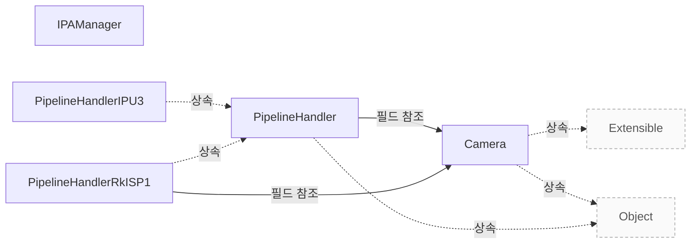

# 하드웨어 지원 구조와 구현 개요

**하드웨어를 연결할 위치와 구현 책임을 확인한 뒤 설정·요청·알고리즘·종료 코드를 읽으세요.**

| 지금 확인할 내용 | 이동할 절 |
|---|---|
| 장치 연동과 파이프라인 구현을 시작합니다. | [Pipeline Handler](pipeline-handler.md) |
| 알고리즘의 모듈 선택과 실행 경계를 확인합니다. | [IPA 관리와 구현 진입점](ipa.md) |
| 요청 정체와 버퍼 재사용 문제를 진단합니다. | [요청 처리와 문제 진단](request-lifecycle.md) |
| IPU3 렌즈 음영 보정의 구현 사례를 읽습니다. | [IPU3 LSC의 설정과 프레임 처리](ipu3-lsc-flow.md) |
| RKISP1 카메라별 왜곡 보정의 구현 사례를 읽습니다. | [RKISP1 카메라별 왜곡 보정](rkisp1-dewarp.md) |

## 하드웨어와 공통 계층의 경계

`PipelineHandler::match()` 함수는 카메라 매니저가 호출하는 메인 진입점입니다. 이 함수는 주어진 `DeviceEnumerator` 를 통해 필요한 모든 미디어 장치를 획득하고, 하나 이상의 `Camera` 인스턴스를 생성한 뒤 이를 카메라 매니저에 등록해야 합니다. `src/libcamera/pipeline_handler.cpp:86`

필요한 모든 미디어 장치를 찾았다면 `MediaDevice::acquire()` 를 호출하여 모두 획득해야 하며, 이후 `Camera` 인스턴스를 생성하고 내부에 저장한 뒤 true 를 반환합니다. 만약 필요한 장치가 하나라도 없다면 어떤 장치도 획득하지 않거나 이미 획득한 장치는 `MediaDevice::release()` 로 모두 해제한 후 false 를 반환해야 합니다. `src/libcamera/pipeline_handler.cpp:86`

시스템에 여러 개의 파이프라인 인스턴스가 존재하면 각 인스턴스마다 한 번씩 `PipelineHandler` 가 생성되고 매칭 함수가 호출됩니다. 각 호출은 하나의 파이프라인 인스턴스를 위해 미디어 장치를 획득하며, 호환 가능한 모든 장치가 소진될 때까지 이 과정을 반복합니다. `src/libcamera/pipeline_handler.cpp:86`

이 함수는 `CameraManager` 스레드에서 호출됩니다. 따라서 매칭 로직과 장치 획득, 카메라 등록 작업은 이 스레드 컨텍스트 내에서 수행된다는 점을 유의해야 합니다. `src/libcamera/pipeline_handler.cpp:86`

근거 원문: [src/libcamera/pipeline_handler.cpp:86](#source-5bbd41c1e725138c)

## 구현할 설정 인터페이스

호출자는 generateConfiguration() 함수를 호출하기 전에 roles 매개변수에 원하는 사용 사례 목록을 채워야 합니다. 이 함수는 해당 카메라에 대한 기본 구성을 생성하여 반환하며, 호출자는 이를 통해 선택된 스트림과 기본 파라미터를 확인할 수 있습니다. `src/libcamera/pipeline_handler.cpp:271`

이 함수는 임의의 스레드에서 호출될 수 있으며 스레드 안전성을 보장합니다. 또한 파이프라인 핸들러 내의 카메라 상태를 수정하지 않아야 합니다. `src/libcamera/pipeline_handler.cpp:271`

요청된 역할이 충족될 경우 유효한 `CameraConfiguration` 객체를 반환하고, 그렇지 않으면 널 포인터를 반환합니다. `src/libcamera/pipeline_handler.cpp:271`

호출자는 configure() 함수를 호출하기 전에 `CameraConfiguration::validate()` 를 통해 구성을 검증해야 합니다. 파이프라인 핸들러 구현체는 추가 검증을 수행하지 않으며, 커스텀 필드를 신뢰할 수 있습니다. `src/libcamera/pipeline_handler.cpp:271`

근거 원문: [src/libcamera/pipeline_handler.cpp:271](#source-c81d81d5cce53ab8)

## 요청을 장치에 전달하고 반환하기

요청을 큐에 넣는 작업은 파이프라인 핸들러가 기기를 프로그래밍하여 요청 내의 버퍼에서 캡처된 프레임에 파라미터를 적용하도록 설정하는 것을 의미합니다. `src/libcamera/pipeline_handler.cpp:530`

버퍼 완료 신호는 파이프라인 핸들러가 호출하며, 이는 애플리케이션에 버퍼 완료를 알리고 요청의 내부 추적 정보를 업데이트합니다. `src/libcamera/pipeline_handler.cpp:547`

queueRequestDevice 와 completeBuffer 함수는 모두 `CameraManager` 스레드에서 호출됩니다. `src/libcamera/pipeline_handler.cpp:530`, `src/libcamera/pipeline_handler.cpp:547`

completeBuffer 는 요청에 포함된 모든 버퍼가 완료되었는지 여부를 반환하며, 마지막 버퍼가 완료되더라도 요청이 자동으로 완료되지 않습니다. `src/libcamera/pipeline_handler.cpp:547`

근거 원문: [src/libcamera/pipeline_handler.cpp:530](#source-bc9c2a42b4251ab0) · [src/libcamera/pipeline_handler.cpp:547](#source-ca3f659653ce3f6a)

## IPA 모듈 선택과 실패 조건

함수는 먼저 지정된 이름으로 IPA 모듈을 검색합니다. `include/libcamera/internal/ipa_manager.h:35`

생성된 프록시가 유효하지 않으면 에러 로그를 남기고 nullptr 를 반환합니다. `include/libcamera/internal/ipa_manager.h:35`

모듈 서명이 유효하면 스레드 기반 프록시를, 그렇지 않으면 격리된 프록시를 생성합니다. `include/libcamera/internal/ipa_manager.h:35`

유효성 검사 실패 시 즉시 nullptr 를 반환하여 호출자에게 실패를 알립니다. `include/libcamera/internal/ipa_manager.h:35`

근거 원문: [include/libcamera/internal/ipa_manager.h:35](#source-1bc92c4993a1c4dc)

## 정지와 오류 처리의 책임

`PipelineHandler::stop()` 함수는 먼저 `PipelineHandler::stopDevice()` 를 호출하여 모든 스트림의 캡처와 처리를 즉시 중단합니다. `src/libcamera/pipeline_handler.cpp:359`

그 후 대기 중인 요청들을 취소하고 doQueueRequest() 를 호출하여 순서 번호를 부여한 뒤, completeRequest() 에서 올바르게 완료되도록 처리합니다. `src/libcamera/pipeline_handler.cpp:359`

마지막으로 queuedRequests_ 와 waitingRequests_ 가 모두 비어 있는지 확인하여 더 이상 대기 중인 요청이 없음을 보장합니다. `src/libcamera/pipeline_handler.cpp:359`

정지 시 모든 대기 중인 요청을 순차적으로 꺼내어 취소하고 완료 상태로 신호를 보냅니다. `src/libcamera/pipeline_handler.cpp:359`

근거 원문: [src/libcamera/pipeline_handler.cpp:359](#source-eefd1bbecb1aad0a)

## 구현 뒤 확인할 계약과 실행 한계

요청이 완료되었음을 카메라에 알리는 함수를 파이프라인 핸들러가 호출해야 합니다. 이 함수가 반환된 시점부터 해당 요청은 더 이상 파이프라인 핸들러의 관리 대상이 아니며, 접근해서는 안 됩니다. `src/libcamera/pipeline_handler.cpp:571`

요청이 제출된 순서대로 애플리케이션으로 반환되도록 보장하지만, 파이프라인 핸들러는 완료된 요청을 호출할 때 특정 순서를 따를 필요는 없습니다. `src/libcamera/pipeline_handler.cpp:571`

이 함수는 반드시 카메라 관리자 스레드에서 호출되어야 합니다. 다른 스레드나 프로세스 경계를 넘어서 호출하는 것은 계약에 위배됩니다. `src/libcamera/pipeline_handler.cpp:571`

근거 원문: [src/libcamera/pipeline_handler.cpp:571](#source-7ac40780a56ae3a9)

??? note "설계 질문과 검증 범위"
    질문별 답변과 근거 연결을 검사했습니다. 의미와 실행 결과는 사람 검토가 필요합니다.
    
    | 설계 질문 | 설명 위치 | 확인 범위 |
    |---|---|---|
    | 하드웨어의 장치 매칭과 카메라 등록은 누가 구현합니까? | [하드웨어와 공통 계층의 경계](#하드웨어와-공통-계층의-경계) | 코드 근거와 설명 연결 |
    | 스트림 구성 구현은 어떤 입력과 출력 계약을 지킵니까? | [구현할 설정 인터페이스](#구현할-설정-인터페이스) | 코드 근거와 설명 연결 |
    | 공통 큐와 하드웨어 구현은 요청 처리 책임을 어떻게 나눕니까? | [요청을 장치에 전달하고 반환하기](#요청을-장치에-전달하고-반환하기) | 코드 근거와 설명 연결 |
    | IPA 모듈과 실행 방식은 어떻게 선택되며 언제 생성에 실패합니까? | [IPA 모듈 선택과 실패 조건](#ipa-모듈-선택과-실패-조건) | 코드 근거와 설명 연결 |
    | 정지 시 공통 코드와 하드웨어 구현은 무엇을 끝내야 합니까? | [정지와 오류 처리의 책임](#정지와-오류-처리의-책임) | 코드 근거와 설명 연결 |
    | 코드 계약과 별도 실행 검증 항목은 무엇입니까? | [구현 뒤 확인할 계약과 실행 한계](#구현-뒤-확인할-계약과-실행-한계) | 코드 근거와 설명 연결 |

## 소스 근거

같은 발췌는 한 번만 싣습니다. 필요한 원문을 펼쳐 설명과 대조하세요.

<a id="source-5bbd41c1e725138c"></a>

??? note "소스 근거: src/libcamera/pipeline_handler.cpp:86"
    `src/libcamera/pipeline_handler.cpp:86`에서 시작하는 발췌입니다. 종료 줄은 119이며, 아래 원문을 설명과 대조할 수 있습니다.
    
    SHA-256: `7dde6563cf6bda32f38f4c1fb3ef0443502432236a0222d4f811b3fa71f3fc05`
    
    ```text
    \fn PipelineHandler::match(DeviceEnumerator *enumerator)
     * \brief Match media devices and create camera instances
     * \param[in] enumerator The enumerator providing all media devices found in the
     * system
     *
     * This function is the main entry point of the pipeline handler. It is called
     * by the camera manager with the \a enumerator passed as an argument. It shall
     * acquire from the \a enumerator all the media devices it needs for a single
     * pipeline, create one or multiple Camera instances and register them with the
     * camera manager.
     *
     * If all media devices needed by the pipeline handler are found, they must all
     * be acquired by a call to MediaDevice::acquire(). This function shall then
     * create the corresponding Camera instances, store them internally, and return
     * true. Otherwise it shall not acquire any media device (or shall release all
     * the media devices is has acquired by calling MediaDevice::release()) and
     * return false.
     *
     * If multiple instances of a pipeline are available in the system, the
     * PipelineHandler class will be instantiated once per instance, and its match()
     * function called for every instance. Each call shall acquire media devices for
     * one pipeline instance, until all compatible media devices are exhausted.
     *
     * If this function returns true, a new instance of the pipeline handler will
     * be created and its match() function called.
     *
     * \context This function is called from the CameraManager thread.
     *
     * \return true if media devices have been acquired and camera instances
     * created, or false otherwise
     */
    
    /**
     * \brief Search and acquire a MediaDevice
    ```

<a id="source-c81d81d5cce53ab8"></a>

??? note "소스 근거: src/libcamera/pipeline_handler.cpp:271"
    `src/libcamera/pipeline_handler.cpp:271`에서 시작하는 발췌입니다. 종료 줄은 319이며, 아래 원문을 설명과 대조할 수 있습니다.
    
    SHA-256: `5284e6062c894a77328b372676c42c1c97a4a01f9b2dccc4d09c83b2578b0e20`
    
    ```text
    \fn PipelineHandler::generateConfiguration()
     * \brief Generate a camera configuration for a specified camera
     * \param[in] camera The camera to generate a default configuration for
     * \param[in] roles A list of stream roles
     *
     * Generate a default configuration for the \a camera for a specified list of
     * stream roles. The caller shall populate the \a roles with the use-cases it
     * wishes to fetch the default configuration for. The returned configuration
     * can then be examined by the caller to learn about the selected streams and
     * their default parameters.
     *
     * The intended companion to this is \a configure() which can be used to change
     * the group of streams parameters.
     *
     * \context This function may be called from any thread and shall be
     * \threadsafe. It shall not modify the state of the \a camera in the pipeline
     * handler.
     *
     * \return A valid CameraConfiguration if the requested roles can be satisfied,
     * or a null pointer otherwise.
     */
    
    /**
     * \fn PipelineHandler::configure()
     * \brief Configure a group of streams for capture
     * \param[in] camera The camera to configure
     * \param[in] config The camera configurations to setup
     *
     * Configure the specified group of streams for \a camera according to the
     * configuration specified in \a config. The intended caller of this interface
     * is the Camera class which will receive configuration to apply from the
     * application.
     *
     * The configuration is guaranteed to have been validated with
     * CameraConfiguration::validate(). The pipeline handler implementation shall
     * not perform further validation and may rely on any custom field stored in its
     * custom CameraConfiguration derived class.
     *
     * When configuring the camera the pipeline handler shall associate a Stream
     * instance to each StreamConfiguration entry in the CameraConfiguration using
     * the StreamConfiguration::setStream() function.
     *
     * \context This function is called from the CameraManager thread.
     *
     * \return 0 on success or a negative error code otherwise
     */
    
    /**
     * \fn PipelineHandler::exportFrameBuffers()
    ```

<a id="source-bc9c2a42b4251ab0"></a>

??? note "소스 근거: src/libcamera/pipeline_handler.cpp:530"
    `src/libcamera/pipeline_handler.cpp:530`에서 시작하는 발췌입니다. 종료 줄은 547이며, 아래 원문을 설명과 대조할 수 있습니다.
    
    SHA-256: `7d7f109ecf4060457991bc81649c0ee7f886ede0a6c0140152f06e70e1d84f00`
    
    ```text
    \fn PipelineHandler::queueRequestDevice()
     * \brief Queue a request to the device
     * \param[in] camera The camera to queue the request to
     * \param[in] request The request to queue
     *
     * This function queues a capture request to the device for processing. The
     * request contains a set of buffers associated with streams and a set of
     * parameters. The pipeline handler shall program the device to ensure that the
     * parameters will be applied to the frames captured in the buffers provided in
     * the request.
     *
     * \context This function is called from the CameraManager thread.
     *
     * \return 0 on success or a negative error code otherwise
     */
    
    /**
     * \brief Complete a buffer for a request
    ```

<a id="source-ca3f659653ce3f6a"></a>

??? note "소스 근거: src/libcamera/pipeline_handler.cpp:547"
    `src/libcamera/pipeline_handler.cpp:547`에서 시작하는 발췌입니다. 종료 줄은 563이며, 아래 원문을 설명과 대조할 수 있습니다.
    
    SHA-256: `49b0139e3f0f620c0a3c044caf699179753dddf1b896d48de417c338bbae6a22`
    
    ```text
    \brief Complete a buffer for a request
     * \param[in] request The request the buffer belongs to
     * \param[in] buffer The buffer that has completed
     *
     * This function shall be called by pipeline handlers to signal completion of
     * the \a buffer part of the \a request. It notifies applications of buffer
     * completion and updates the request's internal buffer tracking. The request
     * is not completed automatically when the last buffer completes to give
     * pipeline handlers a chance to perform any operation that may still be
     * needed. They shall complete requests explicitly with completeRequest().
     *
     * \context This function shall be called from the CameraManager thread.
     *
     * \return True if all buffers contained in the request have completed, false
     * otherwise
     */
    bool PipelineHandler::completeBuffer
    ```

<a id="source-1bc92c4993a1c4dc"></a>

??? note "소스 근거: include/libcamera/internal/ipa_manager.h:35"
    `include/libcamera/internal/ipa_manager.h:35`에서 시작하는 발췌입니다. 종료 줄은 56이며, 아래 원문을 설명과 대조할 수 있습니다.
    
    SHA-256: `a8677961db1bb04a435196457a57d7f77bfdce934023d68a657a72bf3d468abf`
    
    ```text
    template<typename T>
    	std::unique_ptr<T> createIPA(const char *name, uint32_t minVersion,
    				     uint32_t maxVersion)
    	{
    		IPAModule *m = module(name, minVersion, maxVersion);
    		if (!m)
    			return nullptr;
    
    		auto proxy = [&]() -> std::unique_ptr<T> {
    			if (isSignatureValid(m))
    				return std::make_unique<typename T::Threaded>(m, cm_);
    			else
    				return std::make_unique<typename T::Isolated>(m, cm_);
    		}();
    
    		if (!proxy->isValid()) {
    			LOG(IPAManager, Error) << "Failed to load proxy";
    			return nullptr;
    		}
    
    		return proxy;
    	}
    ```

<a id="source-eefd1bbecb1aad0a"></a>

??? note "소스 근거: src/libcamera/pipeline_handler.cpp:359"
    `src/libcamera/pipeline_handler.cpp:359`에서 시작하는 발췌입니다. 종료 줄은 414이며, 아래 원문을 설명과 대조할 수 있습니다.
    
    SHA-256: `108b1bea5a8314ba57213d15c1e3ba01abe2b3f8a9e0e1e1281864b5492c7304`
    
    ```text
    \brief Stop capturing from all running streams and cancel pending requests
     * \param[in] camera The camera to stop
     *
     * This function stops capturing and processing requests immediately. All
     * pending requests are cancelled and complete immediately in an error state.
     *
     * \context This function is called from the CameraManager thread.
     */
    void PipelineHandler::stop(Camera *camera)
    {
    	/*
    	 * Take all waiting requests so that they are not requeued in response
    	 * to completeRequest() being called inside stopDevice(). Cancel them
    	 * after the device to keep them in order.
    	 */
    	Camera::Private *data = camera->_d();
    	std::queue<Request *> waitingRequests;
    	waitingRequests.swap(data->waitingRequests_);
    
    	/* Stop the pipeline handler and let the queued requests complete. */
    	stopDevice(camera);
    
    	/* Cancel and signal as complete all waiting requests. */
    	while (!waitingRequests.empty()) {
    		Request *request = waitingRequests.front();
    		waitingRequests.pop();
    
    		/*
    		 * Cancel all requests by marking them as cancelled and calling
    		 * doQueueRequest() instead of cancelRequest(). This ensures
    		 * that the requests get a sequence number and are temporarily
    		 * added to queuedRequests_ so they can be properly completed in
    		 * completeRequest().
    		 */
    		request->_d()->cancel();
    		doQueueRequest(request);
    	}
    
    	/* Make sure no requests are pending. */
    	ASSERT(data->queuedRequests_.empty());
    	ASSERT(data->waitingRequests_.empty());
    
    	data->requestSequence_ = 0;
    }
    
    /**
     * \fn PipelineHandler::stopDevice()
     * \brief Stop capturing from all running streams
     * \param[in] camera The camera to stop
     *
     * This function stops capturing and processing requests immediately. All
     * pending requests are cancelled and complete immediately in an error state.
     */
    
    /**
     * \brief Determine if the camera has any requests pending
    ```

<a id="source-7ac40780a56ae3a9"></a>

??? note "소스 근거: src/libcamera/pipeline_handler.cpp:571"
    `src/libcamera/pipeline_handler.cpp:571`에서 시작하는 발췌입니다. 종료 줄은 584이며, 아래 원문을 설명과 대조할 수 있습니다.
    
    SHA-256: `25903b4c6a305017b96bfe9117fe2b7b917b51fbeb2fd21139700b1fbf6a4fe2`
    
    ```text
    \brief Signal request completion
     * \param[in] request The request that has completed
     *
     * The pipeline handler shall call this function to notify the \a camera that
     * the request has completed. The request is no longer managed by the pipeline
     * handler and shall not be accessed once this function returns.
     *
     * This function ensures that requests will be returned to the application in
     * submission order, the pipeline handler may call it on any complete request
     * without any ordering constraint.
     *
     * \context This function shall be called from the CameraManager thread.
     */
    void PipelineHandler::completeRequest
    ```


<!-- sdd:class-diagram -->
## 클래스 관계

화살표의 글자는 추출한 관계를 나타내며, 점선은 상속입니다. 화살표는 참조 대상 또는 기반 클래스를 향합니다. 호출 순서를 뜻하지 않습니다.


<!-- /sdd:class-diagram -->

??? note "근거와 검토 정보"
    - 생성 방식: 추출 사실과 LLM 설명
    - 검증 범위: 표·그림은 facts로 만들고 설명은 LLM이 작성합니다. 인용·문장 및 설정된 구조 검사를 적용합니다.
    - 근거 파일: `include/libcamera/camera.h`, `include/libcamera/internal/ipa_manager.h`, `include/libcamera/internal/pipeline_handler.h`, `src/libcamera/camera.cpp`, `src/libcamera/ipa_manager.cpp`, `src/libcamera/pipeline/ipu3/ipu3.cpp`, `src/libcamera/pipeline/rkisp1/rkisp1.cpp`, `src/libcamera/pipeline_handler.cpp`
    - 근거 수준: 코드 확인 (정적 분석, simple_compdb 구성, commit `2c4b67c079`)
    - 자동 검사 (인용·문장 및 설정된 구조 검사): 통과
    - 검토 상태 기록일: 2026-10-24 · 사람 검토 전

다음 단계: [Pipeline Handler](pipeline-handler.md)
