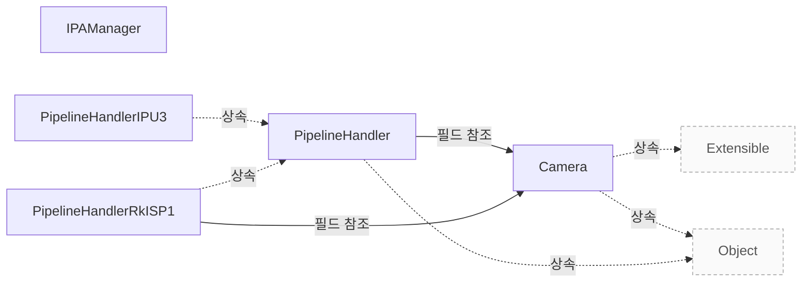

# libcamera 제품 개요

**제공 기능과 공통 설계의 강점을 확인하고 도입할 범위를 판단하세요.**

| 지금 확인할 내용 | 이동할 절 |
|---|---|
| 연동 가이드에서 필요한 내용을 확인합니다. | [연동 가이드](vendor-integration.md) |
| 지원 범위와 검증에서 필요한 내용을 확인합니다. | [지원 범위와 검증](vendor-assurance.md) |
| 장치별 파이프라인을 구현합니다. | [Pipeline Handler](pipeline-handler.md) |

## 복잡한 카메라를 공통 API로 제어하기

libcamera는 Linux 기반 시스템에서 하드웨어 구성과 이미지 제어 알고리즘을 커널 API 위의 일관된 방법으로 다루게 합니다. 장치마다 다른 제어 절차를 애플리케이션이 직접 다루는 부담을 줄이는 공통 카메라 계층으로 활용할 수 있습니다. `Documentation/introduction.rst:42`

근거 원문: [Documentation/introduction.rst:42](#source-d40613f3899f0ffc)

## 제공 기능과 지원 범위

`Camera`는 하나의 이미지 소스에서 하나 이상의 영상 스트림을 만들고, 장치를 설정·제어하며 영상을 캡처하는 공통 인터페이스를 제공합니다. Vendor는 이 인터페이스를 기준으로 애플리케이션 연동 범위를 정할 수 있습니다. `src/libcamera/camera.cpp:752`

하드웨어 지원에는 해당 장치를 다루는 `PipelineHandler` 구현이 필요합니다. 구현은 필요한 미디어 장치를 찾아 확보하고 `Camera`를 만들며, REGISTER_PIPELINE_HANDLER()로 등록해야 합니다. 공통 인터페이스가 있다는 사실만으로 모든 장치가 지원되는 것은 아닙니다. `src/libcamera/pipeline_handler.cpp:30`

근거 원문: [src/libcamera/camera.cpp:752](#source-8264067114dccdee) · [src/libcamera/pipeline_handler.cpp:30](#source-05721740b01bcd0e)

## 구현 근거로 보는 강점

공통 요청 관리가 제공하는 강점은 `PipelineHandler::queueRequest()`에서 확인할 수 있습니다. 요청을 준비 대기 목록에 두고, 준비된 요청을 제출 순서대로 장치 구현에 전달하며, 장치에 전달하는 요청 수에는 maxQueuedRequestsDevice_ 한도를 적용합니다. `src/libcamera/pipeline_handler.cpp:447`

`PipelineHandler::queueRequest()`의 계약에는 준비 실패나 하드웨어 큐 등록 실패 시 요청 취소와, stop() 시 요청을 완료하기 위한 추적도 포함됩니다. 장치 구현자는 completeRequest()로 완료를 알려야 합니다. 공통 요청 관리가 장치별 완료 처리 책임까지 없애 주지는 않습니다. `src/libcamera/pipeline_handler.cpp:447`

근거 원문: [src/libcamera/pipeline_handler.cpp:447](#source-5aa1910611a17d88)

??? note "설계 질문과 검증 범위"
    질문별 답변과 근거 연결을 검사했습니다. 의미와 실행 결과는 사람 검토가 필요합니다.
    
    | 설계 질문 | 설명 위치 | 확인 범위 |
    |---|---|---|
    | 어떤 고객 문제를 해결하며 어떤 환경을 대상으로 합니까? | [복잡한 카메라를 공통 API로 제어하기](#복잡한-카메라를-공통-api로-제어하기) | 코드 근거와 설명 연결 |
    | 어떤 기능을 제공하며 지원 범위는 어떤 구현에 달려 있습니까? | [제공 기능과 지원 범위](#제공-기능과-지원-범위) | 코드 근거와 설명 연결 |
    | 공통 구현을 활용할 수 있는 강점과 그 조건은 무엇입니까? | [구현 근거로 보는 강점](#구현-근거로-보는-강점) | 코드 근거와 설명 연결 |

## 소스 근거

같은 발췌는 한 번만 싣습니다. 필요한 원문을 펼쳐 설명과 대조하세요.

<a id="source-d40613f3899f0ffc"></a>

??? note "소스 근거: Documentation/introduction.rst:42"
    `Documentation/introduction.rst:42`에서 시작하는 발췌입니다. 종료 줄은 51이며, 아래 원문을 설명과 대조할 수 있습니다.
    
    SHA-256: `549b7b082e82dd29575a830fc4731f3a5cae8a8a8adb4e49e085f1c991fec9ac`
    
    ```text
    What is libcamera for?
    ======================
    
    libcamera provides a complete camera stack for Linux-based systems to abstract
    the configuration of hardware and image control algorithms required to obtain
    desirable results from the camera through the kernel's APIs, reducing those
    operations to a simple and consistent method for developers. In short instead of
    having to deal with this:
    
    .. graphviz:: mali-c55.dot
    ```

<a id="source-8264067114dccdee"></a>

??? note "소스 근거: src/libcamera/camera.cpp:752"
    `src/libcamera/camera.cpp:752`에서 시작하는 발췌입니다. 종료 줄은 784이며, 아래 원문을 설명과 대조할 수 있습니다.
    
    SHA-256: `325c2af6569c185be1bc686e1fb6d161782dcbc8db34a0fbb719cff005ba7625`
    
    ```text
    \class Camera
     * \brief Camera device
     *
     * \todo Add documentation for camera start timings. What exactly does the
     * camera expect the pipeline handler to do when start() is called?
     *
     * The Camera class models a camera capable of producing one or more image
     * streams from a single image source. It provides the main interface to
     * configuring and controlling the device, and capturing image streams. It is
     * the central object exposed by libcamera.
     *
     * To support the central nature of Camera objects, libcamera manages the
     * lifetime of camera instances with std::shared_ptr<>. Instances shall be
     * created with the create() function which returns a shared pointer. The
     * Camera constructors and destructor are private, to prevent instances from
     * being constructed and destroyed manually.
     *
     * \section camera_operation Operating the Camera
     *
     * An application needs to perform a sequence of operations on a camera before
     * it is ready to process requests. The camera needs to be acquired and
     * configured to prepare the camera for capture. Once started the camera can
     * process requests until it is stopped. When an application is done with a
     * camera, the camera needs to be released.
     *
     * An application may start and stop a camera multiple times as long as it is
     * not released. The camera may also be reconfigured.
     *
     * Functions that affect the camera state as defined below are generally not
     * synchronized with each other by the Camera class. The caller is responsible
     * for ensuring their synchronization if necessary.
     *
     * \subsection Camera States
    ```

<a id="source-05721740b01bcd0e"></a>

??? note "소스 근거: src/libcamera/pipeline_handler.cpp:30"
    `src/libcamera/pipeline_handler.cpp:30`에서 시작하는 발췌입니다. 종료 줄은 43이며, 아래 원문을 설명과 대조할 수 있습니다.
    
    SHA-256: `2ba321cd394e987c2851002e9db5df0634635d71c749580c066e5556df90a715`
    
    ```text
    \file pipeline_handler.h
     * \brief Create pipelines and cameras from a set of media devices
     *
     * Each pipeline supported by libcamera needs to be backed by a pipeline
     * handler implementation that operate on a set of media devices. The pipeline
     * handler is responsible for matching the media devices it requires with the
     * devices present in the system, and once all those devices can be acquired,
     * create corresponding Camera instances.
     *
     * Every subclass of PipelineHandler shall be registered with libcamera using
     * the REGISTER_PIPELINE_HANDLER() macro.
     */
    
    using namespace std::chrono_literals;
    ```

<a id="source-5aa1910611a17d88"></a>

??? note "소스 근거: src/libcamera/pipeline_handler.cpp:447"
    `src/libcamera/pipeline_handler.cpp:447`에서 시작하는 발췌입니다. 종료 줄은 469이며, 아래 원문을 설명과 대조할 수 있습니다.
    
    SHA-256: `a1d6755ca8c3aa8723a8b5cf13c12e2ba2b021dcc8313f9f04a3dc01500089ba`
    
    ```text
    \fn PipelineHandler::queueRequest()
     * \brief Queue a request
     * \param[in] request The request to queue
     *
     * This function queues a capture request to the pipeline handler for
     * processing. The request is first added to the internal list of waiting
     * requests which have to be prepared to make sure they are ready for being
     * queued to the pipeline handler.
     *
     * The queue of waiting requests is iterated and up to \a
     * maxQueuedRequestsDevice_ prepared requests are passed to the pipeline handler
     * in the same order they have been queued by calling this function.
     *
     * If a Request fails during the preparation phase or if the pipeline handler
     * fails in queuing the request to the hardware the request is cancelled.
     *
     * Keeping track of queued requests ensures automatic completion of all requests
     * when the pipeline handler is stopped with stop(). Request completion shall be
     * signalled by the pipeline handler using the completeRequest() function.
     *
     * \context This function is called from the CameraManager thread.
     */
    void PipelineHandler::queueRequest(Request *request)
    ```


<!-- sdd:class-diagram -->
## 클래스 관계

화살표의 글자는 추출한 관계를 나타내며, 점선은 상속입니다. 화살표는 참조 대상 또는 기반 클래스를 향합니다. 호출 순서를 뜻하지 않습니다.


<!-- /sdd:class-diagram -->

??? note "근거와 검토 정보"
    - 생성 방식: 추출 사실과 LLM 설명
    - 검증 범위: 표·그림은 facts로 만들고 설명은 LLM이 작성합니다. 인용·문장 및 설정된 구조 검사를 적용합니다.
    - 근거 파일: `Documentation/introduction.rst`, `include/libcamera/camera.h`, `include/libcamera/internal/ipa_manager.h`, `include/libcamera/internal/pipeline_handler.h`, `src/libcamera/camera.cpp`, `src/libcamera/ipa_manager.cpp`, `src/libcamera/pipeline/ipu3/ipu3.cpp`, `src/libcamera/pipeline/rkisp1/rkisp1.cpp`, `src/libcamera/pipeline_handler.cpp`
    - 근거 수준: 코드 확인 (정적 분석, simple_compdb 구성, commit `2c4b67c079`)
    - 자동 검사 (인용·문장 및 설정된 구조 검사): 통과
    - 검토 상태 기록일: 2026-10-25 · 사람 검토 전

다음 단계: [연동 가이드](vendor-integration.md)
