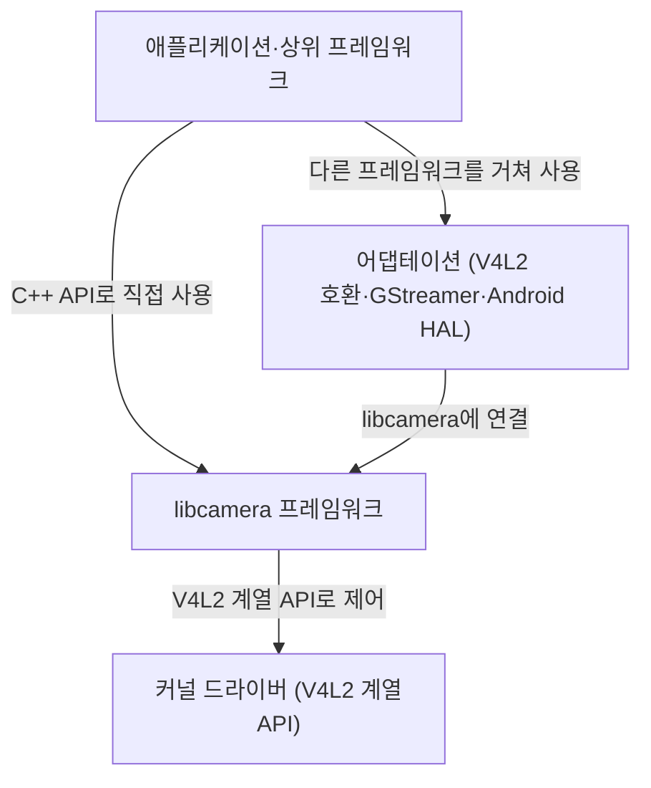
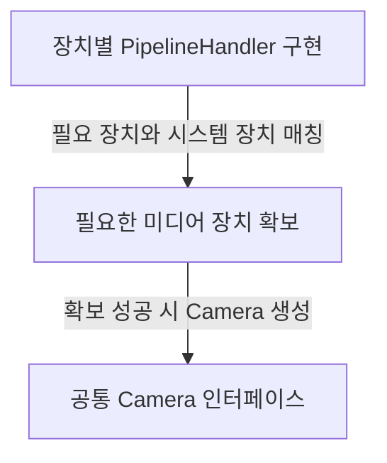
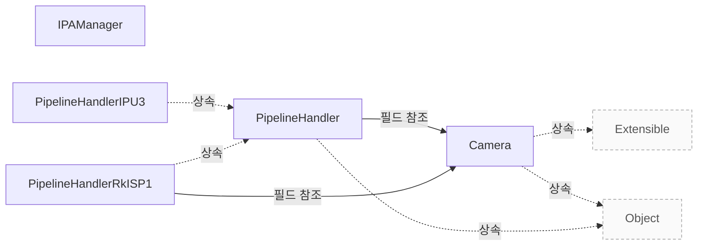

# libcamera 제품 개요

**제품이 무엇이고 어디까지 지원하는지, 공통 설계가 구현자에게 해 주는 일을 확인하고 도입할 범위를 판단하세요.**

| 지금 확인할 내용 | 이동할 절 |
|---|---|
| 연동 순서와 구현 책임을 확인하고 설정·요청·정지 계약을 적용하세요. | [연동 가이드](vendor-integration.md) |
| 지원 조건과 구성 제약을 확인하고 제품 도입 전에 검증할 범위를 정하세요. | [지원 범위와 검증](vendor-assurance.md) |
| 파이프라인 구현이 지켜야 하는 구성·요청·완료·종료 계약을 확인하세요. | [Pipeline Handler](pipeline-handler.md) |
| <a id="장치-요청-한도와-대기-큐"></a>장치 요청 수의 기본 한도와 대기 큐를 확인합니다. | [Pipeline 요청 제출과 완료](pipeline-requests.md#장치-요청-한도와-대기-큐) |

## 무엇이며 누구의 어떤 문제를 푸는가

`libcamera`는 Linux, Android, ChromeOS를 대상으로 하는 오픈 소스 복합 카메라 지원 라이브러리입니다. Linux 커널 장치 드라이버와 연결하고 개발자에게 API를 제공해 Linux 시스템에서 복합 카메라로 이미지를 캡처하는 작업의 복잡함을 줄입니다. `libcamera`는 Linux 기반 시스템에 완전한 카메라 스택을 제공합니다. 이 스택은 커널 API를 통해 카메라에서 원하는 결과를 얻는 데 필요한 하드웨어 구성과 이미지 제어 알고리즘을 추상화하여, 개발자가 이 작업을 간단하고 일관된 방식으로 다루게 합니다. `Documentation/introduction.rst:10`, `product-evidence/libcamera/official-stack.txt:1`

<!-- sdd:visual:camera-stack -->
### 카메라 스택의 네 계층

애플리케이션에서 카메라 하드웨어까지 어떤 계층을 지납니까? 지원 기종이나 성능을 보장하는 그림은 아닙니다.



[Mermaid 원문](vendor-overview.camera-stack.mmd)

??? note "그림 근거와 확인 범위"
    소스에 연결한 설계 해석입니다. 자동 연결 검사는 의미 승인이나 기기 실행 검증이 아닙니다.
    
    | 요소·전이 | 소스 근거 |
    |---|---|
    | 애플리케이션·상위 프레임워크 | [Documentation/introduction.rst:137](#source-e3b563f549a8c46d) |
    | 어댑테이션 (V4L2 호환·GStreamer·Android HAL) | [Documentation/introduction.rst:137](#source-e3b563f549a8c46d) |
    | libcamera 프레임워크 | [Documentation/introduction.rst:137](#source-e3b563f549a8c46d) |
    | 커널 드라이버 (V4L2 계열 API) | [Documentation/introduction.rst:137](#source-e3b563f549a8c46d) |
    | C++ API로 직접 사용 | [Documentation/introduction.rst:137](#source-e3b563f549a8c46d) |
    | 다른 프레임워크를 거쳐 사용 | [Documentation/introduction.rst:137](#source-e3b563f549a8c46d) |
    | libcamera에 연결 | [Documentation/introduction.rst:137](#source-e3b563f549a8c46d) |
    | V4L2 계열 API로 제어 | [Documentation/introduction.rst:137](#source-e3b563f549a8c46d) |
<!-- /sdd:visual:camera-stack -->

드라이버를 사용해 동작하는 카메라 스택을 제공하는 일은 사용자 공간의 책임이며, 벤더가 애플리케이션 개발자를 위한 공통 아키텍처나 API 없이 별도로 구현하는 경우가 많습니다. 하드웨어 파이프라인과 커널 API에서의 표현이 서로 달라 맞춤 처리가 필요한 경우가 많아 이 작업은 더 복잡해집니다. 맨 아래 계층의 커널 드라이버는 카메라 하드웨어를 제어하고 사용자 공간에 낮은 수준의 인터페이스를 제공합니다. 이 인터페이스는 Linux 커널의 `V4L2` API 계열인 Media `Controller` API, V4L2 Video `Device` API, V4L2 Subdev API를 사용합니다. `Documentation/introduction.rst:35`, `Documentation/introduction.rst:137`

그 위의 libcamera 프레임워크는 핵심 구성 요소인 libcamera에서 카메라 장치를 제어하고 상위 계층에 네이티브 `C++ API`를 제공합니다. 선택적 언어 바인딩을 사용하면 다른 프로그래밍 언어에서도 libcamera와 연결할 수 있습니다. 그 위의 libcamera adaptation 계층은 다른 프레임워크에서 libcamera와 연결하는 구성 요소를 가리킵니다. 예로 `V4L2` 호환 계층, gstreamer libcamera 요소, libcamera 기반 Android camera HAL 구현이 있습니다. `Documentation/introduction.rst:137`

맨 위의 애플리케이션과 상위 프레임워크는 libcamera 프레임워크 또는 libcamera adaptation을 기반으로 합니다. 이 계층은 libcamera 프로젝트의 범위 밖입니다. `Documentation/introduction.rst:137`

근거 원문: [Documentation/introduction.rst:10](#source-34fda84500757231) · [Documentation/introduction.rst:35](#source-de476c940b030e4a) · [Documentation/introduction.rst:45](#source-f350cabac0db8343) · [Documentation/introduction.rst:137](#source-e3b563f549a8c46d) · [product-evidence/libcamera/official-stack.txt:1](#source-a43b9ee967d1a5db)

## 지원하는 하드웨어와 빌드 선택

문서는 현재 전용 파이프라인 핸들러로 지원하는 하드웨어 플랫폼으로 Arm `Mali-C55`, Intel `IPU3` (`ipu3`), NXP i.MX8MP (`imx8-isi` 및 `rkisp1`), RaspberryPi 3, 4 및 zero (`rpi/vc4`), Rockchip RK3399 (`rkisp1`)를 나열합니다. 라이브러리가 범용으로 지원한다고 문서에 적은 대상은 USB 비디오 장치 클래스 카메라(`uvcvideo`), iMX7·IPU6·Allwinner Sun6i(`simple`), 테스트 용도의 가상 미디어 컨트롤러 드라이버(`vimc`)입니다. `Documentation/platform_support.rst:6`

빌드할 파이프라인 핸들러는 배열 옵션인 `pipelines`에서 선택합니다. 선택할 수 있는 값은 `all`, `auto`, `imx8-isi`, `ipu3`, `mali-c55`, `rkisp1`, `rpi/pisp`, `rpi/vc4`, `simple`, `uvcvideo`, `vimc`, `virtual`입니다. 기본값인 `auto`는 대상 아키텍처에 적용되는 모든 파이프라인을 빌드하고, `all`은 모든 파이프라인을 빌드합니다. 두 값을 함께 선택하면 `all`이 우선합니다. `meson_options.txt:75`

근거 원문: [Documentation/platform_support.rst:6](#source-9d6502e234c4647d) · [meson_options.txt:75](#source-691389506fe87b32)

## 제공 기능과 지원 범위

`Camera`는 단일 이미지 소스에서 하나 이상의 이미지 스트림을 생성할 수 있는 카메라를 모델링합니다. 장치의 구성과 제어, 이미지 스트림 캡처를 위한 기본 인터페이스를 제공하며, libcamera가 제공하는 중심 객체입니다. 파이프라인 핸들러는 필요한 미디어 장치를 시스템에 있는 장치와 일치시키고 필요한 장치를 모두 확보할 수 있으면 해당 `Camera` 인스턴스를 생성할 책임이 있으며, 모든 `PipelineHandler` 하위 클래스는 `REGISTER_PIPELINE_HANDLER()` 매크로를 사용해 libcamera에 등록해야 합니다. `src/libcamera/camera.cpp:752`, `src/libcamera/pipeline_handler.cpp:30`

<!-- sdd:visual:hardware-boundary -->
### 공통 Camera와 장치별 구현의 경계

장치 지원은 해당 PipelineHandler 구현과 필요한 미디어 장치 확보에 달려 있습니다. 지원 기종이나 성능을 보장하는 그림은 아닙니다.



[Mermaid 원문](vendor-overview.hardware-boundary.mmd)

??? note "그림 근거와 확인 범위"
    소스에 연결한 설계 해석입니다. 자동 연결 검사는 의미 승인이나 기기 실행 검증이 아닙니다.
    
    | 요소·전이 | 소스 근거 |
    |---|---|
    | 장치별 PipelineHandler 구현 | [src/libcamera/pipeline_handler.cpp:30](#source-05721740b01bcd0e) |
    | 필요한 미디어 장치 확보 | [src/libcamera/pipeline_handler.cpp:30](#source-05721740b01bcd0e) |
    | 공통 Camera 인터페이스 | [src/libcamera/camera.cpp:752](#source-8264067114dccdee) |
    | 필요 장치와 시스템 장치 매칭 | [src/libcamera/pipeline_handler.cpp:30](#source-05721740b01bcd0e) |
    | 확보 성공 시 Camera 생성 | [src/libcamera/pipeline_handler.cpp:30](#source-05721740b01bcd0e) |
<!-- /sdd:visual:hardware-boundary -->

근거 원문: [src/libcamera/camera.cpp:752](#source-8264067114dccdee) · [src/libcamera/pipeline_handler.cpp:30](#source-05721740b01bcd0e)

## 장치 구현자가 공통 계층에서 얻는 것

`PipelineHandler::queueRequest()`는 캡처 요청을 먼저 내부 대기 요청 목록에 추가하고 파이프라인 핸들러에 전달할 수 있도록 준비합니다. 이 함수는 대기 큐를 순회하며 준비된 요청을 최대 `maxQueuedRequestsDevice_`개까지 이 함수에 등록된 순서대로 파이프라인 핸들러에 전달합니다. 요청이 준비 단계에서 실패하거나 파이프라인 핸들러가 요청을 하드웨어 큐에 등록하지 못하면 해당 요청은 취소됩니다. `src/libcamera/pipeline_handler.cpp:447`, `src/libcamera/pipeline_handler.cpp:460`

대기열에 넣은 요청을 추적하면 파이프라인 핸들러를 `stop()`으로 중지할 때 모든 요청이 자동으로 완료됩니다. 파이프라인 핸들러는 요청에 속한 버퍼의 완료를 애플리케이션에 알리고 요청 내부의 버퍼 추적을 갱신하도록 `CameraManager` 스레드에서 `completeBuffer()`를 호출해야 합니다. 마지막 버퍼가 완료되어도 요청은 자동으로 완료되지 않으므로 파이프라인 핸들러는 `completeRequest()`를 명시적으로 호출해야 합니다. `src/libcamera/pipeline_handler.cpp:463`, `src/libcamera/pipeline_handler.cpp:547`

근거 원문: [src/libcamera/pipeline_handler.cpp:447](#source-106682bf83e3416a) · [src/libcamera/pipeline_handler.cpp:460](#source-0a5bda976f5815de) · [src/libcamera/pipeline_handler.cpp:463](#source-35ab684c1adef175) · [src/libcamera/pipeline_handler.cpp:547](#source-ab8710f8a8a7905d)

??? note "설계 질문과 검증 범위"
    질문별 답변과 근거 연결을 검사했습니다. 의미와 실행 결과는 사람 검토가 필요합니다.
    
    | 설계 질문 | 설명 위치 | 확인 범위 |
    |---|---|---|
    | 어떤 고객 문제를 해결하며 어떤 환경을 대상으로 합니까? | [무엇이며 누구의 어떤 문제를 푸는가](#무엇이며-누구의-어떤-문제를-푸는가) | 코드 근거와 설명 연결 |
    | 어디까지 지원하며 지원 대상은 어떻게 고릅니까? | [지원하는 하드웨어와 빌드 선택](#지원하는-하드웨어와-빌드-선택) | 코드 근거와 설명 연결 |
    | 어떤 기능을 제공하며 지원 범위는 어떤 구현에 달려 있습니까? | [제공 기능과 지원 범위](#제공-기능과-지원-범위) | 코드 근거와 설명 연결 |
    | 공통 구현을 활용할 수 있는 강점과 그 조건은 무엇입니까? | [장치 구현자가 공통 계층에서 얻는 것](#장치-구현자가-공통-계층에서-얻는-것) | 코드 근거와 설명 연결 |

## 소스 근거

같은 발췌는 한 번만 싣습니다. 필요한 원문을 펼쳐 설명과 대조하세요.

<a id="source-34fda84500757231"></a>

??? note "소스 근거: Documentation/introduction.rst:10"
    `Documentation/introduction.rst:10`에서 시작하는 발췌입니다. 종료 줄은 13이며, 아래 원문을 설명과 대조할 수 있습니다.
    
    SHA-256: `84621541899cba7430b844bc03d13fc8e6f3f03e7c30556df0bf1cd11007494c`
    
    ```text
    libcamera is an open source complex camera support library for Linux, Android
    and ChromeOS. The library interfaces with Linux kernel device drivers and
    provides an intuitive API to developers in order to simplify the complexity
    involved in capturing images from complex cameras on Linux systems.
    ```

<a id="source-de476c940b030e4a"></a>

??? note "소스 근거: Documentation/introduction.rst:35"
    `Documentation/introduction.rst:35`에서 시작하는 발췌입니다. 종료 줄은 40이며, 아래 원문을 설명과 대조할 수 있습니다.
    
    SHA-256: `0c6b72f4ffe9e608101639096b5597a61f41f776e4f5ac4aaa43229c744db3f0`
    
    ```text
    The usage of these drivers to provide a functioning camera stack is a
    responsibility that lies in userspace, and is commonly implemented separately
    by vendors without a common architecture or API for application developers. This
    adds a lot of complexity to the task, particularly when considering that the
    differences in hardware pipelines and their representation in the kernel's APIs
    often necessitate bespoke handling.
    ```

<a id="source-f350cabac0db8343"></a>

??? note "소스 근거: Documentation/introduction.rst:45"
    `Documentation/introduction.rst:45`에서 시작하는 발췌입니다. 종료 줄은 49이며, 아래 원문을 설명과 대조할 수 있습니다.
    
    SHA-256: `56f623776b7eab9511de1f32c1f3080c4eab37239185f5134db6b2644760b1f5`
    
    ```text
    libcamera provides a complete camera stack for Linux-based systems to abstract
    the configuration of hardware and image control algorithms required to obtain
    desirable results from the camera through the kernel's APIs, reducing those
    operations to a simple and consistent method for developers. In short instead of
    having to deal with this:
    ```

<a id="source-e3b563f549a8c46d"></a>

??? note "소스 근거: Documentation/introduction.rst:137"
    `Documentation/introduction.rst:137`에서 시작하는 발췌입니다. 종료 줄은 165이며, 아래 원문을 설명과 대조할 수 있습니다.
    
    SHA-256: `750a623b45ad76fbd899b56427ad76ef91bdc922497972317df868fe538c3b03`
    
    ```text
    The camera stack comprises four software layers. From bottom to top:
    
    * The kernel drivers control the camera hardware and expose a
      low-level interface to userspace through the Linux kernel V4L2
      family of APIs (Media Controller API, V4L2 Video Device API and
      V4L2 Subdev API).
    
    * The libcamera framework is the core part of the stack. It
      handles all control of the camera devices in its core component,
      libcamera, and exposes a native C++ API to upper layers. Optional
      language bindings allow interfacing to libcamera from other
      programming languages.
    
      Those components live in the same source code repository and
      all together constitute the libcamera framework.
    
    * The libcamera adaptation is an umbrella term designating the
      components that interface to libcamera in other frameworks.
      Notable examples are a V4L2 compatibility layer, a gstreamer
      libcamera element, and an Android camera HAL implementation based
      on libcamera.
    
      Those components can live in the libcamera project source code
      in separate repositories, or move to their respective project's
      repository (for instance the gstreamer libcamera element).
    
    * The applications and upper level frameworks are based on the
      libcamera framework or libcamera adaptation, and are outside of
      the scope of the libcamera project.
    ```

<a id="source-a43b9ee967d1a5db"></a>

??? note "제품 자료: product-evidence/libcamera/official-stack.txt:1"
    소스와 별도로 제공된 자료입니다. 제공자·버전·적용 범위를 아래 기록에서 확인하세요. 자동 검사는 사람 승인이 아닙니다.
    
    `product-evidence/libcamera/official-stack.txt:1`에서 시작하는 발췌입니다. 종료 줄은 10이며, 아래 원문을 설명과 대조할 수 있습니다.
    
    SHA-256: `fdd39a9c11328e6bb549203a2395b3f9331fa15d5e2da711b703643e299f8fc0`
    
    ```text
    .. SPDX-License-Identifier: CC-BY-SA-4.0
    .. Source: https://gitlab.freedesktop.org/camera/libcamera/-/blob/212c689fcf2450bbfbaab25c7472895ac277b5d6/Documentation/introduction.rst
    .. Unmodified excerpt; project documentation, not a commercial product specification.
    
    libcamera provides a complete camera stack for Linux-based systems to abstract
    the configuration of hardware and image control algorithms required to obtain
    desirable results from the camera through the kernel's APIs, reducing those
    operations to a simple and consistent method for developers. In short instead of
    having to deal with this:
    
    ```
    
    ```json
    {
      "type": "project-document",
      "supplier": "libcamera official upstream; CC-BY-SA-4.0; URL in local material",
      "version": "212c689fcf2450bbfbaab25c7472895ac277b5d6",
      "date": "2026-10-30",
      "valid_until": "2026-10-30",
      "product": "libcamera",
      "release": "212c689fcf2450bbfbaab25c7472895ac277b5d6",
      "configuration": "public-source-documentation",
      "feature": "camera-stack",
      "conditions": [
        "Linux-based systems",
        "Kernel drivers and the relevant pipeline implementation are required."
      ],
      "sha256": "fdd39a9c11328e6bb549203a2395b3f9331fa15d5e2da711b703643e299f8fc0"
    }
    ```

<a id="source-9d6502e234c4647d"></a>

??? note "소스 근거: Documentation/platform_support.rst:6"
    `Documentation/platform_support.rst:6`에서 시작하는 발췌입니다. 종료 줄은 19이며, 아래 원문을 설명과 대조할 수 있습니다.
    
    SHA-256: `c3521ec69316b30bbb021a31f90ae53cd0d641f77c91a13ed2d6fa0f7266f2bb`
    
    ```text
    The library currently supports the following hardware platforms specifically
    with dedicated pipeline handlers:
    
       - Arm Mali-C55
       - Intel IPU3 (ipu3)
       - NXP i.MX8MP (imx8-isi and rkisp1)
       - RaspberryPi 3, 4 and zero (rpi/vc4)
       - Rockchip RK3399 (rkisp1)
    
    Furthermore, generic platform support is provided for the following:
    
       - USB video device class cameras (uvcvideo)
       - iMX7, IPU6, Allwinner Sun6i (simple)
       - Virtual media controller driver for test use cases (vimc)
    ```

<a id="source-691389506fe87b32"></a>

??? note "소스 근거: meson_options.txt:75"
    `meson_options.txt:75`에서 시작하는 발췌입니다. 종료 줄은 92이며, 아래 원문을 설명과 대조할 수 있습니다.
    
    SHA-256: `6884c14e5ebb9b81b76a500c4890a7c14db2e86c34395d71c496a6c86bf0b58d`
    
    ```text
    option('pipelines',
            type : 'array',
            value : ['auto'],
            choices : [
                'all',
                'auto',
                'imx8-isi',
                'ipu3',
                'mali-c55',
                'rkisp1',
                'rpi/pisp',
                'rpi/vc4',
                'simple',
                'uvcvideo',
                'vimc',
                'virtual'
            ],
            description : 'Select which pipeline handlers to build. If this is set to "auto", all the pipelines applicable to the target architecture will be built. If this is set to "all", all the pipelines will be built. If both are selected then "all" will take precedence.')
    ```

<a id="source-8264067114dccdee"></a>

??? note "소스 근거: src/libcamera/camera.cpp:752"
    `src/libcamera/camera.cpp:752`에서 시작하는 발췌입니다. 종료 줄은 784이며, 아래 원문을 설명과 대조할 수 있습니다.
    
    SHA-256: `325c2af6569c185be1bc686e1fb6d161782dcbc8db34a0fbb719cff005ba7625`
    
    ```text
    \class Camera
     * \brief Camera device
     *
     * \todo Add documentation for camera start timings. What exactly does the
     * camera expect the pipeline handler to do when start() is called?
     *
     * The Camera class models a camera capable of producing one or more image
     * streams from a single image source. It provides the main interface to
     * configuring and controlling the device, and capturing image streams. It is
     * the central object exposed by libcamera.
     *
     * To support the central nature of Camera objects, libcamera manages the
     * lifetime of camera instances with std::shared_ptr<>. Instances shall be
     * created with the create() function which returns a shared pointer. The
     * Camera constructors and destructor are private, to prevent instances from
     * being constructed and destroyed manually.
     *
     * \section camera_operation Operating the Camera
     *
     * An application needs to perform a sequence of operations on a camera before
     * it is ready to process requests. The camera needs to be acquired and
     * configured to prepare the camera for capture. Once started the camera can
     * process requests until it is stopped. When an application is done with a
     * camera, the camera needs to be released.
     *
     * An application may start and stop a camera multiple times as long as it is
     * not released. The camera may also be reconfigured.
     *
     * Functions that affect the camera state as defined below are generally not
     * synchronized with each other by the Camera class. The caller is responsible
     * for ensuring their synchronization if necessary.
     *
     * \subsection Camera States
    ```

<a id="source-05721740b01bcd0e"></a>

??? note "소스 근거: src/libcamera/pipeline_handler.cpp:30"
    `src/libcamera/pipeline_handler.cpp:30`에서 시작하는 발췌입니다. 종료 줄은 43이며, 아래 원문을 설명과 대조할 수 있습니다.
    
    SHA-256: `2ba321cd394e987c2851002e9db5df0634635d71c749580c066e5556df90a715`
    
    ```text
    \file pipeline_handler.h
     * \brief Create pipelines and cameras from a set of media devices
     *
     * Each pipeline supported by libcamera needs to be backed by a pipeline
     * handler implementation that operate on a set of media devices. The pipeline
     * handler is responsible for matching the media devices it requires with the
     * devices present in the system, and once all those devices can be acquired,
     * create corresponding Camera instances.
     *
     * Every subclass of PipelineHandler shall be registered with libcamera using
     * the REGISTER_PIPELINE_HANDLER() macro.
     */
    
    using namespace std::chrono_literals;
    ```

<a id="source-106682bf83e3416a"></a>

??? note "소스 근거: src/libcamera/pipeline_handler.cpp:447"
    `src/libcamera/pipeline_handler.cpp:447`에서 시작하는 발췌입니다. 종료 줄은 458이며, 아래 원문을 설명과 대조할 수 있습니다.
    
    SHA-256: `93b81531d0a6f65b242cd4cfe014e0a861502c2fc2ad1d5e1f593dda7564c17d`
    
    ```text
    \fn PipelineHandler::queueRequest()
     * \brief Queue a request
     * \param[in] request The request to queue
     *
     * This function queues a capture request to the pipeline handler for
     * processing. The request is first added to the internal list of waiting
     * requests which have to be prepared to make sure they are ready for being
     * queued to the pipeline handler.
     *
     * The queue of waiting requests is iterated and up to \a
     * maxQueuedRequestsDevice_ prepared requests are passed to the pipeline handler
     * in the same order they have been queued by calling this function.
    ```

<a id="source-0a5bda976f5815de"></a>

??? note "소스 근거: src/libcamera/pipeline_handler.cpp:460"
    `src/libcamera/pipeline_handler.cpp:460`에서 시작하는 발췌입니다. 종료 줄은 461이며, 아래 원문을 설명과 대조할 수 있습니다.
    
    SHA-256: `06067fbd4ead51418e85617bc3d67c04439619836e4f024497d1583f6ac0787c`
    
    ```text
    If a Request fails during the preparation phase or if the pipeline handler
     * fails in queuing the request to the hardware the request is cancelled.
    ```

<a id="source-35ab684c1adef175"></a>

??? note "소스 근거: src/libcamera/pipeline_handler.cpp:463"
    `src/libcamera/pipeline_handler.cpp:463`에서 시작하는 발췌입니다. 종료 줄은 465이며, 아래 원문을 설명과 대조할 수 있습니다.
    
    SHA-256: `c3d1253c0ef92dd7f0ef5fd41450b788e9aa00145ac2f65bf727bf6a11e08863`
    
    ```text
    Keeping track of queued requests ensures automatic completion of all requests
     * when the pipeline handler is stopped with stop(). Request completion shall be
     * signalled by the pipeline handler using the completeRequest() function.
    ```

<a id="source-ab8710f8a8a7905d"></a>

??? note "소스 근거: src/libcamera/pipeline_handler.cpp:547"
    `src/libcamera/pipeline_handler.cpp:547`에서 시작하는 발췌입니다. 종료 줄은 563이며, 아래 원문을 설명과 대조할 수 있습니다.
    
    SHA-256: `096784b4798b3156e88e3acf84577f60a27f0bf0e2422ae7850e44b081eb9d3a`
    
    ```text
    \brief Complete a buffer for a request
     * \param[in] request The request the buffer belongs to
     * \param[in] buffer The buffer that has completed
     *
     * This function shall be called by pipeline handlers to signal completion of
     * the \a buffer part of the \a request. It notifies applications of buffer
     * completion and updates the request's internal buffer tracking. The request
     * is not completed automatically when the last buffer completes to give
     * pipeline handlers a chance to perform any operation that may still be
     * needed. They shall complete requests explicitly with completeRequest().
     *
     * \context This function shall be called from the CameraManager thread.
     *
     * \return True if all buffers contained in the request have completed, false
     * otherwise
     */
    bool PipelineHandler::completeBuffer(Request *request, FrameBuffer *buffer)
    ```


<!-- sdd:class-diagram -->
## 클래스 관계

화살표의 글자는 추출한 관계를 나타내며, 점선은 상속입니다. 화살표는 참조 대상 또는 기반 클래스를 향합니다. 호출 순서를 뜻하지 않습니다.


<!-- /sdd:class-diagram -->

??? note "근거와 검토 정보"
    - 생성 방식: 추출 사실과 LLM 설명
    - 검증 범위: 표·그림은 facts로 만들고 설명은 LLM이 작성합니다. 인용·문장 및 설정된 구조 검사를 적용합니다.
    - 근거 파일: `Documentation/introduction.rst`, `Documentation/platform_support.rst`, `include/libcamera/camera.h`, `include/libcamera/internal/ipa_manager.h`, `include/libcamera/internal/pipeline_handler.h`, `meson_options.txt`, `product-evidence/libcamera/official-stack.txt`, `src/libcamera/camera.cpp`, `src/libcamera/ipa_manager.cpp`, `src/libcamera/pipeline/ipu3/ipu3.cpp`, `src/libcamera/pipeline/rkisp1/rkisp1.cpp`, `src/libcamera/pipeline_handler.cpp`
    - 근거 수준: 코드 확인 (정적 분석, simple_compdb 구성, commit `212c689fcf`)
    - 자동 검사 (인용·문장 및 설정된 구조 검사): 통과
    - 검토 상태 기록일: 2026-10-30 · 사람 검토 전

다음 단계: [연동 가이드](vendor-integration.md)
