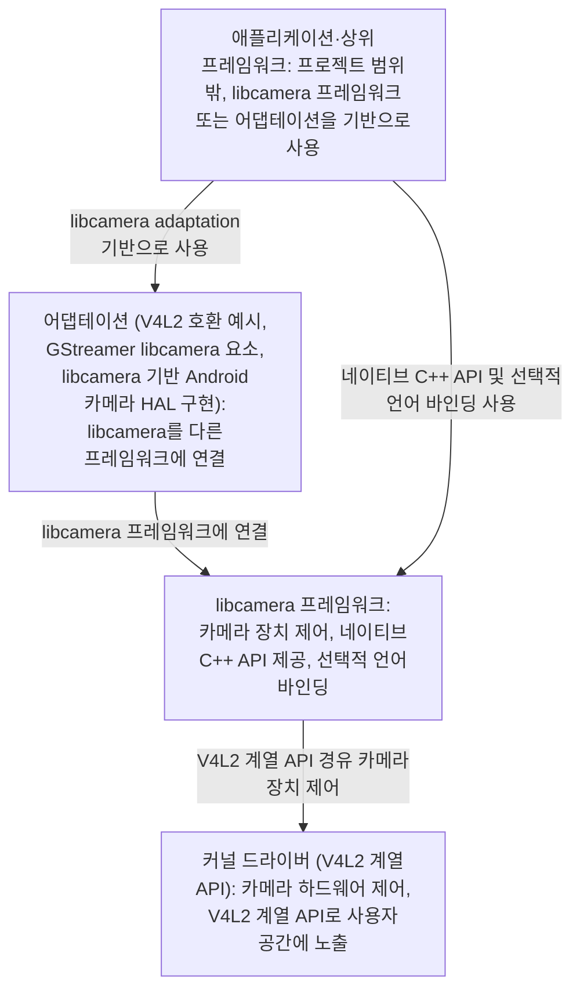
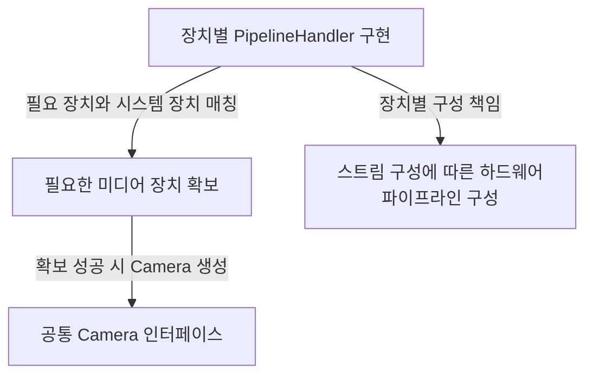
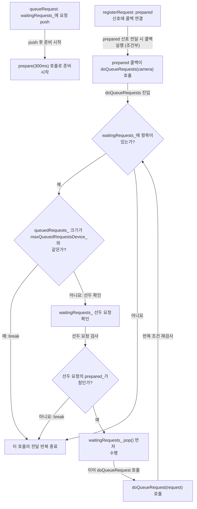
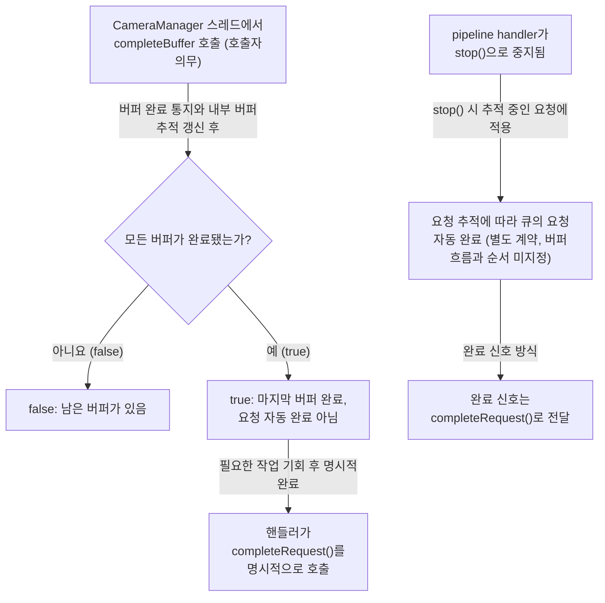
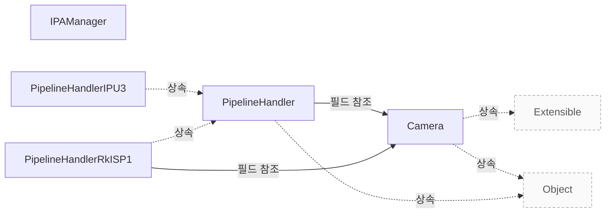

# libcamera 제품 개요

**제품이 무엇이고 어디까지 지원하는지, 공통 설계가 구현자에게 해 주는 일을 확인하고 도입할 범위를 판단하세요.**

| 지금 확인할 내용 | 이동할 절 |
|---|---|
| 연동 순서와 구현 책임을 확인하고 설정·요청·정지 계약을 적용하세요. | [연동 가이드](vendor-integration.md) |
| 지원 조건과 구성 제약을 확인하고 제품 도입 전에 검증할 범위를 정하세요. | [지원 범위와 검증](vendor-assurance.md) |
| 파이프라인 구현이 지켜야 하는 구성·요청·완료·종료 계약을 확인하세요. | [Pipeline Handler](pipeline-handler.md) |
| <a id="장치-요청-한도와-대기-큐"></a>장치 요청 수의 기본 한도와 대기 큐를 확인합니다. | [Pipeline 요청 제출과 완료](pipeline-requests.md#장치-요청-한도와-대기-큐) |

## 무엇이며 누구의 어떤 문제를 푸는가

libcamera는 Linux, Android, ChromeOS를 위한 오픈 소스 복합 카메라 지원 라이브러리입니다. Linux 커널 장치 드라이버와 연동하며, Linux 시스템에서 복합 카메라의 이미지 캡처를 쉽게 다루도록 개발자에게 API를 제공합니다. libcamera는 Linux 기반 시스템에 완전한 카메라 스택을 제공합니다. 이 스택은 커널 API를 통해 카메라에서 원하는 결과를 얻는 데 필요한 하드웨어 구성과 이미지 제어 알고리즘을 추상화하여, 개발자가 이 작업들을 간단하고 일관된 방식으로 다루게 합니다. `Documentation/introduction.rst:10`, `Documentation/introduction.rst:45`

<!-- sdd:visual:camera-stack -->
### 카메라 스택의 네 계층



[Mermaid 원문](vendor-overview.camera-stack.mmd)

??? note "그림 근거와 확인 범위"
    애플리케이션부터 커널 드라이버까지 네 소프트웨어 계층은 각각 어떤 역할을 맡습니까? 카메라 하드웨어 자체, 지원 기종, 성능은 이 그림의 범위가 아닙니다.
    
    소스에 연결한 설계 해석입니다. 자동 연결 검사는 의미 승인이나 기기 실행 검증이 아닙니다.
    
    | 요소·전이 | 소스 근거 |
    |---|---|
    | <span data-sdd-label-en="Applications and upper-level frameworks: outside project scope, based on the libcamera framework or adaptation">애플리케이션·상위 프레임워크: 프로젝트 범위 밖, libcamera 프레임워크 또는 어댑테이션을 기반으로 사용</span> | [Documentation/introduction.rst:137](#source-e3b563f549a8c46d) |
    | <span data-sdd-label-en="Adaptation (V4L2 compatibility example, gstreamer libcamera element, libcamera-based Android camera HAL implementation): connects libcamera to other frameworks">어댑테이션 &#40;V4L2 호환 예시, GStreamer libcamera 요소, libcamera 기반 Android 카메라 HAL 구현&#41;: libcamera를 다른 프레임워크에 연결</span> | [Documentation/introduction.rst:137](#source-e3b563f549a8c46d) |
    | <span data-sdd-label-en="libcamera framework: camera device control, native C++ API, optional language bindings">libcamera 프레임워크: 카메라 장치 제어, 네이티브 C++ API 제공, 선택적 언어 바인딩</span> | [Documentation/introduction.rst:137](#source-e3b563f549a8c46d) |
    | <span data-sdd-label-en="Kernel drivers (V4L2 family of APIs): control camera hardware and expose it to userspace through V4L2 APIs">커널 드라이버 &#40;V4L2 계열 API&#41;: 카메라 하드웨어 제어, V4L2 계열 API로 사용자 공간에 노출</span> | [Documentation/introduction.rst:137](#source-e3b563f549a8c46d) |
    | <span data-sdd-label-en="Use based on the libcamera adaptation">libcamera adaptation 기반으로 사용</span> | [Documentation/introduction.rst:137](#source-e3b563f549a8c46d) |
    | <span data-sdd-label-en="Connect to the libcamera framework">libcamera 프레임워크에 연결</span> | [Documentation/introduction.rst:137](#source-e3b563f549a8c46d) |
    | <span data-sdd-label-en="Control camera devices via the V4L2 family of APIs">V4L2 계열 API 경유 카메라 장치 제어</span> | [Documentation/introduction.rst:137](#source-e3b563f549a8c46d) |
    | <span data-sdd-label-en="Use the native C++ API and optional language bindings">네이티브 C++ API 및 선택적 언어 바인딩 사용</span> | [Documentation/introduction.rst:137](#source-e3b563f549a8c46d) |
<!-- /sdd:visual:camera-stack -->

드라이버를 사용해 동작하는 카메라 스택을 제공하는 일은 사용자 공간의 책임이며, 벤더가 애플리케이션 개발자를 위한 공통 아키텍처나 API 없이 별도로 구현하는 경우가 일반적입니다. 하드웨어 파이프라인과 커널 API에서 이를 표현하는 방식의 차이 때문에 맞춤 처리가 필요한 경우가 많아 작업이 복잡해집니다. 가장 아래 계층의 커널 드라이버는 카메라 하드웨어를 제어하고 사용자 공간에 저수준 인터페이스를 제공합니다. 이 인터페이스는 Linux 커널의 `V4L2` API 계열인 Media `Controller` API, V4L2 Video `Device` API, V4L2 Subdev API를 사용합니다. `Documentation/introduction.rst:35`, `Documentation/introduction.rst:137`

그 위의 libcamera 프레임워크는 핵심 구성 요소인 libcamera에서 카메라 장치의 모든 제어를 처리하고 상위 계층에 네이티브 `C++ API`를 제공합니다. 선택적 언어 바인딩을 사용하면 다른 프로그래밍 언어에서도 libcamera와 연결할 수 있습니다. 그 위의 libcamera adaptation은 다른 프레임워크에서 libcamera에 연결하는 구성 요소를 가리킵니다. 예로 `V4L2` 호환 계층, gstreamer libcamera 요소, libcamera 기반 Android camera HAL 구현이 있습니다. `Documentation/introduction.rst:137`

가장 위의 애플리케이션과 상위 프레임워크는 libcamera 프레임워크 또는 libcamera adaptation을 기반으로 합니다. 이 계층은 libcamera 프로젝트의 범위 밖입니다. `Documentation/introduction.rst:137`

근거 원문: [Documentation/introduction.rst:10](#source-34fda84500757231) · [Documentation/introduction.rst:35](#source-de476c940b030e4a) · [Documentation/introduction.rst:45](#source-f350cabac0db8343) · [Documentation/introduction.rst:137](#source-e3b563f549a8c46d) · [product-evidence/libcamera/official-stack.txt:1](#source-a43b9ee967d1a5db)

## 지원하는 하드웨어와 빌드 선택

문서에는 라이브러리가 현재 전용 파이프라인 핸들러로 지원하는 하드웨어 플랫폼으로 Arm Mali-C55, Intel IPU3 (`ipu3`), NXP i.MX8MP (`imx8-isi` 및 `rkisp1`), RaspberryPi 3, 4 및 zero (`rpi/vc4`), Rockchip RK3399 (`rkisp1`)가 나열되어 있습니다. libcamera가 범용으로 지원한다고 문서에 명시한 대상은 USB 비디오 장치 클래스 카메라(`uvcvideo`), iMX7, IPU6, Allwinner Sun6i(`simple`), 테스트 용도의 가상 미디어 컨트롤러 드라이버(`vimc`)입니다. `Documentation/platform_support.rst:6`

빌드할 파이프라인 핸들러는 배열 옵션인 `pipelines`에서 선택하며, 기본값은 `auto`입니다. `auto`를 선택하면 대상 아키텍처에 적용되는 모든 파이프라인을 빌드하고, `all`을 선택하면 모든 파이프라인을 빌드합니다. 두 값을 함께 선택하면 `all`이 우선합니다. 개별 선택지는 `imx8-isi`, `ipu3`, `mali-c55`, `rkisp1`, `rpi/pisp`, `rpi/vc4`, `simple`, `uvcvideo`, `vimc`, `virtual`입니다. `meson_options.txt:75`

근거 원문: [Documentation/platform_support.rst:6](#source-9d6502e234c4647d) · [meson_options.txt:75](#source-691389506fe87b32)

## 제공 기능과 지원 범위

`Camera`는 하나의 이미지 소스에서 하나 이상의 이미지 스트림을 생성할 수 있는 카메라를 모델링합니다. 기기를 구성하고 제어하며 이미지 스트림을 캡처하는 주요 인터페이스를 제공하는 libcamera의 중심 객체입니다. 장치별 `PipelineHandler`는 스트림 구성에 따라 하드웨어 파이프라인을 구성합니다. `PipelineHandler` 구현은 필요한 미디어 장치를 시스템의 장치와 대응시키고 모두 확보할 수 있게 되면 해당 `Camera` 인스턴스를 생성해야 하며, 모든 `PipelineHandler` 하위 클래스는 `REGISTER_PIPELINE_HANDLER()` 매크로로 libcamera에 등록해야 합니다. `src/libcamera/camera.cpp:752`, `src/libcamera/pipeline_handler.cpp:30`, `Documentation/libcamera_architecture.rst:86`

<!-- sdd:visual:hardware-boundary -->
### 공통 Camera와 장치별 구현의 경계



[Mermaid 원문](vendor-overview.hardware-boundary.mmd)

??? note "그림 근거와 확인 범위"
    공통 Camera와 장치별 PipelineHandler의 책임 연결입니다. 스트림 구성에 따른 하드웨어 구성과 장치 매칭·Camera 생성 책임을 구분하며 전체 실행 순서·지원 기종·성능을 보장하지 않습니다.
    
    소스에 연결한 설계 해석입니다. 자동 연결 검사는 의미 승인이나 기기 실행 검증이 아닙니다.
    
    | 요소·전이 | 소스 근거 |
    |---|---|
    | <span data-sdd-label-en="Device-specific PipelineHandler">장치별 PipelineHandler 구현</span> | [src/libcamera/pipeline_handler.cpp:30](#source-05721740b01bcd0e) |
    | <span data-sdd-label-en="Acquire required media devices">필요한 미디어 장치 확보</span> | [src/libcamera/pipeline_handler.cpp:30](#source-05721740b01bcd0e) |
    | <span data-sdd-label-en="Common Camera interface">공통 Camera 인터페이스</span> | [src/libcamera/camera.cpp:752](#source-8264067114dccdee) |
    | <span data-sdd-label-en="Configure hardware pipeline from stream configuration">스트림 구성에 따른 하드웨어 파이프라인 구성</span> | [Documentation/libcamera_architecture.rst:86](#source-94ac8aab4dea2a65) |
    | <span data-sdd-label-en="Device-specific configuration responsibility">장치별 구성 책임</span> | [Documentation/libcamera_architecture.rst:86](#source-94ac8aab4dea2a65) |
    | <span data-sdd-label-en="Match required devices to the system">필요 장치와 시스템 장치 매칭</span> | [src/libcamera/pipeline_handler.cpp:30](#source-05721740b01bcd0e) |
    | <span data-sdd-label-en="Create Camera after acquisition">확보 성공 시 Camera 생성</span> | [src/libcamera/pipeline_handler.cpp:30](#source-05721740b01bcd0e) |
<!-- /sdd:visual:hardware-boundary -->

근거 원문: [src/libcamera/camera.cpp:752](#source-8264067114dccdee) · [src/libcamera/pipeline_handler.cpp:30](#source-05721740b01bcd0e) · [Documentation/libcamera_architecture.rst:86](#source-94ac8aab4dea2a65)

## 장치 구현자가 공통 계층에서 얻는 것

`PipelineHandler::queueRequest()`는 요청을 대기 목록에 추가한 뒤 준비를 시작합니다. `registerRequest()`는 요청의 `prepared` 신호를 `doQueueRequests()` 호출에 연결합니다. `doQueueRequests()`는 대기 목록의 앞 요청이 준비되지 않았거나 `queuedRequests_`의 원소 개수가 `maxQueuedRequestsDevice_`와 같으면 순회를 멈춥니다. 그 외에는 앞 요청을 목록에서 꺼내 처리하므로 준비된 요청을 제출 순서대로 처리합니다. `src/libcamera/pipeline_handler.cpp:447`, `src/libcamera/pipeline_handler.cpp:428`

<!-- sdd:visual:vendor-waiting-queue-conditions -->
### 선두 요청을 전달하거나 반복을 멈추는 조건



[Mermaid 원문](vendor-overview.vendor-waiting-queue-conditions.mmd)

??? note "그림 근거와 확인 범위"
    waitingRequests_ 순회에서 준비 상태와 queuedRequests_ 소프트웨어 큐 크기는 어떻게 전달을 제한합니까?
    
    소스에 연결한 설계 해석입니다. 자동 연결 검사는 의미 승인이나 기기 실행 검증이 아닙니다.
    
    | 요소·전이 | 소스 근거 |
    |---|---|
    | <span data-sdd-label-en="queueRequest: push request to waitingRequests_">queueRequest: waitingRequests&#95;에 요청 push</span> | [src/libcamera/pipeline_handler.cpp:428](#source-789eafedfaa7f3c5) |
    | <span data-sdd-label-en="Start preparation by calling prepare(300ms)">prepare&#40;300ms&#41; 호출로 준비 시작</span> | [src/libcamera/pipeline_handler.cpp:428](#source-789eafedfaa7f3c5) |
    | <span data-sdd-label-en="registerRequest: connect callback to prepared signal">registerRequest: prepared 신호에 콜백 연결</span> | [src/libcamera/pipeline_handler.cpp:428](#source-789eafedfaa7f3c5) |
    | <span data-sdd-label-en="Prepared callback invokes doQueueRequests(camera)">prepared 콜백이 doQueueRequests&#40;camera&#41; 호출</span> | [src/libcamera/pipeline_handler.cpp:428](#source-789eafedfaa7f3c5) |
    | <span data-sdd-label-en="Does waitingRequests_ contain an item?">waitingRequests&#95;에 항목이 있는가?</span> | [src/libcamera/pipeline_handler.cpp:428](#source-789eafedfaa7f3c5) |
    | <span data-sdd-label-en="Is queuedRequests_ size equal to maxQueuedRequestsDevice_?">queuedRequests&#95; 크기가 maxQueuedRequestsDevice&#95;와 같은가?</span> | [src/libcamera/pipeline_handler.cpp:428](#source-789eafedfaa7f3c5) |
    | <span data-sdd-label-en="Inspect the front request of waitingRequests_">waitingRequests&#95; 선두 요청 확인</span> | [src/libcamera/pipeline_handler.cpp:428](#source-789eafedfaa7f3c5) |
    | <span data-sdd-label-en="Is the front request prepared_?">선두 요청의 prepared&#95;가 참인가?</span> | [src/libcamera/pipeline_handler.cpp:428](#source-789eafedfaa7f3c5) |
    | <span data-sdd-label-en="Pop waitingRequests_ first">waitingRequests&#95;.pop&#40;&#41; 먼저 수행</span> | [src/libcamera/pipeline_handler.cpp:428](#source-789eafedfaa7f3c5) |
    | <span data-sdd-label-en="Call doQueueRequest(request)">doQueueRequest&#40;request&#41; 호출</span> | [src/libcamera/pipeline_handler.cpp:428](#source-789eafedfaa7f3c5) |
    | <span data-sdd-label-en="End this invocation&#x27;s forwarding loop">이 호출의 전달 반복 종료</span> | [src/libcamera/pipeline_handler.cpp:428](#source-789eafedfaa7f3c5) |
    | <span data-sdd-label-en="Start preparation after push">push 후 준비 시작</span> | [src/libcamera/pipeline_handler.cpp:428](#source-789eafedfaa7f3c5) |
    | <span data-sdd-label-en="Callback runs when the prepared signal is delivered (conditional)">prepared 신호 전달 시 콜백 실행 &#40;조건부&#41;</span> | [src/libcamera/pipeline_handler.cpp:428](#source-789eafedfaa7f3c5) |
    | <span data-sdd-label-en="Enter doQueueRequests">doQueueRequests 진입</span> | [src/libcamera/pipeline_handler.cpp:428](#source-789eafedfaa7f3c5) |
    | <span data-sdd-label-en="Yes">예</span> | [src/libcamera/pipeline_handler.cpp:428](#source-789eafedfaa7f3c5) |
    | <span data-sdd-label-en="No">아니요</span> | [src/libcamera/pipeline_handler.cpp:428](#source-789eafedfaa7f3c5) |
    | <span data-sdd-label-en="Yes: break">예: break</span> | [src/libcamera/pipeline_handler.cpp:428](#source-789eafedfaa7f3c5) |
    | <span data-sdd-label-en="No: inspect front">아니요: 선두 확인</span> | [src/libcamera/pipeline_handler.cpp:428](#source-789eafedfaa7f3c5) |
    | <span data-sdd-label-en="Check the front request">선두 요청 검사</span> | [src/libcamera/pipeline_handler.cpp:428](#source-789eafedfaa7f3c5) |
    | <span data-sdd-label-en="No: break">아니요: break</span> | [src/libcamera/pipeline_handler.cpp:428](#source-789eafedfaa7f3c5) |
    | <span data-sdd-label-en="Yes">예</span> | [src/libcamera/pipeline_handler.cpp:428](#source-789eafedfaa7f3c5) |
    | <span data-sdd-label-en="Then call doQueueRequest">이어 doQueueRequest 호출</span> | [src/libcamera/pipeline_handler.cpp:428](#source-789eafedfaa7f3c5) |
    | <span data-sdd-label-en="Recheck loop condition">반복 조건 재검사</span> | [src/libcamera/pipeline_handler.cpp:428](#source-789eafedfaa7f3c5) |
<!-- /sdd:visual:vendor-waiting-queue-conditions -->

<!-- sdd:visual:vendor-buffer-and-request-completion -->
### 버퍼 완료와 명시적 요청 완료의 경계



[Mermaid 원문](vendor-overview.vendor-buffer-and-request-completion.mmd)

??? note "그림 근거와 확인 범위"
    마지막 버퍼가 끝났을 때 completeBuffer의 반환과 핸들러의 요청 완료 의무는 어떻게 구분됩니까?
    
    소스에 연결한 설계 해석입니다. 자동 연결 검사는 의미 승인이나 기기 실행 검증이 아닙니다.
    
    | 요소·전이 | 소스 근거 |
    |---|---|
    | <span data-sdd-label-en="Call completeBuffer on the CameraManager thread (caller obligation)">CameraManager 스레드에서 completeBuffer 호출 &#40;호출자 의무&#41;</span> | [src/libcamera/pipeline_handler.cpp:547](#source-ab8710f8a8a7905d) |
    | <span data-sdd-label-en="Have all buffers completed?">모든 버퍼가 완료됐는가?</span> | [src/libcamera/pipeline_handler.cpp:547](#source-ab8710f8a8a7905d) |
    | <span data-sdd-label-en="false: buffers remain">false: 남은 버퍼가 있음</span> | [src/libcamera/pipeline_handler.cpp:547](#source-ab8710f8a8a7905d) |
    | <span data-sdd-label-en="true: last buffer completed, request not automatically completed">true: 마지막 버퍼 완료, 요청 자동 완료 아님</span> | [src/libcamera/pipeline_handler.cpp:547](#source-ab8710f8a8a7905d) |
    | <span data-sdd-label-en="Handler explicitly calls completeRequest()">핸들러가 completeRequest&#40;&#41;를 명시적으로 호출</span> | [src/libcamera/pipeline_handler.cpp:547](#source-ab8710f8a8a7905d) |
    | <span data-sdd-label-en="Pipeline handler is stopped with stop()">pipeline handler가 stop&#40;&#41;으로 중지됨</span> | [src/libcamera/pipeline_handler.cpp:463](#source-35ab684c1adef175) |
    | <span data-sdd-label-en="Queued requests auto-completed by request tracking (separate contract, no order defined against buffer flow)">요청 추적에 따라 큐의 요청 자동 완료 &#40;별도 계약, 버퍼 흐름과 순서 미지정&#41;</span> | [src/libcamera/pipeline_handler.cpp:463](#source-35ab684c1adef175) |
    | <span data-sdd-label-en="Completion is signalled via completeRequest()">완료 신호는 completeRequest&#40;&#41;로 전달</span> | [src/libcamera/pipeline_handler.cpp:463](#source-35ab684c1adef175) |
    | <span data-sdd-label-en="After notifying buffer completion and updating internal buffer tracking">버퍼 완료 통지와 내부 버퍼 추적 갱신 후</span> | [src/libcamera/pipeline_handler.cpp:547](#source-ab8710f8a8a7905d) |
    | <span data-sdd-label-en="No (false)">아니요 &#40;false&#41;</span> | [src/libcamera/pipeline_handler.cpp:547](#source-ab8710f8a8a7905d) |
    | <span data-sdd-label-en="Yes (true)">예 &#40;true&#41;</span> | [src/libcamera/pipeline_handler.cpp:547](#source-ab8710f8a8a7905d) |
    | <span data-sdd-label-en="After the chance for still-needed work, explicit completion">필요한 작업 기회 후 명시적 완료</span> | [src/libcamera/pipeline_handler.cpp:547](#source-ab8710f8a8a7905d) |
    | <span data-sdd-label-en="Applies to tracked requests when stop() is called">stop&#40;&#41; 시 추적 중인 요청에 적용</span> | [src/libcamera/pipeline_handler.cpp:463](#source-35ab684c1adef175) |
    | <span data-sdd-label-en="Completion signalling method">완료 신호 방식</span> | [src/libcamera/pipeline_handler.cpp:463](#source-35ab684c1adef175) |
<!-- /sdd:visual:vendor-buffer-and-request-completion -->

요청 준비에 실패하거나 파이프라인 핸들러가 장치에 요청을 큐잉하는 데 실패하면 요청이 취소됩니다. 큐에 넣은 요청을 추적하면 `stop()`으로 파이프라인 핸들러를 중지할 때 모든 요청이 자동으로 완료되며, 파이프라인 핸들러는 `completeRequest()`로 요청 완료를 알려야 합니다. 요청이 준비 단계에서 실패하거나 파이프라인 핸들러가 요청을 하드웨어 큐에 등록하지 못하면 해당 요청이 취소됩니다. `src/libcamera/pipeline_handler.cpp:428`, `src/libcamera/pipeline_handler.cpp:460`

대기열에 들어간 요청을 추적하므로 `stop()`으로 파이프라인 핸들러를 정지할 때 모든 요청이 자동으로 완료됩니다. 파이프라인 핸들러는 버퍼 완료를 애플리케이션에 알리고 요청 내부의 버퍼 추적을 갱신하도록 `CameraManager` 스레드에서 `completeBuffer()`를 호출해야 합니다. 마지막 버퍼가 완료되어도 요청은 자동으로 완료되지 않으므로 파이프라인 핸들러는 `completeRequest()`를 명시적으로 호출해야 합니다. `src/libcamera/pipeline_handler.cpp:463`, `src/libcamera/pipeline_handler.cpp:547`

근거 원문: [src/libcamera/pipeline_handler.cpp:447](#source-106682bf83e3416a) · [src/libcamera/pipeline_handler.cpp:460](#source-0a5bda976f5815de) · [src/libcamera/pipeline_handler.cpp:463](#source-35ab684c1adef175) · [src/libcamera/pipeline_handler.cpp:547](#source-ab8710f8a8a7905d) · [src/libcamera/pipeline_handler.cpp:428](#source-789eafedfaa7f3c5)

??? note "설계 질문과 검증 범위"
    질문별 답변과 근거 연결을 검사했습니다. 의미와 실행 결과는 사람 검토가 필요합니다.
    
    | 설계 질문 | 설명 위치 | 확인 범위 |
    |---|---|---|
    | 어떤 고객 문제를 해결하며 어떤 환경을 대상으로 합니까? | [무엇이며 누구의 어떤 문제를 푸는가](#무엇이며-누구의-어떤-문제를-푸는가) | 코드 근거와 설명 연결 |
    | 어디까지 지원하며 지원 대상은 어떻게 고릅니까? | [지원하는 하드웨어와 빌드 선택](#지원하는-하드웨어와-빌드-선택) | 코드 근거와 설명 연결 |
    | 어떤 기능을 제공하며 지원 범위는 어떤 구현에 달려 있습니까? | [제공 기능과 지원 범위](#제공-기능과-지원-범위) | 코드 근거와 설명 연결 |
    | 공통 구현을 활용할 수 있는 강점과 그 조건은 무엇입니까? | [장치 구현자가 공통 계층에서 얻는 것](#장치-구현자가-공통-계층에서-얻는-것) | 코드 근거와 설명 연결 |

## 소스 근거

같은 발췌는 한 번만 싣습니다. 필요한 원문을 펼쳐 설명과 대조하세요.

<a id="source-34fda84500757231"></a>

??? note "소스 근거: Documentation/introduction.rst:10"
    `Documentation/introduction.rst:10`에서 시작하는 발췌입니다. 종료 줄은 13이며, 아래 원문을 설명과 대조할 수 있습니다.
    
    SHA-256: `84621541899cba7430b844bc03d13fc8e6f3f03e7c30556df0bf1cd11007494c`
    
    ```text
    libcamera is an open source complex camera support library for Linux, Android
    and ChromeOS. The library interfaces with Linux kernel device drivers and
    provides an intuitive API to developers in order to simplify the complexity
    involved in capturing images from complex cameras on Linux systems.
    ```

<a id="source-de476c940b030e4a"></a>

??? note "소스 근거: Documentation/introduction.rst:35"
    `Documentation/introduction.rst:35`에서 시작하는 발췌입니다. 종료 줄은 40이며, 아래 원문을 설명과 대조할 수 있습니다.
    
    SHA-256: `0c6b72f4ffe9e608101639096b5597a61f41f776e4f5ac4aaa43229c744db3f0`
    
    ```text
    The usage of these drivers to provide a functioning camera stack is a
    responsibility that lies in userspace, and is commonly implemented separately
    by vendors without a common architecture or API for application developers. This
    adds a lot of complexity to the task, particularly when considering that the
    differences in hardware pipelines and their representation in the kernel's APIs
    often necessitate bespoke handling.
    ```

<a id="source-f350cabac0db8343"></a>

??? note "소스 근거: Documentation/introduction.rst:45"
    `Documentation/introduction.rst:45`에서 시작하는 발췌입니다. 종료 줄은 49이며, 아래 원문을 설명과 대조할 수 있습니다.
    
    SHA-256: `56f623776b7eab9511de1f32c1f3080c4eab37239185f5134db6b2644760b1f5`
    
    ```text
    libcamera provides a complete camera stack for Linux-based systems to abstract
    the configuration of hardware and image control algorithms required to obtain
    desirable results from the camera through the kernel's APIs, reducing those
    operations to a simple and consistent method for developers. In short instead of
    having to deal with this:
    ```

<a id="source-e3b563f549a8c46d"></a>

??? note "소스 근거: Documentation/introduction.rst:137"
    `Documentation/introduction.rst:137`에서 시작하는 발췌입니다. 종료 줄은 165이며, 아래 원문을 설명과 대조할 수 있습니다.
    
    SHA-256: `750a623b45ad76fbd899b56427ad76ef91bdc922497972317df868fe538c3b03`
    
    ```text
    The camera stack comprises four software layers. From bottom to top:
    
    * The kernel drivers control the camera hardware and expose a
      low-level interface to userspace through the Linux kernel V4L2
      family of APIs (Media Controller API, V4L2 Video Device API and
      V4L2 Subdev API).
    
    * The libcamera framework is the core part of the stack. It
      handles all control of the camera devices in its core component,
      libcamera, and exposes a native C++ API to upper layers. Optional
      language bindings allow interfacing to libcamera from other
      programming languages.
    
      Those components live in the same source code repository and
      all together constitute the libcamera framework.
    
    * The libcamera adaptation is an umbrella term designating the
      components that interface to libcamera in other frameworks.
      Notable examples are a V4L2 compatibility layer, a gstreamer
      libcamera element, and an Android camera HAL implementation based
      on libcamera.
    
      Those components can live in the libcamera project source code
      in separate repositories, or move to their respective project's
      repository (for instance the gstreamer libcamera element).
    
    * The applications and upper level frameworks are based on the
      libcamera framework or libcamera adaptation, and are outside of
      the scope of the libcamera project.
    ```

<a id="source-a43b9ee967d1a5db"></a>

??? note "제품 자료: product-evidence/libcamera/official-stack.txt:1"
    소스와 별도로 제공된 자료입니다. 제공자·버전·적용 범위를 아래 기록에서 확인하세요. 자동 검사는 사람 승인이 아닙니다.
    
    `product-evidence/libcamera/official-stack.txt:1`에서 시작하는 발췌입니다. 종료 줄은 10이며, 아래 원문을 설명과 대조할 수 있습니다.
    
    SHA-256: `fdd39a9c11328e6bb549203a2395b3f9331fa15d5e2da711b703643e299f8fc0`
    
    ```text
    .. SPDX-License-Identifier: CC-BY-SA-4.0
    .. Source: https://gitlab.freedesktop.org/camera/libcamera/-/blob/212c689fcf2450bbfbaab25c7472895ac277b5d6/Documentation/introduction.rst
    .. Unmodified excerpt; project documentation, not a commercial product specification.
    
    libcamera provides a complete camera stack for Linux-based systems to abstract
    the configuration of hardware and image control algorithms required to obtain
    desirable results from the camera through the kernel's APIs, reducing those
    operations to a simple and consistent method for developers. In short instead of
    having to deal with this:
    
    ```
    
    ```json
    {
      "type": "project-document",
      "supplier": "libcamera official upstream; CC-BY-SA-4.0; URL in local material",
      "version": "212c689fcf2450bbfbaab25c7472895ac277b5d6",
      "date": "2026-10-30",
      "valid_until": "2026-10-30",
      "product": "libcamera",
      "release": "212c689fcf2450bbfbaab25c7472895ac277b5d6",
      "configuration": "public-source-documentation",
      "feature": "camera-stack",
      "conditions": [
        "Linux-based systems",
        "Kernel drivers and the relevant pipeline implementation are required."
      ],
      "sha256": "fdd39a9c11328e6bb549203a2395b3f9331fa15d5e2da711b703643e299f8fc0"
    }
    ```

<a id="source-9d6502e234c4647d"></a>

??? note "소스 근거: Documentation/platform_support.rst:6"
    `Documentation/platform_support.rst:6`에서 시작하는 발췌입니다. 종료 줄은 19이며, 아래 원문을 설명과 대조할 수 있습니다.
    
    SHA-256: `c3521ec69316b30bbb021a31f90ae53cd0d641f77c91a13ed2d6fa0f7266f2bb`
    
    ```text
    The library currently supports the following hardware platforms specifically
    with dedicated pipeline handlers:
    
       - Arm Mali-C55
       - Intel IPU3 (ipu3)
       - NXP i.MX8MP (imx8-isi and rkisp1)
       - RaspberryPi 3, 4 and zero (rpi/vc4)
       - Rockchip RK3399 (rkisp1)
    
    Furthermore, generic platform support is provided for the following:
    
       - USB video device class cameras (uvcvideo)
       - iMX7, IPU6, Allwinner Sun6i (simple)
       - Virtual media controller driver for test use cases (vimc)
    ```

<a id="source-691389506fe87b32"></a>

??? note "소스 근거: meson_options.txt:75"
    `meson_options.txt:75`에서 시작하는 발췌입니다. 종료 줄은 92이며, 아래 원문을 설명과 대조할 수 있습니다.
    
    SHA-256: `6884c14e5ebb9b81b76a500c4890a7c14db2e86c34395d71c496a6c86bf0b58d`
    
    ```text
    option('pipelines',
            type : 'array',
            value : ['auto'],
            choices : [
                'all',
                'auto',
                'imx8-isi',
                'ipu3',
                'mali-c55',
                'rkisp1',
                'rpi/pisp',
                'rpi/vc4',
                'simple',
                'uvcvideo',
                'vimc',
                'virtual'
            ],
            description : 'Select which pipeline handlers to build. If this is set to "auto", all the pipelines applicable to the target architecture will be built. If this is set to "all", all the pipelines will be built. If both are selected then "all" will take precedence.')
    ```

<a id="source-8264067114dccdee"></a>

??? note "소스 근거: src/libcamera/camera.cpp:752"
    `src/libcamera/camera.cpp:752`에서 시작하는 발췌입니다. 종료 줄은 784이며, 아래 원문을 설명과 대조할 수 있습니다.
    
    SHA-256: `325c2af6569c185be1bc686e1fb6d161782dcbc8db34a0fbb719cff005ba7625`
    
    ```text
    \class Camera
     * \brief Camera device
     *
     * \todo Add documentation for camera start timings. What exactly does the
     * camera expect the pipeline handler to do when start() is called?
     *
     * The Camera class models a camera capable of producing one or more image
     * streams from a single image source. It provides the main interface to
     * configuring and controlling the device, and capturing image streams. It is
     * the central object exposed by libcamera.
     *
     * To support the central nature of Camera objects, libcamera manages the
     * lifetime of camera instances with std::shared_ptr<>. Instances shall be
     * created with the create() function which returns a shared pointer. The
     * Camera constructors and destructor are private, to prevent instances from
     * being constructed and destroyed manually.
     *
     * \section camera_operation Operating the Camera
     *
     * An application needs to perform a sequence of operations on a camera before
     * it is ready to process requests. The camera needs to be acquired and
     * configured to prepare the camera for capture. Once started the camera can
     * process requests until it is stopped. When an application is done with a
     * camera, the camera needs to be released.
     *
     * An application may start and stop a camera multiple times as long as it is
     * not released. The camera may also be reconfigured.
     *
     * Functions that affect the camera state as defined below are generally not
     * synchronized with each other by the Camera class. The caller is responsible
     * for ensuring their synchronization if necessary.
     *
     * \subsection Camera States
    ```

<a id="source-05721740b01bcd0e"></a>

??? note "소스 근거: src/libcamera/pipeline_handler.cpp:30"
    `src/libcamera/pipeline_handler.cpp:30`에서 시작하는 발췌입니다. 종료 줄은 43이며, 아래 원문을 설명과 대조할 수 있습니다.
    
    SHA-256: `2ba321cd394e987c2851002e9db5df0634635d71c749580c066e5556df90a715`
    
    ```text
    \file pipeline_handler.h
     * \brief Create pipelines and cameras from a set of media devices
     *
     * Each pipeline supported by libcamera needs to be backed by a pipeline
     * handler implementation that operate on a set of media devices. The pipeline
     * handler is responsible for matching the media devices it requires with the
     * devices present in the system, and once all those devices can be acquired,
     * create corresponding Camera instances.
     *
     * Every subclass of PipelineHandler shall be registered with libcamera using
     * the REGISTER_PIPELINE_HANDLER() macro.
     */
    
    using namespace std::chrono_literals;
    ```

<a id="source-94ac8aab4dea2a65"></a>

??? note "소스 근거: Documentation/libcamera_architecture.rst:86"
    `Documentation/libcamera_architecture.rst:86`에서 시작하는 발췌입니다. 종료 줄은 108이며, 아래 원문을 설명과 대조할 수 있습니다.
    
    SHA-256: `ebb7ebff27e91e71edc64f2b4e2399eb13abcbf5877787c922ba4f4146c85e7e`
    
    ```text
    Pipeline Handler
      The Pipeline Handler manages the complex pipelines exposed by the kernel
      drivers through the Media Controller and V4L2 APIs. It abstracts pipeline
      handling to hide device-specific details from the rest of the library, and
      implements both pipeline configuration based on stream configuration, and
      pipeline runtime execution and scheduling when needed by the device.
    
      The Pipeline Handler lives in the same process as the rest of the library, and
      has access to all helpers and kernel camera-related devices.
    
      Hardware abstraction is handled by device specific Pipeline Handlers which are
      derived from the Pipeline Handler base class allowing commonality to be shared
      among the implementations.
    
      Derived pipeline handlers create Camera device instances based on the devices
      they detect and support on the running system, and are responsible for
      managing the interactions with a camera device.
    
      More details can be found in the :doxy-int:`PipelineHandler` API
      documentation, and the
      :doc:`Pipeline Handler Writers Guide <guides/pipeline-handler>`.
    
    Image Processing Algorithms
    ```

<a id="source-106682bf83e3416a"></a>

??? note "소스 근거: src/libcamera/pipeline_handler.cpp:447"
    `src/libcamera/pipeline_handler.cpp:447`에서 시작하는 발췌입니다. 종료 줄은 458이며, 아래 원문을 설명과 대조할 수 있습니다.
    
    SHA-256: `93b81531d0a6f65b242cd4cfe014e0a861502c2fc2ad1d5e1f593dda7564c17d`
    
    ```text
    \fn PipelineHandler::queueRequest()
     * \brief Queue a request
     * \param[in] request The request to queue
     *
     * This function queues a capture request to the pipeline handler for
     * processing. The request is first added to the internal list of waiting
     * requests which have to be prepared to make sure they are ready for being
     * queued to the pipeline handler.
     *
     * The queue of waiting requests is iterated and up to \a
     * maxQueuedRequestsDevice_ prepared requests are passed to the pipeline handler
     * in the same order they have been queued by calling this function.
    ```

<a id="source-0a5bda976f5815de"></a>

??? note "소스 근거: src/libcamera/pipeline_handler.cpp:460"
    `src/libcamera/pipeline_handler.cpp:460`에서 시작하는 발췌입니다. 종료 줄은 461이며, 아래 원문을 설명과 대조할 수 있습니다.
    
    SHA-256: `06067fbd4ead51418e85617bc3d67c04439619836e4f024497d1583f6ac0787c`
    
    ```text
    If a Request fails during the preparation phase or if the pipeline handler
     * fails in queuing the request to the hardware the request is cancelled.
    ```

<a id="source-35ab684c1adef175"></a>

??? note "소스 근거: src/libcamera/pipeline_handler.cpp:463"
    `src/libcamera/pipeline_handler.cpp:463`에서 시작하는 발췌입니다. 종료 줄은 465이며, 아래 원문을 설명과 대조할 수 있습니다.
    
    SHA-256: `c3d1253c0ef92dd7f0ef5fd41450b788e9aa00145ac2f65bf727bf6a11e08863`
    
    ```text
    Keeping track of queued requests ensures automatic completion of all requests
     * when the pipeline handler is stopped with stop(). Request completion shall be
     * signalled by the pipeline handler using the completeRequest() function.
    ```

<a id="source-ab8710f8a8a7905d"></a>

??? note "소스 근거: src/libcamera/pipeline_handler.cpp:547"
    `src/libcamera/pipeline_handler.cpp:547`에서 시작하는 발췌입니다. 종료 줄은 563이며, 아래 원문을 설명과 대조할 수 있습니다.
    
    SHA-256: `096784b4798b3156e88e3acf84577f60a27f0bf0e2422ae7850e44b081eb9d3a`
    
    ```text
    \brief Complete a buffer for a request
     * \param[in] request The request the buffer belongs to
     * \param[in] buffer The buffer that has completed
     *
     * This function shall be called by pipeline handlers to signal completion of
     * the \a buffer part of the \a request. It notifies applications of buffer
     * completion and updates the request's internal buffer tracking. The request
     * is not completed automatically when the last buffer completes to give
     * pipeline handlers a chance to perform any operation that may still be
     * needed. They shall complete requests explicitly with completeRequest().
     *
     * \context This function shall be called from the CameraManager thread.
     *
     * \return True if all buffers contained in the request have completed, false
     * otherwise
     */
    bool PipelineHandler::completeBuffer(Request *request, FrameBuffer *buffer)
    ```

<a id="source-789eafedfaa7f3c5"></a>

??? note "소스 근거: src/libcamera/pipeline_handler.cpp:428"
    `src/libcamera/pipeline_handler.cpp:428`에서 시작하는 발췌입니다. 종료 줄은 547이며, 아래 원문을 설명과 대조할 수 있습니다.
    
    SHA-256: `5a7a3397a6034a73fe348ae44eb1e2568d2823e95542fe43386e16359d627180`
    
    ```text
    \fn PipelineHandler::registerRequest()
     * \brief Register a request for use by the pipeline handler
     * \param[in] request The request to register
     *
     * This function is called when the request is created, and allows the pipeline
     * handler to perform any one-time initialization it requries for the request.
     */
    void PipelineHandler::registerRequest(Request *request)
    {
    	/*
    	 * Connect the request prepared signal to notify the pipeline handler
    	 * when a request is ready to be processed.
    	 */
    	request->_d()->prepared.connect(this, [this, request]() {
    		doQueueRequests(request->_d()->camera());
    	});
    }
    
    /**
     * \fn PipelineHandler::queueRequest()
     * \brief Queue a request
     * \param[in] request The request to queue
     *
     * This function queues a capture request to the pipeline handler for
     * processing. The request is first added to the internal list of waiting
     * requests which have to be prepared to make sure they are ready for being
     * queued to the pipeline handler.
     *
     * The queue of waiting requests is iterated and up to \a
     * maxQueuedRequestsDevice_ prepared requests are passed to the pipeline handler
     * in the same order they have been queued by calling this function.
     *
     * If a Request fails during the preparation phase or if the pipeline handler
     * fails in queuing the request to the hardware the request is cancelled.
     *
     * Keeping track of queued requests ensures automatic completion of all requests
     * when the pipeline handler is stopped with stop(). Request completion shall be
     * signalled by the pipeline handler using the completeRequest() function.
     *
     * \context This function is called from the CameraManager thread.
     */
    void PipelineHandler::queueRequest(Request *request)
    {
    	LIBCAMERA_TRACEPOINT(request_queue, request);
    
    	Camera *camera = request->_d()->camera();
    	Camera::Private *data = camera->_d();
    	data->waitingRequests_.push(request);
    
    	request->_d()->prepare(300ms);
    }
    
    /**
     * \brief Queue one requests to the device
     */
    void PipelineHandler::doQueueRequest(Request *request)
    {
    	LIBCAMERA_TRACEPOINT(request_device_queue, request);
    
    	Camera *camera = request->_d()->camera();
    	Camera::Private *data = camera->_d();
    	data->queuedRequests_.push_back(request);
    
    	request->_d()->sequence_ = data->requestSequence_++;
    
    	if (request->_d()->cancelled_) {
    		completeRequest(request);
    		return;
    	}
    
    	int ret = queueRequestDevice(camera, request);
    	if (ret)
    		cancelRequest(request);
    }
    
    /**
     * \brief Queue prepared requests to the device
     *
     * Iterate the list of waiting requests and queue them to the device one
     * by one if they have been prepared.
     */
    void PipelineHandler::doQueueRequests(Camera *camera)
    {
    	Camera::Private *data = camera->_d();
    	while (!data->waitingRequests_.empty()) {
    		if (data->queuedRequests_.size() == maxQueuedRequestsDevice_)
    			break;
    
    		Request *request = data->waitingRequests_.front();
    		if (!request->_d()->prepared_)
    			break;
    
    		/*
    		 * Pop the request first, in case doQueueRequests() is called
    		 * recursively from within doQueueRequest()
    		 */
    		data->waitingRequests_.pop();
    		doQueueRequest(request);
    	}
    }
    
    /**
     * \fn PipelineHandler::queueRequestDevice()
     * \brief Queue a request to the device
     * \param[in] camera The camera to queue the request to
     * \param[in] request The request to queue
     *
     * This function queues a capture request to the device for processing. The
     * request contains a set of buffers associated with streams and a set of
     * parameters. The pipeline handler shall program the device to ensure that the
     * parameters will be applied to the frames captured in the buffers provided in
     * the request.
     *
     * \context This function is called from the CameraManager thread.
     *
     * \return 0 on success or a negative error code otherwise
     */
    
    /**
     * \brief Complete a buffer for a request
    ```


<!-- sdd:class-diagram -->
## 클래스 관계

화살표의 글자는 추출한 관계를 나타내며, 점선은 상속입니다. 화살표는 참조 대상 또는 기반 클래스를 향합니다. 호출 순서를 뜻하지 않습니다.


<!-- /sdd:class-diagram -->

??? note "근거와 검토 정보"
    - 생성 방식: 추출 사실과 LLM 설명
    - 검증 범위: 표·그림은 facts로 만들고 설명은 LLM이 작성합니다. 인용·문장 및 설정된 구조 검사를 적용합니다.
    - 근거 파일: `Documentation/introduction.rst`, `Documentation/libcamera_architecture.rst`, `Documentation/platform_support.rst`, `include/libcamera/camera.h`, `include/libcamera/internal/ipa_manager.h`, `include/libcamera/internal/pipeline_handler.h`, `meson_options.txt`, `product-evidence/libcamera/official-stack.txt`, `src/libcamera/camera.cpp`, `src/libcamera/ipa_manager.cpp`, `src/libcamera/pipeline/ipu3/ipu3.cpp`, `src/libcamera/pipeline/rkisp1/rkisp1.cpp`, `src/libcamera/pipeline_handler.cpp`
    - 근거 수준: 코드 확인 (정적 분석, simple_compdb 구성, commit `be7e83e913`)
    - 자동 검사 (인용·문장 및 설정된 구조 검사): 통과
    - 검토 상태 기록일: 2026-11-05 · 사람 검토 전

다음 단계: [연동 가이드](vendor-integration.md)
