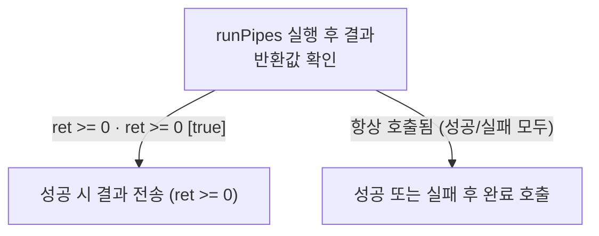

# 공개 mini HAL의 완료 분기

**파이프 반환 조건과 완료 정리를 소스와 함께 확인하세요.**


## 결과 전송과 프레임 정리

RequestManager::onFrame에서 runPipes 반환값에 따른 sendResult 조건과 onFrameDone 호출을 설명하세요. if 블록 안팎을 구분하고 실패 시 정리도 설명하세요. 실행 스레드나 성공 보장을 추정하지 마세요.

<!-- sdd:visual:completion-branches -->
### 파이프 결과와 완료 처리의 분기

RequestManager::onFrame에서 runPipes, sendResult, onFrameDone의 연결을 그리세요. 결과 전송 조건의 condition_ref를 원문 조건 ID의 참·거짓으로 선택하고 성공·실패 경로를 구분하세요. onFrameDone이 성공·실패 양쪽에서 호출되는 것을 보존하세요. 기기 동작이나 스레드 보장은 추정하지 마세요. 세 호출을 각각 한 노드로 표현하며 진입점·변수·성공실패별 가상 상태 노드는 추가하지 마세요.

LLM 그림 초안 · 사람 검토 전

작성 모델: `ollama/qwen3.5:9b`



[Mermaid 원문](completion.completion-branches.mmd)

??? note "그림 근거와 확인 범위"
    소스에 연결한 설계 해석입니다. 자동 연결 검사는 의미 승인이나 기기 실행 검증이 아닙니다.
    
    | 요소·전이 | 소스 근거 |
    |---|---|
    | runPipes 실행 후 결과 반환값 확인 | [src/device/RequestManager.cpp:37](#source-da034a9a1147d012) |
    | 성공 시 결과 전송 (ret &gt;= 0) | [src/device/RequestManager.cpp:37](#source-da034a9a1147d012) |
    | 성공 또는 실패 후 완료 호출 | [src/device/RequestManager.cpp:37](#source-da034a9a1147d012) |
    | ret &gt;= 0 · ret &gt;= 0 [true] | [src/device/RequestManager.cpp:37](#source-da034a9a1147d012) |
    | 항상 호출됨 (성공/실패 모두) | [src/device/RequestManager.cpp:37](#source-da034a9a1147d012) |
<!-- /sdd:visual:completion-branches -->

`src/device/RequestManager.cpp:37`

근거 원문: [src/device/RequestManager.cpp:37](#source-da034a9a1147d012)

## 소스 근거

같은 발췌는 한 번만 싣습니다. 필요한 원문을 펼쳐 설명과 대조하세요.

<a id="source-da034a9a1147d012"></a>

??? note "소스 근거: src/device/RequestManager.cpp:37"
    `src/device/RequestManager.cpp:37`에서 시작하는 발췌입니다. 종료 줄은 47이며, 아래 원문을 설명과 대조할 수 있습니다.
    
    SHA-256: `64ce50dbc9085701f44bbba8bc5573bc9ed24bb9eedbc15e7676446eb4f629fe`
    
    ```text
    void RequestManager::onFrame(Frame &frame) {
        FrameFactory &factory = frame.isPreview ? static_cast<FrameFactory &>(previewFactory_)
                                                : static_cast<FrameFactory &>(captureFactory_);
        int ret = factory.runPipes(frame);
        if (ret >= 0) {
            sendResult(frame);
        }
        onFrameDone(frame);
    }
    
    void RequestManager::sendResult
    ```

??? note "근거와 검토 정보"
    - 생성 방식: 질문과 소스 원문 보기
    - 검증 범위: 동작 설명을 생성하지 않습니다. 질문과 소스 위치를 표시하며 그림 초안의 작성자와 검사 범위는 그림 아래에 따로 기록합니다.
    - 근거 파일: `src/device/RequestManager.cpp`
    - 근거 수준: 코드 확인 (정적 분석, public-excerpt-fixture 구성, commit `f058f7908e`)
    - 자동 검사 (인용·문장 및 설정된 구조 검사): 통과
    - 검토 상태 기록일: 2026-10-25 · 사람 검토 전

다음 단계: [완료 분기](completion.md)
