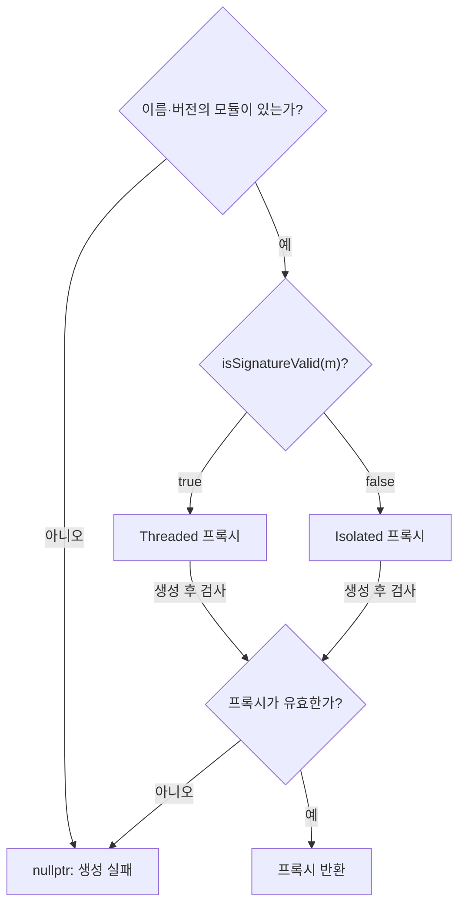
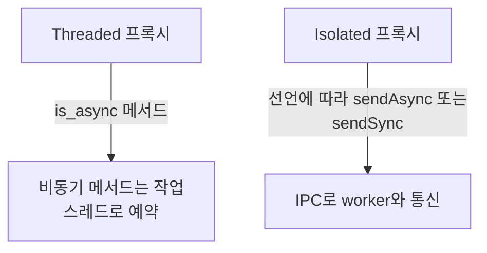
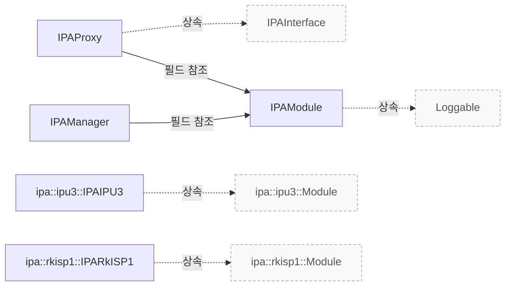

# IPA 관리와 구현 진입점

**IPA 모듈 선택, 스레드·프로세스 경계와 요청·결과 인터페이스를 구현 근거로 확인하세요.**

| 지금 확인할 내용 | 이동할 절 |
|---|---|
| 모듈 탐색과 격리 조건의 조건과 근거를 대조하세요. | [모듈 탐색과 격리 조건](#모듈-탐색과-격리-조건) |
| 스레드와 프로세스 경계의 조건과 근거를 대조하세요. | [스레드와 프로세스 경계](#스레드와-프로세스-경계) |
| 프레임 입력과 결과 인터페이스의 조건과 근거를 대조하세요. | [프레임 입력과 결과 인터페이스](#프레임-입력과-결과-인터페이스) |
| IPA 객체와 종료 순서의 조건과 근거를 대조하세요. | [IPA 객체와 종료 순서](#ipa-객체와-종료-순서) |
| 생성과 IPC 실패의 조건과 근거를 대조하세요. | [생성과 IPC 실패](#생성과-ipc-실패) |
| <a id="보정-전-튜닝-파일"></a>보정 전 튜닝 파일의 조건과 근거를 대조하세요. | [IPA 튜닝과 소프트웨어 ISP](ipa-algorithms.md#보정-전-튜닝-파일) |
| <a id="소프트웨어-isp-입력-버퍼의-텍스처-형식"></a>소프트웨어 ISP 입력 버퍼의 텍스처 형식의 조건과 근거를 대조하세요. | [IPA 튜닝과 소프트웨어 ISP](ipa-algorithms.md#소프트웨어-isp-입력-버퍼의-텍스처-형식) |
| <a id="소프트웨어-isp-셰이더의-렌즈-음영-보정"></a>소프트웨어 ISP 셰이더의 렌즈 음영 보정의 조건과 근거를 대조하세요. | [IPA 튜닝과 소프트웨어 ISP](ipa-algorithms.md#소프트웨어-isp-셰이더의-렌즈-음영-보정) |

## 모듈 탐색과 격리 조건

`IPAManager::IPAManager`는 사용자 지정 `ipa.module_paths`를 우선 검색하며, 빈 경로는 건너뛰고 나머지 각 디렉터리에 `addDir`을 호출합니다. `utils::libcameraBuildPath()`의 결과가 비어 있지 않으면 그 경로에 `src/ipa`를 붙여 탐색 깊이 2로 `addDir`을 호출합니다. 마지막으로 설치된 시스템 경로 `IPA_MODULE_DIR`에 `addDir`을 호출합니다. `src/libcamera/ipa_manager.cpp:107`

<!-- sdd:visual:proxy-selection -->
### IPA 모듈 선택과 실행 경계

모듈 선택, 서명 판정, 프록시 유효성의 분기를 구분하세요. 서명 판정의 구성 조건은 이어지는 설명에서 확인합니다.



[Mermaid 원문](ipa.proxy-selection.mmd)

??? note "그림 근거와 확인 범위"
    소스에 연결한 설계 해석입니다. 자동 연결 검사는 의미 승인이나 기기 실행 검증이 아닙니다.
    
    | 요소·전이 | 소스 근거 |
    |---|---|
    | 이름·버전의 모듈이 있는가? | [include/libcamera/internal/ipa_manager.h:35](#source-2a1bbbc8623a516f) |
    | isSignatureValid(m)? | [include/libcamera/internal/ipa_manager.h:35](#source-2a1bbbc8623a516f) |
    | Threaded 프록시 | [include/libcamera/internal/ipa_manager.h:35](#source-2a1bbbc8623a516f) |
    | Isolated 프록시 | [include/libcamera/internal/ipa_manager.h:35](#source-2a1bbbc8623a516f) |
    | 프록시가 유효한가? | [include/libcamera/internal/ipa_manager.h:35](#source-2a1bbbc8623a516f) |
    | nullptr: 생성 실패 | [include/libcamera/internal/ipa_manager.h:35](#source-2a1bbbc8623a516f) |
    | 프록시 반환 | [include/libcamera/internal/ipa_manager.h:35](#source-2a1bbbc8623a516f) |
    | 아니오 | [include/libcamera/internal/ipa_manager.h:35](#source-2a1bbbc8623a516f) |
    | 예 | [include/libcamera/internal/ipa_manager.h:35](#source-2a1bbbc8623a516f) |
    | true | [include/libcamera/internal/ipa_manager.h:35](#source-2a1bbbc8623a516f) |
    | false | [include/libcamera/internal/ipa_manager.h:35](#source-2a1bbbc8623a516f) |
    | 생성 후 검사 | [include/libcamera/internal/ipa_manager.h:35](#source-2a1bbbc8623a516f) |
    | 생성 후 검사 | [include/libcamera/internal/ipa_manager.h:35](#source-2a1bbbc8623a516f) |
    | 아니오 | [include/libcamera/internal/ipa_manager.h:35](#source-2a1bbbc8623a516f) |
    | 예 | [include/libcamera/internal/ipa_manager.h:35](#source-2a1bbbc8623a516f) |
<!-- /sdd:visual:proxy-selection -->

`IPAModule::match`는 `info_.pipelineVersion`이 `minVersion` 이상이고 `maxVersion` 이하이며 `info_.name`과 `name`이 같은 경우에만 `true`를 반환합니다. 어느 조건이든 충족하지 않으면 `false`를 반환합니다. `src/libcamera/ipa_module.cpp:460`

`createIPA`는 `module(name, minVersion, maxVersion)`으로 모듈을 찾지 못하면 `nullptr`을 반환합니다. 모듈을 찾으면 `isSignatureValid(m)`이 참일 때 `T::Threaded` 프록시를, 거짓일 때 `T::Isolated` 프록시를 생성합니다. 생성한 프록시의 `isValid()`가 거짓이면 오류를 기록하고 `nullptr`을 반환하며, 참이면 프록시를 반환합니다. `include/libcamera/internal/ipa_manager.h:35`

`IPAManager::isSignatureValid`는 `HAVE_IPA_PUBKEY`가 활성화되지 않으면 `false`를 반환합니다. 활성화된 경우 `forceIsolation_`이 참이면 `false`를 반환하고, 그렇지 않으면 IPA 모듈 파일을 읽기 전용으로 엽니다. 파일 열기에 실패하거나 파일 매핑 결과가 비어 있으면 `false`를 반환합니다. 그 외에는 `pubKey_.verify(data, ipa->signature())`의 결과를 기록하고 그 결과를 반환합니다. `src/libcamera/ipa_manager.cpp:289`

근거 원문: [src/libcamera/ipa_manager.cpp:107](#source-7603cbafe8eef490) · [src/libcamera/ipa_module.cpp:460](#source-6e1525c1fc1aa55e) · [include/libcamera/internal/ipa_manager.h:35](#source-2a1bbbc8623a516f) · [src/libcamera/ipa_manager.cpp:289](#source-532f8ffa194bd319)

## 스레드와 프로세스 경계

Threaded `init` 템플릿은 매개변수를 전달해 `ipa_->init()`을 직접 호출합니다. 반환형이 `void`가 아니면 호출 결과를 `_ret`에 저장하고 반환하며, `void`이면 값을 반환하지 않습니다. `init` 분기는 IPA 메서드를 호출한 뒤 `proxy_.moveToThread`에 `thread_`의 주소를 전달합니다. `utils/codegen/ipc/generators/libcamera_templates/module_ipa_proxy.cpp.tmpl:82`

<!-- sdd:visual:execution-boundaries -->
### 스레드 호출과 IPC 호출의 경계

Threaded와 Isolated는 대체 경로입니다. 각 API가 동기인지 비동기인지는 인터페이스 선언에 따라 달라집니다.



[Mermaid 원문](ipa.execution-boundaries.mmd)

??? note "그림 근거와 확인 범위"
    소스에 연결한 설계 해석입니다. 자동 연결 검사는 의미 승인이나 기기 실행 검증이 아닙니다.
    
    | 요소·전이 | 소스 근거 |
    |---|---|
    | Threaded 프록시 | [utils/codegen/ipc/generators/libcamera_templates/module_ipa_proxy.cpp.tmpl:48](#source-c7fd6e52f2c537b5) |
    | 비동기 메서드는 작업 스레드로 예약 | [utils/codegen/ipc/generators/libcamera_templates/module_ipa_proxy.cpp.tmpl:48](#source-c7fd6e52f2c537b5) |
    | Isolated 프록시 | [utils/codegen/ipc/generators/libcamera_templates/module_ipa_proxy.cpp.tmpl:130](#source-9ff6047b0a70ce66) |
    | IPC로 worker와 통신 | [utils/codegen/ipc/generators/libcamera_templates/module_ipa_proxy.cpp.tmpl:130](#source-9ff6047b0a70ce66) |
    | is_async 메서드 | [utils/codegen/ipc/generators/libcamera_templates/module_ipa_proxy.cpp.tmpl:48](#source-c7fd6e52f2c537b5) |
    | 선언에 따라 sendAsync 또는 sendSync | [utils/codegen/ipc/generators/libcamera_templates/module_ipa_proxy.cpp.tmpl:130](#source-9ff6047b0a70ce66) |
<!-- /sdd:visual:execution-boundaries -->

Threaded `start` 템플릿 분기는 `state_`를 `ProxyRunning`으로 설정한 뒤 `thread_.start()`를 호출합니다. 이어서 `proxy_.invokeMethod()`로 `ThreadProxy::start`를 `ConnectionTypeBlocking` 연결 유형과 매개변수로 호출하고 그 반환값을 반환합니다. 생성된 `Threaded` 메서드는 `init`, `start`, `stop`을 제외한 일반 동기 메서드 분기에서 `ipa_`의 같은 이름의 메서드를 전달받은 매개변수로 직접 호출하고 그 결과를 반환합니다. 비동기 메서드 분기의 원문은 `ASSERT` 매크로에 검사식 `state_ == ProxyRunning`을 전달합니다. `utils/codegen/ipc/generators/libcamera_templates/module_ipa_proxy.cpp.tmpl:93`, `utils/codegen/ipc/generators/libcamera_templates/module_ipa_proxy.cpp.tmpl:75`, `utils/codegen/ipc/generators/libcamera_templates/module_ipa_proxy.cpp.tmpl:110`

이 Threaded 비동기 분기에서 `proxy_.invokeMethod`는 `ThreadProxy` 메서드를 전달할 때 `ConnectionTypeQueued` 연결 유형을 사용합니다. `{{proxy_name}}Threaded` 생성자는 `ipam->load()`를 호출합니다. 호출 결과가 거짓이면 생성자에서 바로 반환합니다. `utils/codegen/ipc/generators/libcamera_templates/module_ipa_proxy.cpp.tmpl:109`, `utils/codegen/ipc/generators/libcamera_templates/module_ipa_proxy.cpp.tmpl:55`

`{{proxy_name}}Threaded` 생성자는 `ipam->load()`가 성공한 경우에만 `ipam->createInterface()`를 호출합니다. 반환된 포인터가 없으면 `ipam->path()`를 포함한 오류를 기록하고 반환합니다. 포인터가 있으면 인터페이스를 `unique_ptr`로 소유하고 `proxy_.setIPA(ipa_.get())`를 호출합니다. 이어서 각 이벤트의 `connect`에 수신 객체 `this`와 해당 `{{method.mojom_name}}Handler` 메서드를 지정하고, `valid_`를 `true`로 설정합니다. `utils/codegen/ipc/generators/libcamera_templates/module_ipa_proxy.cpp.tmpl:58`, `utils/codegen/ipc/generators/libcamera_templates/module_ipa_proxy.cpp.tmpl:69`

`{{proxy_name}}Isolated` 생성자는 `resolvePath("{{module_name}}_ipa_proxy")`로 worker 경로를 찾고, 경로가 비어 있으면 오류를 기록한 뒤 반환합니다. 경로가 있으면 IPA 모듈 경로와 worker 경로로 `IPCPipeUnixSocket`을 생성하고, 연결되지 않았으면 오류를 기록한 뒤 반환합니다. `{{proxy_name}}Isolated` 생성자는 `ipc`의 `recv`에 `connect`를 호출하여 수신 객체 `this`와 콜백 `{{proxy_name}}Isolated::recvMessage`를 연결합니다. `{{proxy_name}}Isolated::{{proxy_name}}Isolated()`는 `ipc_`에 `std::move(ipc)`를 대입합니다. `utils/codegen/ipc/generators/libcamera_templates/module_ipa_proxy.cpp.tmpl:130`, `utils/codegen/ipc/generators/libcamera_templates/module_ipa_proxy.cpp.tmpl:151`, `utils/codegen/ipc/generators/libcamera_templates/module_ipa_proxy.cpp.tmpl:153`

`{{proxy_name}}Isolated` 생성자는 이 코드 지점에서 `valid_`에 `true`를 대입합니다. `IPAProxy::resolvePath`는 먼저 `execPaths_`에서 빈 디렉터리를 건너뛰고, 각 디렉터리에 지정된 파일 이름을 붙여 실행 권한이 있는 첫 경로를 반환합니다. 그곳에서 찾지 못하면 `utils::libcameraBuildPath()`가 비어 있지 않을 때는 그 경로 아래 `src/libcamera/proxy/worker`를 확인하고, 비어 있을 때는 설치 디렉터리 `IPA_PROXY_DIR`을 확인합니다. 선택한 디렉터리에 실행 권한이 있는 파일이 있으면 그 경로를 반환하고, 없으면 빈 문자열을 반환합니다. `utils/codegen/ipc/generators/libcamera_templates/module_ipa_proxy.cpp.tmpl:154`, `src/libcamera/ipa_proxy.cpp:204`

`readyRead`는 소켓에서 페이로드를 수신하고, 수신에 실패하거나 데이터 크기가 `IPCMessage::Header`보다 작으면 오류를 기록한 뒤 반환합니다. 그다음 페이로드로 `IPCMessage`를 만들고 헤더의 `cookie`로 `callData_`에서 대기 항목을 찾습니다. 일치하는 항목이 있으면 페이로드를 해당 응답으로 이동하고 `done`을 `true`로 설정한 뒤 반환합니다. 일치하는 항목이 없으면 `recv` 신호로 메시지를 전달합니다. `src/libcamera/ipc_pipe_unixsocket.cpp:27`

`IPCPipeUnixSocket::sendAsync`는 `data.payload()`를 `socket_->send`로 전송합니다. 전송 반환값이 0이 아니면 오류를 기록하고 그 값을 반환합니다. 반환값이 0이면 0을 반환합니다. `src/libcamera/ipc_pipe_unixsocket.cpp:73`

근거 원문: [utils/codegen/ipc/generators/libcamera_templates/module_ipa_proxy.cpp.tmpl:48](#source-c7fd6e52f2c537b5) · [utils/codegen/ipc/generators/libcamera_templates/module_ipa_proxy.cpp.tmpl:130](#source-9ff6047b0a70ce66) · [src/libcamera/ipa_proxy.cpp:204](#source-59a673fb7c43c0e0) · [src/libcamera/ipc_pipe_unixsocket.cpp:27](#source-f0268126d3f8c2bc) · [utils/codegen/ipc/generators/libcamera_templates/module_ipa_proxy.cpp.tmpl:75](#source-542f7efc12af7917) · [utils/codegen/ipc/generators/libcamera_templates/module_ipa_proxy.cpp.tmpl:93](#source-7670edf527118b0e) · [utils/codegen/ipc/generators/libcamera_templates/module_ipa_proxy.cpp.tmpl:109](#source-f6afc431ed47a72a) · [utils/codegen/ipc/generators/libcamera_templates/module_ipa_proxy.cpp.tmpl:82](#source-9d9c3049e90e4238) · [utils/codegen/ipc/generators/libcamera_templates/module_ipa_proxy.cpp.tmpl:110](#source-b37be3b88abeaa94) · [utils/codegen/ipc/generators/libcamera_templates/module_ipa_proxy.cpp.tmpl:55](#source-60c70cd011db2353) · [utils/codegen/ipc/generators/libcamera_templates/module_ipa_proxy.cpp.tmpl:58](#source-7a0e7fe87df98a33) · [utils/codegen/ipc/generators/libcamera_templates/module_ipa_proxy.cpp.tmpl:69](#source-927a8955b49d31d4) · [utils/codegen/ipc/generators/libcamera_templates/module_ipa_proxy.cpp.tmpl:151](#source-c41c960fc2b2e4ff) · [src/libcamera/ipc_pipe_unixsocket.cpp:73](#source-6fafe97ae651cb83) · [utils/codegen/ipc/generators/libcamera_templates/module_ipa_proxy.cpp.tmpl:153](#source-30b0ddcb59876f61) · [utils/codegen/ipc/generators/libcamera_templates/module_ipa_proxy.cpp.tmpl:154](#source-4add57ac70567634)

## 프레임 입력과 결과 인터페이스

`IPAIPU3Interface`는 `[async]` 메서드 `queueRequest`에 `frame`과 `controls`를, `computeParams`에 `frame`과 `bufferId`를 받도록 선언합니다. `processStats`는 `frame`, `frameTimestamp`, `bufferId`, `sensorControls`를 받도록 선언합니다. `IPAIPU3EventInterface`는 `paramsComputed`에 `frame`을, `metadataReady`에 `frame`과 `metadata`를 전달하도록 선언합니다. `setSensorControls`는 `frame`, `sensorControls`, `lensControls`를 인자로 선언합니다. `include/libcamera/ipa/ipu3.mojom:19`

`IPARkISP1Interface`는 `[async]` 메서드 `queueRequest`에 `frame`과 `reqControls`를, `computeParams`에 `frame`과 `bufferId`를 받도록 선언합니다. `processStats`는 `frame`, `bufferId`, `sensorControls`를 받도록 선언합니다. `IPARkISP1EventInterface`는 `paramsComputed`에 `frame`과 `bytesused`를, `metadataReady`에 `frame`과 `metadata`를 전달하도록 선언합니다. `setSensorControls`는 `frame`과 `sensorControls`를 인자로 선언합니다. `include/libcamera/ipa/rkisp1.mojom:17`

근거 원문: [include/libcamera/ipa/ipu3.mojom:19](#source-5a4a0da4800968a4) · [include/libcamera/ipa/rkisp1.mojom:17](#source-7a01de2477d6466e)

## IPA 객체와 종료 순서

호출자는 유효하지 않은 모듈에서 `IPAModule::load()`를 호출해서는 안 됩니다. `load()`가 한 번 성공하면 필요한 `IPAInterface` 인스턴스 수만큼 `createInterface()`를 호출할 수 있습니다. 호출자는 유효하지 않거나 아직 로드되지 않은 모듈에서 `createInterface()`를 호출해서는 안 됩니다. `createInterface()`는 성공하면 인터페이스를 반환하고 오류가 있으면 `nullptr`을 반환합니다. `src/libcamera/ipa_module.cpp:390`

Threaded `stop`은 상태가 `ProxyStopping`이 아님을 단언하고, 상태가 `ProxyRunning`이 아니면 반환합니다. 실행 중이면 상태를 `ProxyStopping`으로 바꾸고 `ThreadProxy::stop`을 블로킹 방식으로 호출합니다. 이어서 스레드에 `exit()`를 호출하고 `wait()`로 기다린 뒤, 현재 스레드에서 이 프록시를 대상으로 한 `InvokeMessage`를 디스패치하고 상태를 `ProxyStopped`로 바꿉니다. `{{proxy_name}}Isolated`의 소멸자는 `ipc_`가 있을 때만 `Exit` 명령과 증가 전의 `seq_`를 헤더에 담아 종료 메시지를 만들고 `sendAsync()`로 보냅니다. `utils/codegen/ipc/generators/libcamera_templates/proxy_functions.tmpl:25`, `utils/codegen/ipc/generators/libcamera_templates/module_ipa_proxy.cpp.tmpl:48`, `utils/codegen/ipc/generators/libcamera_templates/module_ipa_proxy.cpp.tmpl:130`

근거 원문: [src/libcamera/ipa_module.cpp:390](#source-fadefbb962b2fc44) · [utils/codegen/ipc/generators/libcamera_templates/module_ipa_proxy.cpp.tmpl:48](#source-c7fd6e52f2c537b5) · [utils/codegen/ipc/generators/libcamera_templates/proxy_functions.tmpl:25](#source-eb8f57d7452822da) · [utils/codegen/ipc/generators/libcamera_templates/module_ipa_proxy.cpp.tmpl:130](#source-9ff6047b0a70ce66)

## 생성과 IPC 실패

`IPAModule::load()`는 `valid_`가 거짓이면 `false`를 반환하고, 이미 `loaded_`가 참이면 `true`를 반환합니다. 그렇지 않으면 `dlopen`으로 공유 객체를 열고, 실패하면 오류를 기록한 뒤 `false`를 반환합니다. 이어서 `dlsym`으로 `ipaCreate`를 찾으며, 실패하면 오류를 기록하고 핸들을 `dlclose`로 닫은 뒤 `dlHandle_`을 `nullptr`로 설정하고 `false`를 반환합니다. 심벌을 찾으면 이를 `ipaCreate_`에 저장하고 `loaded_`를 참으로 설정한 뒤 `true`를 반환합니다. `src/libcamera/ipa_module.cpp:390`

`IPAModule::createInterface()`는 모듈이 유효하지 않거나 아직 로드되지 않았으면 `nullptr`을 반환합니다. 두 조건을 모두 통과하면 `ipaCreate_()`를 호출하고 그 반환값을 반환합니다. 문서상 로드되지 않았거나 유효하지 않은 모듈에서 이 함수를 호출하는 것은 오류입니다. `src/libcamera/ipa_module.cpp:390`

`IPCPipeUnixSocket::sendSync`는 `call`에 입력 페이로드, 응답 포인터, 입력 헤더의 `cookie`를 전달하고 반환값을 검사합니다. 반환값이 0이 아니면 오류를 기록하고 그 값을 반환합니다. 성공하면 `out`이 null이 아닌 경우 응답으로 만든 `IPCMessage`를 `*out`에 대입한 뒤 0을 반환합니다. `src/libcamera/ipc_pipe_unixsocket.cpp:27`

`IPCPipeUnixSocket::call`은 `cookie`와 `response`, `false`를 `callData_`에 삽입하고 결과의 `first` 필드를 항목을 가리키는 반복자 `iter`로 사용합니다. 이 함수는 삽입 성공 여부를 검사하지 않습니다. 함수는 소켓의 `send`에 반복자가 아닌 `message`를 전달합니다. 송신이 실패하면 `iter`로 가리키는 항목을 `erase`하고 송신의 반환값을 반환합니다. `src/libcamera/ipc_pipe_unixsocket.cpp:27`

`IPCPipeUnixSocket::call`은 타이머를 `2000ms`로 시작하고 해당 항목의 `done`이 참이 될 때까지 기다립니다. 기다리는 동안 타이머가 멈췄으면 `erase`로 항목을 지우고 `-ETIMEDOUT`을 반환합니다. 타이머가 실행 중이면 현재 스레드의 이벤트 디스패처에서 `processEvents`를 호출합니다. `done`이 참이 되어 대기가 끝나면 항목을 `erase`로 지우고 `0`을 반환합니다. `src/libcamera/ipc_pipe_unixsocket.cpp:27`

근거 원문: [src/libcamera/ipa_module.cpp:390](#source-fadefbb962b2fc44) · [src/libcamera/ipc_pipe_unixsocket.cpp:27](#source-f0268126d3f8c2bc)

??? note "설계 질문과 검증 범위"
    질문별 답변과 근거 연결을 검사했습니다. 의미와 실행 결과는 사람 검토가 필요합니다.
    
    | 설계 질문 | 설명 위치 | 확인 범위 |
    |---|---|---|
    | 어떤 IPA 모듈과 실행 방식이 선택됩니까? | [모듈 탐색과 격리 조건](#모듈-탐색과-격리-조건) | 코드 근거와 설명 연결 |
    | 동기 호출과 비동기 호출은 어디에서 실행됩니까? | [스레드와 프로세스 경계](#스레드와-프로세스-경계) | 코드 근거와 설명 연결 |
    | 파이프라인과 알고리즘은 어떤 입력과 결과를 주고받습니까? | [프레임 입력과 결과 인터페이스](#프레임-입력과-결과-인터페이스) | 코드 근거와 설명 연결 |
    | 인터페이스를 만들고 비동기 처리를 끝내는 계약은 무엇입니까? | [IPA 객체와 종료 순서](#ipa-객체와-종료-순서) | 코드 근거와 설명 연결 |
    | 모듈 생성과 IPC 오류는 어떻게 관찰됩니까? | [생성과 IPC 실패](#생성과-ipc-실패) | 코드 근거와 설명 연결 |

## 소스 근거

같은 발췌는 한 번만 싣습니다. 필요한 원문을 펼쳐 설명과 대조하세요.

<a id="source-7603cbafe8eef490"></a>

??? note "소스 근거: src/libcamera/ipa_manager.cpp:107"
    `src/libcamera/ipa_manager.cpp:107`에서 시작하는 발췌입니다. 종료 줄은 162이며, 아래 원문을 설명과 대조할 수 있습니다.
    
    SHA-256: `ed1b15d5743b434eb29e34ba981de978ff4dd9bcb186859e4800931a525e766c`
    
    ```text
    IPAManager::IPAManager(const CameraManager &cm)
    	: cm_(cm)
    {
    	const GlobalConfiguration &configuration = cm._d()->configuration();
    
    #if HAVE_IPA_PUBKEY
    	if (!pubKey_.isValid())
    		LOG(IPAManager, Warning) << "Public key not valid";
    
    	forceIsolation_ = configuration.option<bool>({ "ipa", "force_isolation" })
    				       .value_or(false);
    #endif
    
    	unsigned int ipaCount = 0;
    
    	/* User-specified paths take precedence. */
    	const auto modulePaths =
    		configuration.listOption({ "ipa", "module_paths" })
    			.value_or(utils::defopt);
    	for (const auto &dir : modulePaths) {
    		if (dir.empty())
    			continue;
    
    		ipaCount += addDir(dir.c_str());
    	}
    
    	if (!modulePaths.empty() && !ipaCount)
    		LOG(IPAManager, Warning) << "No IPA found in '"
    					 << utils::join(modulePaths, ":")
    					 << "'";
    
    	/*
    	 * When libcamera is used before it is installed, load IPAs from the
    	 * same build directory as the libcamera library itself.
    	 */
    	std::string root = utils::libcameraBuildPath();
    	if (!root.empty()) {
    		std::string ipaBuildPath = root + "src/ipa";
    		constexpr int maxDepth = 2;
    
    		LOG(IPAManager, Info)
    			<< "libcamera is not installed. Adding '"
    			<< ipaBuildPath << "' to the IPA search path";
    
    		ipaCount += addDir(ipaBuildPath.c_str(), maxDepth);
    	}
    
    	/* Finally try to load IPAs from the installed system path. */
    	ipaCount += addDir(IPA_MODULE_DIR);
    
    	if (!ipaCount)
    		LOG(IPAManager, Warning)
    			<< "No IPA found in '" IPA_MODULE_DIR "'";
    }
    
    IPAManager::~IPAManager() = default;
    ```

<a id="source-6e1525c1fc1aa55e"></a>

??? note "소스 근거: src/libcamera/ipa_module.cpp:460"
    `src/libcamera/ipa_module.cpp:460`에서 시작하는 발췌입니다. 종료 줄은 478이며, 아래 원문을 설명과 대조할 수 있습니다.
    
    SHA-256: `99940db9ea353ad0d8282b7c2148578f4c6054d785ef7aaf690d522b52bafb5b`
    
    ```text
    \brief Verify if the IPA module matches a given name
     * \param[in] name The IPA module name
     * \param[in] minVersion Minimum acceptable version of IPA module
     * \param[in] maxVersion Maximum acceptable version of IPA module
     *
     * This function checks if this IPA module matches the requested \a name
     * and the input version range.
     *
     * \return True if the IPA module matches, or false otherwise
     */
    bool IPAModule::match(const char *name, uint32_t minVersion,
    		      uint32_t maxVersion) const
    {
    	return info_.pipelineVersion >= minVersion &&
    	       info_.pipelineVersion <= maxVersion &&
    	       !strcmp(info_.name, name);
    }
    
    std::string IPAModule::logPrefix()
    ```

<a id="source-2a1bbbc8623a516f"></a>

??? note "소스 근거: include/libcamera/internal/ipa_manager.h:35"
    `include/libcamera/internal/ipa_manager.h:35`에서 시작하는 발췌입니다. 종료 줄은 58이며, 아래 원문을 설명과 대조할 수 있습니다.
    
    SHA-256: `e0bd5192ea24a8b39d3df7b7b93c8b17614663a0144f6dd0741d410fa321d458`
    
    ```text
    template<typename T>
    	std::unique_ptr<T> createIPA(const char *name, uint32_t minVersion,
    				     uint32_t maxVersion)
    	{
    		IPAModule *m = module(name, minVersion, maxVersion);
    		if (!m)
    			return nullptr;
    
    		auto proxy = [&]() -> std::unique_ptr<T> {
    			if (isSignatureValid(m))
    				return std::make_unique<typename T::Threaded>(m, cm_);
    			else
    				return std::make_unique<typename T::Isolated>(m, cm_);
    		}();
    
    		if (!proxy->isValid()) {
    			LOG(IPAManager, Error) << "Failed to load proxy";
    			return nullptr;
    		}
    
    		return proxy;
    	}
    
    #if HAVE_IPA_PUBKEY
    ```

<a id="source-532f8ffa194bd319"></a>

??? note "소스 근거: src/libcamera/ipa_manager.cpp:289"
    `src/libcamera/ipa_manager.cpp:289`에서 시작하는 발췌입니다. 종료 줄은 319이며, 아래 원문을 설명과 대조할 수 있습니다.
    
    SHA-256: `f657ce54df77453510108b02060166edd7506c982d13d3e4868fadee4065a677`
    
    ```text
    bool IPAManager::isSignatureValid([[maybe_unused]] IPAModule *ipa) const
    {
    #if HAVE_IPA_PUBKEY
    	if (forceIsolation_) {
    		LOG(IPAManager, Debug)
    			<< "Isolation of IPA module " << ipa->path()
    			<< " forced through configuration";
    		return false;
    	}
    
    	File file{ ipa->path() };
    	if (!file.open(File::OpenModeFlag::ReadOnly))
    		return false;
    
    	std::span<uint8_t> data = file.map();
    	if (data.empty())
    		return false;
    
    	bool valid = pubKey_.verify(data, ipa->signature());
    
    	LOG(IPAManager, Debug)
    		<< "IPA module " << ipa->path() << " signature is "
    		<< (valid ? "valid" : "not valid");
    
    	return valid;
    #else
    	return false;
    #endif
    }
    
    } /* namespace libcamera */
    ```

<a id="source-c7fd6e52f2c537b5"></a>

??? note "소스 근거: utils/codegen/ipc/generators/libcamera_templates/module_ipa_proxy.cpp.tmpl:48"
    `utils/codegen/ipc/generators/libcamera_templates/module_ipa_proxy.cpp.tmpl:48`에서 시작하는 발췌입니다. 종료 줄은 128이며, 아래 원문을 설명과 대조할 수 있습니다.
    
    SHA-256: `af4b12c81ffee2e9979c01a7e7eb188f5568d258ba03e522b60a3608dc226abd`
    
    ```text
    {{proxy_name}}Threaded::{{proxy_name}}Threaded(IPAModule *ipam, const CameraManager &cm)
    	: {{proxy_name}}(ipam, cm), thread_("{{proxy_name}}")
    {
    	LOG(IPAProxy, Debug)
    		<< "initializing {{module_name}} proxy in thread: loading IPA from "
    		<< ipam->path();
    
    	if (!ipam->load())
    		return;
    
    	IPAInterface *ipai = ipam->createInterface();
    	if (!ipai) {
    		LOG(IPAProxy, Error)
    			<< "Failed to create IPA context for " << ipam->path();
    		return;
    	}
    
    	ipa_ = std::unique_ptr<{{interface_name}}>(static_cast<{{interface_name}} *>(ipai));
    	proxy_.setIPA(ipa_.get());
    
    
    	ipa_->{{method.mojom_name}}.connect(this, &{{proxy_name}}Threaded::{{method.mojom_name}}Handler);
    
    
    	valid_ = true;
    }
    
    {{proxy_name}}Threaded::~{{proxy_name}}Threaded() = default;
    
    
    {{proxy_funcs.func_sig(proxy_name + "Threaded", method)}}
    {
    
    	{{proxy_funcs.stop_thread_body()}}
    
    	{{ method|method_return_value + " _ret = " if method|method_return_value != "void" -}}
    	ipa_->{{method.mojom_name}}(
    	
    		{{param}}{{- ", " if not loop.last}}
    	
    );
    
    	proxy_.moveToThread(&thread_);
    
    	return {{ "_ret" if method|method_return_value != "void" }};
    
    	state_ = ProxyRunning;
    	thread_.start();
    
    	return proxy_.invokeMethod(&ThreadProxy::start, ConnectionTypeBlocking
    	{{- ", " if method|method_param_names}}
    	
    		{{param}}{{- ", " if not loop.last}}
    	
    );
    
    	return ipa_->{{method.mojom_name}}(
    	
    		{{param}}{{- ", " if not loop.last}}
    	
    );
    
    	ASSERT(state_ == ProxyRunning);
    	proxy_.invokeMethod(&ThreadProxy::{{method.mojom_name}}, ConnectionTypeQueued
    	
    		, {{param}}
    	
    );
    
    }
    
    
    
    {{proxy_funcs.func_sig(proxy_name + "Threaded", method, "Handler")}}
    {
    	ASSERT(state_ != ProxyStopped);
    	{{method.mojom_name}}.emit({{method.parameters|params_comma_sep}});
    }
    
    
    /* ========================================================================== */
    ```

<a id="source-9ff6047b0a70ce66"></a>

??? note "소스 근거: utils/codegen/ipc/generators/libcamera_templates/module_ipa_proxy.cpp.tmpl:130"
    `utils/codegen/ipc/generators/libcamera_templates/module_ipa_proxy.cpp.tmpl:130`에서 시작하는 발췌입니다. 종료 줄은 212이며, 아래 원문을 설명과 대조할 수 있습니다.
    
    SHA-256: `dd0ba6e352ffacd6c27c6ff5bb447af14838d75ca6aed8d056855ec442a97744`
    
    ```text
    {{proxy_name}}Isolated::{{proxy_name}}Isolated(IPAModule *ipam, const CameraManager &cm)
    	: {{proxy_name}}(ipam, cm),
    	  controlSerializer_(ControlSerializer::Role::Proxy), seq_(0)
    {
    	LOG(IPAProxy, Debug)
    		<< "initializing {{module_name}} proxy in isolation: loading IPA from "
    		<< ipam->path();
    
    	const std::string proxyWorkerPath = resolvePath("{{module_name}}_ipa_proxy");
    	if (proxyWorkerPath.empty()) {
    		LOG(IPAProxy, Error) << "Failed to get proxy worker path";
    		return;
    	}
    
    	auto ipc = std::make_unique<IPCPipeUnixSocket>(ipam->path().c_str(),
    						       proxyWorkerPath.c_str());
    	if (!ipc->isConnected()) {
    		LOG(IPAProxy, Error) << "Failed to create IPCPipe";
    		return;
    	}
    
    	ipc->recv.connect(this, &{{proxy_name}}Isolated::recvMessage);
    
    	ipc_ = std::move(ipc);
    	valid_ = true;
    }
    
    {{proxy_name}}Isolated::~{{proxy_name}}Isolated()
    {
    	if (ipc_) {
    		IPCMessage::Header header =
    			{ static_cast<uint32_t>({{cmd_enum_name}}::Exit), seq_++ };
    		IPCMessage msg(header);
    		ipc_->sendAsync(msg);
    	}
    }
    
    
    {{proxy_funcs.func_sig(proxy_name + "Isolated", method)}}
    {
    
    	controlSerializer_.reset();
    
    
    
    	IPCMessage::Header _header = { static_cast<uint32_t>({{cmd}}), seq_++ };
    	IPCMessage _ipcInputBuf(_header);
    
    	IPCMessage _ipcOutputBuf;
    
    
    {{proxy_funcs.serialize_call(method|method_param_inputs, '_ipcInputBuf.data()', '_ipcInputBuf.fds()')}}
    
    
    	int _ret = ipc_->sendAsync(_ipcInputBuf);
    
    	int _ret = ipc_->sendSync(_ipcInputBuf
    {{- ", &_ipcOutputBuf" if has_output -}}
    );
    
    	if (_ret < 0) {
    		LOG(IPAProxy, Error) << "Failed to call {{method.mojom_name}}: " << _ret;
    
    		return static_cast<{{method|method_return_value}}>(_ret);
    
    		return;
    
    	}
    
    	{{method|method_return_value}} _retValue = IPADataSerializer<{{method|method_return_value}}>::deserialize(_ipcOutputBuf.data(), 0);
    
    {{proxy_funcs.deserialize_call(method|method_param_outputs, '_ipcOutputBuf.data()', '_ipcOutputBuf.fds()', init_offset = method|method_return_value|byte_width|int)}}
    
    	return _retValue;
    
    
    {{proxy_funcs.deserialize_call(method|method_param_outputs, '_ipcOutputBuf.data()', '_ipcOutputBuf.fds()')}}
    
    }
    
    
    
    void {{proxy_name}}Isolated::recvMessage(
    ```

<a id="source-59a673fb7c43c0e0"></a>

??? note "소스 근거: src/libcamera/ipa_proxy.cpp:204"
    `src/libcamera/ipa_proxy.cpp:204`에서 시작하는 발췌입니다. 종료 줄은 261이며, 아래 원문을 설명과 대조할 수 있습니다.
    
    SHA-256: `8cbcadf7036cdb391f4c48af8562cb637752242f9564f1118c949a62df9dbd77`
    
    ```text
    \brief Find a valid full path for a proxy worker for a given executable name
     * \param[in] file File name of proxy worker executable
     *
     * A proxy worker's executable could be found in either the global installation
     * directory, or in the paths specified by the environment variable
     * LIBCAMERA_IPA_PROXY_PATH. This function checks the global install directory
     * first, then LIBCAMERA_IPA_PROXY_PATH in order, and returns the full path to
     * the proxy worker executable that is specified by file. The proxy worker
     * executable shall have exec permission.
     *
     * \return The full path to the proxy worker executable, or an empty string if
     * no valid executable path
     */
    std::string IPAProxy::resolvePath(const std::string &file) const
    {
    	std::string proxyFile = "/" + file;
    
    	/* Try paths from the configuration first. */
    	for (const auto &dir : execPaths_) {
    		if (dir.empty())
    			continue;
    
    		std::string proxyPath = dir + proxyFile;
    		if (!access(proxyPath.c_str(), X_OK))
    			return proxyPath;
    	}
    
    	/*
    	 * When libcamera is used before it is installed, load proxy workers
    	 * from the same build directory as the libcamera directory itself.
    	 * This requires identifying the path of the libcamera.so, and
    	 * referencing a relative path for the proxy workers from that point.
    	 */
    	std::string root = utils::libcameraBuildPath();
    	if (!root.empty()) {
    		std::string ipaProxyDir = root + "src/libcamera/proxy/worker";
    
    		LOG(IPAProxy, Info)
    			<< "libcamera is not installed. Loading proxy workers from '"
    			<< ipaProxyDir << "'";
    
    		std::string proxyPath = ipaProxyDir + proxyFile;
    		if (!access(proxyPath.c_str(), X_OK))
    			return proxyPath;
    
    		return std::string();
    	}
    
    	/* Else try finding the exec target from the install directory. */
    	std::string proxyPath = std::string(IPA_PROXY_DIR) + proxyFile;
    	if (!access(proxyPath.c_str(), X_OK))
    		return proxyPath;
    
    	return std::string();
    }
    
    /**
     * \var IPAProxy::valid_
    ```

<a id="source-f0268126d3f8c2bc"></a>

??? note "소스 근거: src/libcamera/ipc_pipe_unixsocket.cpp:27"
    `src/libcamera/ipc_pipe_unixsocket.cpp:27`에서 시작하는 발췌입니다. 종료 줄은 144이며, 아래 원문을 설명과 대조할 수 있습니다.
    
    SHA-256: `0abe488ceae72cca0a5b96c7223ffc4cc412ab18f94765fd7f001dc450544f40`
    
    ```text
    IPCPipeUnixSocket::IPCPipeUnixSocket(const char *ipaModulePath,
    				     const char *ipaProxyWorkerPath)
    	: IPCPipe()
    {
    	socket_ = std::make_unique<IPCUnixSocket>();
    	UniqueFD fd = socket_->create();
    	if (!fd.isValid()) {
    		LOG(IPCPipe, Error) << "Failed to create socket";
    		return;
    	}
    	socket_->readyRead.connect(this, &IPCPipeUnixSocket::readyRead);
    
    	std::array args{ std::string(ipaModulePath), std::to_string(fd.get()) };
    	std::array fds{ fd.get() };
    
    	proc_ = std::make_unique<Process>();
    	int ret = proc_->start(ipaProxyWorkerPath, args, fds);
    	if (ret) {
    		LOG(IPCPipe, Error)
    			<< "Failed to start proxy worker process";
    		return;
    	}
    
    	connected_ = true;
    }
    
    IPCPipeUnixSocket::~IPCPipeUnixSocket()
    {
    }
    
    int IPCPipeUnixSocket::sendSync(const IPCMessage &in, IPCMessage *out)
    {
    	IPCUnixSocket::Payload response;
    
    	int ret = call(in.payload(), &response, in.header().cookie);
    	if (ret) {
    		LOG(IPCPipe, Error) << "Failed to call sync";
    		return ret;
    	}
    
    	if (out)
    		*out = IPCMessage(response);
    
    	return 0;
    }
    
    int IPCPipeUnixSocket::sendAsync(const IPCMessage &data)
    {
    	int ret = socket_->send(data.payload());
    	if (ret) {
    		LOG(IPCPipe, Error) << "Failed to call async";
    		return ret;
    	}
    
    	return 0;
    }
    
    void IPCPipeUnixSocket::readyRead()
    {
    	IPCUnixSocket::Payload payload;
    	int ret = socket_->receive(&payload);
    	if (ret) {
    		LOG(IPCPipe, Error) << "Receive message failed" << ret;
    		return;
    	}
    
    	/* \todo Use span to avoid the double copy when callData is found. */
    	if (payload.data.size() < sizeof(IPCMessage::Header)) {
    		LOG(IPCPipe, Error) << "Not enough data received";
    		return;
    	}
    
    	IPCMessage ipcMessage(payload);
    
    	auto callData = callData_.find(ipcMessage.header().cookie);
    	if (callData != callData_.end()) {
    		*callData->second.response = std::move(payload);
    		callData->second.done = true;
    		return;
    	}
    
    	/* Received unexpected data, this means it's a call from the IPA. */
    	recv.emit(ipcMessage);
    }
    
    int IPCPipeUnixSocket::call(const IPCUnixSocket::Payload &message,
    			    IPCUnixSocket::Payload *response, uint32_t cookie)
    {
    	Timer timeout;
    	int ret;
    
    	const auto result = callData_.insert({ cookie, { response, false } });
    	const auto &iter = result.first;
    
    	ret = socket_->send(message);
    	if (ret) {
    		callData_.erase(iter);
    		return ret;
    	}
    
    	/* \todo Make this less dangerous, see IPCPipe::sendSync() */
    	timeout.start(2000ms);
    	while (!iter->second.done) {
    		if (!timeout.isRunning()) {
    			LOG(IPCPipe, Error) << "Call timeout!";
    			callData_.erase(iter);
    			return -ETIMEDOUT;
    		}
    
    		Thread::current()->eventDispatcher()->processEvents();
    	}
    
    	callData_.erase(iter);
    
    	return 0;
    }
    
    } /* namespace libcamera */
    ```

<a id="source-542f7efc12af7917"></a>

??? note "소스 근거: utils/codegen/ipc/generators/libcamera_templates/module_ipa_proxy.cpp.tmpl:75"
    `utils/codegen/ipc/generators/libcamera_templates/module_ipa_proxy.cpp.tmpl:75`에서 시작하는 발췌입니다. 종료 줄은 128이며, 아래 원문을 설명과 대조할 수 있습니다.
    
    SHA-256: `229171bf11ad25715f66dce8118661d411ecb495b15b82548f9f9a8369e0fa0c`
    
    ```text
    {{proxy_name}}Threaded::~{{proxy_name}}Threaded() = default;
    
    
    {{proxy_funcs.func_sig(proxy_name + "Threaded", method)}}
    {
    
    	{{proxy_funcs.stop_thread_body()}}
    
    	{{ method|method_return_value + " _ret = " if method|method_return_value != "void" -}}
    	ipa_->{{method.mojom_name}}(
    	
    		{{param}}{{- ", " if not loop.last}}
    	
    );
    
    	proxy_.moveToThread(&thread_);
    
    	return {{ "_ret" if method|method_return_value != "void" }};
    
    	state_ = ProxyRunning;
    	thread_.start();
    
    	return proxy_.invokeMethod(&ThreadProxy::start, ConnectionTypeBlocking
    	{{- ", " if method|method_param_names}}
    	
    		{{param}}{{- ", " if not loop.last}}
    	
    );
    
    	return ipa_->{{method.mojom_name}}(
    	
    		{{param}}{{- ", " if not loop.last}}
    	
    );
    
    	ASSERT(state_ == ProxyRunning);
    	proxy_.invokeMethod(&ThreadProxy::{{method.mojom_name}}, ConnectionTypeQueued
    	
    		, {{param}}
    	
    );
    
    }
    
    
    
    {{proxy_funcs.func_sig(proxy_name + "Threaded", method, "Handler")}}
    {
    	ASSERT(state_ != ProxyStopped);
    	{{method.mojom_name}}.emit({{method.parameters|params_comma_sep}});
    }
    
    
    /* ========================================================================== */
    ```

<a id="source-7670edf527118b0e"></a>

??? note "소스 근거: utils/codegen/ipc/generators/libcamera_templates/module_ipa_proxy.cpp.tmpl:93"
    `utils/codegen/ipc/generators/libcamera_templates/module_ipa_proxy.cpp.tmpl:93`에서 시작하는 발췌입니다. 종료 줄은 103이며, 아래 원문을 설명과 대조할 수 있습니다.
    
    SHA-256: `6d84fe1343442ab9a1a6b0a70cb1d00c03d0ed1af36ac3cfb8fe739590f517e1`
    
    ```text
    
    	state_ = ProxyRunning;
    	thread_.start();
    
    	return proxy_.invokeMethod(&ThreadProxy::start, ConnectionTypeBlocking
    	{{- ", " if method|method_param_names}}
    	
    		{{param}}{{- ", " if not loop.last}}
    	
    );
    
    ```

<a id="source-f6afc431ed47a72a"></a>

??? note "소스 근거: utils/codegen/ipc/generators/libcamera_templates/module_ipa_proxy.cpp.tmpl:109"
    `utils/codegen/ipc/generators/libcamera_templates/module_ipa_proxy.cpp.tmpl:109`에서 시작하는 발췌입니다. 종료 줄은 118이며, 아래 원문을 설명과 대조할 수 있습니다.
    
    SHA-256: `9bffd86ebff514f6f8f34878e0f5b845ba9a15ccfc50b967619c8e9a9c90651d`
    
    ```text
    
    	ASSERT(state_ == ProxyRunning);
    	proxy_.invokeMethod(&ThreadProxy::{{method.mojom_name}}, ConnectionTypeQueued
    	
    		, {{param}}
    	
    );
    
    }
    
    ```

<a id="source-9d9c3049e90e4238"></a>

??? note "소스 근거: utils/codegen/ipc/generators/libcamera_templates/module_ipa_proxy.cpp.tmpl:82"
    `utils/codegen/ipc/generators/libcamera_templates/module_ipa_proxy.cpp.tmpl:82`에서 시작하는 발췌입니다. 종료 줄은 93이며, 아래 원문을 설명과 대조할 수 있습니다.
    
    SHA-256: `19c6c157aeb7f5b049df673ccd1c2792c2675800d870838db244a21f359738b9`
    
    ```text
    
    	{{ method|method_return_value + " _ret = " if method|method_return_value != "void" -}}
    	ipa_->{{method.mojom_name}}(
    	
    		{{param}}{{- ", " if not loop.last}}
    	
    );
    
    	proxy_.moveToThread(&thread_);
    
    	return {{ "_ret" if method|method_return_value != "void" }};
    
    ```

<a id="source-b37be3b88abeaa94"></a>

??? note "소스 근거: utils/codegen/ipc/generators/libcamera_templates/module_ipa_proxy.cpp.tmpl:110"
    `utils/codegen/ipc/generators/libcamera_templates/module_ipa_proxy.cpp.tmpl:110`에서 시작하는 발췌입니다. 종료 줄은 110이며, 아래 원문을 설명과 대조할 수 있습니다.
    
    SHA-256: `907e9f99409f5dcd13b06745e069a05a81b9fb1a21617232a4cb060e2d9c3bdd`
    
    ```text
    ASSERT(state_ == ProxyRunning);
    ```

<a id="source-60c70cd011db2353"></a>

??? note "소스 근거: utils/codegen/ipc/generators/libcamera_templates/module_ipa_proxy.cpp.tmpl:55"
    `utils/codegen/ipc/generators/libcamera_templates/module_ipa_proxy.cpp.tmpl:55`에서 시작하는 발췌입니다. 종료 줄은 56이며, 아래 원문을 설명과 대조할 수 있습니다.
    
    SHA-256: `487c09c1385700711ded6c5037d3c9d4d59b576e401dd378775c6d567c6b4dbe`
    
    ```text
    if (!ipam->load())
    		return;
    ```

<a id="source-7a0e7fe87df98a33"></a>

??? note "소스 근거: utils/codegen/ipc/generators/libcamera_templates/module_ipa_proxy.cpp.tmpl:58"
    `utils/codegen/ipc/generators/libcamera_templates/module_ipa_proxy.cpp.tmpl:58`에서 시작하는 발췌입니다. 종료 줄은 62이며, 아래 원문을 설명과 대조할 수 있습니다.
    
    SHA-256: `cdee49f4fce36694cff46c542c33cb7f1cd7ba1adc2dab4b01fffb12578b85bc`
    
    ```text
    IPAInterface *ipai = ipam->createInterface();
    	if (!ipai) {
    		LOG(IPAProxy, Error)
    			<< "Failed to create IPA context for " << ipam->path();
    		return;
    ```

<a id="source-927a8955b49d31d4"></a>

??? note "소스 근거: utils/codegen/ipc/generators/libcamera_templates/module_ipa_proxy.cpp.tmpl:69"
    `utils/codegen/ipc/generators/libcamera_templates/module_ipa_proxy.cpp.tmpl:69`에서 시작하는 발췌입니다. 종료 줄은 69이며, 아래 원문을 설명과 대조할 수 있습니다.
    
    SHA-256: `0cec3d8da87151d56561b06770b67b9710e096c7c405e1ceb50dc4b3de79f200`
    
    ```text
    ipa_->{{method.mojom_name}}.connect(this, &{{proxy_name}}Threaded::{{method.mojom_name}}Handler);
    ```

<a id="source-c41c960fc2b2e4ff"></a>

??? note "소스 근거: utils/codegen/ipc/generators/libcamera_templates/module_ipa_proxy.cpp.tmpl:151"
    `utils/codegen/ipc/generators/libcamera_templates/module_ipa_proxy.cpp.tmpl:151`에서 시작하는 발췌입니다. 종료 줄은 151이며, 아래 원문을 설명과 대조할 수 있습니다.
    
    SHA-256: `872cbd408f61ee3a0da2ff0a4fe78884d33175d38205d6648529651cd604f884`
    
    ```text
    ipc->recv.connect(this, &{{proxy_name}}Isolated::recvMessage);
    ```

<a id="source-6fafe97ae651cb83"></a>

??? note "소스 근거: src/libcamera/ipc_pipe_unixsocket.cpp:73"
    `src/libcamera/ipc_pipe_unixsocket.cpp:73`에서 시작하는 발췌입니다. 종료 줄은 84이며, 아래 원문을 설명과 대조할 수 있습니다.
    
    SHA-256: `81f2c0648cc4ae69f0049dd2aef8d25e3fc1bc498706a15d41d76db29c865f61`
    
    ```text
    int IPCPipeUnixSocket::sendAsync(const IPCMessage &data)
    {
    	int ret = socket_->send(data.payload());
    	if (ret) {
    		LOG(IPCPipe, Error) << "Failed to call async";
    		return ret;
    	}
    
    	return 0;
    }
    
    void IPCPipeUnixSocket::readyRead()
    ```

<a id="source-30b0ddcb59876f61"></a>

??? note "소스 근거: utils/codegen/ipc/generators/libcamera_templates/module_ipa_proxy.cpp.tmpl:153"
    `utils/codegen/ipc/generators/libcamera_templates/module_ipa_proxy.cpp.tmpl:153`에서 시작하는 발췌입니다. 종료 줄은 154이며, 아래 원문을 설명과 대조할 수 있습니다.
    
    SHA-256: `cb93fde36a35c51dac44f4da886ede9b356e45a1f80027fb12b75e65613de02b`
    
    ```text
    ipc_ = std::move(ipc);
    	valid_ = true;
    ```

<a id="source-4add57ac70567634"></a>

??? note "소스 근거: utils/codegen/ipc/generators/libcamera_templates/module_ipa_proxy.cpp.tmpl:154"
    `utils/codegen/ipc/generators/libcamera_templates/module_ipa_proxy.cpp.tmpl:154`에서 시작하는 발췌입니다. 종료 줄은 154이며, 아래 원문을 설명과 대조할 수 있습니다.
    
    SHA-256: `8f2f30f0378b3737fdf2f7bd7717a59769665fcd1bbf6eeae8d0a2b1fe2e953f`
    
    ```text
    valid_ = true;
    ```

<a id="source-5a4a0da4800968a4"></a>

??? note "소스 근거: include/libcamera/ipa/ipu3.mojom:19"
    `include/libcamera/ipa/ipu3.mojom:19`에서 시작하는 발췌입니다. 종료 줄은 44이며, 아래 원문을 설명과 대조할 수 있습니다.
    
    SHA-256: `f1969299336634cdd04e42402648a452126032a25540ad5c78bd2c804362a381`
    
    ```text
    interface IPAIPU3Interface {
    	init(libcamera.IPASettings settings,
    	     libcamera.IPACameraSensorInfo sensorInfo,
    	     libcamera.ControlInfoMap sensorControls)
    		=> (int32 ret, libcamera.ControlInfoMap ipaControls);
    	start() => (int32 ret);
    	stop();
    
    	configure(IPAConfigInfo configInfo)
    		=> (int32 ret, libcamera.ControlInfoMap ipaControls);
    
    	mapBuffers(array<libcamera.IPABuffer> buffers);
    	unmapBuffers(array<uint32> ids);
    
    	[async] queueRequest(uint32 frame, libcamera.ControlList controls);
    	[async] computeParams(uint32 frame, uint32 bufferId);
    	[async] processStats(uint32 frame, int64 frameTimestamp,
    			     uint32 bufferId, libcamera.ControlList sensorControls);
    };
    
    interface IPAIPU3EventInterface {
    	setSensorControls(uint32 frame, libcamera.ControlList sensorControls,
    			  libcamera.ControlList lensControls);
    	paramsComputed(uint32 frame);
    	metadataReady(uint32 frame, libcamera.ControlList metadata);
    };
    ```

<a id="source-7a01de2477d6466e"></a>

??? note "소스 근거: include/libcamera/ipa/rkisp1.mojom:17"
    `include/libcamera/ipa/rkisp1.mojom:17`에서 시작하는 발췌입니다. 종료 줄은 43이며, 아래 원문을 설명과 대조할 수 있습니다.
    
    SHA-256: `32d657315ff8eac800254f0a5d39462d55bb4b0ef6ee5717930f3d3b8504162b`
    
    ```text
    interface IPARkISP1Interface {
    	init(libcamera.IPASettings settings,
    	     uint32 hwRevision, uint32 supportedBlocks,
    	     libcamera.IPACameraSensorInfo sensorInfo,
    	     libcamera.ControlInfoMap sensorControls)
    		=> (int32 ret, libcamera.ControlInfoMap ipaControls);
    	start() => (int32 ret);
    	stop();
    
    	configure(IPAConfigInfo configInfo,
    		  map<uint32, libcamera.IPAStream> streamConfig)
    		=> (int32 ret, libcamera.ControlInfoMap ipaControls);
    
    	mapBuffers(array<libcamera.IPABuffer> buffers);
    	unmapBuffers(array<uint32> ids);
    
    	[async] queueRequest(uint32 frame, libcamera.ControlList reqControls);
    	[async] computeParams(uint32 frame, uint32 bufferId);
    	[async] processStats(uint32 frame, uint32 bufferId,
    			     libcamera.ControlList sensorControls);
    };
    
    interface IPARkISP1EventInterface {
    	paramsComputed(uint32 frame, uint32 bytesused);
    	setSensorControls(uint32 frame, libcamera.ControlList sensorControls);
    	metadataReady(uint32 frame, libcamera.ControlList metadata);
    };
    ```

<a id="source-fadefbb962b2fc44"></a>

??? note "소스 근거: src/libcamera/ipa_module.cpp:390"
    `src/libcamera/ipa_module.cpp:390`에서 시작하는 발췌입니다. 종료 줄은 460이며, 아래 원문을 설명과 대조할 수 있습니다.
    
    SHA-256: `a1e13344bfc27e191c6c24c682f3a088446d42c99b9497c6e831ab1b97b55619`
    
    ```text
    \brief Load the IPA implementation factory from the shared object
     *
     * The IPA module shared object implements an IPAInterface object to be used
     * by pipeline handlers. This function loads the factory function from the
     * shared object. Later, createInterface() can be called to instantiate the
     * IPAInterface.
     *
     * This function only needs to be called successfully once, after which
     * createInterface() can be called as many times as IPAInterface instances are
     * needed.
     *
     * Calling this function on an invalid module (as returned by isValid()) is
     * an error.
     *
     * \return True if load was successful, or already loaded, and false otherwise
     */
    bool IPAModule::load()
    {
    	if (!valid_)
    		return false;
    
    	if (loaded_)
    		return true;
    
    	dlHandle_ = dlopen(libPath_.c_str(), RTLD_LAZY);
    	if (!dlHandle_) {
    		LOG(IPAModule, Error)
    			<< "Failed to open IPA module shared object: "
    			<< dlerror();
    		return false;
    	}
    
    	void *symbol = dlsym(dlHandle_, "ipaCreate");
    	if (!symbol) {
    		LOG(IPAModule, Error)
    			<< "Failed to load ipaCreate() from IPA module shared object: "
    			<< dlerror();
    		dlclose(dlHandle_);
    		dlHandle_ = nullptr;
    		return false;
    	}
    
    	ipaCreate_ = reinterpret_cast<IPAIntfFactory>(symbol);
    
    	loaded_ = true;
    
    	return true;
    }
    
    /**
     * \brief Instantiate an IPA interface
     *
     * After loading the IPA module with load(), this function creates an instance
     * of the IPA module interface.
     *
     * Calling this function on a module that has not yet been loaded, or an
     * invalid module (as returned by load() and isValid(), respectively) is
     * an error.
     *
     * \return The IPA interface on success, or nullptr on error
     */
    IPAInterface *IPAModule::createInterface()
    {
    	if (!valid_ || !loaded_)
    		return nullptr;
    
    	return ipaCreate_();
    }
    
    /**
     * \brief Verify if the IPA module matches
    ```

<a id="source-eb8f57d7452822da"></a>

??? note "소스 근거: utils/codegen/ipc/generators/libcamera_templates/proxy_functions.tmpl:25"
    `utils/codegen/ipc/generators/libcamera_templates/proxy_functions.tmpl:25`에서 시작하는 발췌입니다. 종료 줄은 40이며, 아래 원문을 설명과 대조할 수 있습니다.
    
    SHA-256: `40789903a76fad82ef27bf4ecd2c79ed2c47d0e0ad9d6583fba12e9cf072884b`
    
    ```text
    
    	ASSERT(state_ != ProxyStopping);
    	if (state_ != ProxyRunning)
    		return;
    
    	state_ = ProxyStopping;
    
    	proxy_.invokeMethod(&ThreadProxy::stop, ConnectionTypeBlocking);
    
    	thread_.exit();
    	thread_.wait();
    
    	Thread::current()->dispatchMessages(Message::Type::InvokeMessage, this);
    
    	state_ = ProxyStopped;
    
    ```


<!-- sdd:class-diagram -->
## 클래스 관계

화살표의 글자는 추출한 관계를 나타내며, 점선은 상속입니다. 화살표는 참조 대상 또는 기반 클래스를 향합니다. 호출 순서를 뜻하지 않습니다.


<!-- /sdd:class-diagram -->


## 관련 클래스

| 클래스 | 선언 위치 | 상속 | 책임 (주석) |
|---|---|---|---|
| `libcamera::IPAManager` | `include/libcamera/internal/ipa_manager.h:29` | – | Manager for IPA modules |
| `libcamera::IPAModule` | `include/libcamera/internal/ipa_module.h:21` | `libcamera::Loggable` | Wrapper around IPA module shared object |
| `libcamera::IPAProxy` | `include/libcamera/internal/ipa_proxy.h:22` | `libcamera::IPAInterface` | IPA Proxy |
| `libcamera::ipa::ipu3::IPAIPU3` | `src/ipa/ipu3/ipu3.cpp:139` | `libcamera::ipa::ipu3::Module` | The IPU3 IPA implementation |
| `libcamera::ipa::rkisp1::IPARkISP1` | `src/ipa/rkisp1/rkisp1.cpp:46` | `libcamera::ipa::rkisp1::Module` | 확인 필요 |

??? note "근거와 검토 정보"
    - 생성 방식: 추출 사실과 LLM 설명
    - 검증 범위: 표·그림은 facts로 만들고 설명은 LLM이 작성합니다. 인용·문장 및 설정된 구조 검사를 적용합니다.
    - 근거 파일: `include/libcamera/internal/ipa_manager.h`, `include/libcamera/internal/ipa_module.h`, `include/libcamera/internal/ipa_proxy.h`, `include/libcamera/ipa/ipu3.mojom`, `include/libcamera/ipa/rkisp1.mojom`, `src/ipa/ipu3/ipu3.cpp`, `src/ipa/rkisp1/rkisp1.cpp`, `src/libcamera/ipa_manager.cpp`, `src/libcamera/ipa_module.cpp`, `src/libcamera/ipa_proxy.cpp`, `src/libcamera/ipc_pipe_unixsocket.cpp`, `utils/codegen/ipc/generators/libcamera_templates/module_ipa_proxy.cpp.tmpl`, `utils/codegen/ipc/generators/libcamera_templates/proxy_functions.tmpl`
    - 근거 수준: 코드 확인 (정적 분석, simple_compdb 구성, commit `e117198c01`)
    - 자동 검사 (인용·문장 및 설정된 구조 검사): 통과
    - 검토 상태 기록일: 2026-10-30 · 사람 검토 전

다음 단계: [IPA 튜닝과 소프트웨어 ISP](ipa-algorithms.md)
