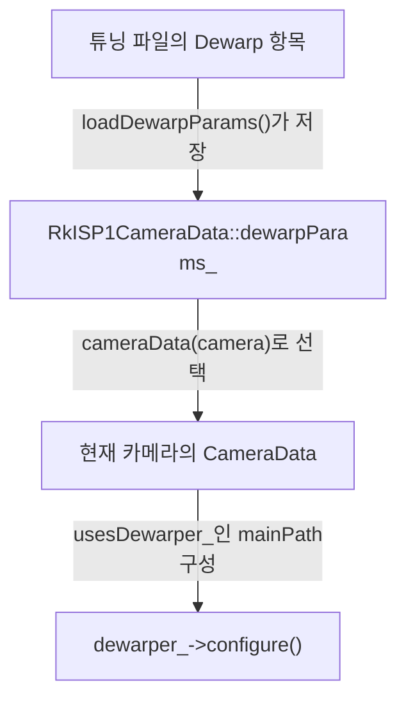
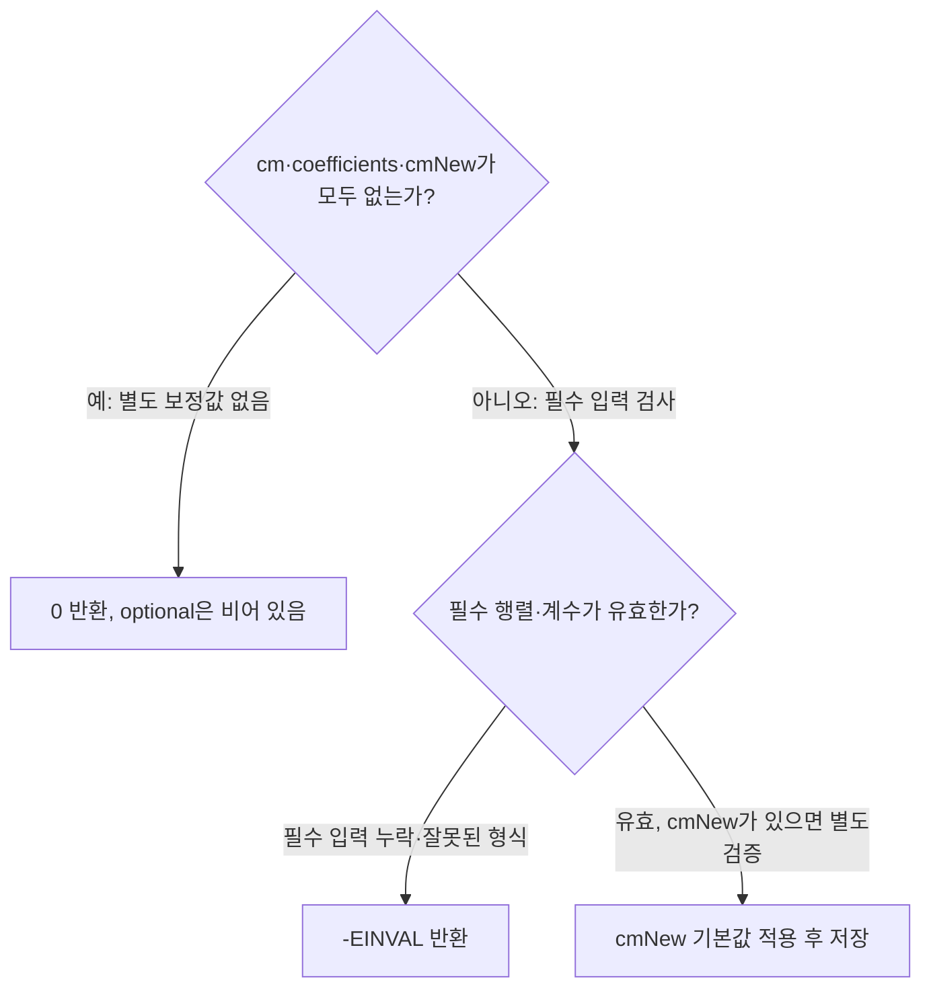

# RKISP1 카메라별 왜곡 보정

**카메라별 보정값의 보관 위치와 설정 시점을 확인한 뒤 튜닝 입력과 커널 지원을 점검하세요.**

| 지금 확인할 내용 | 이동할 절 |
|---|---|
| 카메라별 보정값의 소유권 절을 확인합니다. | [카메라별 보정값의 소유권](#카메라별-보정값의-소유권) |
| 튜닝 입력의 기본값과 오류 절을 확인합니다. | [튜닝 입력의 기본값과 오류](#튜닝-입력의-기본값과-오류) |
| 스트림 적용과 실행 확인 범위 절을 확인합니다. | [스트림 적용과 실행 확인 범위](#스트림-적용과-실행-확인-범위) |

## 카메라별 보정값의 소유권

`RkISP1CameraData` 클래스 내부에 정의된 `dewarpParams_` 멤버 변수는 `std::optional<Dw100VertexMap::DewarpParams>` 타입으로 선언되어 있습니다. `src/libcamera/pipeline/rkisp1/rkisp1.cpp:94`

<!-- sdd:visual:per-camera-parameters -->
### 보정값은 카메라별로 저장하고 구성 때 전달

보정값의 저장 위치와 전달을 표시합니다. 전역 보정값을 모든 카메라가 공유한다고 해석하지 마세요.



[Mermaid 원문](rkisp1-dewarp.per-camera-parameters.mmd)

??? note "그림 근거와 확인 범위"
    소스에 연결한 설계 해석입니다. 자동 연결 검사는 의미 승인이나 기기 실행 검증이 아닙니다.
    
    | 요소·전이 | 소스 근거 |
    |---|---|
    | 튜닝 파일의 Dewarp 항목 | [src/libcamera/pipeline/rkisp1/rkisp1.cpp:434](#source-af6210cb39d0385e) |
    | RkISP1CameraData::dewarpParams_ | [src/libcamera/pipeline/rkisp1/rkisp1.cpp:94](#source-04546183f68b35f4) |
    | 현재 카메라의 CameraData | [src/libcamera/pipeline/rkisp1/rkisp1.cpp:914](#source-c164eb4c00d1c1d6) |
    | dewarper_-&gt;configure() | [src/libcamera/pipeline/rkisp1/rkisp1.cpp:914](#source-c164eb4c00d1c1d6) |
    | loadDewarpParams()가 저장 | [src/libcamera/pipeline/rkisp1/rkisp1.cpp:434](#source-af6210cb39d0385e) |
    | cameraData(camera)로 선택 | [src/libcamera/pipeline/rkisp1/rkisp1.cpp:914](#source-c164eb4c00d1c1d6) |
    | usesDewarper_인 mainPath 구성 | [src/libcamera/pipeline/rkisp1/rkisp1.cpp:914](#source-c164eb4c00d1c1d6) |
<!-- /sdd:visual:per-camera-parameters -->

`std::optional` 컨테이너를 사용하여 이 멤버 변수는 현재 유효한 보정 파라미터가 없을 수도 있고, 설정된 `Dw100VertexMap::DewarpParams` 구조체가 있을 수도 있는 상태를 나타냅니다. `src/libcamera/pipeline/rkisp1/rkisp1.cpp:94`

`RkISP1CameraData::loadTuningFile` 함수는 `pipe()->dewarper_` 가 존재하지 않으면 아무 작업도 수행하지 않고 0 을 반환합니다. `src/libcamera/pipeline/rkisp1/rkisp1.cpp:434`

`RkISP1CameraData::loadTuningFile` 함수는 지정된 경로의 보정 파일을 열지 못하면 오류 코드를 반환하고 오류 메시지를 로그에 기록합니다. `src/libcamera/pipeline/rkisp1/rkisp1.cpp:434`

`PipelineHandlerRkISP1` 클래스의 `configure` 함수에서 `data->dewarpParams_` 는 `dewarper_->configure` 호출 시 인자로 전달됩니다. `src/libcamera/pipeline/rkisp1/rkisp1.cpp:914`

근거 원문: [src/libcamera/pipeline/rkisp1/rkisp1.cpp:94](#source-04546183f68b35f4) · [src/libcamera/pipeline/rkisp1/rkisp1.cpp:434](#source-af6210cb39d0385e) · [src/libcamera/pipeline/rkisp1/rkisp1.cpp:914](#source-c164eb4c00d1c1d6)

## 튜닝 입력의 기본값과 오류

loadDewarpParams 함수가 시작될 때 dewarpParams 출력 optional은 reset() 을 호출하여 초기화되며, 입력 세 항목 (cm, coefficients, cmNew) 이 모두 제공되지 않은 경우 0 을 반환합니다. `src/libcamera/converter/converter_dw100.cpp:105`

<!-- sdd:visual:dewarp-input-branches -->
### 보정 파라미터의 기본값과 입력 오류

입력이 없는 경우와 일부만 잘못 제공한 경우를 구분하세요. 성공 반환만으로 보정값이 저장됐다고 판단하면 안 됩니다.



[Mermaid 원문](rkisp1-dewarp.dewarp-input-branches.mmd)

??? note "그림 근거와 확인 범위"
    소스에 연결한 설계 해석입니다. 자동 연결 검사는 의미 승인이나 기기 실행 검증이 아닙니다.
    
    | 요소·전이 | 소스 근거 |
    |---|---|
    | cm·coefficients·cmNew가 모두 없는가? | [src/libcamera/converter/converter_dw100.cpp:105](#source-eacff078bd6a9d79) |
    | 0 반환, optional은 비어 있음 | [src/libcamera/converter/converter_dw100.cpp:105](#source-eacff078bd6a9d79) |
    | 필수 행렬·계수가 유효한가? | [src/libcamera/converter/converter_dw100.cpp:105](#source-eacff078bd6a9d79) |
    | -EINVAL 반환 | [src/libcamera/converter/converter_dw100.cpp:105](#source-eacff078bd6a9d79) |
    | cmNew 기본값 적용 후 저장 | [src/libcamera/converter/converter_dw100.cpp:105](#source-eacff078bd6a9d79) |
    | 예: 별도 보정값 없음 | [src/libcamera/converter/converter_dw100.cpp:105](#source-eacff078bd6a9d79) |
    | 아니오: 필수 입력 검사 | [src/libcamera/converter/converter_dw100.cpp:105](#source-eacff078bd6a9d79) |
    | 필수 입력 누락·잘못된 형식 | [src/libcamera/converter/converter_dw100.cpp:105](#source-eacff078bd6a9d79) |
    | 유효, cmNew가 있으면 별도 검증 | [src/libcamera/converter/converter_dw100.cpp:105](#source-eacff078bd6a9d79) |
<!-- /sdd:visual:dewarp-input-branches -->

if (!cm) { 조건식이 참일 경우 LOG(`Converter`, Error) << 'Dewarp parameters are missing 'cm' value'; 오류 로그가 출력되고 return -EINVAL;로 함수는 -EINVAL 값을 반환합니다. `src/libcamera/converter/converter_dw100.cpp:119`

cm 에서 읽는 행렬 타입은 `Matrix<double, 3, 3>` 이며, 읽기 실패 시 -EINVAL 를 반환하고 성공 시 dp 의 cm 멤버에 값을 저장합니다. `src/libcamera/converter/converter_dw100.cpp:124`

setCoefficients 함수는 coeffs 배열의 크기 (s) 가 4, 5, 8 또는 12 인 경우에만 유효한 것으로 간주하며, 이 조건을 만족하지 않을 경우 -EINVAL 오류 코드를 반환합니다. `src/libcamera/converter/converter_dw100_vertexmap.cpp:258`

if (!coefficients) 분기는 coefficients 값이 누락된 경우 오류 로그를 기록하고 -EINVAL 값을 반환합니다. `src/libcamera/converter/converter_dw100.cpp:132`

if (cmNew) 안에서 matrix를 읽는 타입은 get<`Matrix<double, 3, 3>`>()이며, if (!matrix)의 반환값은 -EINVAL이고 성공 시 dp.cmNew에 대입하는 식은 *matrix입니다. `src/libcamera/converter/converter_dw100.cpp:150`

else 분기에서 대입하는 식은 'dp.cmNew = dp.cm;'이며, 이 식 이후 dewarpParams에 대입하는 식은 'dewarpParams = dp;'입니다. `src/libcamera/converter/converter_dw100.cpp:158`

근거 원문: [src/libcamera/converter/converter_dw100.cpp:105](#source-eacff078bd6a9d79) · [src/libcamera/converter/converter_dw100_vertexmap.cpp:258](#source-e79e5bb19b123ca2) · [src/libcamera/converter/converter_dw100.cpp:119](#source-4e2762411da5a994) · [src/libcamera/converter/converter_dw100.cpp:132](#source-e853a74344a99ef6) · [src/libcamera/converter/converter_dw100.cpp:124](#source-a9f742bf7887fd05) · [src/libcamera/converter/converter_dw100.cpp:150](#source-6f4b9765edc2519b) · [src/libcamera/converter/converter_dw100.cpp:158](#source-3d1b28fa47a9a32c)

## 스트림 적용과 실행 확인 범위

`configure()` 함수는 각 출력 스트림마다 `vertexMap` 객체를 통해 입력 크기, 출력 크기, 센서 크롭 및 선택적 보정 파라미터를 설정합니다. `src/libcamera/converter/converter_dw100.cpp:178`

입력 스트림의 크롭은 `sensorCrop_` 멤버 변수에서 가져와서 각 출력 스트림의 `vertexMap`에 적용되며, 보정 파라미터가 있으면 해당 값을 설정합니다. `src/libcamera/converter/converter_dw100.cpp:178`

`isConfigured(stream)` 가 거짓인 경우 `configure()` 함수는 즉시 반환하므로 미설정 스트림에는 아무런 동작도 수행하지 않습니다. `src/libcamera/converter/converter_dw100.cpp:178`

`setControls()` 함수는 `isConfigured(stream)` 가 참인 경우에만 제어 값을 적용하며, 실행 중 (`running_`) 에 제어 변경 시에는 커널 드라이버가 `requests` 를 지원해야 합니다. `src/libcamera/converter/converter_dw100.cpp:369`

`populateMetadata()` 함수도 `isConfigured(stream)` 조건을 먼저 확인하여 미설정 스트림은 무시하고 설정된 스트림에만 메타데이터를 채웁니다. `src/libcamera/converter/converter_dw100.cpp:434`

`LensDewarpEnable` 제어는 `hasDewarpParams_` 가 참일 때만 설정되며, 이는 `updateControlInfos()` 와 `setControls()` 함수에서 확인됩니다. `src/libcamera/converter/converter_dw100.cpp:369`

`setSensorCrop()` 함수는 센서 크롭 직사각형을 설정하며, 이는 내부적으로 `ScalerCrop` 제어와 관련된 메타데이터 처리에 사용됩니다. `src/libcamera/converter/converter_dw100.cpp:434`

근거 원문: [src/libcamera/converter/converter_dw100.cpp:178](#source-167e93a77fbf4931) · [src/libcamera/converter/converter_dw100.cpp:369](#source-fc0e25ddead912f1) · [src/libcamera/converter/converter_dw100.cpp:434](#source-3a4c4ed7cee81158)

??? note "설계 질문과 검증 범위"
    질문별 답변과 근거 연결을 검사했습니다. 의미와 실행 결과는 사람 검토가 필요합니다.
    
    | 설계 질문 | 설명 위치 | 확인 범위 |
    |---|---|---|
    | 여러 카메라의 보정값이 섞이지 않도록 누가 값을 보관하고 전달합니까? | [카메라별 보정값의 소유권](#카메라별-보정값의-소유권) | 코드 근거와 설명 연결 |
    | 보정값이 없거나 일부만 있을 때 어떤 결과를 반환합니까? | [튜닝 입력의 기본값과 오류](#튜닝-입력의-기본값과-오류) | 코드 근거와 설명 연결 |
    | 보정값은 어느 스트림에 적용되고 어떤 실행 조건을 따로 확인해야 합니까? | [스트림 적용과 실행 확인 범위](#스트림-적용과-실행-확인-범위) | 코드 근거와 설명 연결 |

## 소스 근거

같은 발췌는 한 번만 싣습니다. 필요한 원문을 펼쳐 설명과 대조하세요.

<a id="source-04546183f68b35f4"></a>

??? note "소스 근거: src/libcamera/pipeline/rkisp1/rkisp1.cpp:94"
    `src/libcamera/pipeline/rkisp1/rkisp1.cpp:94`에서 시작하는 발췌입니다. 종료 줄은 142이며, 아래 원문을 설명과 대조할 수 있습니다.
    
    SHA-256: `4c9387123443d958220746e355a9e93b30dca2bb4a32b4f4020c938e1a699de1`
    
    ```text
    class RkISP1CameraData : public Camera::Private
    {
    public:
    	RkISP1CameraData(PipelineHandler *pipe, RkISP1MainPath *mainPath,
    			 RkISP1SelfPath *selfPath)
    		: Camera::Private(pipe), frame_(0), frameInfo_(pipe),
    		  mainPath_(mainPath), selfPath_(selfPath),
    		  canUseDewarper_(false), usesDewarper_(false)
    	{
    	}
    
    	PipelineHandlerRkISP1 *pipe();
    	const PipelineHandlerRkISP1 *pipe() const;
    	int loadIPA(unsigned int hwRevision, uint32_t supportedBlocks);
    
    	Stream mainPathStream_;
    	Stream selfPathStream_;
    	std::unique_ptr<CameraSensor> sensor_;
    	std::unique_ptr<DelayedControls> delayedCtrls_;
    	unsigned int frame_;
    	std::vector<IPABuffer> ipaBuffers_;
    	RkISP1Frames frameInfo_;
    
    	RkISP1MainPath *mainPath_;
    	RkISP1SelfPath *selfPath_;
    
    	std::unique_ptr<ipa::rkisp1::IPAProxyRkISP1> ipa_;
    
    	ControlInfoMap ipaControls_;
    
    	/*
    	 * All entities in the pipeline, from the camera sensor to the RKISP1.
    	 */
    	MediaPipeline pipe_;
    
    	bool canUseDewarper_;
    	bool usesDewarper_;
    	std::optional<Dw100VertexMap::DewarpParams> dewarpParams_;
    
    private:
    	void paramsComputed(unsigned int frame, unsigned int bytesused);
    	void setSensorControls(unsigned int frame,
    			       const ControlList &sensorControls);
    
    	void metadataReady(unsigned int frame, const ControlList &metadata);
    	int loadTuningFile(const std::string &file);
    };
    
    class RkISP1CameraConfiguration :
    ```

<a id="source-af6210cb39d0385e"></a>

??? note "소스 근거: src/libcamera/pipeline/rkisp1/rkisp1.cpp:434"
    `src/libcamera/pipeline/rkisp1/rkisp1.cpp:434`에서 시작하는 발췌입니다. 종료 줄은 479이며, 아래 원문을 설명과 대조할 수 있습니다.
    
    SHA-256: `d0fb5eb90b4c6d0df3e90cff142c95b4f7daeddb6d483a4272a5fb07d7dd3fec`
    
    ```text
    int RkISP1CameraData::loadTuningFile(const std::string &path)
    {
    	int ret;
    
    	if (!pipe()->dewarper_)
    		/* Nothing to do without dewarper */
    		return 0;
    
    	LOG(RkISP1, Debug) << "Load tuning file " << path;
    
    	File file(path);
    	if (!file.open(File::OpenModeFlag::ReadOnly)) {
    		ret = file.error();
    		LOG(RkISP1, Error)
    			<< "Failed to open tuning file "
    			<< path << ": " << strerror(-ret);
    		return ret;
    	}
    
    	std::unique_ptr<ValueNode> data = YamlParser::parse(file);
    	if (!data)
    		return -EINVAL;
    
    	if (!data->contains("modules"))
    		return 0;
    
    	const auto &modules = (*data)["modules"].asList();
    	for (const auto &module : modules) {
    		const auto &params = module["Dewarp"];
    		if (!params)
    			continue;
    
    		ret = pipe()->dewarper_->loadDewarpParams(params, dewarpParams_);
    		if (ret)
    			return ret;
    
    		LOG(RkISP1, Info) << "Dw100 dewarper initialized";
    
    		canUseDewarper_ = true;
    		return 0;
    	}
    
    	return 0;
    }
    
    void RkISP1CameraData::paramsComputed(
    ```

<a id="source-c164eb4c00d1c1d6"></a>

??? note "소스 근거: src/libcamera/pipeline/rkisp1/rkisp1.cpp:914"
    `src/libcamera/pipeline/rkisp1/rkisp1.cpp:914`에서 시작하는 발췌입니다. 종료 줄은 1122이며, 아래 원문을 설명과 대조할 수 있습니다.
    
    SHA-256: `85e3aef5f0b623538bedbd13a895c0a08ada48616ab1e9ee8fe1a87882b67ee6`
    
    ```text
    int PipelineHandlerRkISP1::configure(Camera *camera, CameraConfiguration *c)
    {
    	RkISP1CameraConfiguration *config =
    		static_cast<RkISP1CameraConfiguration *>(c);
    	RkISP1CameraData *data = cameraData(camera);
    	CameraSensor *sensor = data->sensor_.get();
    	int ret;
    
    	ret = initLinks(camera, *config);
    	if (ret)
    		return ret;
    
    	const PixelFormat &streamFormat = config->at(0).pixelFormat;
    	const PixelFormatInfo &info = PixelFormatInfo::info(streamFormat);
    	isRaw_ = info.colourEncoding == PixelFormatInfo::ColourEncodingRAW;
    	data->usesDewarper_ = data->canUseDewarper_ && !isRaw_;
    
    	Transform transform = config->combinedTransform();
    	bool transposeAfterIsp = false;
    	if (data->usesDewarper_) {
    		if (!!(transform & Transform::Transpose))
    			transposeAfterIsp = true;
    		transform = Transform::Identity;
    	}
    
    	/*
    	 * Configure the format on the sensor output and propagate it through
    	 * the pipeline.
    	 */
    	V4L2SubdeviceFormat format = config->sensorFormat();
    	LOG(RkISP1, Debug) << "Configuring sensor with " << format;
    
    	if (config->sensorConfig)
    		ret = sensor->applyConfiguration(*config->sensorConfig,
    						 transform,
    						 &format);
    	else
    		ret = sensor->setFormat(&format, transform);
    
    	if (ret < 0)
    		return ret;
    
    	LOG(RkISP1, Debug) << "Sensor configured with " << format;
    
    	/* Propagate format through the internal media pipeline up to the ISP */
    	ret = data->pipe_.configure(sensor, &format);
    	if (ret < 0)
    		return ret;
    
    	LOG(RkISP1, Debug) << "Configuring ISP with : " << format;
    	ret = isp_->setFormat(0, &format);
    	if (ret < 0)
    		return ret;
    
    	Rectangle inputCrop(0, 0, format.size);
    	ret = isp_->setSelection(0, V4L2_SEL_TGT_CROP, &inputCrop);
    	if (ret < 0)
    		return ret;
    
    	LOG(RkISP1, Debug)
    		<< "ISP input pad configured with " << format
    		<< " crop " << inputCrop;
    
    	Rectangle outputCrop = inputCrop;
    
    	/* YUYV8_2X8 is required on the ISP source path pad for YUV output. */
    	if (!isRaw_)
    		format.code = MEDIA_BUS_FMT_YUYV8_2X8;
    
    	/*
    	 * On devices without DUAL_CROP (like the imx8mp) cropping needs to be
    	 * done on the ISP/IS output.
    	 *
    	 * If the dewarper is used, the cropping shall be done by the dewarper.
    	 */
    	if (media_->hwRevision() == RKISP1_V_IMX8MP) {
    		/* imx8mp has only a single path. */
    		const auto &cfg = config->at(0);
    		/*
    		 * If the dewarper is used, all cropping including aspect ratio
    		 * preservation shall be done there. To ensure that the output
    		 * format provided by the ISP is supported by the dewarper, a
    		 * minimal crop still needs to be applied on the ISP output.
    		 *
    		 * \todo It might be possible to allocate bigger buffers
    		 * (aligned to 8 pixels) with a stride matching format.size for
    		 * the ISP. The not-filled border could later be ignored by the
    		 * dewarper. This way we could skip the minimal crop here and
    		 * the MaximumScalerCrop would always match the isp output.
    		 */
    		Size ispCrop;
    		if (data->usesDewarper_)
    			ispCrop = dewarper_->adjustInputSize(cfg.pixelFormat,
    							     format.size);
    		else
    			ispCrop = format.size.boundedToAspectRatio(cfg.size)
    					  .alignedUpTo(2, 2);
    
    		outputCrop = ispCrop.centeredTo(Rectangle(format.size).center());
    		format.size = ispCrop;
    	}
    
    	LOG(RkISP1, Debug)
    		<< "Configuring ISP output pad with " << format
    		<< " crop " << outputCrop;
    
    	ret = isp_->setSelection(2, V4L2_SEL_TGT_CROP, &outputCrop);
    	if (ret < 0)
    		return ret;
    
    	format.colorSpace = config->at(0).colorSpace;
    	ret = isp_->setFormat(2, &format);
    	if (ret < 0)
    		return ret;
    
    	LOG(RkISP1, Debug)
    		<< "ISP output pad configured with " << format
    		<< " crop " << outputCrop;
    
    	IPACameraSensorInfo sensorInfo;
    	ret = data->sensor_->sensorInfo(&sensorInfo);
    	if (ret)
    		return ret;
    
    	/* Apply the actual sensor crop for proper dewarp map calculation. */
    	Rectangle sensorCrop = outputCrop.transformedBetween(
    		inputCrop, sensorInfo.analogCrop);
    	if (data->usesDewarper_)
    		dewarper_->setSensorCrop(sensorCrop);
    	data->properties_.set(properties::ScalerCropMaximum, sensorCrop);
    
    	std::map<unsigned int, IPAStream> streamConfig;
    
    	for (const StreamConfiguration &cfg : *config) {
    		if (cfg.stream() == &data->mainPathStream_) {
    			/*
    			 * To allow for digital zoom, scaling down should happen
    			 * in the dewarper, instead of the resizer. Configure
    			 * the isp output to the same size as the sensor output.
    			 */
    			StreamConfiguration ispCfg = cfg;
    			if (data->usesDewarper_) {
    				ispCfg.bufferCount = kRkISP1MinBufferCount;
    				ispCfg.size = format.size;
    				ispCfg.stride =
    					PixelFormatInfo::info(ispCfg.pixelFormat)
    						.stride(ispCfg.size.width, 0);
    
    				ret = dewarper_->configure(ispCfg, { cfg }, data->dewarpParams_);
    				if (ret)
    					return ret;
    
    				dewarper_->setTransform(cfg.stream(), config->combinedTransform());
    				/*
    				 * Apply a default scaler crop that keeps the
    				 * aspect ratio.
    				 */
    				Size size = cfg.size;
    				if (transposeAfterIsp)
    					size.transpose();
    				size = sensorCrop.size().boundedToAspectRatio(size);
    
    				ControlList ctrls;
    				ctrls.set(controls::ScalerCrop, size.centeredTo(sensorCrop.center()));
    				dewarper_->setControls(cfg.stream(), ctrls);
    			}
    
    			ret = mainPath_.configure(ispCfg, format);
    			streamConfig[0] = IPAStream(cfg.pixelFormat,
    						    cfg.size);
    		} else if (hasSelfPath_) {
    			ret = selfPath_.configure(cfg, format);
    			streamConfig[1] = IPAStream(cfg.pixelFormat,
    						    cfg.size);
    		} else {
    			return -ENODEV;
    		}
    
    		if (ret)
    			return ret;
    	}
    
    	V4L2DeviceFormat paramFormat;
    	paramFormat.fourcc = V4L2PixelFormat(V4L2_META_FMT_RK_ISP1_EXT_PARAMS);
    	ret = param_->setFormat(&paramFormat);
    	if (ret)
    		return ret;
    
    	V4L2DeviceFormat statFormat;
    	statFormat.fourcc = V4L2PixelFormat(V4L2_META_FMT_RK_ISP1_STAT_3A);
    	ret = stat_->setFormat(&statFormat);
    	if (ret)
    		return ret;
    
    	/* Inform IPA of stream configuration and sensor controls. */
    	ipa::rkisp1::IPAConfigInfo ipaConfig{ sensorInfo,
    					      data->sensor_->controls(),
    					      paramFormat.fourcc };
    
    	ret = data->ipa_->configure(ipaConfig, streamConfig, &data->ipaControls_);
    	if (ret) {
    		LOG(RkISP1, Error) << "failed configuring IPA (" << ret << ")";
    		return ret;
    	}
    
    	return updateControls(data);
    }
    
    int PipelineHandlerRkISP1::exportFrameBuffers(
    ```

<a id="source-eacff078bd6a9d79"></a>

??? note "소스 근거: src/libcamera/converter/converter_dw100.cpp:105"
    `src/libcamera/converter/converter_dw100.cpp:105`에서 시작하는 발췌입니다. 종료 줄은 178이며, 아래 원문을 설명과 대조할 수 있습니다.
    
    SHA-256: `5e4f1317cd9611173e6e5b1fa350ab26f28500656037c812909008604ebfb091`
    
    ```text
    int ConverterDW100Module::loadDewarpParams(const ValueNode &params,
    					   std::optional<Dw100VertexMap::DewarpParams> &dewarpParams)
    {
    	Dw100VertexMap::DewarpParams dp;
    	dewarpParams.reset();
    
    	auto &cm = params["cm"];
    	auto &coefficients = params["coefficients"];
    	auto &cmNew = params["cmNew"];
    
    	/* If nothing is provided, the dewarper is still functional */
    	if (!cm && !coefficients && !cmNew)
    		return 0;
    
    	if (!cm) {
    		LOG(Converter, Error) << "Dewarp parameters are missing 'cm' value";
    		return -EINVAL;
    	}
    
    	auto matrix = cm.get<Matrix<double, 3, 3>>();
    	if (!matrix) {
    		LOG(Converter, Error) << "Failed to load 'cm' value";
    		return -EINVAL;
    	}
    
    	dp.cm = *matrix;
    
    	if (!coefficients) {
    		LOG(Converter, Error) << "Dewarp parameters are missing 'coefficients' value";
    		return -EINVAL;
    	}
    
    	const auto coeffs = coefficients.get<std::vector<double>>();
    	if (!coeffs) {
    		LOG(Converter, Error) << "Dewarp parameters 'coefficients' value is not a list";
    		return -EINVAL;
    	}
    
    	int ret = dp.setCoefficients(*coeffs);
    	if (ret) {
    		LOG(Converter, Error)
    			<< "Dewarp 'coefficients' must have 4, 5, 8 or 12 values";
    		return -EINVAL;
    	}
    
    	if (cmNew) {
    		matrix = cmNew.get<Matrix<double, 3, 3>>();
    		if (!matrix) {
    			LOG(Converter, Error) << "Failed to load 'cmNew' value";
    			return -EINVAL;
    		}
    
    		dp.cmNew = *matrix;
    	} else {
    		dp.cmNew = dp.cm;
    	}
    
    	dewarpParams = dp;
    
    	return 0;
    }
    
    /**
     * \brief Configure a the dw100 converter module
     * \param[in] inputCfg Input stream configuration
     * \param[in] outputCfgs A list of output stream configurations
     * \param[in] dewarpParams The lens dewarp parameters to apply
     *
     * Configures the converter for the given input and output stream configurations
     * and an optional set of dewarp parameters.
     *
     * \return 0 on success or a negative error code otherwise
     */
    int ConverterDW100Module::configure(
    ```

<a id="source-e79e5bb19b123ca2"></a>

??? note "소스 근거: src/libcamera/converter/converter_dw100_vertexmap.cpp:258"
    `src/libcamera/converter/converter_dw100_vertexmap.cpp:258`에서 시작하는 발췌입니다. 종료 줄은 300이며, 아래 원문을 설명과 대조할 수 있습니다.
    
    SHA-256: `3df21e7bc838b20dd56ee1e159404ae2b825f5cfecbe9c6e8a9e8210f648e378`
    
    ```text
    int Dw100VertexMap::DewarpParams::setCoefficients(std::span<const double> coeffs)
    {
    	size_t s = coeffs.size();
    	if (!(s == 4 || s == 5 || s == 8 || s == 12))
    		return -EINVAL;
    
    	coefficients = {};
    
    	if (s >= 4) {
    		coefficients.k1 = coeffs[0];
    		coefficients.k2 = coeffs[1];
    		coefficients.p1 = coeffs[2];
    		coefficients.p2 = coeffs[3];
    	}
    
    	if (s >= 5)
    		coefficients.k3 = coeffs[4];
    
    	if (s >= 8) {
    		coefficients.k4 = coeffs[5];
    		coefficients.k5 = coeffs[6];
    		coefficients.k6 = coeffs[7];
    	}
    
    	if (s == 12) {
    		coefficients.s1 = coeffs[8];
    		coefficients.s2 = coeffs[9];
    		coefficients.s3 = coeffs[10];
    		coefficients.s4 = coeffs[11];
    	}
    
    	return 0;
    }
    
    /**
     * \brief Apply limits on scale and offset
     *
     * This function calculates \a effectiveScalerCrop_, \a effectiveScale_ and \a
     * effectiveOffset_ based on the requested scaler crop, scale, rotation, offset
     * and the selected scale mode, so that the whole output area is filled with
     * valid input data.
     */
    void Dw100VertexMap::applyLimits(
    ```

<a id="source-4e2762411da5a994"></a>

??? note "소스 근거: src/libcamera/converter/converter_dw100.cpp:119"
    `src/libcamera/converter/converter_dw100.cpp:119`에서 시작하는 발췌입니다. 종료 줄은 124이며, 아래 원문을 설명과 대조할 수 있습니다.
    
    SHA-256: `16f95dd070d1b8e14e62b46e0396341e9fe0634174fb90a355b9932514e5601e`
    
    ```text
    if (!cm) {
    		LOG(Converter, Error) << "Dewarp parameters are missing 'cm' value";
    		return -EINVAL;
    	}
    
    	auto matrix =
    ```

<a id="source-e853a74344a99ef6"></a>

??? note "소스 근거: src/libcamera/converter/converter_dw100.cpp:132"
    `src/libcamera/converter/converter_dw100.cpp:132`에서 시작하는 발췌입니다. 종료 줄은 137이며, 아래 원문을 설명과 대조할 수 있습니다.
    
    SHA-256: `f80f167730943536577bbf57738fe771105a8f8beb21c5e7533837abe2a66797`
    
    ```text
    if (!coefficients) {
    		LOG(Converter, Error) << "Dewarp parameters are missing 'coefficients' value";
    		return -EINVAL;
    	}
    
    	const auto coeffs =
    ```

<a id="source-a9f742bf7887fd05"></a>

??? note "소스 근거: src/libcamera/converter/converter_dw100.cpp:124"
    `src/libcamera/converter/converter_dw100.cpp:124`에서 시작하는 발췌입니다. 종료 줄은 130이며, 아래 원문을 설명과 대조할 수 있습니다.
    
    SHA-256: `500aab7c3c360773dcb1e35fbcf4ded7ca222ccc81fa2c8ef4ef9677cf641f94`
    
    ```text
    auto matrix = cm.get<Matrix<double, 3, 3>>();
    	if (!matrix) {
    		LOG(Converter, Error) << "Failed to load 'cm' value";
    		return -EINVAL;
    	}
    
    	dp.cm = *matrix;
    ```

<a id="source-6f4b9765edc2519b"></a>

??? note "소스 근거: src/libcamera/converter/converter_dw100.cpp:150"
    `src/libcamera/converter/converter_dw100.cpp:150`에서 시작하는 발췌입니다. 종료 줄은 157이며, 아래 원문을 설명과 대조할 수 있습니다.
    
    SHA-256: `93f9701877a556043ddf8cddb3438a0cb29030b8098b616eb52255446d56fe0b`
    
    ```text
    if (cmNew) {
    		matrix = cmNew.get<Matrix<double, 3, 3>>();
    		if (!matrix) {
    			LOG(Converter, Error) << "Failed to load 'cmNew' value";
    			return -EINVAL;
    		}
    
    		dp.cmNew = *matrix;
    ```

<a id="source-3d1b28fa47a9a32c"></a>

??? note "소스 근거: src/libcamera/converter/converter_dw100.cpp:158"
    `src/libcamera/converter/converter_dw100.cpp:158`에서 시작하는 발췌입니다. 종료 줄은 162이며, 아래 원문을 설명과 대조할 수 있습니다.
    
    SHA-256: `64a6bed5ea35bac58ea43ab55f5af1084354d4bc2c1176f01d3ac1501997ba30`
    
    ```text
    } else {
    		dp.cmNew = dp.cm;
    	}
    
    	dewarpParams = dp;
    ```

<a id="source-167e93a77fbf4931"></a>

??? note "소스 근거: src/libcamera/converter/converter_dw100.cpp:178"
    `src/libcamera/converter/converter_dw100.cpp:178`에서 시작하는 발췌입니다. 종료 줄은 212이며, 아래 원문을 설명과 대조할 수 있습니다.
    
    SHA-256: `b517243a55de2dab95250c687c7f2aab9fd32b4ed115e3b65b8878daa39b0bc8`
    
    ```text
    int ConverterDW100Module::configure(const StreamConfiguration &inputCfg,
    				    const std::vector<std::reference_wrapper<const StreamConfiguration>>
    					    &outputCfgs,
    				    const std::optional<Dw100VertexMap::DewarpParams> &dewarpParams)
    {
    	int ret;
    
    	vertexMaps_.clear();
    	ret = converter_.configure(inputCfg, outputCfgs);
    	if (ret)
    		return ret;
    
    	inputBufferCount_ = inputCfg.bufferCount;
    	hasDewarpParams_ = dewarpParams.has_value();
    
    	for (auto &ref : outputCfgs) {
    		const auto &outputCfg = ref.get();
    		auto &info = vertexMaps_[outputCfg.stream()];
    		auto &vertexMap = info.map;
    		vertexMap.setInputSize(inputCfg.size);
    		vertexMap.setOutputSize(outputCfg.size);
    		vertexMap.setSensorCrop(sensorCrop_);
    
    		if (dewarpParams)
    			vertexMap.setDewarpParams(*dewarpParams);
    		info.update = true;
    	}
    
    	return 0;
    }
    
    /**
     * \copydoc libcamera::V4L2M2MConverter::isConfigured
     */
    bool ConverterDW100Module::isConfigured(
    ```

<a id="source-fc0e25ddead912f1"></a>

??? note "소스 근거: src/libcamera/converter/converter_dw100.cpp:369"
    `src/libcamera/converter/converter_dw100.cpp:369`에서 시작하는 발췌입니다. 종료 줄은 434이며, 아래 원문을 설명과 대조할 수 있습니다.
    
    SHA-256: `aa6937cbf814f9c7bf5c1dfab84e4d5e0fa96ace063b360484f3858066454e02`
    
    ```text
    void ConverterDW100Module::updateControlInfos(const Stream *stream, ControlInfoMap::Map &controls)
    {
    	ControlValue scalerCropDefault = sensorCrop_;
    
    	if (isConfigured(stream)) {
    		auto &info = vertexMaps_[stream];
    		info.map.applyLimits();
    		scalerCropDefault = info.map.effectiveScalerCrop();
    	}
    
    	controls[&controls::ScalerCrop] = ControlInfo(Rectangle(sensorCrop_.x, sensorCrop_.y, 1, 1),
    						      sensorCrop_, sensorCrop_);
    
    	if (hasDewarpParams_)
    		controls[&controls::LensDewarpEnable] = ControlInfo(false, true, true);
    
    	if (!converter_.supportsRequests())
    		LOG(Converter, Warning)
    			<< "dw100 kernel driver has no requests support."
    			   " Dynamic configuration is not possible.";
    }
    
    /**
     * \brief Set libcamera controls
     * \param[in] stream The stream to update
     * \param[in] controls The controls
     *
     * Looks up all supported controls in \a controls and sets them on stream \a
     * stream. The controls will be applied to the device on the next call to
     * queueBuffers().
     */
    void ConverterDW100Module::setControls(const Stream *stream, const ControlList &controls)
    {
    	if (!isConfigured(stream))
    		return;
    
    	auto &info = vertexMaps_[stream];
    	auto &vertexMap = info.map;
    
    	const auto &lensDewarpEnable = controls.get(controls::LensDewarpEnable);
    	if (lensDewarpEnable) {
    		vertexMap.setLensDewarpEnable(*lensDewarpEnable);
    		info.update = true;
    	}
    
    	const auto &crop = controls.get(controls::ScalerCrop);
    	if (crop) {
    		vertexMap.setScalerCrop(*crop);
    		info.update = true;
    	}
    
    	if (info.update && running_ && !converter_.supportsRequests())
    		LOG(Converter, Error)
    			<< "Dynamically setting dw100 specific controls requires"
    			   " a dw100 kernel driver with requests support";
    }
    
    /**
     * \brief Retrieve updated metadata
     * \param[in] stream The stream
     * \param[in] meta The metadata list
     *
     * This function retrieves the metadata for the provided \a stream and writes it
     * to \a list. It shall be called after queueBuffers().
     */
    void ConverterDW100Module::populateMetadata(
    ```

<a id="source-3a4c4ed7cee81158"></a>

??? note "소스 근거: src/libcamera/converter/converter_dw100.cpp:434"
    `src/libcamera/converter/converter_dw100.cpp:434`에서 시작하는 발췌입니다. 종료 줄은 465이며, 아래 원문을 설명과 대조할 수 있습니다.
    
    SHA-256: `37f3f992d5270f1f7309de486064df8a88ceebdafa81963ddb49872b7e674ecb`
    
    ```text
    void ConverterDW100Module::populateMetadata(const Stream *stream, ControlList &meta)
    {
    	if (!isConfigured(stream))
    		return;
    
    	auto &vertexMap = vertexMaps_[stream].map;
    
    	meta.set(controls::ScalerCrop, vertexMap.effectiveScalerCrop());
    
    	if (hasDewarpParams_)
    		meta.set(controls::LensDewarpEnable, vertexMap.lensDewarpEnable());
    }
    
    /**
     * \var ConverterDW100Module::inputBufferReady
     * \brief A signal emitted when the input frame buffer completes
     */
    
    /**
     * \var ConverterDW100Module::outputBufferReady
     * \brief A signal emitted on each frame buffer completion of the output queue
     */
    
    /**
     * \brief Set sensor crop rectangle
     * \param[in] rect The crop rectangle
     *
     * Set the sensor crop rectangle to \a rect. This rectangle describes the area
     * covered by the input buffers in sensor coordinates. It is used internally
     * to handle the ScalerCrop control and related metadata.
     */
    void ConverterDW100Module::setSensorCrop(
    ```

??? note "근거와 검토 정보"
    - 생성 방식: 추출 사실과 LLM 설명
    - 검증 범위: 표·그림은 facts로 만들고 설명은 LLM이 작성합니다. 인용·문장 및 설정된 구조 검사를 적용합니다.
    - 근거 파일: `include/libcamera/internal/converter.h`, `include/libcamera/internal/converter/converter_dw100.h`, `include/libcamera/internal/converter/converter_dw100_vertexmap.h`, `src/libcamera/converter.cpp`, `src/libcamera/converter/converter_dw100.cpp`, `src/libcamera/converter/converter_dw100_vertexmap.cpp`, `src/libcamera/pipeline/rkisp1/rkisp1.cpp`
    - 근거 수준: 코드 확인 (정적 분석, simple_compdb 구성, commit `2c4b67c079`)
    - 자동 검사 (인용·문장 및 설정된 구조 검사): 통과
    - 검토 상태 기록일: 2026-10-26 · 사람 검토 전

다음 단계: [Pipeline Handler](pipeline-handler.md)
