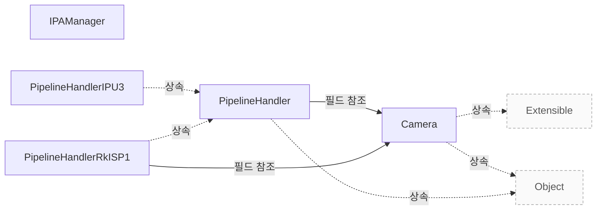

# 지원 범위와 검증

**지원 조건과 구성 제약을 확인하고 제품 도입 전에 검증할 범위를 정하세요.**

| 지금 확인할 내용 | 이동할 절 |
|---|---|
| libcamera 제품 개요에서 필요한 내용을 확인합니다. | [libcamera 제품 개요](vendor-overview.md) |
| 연동 가이드에서 필요한 내용을 확인합니다. | [연동 가이드](vendor-integration.md) |
| 장치별 파이프라인을 구현합니다. | [Pipeline Handler](pipeline-handler.md) |

## 지원 조건과 제약

`CameraConfiguration::Invalid` 은 설정이 유효하지 않아 조정할 수 없으며, 이는 설정이 비어 있는 것과 같은 극단적인 경우에만 발생할 수 있습니다. `src/libcamera/camera.cpp:338`

<!-- sdd:visual:validation-results -->
### validate() 결과별 호출자의 책임

validate()의 Invalid·Adjusted·Valid는 무엇을 뜻하며, Adjusted이면 호출자는 무엇을 다시 확인해야 합니까?

LLM 그림 초안 · 사람 검토 전

작성 모델: `ollama/qwen3.5:9b`

```mermaid
flowchart TB
%% sdd:translations {"Adjusted: 파라미터 <br/>변경·스트림 삭제 가능, <br/>호출자는 신중히 재확인해야 <br/>함": "Adjusted: parameters may <br/>have changed or streams <br/>removed; caller shall check <br/>carefully", "CameraConfiguration::validat<br/>e 함수": "CameraConfiguration::validat<br/>e function", "Invalid: 구성이 유효하지 <br/>않고 조정 불가 (극단적 예시)": "Invalid: configuration is <br/>invalid and can&#x27;t be <br/>adjusted (extreme case)", "Valid: 이미 유효하여 조정 <br/>불필요": "Valid: configuration was <br/>already valid and hasn&#x27;t <br/>been adjusted", "유효하지 않은 구성 (조정 <br/>불가)": "Invalid configuration <br/>(cannot be adjusted)", "이미 유효하여 조정 불필요": "Already valid; no <br/>adjustment needed", "조정됨: 파라미터 변경 또는 <br/>스트림 삭제 가능, 호출자가 <br/>확인해야 함": "Adjusted: parameters may <br/>have changed or streams <br/>removed; caller shall check <br/>carefully"}
  v_n0{"CameraConfiguration::validat<br/>e 함수"}
  v_n1{"Invalid: 구성이 유효하지 <br/>않고 조정 불가 (극단적 예시)"}
  v_n2{"Adjusted: 파라미터 <br/>변경·스트림 삭제 가능, <br/>호출자는 신중히 재확인해야 <br/>함"}
  v_n3{"Valid: 이미 유효하여 조정 <br/>불필요"}
  v_n0 -->|"유효하지 않은 구성 (조정 <br/>불가)"| v_n1
  v_n0 -->|"조정됨: 파라미터 변경 또는 <br/>스트림 삭제 가능, 호출자가 <br/>확인해야 함"| v_n2
  v_n0 -->|"이미 유효하여 조정 불필요"| v_n3
```



[Mermaid 원문](vendor-assurance.validation-results.mmd)

??? note "그림 근거와 확인 범위"
    소스에 연결한 설계 해석입니다. 자동 연결 검사는 의미 승인이나 기기 실행 검증이 아닙니다.
    
    | 요소·전이 | 소스 근거 |
    |---|---|
    | CameraConfiguration::validate 함수 | [src/libcamera/camera.cpp:323](#source-2b31e92e3fb3f083) |
    | Invalid: 구성이 유효하지 않고 조정 불가 (극단적 예시) | [src/libcamera/camera.cpp:323](#source-2b31e92e3fb3f083) |
    | Adjusted: 파라미터 변경·스트림 삭제 가능, 호출자는 신중히 재확인해야 함 | [src/libcamera/camera.cpp:323](#source-2b31e92e3fb3f083) |
    | Valid: 이미 유효하여 조정 불필요 | [src/libcamera/camera.cpp:323](#source-2b31e92e3fb3f083) |
    | 유효하지 않은 구성 (조정 불가) | [src/libcamera/camera.cpp:323](#source-2b31e92e3fb3f083) |
    | 조정됨: 파라미터 변경 또는 스트림 삭제 가능, 호출자가 확인해야 함 | [src/libcamera/camera.cpp:323](#source-2b31e92e3fb3f083) |
    | 이미 유효하여 조정 불필요 | [src/libcamera/camera.cpp:323](#source-2b31e92e3fb3f083) |
<!-- /sdd:visual:validation-results -->

`CameraConfiguration::Adjusted`는 구성이 조정되어 이제 유효함을 나타냅니다. `src/libcamera/camera.cpp:341`

어느 스트림의 파라미터가 변경되었을 수 있으며, 스트림 구성이 제거되었을 수도 있습니다. `src/libcamera/camera.cpp:342`

`CameraConfiguration::Adjusted` 일 때 호출자는 설정을 신중하게 확인해야 합니다. `src/libcamera/camera.cpp:341`

`CameraConfiguration::Valid` 상태는 이미 유효한 구성으로 조정되지 않은 경우를 나타냅니다. `src/libcamera/camera.cpp:323`

generateConfiguration 메서드는 요청된 역할 목록을 충족할 수 있으면 유효한 `CameraConfiguration` 객체를 반환하고, 그렇지 않으면 null 포인터를 반환합니다. `src/libcamera/pipeline_handler.cpp:289`

PipelineHandler::configure() 함수는 `CameraConfiguration::validate()`로 검증된 입력을 전제로 하며, 구현자는 추가 검증을 수행하지 않아야 합니다. `src/libcamera/pipeline_handler.cpp:304`

configure 함수는 성공 시 0 을 반환하거나 실패 시 음수 오류 코드를 반환해야 하며, 검증된 입력을 받았다고 해서 반드시 구성이 성공한다는 보장은 없습니다. `src/libcamera/pipeline_handler.cpp:313`

근거 원문: [src/libcamera/camera.cpp:338](#source-60ab47044c6107c5) · [src/libcamera/camera.cpp:341](#source-c14b4403062d5e35) · [src/libcamera/camera.cpp:323](#source-2b31e92e3fb3f083) · [src/libcamera/pipeline_handler.cpp:289](#source-4abbe39594a1bd27) · [src/libcamera/pipeline_handler.cpp:304](#source-31c5407347b4d0d8) · [src/libcamera/pipeline_handler.cpp:313](#source-f87ceb096b9f931d) · [src/libcamera/camera.cpp:341](#source-8b6aa81367245db5) · [src/libcamera/camera.cpp:342](#source-e13fede0aa40ada1)

## 성능 근거를 읽는 기준

`Benchmark` 클래스에서 skipBeforeMeasure_ 멤버 변수는 30 으로 초기화되어 있으며, 이는 측정 시작 전에 안정화를 위해 건너뛰어야 할 프레임 수를 세기 위해 사용됩니다. `include/libcamera/internal/software_isp/benchmark.h:21`

`Benchmark` 클래스의 framesToMeasure_ 멤버 변수는 소스 코드에서 unsigned int 타입으로 선언되었으며 초기값은 30 으로 설정되어 있습니다. 이 값은 `Benchmark` 클래스 내부의 private 섹션에 정의된 comment 'Skip 30 frames for things to stabilize then measure 30 frames' 에 따라 측정할 프레임 개수를 의미하며, 초당 프레임 수를 세는 것이 아닙니다. `include/libcamera/internal/software_isp/benchmark.h:21`

`Benchmark` 생성자는 software_isp.measure 설정에서 skip과 number 값을 읽는데, 해당 설정이 존재하지 않을 경우 각각 skipBeforeMeasure_와 framesToMeasure_로 정의된 초기값을 유지합니다. `src/libcamera/software_isp/benchmark.cpp:32`

`Benchmark::startFrame()` 함수에서 measure_ 변수가 true 가 되는 조건은 framesToMeasure_ > 0 이고, 현재 처리된 프레임 수(encounteredFrames_) 가 skipBeforeMeasure_ + framesToMeasure_ 보다 작거나 같으며, 증가된 encounteredFrames_ 가 skipBeforeMeasure_ 를 초과하는 것입니다. 따라서 framesToMeasure_ 가 0 인 경우 첫 번째 조건인 'framesToMeasure_ > 0'이 충족되지 않아 measure_ 는 항상 false 가 됩니다. `src/libcamera/software_isp/benchmark.cpp:32`

`DebayerCpu` 클래스에 내장된 벤치마크는 프레임 캡처나 출력에 소요되는 시간을 측정하지 않고, 통계 수집과 디베이어 처리에만 소요되는 시간만을 측정합니다. `Documentation/software-isp-benchmarking.rst:15`

Software ISP 파이프라인을 사용하는 'cam' 또는 'qcam' 명령어를 실행하면 내장 벤치마크가 자동으로 실행되며, 이 벤치마크는 프레임 캡처나 출력에 소요되는 시간을 측정하지 않고 통계 수집 및 디베이링 처리에만 소요된 시간을 측정합니다. `Documentation/software-isp-benchmarking.rst:15`

근거 원문: [Documentation/software-isp-benchmarking.rst:15](#source-9c8139bcb89eab5b) · [include/libcamera/internal/software_isp/benchmark.h:21](#source-d68173fa8579a539) · [src/libcamera/software_isp/benchmark.cpp:32](#source-613682c81852ad86)

??? note "설계 질문과 검증 범위"
    질문별 답변과 근거 연결을 검사했습니다. 의미와 실행 결과는 사람 검토가 필요합니다.
    
    | 설계 질문 | 설명 위치 | 확인 범위 |
    |---|---|---|
    | 지원 전제와 제약은 무엇이며 별도 검증할 항목은 무엇입니까? | [지원 조건과 제약](#지원-조건과-제약) | 코드 근거와 설명 연결 |
    | 참고 벤치마크가 측정하는 범위와 별도 제품 검증 범위는 무엇입니까? | [성능 근거를 읽는 기준](#성능-근거를-읽는-기준) | 코드 근거와 설명 연결 |

## 소스 근거

같은 발췌는 한 번만 싣습니다. 필요한 원문을 펼쳐 설명과 대조하세요.

<a id="source-60ab47044c6107c5"></a>

??? note "소스 근거: src/libcamera/camera.cpp:338"
    `src/libcamera/camera.cpp:338`에서 시작하는 발췌입니다. 종료 줄은 340이며, 아래 원문을 설명과 대조할 수 있습니다.
    
    SHA-256: `2247db4a7b9353362f9df6c84aaa5c2810dec4eaaae4b3b36d19c57e427f5790`
    
    ```text
    \retval CameraConfiguration::Invalid The configuration is invalid and can't
     * be adjusted. This may only occur in extreme cases such as when the
     * configuration is empty.
    ```

<a id="source-c14b4403062d5e35"></a>

??? note "소스 근거: src/libcamera/camera.cpp:341"
    `src/libcamera/camera.cpp:341`에서 시작하는 발췌입니다. 종료 줄은 344이며, 아래 원문을 설명과 대조할 수 있습니다.
    
    SHA-256: `1305054b4a0655a883d0cef7398ff34824da06ecdbac0dfbf1f06de218bb6ebc`
    
    ```text
    \retval CameraConfiguration::Adjusted The configuration has been adjusted
     * and is now valid. Parameters may have changed for any stream, and stream
     * configurations may have been removed. The caller shall check the
     * configuration carefully.
    ```

<a id="source-2b31e92e3fb3f083"></a>

??? note "소스 근거: src/libcamera/camera.cpp:323"
    `src/libcamera/camera.cpp:323`에서 시작하는 발췌입니다. 종료 줄은 346이며, 아래 원문을 설명과 대조할 수 있습니다.
    
    SHA-256: `86bf9109257512866bf70a5d42cd3da29c70d851d871f0e496058141ba377623`
    
    ```text
    \fn CameraConfiguration::validate()
     * \brief Validate and possibly adjust the camera configuration
     *
     * This function adjusts the camera configuration to the closest valid
     * configuration and returns the validation status.
     *
     * \todo Define exactly when to return each status code. Should stream
     * parameters set to 0 by the caller be adjusted without returning Adjusted ?
     * This would potentially be useful for applications but would get in the way
     * in Camera::configure(). Do we need an extra status code to signal this ?
     *
     * \todo Handle validation of buffers count when refactoring the buffers API.
     *
     * \return A CameraConfiguration::Status value that describes the validation
     * status.
     * \retval CameraConfiguration::Invalid The configuration is invalid and can't
     * be adjusted. This may only occur in extreme cases such as when the
     * configuration is empty.
     * \retval CameraConfiguration::Adjusted The configuration has been adjusted
     * and is now valid. Parameters may have changed for any stream, and stream
     * configurations may have been removed. The caller shall check the
     * configuration carefully.
     * \retval CameraConfiguration::Valid The configuration was already valid and
     * hasn't been adjusted.
    ```

<a id="source-4abbe39594a1bd27"></a>

??? note "소스 근거: src/libcamera/pipeline_handler.cpp:289"
    `src/libcamera/pipeline_handler.cpp:289`에서 시작하는 발췌입니다. 종료 줄은 290이며, 아래 원문을 설명과 대조할 수 있습니다.
    
    SHA-256: `b86c8678b02e96936d80626cefebf3811b6a991b459074e51c9f0e08457ff369`
    
    ```text
    \return A valid CameraConfiguration if the requested roles can be satisfied,
     * or a null pointer otherwise.
    ```

<a id="source-31c5407347b4d0d8"></a>

??? note "소스 근거: src/libcamera/pipeline_handler.cpp:304"
    `src/libcamera/pipeline_handler.cpp:304`에서 시작하는 발췌입니다. 종료 줄은 306이며, 아래 원문을 설명과 대조할 수 있습니다.
    
    SHA-256: `625bd787da81f9407ba9e746d4939d93b7172a26642429bcfd3300aa6187675f`
    
    ```text
    The configuration is guaranteed to have been validated with
     * CameraConfiguration::validate(). The pipeline handler implementation shall
     * not perform further validation
    ```

<a id="source-f87ceb096b9f931d"></a>

??? note "소스 근거: src/libcamera/pipeline_handler.cpp:313"
    `src/libcamera/pipeline_handler.cpp:313`에서 시작하는 발췌입니다. 종료 줄은 315이며, 아래 원문을 설명과 대조할 수 있습니다.
    
    SHA-256: `6e139b3c50660a7111d84bd00cfd17078b8b45d4a07688fa64b2d8af9ce52a22`
    
    ```text
    \context This function is called from the CameraManager thread.
     *
     * \return 0 on success or a negative error code otherwise
    ```

<a id="source-8b6aa81367245db5"></a>

??? note "소스 근거: src/libcamera/camera.cpp:341"
    `src/libcamera/camera.cpp:341`에서 시작하는 발췌입니다. 종료 줄은 342이며, 아래 원문을 설명과 대조할 수 있습니다.
    
    SHA-256: `bc530fdf77cefda77bfd8ae1cadf7df4edea81ddfce01bef24867681b29655f6`
    
    ```text
    \retval CameraConfiguration::Adjusted The configuration has been adjusted
     * and is now valid.
    ```

<a id="source-e13fede0aa40ada1"></a>

??? note "소스 근거: src/libcamera/camera.cpp:342"
    `src/libcamera/camera.cpp:342`에서 시작하는 발췌입니다. 종료 줄은 343이며, 아래 원문을 설명과 대조할 수 있습니다.
    
    SHA-256: `7c0debb896b6072c0bc59cf3589fbc49b607f915d96f30182d4e02038b94c156`
    
    ```text
    Parameters may have changed for any stream, and stream
     * configurations may have been removed.
    ```

<a id="source-9c8139bcb89eab5b"></a>

??? note "소스 근거: Documentation/software-isp-benchmarking.rst:15"
    `Documentation/software-isp-benchmarking.rst:15`에서 시작하는 발췌입니다. 종료 줄은 22이며, 아래 원문을 설명과 대조할 수 있습니다.
    
    SHA-256: `01df160bfdc79d4dd48c5e5316a7f3744ea6333454ab939c474cf739490984a3`
    
    ```text
    The DebayerCpu class has a builtin benchmark. This benchmark measures the time
    spent on processing (collecting statistics and debayering) only, it does not
    measure the time spent on capturing or outputting the frames.
    
    The builtin benchmark always runs. So this can be used by simply running "cam"
    or "qcam" with a pipeline using the Software ISP.
    
    When it runs it will skip
    ```

<a id="source-d68173fa8579a539"></a>

??? note "소스 근거: include/libcamera/internal/software_isp/benchmark.h:21"
    `include/libcamera/internal/software_isp/benchmark.h:21`에서 시작하는 발췌입니다. 종료 줄은 41이며, 아래 원문을 설명과 대조할 수 있습니다.
    
    SHA-256: `9ed40b526734c8e5f408a5e91ac90d41497d9ac15aa5c87987559185072893ed`
    
    ```text
    class Benchmark
    {
    public:
    	Benchmark(const CameraManager &cm, const std::string &name);
    	~Benchmark();
    
    	void startFrame(void);
    	void finishFrame(void);
    
    private:
    	std::string name_;
    	timespec frameStartTime_;
    	bool measure_;
    	/* Skip 30 frames for things to stabilize then measure 30 frames */
    	unsigned int encounteredFrames_ = 0;
    	int64_t frameProcessTime_ = 0;
    	unsigned int skipBeforeMeasure_ = 30;
    	unsigned int framesToMeasure_ = 30;
    };
    
    } /* namespace libcamera */
    ```

<a id="source-613682c81852ad86"></a>

??? note "소스 근거: src/libcamera/software_isp/benchmark.cpp:32"
    `src/libcamera/software_isp/benchmark.cpp:32`에서 시작하는 발췌입니다. 종료 줄은 98이며, 아래 원문을 설명과 대조할 수 있습니다.
    
    SHA-256: `0f733957f14bef9f6c218c5ca3eff23f49a019583f9206845a29a9003b4ceb36`
    
    ```text
    Benchmark::Benchmark(const CameraManager &cm, const std::string &name)
    	: name_(name)
    {
    	const GlobalConfiguration &configuration = cm._d()->configuration();
    
    	skipBeforeMeasure_ = configuration.option<unsigned int>(
    						{ "software_isp", "measure", "skip" })
    							.value_or(skipBeforeMeasure_);
    	framesToMeasure_ = configuration.option<unsigned int>(
    						{ "software_isp", "measure", "number" })
    							.value_or(framesToMeasure_);
    }
    
    Benchmark::~Benchmark()
    {
    }
    
    static inline int64_t timeDiff(timespec &after, timespec &before)
    {
    	return (after.tv_sec - before.tv_sec) * 1000000000LL +
    	       (int64_t)after.tv_nsec - (int64_t)before.tv_nsec;
    }
    
    /**
     * \brief Start measuring process time for a single frame
     *
     * Call this function before processing frame data to start measuring
     * the process time for a frame.
     */
    void Benchmark::startFrame(void)
    {
    	measure_ = framesToMeasure_ > 0 &&
    		   encounteredFrames_ < skipBeforeMeasure_ + framesToMeasure_ &&
    		   ++encounteredFrames_ > skipBeforeMeasure_;
    
    	if (measure_) {
    		frameStartTime_ = {};
    		clock_gettime(CLOCK_MONOTONIC_RAW, &frameStartTime_);
    	}
    }
    
    /**
     * \brief Finish measuring process time for a single frame
     *
     * Call this function after processing frame data to finish measuring
     * the process time for a frame.
     *
     * This function will log frame processing time information after
     * Benchmark::kLastFrameToMeasure frames have been processed.
     */
    void Benchmark::finishFrame(void)
    {
    	if (measure_) {
    		timespec frameEndTime = {};
    		clock_gettime(CLOCK_MONOTONIC_RAW, &frameEndTime);
    		frameProcessTime_ += timeDiff(frameEndTime, frameStartTime_);
    		if (encounteredFrames_ == skipBeforeMeasure_ + framesToMeasure_) {
    			LOG(Benchmark, Info)
    				<< name_ << " processed " << framesToMeasure_
    				<< " frames in " << frameProcessTime_ / 1000 << "us, "
    				<< frameProcessTime_ / (1000 * framesToMeasure_)
    				<< " us/frame";
    		}
    	}
    }
    
    } /* namespace libcamera */
    ```


<!-- sdd:class-diagram -->
## 클래스 관계

화살표의 글자는 추출한 관계를 나타내며, 점선은 상속입니다. 화살표는 참조 대상 또는 기반 클래스를 향합니다. 호출 순서를 뜻하지 않습니다.


<!-- /sdd:class-diagram -->

??? note "근거와 검토 정보"
    - 생성 방식: 추출 사실과 LLM 설명
    - 검증 범위: 표·그림은 facts로 만들고 설명은 LLM이 작성합니다. 인용·문장 및 설정된 구조 검사를 적용합니다.
    - 근거 파일: `Documentation/software-isp-benchmarking.rst`, `include/libcamera/camera.h`, `include/libcamera/internal/ipa_manager.h`, `include/libcamera/internal/pipeline_handler.h`, `include/libcamera/internal/software_isp/benchmark.h`, `src/libcamera/camera.cpp`, `src/libcamera/ipa_manager.cpp`, `src/libcamera/pipeline/ipu3/ipu3.cpp`, `src/libcamera/pipeline/rkisp1/rkisp1.cpp`, `src/libcamera/pipeline_handler.cpp`, `src/libcamera/software_isp/benchmark.cpp`
    - 근거 수준: 코드 확인 (정적 분석, simple_compdb 구성, commit `2c4b67c079`)
    - 자동 검사 (인용·문장 및 설정된 구조 검사): 통과
    - 검토 상태 기록일: 2026-10-26 · 사람 검토 전

다음 단계: [요청 처리와 문제 진단](request-lifecycle.md)
