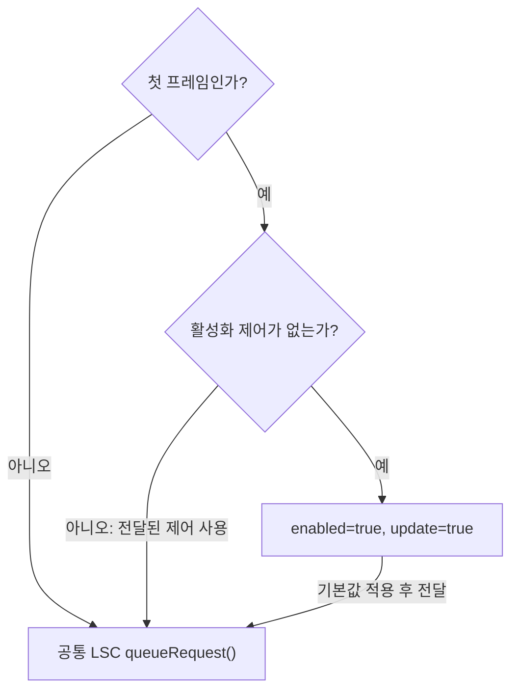
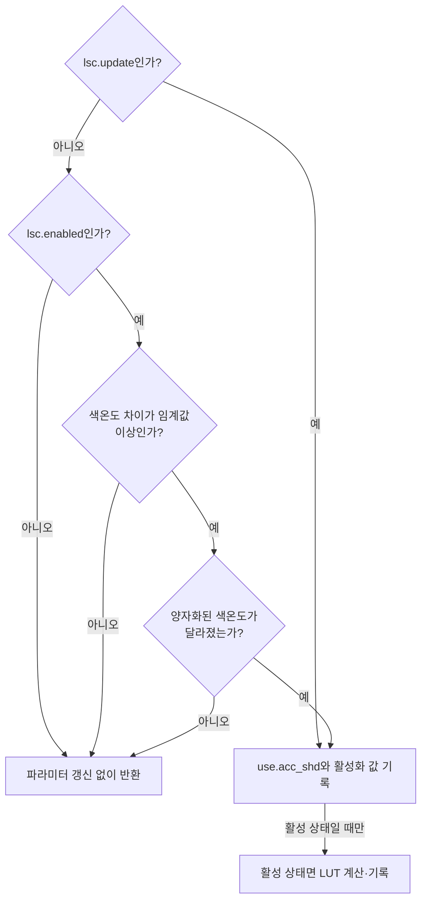
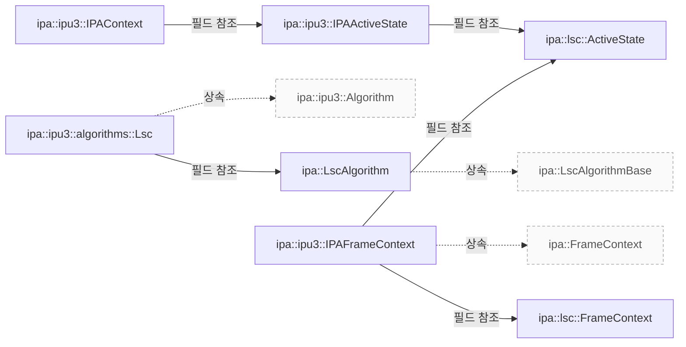

# IPU3 LSC의 설정과 프레임 처리

**LSC를 수정할 때는 초기 그리드 설정, 요청별 활성화 상태, 색온도에 따른 파라미터 갱신 조건을 차례로 확인하세요.**

| 지금 확인할 내용 | 이동할 절 |
|---|---|
| 빌드와 상태 연결 절을 확인합니다. | [빌드와 상태 연결](#빌드와-상태-연결) |
| 초기화와 크롭 설정 절을 확인합니다. | [초기화와 크롭 설정](#초기화와-크롭-설정) |
| 첫 프레임과 요청별 제어 절을 확인합니다. | [첫 프레임과 요청별 제어](#첫-프레임과-요청별-제어) |
| 파라미터 갱신 조건 절을 확인합니다. | [파라미터 갱신 조건](#파라미터-갱신-조건) |
| 메타데이터와 확인 범위 절을 확인합니다. | [메타데이터와 확인 범위](#메타데이터와-확인-범위) |

## 빌드와 상태 연결

빌드 목록은 `ipu3_ipa_algorithms` 배열에 `lsc.cpp` 파일을 포함하고 있습니다. `src/ipa/ipu3/algorithms/meson.build:3`

`IPAActiveState` 구조체 내의 `lsc` 멤버는 `ipa::lsc::ActiveState` 타입으로 선언되어 있으며, 이는 자동 노출 제어 (AGC) 와 함께 AWB, CCM, 감마, LSC 상태 정보를 포함하는 컨텍스트입니다. `src/ipa/ipu3/ipa_context.h:32`

`IPAFrameContext` 구조체 내의 `lsc` 멤버는 `ipa::lsc::FrameContext` 타입으로 선언되어 있으며, 이는 프레임 단위 렌즈 음영 보정 상태 정보를 담고 있습니다. `src/ipa/ipu3/ipa_context.h:32`

`IPAContext` 구조체는 `frameContexts` 필드를 통해 여러 개의 `IPAFrameContext` 인스턴스를 보관하며, 이는 `FCQueue<IPAFrameContext>` 타입으로 정의된 큐입니다. `src/ipa/ipu3/ipa_context.h:32`

근거 원문: [src/ipa/ipu3/algorithms/meson.build:3](#source-914bc0dd95a64016) · [src/ipa/ipu3/ipa_context.h:32](#source-583d9ce20836f162)

## 초기화와 크롭 설정

kMaxNumHCells의 현재 선언 값은 65이며, kMaxNumVCells의 현재 선언 값은 56입니다. `src/ipa/ipu3/algorithms/lsc.cpp:31`

unsigned int cellWidth = (sensorWidth_ + kMaxNumHCells - 1) / kMaxNumHCells; unsigned int cellHeight = (sensorHeight_ + kMaxNumVCells - 1) / kMaxNumVCells; `src/ipa/ipu3/algorithms/lsc.cpp:66`

minCellWidth는 cellWidth 변수에 std::bit_ceil 함수를 호출하여 초기화되고, minCellHeight는 cellHeight 변수에 std::bit_ceil 함수를 호출하여 초기화됩니다. `src/ipa/ipu3/algorithms/lsc.cpp:69`

numHCells_ 는 (sensorWidth_ + minCellWidth - 1) / minCellWidth 로, numVCells_ 는 (sensorHeight_ + minCellHeight - 1) / minCellHeight 로 대입합니다. `src/ipa/ipu3/algorithms/lsc.cpp:72`

`Lsc::init` 함수는 lscAlgo_.init에 전달할 때, 채널 키로는 문자열 리터럴의 따옴표 없이 r, gr, gb, b 네 가지를 사용하며, 샘플 수는 numHCells_와 numVCells_를 각각 .numHSamples 와 .numVSamples 에 할당하고, 센서 크기는 context.sensorInfo.activeArea.size() 를 .sensorSize 에 전달합니다. `src/ipa/ipu3/algorithms/lsc.cpp:31`

calculatePositions 함수는 for 문의 초기화 식으로 double i = 0.0 을 사용하고, 조건식으로는 i < dimension 을 유지하며, 증감식은 i++ 를 적용한 후 각 반복에서 positions 의 해당 인덱스 원소에 i / (dimension - 1) 값을 대입합니다. `src/ipa/ipu3/algorithms/lsc.cpp:95`

`Lsc::configure` 함수는 configInfo.sensorInfo.analogCrop.width 와 height 를 사용하여 cropWidth_ 와 cropHeight_ 를 설정한 후, calculatePositions 함수를 호출하여 xPos 와 yPos 벡터를 생성하고, 이를 lscAlgo_.configure 메서드를 통해 context.activeState.lsc 에 전달합니다. `src/ipa/ipu3/algorithms/lsc.cpp:31`

근거 원문: [src/ipa/ipu3/algorithms/lsc.cpp:31](#source-0f6452414579e066) · [src/ipa/ipu3/algorithms/lsc.cpp:95](#source-de1c621d5f1ca846) · [src/ipa/ipu3/algorithms/lsc.cpp:31](#source-944b69cd4a69f55b) · [src/ipa/ipu3/algorithms/lsc.cpp:66](#source-e8063287bc2fb4e2) · [src/ipa/ipu3/algorithms/lsc.cpp:69](#source-19c16c58397c5977) · [src/ipa/ipu3/algorithms/lsc.cpp:72](#source-306e90c22fea6520)

## 첫 프레임과 요청별 제어

`frame` 이 0 인 첫 번째 프레임에서 `controls` 목록에 `LensShadingCorrectionEnable` 항목이 없으면, 해당 항목을 찾지 못했음을 나타내는 조건부 로직이 실행되어 `frameContext.lsc.enabled` 멤버를 `true`로 설정합니다. `src/ipa/ipu3/algorithms/lsc.cpp:121`

<!-- sdd:visual:lsc-request-input -->
### 요청 제어가 프레임 상태에 반영되는 곳

첫 프레임에서 활성화 제어가 없으면 광고한 기본값을 맞춥니다. 이후 공통 LSC 알고리즘에 요청 제어를 전달합니다.



[Mermaid 원문](ipu3-lsc-flow.lsc-request-input.mmd)

??? note "그림 근거와 확인 범위"
    소스에 연결한 설계 해석입니다. 자동 연결 검사는 의미 승인이나 기기 실행 검증이 아닙니다.
    
    | 요소·전이 | 소스 근거 |
    |---|---|
    | 첫 프레임인가? | [src/ipa/ipu3/algorithms/lsc.cpp:121](#source-80fd6c99ec2c0ae8) |
    | 활성화 제어가 없는가? | [src/ipa/ipu3/algorithms/lsc.cpp:121](#source-80fd6c99ec2c0ae8) |
    | enabled=true, update=true | [src/ipa/ipu3/algorithms/lsc.cpp:121](#source-80fd6c99ec2c0ae8) |
    | 공통 LSC queueRequest() | [src/ipa/ipu3/algorithms/lsc.cpp:121](#source-80fd6c99ec2c0ae8) |
    | 예 | [src/ipa/ipu3/algorithms/lsc.cpp:121](#source-80fd6c99ec2c0ae8) |
    | 아니오 | [src/ipa/ipu3/algorithms/lsc.cpp:121](#source-80fd6c99ec2c0ae8) |
    | 예 | [src/ipa/ipu3/algorithms/lsc.cpp:121](#source-80fd6c99ec2c0ae8) |
    | 아니오: 전달된 제어 사용 | [src/ipa/ipu3/algorithms/lsc.cpp:121](#source-80fd6c99ec2c0ae8) |
    | 기본값 적용 후 전달 | [src/ipa/ipu3/algorithms/lsc.cpp:121](#source-80fd6c99ec2c0ae8) |
<!-- /sdd:visual:lsc-request-input -->

`frame` 이 0 인 첫 번째 프레임에서 `controls` 목록에 `LensShadingCorrectionEnable` 항목이 없으면, 해당 항목을 찾지 못했음을 나타내는 조건부 로직이 실행되어 `frameContext.lsc.update` 멤버를 `true`로 설정합니다. `src/ipa/ipu3/algorithms/lsc.cpp:121`

`lscAlgo_.queueRequest` 함수는 첫 번째 인자로 `context.activeState.lsc`라는 공유 상태를, 두 번째 인자로 `frameContext.lsc`라는 프레임 상태 객체를, 세 번째 인자로 `controls`라는 제어 목록을 전달받습니다. `src/ipa/ipu3/algorithms/lsc.cpp:121`

`context.activeState.lsc`는 여러 프레임에 걸쳐 유지되는 공유 상태 정보를 나타내고, `frameContext.lsc`는 특정 프레임에 대한 일시적인 상태를 의미하며, `controls`는 해당 프레임의 설정을 담은 제어 목록입니다. `src/ipa/ipu3/algorithms/lsc.cpp:121`

실행 확인 항목: `lscAlgo_.queueRequest` 함수 내부의 구체적인 동작은 추정할 수 없으며, 이 문서에서는 전달되는 인자의 역할과 상태 구분에만 초점을 맞춥니다. `src/ipa/ipu3/algorithms/lsc.cpp:121`

근거 원문: [src/ipa/ipu3/algorithms/lsc.cpp:121](#source-80fd6c99ec2c0ae8)

## 파라미터 갱신 조건

`Lsc::prepare` 함수는 `frameContext.lsc.update` 가 `false` 인 경우 세 가지 조건 중 하나를 만족하면 즉시 반환합니다. `src/ipa/ipu3/algorithms/lsc.cpp:142`

<!-- sdd:visual:lsc-update-gates -->
### LSC 파라미터를 갱신하는 분기

명시적 update가 있으면 색온도 생략 검사를 건너뜁니다. 갱신을 통지한 뒤 비활성 상태이면 LUT 계산은 수행하지 않습니다.



[Mermaid 원문](ipu3-lsc-flow.lsc-update-gates.mmd)

??? note "그림 근거와 확인 범위"
    소스에 연결한 설계 해석입니다. 자동 연결 검사는 의미 승인이나 기기 실행 검증이 아닙니다.
    
    | 요소·전이 | 소스 근거 |
    |---|---|
    | lsc.update인가? | [src/ipa/ipu3/algorithms/lsc.cpp:142](#source-026024190618ffa6) |
    | lsc.enabled인가? | [src/ipa/ipu3/algorithms/lsc.cpp:142](#source-026024190618ffa6) |
    | 색온도 차이가 임계값 이상인가? | [src/ipa/ipu3/algorithms/lsc.cpp:142](#source-026024190618ffa6) |
    | 양자화된 색온도가 달라졌는가? | [src/ipa/ipu3/algorithms/lsc.cpp:142](#source-026024190618ffa6) |
    | 파라미터 갱신 없이 반환 | [src/ipa/ipu3/algorithms/lsc.cpp:142](#source-026024190618ffa6) |
    | use.acc_shd와 활성화 값 기록 | [src/ipa/ipu3/algorithms/lsc.cpp:142](#source-026024190618ffa6) |
    | 활성 상태면 LUT 계산·기록 | [src/ipa/ipu3/algorithms/lsc.cpp:142](#source-026024190618ffa6) |
    | 예 | [src/ipa/ipu3/algorithms/lsc.cpp:142](#source-026024190618ffa6) |
    | 아니오 | [src/ipa/ipu3/algorithms/lsc.cpp:142](#source-026024190618ffa6) |
    | 아니오 | [src/ipa/ipu3/algorithms/lsc.cpp:142](#source-026024190618ffa6) |
    | 예 | [src/ipa/ipu3/algorithms/lsc.cpp:142](#source-026024190618ffa6) |
    | 아니오 | [src/ipa/ipu3/algorithms/lsc.cpp:142](#source-026024190618ffa6) |
    | 예 | [src/ipa/ipu3/algorithms/lsc.cpp:142](#source-026024190618ffa6) |
    | 아니오 | [src/ipa/ipu3/algorithms/lsc.cpp:142](#source-026024190618ffa6) |
    | 예 | [src/ipa/ipu3/algorithms/lsc.cpp:142](#source-026024190618ffa6) |
    | 활성 상태일 때만 | [src/ipa/ipu3/algorithms/lsc.cpp:142](#source-026024190618ffa6) |
<!-- /sdd:visual:lsc-update-gates -->

첫 번째 조건은 LSC 기능이 비활성화되어 있는 경우로, `frameContext.lsc.enabled` 가 `false` 일 때 발생합니다. `src/ipa/ipu3/algorithms/lsc.cpp:142`

두 번째 조건은 색온도가 양자화 단위의 절반 이상 변하지 않았을 때이며, `utils::abs_diff` 함수를 통해 현재 색온도와 마지막 적용된 색온도의 차이가 `kColourTemperatureQuantization / 2` 보다 작으면 반환합니다. `src/ipa/ipu3/algorithms/lsc.cpp:142`

세 번째 조건은 양자화된 색온도가 마지막 적용된 양자화된 색온도와 동일한 경우로, `quantizedCt == lastAppliedQuantizedCt_` 비교를 통해 확인됩니다. `src/ipa/ipu3/algorithms/lsc.cpp:142`

`params->use.acc_shd`는 `1`로 설정됩니다. `src/ipa/ipu3/algorithms/lsc.cpp:175`

`config->general.shd_enable`는 `frameContext.lsc.enabled`의 값을 그대로 받아서 기록합니다. `src/ipa/ipu3/algorithms/lsc.cpp:175`

`frameContext.lsc.enabled`가 `false`라면 함수는 즉시 반환하여 추가 작업을 수행하지 않습니다. `src/ipa/ipu3/algorithms/lsc.cpp:175`

`config->grid.width`에는 `numHCells_`를, `config->grid.height`에는 `numVCells_`를 대입합니다. `src/ipa/ipu3/algorithms/lsc.cpp:187`

`config->grid.block_width_log2`에는 `blockWidthLog2_`를, `config->grid.block_height_log2`에는 `blockHeightLog2_`를 대입합니다. `src/ipa/ipu3/algorithms/lsc.cpp:187`

`config->grid.grid_height_per_slice`에는 `IPU3_UAPI_SHD_MAX_CELLS_PER_SET`를 `numHCells_`로 나눈 값을 대입합니다. `src/ipa/ipu3/algorithms/lsc.cpp:187`

`Lsc::prepare` 함수는 `config->general.gain_factor`를 0 으로 설정하며, 이는 주석에 따르면 더 높은 이득 인자는 드물기 때문에 현재로서는 고정된 값으로 처리한다는 추정입니다. `src/ipa/ipu3/algorithms/lsc.cpp:142`

`Lsc::prepare` 함수는 `config->black_level.bl_r`, `bl_gr`, `bl_gb`, `bl_b`를 모두 0 으로 설정하고, 이 값들은 별도의 파라미터 블록을 통해 처리된다고 명시합니다. `src/ipa/ipu3/algorithms/lsc.cpp:142`

`Lsc::prepare` 함수는 `lscAlgo_.interpolateComponents(quantizedCt)`를 호출하여 채널별 LUT 데이터를 가져옵니다. `src/ipa/ipu3/algorithms/lsc.cpp:142`

`Lsc::prepare` 함수는 `interpolateComponents`에서 반환된 채널별 LUT 데이터를 반복문을 통해 `lut->sets` 구조체에 복사합니다. `src/ipa/ipu3/algorithms/lsc.cpp:142`

`polynomial_` 가 참인 경우 `config->grid.x_start` 는 0 이고 `config->grid.y_start` 도 0 으로 설정됩니다. `src/ipa/ipu3/algorithms/lsc.cpp:207`

`polynomial_` 가 거짓인 경우 `config->grid.x_start` 는 `(cropWidth_ - sensorWidth_) / 2` 로 계산되며, `config->grid.y_start` 는 `(cropHeight_ - sensorHeight_) / 2` 로 설정됩니다. `src/ipa/ipu3/algorithms/lsc.cpp:207`

근거 원문: [src/ipa/ipu3/algorithms/lsc.cpp:142](#source-026024190618ffa6) · [src/ipa/ipu3/algorithms/lsc.cpp:31](#source-6f726f39f14e348b) · [src/ipa/ipu3/algorithms/lsc.cpp:187](#source-d84099d1d2d33f6a) · [src/ipa/ipu3/algorithms/lsc.cpp:207](#source-d7631dfb0fd0e870) · [src/ipa/ipu3/algorithms/lsc.cpp:175](#source-6cc277fe54d97adb)

## 메타데이터와 확인 범위

process() 함수 본문은 공통 알고리즘인 lscAlgo_에 frameContext.lsc 와 metadata 를 전달하며, stats 인자는 `Lsc::process` 의 매개변수로 정의되어 있으나 본문 내에서 직접적으로 사용되지 않습니다. `src/ipa/ipu3/algorithms/lsc.cpp:282`

등록 매크로에 전달하는 클래스는 `Lsc` 이며 이름은 `Lsc` 입니다. `src/ipa/ipu3/algorithms/lsc.cpp:291`

근거 원문: [src/ipa/ipu3/algorithms/lsc.cpp:282](#source-752ab64b53e03c10) · [src/ipa/ipu3/algorithms/lsc.cpp:291](#source-4700f249e41cc141)

??? note "설계 질문과 검증 범위"
    질문별 답변과 근거 연결을 검사했습니다. 의미와 실행 결과는 사람 검토가 필요합니다.
    
    | 설계 질문 | 설명 위치 | 확인 범위 |
    |---|---|---|
    | LSC 구현 파일과 공유 상태 및 프레임별 상태는 어떻게 연결됩니까? | [빌드와 상태 연결](#빌드와-상태-연결) | 코드 근거와 설명 연결 |
    | 입력 크기에 따라 그리드와 크기 제한을 어떻게 결정합니까? | [초기화와 크롭 설정](#초기화와-크롭-설정) | 코드 근거와 설명 연결 |
    | 첫 프레임의 기본 활성화와 요청 제어는 어떤 데이터를 전달합니까? | [첫 프레임과 요청별 제어](#첫-프레임과-요청별-제어) | 코드 근거와 설명 연결 · 실행 확인 항목 별도 |
    | 갱신은 어떤 조건에서 수행하며 커널에 어떤 파라미터를 전달합니까? | [파라미터 갱신 조건](#파라미터-갱신-조건) | 코드 근거와 설명 연결 |
    | 프레임 처리 결과를 어떻게 통지합니까? | [메타데이터와 확인 범위](#메타데이터와-확인-범위) | 코드 근거와 설명 연결 |

## 소스 근거

같은 발췌는 한 번만 싣습니다. 필요한 원문을 펼쳐 설명과 대조하세요.

<a id="source-914bc0dd95a64016"></a>

??? note "소스 근거: src/ipa/ipu3/algorithms/meson.build:3"
    `src/ipa/ipu3/algorithms/meson.build:3`에서 시작하는 발췌입니다. 종료 줄은 11이며, 아래 원문을 설명과 대조할 수 있습니다.
    
    SHA-256: `5b34e175668b4fedb33a633567f049c2738f6368c3b4d8ac26d069e77add82c9`
    
    ```text
    ipu3_ipa_algorithms = files([
        'af.cpp',
        'agc.cpp',
        'awb.cpp',
        'blc.cpp',
        'ccm.cpp',
        'lsc.cpp',
        'tone_mapping.cpp',
    ])
    ```

<a id="source-583d9ce20836f162"></a>

??? note "소스 근거: src/ipa/ipu3/ipa_context.h:32"
    `src/ipa/ipu3/ipa_context.h:32`에서 시작하는 발췌입니다. 종료 줄은 94이며, 아래 원문을 설명과 대조할 수 있습니다.
    
    SHA-256: `7058513529289a46facf463db4a27885d1e73fc501051baa468290a42da58da0`
    
    ```text
    struct IPASessionConfiguration {
    	struct {
    		ipu3_uapi_grid_config bdsGrid;
    		Size bdsOutputSize;
    		uint32_t stride;
    	} grid;
    
    	struct {
    		ipu3_uapi_grid_config afGrid;
    	} af;
    
    	agc::Session agc;
    };
    
    struct IPAActiveState {
    	struct {
    		uint32_t focus;
    		double maxVariance;
    		bool stable;
    	} af;
    
    	agc::ActiveState agc;
    	ipa::awb::ActiveState awb;
    	ipa::ccm::ActiveState ccm;
    	ipa::gamma::ActiveState gamma;
    	ipa::lsc::ActiveState lsc;
    };
    
    struct ReplayProbe {};
    
    struct IPAFrameContext : public FrameContext {
    	lsc::ActiveState replayProbe;
    	struct {
    		uint32_t exposure;
    		double gain;
    	} sensor;
    
    	agc::FrameContext agc;
    	ipa::awb::FrameContext awb;
    	ipa::ccm::FrameContext ccm;
    	ipa::gamma::FrameContext gamma;
    	ipa::lsc::FrameContext lsc;
    };
    
    struct IPAContext {
    	IPAContext(unsigned int frameContextSize)
    		: frameContexts(frameContextSize)
    	{
    	}
    
    	IPASessionConfiguration configuration;
    	IPACameraSensorInfo sensorInfo;
    	ControlInfoMap sensorControls;
    	IPAActiveState activeState;
    
    	FCQueue<IPAFrameContext> frameContexts;
    
    	std::unique_ptr<CameraSensorHelper> camHelper;
    
    	ControlInfoMap::Map ctrlMap;
    };
    
    } /* namespace ipa::ipu3 */
    ```

<a id="source-0f6452414579e066"></a>

??? note "소스 근거: src/ipa/ipu3/algorithms/lsc.cpp:31"
    `src/ipa/ipu3/algorithms/lsc.cpp:31`에서 시작하는 발췌입니다. 종료 줄은 121이며, 아래 원문을 설명과 대조할 수 있습니다.
    
    SHA-256: `0d334cfc15be74fcc678e2a8db2cf6b76b86d94281313ffc2212992b74dd7259`
    
    ```text
    static constexpr unsigned int kMaxNumHCells = 65;
    static constexpr unsigned int kMaxNumVCells = 56;
    static constexpr int kColourTemperatureQuantization = 10;
    
    /**
     * \copydoc libcamera::ipa::Algorithm::init
     */
    int Lsc::init(IPAContext &context, const ValueNode &tuningData)
    {
    	/*
    	 * The IPU3 lens shading block expects a table of data that isn't of a
    	 * fixed size, but rather is configurable based on 4 parameters:
    	 *
    	 * block_width_log2:	The log2 of the horizontal pixel count per cell
    	 * block_height_log2:	The log2 of the vertical pixel count per cell
    	 * width:		The number of horizontal cells
    	 * height:		The number of vertical cells
    	 *
    	 * The constructed grid should be capable of covering the image, but
    	 * ideally won't extend past the edges of the image. Fixing either set
    	 * of parameters for the algorithm as a whole is likely to result in
    	 * suboptimal situations for some sensors, so let's determine them
    	 * programmatically instead.
    	 *
    	 * What we want is the densest possible grid that ideally doesn't extend
    	 * past the edges of the image at all. The maximum grid size is 73x56,
    	 * which gives us the lower bounds on cell size. Unfortunately we can
    	 * only specify sizes in powers of two, which can have the effect of
    	 * making the grid much more coarse. For example for a 2592x1944 input
    	 * image, 2592 / 73 = 35.5...which means we need to set blockWidthLog2
    	 * to 6 (I.E. 64) and have just 40.5 (or rather 41) cells horizontally.
    	 */
    	sensorWidth_ = context.sensorInfo.activeArea.width;
    	sensorHeight_ = context.sensorInfo.activeArea.height;
    
    	unsigned int cellWidth = (sensorWidth_ + kMaxNumHCells - 1) / kMaxNumHCells;
    	unsigned int cellHeight = (sensorHeight_ + kMaxNumVCells - 1) / kMaxNumVCells;
    
    	unsigned int minCellWidth = std::bit_ceil(cellWidth);
    	unsigned int minCellHeight = std::bit_ceil(cellHeight);
    
    	numHCells_ = (sensorWidth_ + minCellWidth - 1) / minCellWidth;
    	numVCells_ = (sensorHeight_ + minCellHeight - 1) / minCellHeight;
    
    	blockWidthLog2_ = std::bit_width(minCellWidth) - 1;
    	blockHeightLog2_ = std::bit_width(minCellHeight) - 1;
    
    	LOG(IPU3Lsc, Debug) << "Calculated Grid configuration: "
    			    << numHCells_ << "x" << numVCells_ << " cells of "
    			    << minCellWidth << "x" << minCellHeight << " pixels";
    
    	/*
    	 * We need to know if we're running the polynomial algorithm or not as
    	 * things will behave slightly differently.
    	 */
    	polynomial_ = tuningData["type"].get<std::string>() == "polynomial";
    
    	return lscAlgo_.init(tuningData, context.ctrlMap,
    			     { .keys = { "r", "gr", "gb", "b" },
    			       .numHSamples = numHCells_,
    			       .numVSamples = numVCells_,
    			       .sensorSize = context.sensorInfo.activeArea.size() });
    }
    
    std::vector<double> Lsc::calculatePositions(unsigned int dimension)
    {
    	std::vector<double> positions(dimension);
    	for (double i = 0.0; i < dimension; i++)
    		positions[i] = i / (dimension - 1);
    
    	return positions;
    }
    
    /**
     * \copydoc libcamera::ipa::Algorithm::configure
     */
    int Lsc::configure(IPAContext &context, const IPAConfigInfo &configInfo)
    {
    	cropWidth_ = configInfo.sensorInfo.analogCrop.width;
    	cropHeight_ = configInfo.sensorInfo.analogCrop.height;
    	std::vector<double> xPos = calculatePositions(numHCells_);
    	std::vector<double> yPos = calculatePositions(numVCells_);
    
    	return lscAlgo_.configure(context.activeState.lsc,
    				  configInfo.sensorInfo.analogCrop, xPos, yPos);
    }
    
    /**
     * \copydoc libcamera::ipa::Algorithm::queueRequest
     */
    void Lsc::queueRequest(
    ```

<a id="source-de1c621d5f1ca846"></a>

??? note "소스 근거: src/ipa/ipu3/algorithms/lsc.cpp:95"
    `src/ipa/ipu3/algorithms/lsc.cpp:95`에서 시작하는 발췌입니다. 종료 줄은 102이며, 아래 원문을 설명과 대조할 수 있습니다.
    
    SHA-256: `9bce6eef5f979ed7bb2a267664f2fae21c4b04b1c26e28ec83d516bf184593b4`
    
    ```text
    std::vector<double> Lsc::calculatePositions(unsigned int dimension)
    {
    	std::vector<double> positions(dimension);
    	for (double i = 0.0; i < dimension; i++)
    		positions[i] = i / (dimension - 1);
    
    	return positions;
    }
    ```

<a id="source-944b69cd4a69f55b"></a>

??? note "소스 근거: src/ipa/ipu3/algorithms/lsc.cpp:31"
    `src/ipa/ipu3/algorithms/lsc.cpp:31`에서 시작하는 발췌입니다. 종료 줄은 38이며, 아래 원문을 설명과 대조할 수 있습니다.
    
    SHA-256: `50a3432ce0ba0030c81e910bdb7288381c4fe5bce3815b11bf2a208043b542fd`
    
    ```text
    static constexpr unsigned int kMaxNumHCells = 65;
    static constexpr unsigned int kMaxNumVCells = 56;
    static constexpr int kColourTemperatureQuantization = 10;
    
    /**
     * \copydoc libcamera::ipa::Algorithm::init
     */
    int Lsc::init
    ```

<a id="source-e8063287bc2fb4e2"></a>

??? note "소스 근거: src/ipa/ipu3/algorithms/lsc.cpp:66"
    `src/ipa/ipu3/algorithms/lsc.cpp:66`에서 시작하는 발췌입니다. 종료 줄은 69이며, 아래 원문을 설명과 대조할 수 있습니다.
    
    SHA-256: `869a99fd9db0c8a3709064f8823619eb9b74dc69412e6df9d95e648f4e98eef1`
    
    ```text
    unsigned int cellWidth = (sensorWidth_ + kMaxNumHCells - 1) / kMaxNumHCells;
    	unsigned int cellHeight = (sensorHeight_ + kMaxNumVCells - 1) / kMaxNumVCells;
    
    
    ```

<a id="source-19c16c58397c5977"></a>

??? note "소스 근거: src/ipa/ipu3/algorithms/lsc.cpp:69"
    `src/ipa/ipu3/algorithms/lsc.cpp:69`에서 시작하는 발췌입니다. 종료 줄은 72이며, 아래 원문을 설명과 대조할 수 있습니다.
    
    SHA-256: `bc44fbc3d9dae82d24234df39afbd780907085315892a4b17b1a92e3bb2d1383`
    
    ```text
    unsigned int minCellWidth = std::bit_ceil(cellWidth);
    	unsigned int minCellHeight = std::bit_ceil(cellHeight);
    
    
    ```

<a id="source-306e90c22fea6520"></a>

??? note "소스 근거: src/ipa/ipu3/algorithms/lsc.cpp:72"
    `src/ipa/ipu3/algorithms/lsc.cpp:72`에서 시작하는 발췌입니다. 종료 줄은 75이며, 아래 원문을 설명과 대조할 수 있습니다.
    
    SHA-256: `9c7766d15b67f1caf0171df653ee1be8c7067dd6b3bfb2204a9e213039d99de4`
    
    ```text
    numHCells_ = (sensorWidth_ + minCellWidth - 1) / minCellWidth;
    	numVCells_ = (sensorHeight_ + minCellHeight - 1) / minCellHeight;
    
    
    ```

<a id="source-80fd6c99ec2c0ae8"></a>

??? note "소스 근거: src/ipa/ipu3/algorithms/lsc.cpp:121"
    `src/ipa/ipu3/algorithms/lsc.cpp:121`에서 시작하는 발췌입니다. 종료 줄은 142이며, 아래 원문을 설명과 대조할 수 있습니다.
    
    SHA-256: `550c83f35d2a4d5218ac10731fe8650d8446e262841f2dd80a54e9238c7da287`
    
    ```text
    void Lsc::queueRequest(IPAContext &context, const uint32_t frame,
    		       IPAFrameContext &frameContext,
    		       const ControlList &controls)
    {
    	/*
    	 * The base algorithm defines the LensShadingCorrectionEnable control
    	 * with a default value of true, but actually the IPU3 driver defaults
    	 * it to off. If this is the first frame, check for the control, but if
    	 * there isn't one, force it on to fulfil the advertised default.
    	 */
    	if (frame == 0) {
    		const auto &lscEnable = controls.get(controls::LensShadingCorrectionEnable);
    		if (!lscEnable) {
    			frameContext.lsc.enabled = true;
    			frameContext.lsc.update = true;
    		}
    	}
    
    	lscAlgo_.queueRequest(context.activeState.lsc, frameContext.lsc, controls);
    }
    
    static unsigned int quantize(
    ```

<a id="source-026024190618ffa6"></a>

??? note "소스 근거: src/ipa/ipu3/algorithms/lsc.cpp:142"
    `src/ipa/ipu3/algorithms/lsc.cpp:142`에서 시작하는 발췌입니다. 종료 줄은 282이며, 아래 원문을 설명과 대조할 수 있습니다.
    
    SHA-256: `1d11fc7397b377f682d4fab45d12dd20480e554176aae94ba2708a5f8f747268`
    
    ```text
    static unsigned int quantize(unsigned int value, unsigned int step)
    {
    	return std::lround(value / static_cast<double>(step)) * step;
    }
    
    /**
     * \copydoc libcamera::ipa::Algorithm::prepare
     */
    void Lsc::prepare([[maybe_unused]] IPAContext &context, [[maybe_unused]] const uint32_t frame,
    		  IPAFrameContext &frameContext, ipu3_uapi_params *params)
    {
    	uint32_t ct = frameContext.awb.colourTemperature;
    	unsigned int quantizedCt = quantize(ct, kColourTemperatureQuantization);
    
    	if (!frameContext.lsc.update) {
    		if (!frameContext.lsc.enabled)
    			return;
    
    		/*
    		 * Add a threshold so that oscillations around a quantization
    		 * step don't lead to constant changes.
    		 */
    		if (utils::abs_diff(ct, lastAppliedCt_) < kColourTemperatureQuantization / 2)
    			return;
    
    		if (quantizedCt == lastAppliedQuantizedCt_)
    			return;
    	}
    
    	/*
    	 * This flag tells the kernel driver that it should read the LSC params
    	 * passed from userspace instead of using its cached copy.
    	 */
    	params->use.acc_shd = 1;
    
    	/*
    	 * Pass the enabled flag. If we're not enabled, we can then just bail
    	 * out.
    	 */
    	ipu3_uapi_shd_config_static *config = &params->acc_param.shd.shd;
    	config->general.shd_enable = frameContext.lsc.enabled;
    
    	if (!frameContext.lsc.enabled)
    		return;
    
    	config->grid.width = numHCells_;
    	config->grid.height = numVCells_;
    	config->grid.block_width_log2 = blockWidthLog2_;
    	config->grid.block_height_log2 = blockHeightLog2_;
    	config->grid.grid_height_per_slice = IPU3_UAPI_SHD_MAX_CELLS_PER_SET / numHCells_;
    
    	/*
    	 * The IPU3's documentation describes the x_start and y_start members
    	 * as follows:
    	 *
    	 * "[X/Y] value of top left corner of sensor relative to ROI
    	 * s13, [-4096, 0], default 0, only negative values."
    	 *
    	 * I interpret that as allowing us to configure the cropped rectangle
    	 * relative to the full grid. That's useful if we're running the tabular
    	 * algorithm, which would otherwise apply the full grid inappropriately.
    	 * If we're running the polynomial one though the calculated grid is
    	 * probably more appropriate than a coarse application of the full grid
    	 * so let's tell the hardware not to bother correcting in that case.
    	 */
    	if (polynomial_) {
    		config->grid.x_start = 0;
    		config->grid.y_start = 0;
    	} else {
    		config->grid.x_start = (cropWidth_ - sensorWidth_) / 2;
    		config->grid.y_start = (cropHeight_ - sensorHeight_) / 2;
    	}
    
    	/* No idea what this is, but the docs say it should be set as so */
    	config->general.init_set_vrt_offst_ul =
    		config->grid.y_start >> (config->grid.block_height_log2 %
    					 config->grid.grid_height_per_slice);
    
    	/*
    	 * Values in the LUT cease taking effect at 4096, and a value of 0.0 is
    	 * "no correction" rather than black. The gain factor is described by
    	 * the documentation like so:
    	 *
    	 * "Shift calculated anti shading value. Precision u2. 0x0 - gain factor
    	 * [1, 5], means no shift interpolated value. 0x1 - gain factor [1, 9],
    	 * means shift interpolated by 1. 0x2 - gain factor [1, 17], means shift
    	 * interpolated by 2."
    	 *
    	 * The simplest interpretation for those pieces of information is I
    	 * think that the LUT stores 12-bit Q numbers who's represented values
    	 * depend on the gain_factor setting like so:
    	 *
    	 * 0: UQ<2, 10> representing values in range [0, 4)
    	 * 1: UQ<3, 9> representing values in range [0, 8)
    	 * 2: UQ<4, 8> representing values in range [0, 16)
    	 *
    	 * And that a base gain of 1.0 is added to those configured values. As a
    	 * gain of more than 5.0 is fairly unlikely, let's fix gain_factor to 0
    	 * for now and revisit if needed.
    	 */
    	config->general.gain_factor = 0;
    
    	/*
    	 * Disable the black level settings here - we do that through another
    	 * parameters block.
    	 */
    	config->black_level.bl_r = 0;
    	config->black_level.bl_gr = 0;
    	config->black_level.bl_gb = 0;
    	config->black_level.bl_b = 0;
    
    	ipu3_uapi_shd_lut *lut = &params->acc_param.shd.shd_lut;
    
    	const auto &set = lscAlgo_.interpolateComponents(quantizedCt);
    
    	unsigned int totalCells = numHCells_ * numVCells_;
    	unsigned int cellsPerSet = numHCells_ * config->grid.grid_height_per_slice;
    	unsigned int numSets = (numHCells_ + config->grid.grid_height_per_slice - 1) /
    			       config->grid.grid_height_per_slice;
    	unsigned int i = 0;
    
    	for (unsigned int s = 0; s < numSets; s++) {
    		for (unsigned int c = 0; c < cellsPerSet && i < totalCells; c++, i++) {
    			lut->sets[s].r_and_gr[c].r = set.at("r")[i];
    			lut->sets[s].r_and_gr[c].gr = set.at("gr")[i];
    			lut->sets[s].gb_and_b[c].gb = set.at("gb")[i];
    			lut->sets[s].gb_and_b[c].b = set.at("b")[i];
    		}
    	}
    
    	lastAppliedCt_ = ct;
    	lastAppliedQuantizedCt_ = quantizedCt;
    	LOG(IPU3Lsc, Debug)
    		<< "ct is " << ct << ", quantized to "
    		<< quantizedCt;
    }
    
    /**
     * \copydoc libcamera::ipa::Algorithm::process
     */
    void Lsc::process(
    ```

<a id="source-6f726f39f14e348b"></a>

??? note "소스 근거: src/ipa/ipu3/algorithms/lsc.cpp:31"
    `src/ipa/ipu3/algorithms/lsc.cpp:31`에서 시작하는 발췌입니다. 종료 줄은 38이며, 아래 원문을 설명과 대조할 수 있습니다.
    
    SHA-256: `ad82855e8992ab73ad209ffd5be3845fb9ddf0452097e359912bfceabea3c25b`
    
    ```text
    static constexpr unsigned int kMaxNumHCells = 65;
    static constexpr unsigned int kMaxNumVCells = 56;
    static constexpr int kColourTemperatureQuantization = 10;
    
    /**
     * \copydoc libcamera::ipa::Algorithm::init
     */
    int Lsc::init(
    ```

<a id="source-d84099d1d2d33f6a"></a>

??? note "소스 근거: src/ipa/ipu3/algorithms/lsc.cpp:187"
    `src/ipa/ipu3/algorithms/lsc.cpp:187`에서 시작하는 발췌입니다. 종료 줄은 191이며, 아래 원문을 설명과 대조할 수 있습니다.
    
    SHA-256: `a516024d75117ae6aa1e856b7fda537c340c6c24f25c033a60cc2862678365c0`
    
    ```text
    config->grid.width = numHCells_;
    	config->grid.height = numVCells_;
    	config->grid.block_width_log2 = blockWidthLog2_;
    	config->grid.block_height_log2 = blockHeightLog2_;
    	config->grid.grid_height_per_slice = IPU3_UAPI_SHD_MAX_CELLS_PER_SET / numHCells_;
    ```

<a id="source-d7631dfb0fd0e870"></a>

??? note "소스 근거: src/ipa/ipu3/algorithms/lsc.cpp:207"
    `src/ipa/ipu3/algorithms/lsc.cpp:207`에서 시작하는 발췌입니다. 종료 줄은 212이며, 아래 원문을 설명과 대조할 수 있습니다.
    
    SHA-256: `94d801c1677271ca78f905e02719c195a3f681e846e5554f196c2a3e378f7fed`
    
    ```text
    if (polynomial_) {
    		config->grid.x_start = 0;
    		config->grid.y_start = 0;
    	} else {
    		config->grid.x_start = (cropWidth_ - sensorWidth_) / 2;
    		config->grid.y_start = (cropHeight_ - sensorHeight_) / 2;
    ```

<a id="source-6cc277fe54d97adb"></a>

??? note "소스 근거: src/ipa/ipu3/algorithms/lsc.cpp:175"
    `src/ipa/ipu3/algorithms/lsc.cpp:175`에서 시작하는 발췌입니다. 종료 줄은 185이며, 아래 원문을 설명과 대조할 수 있습니다.
    
    SHA-256: `d65ad0a9b2b636ffd1894e5f35f13e9f262dfe05837120bc339735d0d79585fe`
    
    ```text
    params->use.acc_shd = 1;
    
    	/*
    	 * Pass the enabled flag. If we're not enabled, we can then just bail
    	 * out.
    	 */
    	ipu3_uapi_shd_config_static *config = &params->acc_param.shd.shd;
    	config->general.shd_enable = frameContext.lsc.enabled;
    
    	if (!frameContext.lsc.enabled)
    		return;
    ```

<a id="source-752ab64b53e03c10"></a>

??? note "소스 근거: src/ipa/ipu3/algorithms/lsc.cpp:282"
    `src/ipa/ipu3/algorithms/lsc.cpp:282`에서 시작하는 발췌입니다. 종료 줄은 289이며, 아래 원문을 설명과 대조할 수 있습니다.
    
    SHA-256: `dd88a6a7955ed67023b765d7bbe9e96db2716d8da42db7ff66f541b937d7776e`
    
    ```text
    void Lsc::process([[maybe_unused]] IPAContext &context,
    		  [[maybe_unused]] const uint32_t frame,
    		  IPAFrameContext &frameContext,
    		  [[maybe_unused]] const ipu3_uapi_stats_3a *stats,
    		  ControlList &metadata)
    {
    	lscAlgo_.process(frameContext.lsc, metadata);
    }
    ```

<a id="source-4700f249e41cc141"></a>

??? note "소스 근거: src/ipa/ipu3/algorithms/lsc.cpp:291"
    `src/ipa/ipu3/algorithms/lsc.cpp:291`에서 시작하는 발췌입니다. 종료 줄은 291이며, 아래 원문을 설명과 대조할 수 있습니다.
    
    SHA-256: `eed5bcc078ebd3e3360df26a92f900ac0d627a5bedd09cbbd438f6b75e5b5073`
    
    ```text
    REGISTER_IPA_ALGORITHM(Lsc, "Lsc")
    ```


<!-- sdd:class-diagram -->
## 클래스 관계

화살표의 글자는 추출한 관계를 나타내며, 점선은 상속입니다. 화살표는 참조 대상 또는 기반 클래스를 향합니다. 호출 순서를 뜻하지 않습니다.


<!-- /sdd:class-diagram -->


## 관련 클래스

| 클래스 | 선언 위치 | 상속 | 책임 (주석) |
|---|---|---|---|
| `libcamera::ipa::LscAlgorithm` | `src/ipa/libipa/lsc.h:78` | `libcamera::ipa::LscAlgorithmBase` | libIPA LSC algorithm implementation |
| `libcamera::ipa::ipu3::IPAActiveState` | `src/ipa/ipu3/ipa_context.h:46` | – | The active state of the IPA algorithms |
| `libcamera::ipa::ipu3::IPAContext` | `src/ipa/ipu3/ipa_context.h:76` | – | Global IPA context data shared between all algorithms |
| `libcamera::ipa::ipu3::IPAFrameContext` | `src/ipa/ipu3/ipa_context.h:62` | `libcamera::ipa::FrameContext` | IPU3-specific FrameContext |
| `libcamera::ipa::ipu3::algorithms::Lsc` | `src/ipa/ipu3/algorithms/lsc.h:21` | `libcamera::ipa::ipu3::Algorithm` | IPU3 Lens Shading Correction algorithm |
| `libcamera::ipa::lsc::ActiveState` | `src/ipa/libipa/lsc.h:27` | – | The LSC active state |
| `libcamera::ipa::lsc::FrameContext` | `src/ipa/libipa/lsc.h:31` | – | 확인 필요 |

??? note "근거와 검토 정보"
    - 생성 방식: 추출 사실과 LLM 설명
    - 검증 범위: 표·그림은 facts로 만들고 설명은 LLM이 작성합니다. 인용·문장 및 설정된 구조 검사를 적용합니다.
    - 근거 파일: `src/ipa/ipu3/algorithms/lsc.cpp`, `src/ipa/ipu3/algorithms/lsc.h`, `src/ipa/ipu3/algorithms/meson.build`, `src/ipa/ipu3/ipa_context.h`, `src/ipa/libipa/lsc.h`
    - 근거 수준: 코드 확인 (정적 분석, simple_compdb 구성, commit `7f28df94ac`)
    - 자동 검사 (인용·문장 및 설정된 구조 검사): 통과
    - 검토 상태 기록일: 2026-10-26 · 사람 검토 전

다음 단계: [시스템 개요](overview.md)
