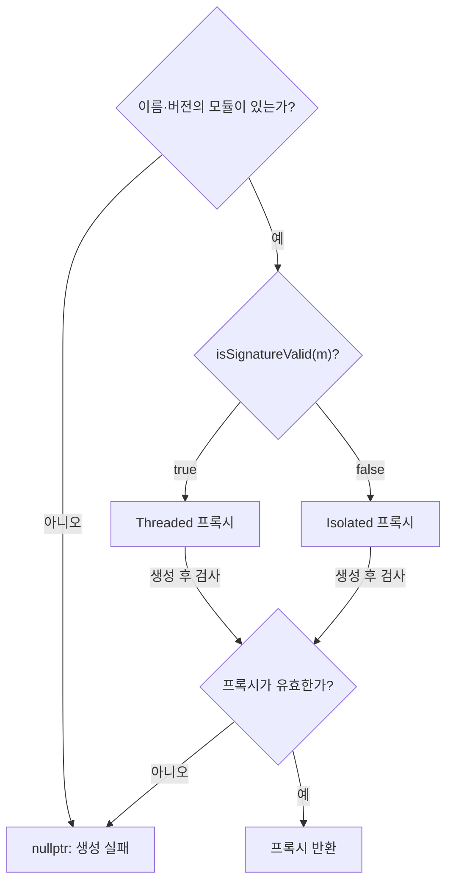
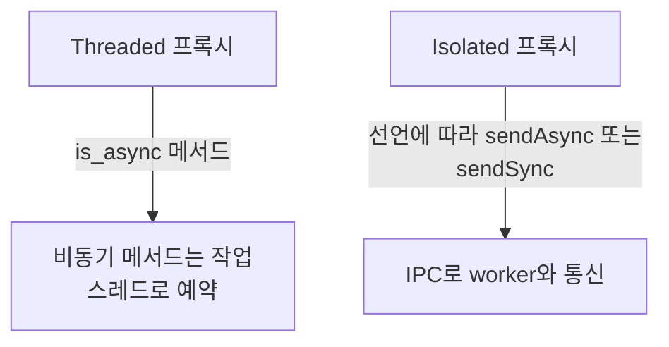
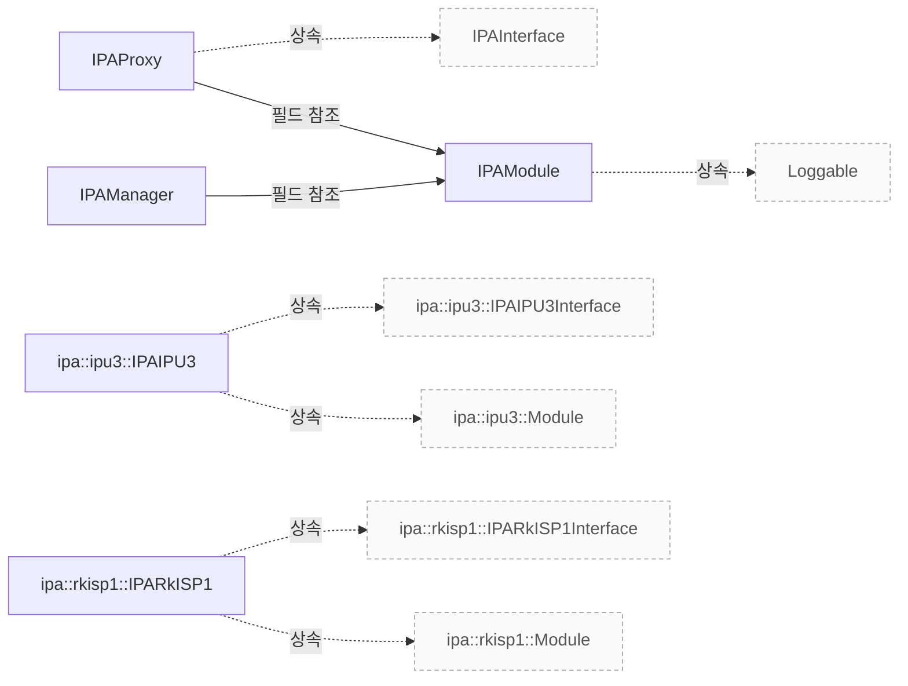

# IPA 관리와 구현 진입점

**IPA 모듈 선택, 스레드·프로세스 경계와 요청·결과 인터페이스를 구현 근거로 확인하세요.**

| 지금 확인할 내용 | 이동할 절 |
|---|---|
| 모듈 탐색과 격리 조건 절을 확인합니다. | [모듈 탐색과 격리 조건](#모듈-탐색과-격리-조건) |
| 스레드와 프로세스 경계 절을 확인합니다. | [스레드와 프로세스 경계](#스레드와-프로세스-경계) |
| 프레임 입력과 결과 인터페이스 절을 확인합니다. | [프레임 입력과 결과 인터페이스](#프레임-입력과-결과-인터페이스) |
| IPA 객체와 종료 순서 절을 확인합니다. | [IPA 객체와 종료 순서](#ipa-객체와-종료-순서) |
| 생성과 IPC 실패 절을 확인합니다. | [생성과 IPC 실패](#생성과-ipc-실패) |
| 보정 전 튜닝 파일 절을 확인합니다. | [보정 전 튜닝 파일](#보정-전-튜닝-파일) |

## 모듈 탐색과 격리 조건

modulePaths를 순회할 때 비어 있는 경로인 경우 continue 문을 통해 해당 루프를 반복하며 다음 경로를 처리하고, addDir에 전달하는 경로는 modulePaths에서 가져온 각 dir의 c_str() 형태입니다. `src/libcamera/ipa_manager.cpp:123`

<!-- sdd:visual:proxy-selection -->
### IPA 모듈 선택과 실행 경계

모듈 선택, 서명 판정, 프록시 유효성의 분기를 구분하세요. 서명 판정의 구성 조건은 이어지는 설명에서 확인합니다.



[Mermaid 원문](ipa.proxy-selection.mmd)

??? note "그림 근거와 확인 범위"
    소스에 연결한 설계 해석입니다. 자동 연결 검사는 의미 승인이나 기기 실행 검증이 아닙니다.
    
    | 요소·전이 | 소스 근거 |
    |---|---|
    | 이름·버전의 모듈이 있는가? | [include/libcamera/internal/ipa_manager.h:35](#source-2a1bbbc8623a516f) |
    | isSignatureValid(m)? | [include/libcamera/internal/ipa_manager.h:35](#source-2a1bbbc8623a516f) |
    | Threaded 프록시 | [include/libcamera/internal/ipa_manager.h:35](#source-2a1bbbc8623a516f) |
    | Isolated 프록시 | [include/libcamera/internal/ipa_manager.h:35](#source-2a1bbbc8623a516f) |
    | 프록시가 유효한가? | [include/libcamera/internal/ipa_manager.h:35](#source-2a1bbbc8623a516f) |
    | nullptr: 생성 실패 | [include/libcamera/internal/ipa_manager.h:35](#source-2a1bbbc8623a516f) |
    | 프록시 반환 | [include/libcamera/internal/ipa_manager.h:35](#source-2a1bbbc8623a516f) |
    | 아니오 | [include/libcamera/internal/ipa_manager.h:35](#source-2a1bbbc8623a516f) |
    | 예 | [include/libcamera/internal/ipa_manager.h:35](#source-2a1bbbc8623a516f) |
    | true | [include/libcamera/internal/ipa_manager.h:35](#source-2a1bbbc8623a516f) |
    | false | [include/libcamera/internal/ipa_manager.h:35](#source-2a1bbbc8623a516f) |
    | 생성 후 검사 | [include/libcamera/internal/ipa_manager.h:35](#source-2a1bbbc8623a516f) |
    | 생성 후 검사 | [include/libcamera/internal/ipa_manager.h:35](#source-2a1bbbc8623a516f) |
    | 아니오 | [include/libcamera/internal/ipa_manager.h:35](#source-2a1bbbc8623a516f) |
    | 예 | [include/libcamera/internal/ipa_manager.h:35](#source-2a1bbbc8623a516f) |
<!-- /sdd:visual:proxy-selection -->

if (!root.empty()) 조건식 전체를 감싸서, root 경로에 'src/ipa'를 조합한 ipaBuildPath와 maxDepth 값 2 를 사용하여 해당 경로를 IPA 검색 경로로 추가합니다. `src/libcamera/ipa_manager.cpp:142`

마지막 addDir 호출이 인자로 받는 설치 경로 식별자는 IPA_MODULE_DIR 입니다. `src/libcamera/ipa_manager.cpp:154`

`IPAModule::match` 함수는 info_.name 과 name 매개변수가 strcmp 을 통해 일치하는지 확인하고, info_.pipelineVersion 가 minVersion 보다 크거나 같으며 maxVersion 보다 작거나 같은지 조건을 모두 만족할 때 true 를 반환하며, 그렇지 않을 경우 false 를 반환합니다. `src/libcamera/ipa_module.cpp:460`

module 호출식은 module(name, minVersion, maxVersion)이며, 인자 순서는 name, minVersion, maxVersion 입니다. `include/libcamera/internal/ipa_manager.h:39`

createIPA에서 모듈 포인터 m이 없을 때 nullptr를 반환합니다. `include/libcamera/internal/ipa_manager.h:40`

if (isSignatureValid(m)) 조건에서 참인 경우 isSignatureValid(m)가 true일 때 `std::make_unique<typename T::Threaded>`(m, cm_)를 호출하여 Threaded 객체를 반환하고, 거짓인 경우 isSignatureValid(m)가 false일 때 `std::make_unique<typename T::Isolated>`(m, cm_)를 호출하여 Isolated 객체를 반환합니다. `include/libcamera/internal/ipa_manager.h:43`

createIPA 함수에서 생성된 프록시의 isValid() 검사 결과에 따라, 실패 시에는 로그를 출력하고 nullptr 를 반환하며, 성공 시에는 해당 프록시 객체를 반환합니다. `include/libcamera/internal/ipa_manager.h:35`

isSignatureValid 함수는 forceIsolation_ 가 true 인 경우 서명 검증을 생략하고 false 를 반환하며, HAVE_IPA_PUBKEY 가 정의되지 않은 경우에도 서명 검증을 수행하지 않고 false 를 반환합니다. `src/libcamera/ipa_manager.cpp:289`

근거 원문: [src/libcamera/ipa_module.cpp:460](#source-6e1525c1fc1aa55e) · [include/libcamera/internal/ipa_manager.h:35](#source-2a1bbbc8623a516f) · [src/libcamera/ipa_manager.cpp:289](#source-532f8ffa194bd319) · [include/libcamera/internal/ipa_manager.h:39](#source-88cede73f337db67) · [include/libcamera/internal/ipa_manager.h:40](#source-6f1686cd6fb2f602) · [include/libcamera/internal/ipa_manager.h:43](#source-6dc4133d5797f19b) · [src/libcamera/ipa_manager.cpp:123](#source-cb4b6f121fa3e274) · [src/libcamera/ipa_manager.cpp:142](#source-204701383274db04) · [src/libcamera/ipa_manager.cpp:154](#source-a90f3412e91c88ee)

## 스레드와 프로세스 경계

`Threaded` 프록시에서 동기 메서드는 `state_`가 `ProxyRunning` 상태여도 호출자가 직접 구현된 핸들러를 통해 바로 실행되며, 반환값을 즉시 제공합니다. `utils/codegen/ipc/generators/libcamera_templates/module_ipa_proxy.cpp.tmpl:48`

<!-- sdd:visual:execution-boundaries -->
### 스레드 호출과 IPC 호출의 경계

Threaded와 Isolated는 대체 경로입니다. 각 API가 동기인지 비동기인지는 인터페이스 선언에 따라 달라집니다.



[Mermaid 원문](ipa.execution-boundaries.mmd)

??? note "그림 근거와 확인 범위"
    소스에 연결한 설계 해석입니다. 자동 연결 검사는 의미 승인이나 기기 실행 검증이 아닙니다.
    
    | 요소·전이 | 소스 근거 |
    |---|---|
    | Threaded 프록시 | [utils/codegen/ipc/generators/libcamera_templates/module_ipa_proxy.cpp.tmpl:48](#source-c7fd6e52f2c537b5) |
    | 비동기 메서드는 작업 스레드로 예약 | [utils/codegen/ipc/generators/libcamera_templates/module_ipa_proxy.cpp.tmpl:48](#source-c7fd6e52f2c537b5) |
    | Isolated 프록시 | [utils/codegen/ipc/generators/libcamera_templates/module_ipa_proxy.cpp.tmpl:130](#source-9ff6047b0a70ce66) |
    | IPC로 worker와 통신 | [utils/codegen/ipc/generators/libcamera_templates/module_ipa_proxy.cpp.tmpl:130](#source-9ff6047b0a70ce66) |
    | is_async 메서드 | [utils/codegen/ipc/generators/libcamera_templates/module_ipa_proxy.cpp.tmpl:48](#source-c7fd6e52f2c537b5) |
    | 선언에 따라 sendAsync 또는 sendSync | [utils/codegen/ipc/generators/libcamera_templates/module_ipa_proxy.cpp.tmpl:130](#source-9ff6047b0a70ce66) |
<!-- /sdd:visual:execution-boundaries -->

`Threaded` 프록시에서 비동기 메서드는 `state_ == ProxyRunning` 조건이 충족될 때만 `proxy_.invokeMethod`를 통해 큐에 작업을 추가하고, 호출자는 즉시 반환받습니다. `utils/codegen/ipc/generators/libcamera_templates/module_ipa_proxy.cpp.tmpl:48`

`{{proxy_name}}Isolated` 클래스의 메서드는 호출 시점과 반환 타이밍에 따라 IPC 메시지 전달 방식을 동기 및 비동기로 구분합니다. `utils/codegen/ipc/generators/libcamera_templates/module_ipa_proxy.cpp.tmpl:130`

비동기 메서드는 `ipc_->sendAsync(_ipcInputBuf)`를 호출하여 메시지를 즉시 전송하고, 함수는 바로 반환합니다. `utils/codegen/ipc/generators/libcamera_templates/module_ipa_proxy.cpp.tmpl:130`

`IPAProxy::resolvePath` 함수는 주어진 worker 실행 파일 이름을 사용하여 유효한 전체 경로를 찾기 위해 일정한 순서로 검색합니다. `src/libcamera/ipa_proxy.cpp:204`

먼저 `execPaths_` 구성에서 지정된 경로들을 순회하며 각 경로의 실행 파일에 대해 `X_OK` 권한이 있는지 확인합니다. `src/libcamera/ipa_proxy.cpp:204`

`IPCPipeUnixSocket` 클래스는 생성자에서 `IPAProxyWorkerPath`를 사용하여 프로세스를 시작하고, 소켓 연결이 성공하면 `connected_` 플래그를 `true`로 설정합니다. 그러나 이 연결 성공은 곧바로 콜백 함수가 실행되는 스레드를 보장하지 않습니다. `src/libcamera/ipc_pipe_unixsocket.cpp:27`

`sendSync` 메서드는 `call` 함수를 통해 동기적으로 메시지를 전송하며, 호출 시점에 `callData_` 맵에 응답을 저장할 공간이 만들어집니다. 이 과정에서 반환된 오류 코드가 없으면 메시지가 성공적으로 전송됩니다. `src/libcamera/ipc_pipe_unixsocket.cpp:27`

근거 원문: [utils/codegen/ipc/generators/libcamera_templates/module_ipa_proxy.cpp.tmpl:48](#source-c7fd6e52f2c537b5) · [utils/codegen/ipc/generators/libcamera_templates/module_ipa_proxy.cpp.tmpl:130](#source-9ff6047b0a70ce66) · [src/libcamera/ipa_proxy.cpp:204](#source-59a673fb7c43c0e0) · [src/libcamera/ipc_pipe_unixsocket.cpp:27](#source-f0268126d3f8c2bc)

## 프레임 입력과 결과 인터페이스

`IPAIPU3Interface` 인터페이스는 `init`, `start`, `stop` 메서드를 통해 초기화 및 제어 흐름을 관리하며, `configure` 메서드는 설정 정보를 받아 처리된 컨트롤 맵을 반환합니다. `include/libcamera/ipa/ipu3.mojom:19`

`IPAIPU3Interface`는 `mapBuffers`와 `unmapBuffers`를 통해 버퍼 매핑을 처리하고, `queueRequest`, `computeParams`, `processStats`와 같은 비동기 메서드를 사용하여 프레임 요청, 파라미터 계산 및 통계 처리를 수행합니다. `include/libcamera/ipa/ipu3.mojom:19`

`IPAIPU3EventInterface`는 `setSensorControls`, `paramsComputed`, `metadataReady` 메서드를 통해 센서 제어 설정, 파라미터 계산 완료 및 메타데이터 준비 상태를 알림을 제공합니다. `include/libcamera/ipa/ipu3.mojom:19`

`IPARkISP1Interface` 인터페이스는 `init`, `start`, `stop` 메서드를 통해 초기화 및 제어 흐름을 관리하며, `configure` 메서드는 설정 정보와 스트림 구성 정보를 받아 처리된 컨트롤 맵을 반환합니다. `include/libcamera/ipa/rkisp1.mojom:17`

`IPARkISP1Interface`는 `mapBuffers`와 `unmapBuffers`를 통해 버퍼 매핑을 처리하고, `queueRequest`, `computeParams`, `processStats`와 같은 비동기 메서드를 사용하여 프레임 요청, 파라미터 계산 및 통계 처리를 수행합니다. `include/libcamera/ipa/rkisp1.mojom:17`

`IPARkISP1EventInterface`는 `paramsComputed`, `setSensorControls`, `metadataReady` 메서드를 통해 파라미터 계산 완료, 센서 제어 설정 및 메타데이터 준비 상태를 알림을 제공합니다. `include/libcamera/ipa/rkisp1.mojom:17`

실행 확인 항목: `queueRequest`와 `computeParams`, `processStats`는 비동기 메서드로 선언되어 있지만, 이 선언만으로는 실제 실행 타이밍이나 순서를 보장하지 않습니다. `include/libcamera/ipa/ipu3.mojom:19`

`paramsComputed`와 `metadataReady`는 이벤트 인터페이스를 통해 호출되며, 이는 비동기적으로 파라미터 계산 완료 및 메타데이터 준비 상태를 알리는 역할을 합니다. `include/libcamera/ipa/rkisp1.mojom:17`

근거 원문: [include/libcamera/ipa/ipu3.mojom:19](#source-5a4a0da4800968a4) · [include/libcamera/ipa/rkisp1.mojom:17](#source-7a01de2477d6466e)

## IPA 객체와 종료 순서

`IPAModule::load()` 함수는 모듈을 한 번만 성공적으로 로드해야 하며, 이후 `createInterface()` 를 여러 번 호출할 수 있습니다. 이 함수는 유효하지 않은 모듈에 대해 호출되면 오류가 발생하며, 이미 로드된 상태라면 즉시 true 를 반환합니다. `src/libcamera/ipa_module.cpp:390`

`IPAModule::createInterface()` 함수는 모듈이 로드되지 않았거나 유효하지 않은 경우 nullptr 를 반환하며, 성공 시 IPA 인터페이스 인스턴스를 생성하여 반환합니다. `src/libcamera/ipa_module.cpp:390`

`{{proxy_name}}Threaded` 프록시는 초기화 시 `ipam->load()` 와 `ipam->createInterface()` 를 호출하여 IPA 컨텍스트를 생성합니다. 인터페이스 생성 실패 시 로그를 기록하고 초기화를 중단하며, 성공 시에만 이벤트 핸들러를 연결하고 유효 상태를 설정합니다. `utils/codegen/ipc/generators/libcamera_templates/module_ipa_proxy.cpp.tmpl:48`

`{{proxy_name}}Threaded` 프록시의 `start()` 메서드는 실행 상태가 아닌 경우를 방지하고, 스레드를 시작하여 비동기 처리를 시작합니다. 반면 `stop()` 메서드는 `ProxyStopping` 상태를 확인하고, 스레드 정리를 위해 `invokeMethod` 와 `exit`, `wait` 을 순차적으로 호출하여 정리합니다. `utils/codegen/ipc/generators/libcamera_templates/proxy_functions.tmpl:25`

`{{proxy_name}}Isolated` 프록시는 생성 시 IPC 파이프를 설정하고 연결 상태를 확인하며, 종료 시에는 `Exit` 명령을 통해 비동기 메시지를 전송하여 정리합니다. 메서드 호출 시 입력/출력 데이터를 직렬화하고, 비동기 호출은 `sendAsync`, 동기 호출은 `sendSync` 를 사용하여 처리합니다. `utils/codegen/ipc/generators/libcamera_templates/module_ipa_proxy.cpp.tmpl:130`

`{{proxy_name}}Isolated` 프록시는 `configure()` 메서드 호출 시 `controlSerializer_` 를 초기화하며, 출력 데이터가 있는 경우에만 `_ipcOutputBuf` 를 생성하여 결과를 직렬화합니다. `utils/codegen/ipc/generators/libcamera_templates/module_ipa_proxy.cpp.tmpl:130`

근거 원문: [src/libcamera/ipa_module.cpp:390](#source-fadefbb962b2fc44) · [utils/codegen/ipc/generators/libcamera_templates/module_ipa_proxy.cpp.tmpl:48](#source-c7fd6e52f2c537b5) · [utils/codegen/ipc/generators/libcamera_templates/proxy_functions.tmpl:25](#source-eb8f57d7452822da) · [utils/codegen/ipc/generators/libcamera_templates/module_ipa_proxy.cpp.tmpl:130](#source-9ff6047b0a70ce66)

## 생성과 IPC 실패

`IPAModule::load` 함수에서 if (!valid_) 조건이 참일 경우 false 를 반환하며, if (loaded_) 조건이 참일 경우 true 를 반환합니다. `src/libcamera/ipa_module.cpp:390`

`IPAModule::load`에서 dlopen 실패 시에는 로그를 기록한 후 dlHandle_를 nullptr로 설정하지 않고 false를 반환하지만, dlsym 실패 시에는 로그를 기록한 후 dlclose(dlHandle_)를 호출하여 핸들을 정리하고 dlHandle_를 nullptr로 설정한 뒤 false를 반환합니다. `src/libcamera/ipa_module.cpp:390`

`IPAModule::createInterface` 함수는 if (!valid_ || !loaded_) 조건식이 참일 때 nullptr 을 반환하며, 이 조건이 거짓인 경우 (즉 valid_ 가 참이고 loaded_ 도 참일 때) ipaCreate_() 호출식을 실행하여 IPA 인터페이스 인스턴스를 생성하고 반환합니다. `src/libcamera/ipa_module.cpp:390`

{{proxy_name}}Isolated 생성자는 워커 경로를 확인하고 경로가 비어있으면 로그를 출력한 후 즉시 반환하며, IPC 파이프를 생성하여 연결이 되지 않은 경우에도 오류 로그를 기록하고 반환합니다. `utils/codegen/ipc/generators/libcamera_templates/module_ipa_proxy.cpp.tmpl:130`

`IPCPipeUnixSocket::sendSync` 함수는 call 함수를 호출하며, ret 가 0 이 아닐 경우 해당 값을 반환하고 out 은 처리되지 않습니다. `src/libcamera/ipc_pipe_unixsocket.cpp:57`

socket_->send가 실패하면 (ret 가 0 이 아닌 경우) callData_ 에서 해당 cookie 를 지우고(ret) ret 값을 반환하며, 타이머 만료 시에는 LOG 에 Call timeout! 을 기록한 후 callData_ 에서 해당 항목을 지우고 -ETIMEDOUT 을 반환하고, 정상 완료 조건은 iter->second.done 이 true 가 되는 경우이며 이때 callData_ 를 지우고 0 을 반환합니다. `src/libcamera/ipc_pipe_unixsocket.cpp:112`

근거 원문: [src/libcamera/ipa_module.cpp:390](#source-fadefbb962b2fc44) · [utils/codegen/ipc/generators/libcamera_templates/module_ipa_proxy.cpp.tmpl:130](#source-9ff6047b0a70ce66) · [src/libcamera/ipc_pipe_unixsocket.cpp:57](#source-c9e0d1aa9473ec41) · [src/libcamera/ipc_pipe_unixsocket.cpp:112](#source-3f12b93a0bc626a1)

## 보정 전 튜닝 파일

RKISP1 또는 Mali-C55의 센서를 사용할 때 IPA 모듈 이름은 디렉토리 이름을 생성하는 데 그대로 사용되며, 이 이름은 모듈 로딩 시 검증됩니다. `src/libcamera/ipa_proxy.cpp:174`

먼저 주어진 센서 모델 이름을 사용하여 `.yaml` 확장자를 가진 튜닝 파일을 찾습니다. `src/libcamera/pipeline/rkisp1/rkisp1.cpp:406`

주요 튜닝 파일이 존재하지 않으면 `fallbackName`에 지정된 대체 파일을 사용합니다. `src/libcamera/ipa_proxy.cpp:174`

대체 파일도 없으면 오류 로그를 출력하고 빈 문자열을 반환하며, 이 경우 어떤 튜닝 파일도 사용되지 않습니다. `src/libcamera/ipa_proxy.cpp:174`

RKISP1의 uncalibrated.yaml 파일에는 `Agc`, `Awb`, `BlackLevelCorrection`, `Ccm`, `GammaOutCorrection` 등의 알고리즘이 정의되어 있습니다. `src/ipa/rkisp1/data/uncalibrated.yaml:1`

Mali-C55의 uncalibrated.yaml 파일에도 `Agc`, `Awb`, `BlackLevelCorrection`, `Ccm`과 같은 알고리즘이 정의되어 있습니다. `src/ipa/mali-c55/data/uncalibrated.yaml:1`

실행 확인 항목: 목록에 명시되지 않은 보정 알고리즘이 활성화되었다고 추정해서는 안 됩니다. `src/ipa/rkisp1/data/uncalibrated.yaml:1`

두 플랫폼 모두에서 센서별 파일이 없으면 fallback 메커니즘을 통해 대체 파일을 시도합니다. `src/libcamera/ipa_proxy.cpp:174`

근거 원문: [src/libcamera/pipeline/rkisp1/rkisp1.cpp:406](#source-a117437c7ec61db3) · [src/libcamera/pipeline/mali-c55/mali-c55.cpp:468](#source-efc0c3fc5cf7acef) · [src/libcamera/ipa_proxy.cpp:174](#source-4000376c954f5327) · [src/ipa/rkisp1/data/uncalibrated.yaml:1](#source-c3d57577d02a4dc3) · [src/ipa/mali-c55/data/uncalibrated.yaml:1](#source-9146c9052851a10f)

## 소프트웨어 ISP 입력 버퍼의 텍스처 형식

`createDMABufTexture2D()` 함수 내부의 `switch (eglImage.format_)` 문장은 입력된 EGL 이미지 형식에 따라 DRM 포맷을 매핑합니다. GL_RED 또는 GL_LUMINANCE 형식이 주어지면 DRM_FORMAT_R8 을, GL_RG 형식이 주어지면 DRM_FORMAT_GR88 를, GL_RGBA 형식이 주어지면 DRM_FORMAT_ARGB8888 를 각각 선택하여 `drm_format` 변수에 할당합니다. `src/libcamera/egl.cpp:174`

`createDMABufTexture2D()` 함수의 `switch (eglImage.format_)` 문에서 기본(default) 분기가 실행되면, 해당 형식을 처리할 수 없음을 나타내는 오류 로그가 출력됩니다. `src/libcamera/egl.cpp:174`

동일한 기본 분기에서 실행이 완료되면 함수는 `-ENODEV` 값을 반환하여 호출자에게 오류를 알립니다. `src/libcamera/egl.cpp:174`

`createDMABufTexture2D()` 함수에서 `eglCreateImageKHR()` 호출이 `EGL_NO_IMAGE_KHR`를 반환하면, 디버깅 로그에 'eglCreateImageKHR fail'라는 메시지를 출력하고 `eglImage.dmabuf_import_failed_` 플래그를 `true`로 설정한 뒤 `-ENODEV`를 반환합니다. `src/libcamera/egl.cpp:174`

`createInputDMABufTexture2D()` 함수는 내부적으로 `createDMABufTexture2D()` 함수를 호출할 때 마지막 인자로 `false` 값을 전달합니다. `src/libcamera/egl.cpp:174`

`createOutputDMABufTexture2D()` 함수는 내부적으로 `createDMABufTexture2D()` 함수를 호출할 때 마지막 인자로 `true` 값을 전달합니다. `src/libcamera/egl.cpp:174`

`createDMABufTexture2D()` 함수는 `output` 매개변수가 참일 때에만 프레임버퍼 객체 (FBO) 에 텍스처를 연결합니다. `src/libcamera/egl.cpp:174`

`output` 가 참인 경우 `attachTextureToFBO(eglImage)` 함수를 호출하여 연결을 수행하고 그 반환값으로 `ret` 변수에 대입합니다. `src/libcamera/egl.cpp:174`

근거 원문: [src/libcamera/egl.cpp:174](#source-8cc12a6ba8b0dced)

## 소프트웨어 ISP 셰이더의 렌즈 음영 보정

두 셰이더에서 블랙 레벨 보정은 가장 먼저 수행되며, rgb 값에서 blacklevel 을 빼고 (1.0 - blacklevel) 로 나누어 정규화합니다. `src/libcamera/shaders/bayer_1x_packed.frag:237`

APPLY_LSC 가 정의된 경우에만 렌즈 음영 보정 (LSC) 이 적용되며, 이때는 텍스처 좌표로 샘플링한 값에 4.0 을 곱하여 `UQ<2, 6>` 에서 float 로 변환하는 계산을 수행합니다. `src/libcamera/shaders/bayer_1x_packed.frag:237`

렌즈 음영 보정 이후에는 AWB 이득을 적용하고 각 채널을 센서 범위 (0.0~1.0) 로 포화시킵니다. `src/libcamera/shaders/bayer_1x_packed.frag:237`

색 보정 행렬 (CCM) 을 곱한 후 대비 조정과 감마 변환이 순차적으로 적용됩니다. `src/libcamera/shaders/bayer_1x_packed.frag:237`

실행 확인 항목: 소프트웨어 ISP 인터페이스에서는 LSC 버퍼를 texture2D(...) 함수를 통해 샘플링하여 셰이더 내부에서 처리하지만, 실제 GPU 실행 검증은 이 문서의 범위를 벗어납니다. `include/libcamera/ipa/softisp.mojom:1`

근거 원문: [src/libcamera/shaders/bayer_1x_packed.frag:237](#source-68d470282c445049) · [src/libcamera/shaders/bayer_unpacked.frag:140](#source-86d4a7688119bd37) · [include/libcamera/ipa/softisp.mojom:1](#source-df8e8976167a0311)

??? note "설계 질문과 검증 범위"
    질문별 답변과 근거 연결을 검사했습니다. 의미와 실행 결과는 사람 검토가 필요합니다.
    
    | 설계 질문 | 설명 위치 | 확인 범위 |
    |---|---|---|
    | 어떤 IPA 모듈과 실행 방식이 선택됩니까? | [모듈 탐색과 격리 조건](#모듈-탐색과-격리-조건) | 코드 근거와 설명 연결 |
    | 동기 호출과 비동기 호출은 어디에서 실행됩니까? | [스레드와 프로세스 경계](#스레드와-프로세스-경계) | 코드 근거와 설명 연결 |
    | 파이프라인과 알고리즘은 어떤 입력과 결과를 주고받습니까? | [프레임 입력과 결과 인터페이스](#프레임-입력과-결과-인터페이스) | 코드 근거와 설명 연결 · 실행 확인 항목 별도 |
    | 인터페이스를 만들고 비동기 처리를 끝내는 계약은 무엇입니까? | [IPA 객체와 종료 순서](#ipa-객체와-종료-순서) | 코드 근거와 설명 연결 |
    | 모듈 생성과 IPC 오류는 어떻게 관찰됩니까? | [생성과 IPC 실패](#생성과-ipc-실패) | 코드 근거와 설명 연결 |
    | 센서별 튜닝 파일이 없으면 어떤 파일과 알고리즘이 쓰입니까? | [보정 전 튜닝 파일](#보정-전-튜닝-파일) | 코드 근거와 설명 연결 · 실행 확인 항목 별도 |
    | 소프트웨어 ISP의 GPU 셰이더는 렌즈 음영 보정을 어느 단계에 적용합니까? | [소프트웨어 ISP 셰이더의 렌즈 음영 보정](#소프트웨어-isp-셰이더의-렌즈-음영-보정) | 코드 근거와 설명 연결 · 실행 확인 항목 별도 |
    | 소프트웨어 ISP의 입력 버퍼를 텍스처로 가져올 때 형식과 실패 처리는 어떻게 연결됩니까? | [소프트웨어 ISP 입력 버퍼의 텍스처 형식](#소프트웨어-isp-입력-버퍼의-텍스처-형식) | 코드 근거와 설명 연결 |

## 소스 근거

같은 발췌는 한 번만 싣습니다. 필요한 원문을 펼쳐 설명과 대조하세요.

<a id="source-6e1525c1fc1aa55e"></a>

??? note "소스 근거: src/libcamera/ipa_module.cpp:460"
    `src/libcamera/ipa_module.cpp:460`에서 시작하는 발췌입니다. 종료 줄은 478이며, 아래 원문을 설명과 대조할 수 있습니다.
    
    SHA-256: `99940db9ea353ad0d8282b7c2148578f4c6054d785ef7aaf690d522b52bafb5b`
    
    ```text
    \brief Verify if the IPA module matches a given name
     * \param[in] name The IPA module name
     * \param[in] minVersion Minimum acceptable version of IPA module
     * \param[in] maxVersion Maximum acceptable version of IPA module
     *
     * This function checks if this IPA module matches the requested \a name
     * and the input version range.
     *
     * \return True if the IPA module matches, or false otherwise
     */
    bool IPAModule::match(const char *name, uint32_t minVersion,
    		      uint32_t maxVersion) const
    {
    	return info_.pipelineVersion >= minVersion &&
    	       info_.pipelineVersion <= maxVersion &&
    	       !strcmp(info_.name, name);
    }
    
    std::string IPAModule::logPrefix()
    ```

<a id="source-2a1bbbc8623a516f"></a>

??? note "소스 근거: include/libcamera/internal/ipa_manager.h:35"
    `include/libcamera/internal/ipa_manager.h:35`에서 시작하는 발췌입니다. 종료 줄은 58이며, 아래 원문을 설명과 대조할 수 있습니다.
    
    SHA-256: `e0bd5192ea24a8b39d3df7b7b93c8b17614663a0144f6dd0741d410fa321d458`
    
    ```text
    template<typename T>
    	std::unique_ptr<T> createIPA(const char *name, uint32_t minVersion,
    				     uint32_t maxVersion)
    	{
    		IPAModule *m = module(name, minVersion, maxVersion);
    		if (!m)
    			return nullptr;
    
    		auto proxy = [&]() -> std::unique_ptr<T> {
    			if (isSignatureValid(m))
    				return std::make_unique<typename T::Threaded>(m, cm_);
    			else
    				return std::make_unique<typename T::Isolated>(m, cm_);
    		}();
    
    		if (!proxy->isValid()) {
    			LOG(IPAManager, Error) << "Failed to load proxy";
    			return nullptr;
    		}
    
    		return proxy;
    	}
    
    #if HAVE_IPA_PUBKEY
    ```

<a id="source-532f8ffa194bd319"></a>

??? note "소스 근거: src/libcamera/ipa_manager.cpp:289"
    `src/libcamera/ipa_manager.cpp:289`에서 시작하는 발췌입니다. 종료 줄은 319이며, 아래 원문을 설명과 대조할 수 있습니다.
    
    SHA-256: `f657ce54df77453510108b02060166edd7506c982d13d3e4868fadee4065a677`
    
    ```text
    bool IPAManager::isSignatureValid([[maybe_unused]] IPAModule *ipa) const
    {
    #if HAVE_IPA_PUBKEY
    	if (forceIsolation_) {
    		LOG(IPAManager, Debug)
    			<< "Isolation of IPA module " << ipa->path()
    			<< " forced through configuration";
    		return false;
    	}
    
    	File file{ ipa->path() };
    	if (!file.open(File::OpenModeFlag::ReadOnly))
    		return false;
    
    	std::span<uint8_t> data = file.map();
    	if (data.empty())
    		return false;
    
    	bool valid = pubKey_.verify(data, ipa->signature());
    
    	LOG(IPAManager, Debug)
    		<< "IPA module " << ipa->path() << " signature is "
    		<< (valid ? "valid" : "not valid");
    
    	return valid;
    #else
    	return false;
    #endif
    }
    
    } /* namespace libcamera */
    ```

<a id="source-88cede73f337db67"></a>

??? note "소스 근거: include/libcamera/internal/ipa_manager.h:39"
    `include/libcamera/internal/ipa_manager.h:39`에서 시작하는 발췌입니다. 종료 줄은 39이며, 아래 원문을 설명과 대조할 수 있습니다.
    
    SHA-256: `abe3700a1da7f3f2eb981affc5f0e293b2e1acc38b3566ae91bb3dd5283f2e4c`
    
    ```text
    IPAModule *m = module(name, minVersion, maxVersion);
    ```

<a id="source-6f1686cd6fb2f602"></a>

??? note "소스 근거: include/libcamera/internal/ipa_manager.h:40"
    `include/libcamera/internal/ipa_manager.h:40`에서 시작하는 발췌입니다. 종료 줄은 41이며, 아래 원문을 설명과 대조할 수 있습니다.
    
    SHA-256: `71fb729c3bdd4a56b9459ea7d0dd8857e2a3e8e367cc6b29f731916bd7a44256`
    
    ```text
    if (!m)
    			return nullptr;
    ```

<a id="source-6dc4133d5797f19b"></a>

??? note "소스 근거: include/libcamera/internal/ipa_manager.h:43"
    `include/libcamera/internal/ipa_manager.h:43`에서 시작하는 발췌입니다. 종료 줄은 48이며, 아래 원문을 설명과 대조할 수 있습니다.
    
    SHA-256: `8dd07139188ee0ecf096f7b10adb371325923fd96667ed987098ba80c3cea94f`
    
    ```text
    auto proxy = [&]() -> std::unique_ptr<T> {
    			if (isSignatureValid(m))
    				return std::make_unique<typename T::Threaded>(m, cm_);
    			else
    				return std::make_unique<typename T::Isolated>(m, cm_);
    		}();
    ```

<a id="source-cb4b6f121fa3e274"></a>

??? note "소스 근거: src/libcamera/ipa_manager.cpp:123"
    `src/libcamera/ipa_manager.cpp:123`에서 시작하는 발췌입니다. 종료 줄은 133이며, 아래 원문을 설명과 대조할 수 있습니다.
    
    SHA-256: `ef31bd47aca5a0254bc8317e1533a480df3c8971b84105608a6252089edfac9b`
    
    ```text
    const auto modulePaths =
    		configuration.listOption({ "ipa", "module_paths" })
    			.value_or(utils::defopt);
    	for (const auto &dir : modulePaths) {
    		if (dir.empty())
    			continue;
    
    		ipaCount += addDir(dir.c_str());
    	}
    
    	if (!modulePaths.empty() && !ipaCount)
    ```

<a id="source-204701383274db04"></a>

??? note "소스 근거: src/libcamera/ipa_manager.cpp:142"
    `src/libcamera/ipa_manager.cpp:142`에서 시작하는 발췌입니다. 종료 줄은 151이며, 아래 원문을 설명과 대조할 수 있습니다.
    
    SHA-256: `aa44a61f24058ff10198a753fbc660d8c24e51e49e30de27c7a930bb450d9eba`
    
    ```text
    std::string root = utils::libcameraBuildPath();
    	if (!root.empty()) {
    		std::string ipaBuildPath = root + "src/ipa";
    		constexpr int maxDepth = 2;
    
    		LOG(IPAManager, Info)
    			<< "libcamera is not installed. Adding '"
    			<< ipaBuildPath << "' to the IPA search path";
    
    		ipaCount += addDir(ipaBuildPath.c_str(), maxDepth);
    ```

<a id="source-a90f3412e91c88ee"></a>

??? note "소스 근거: src/libcamera/ipa_manager.cpp:154"
    `src/libcamera/ipa_manager.cpp:154`에서 시작하는 발췌입니다. 종료 줄은 155이며, 아래 원문을 설명과 대조할 수 있습니다.
    
    SHA-256: `8aebbf25d6c5bd205901c410c0d4aaeda1671e583a5a2ea29d9277f409066f71`
    
    ```text
    /* Finally try to load IPAs from the installed system path. */
    	ipaCount += addDir(IPA_MODULE_DIR);
    ```

<a id="source-c7fd6e52f2c537b5"></a>

??? note "소스 근거: utils/codegen/ipc/generators/libcamera_templates/module_ipa_proxy.cpp.tmpl:48"
    `utils/codegen/ipc/generators/libcamera_templates/module_ipa_proxy.cpp.tmpl:48`에서 시작하는 발췌입니다. 종료 줄은 128이며, 아래 원문을 설명과 대조할 수 있습니다.
    
    SHA-256: `af4b12c81ffee2e9979c01a7e7eb188f5568d258ba03e522b60a3608dc226abd`
    
    ```text
    {{proxy_name}}Threaded::{{proxy_name}}Threaded(IPAModule *ipam, const CameraManager &cm)
    	: {{proxy_name}}(ipam, cm), thread_("{{proxy_name}}")
    {
    	LOG(IPAProxy, Debug)
    		<< "initializing {{module_name}} proxy in thread: loading IPA from "
    		<< ipam->path();
    
    	if (!ipam->load())
    		return;
    
    	IPAInterface *ipai = ipam->createInterface();
    	if (!ipai) {
    		LOG(IPAProxy, Error)
    			<< "Failed to create IPA context for " << ipam->path();
    		return;
    	}
    
    	ipa_ = std::unique_ptr<{{interface_name}}>(static_cast<{{interface_name}} *>(ipai));
    	proxy_.setIPA(ipa_.get());
    
    
    	ipa_->{{method.mojom_name}}.connect(this, &{{proxy_name}}Threaded::{{method.mojom_name}}Handler);
    
    
    	valid_ = true;
    }
    
    {{proxy_name}}Threaded::~{{proxy_name}}Threaded() = default;
    
    
    {{proxy_funcs.func_sig(proxy_name + "Threaded", method)}}
    {
    
    	{{proxy_funcs.stop_thread_body()}}
    
    	{{ method|method_return_value + " _ret = " if method|method_return_value != "void" -}}
    	ipa_->{{method.mojom_name}}(
    	
    		{{param}}{{- ", " if not loop.last}}
    	
    );
    
    	proxy_.moveToThread(&thread_);
    
    	return {{ "_ret" if method|method_return_value != "void" }};
    
    	state_ = ProxyRunning;
    	thread_.start();
    
    	return proxy_.invokeMethod(&ThreadProxy::start, ConnectionTypeBlocking
    	{{- ", " if method|method_param_names}}
    	
    		{{param}}{{- ", " if not loop.last}}
    	
    );
    
    	return ipa_->{{method.mojom_name}}(
    	
    		{{param}}{{- ", " if not loop.last}}
    	
    );
    
    	ASSERT(state_ == ProxyRunning);
    	proxy_.invokeMethod(&ThreadProxy::{{method.mojom_name}}, ConnectionTypeQueued
    	
    		, {{param}}
    	
    );
    
    }
    
    
    
    {{proxy_funcs.func_sig(proxy_name + "Threaded", method, "Handler")}}
    {
    	ASSERT(state_ != ProxyStopped);
    	{{method.mojom_name}}.emit({{method.parameters|params_comma_sep}});
    }
    
    
    /* ========================================================================== */
    ```

<a id="source-9ff6047b0a70ce66"></a>

??? note "소스 근거: utils/codegen/ipc/generators/libcamera_templates/module_ipa_proxy.cpp.tmpl:130"
    `utils/codegen/ipc/generators/libcamera_templates/module_ipa_proxy.cpp.tmpl:130`에서 시작하는 발췌입니다. 종료 줄은 212이며, 아래 원문을 설명과 대조할 수 있습니다.
    
    SHA-256: `dd0ba6e352ffacd6c27c6ff5bb447af14838d75ca6aed8d056855ec442a97744`
    
    ```text
    {{proxy_name}}Isolated::{{proxy_name}}Isolated(IPAModule *ipam, const CameraManager &cm)
    	: {{proxy_name}}(ipam, cm),
    	  controlSerializer_(ControlSerializer::Role::Proxy), seq_(0)
    {
    	LOG(IPAProxy, Debug)
    		<< "initializing {{module_name}} proxy in isolation: loading IPA from "
    		<< ipam->path();
    
    	const std::string proxyWorkerPath = resolvePath("{{module_name}}_ipa_proxy");
    	if (proxyWorkerPath.empty()) {
    		LOG(IPAProxy, Error) << "Failed to get proxy worker path";
    		return;
    	}
    
    	auto ipc = std::make_unique<IPCPipeUnixSocket>(ipam->path().c_str(),
    						       proxyWorkerPath.c_str());
    	if (!ipc->isConnected()) {
    		LOG(IPAProxy, Error) << "Failed to create IPCPipe";
    		return;
    	}
    
    	ipc->recv.connect(this, &{{proxy_name}}Isolated::recvMessage);
    
    	ipc_ = std::move(ipc);
    	valid_ = true;
    }
    
    {{proxy_name}}Isolated::~{{proxy_name}}Isolated()
    {
    	if (ipc_) {
    		IPCMessage::Header header =
    			{ static_cast<uint32_t>({{cmd_enum_name}}::Exit), seq_++ };
    		IPCMessage msg(header);
    		ipc_->sendAsync(msg);
    	}
    }
    
    
    {{proxy_funcs.func_sig(proxy_name + "Isolated", method)}}
    {
    
    	controlSerializer_.reset();
    
    
    
    	IPCMessage::Header _header = { static_cast<uint32_t>({{cmd}}), seq_++ };
    	IPCMessage _ipcInputBuf(_header);
    
    	IPCMessage _ipcOutputBuf;
    
    
    {{proxy_funcs.serialize_call(method|method_param_inputs, '_ipcInputBuf.data()', '_ipcInputBuf.fds()')}}
    
    
    	int _ret = ipc_->sendAsync(_ipcInputBuf);
    
    	int _ret = ipc_->sendSync(_ipcInputBuf
    {{- ", &_ipcOutputBuf" if has_output -}}
    );
    
    	if (_ret < 0) {
    		LOG(IPAProxy, Error) << "Failed to call {{method.mojom_name}}: " << _ret;
    
    		return static_cast<{{method|method_return_value}}>(_ret);
    
    		return;
    
    	}
    
    	{{method|method_return_value}} _retValue = IPADataSerializer<{{method|method_return_value}}>::deserialize(_ipcOutputBuf.data(), 0);
    
    {{proxy_funcs.deserialize_call(method|method_param_outputs, '_ipcOutputBuf.data()', '_ipcOutputBuf.fds()', init_offset = method|method_return_value|byte_width|int)}}
    
    	return _retValue;
    
    
    {{proxy_funcs.deserialize_call(method|method_param_outputs, '_ipcOutputBuf.data()', '_ipcOutputBuf.fds()')}}
    
    }
    
    
    
    void {{proxy_name}}Isolated::recvMessage(
    ```

<a id="source-59a673fb7c43c0e0"></a>

??? note "소스 근거: src/libcamera/ipa_proxy.cpp:204"
    `src/libcamera/ipa_proxy.cpp:204`에서 시작하는 발췌입니다. 종료 줄은 261이며, 아래 원문을 설명과 대조할 수 있습니다.
    
    SHA-256: `8cbcadf7036cdb391f4c48af8562cb637752242f9564f1118c949a62df9dbd77`
    
    ```text
    \brief Find a valid full path for a proxy worker for a given executable name
     * \param[in] file File name of proxy worker executable
     *
     * A proxy worker's executable could be found in either the global installation
     * directory, or in the paths specified by the environment variable
     * LIBCAMERA_IPA_PROXY_PATH. This function checks the global install directory
     * first, then LIBCAMERA_IPA_PROXY_PATH in order, and returns the full path to
     * the proxy worker executable that is specified by file. The proxy worker
     * executable shall have exec permission.
     *
     * \return The full path to the proxy worker executable, or an empty string if
     * no valid executable path
     */
    std::string IPAProxy::resolvePath(const std::string &file) const
    {
    	std::string proxyFile = "/" + file;
    
    	/* Try paths from the configuration first. */
    	for (const auto &dir : execPaths_) {
    		if (dir.empty())
    			continue;
    
    		std::string proxyPath = dir + proxyFile;
    		if (!access(proxyPath.c_str(), X_OK))
    			return proxyPath;
    	}
    
    	/*
    	 * When libcamera is used before it is installed, load proxy workers
    	 * from the same build directory as the libcamera directory itself.
    	 * This requires identifying the path of the libcamera.so, and
    	 * referencing a relative path for the proxy workers from that point.
    	 */
    	std::string root = utils::libcameraBuildPath();
    	if (!root.empty()) {
    		std::string ipaProxyDir = root + "src/libcamera/proxy/worker";
    
    		LOG(IPAProxy, Info)
    			<< "libcamera is not installed. Loading proxy workers from '"
    			<< ipaProxyDir << "'";
    
    		std::string proxyPath = ipaProxyDir + proxyFile;
    		if (!access(proxyPath.c_str(), X_OK))
    			return proxyPath;
    
    		return std::string();
    	}
    
    	/* Else try finding the exec target from the install directory. */
    	std::string proxyPath = std::string(IPA_PROXY_DIR) + proxyFile;
    	if (!access(proxyPath.c_str(), X_OK))
    		return proxyPath;
    
    	return std::string();
    }
    
    /**
     * \var IPAProxy::valid_
    ```

<a id="source-f0268126d3f8c2bc"></a>

??? note "소스 근거: src/libcamera/ipc_pipe_unixsocket.cpp:27"
    `src/libcamera/ipc_pipe_unixsocket.cpp:27`에서 시작하는 발췌입니다. 종료 줄은 144이며, 아래 원문을 설명과 대조할 수 있습니다.
    
    SHA-256: `0abe488ceae72cca0a5b96c7223ffc4cc412ab18f94765fd7f001dc450544f40`
    
    ```text
    IPCPipeUnixSocket::IPCPipeUnixSocket(const char *ipaModulePath,
    				     const char *ipaProxyWorkerPath)
    	: IPCPipe()
    {
    	socket_ = std::make_unique<IPCUnixSocket>();
    	UniqueFD fd = socket_->create();
    	if (!fd.isValid()) {
    		LOG(IPCPipe, Error) << "Failed to create socket";
    		return;
    	}
    	socket_->readyRead.connect(this, &IPCPipeUnixSocket::readyRead);
    
    	std::array args{ std::string(ipaModulePath), std::to_string(fd.get()) };
    	std::array fds{ fd.get() };
    
    	proc_ = std::make_unique<Process>();
    	int ret = proc_->start(ipaProxyWorkerPath, args, fds);
    	if (ret) {
    		LOG(IPCPipe, Error)
    			<< "Failed to start proxy worker process";
    		return;
    	}
    
    	connected_ = true;
    }
    
    IPCPipeUnixSocket::~IPCPipeUnixSocket()
    {
    }
    
    int IPCPipeUnixSocket::sendSync(const IPCMessage &in, IPCMessage *out)
    {
    	IPCUnixSocket::Payload response;
    
    	int ret = call(in.payload(), &response, in.header().cookie);
    	if (ret) {
    		LOG(IPCPipe, Error) << "Failed to call sync";
    		return ret;
    	}
    
    	if (out)
    		*out = IPCMessage(response);
    
    	return 0;
    }
    
    int IPCPipeUnixSocket::sendAsync(const IPCMessage &data)
    {
    	int ret = socket_->send(data.payload());
    	if (ret) {
    		LOG(IPCPipe, Error) << "Failed to call async";
    		return ret;
    	}
    
    	return 0;
    }
    
    void IPCPipeUnixSocket::readyRead()
    {
    	IPCUnixSocket::Payload payload;
    	int ret = socket_->receive(&payload);
    	if (ret) {
    		LOG(IPCPipe, Error) << "Receive message failed" << ret;
    		return;
    	}
    
    	/* \todo Use span to avoid the double copy when callData is found. */
    	if (payload.data.size() < sizeof(IPCMessage::Header)) {
    		LOG(IPCPipe, Error) << "Not enough data received";
    		return;
    	}
    
    	IPCMessage ipcMessage(payload);
    
    	auto callData = callData_.find(ipcMessage.header().cookie);
    	if (callData != callData_.end()) {
    		*callData->second.response = std::move(payload);
    		callData->second.done = true;
    		return;
    	}
    
    	/* Received unexpected data, this means it's a call from the IPA. */
    	recv.emit(ipcMessage);
    }
    
    int IPCPipeUnixSocket::call(const IPCUnixSocket::Payload &message,
    			    IPCUnixSocket::Payload *response, uint32_t cookie)
    {
    	Timer timeout;
    	int ret;
    
    	const auto result = callData_.insert({ cookie, { response, false } });
    	const auto &iter = result.first;
    
    	ret = socket_->send(message);
    	if (ret) {
    		callData_.erase(iter);
    		return ret;
    	}
    
    	/* \todo Make this less dangerous, see IPCPipe::sendSync() */
    	timeout.start(2000ms);
    	while (!iter->second.done) {
    		if (!timeout.isRunning()) {
    			LOG(IPCPipe, Error) << "Call timeout!";
    			callData_.erase(iter);
    			return -ETIMEDOUT;
    		}
    
    		Thread::current()->eventDispatcher()->processEvents();
    	}
    
    	callData_.erase(iter);
    
    	return 0;
    }
    
    } /* namespace libcamera */
    ```

<a id="source-5a4a0da4800968a4"></a>

??? note "소스 근거: include/libcamera/ipa/ipu3.mojom:19"
    `include/libcamera/ipa/ipu3.mojom:19`에서 시작하는 발췌입니다. 종료 줄은 44이며, 아래 원문을 설명과 대조할 수 있습니다.
    
    SHA-256: `f1969299336634cdd04e42402648a452126032a25540ad5c78bd2c804362a381`
    
    ```text
    interface IPAIPU3Interface {
    	init(libcamera.IPASettings settings,
    	     libcamera.IPACameraSensorInfo sensorInfo,
    	     libcamera.ControlInfoMap sensorControls)
    		=> (int32 ret, libcamera.ControlInfoMap ipaControls);
    	start() => (int32 ret);
    	stop();
    
    	configure(IPAConfigInfo configInfo)
    		=> (int32 ret, libcamera.ControlInfoMap ipaControls);
    
    	mapBuffers(array<libcamera.IPABuffer> buffers);
    	unmapBuffers(array<uint32> ids);
    
    	[async] queueRequest(uint32 frame, libcamera.ControlList controls);
    	[async] computeParams(uint32 frame, uint32 bufferId);
    	[async] processStats(uint32 frame, int64 frameTimestamp,
    			     uint32 bufferId, libcamera.ControlList sensorControls);
    };
    
    interface IPAIPU3EventInterface {
    	setSensorControls(uint32 frame, libcamera.ControlList sensorControls,
    			  libcamera.ControlList lensControls);
    	paramsComputed(uint32 frame);
    	metadataReady(uint32 frame, libcamera.ControlList metadata);
    };
    ```

<a id="source-7a01de2477d6466e"></a>

??? note "소스 근거: include/libcamera/ipa/rkisp1.mojom:17"
    `include/libcamera/ipa/rkisp1.mojom:17`에서 시작하는 발췌입니다. 종료 줄은 43이며, 아래 원문을 설명과 대조할 수 있습니다.
    
    SHA-256: `32d657315ff8eac800254f0a5d39462d55bb4b0ef6ee5717930f3d3b8504162b`
    
    ```text
    interface IPARkISP1Interface {
    	init(libcamera.IPASettings settings,
    	     uint32 hwRevision, uint32 supportedBlocks,
    	     libcamera.IPACameraSensorInfo sensorInfo,
    	     libcamera.ControlInfoMap sensorControls)
    		=> (int32 ret, libcamera.ControlInfoMap ipaControls);
    	start() => (int32 ret);
    	stop();
    
    	configure(IPAConfigInfo configInfo,
    		  map<uint32, libcamera.IPAStream> streamConfig)
    		=> (int32 ret, libcamera.ControlInfoMap ipaControls);
    
    	mapBuffers(array<libcamera.IPABuffer> buffers);
    	unmapBuffers(array<uint32> ids);
    
    	[async] queueRequest(uint32 frame, libcamera.ControlList reqControls);
    	[async] computeParams(uint32 frame, uint32 bufferId);
    	[async] processStats(uint32 frame, uint32 bufferId,
    			     libcamera.ControlList sensorControls);
    };
    
    interface IPARkISP1EventInterface {
    	paramsComputed(uint32 frame, uint32 bytesused);
    	setSensorControls(uint32 frame, libcamera.ControlList sensorControls);
    	metadataReady(uint32 frame, libcamera.ControlList metadata);
    };
    ```

<a id="source-fadefbb962b2fc44"></a>

??? note "소스 근거: src/libcamera/ipa_module.cpp:390"
    `src/libcamera/ipa_module.cpp:390`에서 시작하는 발췌입니다. 종료 줄은 460이며, 아래 원문을 설명과 대조할 수 있습니다.
    
    SHA-256: `a1e13344bfc27e191c6c24c682f3a088446d42c99b9497c6e831ab1b97b55619`
    
    ```text
    \brief Load the IPA implementation factory from the shared object
     *
     * The IPA module shared object implements an IPAInterface object to be used
     * by pipeline handlers. This function loads the factory function from the
     * shared object. Later, createInterface() can be called to instantiate the
     * IPAInterface.
     *
     * This function only needs to be called successfully once, after which
     * createInterface() can be called as many times as IPAInterface instances are
     * needed.
     *
     * Calling this function on an invalid module (as returned by isValid()) is
     * an error.
     *
     * \return True if load was successful, or already loaded, and false otherwise
     */
    bool IPAModule::load()
    {
    	if (!valid_)
    		return false;
    
    	if (loaded_)
    		return true;
    
    	dlHandle_ = dlopen(libPath_.c_str(), RTLD_LAZY);
    	if (!dlHandle_) {
    		LOG(IPAModule, Error)
    			<< "Failed to open IPA module shared object: "
    			<< dlerror();
    		return false;
    	}
    
    	void *symbol = dlsym(dlHandle_, "ipaCreate");
    	if (!symbol) {
    		LOG(IPAModule, Error)
    			<< "Failed to load ipaCreate() from IPA module shared object: "
    			<< dlerror();
    		dlclose(dlHandle_);
    		dlHandle_ = nullptr;
    		return false;
    	}
    
    	ipaCreate_ = reinterpret_cast<IPAIntfFactory>(symbol);
    
    	loaded_ = true;
    
    	return true;
    }
    
    /**
     * \brief Instantiate an IPA interface
     *
     * After loading the IPA module with load(), this function creates an instance
     * of the IPA module interface.
     *
     * Calling this function on a module that has not yet been loaded, or an
     * invalid module (as returned by load() and isValid(), respectively) is
     * an error.
     *
     * \return The IPA interface on success, or nullptr on error
     */
    IPAInterface *IPAModule::createInterface()
    {
    	if (!valid_ || !loaded_)
    		return nullptr;
    
    	return ipaCreate_();
    }
    
    /**
     * \brief Verify if the IPA module matches
    ```

<a id="source-eb8f57d7452822da"></a>

??? note "소스 근거: utils/codegen/ipc/generators/libcamera_templates/proxy_functions.tmpl:25"
    `utils/codegen/ipc/generators/libcamera_templates/proxy_functions.tmpl:25`에서 시작하는 발췌입니다. 종료 줄은 40이며, 아래 원문을 설명과 대조할 수 있습니다.
    
    SHA-256: `40789903a76fad82ef27bf4ecd2c79ed2c47d0e0ad9d6583fba12e9cf072884b`
    
    ```text
    
    	ASSERT(state_ != ProxyStopping);
    	if (state_ != ProxyRunning)
    		return;
    
    	state_ = ProxyStopping;
    
    	proxy_.invokeMethod(&ThreadProxy::stop, ConnectionTypeBlocking);
    
    	thread_.exit();
    	thread_.wait();
    
    	Thread::current()->dispatchMessages(Message::Type::InvokeMessage, this);
    
    	state_ = ProxyStopped;
    
    ```

<a id="source-c9e0d1aa9473ec41"></a>

??? note "소스 근거: src/libcamera/ipc_pipe_unixsocket.cpp:57"
    `src/libcamera/ipc_pipe_unixsocket.cpp:57`에서 시작하는 발췌입니다. 종료 줄은 73이며, 아래 원문을 설명과 대조할 수 있습니다.
    
    SHA-256: `ca080f3e166fef0ef37747fe265b78c3e9d2842ec5189bdf05f581c2616781ca`
    
    ```text
    int IPCPipeUnixSocket::sendSync(const IPCMessage &in, IPCMessage *out)
    {
    	IPCUnixSocket::Payload response;
    
    	int ret = call(in.payload(), &response, in.header().cookie);
    	if (ret) {
    		LOG(IPCPipe, Error) << "Failed to call sync";
    		return ret;
    	}
    
    	if (out)
    		*out = IPCMessage(response);
    
    	return 0;
    }
    
    int IPCPipeUnixSocket::sendAsync(
    ```

<a id="source-3f12b93a0bc626a1"></a>

??? note "소스 근거: src/libcamera/ipc_pipe_unixsocket.cpp:112"
    `src/libcamera/ipc_pipe_unixsocket.cpp:112`에서 시작하는 발췌입니다. 종료 줄은 144이며, 아래 원문을 설명과 대조할 수 있습니다.
    
    SHA-256: `c210478eb39125ed13bfbfc5a17875dc401301404bb302f1772271464b51d18f`
    
    ```text
    int IPCPipeUnixSocket::call(const IPCUnixSocket::Payload &message,
    			    IPCUnixSocket::Payload *response, uint32_t cookie)
    {
    	Timer timeout;
    	int ret;
    
    	const auto result = callData_.insert({ cookie, { response, false } });
    	const auto &iter = result.first;
    
    	ret = socket_->send(message);
    	if (ret) {
    		callData_.erase(iter);
    		return ret;
    	}
    
    	/* \todo Make this less dangerous, see IPCPipe::sendSync() */
    	timeout.start(2000ms);
    	while (!iter->second.done) {
    		if (!timeout.isRunning()) {
    			LOG(IPCPipe, Error) << "Call timeout!";
    			callData_.erase(iter);
    			return -ETIMEDOUT;
    		}
    
    		Thread::current()->eventDispatcher()->processEvents();
    	}
    
    	callData_.erase(iter);
    
    	return 0;
    }
    
    } /* namespace libcamera */
    ```

<a id="source-a117437c7ec61db3"></a>

??? note "소스 근거: src/libcamera/pipeline/rkisp1/rkisp1.cpp:406"
    `src/libcamera/pipeline/rkisp1/rkisp1.cpp:406`에서 시작하는 발췌입니다. 종료 줄은 408이며, 아래 원문을 설명과 대조할 수 있습니다.
    
    SHA-256: `5085c39368b264636b7bc7386979e019ea9cd60621335cc42d1e3ad28d810c6c`
    
    ```text
    /* The IPA tuning file is made from the sensor name. */
    	std::string ipaTuningFile =
    		ipa_->configurationFile(sensor_->model() + ".yaml", "uncalibrated.yaml");
    ```

<a id="source-efc0c3fc5cf7acef"></a>

??? note "소스 근거: src/libcamera/pipeline/mali-c55/mali-c55.cpp:468"
    `src/libcamera/pipeline/mali-c55/mali-c55.cpp:468`에서 시작하는 발췌입니다. 종료 줄은 469이며, 아래 원문을 설명과 대조할 수 있습니다.
    
    SHA-256: `226c3c21c4b760c25b2a3323369bce67c92f92db80b9fcef19589a44af6eaa2a`
    
    ```text
    std::string ipaTuningFile = ipa_->configurationFile(sensor()->model() + ".yaml",
    							    "uncalibrated.yaml");
    ```

<a id="source-4000376c954f5327"></a>

??? note "소스 근거: src/libcamera/ipa_proxy.cpp:174"
    `src/libcamera/ipa_proxy.cpp:174`에서 시작하는 발췌입니다. 종료 줄은 199이며, 아래 원문을 설명과 대조할 수 있습니다.
    
    SHA-256: `6c48d1f3994c22addbc1b338c87cf7b166f9fee0f9223ecf718a254be0aa93a8`
    
    ```text
    std::string IPAProxy::configurationFile(const std::string &name,
    					const std::string &fallbackName) const
    {
    	/*
    	 * The IPA module name can be used as-is to build directory names as it
    	 * has been validated when loading the module.
    	 */
    	const std::string ipaName = ipam_->info().name;
    	std::string confPath = ipaConfigurationFile(ipaName, name, configPaths_);
    	if (!confPath.empty()) {
    		LOG(IPAProxy, Info) << "Using tuning file " << confPath;
    		return confPath;
    	}
    
    	if (fallbackName.empty()) {
    		LOG(IPAProxy, Error)
    			<< "Configuration file '" << name
    			<< "' not found for IPA module '" << ipaName << "'";
    		return std::string();
    	}
    
    	confPath = ipaConfigurationFile(ipaName, fallbackName, configPaths_);
    	LOG(IPAProxy, Warning)
    		<< "Configuration file '" << name
    		<< "' not found for IPA module '" << ipaName
    		<< "', falling back to '" << confPath << "'";
    ```

<a id="source-c3d57577d02a4dc3"></a>

??? note "소스 근거: src/ipa/rkisp1/data/uncalibrated.yaml:1"
    `src/ipa/rkisp1/data/uncalibrated.yaml:1`에서 시작하는 발췌입니다. 종료 줄은 11이며, 아래 원문을 설명과 대조할 수 있습니다.
    
    SHA-256: `f3e8a3a6257b7fb82f16cf5c8239901d57bcc15023908c8994dcac3714e9e648`
    
    ```text
    # SPDX-License-Identifier: CC0-1.0
    %YAML 1.1
    ---
    version: 1
    algorithms:
      - Agc:
      - Awb:
      - BlackLevelCorrection:
      - Ccm:
      - GammaOutCorrection:
    ...
    ```

<a id="source-9146c9052851a10f"></a>

??? note "소스 근거: src/ipa/mali-c55/data/uncalibrated.yaml:1"
    `src/ipa/mali-c55/data/uncalibrated.yaml:1`에서 시작하는 발췌입니다. 종료 줄은 10이며, 아래 원문을 설명과 대조할 수 있습니다.
    
    SHA-256: `532d8234c4d0a6d5429c8a8f8df85d151b0701e965fb7372abc71fe70d2bed82`
    
    ```text
    # SPDX-License-Identifier: CC0-1.0
    %YAML 1.1
    ---
    version: 1
    algorithms:
      - Agc:
      - Awb:
      - BlackLevelCorrection:
      - Ccm:
    ...
    ```

<a id="source-8cc12a6ba8b0dced"></a>

??? note "소스 근거: src/libcamera/egl.cpp:174"
    `src/libcamera/egl.cpp:174`에서 시작하는 발췌입니다. 종료 줄은 279이며, 아래 원문을 설명과 대조할 수 있습니다.
    
    SHA-256: `54972e6c423848da387112f756eb3670a3ac895a05f7cc8d3e7bb77f5cb6a570`
    
    ```text
    int eGL::createDMABufTexture2D(eGLImage &eglImage, int fd, bool output)
    {
    	EGLint drm_format;
    	int ret = 0;
    
    	assertThread();
    
    	switch (eglImage.format_) {
    	case GL_RED:
    	case GL_LUMINANCE:
    		drm_format = DRM_FORMAT_R8;
    		break;
    	case GL_RG:
    		drm_format = DRM_FORMAT_GR88;
    		break;
    	case GL_RGBA:
    		drm_format = DRM_FORMAT_ARGB8888;
    		break;
    	default:
    		LOG(eGL, Error) << "unhandled GL format";
    		return -ENODEV;
    	}
    
    	// clang-format off
    	EGLint image_attrs[] = {
    		EGL_WIDTH, (EGLint)eglImage.width_,
    		EGL_HEIGHT, (EGLint)eglImage.height_,
    		EGL_LINUX_DRM_FOURCC_EXT, drm_format,
    		EGL_DMA_BUF_PLANE0_FD_EXT, fd,
    		EGL_DMA_BUF_PLANE0_OFFSET_EXT, 0,
    		EGL_DMA_BUF_PLANE0_PITCH_EXT, (EGLint)eglImage.stride_,
    		EGL_DMA_BUF_PLANE0_MODIFIER_LO_EXT, 0,
    		EGL_DMA_BUF_PLANE0_MODIFIER_HI_EXT, 0,
    		EGL_NONE,
    	};
    	// clang-format on
    
    	EGLImageKHR image = vtable_.eglCreateImageKHR(display_, EGL_NO_CONTEXT,
    						      EGL_LINUX_DMA_BUF_EXT,
    						      NULL, image_attrs);
    
    	if (image == EGL_NO_IMAGE_KHR) {
    		LOG(eGL, Debug) << "eglCreateImageKHR fail";
    		eglImage.dmabuf_import_failed_ = true;
    		return -ENODEV;
    	}
    
    	activateBindTexture(eglImage);
    
    	// Generate texture with filter semantics
    	vtable_.glEGLImageTargetTexture2DOES(GL_TEXTURE_2D, image);
    	vtable_.eglDestroyImageKHR(display_, image);
    
    	// Nearest filtering
    	glTexParameteri(GL_TEXTURE_2D, GL_TEXTURE_MIN_FILTER, GL_NEAREST);
    	glTexParameteri(GL_TEXTURE_2D, GL_TEXTURE_MAG_FILTER, GL_NEAREST);
    
    	// Wrap to edge to avoid edge artifacts
    	glTexParameteri(GL_TEXTURE_2D, GL_TEXTURE_WRAP_S, GL_CLAMP_TO_EDGE);
    	glTexParameteri(GL_TEXTURE_2D, GL_TEXTURE_WRAP_T, GL_CLAMP_TO_EDGE);
    
    	if (output)
    		ret = attachTextureToFBO(eglImage);
    
    	return ret;
    }
    
    /**
     * \brief Create an input DMA-BUF backed texture
     * \param[in,out] eglImage EGL image to associate with the DMA-BUF
     * \param[in] fd DMA-BUF file descriptor
     *
     * Creates an EGL image from a DMA-BUF file descriptor and binds it to
     * a 2D texture for use as an input texture in shaders. The texture is
     * configured with nearest filtering and clamp-to-edge wrapping.
     *
     * \return 0 on success, or -ENODEV on failure
     */
    int eGL::createInputDMABufTexture2D(eGLImage &eglImage, int fd)
    {
    	assertThread();
    
    	return createDMABufTexture2D(eglImage, fd, false);
    }
    
    /**
     * \brief Create an output DMA-BUF backed texture
     * \param[in,out] eglImage EGL image to associate with the DMA-BUF
     * \param[in] fd DMA-BUF file descriptor
     *
     * Creates an EGL image from a DMA-BUF file descriptor and binds it to
     * a 2D texture, then attaches it to a framebuffer object for use as a
     * render target. This enables zero-copy rendering directly to the
     * DMA-BUF.
     *
     * \return 0 on success, or -ENODEV on failure
     */
    int eGL::createOutputDMABufTexture2D(eGLImage &eglImage, int fd)
    {
    	assertThread();
    
    	return createDMABufTexture2D(eglImage, fd, true);
    }
    
    /**
     * \brief Create a 2D texture from a memory buffer
    ```

<a id="source-68d470282c445049"></a>

??? note "소스 근거: src/libcamera/shaders/bayer_1x_packed.frag:237"
    `src/libcamera/shaders/bayer_1x_packed.frag:237`에서 시작하는 발췌입니다. 종료 줄은 270이며, 아래 원문을 설명과 대조할 수 있습니다.
    
    SHA-256: `84e5be2b8bbb1a1337af23df059b5d9270e16421c945a530a8c848709f302e6a`
    
    ```text
    rgb = (rgb - blacklevel) / (1.0 - blacklevel);
    
    #if defined(APPLY_LSC)
            /* Multiple by 4.0 for UQ<2, 6> -> float conversion:
             * texture2D(...) = original_float * 2^6 (quantization) * 1/2^8 (texture byte to float)
             * => original_float = texture2D(...) / 2^6 * 2^8 = texture2D(...) * 2^2
             */
            rgb = rgb * (texture2D(lsc_tex, textureOut).rgb * 4.0);
    #endif
    
    	/* Apply AWB gains, and saturate each channel at sensor range */
    	rgb = clamp(rgb * awb, vec3(0.0), vec3(1.0));
    
    	/* Colour Correction Matrix */
    	rgb = ccm * rgb;
    
    	/*
    	 * Contrast
    	 * contrastExp 0..2 contrast to 0..infinity; avoid actual infinity at tan(pi/2)
    	 */
    	rgb = clamp(rgb, 0.0, 1.0);
    	rgb.r = apply_contrast(rgb.r);
    	rgb.g = apply_contrast(rgb.g);
    	rgb.b = apply_contrast(rgb.b);
    
    	/* Apply gamma after colour correction */
    	rgb = pow(rgb, vec3(gamma));
    
    #if defined (SWAP_BLUE)
    	gl_FragColor = vec4(rgb.bgr, 1.0);
    #else
    	gl_FragColor = vec4(rgb, 1.0);
    #endif
    }
    ```

<a id="source-86d4a7688119bd37"></a>

??? note "소스 근거: src/libcamera/shaders/bayer_unpacked.frag:140"
    `src/libcamera/shaders/bayer_unpacked.frag:140`에서 시작하는 발췌입니다. 종료 줄은 169이며, 아래 원문을 설명과 대조할 수 있습니다.
    
    SHA-256: `5567b6548b078d7db847d9b57eefb1799e917214787288683110d5b41510573b`
    
    ```text
    rgb = (rgb - blacklevel) / (1.0 - blacklevel);
    
    #if defined(APPLY_LSC)
        /* Multiple by 4.0 for UQ<2, 6> -> float conversion */
        rgb = rgb * (texture2D(lsc_tex, center.xy).rgb * 4.0);
    #endif
    
        /* Apply AWB gains, and saturate each channel at sensor range */
        rgb = clamp(rgb * awb, vec3(0.0), vec3(1.0));
    
        /* Colour Correction Matrix */
        rgb = ccm * rgb;
    
        /*
         * Contrast
         */
        rgb = clamp(rgb, 0.0, 1.0);
        rgb.r = apply_contrast(rgb.r);
        rgb.g = apply_contrast(rgb.g);
        rgb.b = apply_contrast(rgb.b);
    
        /* Apply gamma after colour correction */
        rgb = pow(rgb, vec3(gamma));
    
    #if defined (SWAP_BLUE)
        gl_FragColor = vec4(rgb.bgr, 1.0);
    #else
        gl_FragColor = vec4(rgb, 1.0);
    #endif
    }
    ```

<a id="source-df8e8976167a0311"></a>

??? note "소스 근거: include/libcamera/ipa/softisp.mojom:1"
    `include/libcamera/ipa/softisp.mojom:1`에서 시작하는 발췌입니다. 종료 줄은 40이며, 아래 원문을 설명과 대조할 수 있습니다.
    
    SHA-256: `dedbfb928f4f1cdb8e174d8104cb8cbd575fd543e9b620240984c3af4cddecdb`
    
    ```text
    /* SPDX-License-Identifier: LGPL-2.1-or-later */
    
    /*
     * \todo Document the interface and remove the related EXCLUDE_PATTERNS entry.
     */
    
    module ipa.softisp;
    
    import "include/libcamera/ipa/core.mojom";
    
    struct IPAConfigInfo {
    	libcamera.ControlInfoMap sensorControls;
    };
    
    interface IPASoftIspInterface {
    	init(libcamera.IPASettings settings,
    	     libcamera.SharedFD fdStats,
    	     libcamera.SharedFD fdParams,
    	     libcamera.IPACameraSensorInfo sensorInfo,
    	     libcamera.ControlInfoMap sensorControls)
    		=> (int32 ret,
    		    libcamera.ControlInfoMap ipaControls,
    		    bool ccmEnabled, bool lscEnabled);
    	start() => (int32 ret);
    	stop();
    	configure(IPAConfigInfo configInfo)
    		=> (int32 ret, libcamera.ControlInfoMap ipaControls);
    
    	[async] queueRequest(uint32 frame, libcamera.ControlList sensorControls);
    	[async] computeParams(uint32 frame);
    	[async] processStats(uint32 frame,
    			     uint32 bufferId,
    			     libcamera.ControlList sensorControls);
    };
    
    interface IPASoftIspEventInterface {
    	setSensorControls(libcamera.ControlList sensorControls);
    	paramsComputed(uint32 frame);
    	metadataReady(uint32 frame, libcamera.ControlList metadata);
    };
    ```


<!-- sdd:class-diagram -->
## 클래스 관계

화살표의 글자는 추출한 관계를 나타내며, 점선은 상속입니다. 화살표는 참조 대상 또는 기반 클래스를 향합니다. 호출 순서를 뜻하지 않습니다.


<!-- /sdd:class-diagram -->


## 관련 클래스

| 클래스 | 선언 위치 | 상속 | 책임 (주석) |
|---|---|---|---|
| `libcamera::IPAManager` | `include/libcamera/internal/ipa_manager.h:29` | – | Manager for IPA modules |
| `libcamera::IPAModule` | `include/libcamera/internal/ipa_module.h:21` | `libcamera::Loggable` | Wrapper around IPA module shared object |
| `libcamera::IPAProxy` | `include/libcamera/internal/ipa_proxy.h:22` | `libcamera::IPAInterface` | IPA Proxy |
| `libcamera::ipa::ipu3::IPAIPU3` | `src/ipa/ipu3/ipu3.cpp:139` | `libcamera::ipa::ipu3::IPAIPU3Interface`, `libcamera::ipa::ipu3::Module` | The IPU3 IPA implementation |
| `libcamera::ipa::rkisp1::IPARkISP1` | `src/ipa/rkisp1/rkisp1.cpp:46` | `libcamera::ipa::rkisp1::IPARkISP1Interface`, `libcamera::ipa::rkisp1::Module` | 확인 필요 |

??? note "근거와 검토 정보"
    - 생성 방식: 추출 사실과 LLM 설명
    - 검증 범위: 표·그림은 facts로 만들고 설명은 LLM이 작성합니다. 인용·문장 및 설정된 구조 검사를 적용합니다.
    - 근거 파일: `include/libcamera/internal/ipa_manager.h`, `include/libcamera/internal/ipa_module.h`, `include/libcamera/internal/ipa_proxy.h`, `include/libcamera/ipa/ipu3.mojom`, `include/libcamera/ipa/rkisp1.mojom`, `include/libcamera/ipa/softisp.mojom`, `src/ipa/ipu3/ipu3.cpp`, `src/ipa/mali-c55/data/uncalibrated.yaml`, `src/ipa/rkisp1/data/uncalibrated.yaml`, `src/ipa/rkisp1/rkisp1.cpp`, `src/libcamera/egl.cpp`, `src/libcamera/ipa_manager.cpp`, `src/libcamera/ipa_module.cpp`, `src/libcamera/ipa_proxy.cpp`, `src/libcamera/ipc_pipe_unixsocket.cpp`, `src/libcamera/pipeline/mali-c55/mali-c55.cpp`, `src/libcamera/pipeline/rkisp1/rkisp1.cpp`, `src/libcamera/shaders/bayer_1x_packed.frag`, `src/libcamera/shaders/bayer_unpacked.frag`, `utils/codegen/ipc/generators/libcamera_templates/module_ipa_proxy.cpp.tmpl`, `utils/codegen/ipc/generators/libcamera_templates/proxy_functions.tmpl`
    - 근거 수준: 코드 확인 (정적 분석, simple_compdb 구성, commit `960713a8f9`)
    - 자동 검사 (인용·문장 및 설정된 구조 검사): 통과
    - 검토 상태 기록일: 2026-10-26 · 사람 검토 전

다음 단계: [IPU3 LSC와 상태 연결](ipu3-lsc.md)
