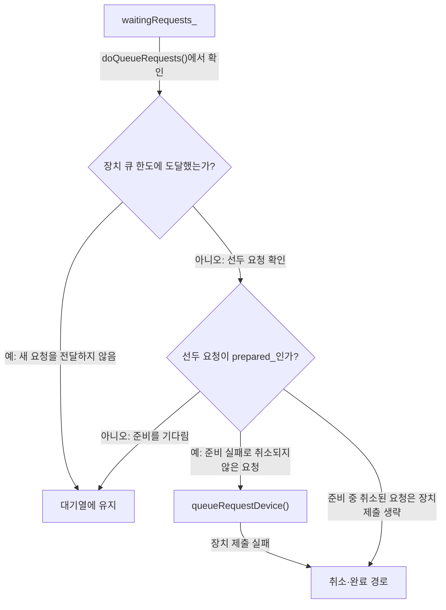
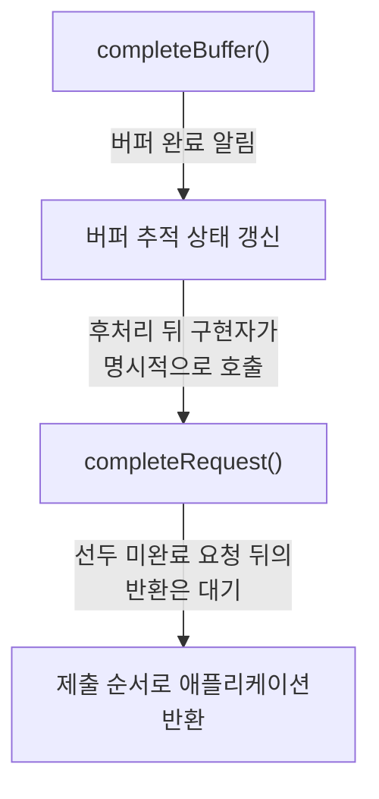
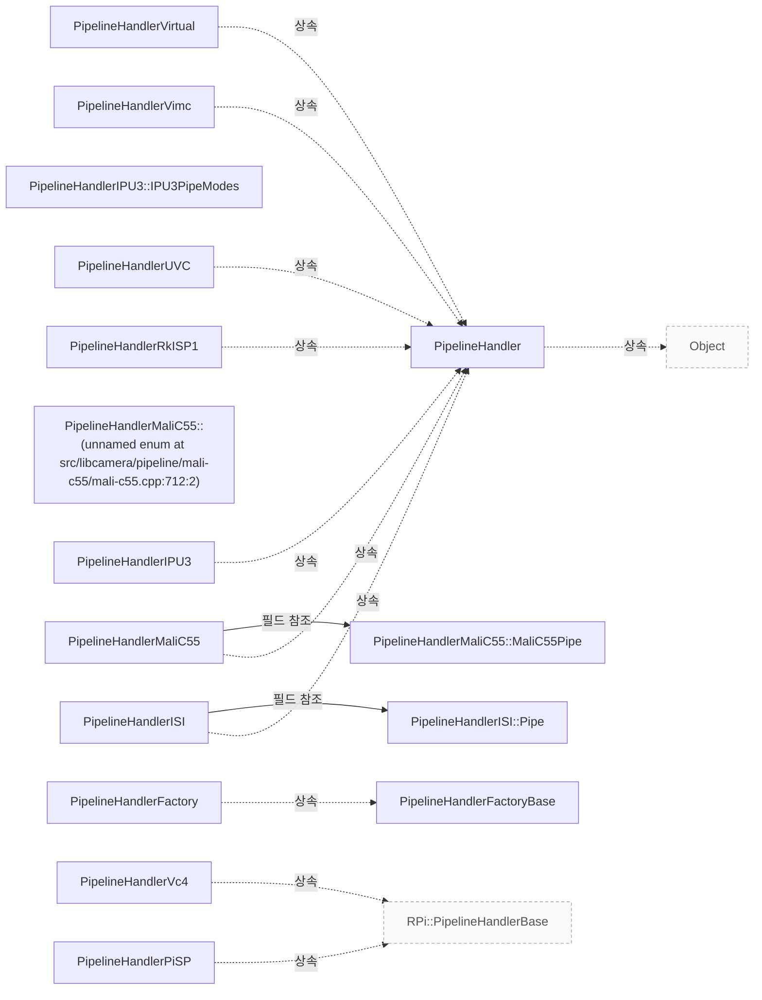

# Pipeline Handler

**파이프라인 구현이 지켜야 하는 구성·요청·완료·종료 계약을 확인하세요.**

| 지금 확인할 내용 | 이동할 절 |
|---|---|
| 장치 매칭과 객체 수명 절을 확인합니다. | [장치 매칭과 객체 수명](#장치-매칭과-객체-수명) |
| 구성의 입력과 검증 책임 절을 확인합니다. | [구성의 입력과 검증 책임](#구성의-입력과-검증-책임) |
| 요청 준비와 장치 큐 절을 확인합니다. | [요청 준비와 장치 큐](#요청-준비와-장치-큐) |
| 버퍼 완료와 요청 반환 절을 확인합니다. | [버퍼 완료와 요청 반환](#버퍼-완료와-요청-반환) |
| 정지와 미완료 요청 절을 확인합니다. | [정지와 미완료 요청](#정지와-미완료-요청) |

## 장치 매칭과 객체 수명

핸들러는 `DeviceEnumerator` 가 제공하는 미디어 장치를 매칭하여 카메라 인스턴스를 생성하고 관리하며, 핸들러 인스턴스는 std::shared_ptr< > 를 통해 참조 카운팅되고 enable_shared_from_this< > 를 구현하여 'this' 포인터만 있는 코드 경로에서 새로운 공유 포인터를 생성할 수 있습니다. `src/libcamera/pipeline_handler.cpp:50`

근거 원문: [src/libcamera/pipeline_handler.cpp:50](#source-69bfa9568cf8b5c5) · [src/libcamera/pipeline_handler.cpp:119](#source-a3caf1625bc18d64)

## 구성의 입력과 검증 책임

generateConfiguration() 함수는 호출자가 roles 매개변수에 원하는 사용 사례를 채워 넣어야 하며, 요청된 역할이 충족될 경우 유효한 `CameraConfiguration` 를 반환하거나 그렇지 않으면 null 포인터를 반환합니다. 이 함수는 임의 스레드에서 호출될 수 있으며 파이프라인 핸들러의 상태 변경 없이 호출할 수 있어야 합니다. 반면 configure() 함수는 호출 시 이미 `CameraConfiguration::validate()` 로 검증된 구성을 전제로 하며, 파이프라인 핸들러 구현체는 추가 검증을 수행하지 않고 `StreamConfiguration` 의 setStream() 함수를 사용하여 각 `StreamConfiguration` 항목에 `Stream` 인스턴스를 연결해야 합니다. 또한 configure() 는 `CameraManager` 스레드에서 호출되며 성공 시 0 을 반환하거나 오류 발생 시 음수 오류 코드를 반환합니다. `src/libcamera/pipeline_handler.cpp:271`

근거 원문: [src/libcamera/pipeline_handler.cpp:271](#source-c81d81d5cce53ab8)

## 요청 준비와 장치 큐

registerRequest() 함수는 prepared 신호를 연결하여 해당 신호가 발생하면 doQueueRequests() 함수를 호출합니다. `src/libcamera/pipeline_handler.cpp:428`

<!-- sdd:visual:queue-gates -->
### 요청이 대기하거나 장치로 가는 조건

준비 대기와 장치 큐 한도를 구분하세요. 준비 실패와 장치 제출 실패는 취소 경로로 이어집니다.



[Mermaid 원문](pipeline-handler.queue-gates.mmd)

??? note "그림 근거와 확인 범위"
    소스에 연결한 설계 해석입니다. 자동 연결 검사는 의미 승인이나 기기 실행 검증이 아닙니다.
    
    | 요소·전이 | 소스 근거 |
    |---|---|
    | waitingRequests_ | [src/libcamera/pipeline_handler.cpp:469](#source-28b02cb32c6a87af) |
    | 선두 요청이 prepared_인가? | [src/libcamera/pipeline_handler.cpp:509](#source-d63c9e57bcf862b0) |
    | 장치 큐 한도에 도달했는가? | [src/libcamera/pipeline_handler.cpp:509](#source-d63c9e57bcf862b0) |
    | 대기열에 유지 | [src/libcamera/pipeline_handler.cpp:509](#source-d63c9e57bcf862b0) |
    | queueRequestDevice() | [src/libcamera/pipeline_handler.cpp:483](#source-8bf901f3faef18e5) |
    | 취소·완료 경로 | [src/libcamera/pipeline_handler.cpp:483](#source-8bf901f3faef18e5) |
    | doQueueRequests()에서 확인 | [src/libcamera/pipeline_handler.cpp:509](#source-d63c9e57bcf862b0) |
    | 예: 새 요청을 전달하지 않음 | [src/libcamera/pipeline_handler.cpp:509](#source-d63c9e57bcf862b0) |
    | 아니오: 선두 요청 확인 | [src/libcamera/pipeline_handler.cpp:509](#source-d63c9e57bcf862b0) |
    | 아니오: 준비를 기다림 | [src/libcamera/pipeline_handler.cpp:509](#source-d63c9e57bcf862b0) |
    | 예: 준비 실패로 취소되지 않은 요청 | [src/libcamera/pipeline_handler.cpp:483](#source-8bf901f3faef18e5) |
    | 장치 제출 실패 | [src/libcamera/pipeline_handler.cpp:483](#source-8bf901f3faef18e5) |
    | 준비 중 취소된 요청은 장치 제출 생략 | [src/libcamera/pipeline_handler.cpp:483](#source-8bf901f3faef18e5) |
<!-- /sdd:visual:queue-gates -->

queueRequest() 함수는 request->_d()->prepare(300ms)를 호출하여 `Request::Private::prepare()`에 300ms의 대기 시간 값을 전달하며, 이 인자는 해당 요청이 하드웨어 장치로 큐잉되기 전에 메모리 전송을 위해 준비되도록 하기 위해 각 프레임 버퍼 획득 펜스(acquire fence)가 신호(signalled)되는 것을 기다리는 데 사용됩니다. `src/libcamera/pipeline_handler.cpp:469`

if (data->queuedRequests_.size() == maxQueuedRequestsDevice_) break; `src/libcamera/pipeline_handler.cpp:509`

doQueueRequests() 함수는 prepared_가 false인 선두 요청을 만나면 while 반복문의 조건부 제어문 'if (!request->_d()->prepared_) break;'를 실행하여 반복문을 종료합니다. `src/libcamera/pipeline_handler.cpp:509`

doQueueRequests()에서 두 break 검사를 통과한 요청에 대해서는 먼저 data->waitingRequests_.pop()을 호출한 후 doQueueRequest(request)를 호출합니다. `src/libcamera/pipeline_handler.cpp:509`

doQueueRequest()에서 request->_d()->cancelled_가 참인 경우 completeRequest(request)를 호출하여 요청을 완료하고 함수를 종료하며, queueRequestDevice(camera, request)의 반환값이 0이 아닌 실패한 경우 cancelRequest(request)를 호출하여 요청을 취소합니다. `src/libcamera/pipeline_handler.cpp:483`

queueRequestDevice() 구현자는 요청에 포함된 스트림과 관련된 버퍼 세트 및 파라미터 세트를 장치에 전달하며, 파이프라인 핸들러는 해당 파라미터가 요청에서 제공된 버퍼에 할당된 프레임에 적용되도록 장치를 프로그래해야 합니다. `src/libcamera/pipeline_handler.cpp:530`

`Request::Private::prepare()` 함수는 각 프레임 버퍼에 연결된 페인스(fence)가 모두 신호(signalled)될 때까지 대기하며, 지정된 타임아웃이 설정된 경우 해당 시간 내에 모든 페인스가 신호되지 않거나 페인스 처리 중 문제가 발생하면 요청(`Request`)이 취소되고 prepared 신호가 방출됩니다. `src/libcamera/request.cpp:199`

근거 원문: [src/libcamera/pipeline_handler.cpp:428](#source-9b4cdd02b7a0ff1e) · [src/libcamera/pipeline_handler.cpp:469](#source-28b02cb32c6a87af) · [src/libcamera/pipeline_handler.cpp:483](#source-8bf901f3faef18e5) · [src/libcamera/pipeline_handler.cpp:509](#source-d63c9e57bcf862b0) · [src/libcamera/pipeline_handler.cpp:530](#source-bc9c2a42b4251ab0) · [src/libcamera/request.cpp:199](#source-4f52447929ee8da9)

## 버퍼 완료와 요청 반환

completeBuffer()는 요청 내부의 버퍼 추적 업데이트 및 애플리케이션에 대한 버퍼 완료 알림을 수행하지만 마지막 버퍼가 완료되더라도 요청이 자동으로 완료되지 않아 파이프라인 핸들러가 추가 작업을 수행할 기회를 제공하며, 명시적인 completeRequest() 호출로 요청을 완료해야 합니다. completeRequest()는 요청이 더 이상 파이프라인 핸들러에 의해 관리되지 않으며 반환 후 접근해서는 안 되며, 이 함수를 통해 요청이 제출 순서대로 애플리케이션에 반환되도록 보장합니다. 또한 파이프라인 핸들러는 어떤 완전한 요청에도 순서 제약 없이 호출할 수 있으며, 장치 큐 앞의 Pending 상태를 가진 요청을 만나면 반복을 중단하고 해당 요청을 처리하며, 대기 중인 요청들을 다시 큐에 추가하기 위해 doQueueRequests(camera)를 호출하여 재개합니다. 이 모든 함수들은 `CameraManager` 스레드에서 호출되어야 합니다. `src/libcamera/pipeline_handler.cpp:547`

<!-- sdd:visual:buffer-request-completion -->
### 버퍼 완료에서 요청 반환까지

마지막 버퍼의 완료가 요청을 자동 완료하지 않습니다. 핸들러의 명시적 요청 완료 통지가 필요합니다.



[Mermaid 원문](pipeline-handler.buffer-request-completion.mmd)

??? note "그림 근거와 확인 범위"
    소스에 연결한 설계 해석입니다. 자동 연결 검사는 의미 승인이나 기기 실행 검증이 아닙니다.
    
    | 요소·전이 | 소스 근거 |
    |---|---|
    | completeBuffer() | [src/libcamera/pipeline_handler.cpp:547](#source-01ad7c6605c3296a) |
    | 버퍼 추적 상태 갱신 | [src/libcamera/pipeline_handler.cpp:547](#source-01ad7c6605c3296a) |
    | completeRequest() | [src/libcamera/pipeline_handler.cpp:547](#source-01ad7c6605c3296a) |
    | 제출 순서로 애플리케이션 반환 | [src/libcamera/pipeline_handler.cpp:547](#source-01ad7c6605c3296a) |
    | 버퍼 완료 알림 | [src/libcamera/pipeline_handler.cpp:547](#source-01ad7c6605c3296a) |
    | 후처리 뒤 구현자가 명시적으로 호출 | [src/libcamera/pipeline_handler.cpp:547](#source-01ad7c6605c3296a) |
    | 선두 미완료 요청 뒤의 반환은 대기 | [src/libcamera/pipeline_handler.cpp:547](#source-01ad7c6605c3296a) |
<!-- /sdd:visual:buffer-request-completion -->

근거 원문: [src/libcamera/pipeline_handler.cpp:547](#source-01ad7c6605c3296a)

## 정지와 미완료 요청

stop() 함수는 먼저 카메라의 private 데이터에서 waitingRequests_ 큐를 분리하여 임시 변수에 저장한 후, stopDevice() 를 호출하여 파이프라인 핸들러를 중지시키고, 그 다음 분리된 요청들을 하나씩 꺼내어 cancel() 로 취소하고 doQueueRequest() 를 호출하여 처리합니다. `src/libcamera/pipeline_handler.cpp:367`

stop() 함수 내부의 분리된 요청 처리 반복문에서 request->_d()->cancel()를 호출하여 cancelled_ 플래그를 설정한 후 doQueueRequest()로 넘어가는 경로와, doQueueRequest() 함수 내부에서 if (request->_d()->cancelled_) 조건을 만족하는 분기는 모두 completeRequest()로 바로 진입합니다. sequence_는 stop() 함수의 반복문 밖에서 data->requestSequence_ = 0 로 초기화되고, doQueueRequest() 함수 내에서 request->_d()->sequence_ = data->requestSequence_++ 를 통해 부여되지만, cancelled_가 설정된 요청은 해당 sequence_ 할당 전에 completeRequest()로 바로 넘어갑니다. `src/libcamera/pipeline_handler.cpp:367`

`PipelineHandler::stop()` 함수 끝부분에서 ASSERT(data->queuedRequests_.empty())와 ASSERT(data->waitingRequests_.empty())는 두 큐가 비어있음을 확인하며, data->requestSequence_ = 0;은 requestSequence_를 0으로 초기화합니다. `src/libcamera/pipeline_handler.cpp:398`

stopDevice() 구현자는 모든 실행 중인 스트림에서 캡처를 중지하고, 즉시 처리 중이던 요청을 취소하며 미완료된 요청은 오류 상태로 즉시 완료시켜야 합니다. `src/libcamera/pipeline_handler.cpp:405`

근거 원문: [src/libcamera/pipeline_handler.cpp:367](#source-cc35019f986c2954) · [src/libcamera/pipeline_handler.cpp:405](#source-a1eeb263fc114d2f) · [src/libcamera/pipeline_handler.cpp:483](#source-8bf901f3faef18e5) · [src/libcamera/pipeline_handler.cpp:398](#source-4b39343dd132712a)

??? note "설계 질문과 검증 범위"
    질문별 답변과 근거 연결을 검사했습니다. 의미와 실행 결과는 사람 검토가 필요합니다.
    
    | 설계 질문 | 설명 위치 | 확인 범위 |
    |---|---|---|
    | 핸들러는 어떤 객체와 장치를 만들고 관리합니까? | [장치 매칭과 객체 수명](#장치-매칭과-객체-수명) | 코드 근거와 설명 연결 |
    | 기본 구성과 실제 구성에서 호출자와 구현의 책임은 무엇입니까? | [구성의 입력과 검증 책임](#구성의-입력과-검증-책임) | 코드 근거와 설명 연결 |
    | 요청을 장치로 넘기는 조건과 실패 처리는 무엇입니까? | [요청 준비와 장치 큐](#요청-준비와-장치-큐) | 코드 근거와 설명 연결 |
    | 버퍼 완료, 요청 완료와 접근 가능한 수명은 어떻게 구분됩니까? | [버퍼 완료와 요청 반환](#버퍼-완료와-요청-반환) | 코드 근거와 설명 연결 |
    | 정지 중 재큐잉을 막고 대기 요청을 반환하는 방법은 무엇입니까? | [정지와 미완료 요청](#정지와-미완료-요청) | 코드 근거와 설명 연결 |

## 소스 근거

같은 발췌는 한 번만 싣습니다. 필요한 원문을 펼쳐 설명과 대조하세요.

<a id="source-69bfa9568cf8b5c5"></a>

??? note "소스 근거: src/libcamera/pipeline_handler.cpp:50"
    `src/libcamera/pipeline_handler.cpp:50`에서 시작하는 발췌입니다. 종료 줄은 119이며, 아래 원문을 설명과 대조할 수 있습니다.
    
    SHA-256: `e05278df0a06cb963fe79f772e62d4560b62df15c1411a6b49e32f7ca84d9e74`
    
    ```text
    \class PipelineHandler
     * \brief Create and manage cameras based on a set of media devices
     *
     * The PipelineHandler matches the media devices provided by a DeviceEnumerator
     * with the pipelines it supports and creates corresponding Camera devices.
     *
     * Pipeline handler instances are reference-counted through std::shared_ptr<>.
     * They implement std::enable_shared_from_this<> in order to create new
     * std::shared_ptr<> in code paths originating from member functions of the
     * PipelineHandler class where only the 'this' pointer is available.
     */
    
    /**
     * \brief Construct a PipelineHandler instance
     * \param[in] manager The camera manager
     * \param[in] maxQueuedRequestsDevice The maximum number of requests queued to
     * the device
     *
     * In order to honour the std::enable_shared_from_this<> contract,
     * PipelineHandler instances shall never be constructed manually, but always
     * through the PipelineHandlerFactoryBase::create() function.
     */
    PipelineHandler::PipelineHandler(CameraManager *manager,
    				 unsigned int maxQueuedRequestsDevice)
    	: manager_(manager), maxQueuedRequestsDevice_(maxQueuedRequestsDevice),
    	  useCount_(0)
    {
    }
    
    PipelineHandler::~PipelineHandler()
    {
    	for (std::shared_ptr<MediaDevice> &media : mediaDevices_)
    		media->release();
    }
    
    /**
     * \fn PipelineHandler::match(DeviceEnumerator *enumerator)
     * \brief Match media devices and create camera instances
     * \param[in] enumerator The enumerator providing all media devices found in the
     * system
     *
     * This function is the main entry point of the pipeline handler. It is called
     * by the camera manager with the \a enumerator passed as an argument. It shall
     * acquire from the \a enumerator all the media devices it needs for a single
     * pipeline, create one or multiple Camera instances and register them with the
     * camera manager.
     *
     * If all media devices needed by the pipeline handler are found, they must all
     * be acquired by a call to MediaDevice::acquire(). This function shall then
     * create the corresponding Camera instances, store them internally, and return
     * true. Otherwise it shall not acquire any media device (or shall release all
     * the media devices is has acquired by calling MediaDevice::release()) and
     * return false.
     *
     * If multiple instances of a pipeline are available in the system, the
     * PipelineHandler class will be instantiated once per instance, and its match()
     * function called for every instance. Each call shall acquire media devices for
     * one pipeline instance, until all compatible media devices are exhausted.
     *
     * If this function returns true, a new instance of the pipeline handler will
     * be created and its match() function called.
     *
     * \context This function is called from the CameraManager thread.
     *
     * \return true if media devices have been acquired and camera instances
     * created, or false otherwise
     */
    
    /**
     * \brief Search and acquire a MediaDevice
    ```

<a id="source-a3caf1625bc18d64"></a>

??? note "소스 근거: src/libcamera/pipeline_handler.cpp:119"
    `src/libcamera/pipeline_handler.cpp:119`에서 시작하는 발췌입니다. 종료 줄은 271이며, 아래 원문을 설명과 대조할 수 있습니다.
    
    SHA-256: `379b17c52a1e97055bf78aaabd964595fb3ec506c568d112e552ed1c29235591`
    
    ```text
    \brief Search and acquire a MediaDevice matching a device pattern
     * \param[in] enumerator Enumerator containing all media devices in the system
     * \param[in] dm Device match pattern
     *
     * Search the device \a enumerator for an available media device matching the
     * device match pattern \a dm. Matching media device that have previously been
     * acquired by MediaDevice::acquire() are not considered. If a match is found,
     * the media device is acquired and returned. The caller shall not release the
     * device explicitly, it will be automatically released when the pipeline
     * handler is destroyed.
     *
     * \context This function shall be called from the CameraManager thread.
     *
     * \return A shared pointer to the matching MediaDevice, or nullptr if no match
     * is found
     */
    std::shared_ptr<MediaDevice>
    PipelineHandler::acquireMediaDevice(DeviceEnumerator *enumerator,
    				    const DeviceMatch &dm)
    {
    	std::shared_ptr<MediaDevice> media = enumerator->search(dm);
    	if (!media)
    		return nullptr;
    
    	if (!media->acquire())
    		return nullptr;
    
    	mediaDevices_.push_back(media);
    
    	return media;
    }
    
    /**
     * \brief Acquire exclusive access to the pipeline handler for the process
     *
     * This function locks all the media devices used by the pipeline to ensure
     * that no other process can access them concurrently.
     *
     * Access to a pipeline handler may be acquired recursively from within the
     * same process. Every successful acquire() call shall be matched with a
     * release() call. This allows concurrent access to the same pipeline handler
     * from different cameras within the same process.
     *
     * Pipeline handlers shall not call this function directly as the Camera class
     * handles access internally.
     *
     * \context This function is called from the CameraManager thread.
     *
     * \return True if the pipeline handler was acquired, false if another process
     * has already acquired it
     * \sa release()
     */
    bool PipelineHandler::acquire(Camera *camera)
    {
    	if (useCount_ == 0) {
    		for (std::shared_ptr<MediaDevice> &media : mediaDevices_) {
    			if (!media->lock()) {
    				unlockMediaDevices();
    				return false;
    			}
    		}
    	}
    
    	if (!acquireDevice(camera)) {
    		if (useCount_ == 0)
    			unlockMediaDevices();
    
    		return false;
    	}
    
    	++useCount_;
    	return true;
    }
    
    /**
     * \brief Release exclusive access to the pipeline handler
     * \param[in] camera The camera for which to release data
     *
     * This function releases access to the pipeline handler previously acquired by
     * a call to acquire(). Every release() call shall match a previous successful
     * acquire() call. Calling this function on a pipeline handler that hasn't been
     * acquired results in undefined behaviour.
     *
     * Pipeline handlers shall not call this function directly as the Camera class
     * handles access internally.
     *
     * \context This function is called from the CameraManager thread.
     *
     * \sa acquire()
     */
    void PipelineHandler::release(Camera *camera)
    {
    	ASSERT(useCount_);
    
    	releaseDevice(camera);
    
    	if (useCount_ == 1)
    		unlockMediaDevices();
    
    	--useCount_;
    }
    
    /**
     * \brief Acquire resources associated with this camera
     * \param[in] camera The camera for which to acquire resources
     *
     * Pipeline handlers may override this in order to get resources such as opening
     * devices and allocating buffers when a camera is acquired.
     *
     * This is used by the uvcvideo pipeline handler to delay opening /dev/video#
     * until the camera is acquired to avoid excess power consumption. The delayed
     * opening of /dev/video# is a special case because the kernel uvcvideo driver
     * powers on the USB device as soon as /dev/video# is opened. This behavior
     * should *not* be copied by other pipeline handlers.
     *
     * \context This function is called from the CameraManager thread.
     *
     * \return True on success, false on failure
     * \sa releaseDevice()
     */
    bool PipelineHandler::acquireDevice([[maybe_unused]] Camera *camera)
    {
    	return true;
    }
    
    /**
     * \brief Release resources associated with this camera
     * \param[in] camera The camera for which to release resources
     *
     * Pipeline handlers may override this in order to perform cleanup operations
     * when a camera is released, such as freeing memory.
     *
     * This is called once for every camera that is released. If there are resources
     * shared by multiple cameras then the pipeline handler must take care to not
     * release them until releaseDevice() has been called for all previously
     * acquired cameras.
     *
     * \context This function is called from the CameraManager thread.
     *
     * \sa acquireDevice()
     */
    void PipelineHandler::releaseDevice([[maybe_unused]] Camera *camera)
    {
    }
    
    void PipelineHandler::unlockMediaDevices()
    {
    	for (std::shared_ptr<MediaDevice> &media : mediaDevices_)
    		media->unlock();
    }
    
    /**
     * \fn PipelineHandler::generateConfiguration()
    ```

<a id="source-c81d81d5cce53ab8"></a>

??? note "소스 근거: src/libcamera/pipeline_handler.cpp:271"
    `src/libcamera/pipeline_handler.cpp:271`에서 시작하는 발췌입니다. 종료 줄은 319이며, 아래 원문을 설명과 대조할 수 있습니다.
    
    SHA-256: `5284e6062c894a77328b372676c42c1c97a4a01f9b2dccc4d09c83b2578b0e20`
    
    ```text
    \fn PipelineHandler::generateConfiguration()
     * \brief Generate a camera configuration for a specified camera
     * \param[in] camera The camera to generate a default configuration for
     * \param[in] roles A list of stream roles
     *
     * Generate a default configuration for the \a camera for a specified list of
     * stream roles. The caller shall populate the \a roles with the use-cases it
     * wishes to fetch the default configuration for. The returned configuration
     * can then be examined by the caller to learn about the selected streams and
     * their default parameters.
     *
     * The intended companion to this is \a configure() which can be used to change
     * the group of streams parameters.
     *
     * \context This function may be called from any thread and shall be
     * \threadsafe. It shall not modify the state of the \a camera in the pipeline
     * handler.
     *
     * \return A valid CameraConfiguration if the requested roles can be satisfied,
     * or a null pointer otherwise.
     */
    
    /**
     * \fn PipelineHandler::configure()
     * \brief Configure a group of streams for capture
     * \param[in] camera The camera to configure
     * \param[in] config The camera configurations to setup
     *
     * Configure the specified group of streams for \a camera according to the
     * configuration specified in \a config. The intended caller of this interface
     * is the Camera class which will receive configuration to apply from the
     * application.
     *
     * The configuration is guaranteed to have been validated with
     * CameraConfiguration::validate(). The pipeline handler implementation shall
     * not perform further validation and may rely on any custom field stored in its
     * custom CameraConfiguration derived class.
     *
     * When configuring the camera the pipeline handler shall associate a Stream
     * instance to each StreamConfiguration entry in the CameraConfiguration using
     * the StreamConfiguration::setStream() function.
     *
     * \context This function is called from the CameraManager thread.
     *
     * \return 0 on success or a negative error code otherwise
     */
    
    /**
     * \fn PipelineHandler::exportFrameBuffers()
    ```

<a id="source-9b4cdd02b7a0ff1e"></a>

??? note "소스 근거: src/libcamera/pipeline_handler.cpp:428"
    `src/libcamera/pipeline_handler.cpp:428`에서 시작하는 발췌입니다. 종료 줄은 447이며, 아래 원문을 설명과 대조할 수 있습니다.
    
    SHA-256: `3e779cde8ff6add042f7ebb4a27482e0ea5731099a3aa208157b7e56d2f0452a`
    
    ```text
    \fn PipelineHandler::registerRequest()
     * \brief Register a request for use by the pipeline handler
     * \param[in] request The request to register
     *
     * This function is called when the request is created, and allows the pipeline
     * handler to perform any one-time initialization it requries for the request.
     */
    void PipelineHandler::registerRequest(Request *request)
    {
    	/*
    	 * Connect the request prepared signal to notify the pipeline handler
    	 * when a request is ready to be processed.
    	 */
    	request->_d()->prepared.connect(this, [this, request]() {
    		doQueueRequests(request->_d()->camera());
    	});
    }
    
    /**
     * \fn PipelineHandler::queueRequest()
    ```

<a id="source-28b02cb32c6a87af"></a>

??? note "소스 근거: src/libcamera/pipeline_handler.cpp:469"
    `src/libcamera/pipeline_handler.cpp:469`에서 시작하는 발췌입니다. 종료 줄은 481이며, 아래 원문을 설명과 대조할 수 있습니다.
    
    SHA-256: `94dc76217ffb6f15b346216b0baaf049ce1939346bb1ec517589f26682f0092f`
    
    ```text
    void PipelineHandler::queueRequest(Request *request)
    {
    	LIBCAMERA_TRACEPOINT(request_queue, request);
    
    	Camera *camera = request->_d()->camera();
    	Camera::Private *data = camera->_d();
    	data->waitingRequests_.push(request);
    
    	request->_d()->prepare(300ms);
    }
    
    /**
     * \brief Queue one requests to the device
    ```

<a id="source-8bf901f3faef18e5"></a>

??? note "소스 근거: src/libcamera/pipeline_handler.cpp:483"
    `src/libcamera/pipeline_handler.cpp:483`에서 시작하는 발췌입니다. 종료 줄은 504이며, 아래 원문을 설명과 대조할 수 있습니다.
    
    SHA-256: `6c0fefadbc69b9bb9371953979a07a38024dc18cb648266d81168f15d8e9e4fb`
    
    ```text
    void PipelineHandler::doQueueRequest(Request *request)
    {
    	LIBCAMERA_TRACEPOINT(request_device_queue, request);
    
    	Camera *camera = request->_d()->camera();
    	Camera::Private *data = camera->_d();
    	data->queuedRequests_.push_back(request);
    
    	request->_d()->sequence_ = data->requestSequence_++;
    
    	if (request->_d()->cancelled_) {
    		completeRequest(request);
    		return;
    	}
    
    	int ret = queueRequestDevice(camera, request);
    	if (ret)
    		cancelRequest(request);
    }
    
    /**
     * \brief Queue prepared requests to the device
    ```

<a id="source-d63c9e57bcf862b0"></a>

??? note "소스 근거: src/libcamera/pipeline_handler.cpp:509"
    `src/libcamera/pipeline_handler.cpp:509`에서 시작하는 발췌입니다. 종료 줄은 530이며, 아래 원문을 설명과 대조할 수 있습니다.
    
    SHA-256: `b2d2d134eaa639300cae5e7660d8453da545646bcc100bf640a981fa1371899d`
    
    ```text
    void PipelineHandler::doQueueRequests(Camera *camera)
    {
    	Camera::Private *data = camera->_d();
    	while (!data->waitingRequests_.empty()) {
    		if (data->queuedRequests_.size() == maxQueuedRequestsDevice_)
    			break;
    
    		Request *request = data->waitingRequests_.front();
    		if (!request->_d()->prepared_)
    			break;
    
    		/*
    		 * Pop the request first, in case doQueueRequests() is called
    		 * recursively from within doQueueRequest()
    		 */
    		data->waitingRequests_.pop();
    		doQueueRequest(request);
    	}
    }
    
    /**
     * \fn PipelineHandler::queueRequestDevice()
    ```

<a id="source-bc9c2a42b4251ab0"></a>

??? note "소스 근거: src/libcamera/pipeline_handler.cpp:530"
    `src/libcamera/pipeline_handler.cpp:530`에서 시작하는 발췌입니다. 종료 줄은 547이며, 아래 원문을 설명과 대조할 수 있습니다.
    
    SHA-256: `7d7f109ecf4060457991bc81649c0ee7f886ede0a6c0140152f06e70e1d84f00`
    
    ```text
    \fn PipelineHandler::queueRequestDevice()
     * \brief Queue a request to the device
     * \param[in] camera The camera to queue the request to
     * \param[in] request The request to queue
     *
     * This function queues a capture request to the device for processing. The
     * request contains a set of buffers associated with streams and a set of
     * parameters. The pipeline handler shall program the device to ensure that the
     * parameters will be applied to the frames captured in the buffers provided in
     * the request.
     *
     * \context This function is called from the CameraManager thread.
     *
     * \return 0 on success or a negative error code otherwise
     */
    
    /**
     * \brief Complete a buffer for a request
    ```

<a id="source-4f52447929ee8da9"></a>

??? note "소스 근거: src/libcamera/request.cpp:199"
    `src/libcamera/request.cpp:199`에서 시작하는 발췌입니다. 종료 줄은 263이며, 아래 원문을 설명과 대조할 수 있습니다.
    
    SHA-256: `97d311c371577c108a7c9e936dc85fca0cbcc912ac3de743229c1d2647590bd3`
    
    ```text
    \brief Prepare the Request to be queued to the device
     * \param[in] timeout Optional expiration timeout
     *
     * Prepare a Request to be queued to the hardware device by ensuring it is
     * ready for the incoming memory transfers.
     *
     * This currently means waiting on each frame buffer acquire fence to be
     * signalled. An optional expiration timeout can be specified. If not all the
     * fences have been signalled correctly before the timeout expires the Request
     * is cancelled.
     *
     * The function immediately emits the prepared signal if all the prepare
     * operations have been completed synchronously. If instead the prepare
     * operations require to wait the completion of asynchronous events, such as
     * fences notifications or timer expiration, the prepared signal is emitted upon
     * the asynchronous event completion.
     *
     * As we currently only handle fences, the function emits the prepared signal
     * immediately if there are no fences to wait on. Otherwise the prepared signal
     * is emitted when all fences have been signalled or the optional timeout has
     * expired.
     *
     * If not all the fences have been correctly signalled or the optional timeout
     * has expired the Request will be cancelled and the Request::prepared signal
     * emitted.
     *
     * The intended user of this function is the PipelineHandler base class, which
     * 'prepares' a Request before queuing it to the hardware device.
     */
    void Request::Private::prepare(std::chrono::milliseconds timeout)
    {
    	/* Create and connect one notifier for each synchronization fence. */
    	for (FrameBuffer *buffer : pending_) {
    		const Fence *fence = buffer->_d()->fence();
    		if (!fence)
    			continue;
    
    		auto [it, inserted] = notifiers_.try_emplace(buffer, fence->fd().get(), EventNotifier::Type::Read);
    		ASSERT(inserted);
    
    		it->second.activated.connect(this, [this, buffer] {
    			notifierActivated(buffer);
    		});
    	}
    
    	if (notifiers_.empty()) {
    		emitPrepareCompleted();
    		return;
    	}
    
    	/*
    	 * In case a timeout is specified, create a timer and set it up.
    	 *
    	 * The timer must be created here instead of in the Request constructor,
    	 * in order to be bound to the pipeline handler thread.
    	 */
    	if (timeout != 0ms) {
    		timer_ = std::make_unique<Timer>();
    		timer_->timeout.connect(this, &Request::Private::timeout);
    		timer_->start(timeout);
    	}
    }
    
    /**
     * \var Request::Private::prepared
    ```

<a id="source-01ad7c6605c3296a"></a>

??? note "소스 근거: src/libcamera/pipeline_handler.cpp:547"
    `src/libcamera/pipeline_handler.cpp:547`에서 시작하는 발췌입니다. 종료 줄은 620이며, 아래 원문을 설명과 대조할 수 있습니다.
    
    SHA-256: `514288cc958de9ff5fd19d46393cec3bb3088f4f08486528d4559071138638c9`
    
    ```text
    \brief Complete a buffer for a request
     * \param[in] request The request the buffer belongs to
     * \param[in] buffer The buffer that has completed
     *
     * This function shall be called by pipeline handlers to signal completion of
     * the \a buffer part of the \a request. It notifies applications of buffer
     * completion and updates the request's internal buffer tracking. The request
     * is not completed automatically when the last buffer completes to give
     * pipeline handlers a chance to perform any operation that may still be
     * needed. They shall complete requests explicitly with completeRequest().
     *
     * \context This function shall be called from the CameraManager thread.
     *
     * \return True if all buffers contained in the request have completed, false
     * otherwise
     */
    bool PipelineHandler::completeBuffer(Request *request, FrameBuffer *buffer)
    {
    	Camera *camera = request->_d()->camera();
    	camera->bufferCompleted.emit(request, buffer);
    	return request->_d()->completeBuffer(buffer);
    }
    
    /**
     * \brief Signal request completion
     * \param[in] request The request that has completed
     *
     * The pipeline handler shall call this function to notify the \a camera that
     * the request has completed. The request is no longer managed by the pipeline
     * handler and shall not be accessed once this function returns.
     *
     * This function ensures that requests will be returned to the application in
     * submission order, the pipeline handler may call it on any complete request
     * without any ordering constraint.
     *
     * \context This function shall be called from the CameraManager thread.
     */
    void PipelineHandler::completeRequest(Request *request)
    {
    	Camera *camera = request->_d()->camera();
    
    	request->_d()->complete();
    
    	Camera::Private *data = camera->_d();
    
    	while (!data->queuedRequests_.empty()) {
    		Request *req = data->queuedRequests_.front();
    		if (req->status() == Request::RequestPending)
    			break;
    
    		ASSERT(!req->hasPendingBuffers());
    		data->queuedRequests_.pop_front();
    		camera->requestComplete(req);
    	}
    
    	/* Allow any waiting requests to be queued to the pipeline. */
    	doQueueRequests(camera);
    }
    
    /**
     * \brief Cancel request and signal its completion
     * \param[in] request The request to cancel
     *
     * This function cancels and completes the request. The same rules as for
     * completeRequest() apply.
     */
    void PipelineHandler::cancelRequest(Request *request)
    {
    	request->_d()->cancel();
    	completeRequest(request);
    }
    
    /**
     * \brief Retrieve the absolute path to a platform configuration file
    ```

<a id="source-cc35019f986c2954"></a>

??? note "소스 근거: src/libcamera/pipeline_handler.cpp:367"
    `src/libcamera/pipeline_handler.cpp:367`에서 시작하는 발췌입니다. 종료 줄은 405이며, 아래 원문을 설명과 대조할 수 있습니다.
    
    SHA-256: `53b4437b3a5285dfe344d8732495653fe1d1d6bdcd125b6af96ae60caec61ea3`
    
    ```text
    void PipelineHandler::stop(Camera *camera)
    {
    	/*
    	 * Take all waiting requests so that they are not requeued in response
    	 * to completeRequest() being called inside stopDevice(). Cancel them
    	 * after the device to keep them in order.
    	 */
    	Camera::Private *data = camera->_d();
    	std::queue<Request *> waitingRequests;
    	waitingRequests.swap(data->waitingRequests_);
    
    	/* Stop the pipeline handler and let the queued requests complete. */
    	stopDevice(camera);
    
    	/* Cancel and signal as complete all waiting requests. */
    	while (!waitingRequests.empty()) {
    		Request *request = waitingRequests.front();
    		waitingRequests.pop();
    
    		/*
    		 * Cancel all requests by marking them as cancelled and calling
    		 * doQueueRequest() instead of cancelRequest(). This ensures
    		 * that the requests get a sequence number and are temporarily
    		 * added to queuedRequests_ so they can be properly completed in
    		 * completeRequest().
    		 */
    		request->_d()->cancel();
    		doQueueRequest(request);
    	}
    
    	/* Make sure no requests are pending. */
    	ASSERT(data->queuedRequests_.empty());
    	ASSERT(data->waitingRequests_.empty());
    
    	data->requestSequence_ = 0;
    }
    
    /**
     * \fn PipelineHandler::stopDevice()
    ```

<a id="source-a1eeb263fc114d2f"></a>

??? note "소스 근거: src/libcamera/pipeline_handler.cpp:405"
    `src/libcamera/pipeline_handler.cpp:405`에서 시작하는 발췌입니다. 종료 줄은 411이며, 아래 원문을 설명과 대조할 수 있습니다.
    
    SHA-256: `10e65d81029b39b67e5a3a0b9f6502965f8444fd0cfc459af29fbc511644930b`
    
    ```text
    \fn PipelineHandler::stopDevice()
     * \brief Stop capturing from all running streams
     * \param[in] camera The camera to stop
     *
     * This function stops capturing and processing requests immediately. All
     * pending requests are cancelled and complete immediately in an error state.
     */
    ```

<a id="source-4b39343dd132712a"></a>

??? note "소스 근거: src/libcamera/pipeline_handler.cpp:398"
    `src/libcamera/pipeline_handler.cpp:398`에서 시작하는 발췌입니다. 종료 줄은 402이며, 아래 원문을 설명과 대조할 수 있습니다.
    
    SHA-256: `524198574af1d14bc08a6e8f7dff55b18e3da68b0257257f8706e486d8194f10`
    
    ```text
    ASSERT(data->queuedRequests_.empty());
    	ASSERT(data->waitingRequests_.empty());
    
    	data->requestSequence_ = 0;
    }
    ```


<!-- sdd:class-diagram -->
## 클래스 관계

화살표의 글자는 추출한 관계를 나타내며, 점선은 상속입니다. 화살표는 참조 대상 또는 기반 클래스를 향합니다. 호출 순서를 뜻하지 않습니다.


<!-- /sdd:class-diagram -->


## 관련 클래스

| 클래스 | 선언 위치 | 상속 | 책임 (주석) |
|---|---|---|---|
| `libcamera::PipelineHandler` | `include/libcamera/internal/pipeline_handler.h:34` | `libcamera::Object` | Create and manage cameras based on a set of media devices |
| `libcamera::PipelineHandlerFactory` | `include/libcamera/internal/pipeline_handler.h:144` | `libcamera::PipelineHandlerFactoryBase` | Registration of PipelineHandler classes and creation of instances |
| `libcamera::PipelineHandlerFactoryBase` | `include/libcamera/internal/pipeline_handler.h:121` | – | Base class for pipeline handler factories |
| `libcamera::PipelineHandlerIPU3` | `src/libcamera/pipeline/ipu3/ipu3.cpp:124` | `libcamera::PipelineHandler` | 확인 필요 |
| `libcamera::PipelineHandlerIPU3::IPU3PipeModes` | `src/libcamera/pipeline/ipu3/ipu3.cpp:130` | – | 확인 필요 |
| `libcamera::PipelineHandlerISI` | `src/libcamera/pipeline/imx8-isi/imx8-isi.cpp:102` | `libcamera::PipelineHandler` | 확인 필요 |
| `libcamera::PipelineHandlerISI::Pipe` | `src/libcamera/pipeline/imx8-isi/imx8-isi.cpp:129` | – | 확인 필요 |
| `libcamera::PipelineHandlerMaliC55` | `src/libcamera/pipeline/mali-c55/mali-c55.cpp:676` | `libcamera::PipelineHandler` | 확인 필요 |
| `libcamera::PipelineHandlerMaliC55::(unnamed enum at src/libcamera/pipeline/mali-c55/mali-c55.cpp:712:2)` | `src/libcamera/pipeline/mali-c55/mali-c55.cpp:712` | – | 확인 필요 |
| `libcamera::PipelineHandlerMaliC55::MaliC55Pipe` | `src/libcamera/pipeline/mali-c55/mali-c55.cpp:705` | – | 확인 필요 |
| `libcamera::PipelineHandlerPiSP` | `src/libcamera/pipeline/rpi/pisp/pisp.cpp:852` | `libcamera::RPi::PipelineHandlerBase` | 확인 필요 |
| `libcamera::PipelineHandlerRkISP1` | `src/libcamera/pipeline/rkisp1/rkisp1.cpp:185` | `libcamera::PipelineHandler` | 확인 필요 |
| `libcamera::PipelineHandlerUVC` | `src/libcamera/pipeline/uvcvideo/uvcvideo.cpp:81` | `libcamera::PipelineHandler` | 확인 필요 |
| `libcamera::PipelineHandlerVc4` | `src/libcamera/pipeline/rpi/vc4/vc4.cpp:141` | `libcamera::RPi::PipelineHandlerBase` | 확인 필요 |
| `libcamera::PipelineHandlerVimc` | `src/libcamera/pipeline/vimc/vimc.cpp:84` | `libcamera::PipelineHandler` | 확인 필요 |
| `libcamera::PipelineHandlerVirtual` | `src/libcamera/pipeline/virtual/virtual.cpp:81` | `libcamera::PipelineHandler` | 확인 필요 |

??? note "근거와 검토 정보"
    - 생성 방식: 추출 사실과 LLM 설명
    - 검증 범위: 표·그림은 facts로 만들고 설명은 LLM이 작성합니다. 인용·문장 및 설정된 구조 검사를 적용합니다.
    - 근거 파일: `include/libcamera/internal/pipeline_handler.h`, `src/libcamera/pipeline/imx8-isi/imx8-isi.cpp`, `src/libcamera/pipeline/ipu3/ipu3.cpp`, `src/libcamera/pipeline/mali-c55/mali-c55.cpp`, `src/libcamera/pipeline/rkisp1/rkisp1.cpp`, `src/libcamera/pipeline/rpi/pisp/pisp.cpp`, `src/libcamera/pipeline/rpi/vc4/vc4.cpp`, `src/libcamera/pipeline/uvcvideo/uvcvideo.cpp`, `src/libcamera/pipeline/vimc/vimc.cpp`, `src/libcamera/pipeline/virtual/virtual.cpp`, `src/libcamera/pipeline_handler.cpp`, `src/libcamera/request.cpp`
    - 근거 수준: 코드 확인 (정적 분석, simple_compdb 구성, commit `960713a8f9`)
    - 자동 검사 (인용·문장 및 설정된 구조 검사): 통과
    - 검토 상태 기록일: 2026-10-26 · 사람 검토 전

다음 단계: [시스템 개요](overview.md)
