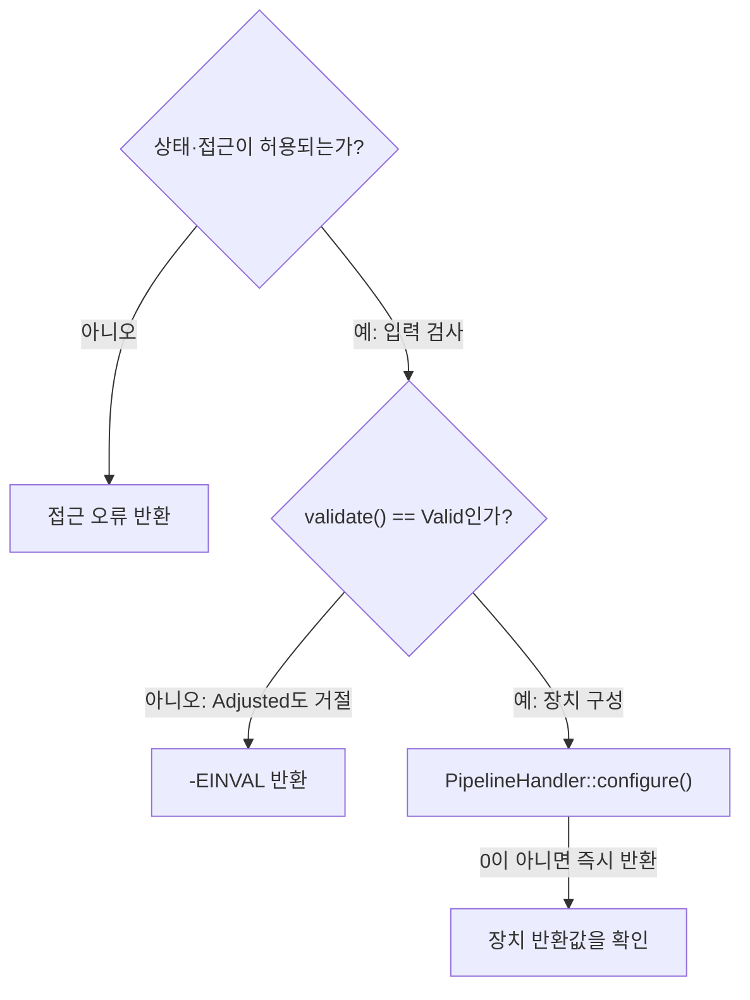
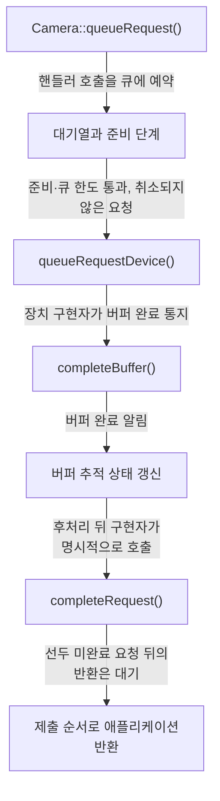
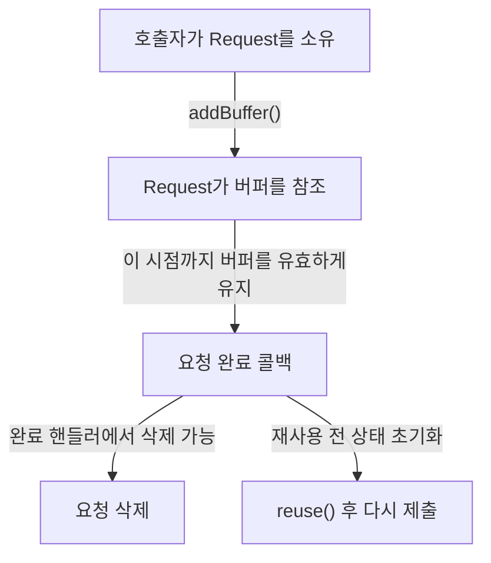
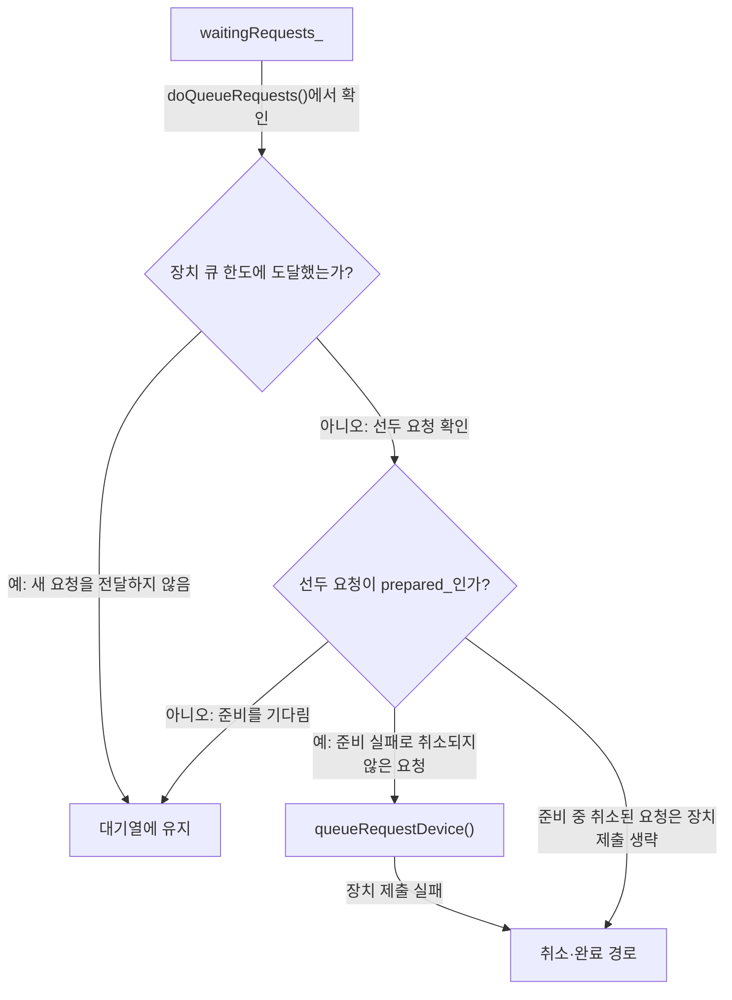
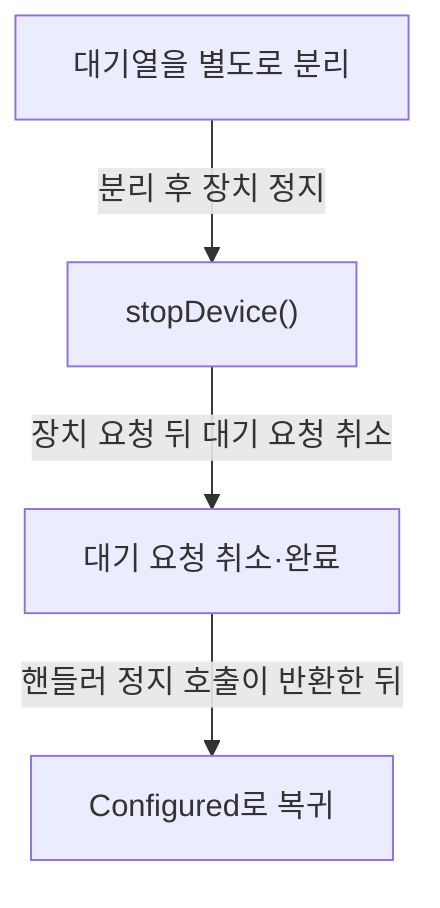

# 요청 처리와 문제 진단

**요청의 제출 성공과 촬영 완료를 구분하고, 버퍼를 유지할 기간과 오류가 난 위치를 확인하세요.**

| 지금 확인할 내용 | 이동할 절 |
|---|---|
| 구성 실패의 반환값과 분기를 확인합니다. | [구성 실패를 좁히는 순서](#구성-실패를-좁히는-순서) |
| 요청 제출과 완료의 연결을 확인합니다. | [제출에서 완료까지](#제출에서-완료까지) |
| 자원을 재사용하거나 해제할 시점을 확인합니다. | [요청·버퍼·fence의 수명](#요청버퍼fence의-수명) |
| 완료 누락의 관측 지점을 찾습니다. | [실패 위치별 확인 순서](#실패-위치별-확인-순서) |
| 정지와 연결 해제의 차이를 확인합니다. | [정지와 연결 해제를 구분하기](#정지와-연결-해제를-구분하기) |

## 구성 실패를 좁히는 순서

`Camera::configure` 함수는 설정을 구성하기 전에 `isAccessAllowed` 함수를 호출하여 접근 권한이 있는지 확인합니다. `src/libcamera/camera.cpp:1191`

<!-- sdd:visual:configure-failures -->
### 구성 실패를 좁히는 분기

입력 검사와 장치 구현 실패를 순서대로 구분하세요. 아래 그림의 성공 경로에서도 스트림 연결 검사가 남습니다.



[Mermaid 원문](request-lifecycle.configure-failures.mmd)

??? note "그림 근거와 확인 범위"
    소스에 연결한 설계 해석입니다. 자동 연결 검사는 의미 승인이나 기기 실행 검증이 아닙니다.
    
    | 요소·전이 | 소스 근거 |
    |---|---|
    | 상태·접근이 허용되는가? | [src/libcamera/camera.cpp:1163](#source-4e218db5e20840dc) |
    | 접근 오류 반환 | [src/libcamera/camera.cpp:1163](#source-4e218db5e20840dc) |
    | validate() == Valid인가? | [src/libcamera/camera.cpp:1163](#source-4e218db5e20840dc) |
    | -EINVAL 반환 | [src/libcamera/camera.cpp:1163](#source-4e218db5e20840dc) |
    | PipelineHandler::configure() | [src/libcamera/camera.cpp:1163](#source-4e218db5e20840dc) |
    | 장치 반환값을 확인 | [src/libcamera/camera.cpp:1163](#source-4e218db5e20840dc) |
    | 아니오 | [src/libcamera/camera.cpp:1163](#source-4e218db5e20840dc) |
    | 예: 입력 검사 | [src/libcamera/camera.cpp:1163](#source-4e218db5e20840dc) |
    | 아니오: Adjusted도 거절 | [src/libcamera/camera.cpp:1163](#source-4e218db5e20840dc) |
    | 예: 장치 구성 | [src/libcamera/camera.cpp:1163](#source-4e218db5e20840dc) |
    | 0이 아니면 즉시 반환 | [src/libcamera/camera.cpp:1163](#source-4e218db5e20840dc) |
<!-- /sdd:visual:configure-failures -->

`Camera::Private::isAccessAllowed` 함수는 `allowDisconnected` 가 `false`이고 현재 카메라가 연결 해제 상태(`disconnected_`)라면 `-ENODEV` 오류 코드를 반환합니다. `src/libcamera/camera.cpp:709`

`currentState` 가 `low` 이상이고 `high` 이하인 범위 내에 있으면 함수는 즉시 `0`을 반환합니다. `src/libcamera/camera.cpp:717`

`currentState` 가 지정된 허용 범위 (`low`와 `high`) 를 벗어난 경우 함수는 `-EACCES`를 반환합니다. `src/libcamera/camera.cpp:717`

`Camera::configure` 함수는 내부적으로 `config->validate()` 호출 결과를 확인하며, 이 결과가 `Valid`가 아닌 경우 `-EINVAL` 오류 식별자를 반환합니다. `src/libcamera/camera.cpp:1203`

`CameraConfiguration::validate()` 함수는 카메라 설정을 가장 가까운 유효한 상태로 조정하고 검증 상태를 반환합니다. `src/libcamera/camera.cpp:323`

함수가 `CameraConfiguration::Invalid`를 반환하면 설정이 조정할 수 없는 무효 상태이며, 이는 설정이 비어 있는 극단적인 경우에만 발생할 수 있습니다. `src/libcamera/camera.cpp:323`

`Camera::configure` 함수는 `PipelineHandler::configure` 메서드를 호출하기 위해 invokeMethod를 사용하며, 이때 반환된 값을 ret 변수에 저장합니다. `src/libcamera/camera.cpp:1163`

invokeMethod 호출 직후 ret의 값이 0 이 아닌 경우, 함수는 그 값을 그대로 반환하여 오류를 상향 전달합니다. `src/libcamera/camera.cpp:1163`

`Camera::configure` 함수 내부의 `if (!stream)` 조건 블록에서 먼저 `d->activeStreams_` 컨테이너를 비웁니다. `src/libcamera/camera.cpp:1225`

`d->activeStreams_` 를 비운 직후 해당 함수는 `-EINVAL` 오류 코드를 반환합니다. `src/libcamera/camera.cpp:1225`

근거 원문: [src/libcamera/camera.cpp:1163](#source-4e218db5e20840dc) · [src/libcamera/camera.cpp:1191](#source-ff41728b62b4632a) · [src/libcamera/camera.cpp:709](#source-1e64f4ece8808997) · [src/libcamera/camera.cpp:323](#source-cb5242e98ac1e72c) · [src/libcamera/camera.cpp:1203](#source-dddebf91b51fd381) · [src/libcamera/camera.cpp:1225](#source-a25518916c3bca3d) · [src/libcamera/camera.cpp:717](#source-2bd61734262b0f97)

## 제출에서 완료까지

createRequest 함수는 카메라가 Configured 또는 Running 상태일 때만 호출할 수 있으며, 새로 생성된 요청의 소유권은 호출자에게 전달되어 호출자가 이를 삭제하는 책임을 집니다. `src/libcamera/camera.cpp:1243`

<!-- sdd:visual:request-stages -->
### 제출·준비·장치 처리·완료의 연결

접수 성공 뒤에도 준비 대기와 장치 처리가 남습니다. 정상 촬영 경로의 계약을 연결한 그림이며 실제 실행 시간이나 전체 실패 경로를 나타내지 않습니다.



[Mermaid 원문](request-lifecycle.request-stages.mmd)

??? note "그림 근거와 확인 범위"
    소스에 연결한 설계 해석입니다. 자동 연결 검사는 의미 승인이나 기기 실행 검증이 아닙니다.
    
    | 요소·전이 | 소스 근거 |
    |---|---|
    | Camera::queueRequest() | [src/libcamera/camera.cpp:1330](#source-d31ac0773e28daca) |
    | 대기열과 준비 단계 | [src/libcamera/pipeline_handler.cpp:469](#source-2bc624f7e6571c0b) |
    | queueRequestDevice() | [src/libcamera/pipeline_handler.cpp:483](#source-7348e9b4af985eb2) |
    | completeBuffer() | [src/libcamera/pipeline_handler.cpp:547](#source-ab8710f8a8a7905d) |
    | 버퍼 추적 상태 갱신 | [src/libcamera/pipeline_handler.cpp:547](#source-ab8710f8a8a7905d) |
    | completeRequest() | [src/libcamera/pipeline_handler.cpp:571](#source-257e6e7c94862f30) |
    | 제출 순서로 애플리케이션 반환 | [src/libcamera/pipeline_handler.cpp:571](#source-257e6e7c94862f30) |
    | 핸들러 호출을 큐에 예약 | [src/libcamera/camera.cpp:1330](#source-d31ac0773e28daca) |
    | 준비·큐 한도 통과, 취소되지 않은 요청 | [src/libcamera/pipeline_handler.cpp:483](#source-7348e9b4af985eb2) |
    | 장치 구현자가 버퍼 완료 통지 | [src/libcamera/pipeline_handler.cpp:547](#source-ab8710f8a8a7905d) |
    | 버퍼 완료 알림 | [src/libcamera/pipeline_handler.cpp:563](#source-e93fc49557947f2a) |
    | 후처리 뒤 구현자가 명시적으로 호출 | [src/libcamera/pipeline_handler.cpp:547](#source-ab8710f8a8a7905d) |
    | 선두 미완료 요청 뒤의 반환은 대기 | [src/libcamera/pipeline_handler.cpp:584](#source-695328706c4e6d8e) |
<!-- /sdd:visual:request-stages -->

addBuffer 함수는 요청에 버퍼 참조를 저장하며, 호출자는 해당 버퍼가 요청 완료 콜백이 호출될 때까지 유효하게 유지되도록 보장해야 할 책임이 있습니다. `src/libcamera/request.cpp:442`

invokeMethod로 예약하는 함수는 `PipelineHandler::queueRequest`이며, 연결 타입은 ConnectionTypeQueued이고 인자는 request입니다. `Camera::queueRequest`의 성공 반환값은 0입니다. `src/libcamera/camera.cpp:1330`

registerRequest 함수는 request->_d() 의 prepared 신호를 this 와 람다식 연결자를 통해 연결하며, 해당 신호가 발생했을 때 호출되는 함수는 doQueueRequests 이고 인자로 request->_d()->camera() 가 전달됩니다. `src/libcamera/pipeline_handler.cpp:435`

`PipelineHandler::queueRequest`는 요청을 data->waitingRequests_라는 큐에 넣으며, prepare() 함수에는 300ms라는 현재 인자를 전달합니다. `src/libcamera/pipeline_handler.cpp:469`

doQueueRequests 함수는 waitingRequests_ 큐가 비어있지 않을 때 루프를 실행하며, 먼저 queuedRequests_의 크기가 maxQueuedRequestsDevice_에 도달했는지 확인하여 조건이 맞으면 break 합니다. 또한 pop된 요청에 대해 prepared_ 속성이 false 인 경우에도 break 를 수행합니다. 루프 내에서 waitingRequests_.front() 에서 요청을 가져온 후 바로 data->waitingRequests_.pop() 을 호출하여 큐에서 제거한 뒤 doQueueRequest(request) 를 호출하는 순서로 동작하며, 이는 doQueueRequest 가 재귀적으로 doQueueRequests 를 호출할 경우를 대비해 요청을 먼저 제거하기 위한 것입니다. `src/libcamera/pipeline_handler.cpp:509`

doQueueRequest에서 request->_d()->cancelled_가 참일 경우 completeRequest(request) 함수를 호출한 뒤 return을 수행하며, queueRequestDevice(camera, request) 호출 이후 if(ret) 조건에서 ret 값이 0이 아닌 값을 가질 경우 cancelRequest(request) 함수를 호출합니다. `src/libcamera/pipeline_handler.cpp:483`

`PipelineHandler::completeBuffer` 함수는 파이프라인 핸들러가 요청의 버퍼 부분을 완료 신호로 보내고 애플리케이션에 버퍼 완료 알림을 제공하며 요청의 내부 버퍼 추적을 갱신해야 합니다. 마지막 버퍼가 완료되더라도 요청이 자동으로 완료되지 않아 파이프라인 핸들러가 여전히 필요한 작업을 수행할 기회를 주며, 이들은 명시적으로 completeRequest() 함수를 호출하여 요청을 완료해야 합니다. 또한 이 함수는 `CameraManager` 스레드에서 호출되어야 합니다. `src/libcamera/pipeline_handler.cpp:547`

`PipelineHandler` 는 요청이 완료되면 카메라에 해당 요청이 완료되었음을 알리기 위해 completeRequest 함수를 호출해야 하며, 이 함수가 반환된 후에는 해당 요청은 더 이상 `PipelineHandler` 에 의해 관리되지 않으므로 접근해서는 안 됩니다. 또한 이 함수는 애플리케이션에 제출된 순서대로 요청을 반환하도록 보장하지만, `PipelineHandler` 는 제약 없이 어떤 완료된 요청이라도 임의의 순서로 이 함수를 호출할 수 있습니다. `src/libcamera/pipeline_handler.cpp:571`

completeRequest 함수의 while 루프에서 break가 발생하는 조건은 data->queuedRequests_.front()인 요청(req)의 상태(status)가 `Request::RequestPending`일 때입니다. `src/libcamera/pipeline_handler.cpp:584`

completeBuffer 함수 본문은 request->_d()->camera() 를 통해 얻은 `Camera` 객체의 bufferCompleted 신호를 emit 하고, 이후 request->_d()->completeBuffer(buffer) 호출의 반환값을 그대로 반환합니다. `src/libcamera/pipeline_handler.cpp:563`

completeBuffer API 주석의 return 문장에 따르면, 이 함수는 요청(request)에 포함된 모든 버퍼(buffer)가 완료되었을 때 참(true)을 반환하고 그렇지 않은 경우 거짓(false)을 반환합니다. `src/libcamera/pipeline_handler.cpp:547`

근거 원문: [src/libcamera/camera.cpp:1243](#source-0ae00d77839f61cb) · [src/libcamera/request.cpp:442](#source-95ae69eeb085e3b1) · [src/libcamera/camera.cpp:1330](#source-d31ac0773e28daca) · [src/libcamera/pipeline_handler.cpp:435](#source-2e194e2fc68579c3) · [src/libcamera/pipeline_handler.cpp:469](#source-2bc624f7e6571c0b) · [src/libcamera/pipeline_handler.cpp:509](#source-9bef16708cb3efe3) · [src/libcamera/pipeline_handler.cpp:483](#source-7348e9b4af985eb2) · [src/libcamera/pipeline_handler.cpp:547](#source-ab8710f8a8a7905d) · [src/libcamera/pipeline_handler.cpp:571](#source-257e6e7c94862f30) · [src/libcamera/pipeline_handler.cpp:584](#source-695328706c4e6d8e) · [src/libcamera/pipeline_handler.cpp:563](#source-e93fc49557947f2a)

## 요청·버퍼·fence의 수명

createRequest 함수는 카메라가 Configured 또는 Running 상태일 때만 호출할 수 있으며, 생성된 요청의 소유권은 호출자에게 전달되어 호출자가 해당 요청을 삭제하는 책임을 집니다. `src/libcamera/camera.cpp:1243`

<!-- sdd:visual:request-ownership -->
### 요청과 버퍼를 유지할 기간

요청의 소유권은 호출자에게 있습니다. 버퍼 참조를 연결해도 호출자의 버퍼 유지 책임은 계속됩니다.



[Mermaid 원문](request-lifecycle.request-ownership.mmd)

??? note "그림 근거와 확인 범위"
    소스에 연결한 설계 해석입니다. 자동 연결 검사는 의미 승인이나 기기 실행 검증이 아닙니다.
    
    | 요소·전이 | 소스 근거 |
    |---|---|
    | 호출자가 Request를 소유 | [src/libcamera/camera.cpp:1243](#source-0ae00d77839f61cb) |
    | Request가 버퍼를 참조 | [src/libcamera/request.cpp:442](#source-95ae69eeb085e3b1) |
    | 요청 완료 콜백 | [src/libcamera/request.cpp:442](#source-95ae69eeb085e3b1) |
    | 요청 삭제 | [src/libcamera/camera.cpp:1243](#source-0ae00d77839f61cb) |
    | reuse() 후 다시 제출 | [src/libcamera/request.cpp:376](#source-b23ce28b1eb9623e) |
    | addBuffer() | [src/libcamera/request.cpp:442](#source-95ae69eeb085e3b1) |
    | 이 시점까지 버퍼를 유효하게 유지 | [src/libcamera/request.cpp:442](#source-95ae69eeb085e3b1) |
    | 완료 핸들러에서 삭제 가능 | [src/libcamera/camera.cpp:1243](#source-0ae00d77839f61cb) |
    | 재사용 전 상태 초기화 | [src/libcamera/request.cpp:376](#source-b23ce28b1eb9623e) |
<!-- /sdd:visual:request-ownership -->

addBuffer 함수는 요청에 버퍼 참조를 저장하며, 호출자는 요청 완료 콜백이 호출될 때까지 버퍼가 유효하게 유지되도록 보장해야 할 책임이 있습니다. `src/libcamera/request.cpp:442`

`Request::reuse` 함수는 요청을 카메라에 큐잉하기 전에 호출해야 합니다. `src/libcamera/request.cpp:376`

ReuseBuffers 플래그가 설정된 경우 bufferMap_ 내 모든 버퍼에 대해 _d()->setRequest(this) 와 _d()->pending_.insert(buffer) 를 수행한 후 status_ 는 RequestPending 으로, controls_ 와 metadata_ 는 각각 clear() 로 초기화됩니다. ReuseBuffers 플래그가 설정되지 않은 경우 bufferMap_ 를 clear() 하고 status_ 는 RequestPending 으로, controls_ 와 metadata_ 는 각각 clear() 로 초기화됩니다. `src/libcamera/request.cpp:385`

ReuseBuffers 플래그는 addBuffer() 를 통해 이전에 추가된 버퍼를 재사용하는 것을 제어하며, 이 플래그와 함께 사용될 경우 버퍼에 연결된 펜스(fences) 는 재사용되지 않으므로 펜스를 사용하는 경우에는 이 플래그를 사용하지 않아야 합니다. `src/libcamera/request.cpp:326`

`PipelineHandler` 는 요청이 완료되면 카메라에 해당 요청이 완료되었음을 알리기 위해 completeRequest 함수를 호출해야 하며, 이 함수가 반환된 후에는 해당 요청은 더 이상 `PipelineHandler` 에 의해 관리되지 않으므로 접근해서는 안 됩니다. 또한 이 함수는 요청이 애플리케이션으로 제출된 순서대로 반환되도록 보장하지만, `PipelineHandler` 가 어떤 완전한 요청에 대해든 이를 호출할 수 있으므로 호출 자체에는 특정 순서 제약이 없습니다. `src/libcamera/pipeline_handler.cpp:571`

cancelRequest 함수는 먼저 request->_d()->cancel()를 호출하여 요청을 취소한 후, completeRequest(request)를 호출하여 요청의 완료를 신호로 보냅니다. `src/libcamera/pipeline_handler.cpp:607`

fence 소유권은 성공할 경우에만 취해지며, 그렇지 않은 경우에는 fence 가 수정되지 않은 상태로 남아있게 됩니다. `src/libcamera/request.cpp:458`

유효한 `Fence` 가 이 함수에 제공되면 해당 fence 는 buffer 로 이동되며, 모든 버퍼의 fences 가 올바르게 신호(signalled) 되었을 때만 이 요청이 장치로 제출됩니다. `src/libcamera/request.cpp:456`

fence 신호가 오지 않아 timeout이 난 뒤 버퍼에는 여전히 fence 가 남아있으며, 이 버퍼를 재사용하기 전에 applications 은 `FrameBuffer::releaseFence()` 함수를 호출하여 남은 fence 를 가져야 합니다. `src/libcamera/request.cpp:462`

근거 원문: [src/libcamera/camera.cpp:1243](#source-0ae00d77839f61cb) · [src/libcamera/request.cpp:442](#source-95ae69eeb085e3b1) · [src/libcamera/request.cpp:376](#source-b23ce28b1eb9623e) · [src/libcamera/request.cpp:385](#source-9587543f8c422e7c) · [src/libcamera/request.cpp:326](#source-447804db33308244) · [src/libcamera/pipeline_handler.cpp:571](#source-257e6e7c94862f30) · [src/libcamera/pipeline_handler.cpp:607](#source-b294c03e13c0262d) · [src/libcamera/request.cpp:458](#source-90771942d6e02504) · [src/libcamera/request.cpp:456](#source-00d698c5ffeb6e73) · [src/libcamera/request.cpp:462](#source-1778eeffec821aed)

## 실패 위치별 확인 순서

doQueueRequests 함수는 while 루프 내에서 두 가지 조건에서 break를 수행하며, 먼저 queuedRequests_.size()가 maxQueuedRequestsDevice_와 같으면 중단하고, 다음으로 waitingRequests_.front()인 request의 prepared_ 속성이 false이면 중단합니다. `src/libcamera/pipeline_handler.cpp:509`

<!-- sdd:visual:queue-gates -->
### 요청이 대기하거나 장치로 가는 조건

준비 대기와 장치 큐 한도를 구분하세요. 준비 실패와 장치 제출 실패는 취소 경로로 이어집니다.



[Mermaid 원문](request-lifecycle.queue-gates.mmd)

??? note "그림 근거와 확인 범위"
    소스에 연결한 설계 해석입니다. 자동 연결 검사는 의미 승인이나 기기 실행 검증이 아닙니다.
    
    | 요소·전이 | 소스 근거 |
    |---|---|
    | waitingRequests_ | [src/libcamera/pipeline_handler.cpp:469](#source-2bc624f7e6571c0b) |
    | 선두 요청이 prepared_인가? | [src/libcamera/pipeline_handler.cpp:509](#source-9bef16708cb3efe3) |
    | 장치 큐 한도에 도달했는가? | [src/libcamera/pipeline_handler.cpp:509](#source-9bef16708cb3efe3) |
    | 대기열에 유지 | [src/libcamera/pipeline_handler.cpp:509](#source-9bef16708cb3efe3) |
    | queueRequestDevice() | [src/libcamera/pipeline_handler.cpp:483](#source-7348e9b4af985eb2) |
    | 취소·완료 경로 | [src/libcamera/pipeline_handler.cpp:483](#source-7348e9b4af985eb2) |
    | doQueueRequests()에서 확인 | [src/libcamera/pipeline_handler.cpp:509](#source-9bef16708cb3efe3) |
    | 예: 새 요청을 전달하지 않음 | [src/libcamera/pipeline_handler.cpp:509](#source-9bef16708cb3efe3) |
    | 아니오: 선두 요청 확인 | [src/libcamera/pipeline_handler.cpp:509](#source-9bef16708cb3efe3) |
    | 아니오: 준비를 기다림 | [src/libcamera/pipeline_handler.cpp:509](#source-9bef16708cb3efe3) |
    | 예: 준비 실패로 취소되지 않은 요청 | [src/libcamera/pipeline_handler.cpp:483](#source-7348e9b4af985eb2) |
    | 장치 제출 실패 | [src/libcamera/pipeline_handler.cpp:483](#source-7348e9b4af985eb2) |
    | 준비 중 취소된 요청은 장치 제출 생략 | [src/libcamera/pipeline_handler.cpp:483](#source-7348e9b4af985eb2) |
<!-- /sdd:visual:queue-gates -->

doQueueRequest 함수에서 request->_d()->cancelled_ 가 참일 경우 completeRequest(request) 함수를 호출한 뒤 return 을 수행하며, queueRequestDevice(camera, request) 를 호출한 후 ret 가 0 이 아닌 값을 가지면 cancelRequest(request) 함수를 호출합니다. `src/libcamera/pipeline_handler.cpp:483`

cancelRequest 함수는 먼저 request->_d()->cancel()를 호출한 후 completeRequest(request)를 호출하며, 이 두 호출이 적용되는 규칙은 completeRequest()에 대한 것과 동일합니다. `src/libcamera/pipeline_handler.cpp:607`

`PipelineHandler::completeBuffer` 함수는 파이프라인 핸들러가 요청의 버퍼 부분을 완료 신호로 전달하고 애플리케이션에 버퍼 완료 상태를 알리며 요청의 내부 버퍼 추적을 갱신해야 합니다. 마지막 버퍼가 완료되더라도 요청이 자동으로 완료되지 않으며, 파이프라인 핸들러가 여전히 수행해야 할 작업을 처리할 기회를 주기 때문에 요청은 명시적으로 completeRequest() 함수를 호출하여 완료되어야 합니다. 또한 이 함수는 반드시 `CameraManager` 스레드에서 호출되어야 합니다. `src/libcamera/pipeline_handler.cpp:547`

completeRequest 함수의 while 루프에서 break하는 if 조건은 '요청 상태가 `Request::RequestPending`인 경우'입니다. `src/libcamera/pipeline_handler.cpp:584`

`PipelineHandler::queueRequest`는 요청을 data->waitingRequests_라는 큐에 넣으며, prepare() 함수에는 300ms라는 현재 인자를 전달합니다. `src/libcamera/pipeline_handler.cpp:469`

completeBuffer API 주석의 return 문장에 따르면, 이 함수는 요청(request)에 포함된 모든 버퍼(buffer)가 완료되었을 때 참(true)을 반환하고 그렇지 않은 경우 거짓(false)을 반환합니다. `src/libcamera/pipeline_handler.cpp:547`

ASSERT(!req->hasPendingBuffers())는 요청 객체 req 가 대기 중인 버퍼가 없는지 확인하며, 이 조건이 참일 때 data->queuedRequests_의 앞쪽 요소를 제거하는 pop_front() 호출과 camera->requestComplete(req)를 순차적으로 실행합니다. `src/libcamera/pipeline_handler.cpp:597`

`Camera::queueRequest` 함수는 isAccessAllowed에 `Private::CameraRunning` 상태를 전달하며, ret < 0 분기에서는 ret 값을 그대로 반환합니다. `src/libcamera/camera.cpp:1330`

요청이 생성된 카메라가 현재 객체와 일치하지 않는지 검사하는 if 조건 (if (request->_d()->camera() != this)) 이 실행되면, 로그에 '`Request` was not created by this camera'라는 오류 메시지를 출력한 후 -EXDEV 값을 반환합니다. `src/libcamera/camera.cpp:1339`

요청 상태를 검사하는 if 조건은 request->status() 가 `Request::RequestPending` 와 다른 경우를 확인하며, 이 조건이 충족되면 로그에 오류 메시지를 출력하고 -EINVAL 값을 반환합니다. `src/libcamera/camera.cpp:1344`

요청의 controls() 메서드를 통해 얻은 infoMap이 현재 객체의 controls()와 동일한지 검사하며, 두 값이 다르면 'Overwriting `Request::controls()` is not allowed' 오류 로그를 출력하고 -EINVAL 값을 반환합니다. `src/libcamera/camera.cpp:1350`

버퍼 목록이 비어 있는지 if (request->buffers().empty()) 조건으로 검사하며, 버퍼가 없으면 '`Request` contains no buffers' 오류 로그를 출력한 후 -EINVAL 값을 반환합니다. `src/libcamera/camera.cpp:1361`

스트림이 d->activeStreams_ 맵에 존재하지 않는 경우 if 조건에서 Invalid request 로그를 출력하고 -EINVAL 값을 반환합니다. `src/libcamera/camera.cpp:1367`

근거 원문: [src/libcamera/pipeline_handler.cpp:509](#source-9bef16708cb3efe3) · [src/libcamera/pipeline_handler.cpp:483](#source-7348e9b4af985eb2) · [src/libcamera/pipeline_handler.cpp:607](#source-b294c03e13c0262d) · [src/libcamera/pipeline_handler.cpp:547](#source-ab8710f8a8a7905d) · [src/libcamera/pipeline_handler.cpp:584](#source-695328706c4e6d8e) · [src/libcamera/pipeline_handler.cpp:469](#source-2bc624f7e6571c0b) · [src/libcamera/camera.cpp:1330](#source-2745b1d62c97f2ca) · [src/libcamera/camera.cpp:1339](#source-2604c3d6c6f3f5a9) · [src/libcamera/camera.cpp:1344](#source-4e441a69ff991bd9) · [src/libcamera/camera.cpp:1350](#source-47c5809e275843b4) · [src/libcamera/camera.cpp:1361](#source-9d15e20d57d8a7a3) · [src/libcamera/camera.cpp:1367](#source-0ab24282296e3cb7) · [src/libcamera/pipeline_handler.cpp:597](#source-98188febb52b36ee)

## 정지와 연결 해제를 구분하기

`Camera::stop()` 함수는 d->isRunning() 이 거짓일 경우 즉시 0 을 반환하며, d->isAccessAllowed(`Private::CameraRunning`) 가 음수인 경우 해당 음수 값을 즉시 반환합니다. 이후 d->setState(`Private::CameraStopping`) 으로 상태를 Stopping 으로 설정한 후 d->pipe_->invokeMethod(&`PipelineHandler::stop`, ConnectionTypeBlocking, this) 를 호출하고, 마지막으로 d->setState(`Private::CameraConfigured`) 로 상태를 Configured 로 복귀하여 0 을 반환합니다. `src/libcamera/camera.cpp:1445`

<!-- sdd:visual:stop-order -->
### 정지할 때 대기 요청을 처리하는 순서

정상 정지 경로의 순서를 표시합니다. 연결 해제 알림의 미완료 요청 TODO를 이 정지 보장과 혼동하지 마세요.



[Mermaid 원문](request-lifecycle.stop-order.mmd)

??? note "그림 근거와 확인 범위"
    소스에 연결한 설계 해석입니다. 자동 연결 검사는 의미 승인이나 기기 실행 검증이 아닙니다.
    
    | 요소·전이 | 소스 근거 |
    |---|---|
    | 대기열을 별도로 분리 | [src/libcamera/pipeline_handler.cpp:367](#source-1cc522721d2c5142) |
    | stopDevice() | [src/libcamera/pipeline_handler.cpp:367](#source-1cc522721d2c5142) |
    | 대기 요청 취소·완료 | [src/libcamera/pipeline_handler.cpp:367](#source-1cc522721d2c5142) |
    | Configured로 복귀 | [src/libcamera/camera.cpp:1445](#source-96a432196b4d7557) |
    | 분리 후 장치 정지 | [src/libcamera/pipeline_handler.cpp:367](#source-1cc522721d2c5142) |
    | 장치 요청 뒤 대기 요청 취소 | [src/libcamera/pipeline_handler.cpp:367](#source-1cc522721d2c5142) |
    | 핸들러 정지 호출이 반환한 뒤 | [src/libcamera/camera.cpp:1445](#source-96a432196b4d7557) |
<!-- /sdd:visual:stop-order -->

`PipelineHandler::stop` 함수는 모든 대기 중인 요청이 completeRequest() 호출로 인해 재큐되지 않도록 하기 위해 waitingRequests_를 임시 큐인 waitingRequests 로 분리한 후, stopDevice 를 호출하여 파이프라인 핸들러를 중지하고 대기 중인 요청들이 완료되도록 합니다. `src/libcamera/pipeline_handler.cpp:367`

stopDevice 함수는 모든 실행 중인 스트림에서 캡처를 즉시 중지하고, 대기 중인 모든 요청을 취소하여 오류 상태로 즉시 완료시킵니다. `src/libcamera/pipeline_handler.cpp:405`

completeRequest 함수의 while 루프에서 break가 실행되는 조건은 data->queuedRequests_.front()인 요청(req)의 상태(status)가 `Request::RequestPending`일 때입니다. `src/libcamera/pipeline_handler.cpp:584`

`Camera::disconnect()` 함수는 카메라 인스턴스가 하드웨어가 연결 해제되었음을 알리기 위해 disconnect() 메서드를 호출하고 disconnected 신호를 방출하며, 새로운 API 호출이 에러를 반환하도록 보장합니다. `src/libcamera/camera.cpp:944`

waitingRequests 큐에서 요청을 꺼낸 뒤 먼저 request->_d()->cancel()를 호출하여 요청을 취소 상태로 표시한 후, doQueueRequest(request)를 호출하는 순서로 처리되며 주석에 따르면 이 순서는 요청이 sequence number를 받고 completeRequest()에서 올바르게 완료될 수 있도록 임시로 queuedRequests_에 추가되도록 하기 위함입니다. `src/libcamera/pipeline_handler.cpp:382`

이 발췌에서는 data->queuedRequests_와 data->waitingRequests_라는 두 큐가 비어 있는지 ASSERT로 확인하며, 확인 후 data->requestSequence_를 0으로 대입합니다. `src/libcamera/pipeline_handler.cpp:397`

근거 원문: [src/libcamera/camera.cpp:1445](#source-96a432196b4d7557) · [src/libcamera/pipeline_handler.cpp:367](#source-1cc522721d2c5142) · [src/libcamera/pipeline_handler.cpp:405](#source-06f63604b431494c) · [src/libcamera/pipeline_handler.cpp:584](#source-695328706c4e6d8e) · [src/libcamera/camera.cpp:944](#source-2758e9ddd31ad41d) · [src/libcamera/pipeline_handler.cpp:382](#source-c1c04bdcb583cc72) · [src/libcamera/pipeline_handler.cpp:397](#source-9d8596b7b45d5a41)

## 변경 검토와 실행 확인

invokeMethod로 예약하는 함수는 `PipelineHandler::queueRequest`이며, 연결 타입은 ConnectionTypeQueued이고 인자는 request입니다. `src/libcamera/camera.cpp:1330`

`PipelineHandler::completeBuffer` 함수는 파이프라인 핸들러가 요청의 버퍼 부분을 완료 신호로 보내고 애플리케이션에 버퍼 완료 알림을 제공하며 요청의 내부 버퍼 추적을 갱신해야 합니다. 마지막 버퍼가 완료되더라도 요청이 자동으로 완료되지 않아 파이프라인 핸들러가 여전히 필요한 작업을 수행할 기회를 주기 때문에, 핸들러는 명시적으로 completeRequest() 함수를 호출하여 요청을 완료해야 합니다. 또한 이 함수는 `CameraManager` 스레드에서 호출되어야 합니다. `src/libcamera/pipeline_handler.cpp:547`

completeRequest 함수 내 while 루프에서 break가 발생하는 조건은 data->queuedRequests_.front()로 가져온 요청(req)의 상태가 `Request::RequestPending`인 경우이며, 이 조건이 충족되면 해당 요청을 더 이상 처리하지 않고 루프를 종료합니다. `src/libcamera/pipeline_handler.cpp:584`

ReuseBuffers 플래그가 설정된 경우 bufferMap_ 내의 각 버퍼에 대해 _d()->setRequest(this) 와 _d()->pending_.insert(buffer) 를 수행한 후, 플래그가 설정되지 않은 경우 bufferMap_를 지우고, 두 분기 모두에서 status_는 RequestPending 으로 설정되며 controls_와 metadata_는 각각 clear() 로 초기화됩니다. `src/libcamera/request.cpp:385`

`PipelineHandler::stop` 함수는 모든 대기 중인 요청이 completeRequest() 호출로 인해 재큐되지 않도록 하기 위해 waitingRequests_를 임시 큐인 waitingRequests 로 분리한 후, stopDevice 를 호출하여 파이프라인 핸들러를 중지하고 큐에 있는 요청들이 완료되도록 합니다. `src/libcamera/pipeline_handler.cpp:367`

completeBuffer API 주석의 return 문장에 따르면, 이 함수는 요청(request)에 포함된 모든 버퍼(buffer)가 완료되었을 때 참(true)을 반환하고 그렇지 않은 경우 거짓(false)을 반환합니다. `src/libcamera/pipeline_handler.cpp:547`

이 발췌에서는 data->queuedRequests_와 data->waitingRequests_라는 두 큐가 비어 있는지 ASSERT로 확인하며, 확인이 완료되면 data->requestSequence_를 0으로 대입합니다. `src/libcamera/pipeline_handler.cpp:397`

근거 원문: [src/libcamera/camera.cpp:1330](#source-d31ac0773e28daca) · [src/libcamera/pipeline_handler.cpp:547](#source-ab8710f8a8a7905d) · [src/libcamera/pipeline_handler.cpp:584](#source-695328706c4e6d8e) · [src/libcamera/request.cpp:385](#source-9587543f8c422e7c) · [src/libcamera/pipeline_handler.cpp:367](#source-1cc522721d2c5142) · [src/libcamera/pipeline_handler.cpp:397](#source-9d8596b7b45d5a41)

??? note "설계 질문과 검증 범위"
    질문별 답변과 근거 연결을 검사했습니다. 의미와 실행 결과는 사람 검토가 필요합니다.
    
    | 설계 질문 | 설명 위치 | 확인 범위 |
    |---|---|---|
    | 제출 성공 이후의 대기 조건과 완료 책임은 무엇입니까? | [제출에서 완료까지](#제출에서-완료까지) | 코드 근거와 설명 연결 |
    | 어떤 자원을 누가 유지하고 완료 후 무엇을 초기화해야 합니까? | [요청·버퍼·fence의 수명](#요청버퍼fence의-수명) | 코드 근거와 설명 연결 |
    | 제출 실패와 제출 후 완료 지연을 어떻게 구분합니까? | [실패 위치별 확인 순서](#실패-위치별-확인-순서) | 코드 근거와 설명 연결 |
    | 정지 중 요청 반환과 연결 해제의 보장 범위는 어떻게 다릅니까? | [정지와 연결 해제를 구분하기](#정지와-연결-해제를-구분하기) | 코드 근거와 설명 연결 |
    | 문서를 읽고 어떤 질문에 답하고 어떤 실행 증거를 확보해야 합니까? | [변경 검토와 실행 확인](#변경-검토와-실행-확인) | 코드 근거와 설명 연결 |
    | 구성 실패를 상태 검사·구성 검증·장치 구성·스트림 연결 중 어디로 좁히며 어떤 값을 관찰합니까? | [구성 실패를 좁히는 순서](#구성-실패를-좁히는-순서) | 코드 근거와 설명 연결 |

## 소스 근거

같은 발췌는 한 번만 싣습니다. 필요한 원문을 펼쳐 설명과 대조하세요.

<a id="source-4e218db5e20840dc"></a>

??? note "소스 근거: src/libcamera/camera.cpp:1163"
    `src/libcamera/camera.cpp:1163`에서 시작하는 발췌입니다. 종료 줄은 1243이며, 아래 원문을 설명과 대조할 수 있습니다.
    
    SHA-256: `5892a108abafcaf7266fb5798b70facc498e62efce52f04e773156c01471b509`
    
    ```text
    \brief Configure the camera prior to capture
     * \param[in] config The camera configurations to setup
     *
     * Prior to starting capture, the camera must be configured to select a
     * group of streams to be involved in the capture and their configuration.
     * The caller specifies which streams are to be involved and their configuration
     * by populating \a config.
     *
     * The configuration is created by generateConfiguration(), and adjusted by the
     * caller with CameraConfiguration::validate(). This function only accepts fully
     * valid configurations and returns an error if \a config is not valid.
     *
     * Exclusive access to the camera shall be ensured by a call to acquire() prior
     * to calling this function, otherwise an -EACCES error will be returned.
     *
     * \context This function may only be called when the camera is in the Acquired
     * or Configured state as defined in \ref camera_operation, and shall be
     * synchronized by the caller with other functions that affect the camera
     * state.
     *
     * Upon return the StreamConfiguration entries in \a config are associated with
     * Stream instances which can be retrieved with StreamConfiguration::stream().
     *
     * \return 0 on success or a negative error code otherwise
     * \retval -ENODEV The camera has been disconnected from the system
     * \retval -EACCES The camera is not in a state where it can be configured
     * \retval -EINVAL The configuration is not valid
     */
    int Camera::configure(CameraConfiguration *config)
    {
    	Private *const d = _d();
    
    	int ret = d->isAccessAllowed(Private::CameraAcquired,
    				     Private::CameraConfigured);
    	if (ret < 0)
    		return ret;
    
    	for (auto &cfg : *config)
    		cfg.setStream(nullptr);
    
    	if (config->validate() != CameraConfiguration::Valid) {
    		LOG(Camera, Error)
    			<< "Can't configure camera with invalid configuration";
    		return -EINVAL;
    	}
    
    	std::ostringstream msg("configuring streams:", std::ios_base::ate);
    
    	for (unsigned int index = 0; index < config->size(); ++index) {
    		StreamConfiguration &cfg = config->at(index);
    		msg << " (" << index << ") " << cfg.toString();
    	}
    
    	LOG(Camera, Info) << msg.str();
    
    	ret = d->pipe_->invokeMethod(&PipelineHandler::configure,
    				     ConnectionTypeBlocking, this, config);
    	if (ret)
    		return ret;
    
    	d->activeStreams_.clear();
    	for (const StreamConfiguration &cfg : *config) {
    		Stream *stream = cfg.stream();
    		if (!stream) {
    			LOG(Camera, Fatal)
    				<< "Pipeline handler failed to update stream configuration";
    			d->activeStreams_.clear();
    			return -EINVAL;
    		}
    
    		stream->configuration_ = cfg;
    		d->activeStreams_.insert(stream);
    	}
    
    	d->setState(Private::CameraConfigured);
    
    	return 0;
    }
    
    /**
     * \brief Create a request object for the camera
    ```

<a id="source-ff41728b62b4632a"></a>

??? note "소스 근거: src/libcamera/camera.cpp:1191"
    `src/libcamera/camera.cpp:1191`에서 시작하는 발췌입니다. 종료 줄은 1200이며, 아래 원문을 설명과 대조할 수 있습니다.
    
    SHA-256: `0f3b88c17c1002863a3d51542970be798a012d80ca62f2817a1333aa4e54224f`
    
    ```text
    int Camera::configure(CameraConfiguration *config)
    {
    	Private *const d = _d();
    
    	int ret = d->isAccessAllowed(Private::CameraAcquired,
    				     Private::CameraConfigured);
    	if (ret < 0)
    		return ret;
    
    	for (auto &cfg : *config)
    ```

<a id="source-1e64f4ece8808997"></a>

??? note "소스 근거: src/libcamera/camera.cpp:709"
    `src/libcamera/camera.cpp:709`에서 시작하는 발췌입니다. 종료 줄은 732이며, 아래 원문을 설명과 대조할 수 있습니다.
    
    SHA-256: `4652821b0f8cfd78a0a4b8ec372fe45eb5ed2fc9b2280a765c3dc47bcc13767b`
    
    ```text
    int Camera::Private::isAccessAllowed(State low, State high,
    				     bool allowDisconnected,
    				     const char *from) const
    {
    	if (!allowDisconnected && disconnected_)
    		return -ENODEV;
    
    	State currentState = state_.load(std::memory_order_acquire);
    	if (currentState >= low && currentState <= high)
    		return 0;
    
    	ASSERT(static_cast<unsigned int>(low) < std::size(camera_state_names) &&
    	       static_cast<unsigned int>(high) < std::size(camera_state_names));
    
    	LOG(Camera, Error) << "Camera in " << camera_state_names[currentState]
    			   << " state trying " << from
    			   << "() requiring state between "
    			   << camera_state_names[low] << " and "
    			   << camera_state_names[high];
    
    	return -EACCES;
    }
    
    void Camera::Private::disconnect()
    ```

<a id="source-cb5242e98ac1e72c"></a>

??? note "소스 근거: src/libcamera/camera.cpp:323"
    `src/libcamera/camera.cpp:323`에서 시작하는 발췌입니다. 종료 줄은 350이며, 아래 원문을 설명과 대조할 수 있습니다.
    
    SHA-256: `a6c84f68e53cafd0f2721ee7eee586981059b62a93378a48235f86ffaa0a8fce`
    
    ```text
    \fn CameraConfiguration::validate()
     * \brief Validate and possibly adjust the camera configuration
     *
     * This function adjusts the camera configuration to the closest valid
     * configuration and returns the validation status.
     *
     * \todo Define exactly when to return each status code. Should stream
     * parameters set to 0 by the caller be adjusted without returning Adjusted ?
     * This would potentially be useful for applications but would get in the way
     * in Camera::configure(). Do we need an extra status code to signal this ?
     *
     * \todo Handle validation of buffers count when refactoring the buffers API.
     *
     * \return A CameraConfiguration::Status value that describes the validation
     * status.
     * \retval CameraConfiguration::Invalid The configuration is invalid and can't
     * be adjusted. This may only occur in extreme cases such as when the
     * configuration is empty.
     * \retval CameraConfiguration::Adjusted The configuration has been adjusted
     * and is now valid. Parameters may have changed for any stream, and stream
     * configurations may have been removed. The caller shall check the
     * configuration carefully.
     * \retval CameraConfiguration::Valid The configuration was already valid and
     * hasn't been adjusted.
     */
    
    /**
     * \brief Retrieve a reference to a stream configuration
    ```

<a id="source-dddebf91b51fd381"></a>

??? note "소스 근거: src/libcamera/camera.cpp:1203"
    `src/libcamera/camera.cpp:1203`에서 시작하는 발췌입니다. 종료 줄은 1209이며, 아래 원문을 설명과 대조할 수 있습니다.
    
    SHA-256: `f97eef3933944e868015da59c2ed8e034f8e147008431c5d9ae5f53faaad3a3c`
    
    ```text
    if (config->validate() != CameraConfiguration::Valid) {
    		LOG(Camera, Error)
    			<< "Can't configure camera with invalid configuration";
    		return -EINVAL;
    	}
    
    	std::ostringstream msg
    ```

<a id="source-a25518916c3bca3d"></a>

??? note "소스 근거: src/libcamera/camera.cpp:1225"
    `src/libcamera/camera.cpp:1225`에서 시작하는 발췌입니다. 종료 줄은 1233이며, 아래 원문을 설명과 대조할 수 있습니다.
    
    SHA-256: `11818e68b91a5a6ac04eecd9714e3b9a422344a943ed450929352f00c09e8f94`
    
    ```text
    Stream *stream = cfg.stream();
    		if (!stream) {
    			LOG(Camera, Fatal)
    				<< "Pipeline handler failed to update stream configuration";
    			d->activeStreams_.clear();
    			return -EINVAL;
    		}
    
    		stream->configuration_ = cfg;
    ```

<a id="source-2bd61734262b0f97"></a>

??? note "소스 근거: src/libcamera/camera.cpp:717"
    `src/libcamera/camera.cpp:717`에서 시작하는 발췌입니다. 종료 줄은 732이며, 아래 원문을 설명과 대조할 수 있습니다.
    
    SHA-256: `61511adef3e69f6c8f9c59805bfe7acab9b8719e23c69909bb8505046390a5c3`
    
    ```text
    if (currentState >= low && currentState <= high)
    		return 0;
    
    	ASSERT(static_cast<unsigned int>(low) < std::size(camera_state_names) &&
    	       static_cast<unsigned int>(high) < std::size(camera_state_names));
    
    	LOG(Camera, Error) << "Camera in " << camera_state_names[currentState]
    			   << " state trying " << from
    			   << "() requiring state between "
    			   << camera_state_names[low] << " and "
    			   << camera_state_names[high];
    
    	return -EACCES;
    }
    
    void Camera::Private::disconnect()
    ```

<a id="source-0ae00d77839f61cb"></a>

??? note "소스 근거: src/libcamera/camera.cpp:1243"
    `src/libcamera/camera.cpp:1243`에서 시작하는 발췌입니다. 종료 줄은 1263이며, 아래 원문을 설명과 대조할 수 있습니다.
    
    SHA-256: `9f251ecf5ba569606e9753d3619b88e1aef5a4ce15f816ae97efd283e34b823b`
    
    ```text
    \brief Create a request object for the camera
     * \param[in] cookie Opaque cookie for application use
     *
     * This function creates an empty request for the application to fill with
     * buffers and parameters, and queue for capture.
     *
     * The \a cookie is stored in the request and is accessible through the
     * Request::cookie() function at any time. It is typically used by applications
     * to map the request to an external resource in the request completion
     * handler, and is completely opaque to libcamera.
     *
     * The ownership of the returned request is passed to the caller, which is
     * responsible for deleting it. The request may be deleted in the completion
     * handler, or reused after resetting its state with Request::reuse().
     *
     * \context This function is \threadsafe. It may only be called when the camera
     * is in the Configured or Running state as defined in \ref camera_operation.
     *
     * \return A pointer to the newly created request, or nullptr on error
     */
    std::unique_ptr<Request> Camera::createRequest(uint64_t cookie)
    ```

<a id="source-95ae69eeb085e3b1"></a>

??? note "소스 근거: src/libcamera/request.cpp:442"
    `src/libcamera/request.cpp:442`에서 시작하는 발췌입니다. 종료 줄은 475이며, 아래 원문을 설명과 대조할 수 있습니다.
    
    SHA-256: `65cd8b0501b7f6545dd10eaaec4a4fe46c52a096a3bbd94ea6b4813e4a670876`
    
    ```text
    \brief Add a FrameBuffer with its associated Stream to the Request
     * \param[in] stream The stream the buffer belongs to
     * \param[in] buffer The FrameBuffer to add to the request
     * \param[in] fence The optional fence
     *
     * A reference to the buffer is stored in the request. The caller is responsible
     * for ensuring that the buffer will remain valid until the request complete
     * callback is called.
     *
     * A request can only contain one buffer per stream. If a buffer has already
     * been added to the request for the same stream, this function returns -EEXIST.
     *
     * A Fence can be optionally associated with the \a buffer.
     *
     * When a valid Fence is provided to this function, \a fence is moved to \a
     * buffer and this Request will only be queued to the device once the
     * fences of all its buffers have been correctly signalled. Ownership of the
     * fence will only be taken in case of success, otherwise the fence will
     * be left unmodified.
     *
     * If the \a fence associated with \a buffer isn't signalled, the request will
     * fail after a timeout. The buffer will still contain the fence, which
     * applications must retrieve with FrameBuffer::releaseFence() before the buffer
     * can be reused in another request. Attempting to add a buffer that still
     * contains a fence to a request will result in this function returning -EEXIST.
     *
     * \sa FrameBuffer::releaseFence()
     *
     * \return 0 on success or a negative error code otherwise
     * \retval -EEXIST The request already contains a buffer for the stream
     *  or the buffer still references a fence
     * \retval -EINVAL The buffer does not reference a valid Stream
     */
    int Request::addBuffer(const Stream *stream, FrameBuffer *buffer,
    ```

<a id="source-d31ac0773e28daca"></a>

??? note "소스 근거: src/libcamera/camera.cpp:1330"
    `src/libcamera/camera.cpp:1330`에서 시작하는 발췌입니다. 종료 줄은 1380이며, 아래 원문을 설명과 대조할 수 있습니다.
    
    SHA-256: `165f055384e52ece575e47f3dd511dfc3a45023e00b08a1fb28594da5cb19534`
    
    ```text
    int Camera::queueRequest(Request *request)
    {
    	Private *const d = _d();
    
    	int ret = d->isAccessAllowed(Private::CameraRunning);
    	if (ret < 0)
    		return ret;
    
    	/* Requests can only be queued to the camera that created them. */
    	if (request->_d()->camera() != this) {
    		LOG(Camera, Error) << "Request was not created by this camera";
    		return -EXDEV;
    	}
    
    	if (request->status() != Request::RequestPending) {
    		LOG(Camera, Error) << request->toString() << " is not valid";
    		return -EINVAL;
    	}
    
    	/* Make sure the Request has a valid control list. */
    	if (request->controls().infoMap() != &controls()) {
    		LOG(Camera, Error) << "Overwriting Request::controls() is not allowed";
    		return -EINVAL;
    	}
    
    	/*
    	 * The camera state may change until the end of the function. No locking
    	 * is however needed as PipelineHandler::queueRequest() will handle
    	 * this.
    	 */
    
    	if (request->buffers().empty()) {
    		LOG(Camera, Error) << "Request contains no buffers";
    		return -EINVAL;
    	}
    
    	for (const auto &[stream, buffer] : request->buffers()) {
    		if (d->activeStreams_.find(stream) == d->activeStreams_.end()) {
    			LOG(Camera, Error) << "Invalid request";
    			return -EINVAL;
    		}
    	}
    
    	/* Pre-process AeEnable. */
    	patchControlList(request->controls());
    
    	d->pipe_->invokeMethod(&PipelineHandler::queueRequest,
    			       ConnectionTypeQueued, request);
    
    	return 0;
    }
    ```

<a id="source-2e194e2fc68579c3"></a>

??? note "소스 근거: src/libcamera/pipeline_handler.cpp:435"
    `src/libcamera/pipeline_handler.cpp:435`에서 시작하는 발췌입니다. 종료 줄은 444이며, 아래 원문을 설명과 대조할 수 있습니다.
    
    SHA-256: `ceadd0f83ea31d5d8a39a1673cb0e9b9b4f0f9d212cb5161241a6eec94b0c193`
    
    ```text
    void PipelineHandler::registerRequest(Request *request)
    {
    	/*
    	 * Connect the request prepared signal to notify the pipeline handler
    	 * when a request is ready to be processed.
    	 */
    	request->_d()->prepared.connect(this, [this, request]() {
    		doQueueRequests(request->_d()->camera());
    	});
    }
    ```

<a id="source-2bc624f7e6571c0b"></a>

??? note "소스 근거: src/libcamera/pipeline_handler.cpp:469"
    `src/libcamera/pipeline_handler.cpp:469`에서 시작하는 발췌입니다. 종료 줄은 478이며, 아래 원문을 설명과 대조할 수 있습니다.
    
    SHA-256: `30cf5da13ae3a4f74c8404f767c03dd36002e4d24350b3a33f371ca817514ea0`
    
    ```text
    void PipelineHandler::queueRequest(Request *request)
    {
    	LIBCAMERA_TRACEPOINT(request_queue, request);
    
    	Camera *camera = request->_d()->camera();
    	Camera::Private *data = camera->_d();
    	data->waitingRequests_.push(request);
    
    	request->_d()->prepare(300ms);
    }
    ```

<a id="source-9bef16708cb3efe3"></a>

??? note "소스 근거: src/libcamera/pipeline_handler.cpp:509"
    `src/libcamera/pipeline_handler.cpp:509`에서 시작하는 발췌입니다. 종료 줄은 527이며, 아래 원문을 설명과 대조할 수 있습니다.
    
    SHA-256: `2bcae42fd283195880204cc5f4cfa46a3cb50981efd559abfebb1f8c163f920a`
    
    ```text
    void PipelineHandler::doQueueRequests(Camera *camera)
    {
    	Camera::Private *data = camera->_d();
    	while (!data->waitingRequests_.empty()) {
    		if (data->queuedRequests_.size() == maxQueuedRequestsDevice_)
    			break;
    
    		Request *request = data->waitingRequests_.front();
    		if (!request->_d()->prepared_)
    			break;
    
    		/*
    		 * Pop the request first, in case doQueueRequests() is called
    		 * recursively from within doQueueRequest()
    		 */
    		data->waitingRequests_.pop();
    		doQueueRequest(request);
    	}
    }
    ```

<a id="source-7348e9b4af985eb2"></a>

??? note "소스 근거: src/libcamera/pipeline_handler.cpp:483"
    `src/libcamera/pipeline_handler.cpp:483`에서 시작하는 발췌입니다. 종료 줄은 501이며, 아래 원문을 설명과 대조할 수 있습니다.
    
    SHA-256: `fbd3ed6fe295b1cdd82d6ce420a30695986e43199347f92ac2545fe0e7831da8`
    
    ```text
    void PipelineHandler::doQueueRequest(Request *request)
    {
    	LIBCAMERA_TRACEPOINT(request_device_queue, request);
    
    	Camera *camera = request->_d()->camera();
    	Camera::Private *data = camera->_d();
    	data->queuedRequests_.push_back(request);
    
    	request->_d()->sequence_ = data->requestSequence_++;
    
    	if (request->_d()->cancelled_) {
    		completeRequest(request);
    		return;
    	}
    
    	int ret = queueRequestDevice(camera, request);
    	if (ret)
    		cancelRequest(request);
    }
    ```

<a id="source-ab8710f8a8a7905d"></a>

??? note "소스 근거: src/libcamera/pipeline_handler.cpp:547"
    `src/libcamera/pipeline_handler.cpp:547`에서 시작하는 발췌입니다. 종료 줄은 563이며, 아래 원문을 설명과 대조할 수 있습니다.
    
    SHA-256: `096784b4798b3156e88e3acf84577f60a27f0bf0e2422ae7850e44b081eb9d3a`
    
    ```text
    \brief Complete a buffer for a request
     * \param[in] request The request the buffer belongs to
     * \param[in] buffer The buffer that has completed
     *
     * This function shall be called by pipeline handlers to signal completion of
     * the \a buffer part of the \a request. It notifies applications of buffer
     * completion and updates the request's internal buffer tracking. The request
     * is not completed automatically when the last buffer completes to give
     * pipeline handlers a chance to perform any operation that may still be
     * needed. They shall complete requests explicitly with completeRequest().
     *
     * \context This function shall be called from the CameraManager thread.
     *
     * \return True if all buffers contained in the request have completed, false
     * otherwise
     */
    bool PipelineHandler::completeBuffer(Request *request, FrameBuffer *buffer)
    ```

<a id="source-257e6e7c94862f30"></a>

??? note "소스 근거: src/libcamera/pipeline_handler.cpp:571"
    `src/libcamera/pipeline_handler.cpp:571`에서 시작하는 발췌입니다. 종료 줄은 584이며, 아래 원문을 설명과 대조할 수 있습니다.
    
    SHA-256: `ee38212c166d6623869b4f2b78c843e9025d173682ecf94f344a987761d47218`
    
    ```text
    \brief Signal request completion
     * \param[in] request The request that has completed
     *
     * The pipeline handler shall call this function to notify the \a camera that
     * the request has completed. The request is no longer managed by the pipeline
     * handler and shall not be accessed once this function returns.
     *
     * This function ensures that requests will be returned to the application in
     * submission order, the pipeline handler may call it on any complete request
     * without any ordering constraint.
     *
     * \context This function shall be called from the CameraManager thread.
     */
    void PipelineHandler::completeRequest(Request *request)
    ```

<a id="source-695328706c4e6d8e"></a>

??? note "소스 근거: src/libcamera/pipeline_handler.cpp:584"
    `src/libcamera/pipeline_handler.cpp:584`에서 시작하는 발췌입니다. 종료 줄은 604이며, 아래 원문을 설명과 대조할 수 있습니다.
    
    SHA-256: `06aba06c3d636ad21e1409ac329ab9c3853776a2eef8ca443acbb49c8893e90b`
    
    ```text
    void PipelineHandler::completeRequest(Request *request)
    {
    	Camera *camera = request->_d()->camera();
    
    	request->_d()->complete();
    
    	Camera::Private *data = camera->_d();
    
    	while (!data->queuedRequests_.empty()) {
    		Request *req = data->queuedRequests_.front();
    		if (req->status() == Request::RequestPending)
    			break;
    
    		ASSERT(!req->hasPendingBuffers());
    		data->queuedRequests_.pop_front();
    		camera->requestComplete(req);
    	}
    
    	/* Allow any waiting requests to be queued to the pipeline. */
    	doQueueRequests(camera);
    }
    ```

<a id="source-e93fc49557947f2a"></a>

??? note "소스 근거: src/libcamera/pipeline_handler.cpp:563"
    `src/libcamera/pipeline_handler.cpp:563`에서 시작하는 발췌입니다. 종료 줄은 568이며, 아래 원문을 설명과 대조할 수 있습니다.
    
    SHA-256: `54525292749afc2e145687fa1031d697bb00c018d2e9cb2c5cbcba278dbbf75d`
    
    ```text
    bool PipelineHandler::completeBuffer(Request *request, FrameBuffer *buffer)
    {
    	Camera *camera = request->_d()->camera();
    	camera->bufferCompleted.emit(request, buffer);
    	return request->_d()->completeBuffer(buffer);
    }
    ```

<a id="source-b23ce28b1eb9623e"></a>

??? note "소스 근거: src/libcamera/request.cpp:376"
    `src/libcamera/request.cpp:376`에서 시작하는 발췌입니다. 종료 줄은 385이며, 아래 원문을 설명과 대조할 수 있습니다.
    
    SHA-256: `682e5dd28db68751cb79b570375c7065dc7731dc55359b439c81405136bcebdf`
    
    ```text
    \brief Reset the request for reuse
     * \param[in] flags Indicate whether or not to reuse the buffers
     *
     * Reset the status and controls associated with the request, to allow it to
     * be reused and requeued without destruction. This function shall be called
     * prior to queueing the request to the camera, in lieu of constructing a new
     * request. The application can reuse the buffers that were previously added
     * to the request via addBuffer() by setting \a flags to ReuseBuffers.
     */
    void Request::reuse(ReuseFlag flags)
    ```

<a id="source-9587543f8c422e7c"></a>

??? note "소스 근거: src/libcamera/request.cpp:385"
    `src/libcamera/request.cpp:385`에서 시작하는 발췌입니다. 종료 줄은 404이며, 아래 원문을 설명과 대조할 수 있습니다.
    
    SHA-256: `cfe9f2cfbcee4601ce76b708402b5265cea1e2508825b72eddbe0d2f48beb56b`
    
    ```text
    void Request::reuse(ReuseFlag flags)
    {
    	LIBCAMERA_TRACEPOINT(request_reuse, this);
    
    	_d()->reset();
    
    	if (flags & ReuseBuffers) {
    		for (const auto &[stream, buffer] : bufferMap_) {
    			buffer->_d()->setRequest(this);
    			_d()->pending_.insert(buffer);
    		}
    	} else {
    		bufferMap_.clear();
    	}
    
    	status_ = RequestPending;
    
    	controls_.clear();
    	_d()->metadata_.clear();
    }
    ```

<a id="source-447804db33308244"></a>

??? note "소스 근거: src/libcamera/request.cpp:326"
    `src/libcamera/request.cpp:326`에서 시작하는 발췌입니다. 종료 줄은 338이며, 아래 원문을 설명과 대조할 수 있습니다.
    
    SHA-256: `9e55d8335a38080c0af78cf267bac78c573636447425e25d394e5b206217e7fe`
    
    ```text
    \enum Request::ReuseFlag
     * Flags to control the behavior of Request::reuse()
     * \var Request::Default
     * Don't reuse buffers
     * \var Request::ReuseBuffers
     * Reuse the buffers that were previously added by addBuffer()
     *
     * \note Fences associated with the buffers are not reused.
     *  This flag should not be used if fences are used.
     */
    
    /**
     * \typedef Request::BufferMap
    ```

<a id="source-b294c03e13c0262d"></a>

??? note "소스 근거: src/libcamera/pipeline_handler.cpp:607"
    `src/libcamera/pipeline_handler.cpp:607`에서 시작하는 발췌입니다. 종료 줄은 617이며, 아래 원문을 설명과 대조할 수 있습니다.
    
    SHA-256: `e7877ebff75a9082226de0da4d333d731300429781e6787d8b012afa33df3f4d`
    
    ```text
    \brief Cancel request and signal its completion
     * \param[in] request The request to cancel
     *
     * This function cancels and completes the request. The same rules as for
     * completeRequest() apply.
     */
    void PipelineHandler::cancelRequest(Request *request)
    {
    	request->_d()->cancel();
    	completeRequest(request);
    }
    ```

<a id="source-90771942d6e02504"></a>

??? note "소스 근거: src/libcamera/request.cpp:458"
    `src/libcamera/request.cpp:458`에서 시작하는 발췌입니다. 종료 줄은 460이며, 아래 원문을 설명과 대조할 수 있습니다.
    
    SHA-256: `edaa688b9d09ce2d2db9584e4ddfc68578fbad4afa16419c0e317d17696ef09b`
    
    ```text
    Ownership of the
     * fence will only be taken in case of success, otherwise the fence will
     * be left unmodified.
    ```

<a id="source-00d698c5ffeb6e73"></a>

??? note "소스 근거: src/libcamera/request.cpp:456"
    `src/libcamera/request.cpp:456`에서 시작하는 발췌입니다. 종료 줄은 458이며, 아래 원문을 설명과 대조할 수 있습니다.
    
    SHA-256: `0849c0d26a834db7f44e8b7c964ff9d5c45d1e64970bb97a4d5791fc55be9d46`
    
    ```text
    When a valid Fence is provided to this function, \a fence is moved to \a
     * buffer and this Request will only be queued to the device once the
     * fences of all its buffers have been correctly signalled.
    ```

<a id="source-1778eeffec821aed"></a>

??? note "소스 근거: src/libcamera/request.cpp:462"
    `src/libcamera/request.cpp:462`에서 시작하는 발췌입니다. 종료 줄은 466이며, 아래 원문을 설명과 대조할 수 있습니다.
    
    SHA-256: `63b183a431782ec21df8ae20627587a127cd058015d6984c5d349c46b3b884aa`
    
    ```text
    If the \a fence associated with \a buffer isn't signalled, the request will
     * fail after a timeout. The buffer will still contain the fence, which
     * applications must retrieve with FrameBuffer::releaseFence() before the buffer
     * can be reused in another request. Attempting to add a buffer that still
     * contains a fence to a request will result in this function returning -EEXIST.
    ```

<a id="source-2745b1d62c97f2ca"></a>

??? note "소스 근거: src/libcamera/camera.cpp:1330"
    `src/libcamera/camera.cpp:1330`에서 시작하는 발췌입니다. 종료 줄은 1336이며, 아래 원문을 설명과 대조할 수 있습니다.
    
    SHA-256: `cc0b028a5c7a0d237a0e06da1d8c316f5b02ab44523fdd01309fa9db4005101b`
    
    ```text
    int Camera::queueRequest(Request *request)
    {
    	Private *const d = _d();
    
    	int ret = d->isAccessAllowed(Private::CameraRunning);
    	if (ret < 0)
    		return ret;
    ```

<a id="source-2604c3d6c6f3f5a9"></a>

??? note "소스 근거: src/libcamera/camera.cpp:1339"
    `src/libcamera/camera.cpp:1339`에서 시작하는 발췌입니다. 종료 줄은 1342이며, 아래 원문을 설명과 대조할 수 있습니다.
    
    SHA-256: `e6d3ce0a7e8ea2fbc51d3e88b8144fe14c48f290e1e2136d138f30c96089a497`
    
    ```text
    if (request->_d()->camera() != this) {
    		LOG(Camera, Error) << "Request was not created by this camera";
    		return -EXDEV;
    	}
    ```

<a id="source-4e441a69ff991bd9"></a>

??? note "소스 근거: src/libcamera/camera.cpp:1344"
    `src/libcamera/camera.cpp:1344`에서 시작하는 발췌입니다. 종료 줄은 1347이며, 아래 원문을 설명과 대조할 수 있습니다.
    
    SHA-256: `adf06ba7f60190ab6831de4ddbfc44254cfd30aa73804b8653737d30d3410d11`
    
    ```text
    if (request->status() != Request::RequestPending) {
    		LOG(Camera, Error) << request->toString() << " is not valid";
    		return -EINVAL;
    	}
    ```

<a id="source-47c5809e275843b4"></a>

??? note "소스 근거: src/libcamera/camera.cpp:1350"
    `src/libcamera/camera.cpp:1350`에서 시작하는 발췌입니다. 종료 줄은 1353이며, 아래 원문을 설명과 대조할 수 있습니다.
    
    SHA-256: `1c85b739f2ca2dbc505a51e5f0f7aa6f4d79196e1071d1432746dcc2ed35ea60`
    
    ```text
    if (request->controls().infoMap() != &controls()) {
    		LOG(Camera, Error) << "Overwriting Request::controls() is not allowed";
    		return -EINVAL;
    	}
    ```

<a id="source-9d15e20d57d8a7a3"></a>

??? note "소스 근거: src/libcamera/camera.cpp:1361"
    `src/libcamera/camera.cpp:1361`에서 시작하는 발췌입니다. 종료 줄은 1364이며, 아래 원문을 설명과 대조할 수 있습니다.
    
    SHA-256: `d5b8bbd0f72dd7ef413d6497f10b03f8828905516818b8b9b1b4836a6a590dab`
    
    ```text
    if (request->buffers().empty()) {
    		LOG(Camera, Error) << "Request contains no buffers";
    		return -EINVAL;
    	}
    ```

<a id="source-0ab24282296e3cb7"></a>

??? note "소스 근거: src/libcamera/camera.cpp:1367"
    `src/libcamera/camera.cpp:1367`에서 시작하는 발췌입니다. 종료 줄은 1370이며, 아래 원문을 설명과 대조할 수 있습니다.
    
    SHA-256: `53036bd44d0d572453a1dd8d822b04d2d814b7d12b410b63db117c28dccba0eb`
    
    ```text
    if (d->activeStreams_.find(stream) == d->activeStreams_.end()) {
    			LOG(Camera, Error) << "Invalid request";
    			return -EINVAL;
    		}
    ```

<a id="source-98188febb52b36ee"></a>

??? note "소스 근거: src/libcamera/pipeline_handler.cpp:597"
    `src/libcamera/pipeline_handler.cpp:597`에서 시작하는 발췌입니다. 종료 줄은 599이며, 아래 원문을 설명과 대조할 수 있습니다.
    
    SHA-256: `c82c20d516436878eac193d8f720e34d2c76ff88a5acf995e292978cb28a3836`
    
    ```text
    ASSERT(!req->hasPendingBuffers());
    		data->queuedRequests_.pop_front();
    		camera->requestComplete(req);
    ```

<a id="source-96a432196b4d7557"></a>

??? note "소스 근거: src/libcamera/camera.cpp:1445"
    `src/libcamera/camera.cpp:1445`에서 시작하는 발췌입니다. 종료 줄은 1472이며, 아래 원문을 설명과 대조할 수 있습니다.
    
    SHA-256: `8a1acdc0c0263c5453e024b1fc0c119960d8c291dc3ff6dffa38f38ff37af63d`
    
    ```text
    int Camera::stop()
    {
    	Private *const d = _d();
    
    	/*
    	 * \todo Make calling stop() when not in 'Running' part of the state
    	 * machine rather than take this shortcut
    	 */
    	if (!d->isRunning())
    		return 0;
    
    	int ret = d->isAccessAllowed(Private::CameraRunning);
    	if (ret < 0)
    		return ret;
    
    	LOG(Camera, Debug) << "Stopping capture";
    
    	d->setState(Private::CameraStopping);
    
    	d->pipe_->invokeMethod(&PipelineHandler::stop, ConnectionTypeBlocking,
    			       this);
    
    	ASSERT(!d->pipe_->hasPendingRequests(this));
    
    	d->setState(Private::CameraConfigured);
    
    	return 0;
    }
    ```

<a id="source-1cc522721d2c5142"></a>

??? note "소스 근거: src/libcamera/pipeline_handler.cpp:367"
    `src/libcamera/pipeline_handler.cpp:367`에서 시작하는 발췌입니다. 종료 줄은 402이며, 아래 원문을 설명과 대조할 수 있습니다.
    
    SHA-256: `43962342db73d223e196b6bae1c49c79db3d3a68de4893cba3ddad50945c23d2`
    
    ```text
    void PipelineHandler::stop(Camera *camera)
    {
    	/*
    	 * Take all waiting requests so that they are not requeued in response
    	 * to completeRequest() being called inside stopDevice(). Cancel them
    	 * after the device to keep them in order.
    	 */
    	Camera::Private *data = camera->_d();
    	std::queue<Request *> waitingRequests;
    	waitingRequests.swap(data->waitingRequests_);
    
    	/* Stop the pipeline handler and let the queued requests complete. */
    	stopDevice(camera);
    
    	/* Cancel and signal as complete all waiting requests. */
    	while (!waitingRequests.empty()) {
    		Request *request = waitingRequests.front();
    		waitingRequests.pop();
    
    		/*
    		 * Cancel all requests by marking them as cancelled and calling
    		 * doQueueRequest() instead of cancelRequest(). This ensures
    		 * that the requests get a sequence number and are temporarily
    		 * added to queuedRequests_ so they can be properly completed in
    		 * completeRequest().
    		 */
    		request->_d()->cancel();
    		doQueueRequest(request);
    	}
    
    	/* Make sure no requests are pending. */
    	ASSERT(data->queuedRequests_.empty());
    	ASSERT(data->waitingRequests_.empty());
    
    	data->requestSequence_ = 0;
    }
    ```

<a id="source-06f63604b431494c"></a>

??? note "소스 근거: src/libcamera/pipeline_handler.cpp:405"
    `src/libcamera/pipeline_handler.cpp:405`에서 시작하는 발췌입니다. 종료 줄은 414이며, 아래 원문을 설명과 대조할 수 있습니다.
    
    SHA-256: `5d722a97c30504ed8c02ef969e101356ac92bfcb70d9d5c5c27bd381be8ec72f`
    
    ```text
    \fn PipelineHandler::stopDevice()
     * \brief Stop capturing from all running streams
     * \param[in] camera The camera to stop
     *
     * This function stops capturing and processing requests immediately. All
     * pending requests are cancelled and complete immediately in an error state.
     */
    
    /**
     * \brief Determine if the camera has any requests pending
    ```

<a id="source-2758e9ddd31ad41d"></a>

??? note "소스 근거: src/libcamera/camera.cpp:944"
    `src/libcamera/camera.cpp:944`에서 시작하는 발췌입니다. 종료 줄은 963이며, 아래 원문을 설명과 대조할 수 있습니다.
    
    SHA-256: `cbc12aaba21898e519c8599faec5e998b408162912a507880b162ee6787cf8b0`
    
    ```text
    \brief Notify camera disconnection
     *
     * This function is used to notify the camera instance that the underlying
     * hardware has been unplugged. In response to the disconnection the camera
     * instance notifies the application by emitting the #disconnected signal, and
     * ensures that all new calls to the application-facing Camera API return an
     * error immediately.
     *
     * \todo Deal with pending requests if the camera is disconnected in a
     * running state.
     */
    void Camera::disconnect()
    {
    	LOG(Camera, Debug) << "Disconnecting camera " << id();
    
    	_d()->disconnect();
    	disconnected.emit();
    }
    
    int Camera::exportFrameBuffers(Stream *stream,
    ```

<a id="source-c1c04bdcb583cc72"></a>

??? note "소스 근거: src/libcamera/pipeline_handler.cpp:382"
    `src/libcamera/pipeline_handler.cpp:382`에서 시작하는 발췌입니다. 종료 줄은 395이며, 아래 원문을 설명과 대조할 수 있습니다.
    
    SHA-256: `1762a77459d09ee281c868e6f5f8d8fdb2c9735b086b0a4f6086b8ba562291cd`
    
    ```text
    while (!waitingRequests.empty()) {
    		Request *request = waitingRequests.front();
    		waitingRequests.pop();
    
    		/*
    		 * Cancel all requests by marking them as cancelled and calling
    		 * doQueueRequest() instead of cancelRequest(). This ensures
    		 * that the requests get a sequence number and are temporarily
    		 * added to queuedRequests_ so they can be properly completed in
    		 * completeRequest().
    		 */
    		request->_d()->cancel();
    		doQueueRequest(request);
    	}
    ```

<a id="source-9d8596b7b45d5a41"></a>

??? note "소스 근거: src/libcamera/pipeline_handler.cpp:397"
    `src/libcamera/pipeline_handler.cpp:397`에서 시작하는 발췌입니다. 종료 줄은 401이며, 아래 원문을 설명과 대조할 수 있습니다.
    
    SHA-256: `f2bb9becbd786d44e48aafbc122a135b7e6d6ef5fffdd0c8a6445a18c6be5962`
    
    ```text
    /* Make sure no requests are pending. */
    	ASSERT(data->queuedRequests_.empty());
    	ASSERT(data->waitingRequests_.empty());
    
    	data->requestSequence_ = 0;
    ```

??? note "근거와 검토 정보"
    - 생성 방식: 추출 사실과 LLM 설명
    - 검증 범위: 표·그림은 facts로 만들고 설명은 LLM이 작성합니다. 인용·문장 및 설정된 구조 검사를 적용합니다.
    - 근거 파일: `include/libcamera/camera.h`, `include/libcamera/internal/pipeline_handler.h`, `include/libcamera/request.h`, `src/libcamera/camera.cpp`, `src/libcamera/pipeline_handler.cpp`, `src/libcamera/request.cpp`
    - 근거 수준: 코드 확인 (정적 분석, simple_compdb 구성, commit `960713a8f9`)
    - 자동 검사 (인용·문장 및 설정된 구조 검사): 통과
    - 검토 상태 기록일: 2026-10-26 · 사람 검토 전

다음 단계: [Pipeline Handler](pipeline-handler.md)
