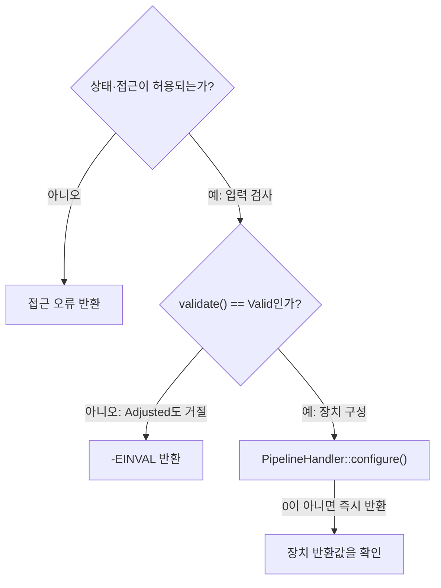
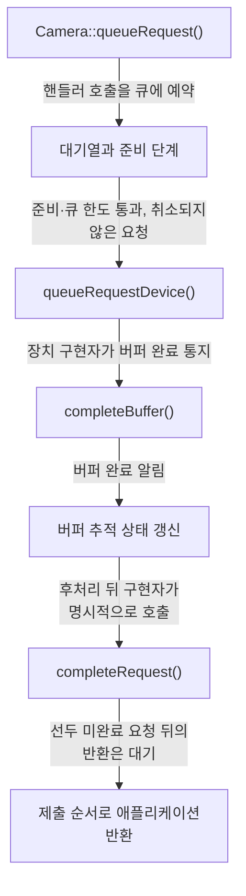
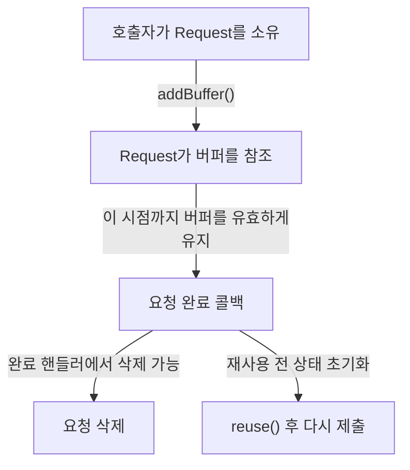
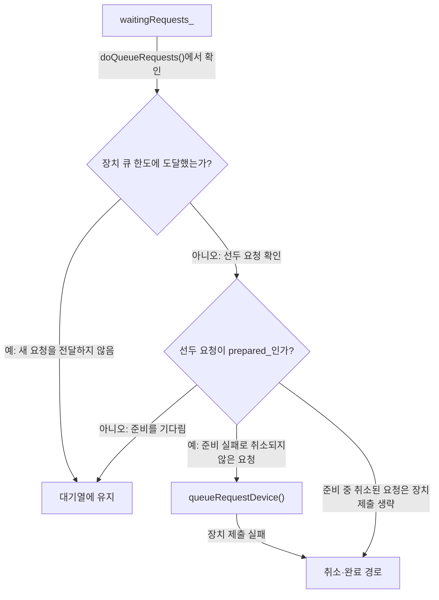
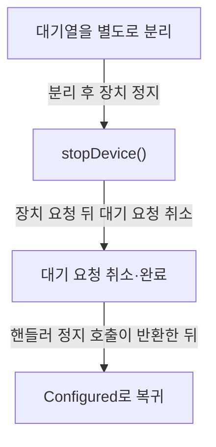

# 요청 처리와 문제 진단

**요청의 제출 성공과 촬영 완료를 구분하고, 버퍼를 유지할 기간과 오류가 난 위치를 확인하세요.**

| 지금 확인할 내용 | 이동할 절 |
|---|---|
| 구성 실패의 반환값과 분기를 확인합니다. | [구성 실패를 좁히는 순서](#구성-실패를-좁히는-순서) |
| 요청 제출과 완료의 연결을 확인합니다. | [제출에서 완료까지](#제출에서-완료까지) |
| 자원을 재사용하거나 해제할 시점을 확인합니다. | [요청·버퍼·fence의 수명](#요청버퍼fence의-수명) |
| 완료 누락의 관측 지점을 찾습니다. | [실패 위치별 확인 순서](#실패-위치별-확인-순서) |
| 정지와 연결 해제의 차이를 확인합니다. | [정지와 연결 해제를 구분하기](#정지와-연결-해제를-구분하기) |

## 구성 실패를 좁히는 순서

`Camera::configure` 함수는 설정을 구성하기 전에 `isAccessAllowed` 함수를 호출하여 접근 권한이 있는지 확인합니다. `src/libcamera/camera.cpp:1191`

<!-- sdd:visual:configure-failures -->
### 구성 실패를 좁히는 분기

입력 검사와 장치 구현 실패를 순서대로 구분하세요. 아래 그림의 성공 경로에서도 스트림 연결 검사가 남습니다.



[Mermaid 원문](request-lifecycle.configure-failures.mmd)

??? note "그림 근거와 확인 범위"
    소스에 연결한 설계 해석입니다. 자동 연결 검사는 의미 승인이나 기기 실행 검증이 아닙니다.
    
    | 요소·전이 | 소스 근거 |
    |---|---|
    | 상태·접근이 허용되는가? | [src/libcamera/camera.cpp:1163](#source-4e218db5e20840dc) |
    | 접근 오류 반환 | [src/libcamera/camera.cpp:1163](#source-4e218db5e20840dc) |
    | validate() == Valid인가? | [src/libcamera/camera.cpp:1163](#source-4e218db5e20840dc) |
    | -EINVAL 반환 | [src/libcamera/camera.cpp:1163](#source-4e218db5e20840dc) |
    | PipelineHandler::configure() | [src/libcamera/camera.cpp:1163](#source-4e218db5e20840dc) |
    | 장치 반환값을 확인 | [src/libcamera/camera.cpp:1163](#source-4e218db5e20840dc) |
    | 아니오 | [src/libcamera/camera.cpp:1163](#source-4e218db5e20840dc) |
    | 예: 입력 검사 | [src/libcamera/camera.cpp:1163](#source-4e218db5e20840dc) |
    | 아니오: Adjusted도 거절 | [src/libcamera/camera.cpp:1163](#source-4e218db5e20840dc) |
    | 예: 장치 구성 | [src/libcamera/camera.cpp:1163](#source-4e218db5e20840dc) |
    | 0이 아니면 즉시 반환 | [src/libcamera/camera.cpp:1163](#source-4e218db5e20840dc) |
<!-- /sdd:visual:configure-failures -->

`Camera::Private::isAccessAllowed` 함수는 `allowDisconnected` 가 `false`이고 현재 카메라가 연결 해제 상태(`disconnected_`)라면 `-ENODEV` 오류 코드를 반환합니다. `src/libcamera/camera.cpp:709`

`currentState` 가 `low` 이상이고 `high` 이하인 범위 내에 있으면 함수는 즉시 `0`을 반환합니다. `src/libcamera/camera.cpp:717`

`currentState` 가 지정된 허용 범위 (`low`와 `high`) 를 벗어난 경우 함수는 `-EACCES`를 반환합니다. `src/libcamera/camera.cpp:717`

`Camera::configure` 함수는 내부적으로 `config->validate()` 호출 결과를 확인하며, 이 결과가 `Valid`가 아닌 경우 `-EINVAL` 오류 식별자를 반환합니다. `src/libcamera/camera.cpp:1203`

`CameraConfiguration::validate()` 함수는 카메라 설정을 가장 가까운 유효한 상태로 조정하고 검증 상태를 반환합니다. `src/libcamera/camera.cpp:323`

함수가 `CameraConfiguration::Invalid`를 반환하면 설정이 조정할 수 없는 무효 상태이며, 이는 설정이 비어 있는 극단적인 경우에만 발생할 수 있습니다. `src/libcamera/camera.cpp:323`

`Camera::configure` 함수는 `PipelineHandler::configure` 메서드를 호출하기 위해 invokeMethod를 사용하며, 이때 반환된 값을 ret 변수에 저장합니다. `src/libcamera/camera.cpp:1163`

invokeMethod 호출 직후 ret의 값이 0 이 아닌 경우, 함수는 그 값을 그대로 반환하여 오류를 상향 전달합니다. `src/libcamera/camera.cpp:1163`

`Camera::configure` 함수 내부의 `if (!stream)` 조건 블록에서 먼저 `d->activeStreams_` 컨테이너를 비웁니다. `src/libcamera/camera.cpp:1225`

`d->activeStreams_` 를 비운 직후 해당 함수는 `-EINVAL` 오류 코드를 반환합니다. `src/libcamera/camera.cpp:1225`

근거 원문: [src/libcamera/camera.cpp:1163](#source-4e218db5e20840dc) · [src/libcamera/camera.cpp:1191](#source-ff41728b62b4632a) · [src/libcamera/camera.cpp:709](#source-1e64f4ece8808997) · [src/libcamera/camera.cpp:323](#source-cb5242e98ac1e72c) · [src/libcamera/camera.cpp:1203](#source-dddebf91b51fd381) · [src/libcamera/camera.cpp:1225](#source-a25518916c3bca3d) · [src/libcamera/camera.cpp:717](#source-2bd61734262b0f97)

## 제출에서 완료까지

요청을 생성하려면 `Camera::createRequest()` 함수를 호출하여 애플리케이션이 버퍼와 매개변수로 채울 빈 요청 객체를 얻어야 합니다. 이 함수는 카메라가 `Configured` 또는 `Running` 상태일 때만 호출할 수 있으며, 반환된 요청의 소유권은 호출자에게 넘어갑니다. `src/libcamera/camera.cpp:1243`

<!-- sdd:visual:request-stages -->
### 제출·준비·장치 처리·완료의 연결

접수 성공 뒤에도 준비 대기와 장치 처리가 남습니다. 정상 촬영 경로의 계약을 연결한 그림이며 실제 실행 시간이나 전체 실패 경로를 나타내지 않습니다.



[Mermaid 원문](request-lifecycle.request-stages.mmd)

??? note "그림 근거와 확인 범위"
    소스에 연결한 설계 해석입니다. 자동 연결 검사는 의미 승인이나 기기 실행 검증이 아닙니다.
    
    | 요소·전이 | 소스 근거 |
    |---|---|
    | Camera::queueRequest() | [src/libcamera/camera.cpp:1308](#source-28d007de6ad1a8a5) |
    | 대기열과 준비 단계 | [src/libcamera/pipeline_handler.cpp:428](#source-789eafedfaa7f3c5) |
    | queueRequestDevice() | [src/libcamera/pipeline_handler.cpp:428](#source-789eafedfaa7f3c5) |
    | completeBuffer() | [src/libcamera/pipeline_handler.cpp:547](#source-01ad7c6605c3296a) |
    | 버퍼 추적 상태 갱신 | [src/libcamera/pipeline_handler.cpp:547](#source-01ad7c6605c3296a) |
    | completeRequest() | [src/libcamera/pipeline_handler.cpp:547](#source-01ad7c6605c3296a) |
    | 제출 순서로 애플리케이션 반환 | [src/libcamera/pipeline_handler.cpp:547](#source-01ad7c6605c3296a) |
    | 핸들러 호출을 큐에 예약 | [src/libcamera/camera.cpp:1308](#source-28d007de6ad1a8a5) |
    | 준비·큐 한도 통과, 취소되지 않은 요청 | [src/libcamera/pipeline_handler.cpp:428](#source-789eafedfaa7f3c5) |
    | 장치 구현자가 버퍼 완료 통지 | [src/libcamera/pipeline_handler.cpp:547](#source-01ad7c6605c3296a) |
    | 버퍼 완료 알림 | [src/libcamera/pipeline_handler.cpp:547](#source-01ad7c6605c3296a) |
    | 후처리 뒤 구현자가 명시적으로 호출 | [src/libcamera/pipeline_handler.cpp:547](#source-01ad7c6605c3296a) |
    | 선두 미완료 요청 뒤의 반환은 대기 | [src/libcamera/pipeline_handler.cpp:547](#source-01ad7c6605c3296a) |
<!-- /sdd:visual:request-stages -->

요청을 카메라에 제출하려면 `Camera::queueRequest()` 함수를 호출해야 하며, 이 요청에는 최소 하나의 캡처 버퍼가 포함되어 있어야 합니다. 버퍼가 없는 요청은 무효로 거부됩니다. `src/libcamera/camera.cpp:1308`

`Camera::queueRequest()` 함수는 요청이 카메라에 의해 생성되었는지 확인하고, 요청 상태가 `RequestPending`인지, 버퍼 목록이 유효하며, 모든 스트림의 버퍼가 활성화된 스트림인지 검증합니다. `src/libcamera/camera.cpp:1308`

요청이 준비되면 `PipelineHandler::registerRequest()` 함수가 연결된 신호를 통해 파이프라인 핸들러에 요청이 처리될 준비가 되었음을 알립니다. `src/libcamera/pipeline_handler.cpp:428`

`PipelineHandler::queueRequest()` 함수는 요청을 내부 대기 큐에 추가하고, 300ms 동안 준비 상태를 기다립니다. `src/libcamera/pipeline_handler.cpp:428`

`PipelineHandler::doQueueRequests()` 함수는 대기 큐의 요청을 순차적으로 처리하며, `maxQueuedRequestsDevice_` 제한에 도달하면 더 이상 추가하지 않습니다. `src/libcamera/pipeline_handler.cpp:428`

`PipelineHandler::doQueueRequest()` 함수는 요청을 장치에 제출하고, 실패 시 `cancelRequest()` 를 호출하여 요청을 취소합니다. `src/libcamera/pipeline_handler.cpp:428`

`PipelineHandler::completeBuffer()` 함수는 버퍼 완료를 신호하고, 모든 버퍼가 완료되었는지 확인합니다. `src/libcamera/pipeline_handler.cpp:547`

근거 원문: [src/libcamera/camera.cpp:1243](#source-0ae00d77839f61cb) · [src/libcamera/camera.cpp:1308](#source-28d007de6ad1a8a5) · [src/libcamera/request.cpp:442](#source-95ae69eeb085e3b1) · [src/libcamera/pipeline_handler.cpp:428](#source-789eafedfaa7f3c5) · [src/libcamera/pipeline_handler.cpp:547](#source-01ad7c6605c3296a)

## 요청·버퍼·fence의 수명

요청 객체의 소유권은 `Camera::createRequest()` 함수가 반환한 지점부터 호출자에게 넘어갑니다. 호출자는 이 요청을 삭제할 책임이 있으며, 완료 핸들러에서 삭제하거나 `Request::reuse()` 를 호출하여 상태를 초기화하고 재사용할 수 있습니다. `src/libcamera/camera.cpp:1243`

<!-- sdd:visual:request-ownership -->
### 요청과 버퍼를 유지할 기간

요청의 소유권은 호출자에게 있습니다. 버퍼 참조를 연결해도 호출자의 버퍼 유지 책임은 계속됩니다.



[Mermaid 원문](request-lifecycle.request-ownership.mmd)

??? note "그림 근거와 확인 범위"
    소스에 연결한 설계 해석입니다. 자동 연결 검사는 의미 승인이나 기기 실행 검증이 아닙니다.
    
    | 요소·전이 | 소스 근거 |
    |---|---|
    | 호출자가 Request를 소유 | [src/libcamera/camera.cpp:1243](#source-0ae00d77839f61cb) |
    | Request가 버퍼를 참조 | [src/libcamera/request.cpp:442](#source-95ae69eeb085e3b1) |
    | 요청 완료 콜백 | [src/libcamera/request.cpp:442](#source-95ae69eeb085e3b1) |
    | 요청 삭제 | [src/libcamera/camera.cpp:1243](#source-0ae00d77839f61cb) |
    | reuse() 후 다시 제출 | [src/libcamera/request.cpp:376](#source-38494771cb29cc8c) |
    | addBuffer() | [src/libcamera/request.cpp:442](#source-95ae69eeb085e3b1) |
    | 이 시점까지 버퍼를 유효하게 유지 | [src/libcamera/request.cpp:442](#source-95ae69eeb085e3b1) |
    | 완료 핸들러에서 삭제 가능 | [src/libcamera/camera.cpp:1243](#source-0ae00d77839f61cb) |
    | 재사용 전 상태 초기화 | [src/libcamera/request.cpp:376](#source-38494771cb29cc8c) |
<!-- /sdd:visual:request-ownership -->

실행 확인 항목: `Request::addBuffer()` 함수는 스트림당 하나의 버퍼만 허용하며, 이미 동일한 스트림에 버퍼가 추가되어 있거나 버퍼에 펜스가 남아있으면 `-EEXIST` 오류를 반환합니다. `src/libcamera/request.cpp:442`

버퍼의 유효 기간은 요청 완료 콜백이 호출될 때까지 유지되어야 하며, 호출자는 이 기간 동안 버퍼가 유효함을 보장해야 합니다. `src/libcamera/request.cpp:442`

`Request::reuse()` 함수는 요청의 상태와 컨트롤을 초기화하여 재사용과 재큐잉을 가능하게 합니다. 이 함수를 호출하기 전에 반드시 호출해야 하며, 새로운 요청을 생성하는 대신 기존 요청을 재사용할 수 있습니다. `src/libcamera/request.cpp:376`

실행 확인 항목: `ReuseBuffers` 플래그를 설정하면 이전에 `addBuffer()` 로 추가된 버퍼들이 재사용되지만, 펜스는 재사용되지 않습니다. 따라서 펜스를 사용하는 경우 이 플래그는 사용하지 않아야 합니다. `src/libcamera/request.cpp:326`

`ReuseBuffers` 플래그가 설정되지 않은 경우 `Request::reuse()` 는 버퍼 맵을 비우고 요청 상태를 `RequestPending` 로 변경합니다. `src/libcamera/request.cpp:376`

`PipelineHandler::completeBuffer()` 함수는 파이프라인 핸들러가 버퍼 완료를 신호할 때 호출되며, 모든 버퍼가 완료되었는지 확인하지 않습니다. `src/libcamera/pipeline_handler.cpp:547`

`PipelineHandler::completeRequest()` 함수는 요청이 완료되었음을 카메라에 알리고, 더 이상 파이프라인 핸들러가 이 요청을 관리하지 않게 합니다. 이 함수가 반환된 후에는 핸들러가 요청에 접근해서는 안 됩니다. `src/libcamera/pipeline_handler.cpp:547`

근거 원문: [src/libcamera/camera.cpp:1243](#source-0ae00d77839f61cb) · [src/libcamera/request.cpp:442](#source-95ae69eeb085e3b1) · [src/libcamera/request.cpp:376](#source-38494771cb29cc8c) · [src/libcamera/pipeline_handler.cpp:547](#source-01ad7c6605c3296a) · [src/libcamera/request.cpp:326](#source-447804db33308244)

## 실패 위치별 확인 순서

요청이 카메라에 제출되지 않는 경우, `Camera::queueRequest()` 함수가 반환하는 오류 코드를 먼저 확인해야 합니다. 이 함수는 요청이 유효하지 않거나 버퍼가 없으면 `-EINVAL`을, 카메라 상태가 실행 중이 아니면 `-EACCES`를, 그리고 요청이 해당 카메라에 속하지 않으면 `-EXDEV`를 반환합니다. `src/libcamera/camera.cpp:1308`

<!-- sdd:visual:queue-gates -->
### 요청이 대기하거나 장치로 가는 조건

준비 대기와 장치 큐 한도를 구분하세요. 준비 실패와 장치 제출 실패는 취소 경로로 이어집니다.



[Mermaid 원문](request-lifecycle.queue-gates.mmd)

??? note "그림 근거와 확인 범위"
    소스에 연결한 설계 해석입니다. 자동 연결 검사는 의미 승인이나 기기 실행 검증이 아닙니다.
    
    | 요소·전이 | 소스 근거 |
    |---|---|
    | waitingRequests_ | [src/libcamera/pipeline_handler.cpp:428](#source-789eafedfaa7f3c5) |
    | 선두 요청이 prepared_인가? | [src/libcamera/pipeline_handler.cpp:428](#source-789eafedfaa7f3c5) |
    | 장치 큐 한도에 도달했는가? | [src/libcamera/pipeline_handler.cpp:428](#source-789eafedfaa7f3c5) |
    | 대기열에 유지 | [src/libcamera/pipeline_handler.cpp:428](#source-789eafedfaa7f3c5) |
    | queueRequestDevice() | [src/libcamera/pipeline_handler.cpp:428](#source-789eafedfaa7f3c5) |
    | 취소·완료 경로 | [src/libcamera/pipeline_handler.cpp:428](#source-789eafedfaa7f3c5) |
    | doQueueRequests()에서 확인 | [src/libcamera/pipeline_handler.cpp:428](#source-789eafedfaa7f3c5) |
    | 예: 새 요청을 전달하지 않음 | [src/libcamera/pipeline_handler.cpp:428](#source-789eafedfaa7f3c5) |
    | 아니오: 선두 요청 확인 | [src/libcamera/pipeline_handler.cpp:428](#source-789eafedfaa7f3c5) |
    | 아니오: 준비를 기다림 | [src/libcamera/pipeline_handler.cpp:428](#source-789eafedfaa7f3c5) |
    | 예: 준비 실패로 취소되지 않은 요청 | [src/libcamera/pipeline_handler.cpp:428](#source-789eafedfaa7f3c5) |
    | 장치 제출 실패 | [src/libcamera/pipeline_handler.cpp:428](#source-789eafedfaa7f3c5) |
    | 준비 중 취소된 요청은 장치 제출 생략 | [src/libcamera/pipeline_handler.cpp:428](#source-789eafedfaa7f3c5) |
<!-- /sdd:visual:queue-gates -->

`Camera::queueRequest()` 내부에서 `request->buffers().empty()`가 참이면 요청이 버퍼를 포함하지 않아서 `-EINVAL` 오류로 즉시 거부됩니다. 또한 `request->controls().infoMap() != &controls()`인 경우 제어 목록이 유효하지 않아서 같은 오류 코드가 반환되며, 이는 요청의 상태나 준비 여부와는 별개의 검증 단계입니다. `src/libcamera/camera.cpp:1308`

요청이 `Camera::queueRequest()`를 통과하면 `PipelineHandler::doQueueRequests()`에서 대기 중인 요청 목록을 순회하며 제출합니다. 이 과정에서 각 요청의 `prepared_` 플래그가 거짓이면 더 이상 처리되지 않고 루프가 중단되며, 이는 요청이 아직 준비되지 않았음을 의미합니다. `src/libcamera/pipeline_handler.cpp:428`

`PipelineHandler::doQueueRequests()`는 `queuedRequests_.size()`가 `maxQueuedRequestsDevice_`에 도달하면 더 이상 요청을 제출하지 않고 루프를 종료합니다. 이는 하드웨어나 파이프라인 처리기의 한도에 의해 제출이 지연되거나 중단되는 경우로, 요청 자체가 잘못되었음을 뜻하지 않습니다. `src/libcamera/pipeline_handler.cpp:428`

`PipelineHandler::doQueueRequest()`에서 `request->_d()->cancelled_`가 참이면 요청이 취소되어 즉시 완료 신호를 발생시키고 함수를 종료합니다. 이 상태는 제출 실패가 아니라 의도적인 취소로, 요청의 내부 상태를 확인하여 구분해야 합니다. `src/libcamera/pipeline_handler.cpp:428`

`PipelineHandler::doQueueRequest()`는 `queueRequestDevice()`를 호출한 후 반환값이 0이 아니면 요청을 취소합니다. 이 경우 제출 실패가 발생했으므로, 완료 신호 없이 요청이 파이프라인에서 제거됩니다. `src/libcamera/pipeline_handler.cpp:428`

`PipelineHandler::completeBuffer()`는 요청의 마지막 버퍼가 완료되었더라도 자동으로 요청을 완료하지 않습니다. 파이프라인 처리기는 추가 작업을 수행할 기회를 주기 위해 명시적으로 `completeRequest()`를 호출해야 하며, 이는 버퍼 완료와 요청 완료 사이의 지연을 이해하는 데 중요합니다. `src/libcamera/pipeline_handler.cpp:547`

`PipelineHandler::completeRequest()`는 `queuedRequests_` 목록의 선두에 있는 요청이 `RequestPending` 상태인지 확인하며, 완료되지 않은 요청은 계속 대기합니다. 이 과정에서 모든 버퍼가 완료되었는지 (`hasPendingBuffers()`) 확인하고, 그렇지 않으면 요청을 취소하지 않고 대기 상태로 둡니다. `src/libcamera/pipeline_handler.cpp:547`

근거 원문: [src/libcamera/camera.cpp:1308](#source-28d007de6ad1a8a5) · [src/libcamera/request.cpp:442](#source-95ae69eeb085e3b1) · [src/libcamera/pipeline_handler.cpp:428](#source-789eafedfaa7f3c5) · [src/libcamera/pipeline_handler.cpp:547](#source-01ad7c6605c3296a)

## 정지와 연결 해제를 구분하기

`Camera::stop()` 함수는 카메라가 실행 중이 아닌 상태라면 즉시 0 을 반환하며, 이는 실제 정지 동작을 수행하지 않은 no-op 입니다. `src/libcamera/camera.cpp:1431`

<!-- sdd:visual:stop-order -->
### 정지할 때 대기 요청을 처리하는 순서

정상 정지 경로의 순서를 표시합니다. 연결 해제 알림의 미완료 요청 TODO를 이 정지 보장과 혼동하지 마세요.



[Mermaid 원문](request-lifecycle.stop-order.mmd)

??? note "그림 근거와 확인 범위"
    소스에 연결한 설계 해석입니다. 자동 연결 검사는 의미 승인이나 기기 실행 검증이 아닙니다.
    
    | 요소·전이 | 소스 근거 |
    |---|---|
    | 대기열을 별도로 분리 | [src/libcamera/pipeline_handler.cpp:359](#source-eefd1bbecb1aad0a) |
    | stopDevice() | [src/libcamera/pipeline_handler.cpp:359](#source-eefd1bbecb1aad0a) |
    | 대기 요청 취소·완료 | [src/libcamera/pipeline_handler.cpp:359](#source-eefd1bbecb1aad0a) |
    | Configured로 복귀 | [src/libcamera/camera.cpp:1431](#source-e09324743def3f09) |
    | 분리 후 장치 정지 | [src/libcamera/pipeline_handler.cpp:359](#source-eefd1bbecb1aad0a) |
    | 장치 요청 뒤 대기 요청 취소 | [src/libcamera/pipeline_handler.cpp:359](#source-eefd1bbecb1aad0a) |
    | 핸들러 정지 호출이 반환한 뒤 | [src/libcamera/camera.cpp:1431](#source-e09324743def3f09) |
<!-- /sdd:visual:stop-order -->

카메라가 실행 중일 경우 `Camera::stop()` 은 내부적으로 `PipelineHandler::stop` 을 Blocking 연결 타입으로 호출하여 정지 요청을 전달합니다. `src/libcamera/camera.cpp:1431`

`PipelineHandler::stop()` 은 먼저 카메라의 waitingRequests_ 큐를 임시로 분리하여 stopDevice() 호출 시 재큐되지 않도록 보호합니다. `src/libcamera/pipeline_handler.cpp:359`

`PipelineHandler::stop()` 은 stopDevice() 를 호출한 후 분리된 waitingRequests_ 큐에 있는 모든 요청을 취소하고 completeRequest() 로 완료합니다. `src/libcamera/pipeline_handler.cpp:359`

`PipelineHandler::stopDevice()` 는 모든 스트림의 캡처를 즉시 중지하고 대기 중인 요청을 오류 상태로 완료하지만, 함수가 복귀한 후에도 queuedRequests_ 가 비어있음을 ASSERT 로 보장합니다. `src/libcamera/pipeline_handler.cpp:359`

`PipelineHandler::stop()` 은 stopDevice() 복귀 후 waitingRequests_ 와 queuedRequests_ 가 모두 비어있음을 ASSERT 로 확인하여 큐에 요청이 남지 않았음을 검증합니다. `src/libcamera/pipeline_handler.cpp:359`

`PipelineHandler::completeRequest()` 는 요청을 완료할 때 queuedRequests_ 에서 대기 중인 요청을 순서대로 꺼내어 카메라에 반환하며, 상태가 Pending 이 아닌 요청만 처리합니다. `src/libcamera/pipeline_handler.cpp:547`

실행 확인 항목: `Camera::disconnect()` 는 하드웨어가 분리되었음을 알리고 disconnected 신호를 발생시키지만, 실행 중일 때의 대기 요청 처리는 TODO 로 남아있어 현재 보장되지 않습니다. `src/libcamera/camera.cpp:944`

근거 원문: [src/libcamera/camera.cpp:1431](#source-e09324743def3f09) · [src/libcamera/pipeline_handler.cpp:359](#source-eefd1bbecb1aad0a) · [src/libcamera/pipeline_handler.cpp:547](#source-01ad7c6605c3296a) · [src/libcamera/camera.cpp:944](#source-2758e9ddd31ad41d)

## 변경 검토와 실행 확인

`Camera::queueRequest()` 함수는 카메라가 `Running` 상태여야 하며, 요청에 최소 하나의 캡처 버퍼가 포함되어 있어야 합니다. 버퍼가 없거나 요청이 유효하지 않으면 `-EINVAL` 오류를 반환하며, 요청은 큐에 추가되지 않습니다. `src/libcamera/camera.cpp:1308`

`PipelineHandler::completeBuffer()` 함수는 버퍼 완료를 신호로 보내지만, 마지막 버퍼가 완료되더라도 요청이 자동으로 완료되지 않습니다. 이는 파이프라인 핸들러가 추가 작업을 수행할 기회를 주기 위함이며, 명시적으로 `completeRequest()` 를 호출해야 합니다. `src/libcamera/pipeline_handler.cpp:547`

`PipelineHandler::completeRequest()` 함수는 요청이 완료되었음을 카메라에 알리고, 요청은 제출 순서대로 반환되도록 보장합니다. 파이프라인 핸들러는 어떤 완전한 요청이라도 호출할 수 있으며, 순서 제약 없이 호출할 수 있습니다. `src/libcamera/pipeline_handler.cpp:547`

`PipelineHandler::stop()` 함수는 모든 대기 중인 요청을 취소하고 즉시 완료 상태로 만듭니다. 이 과정에서 `cancelRequest()` 대신 `doQueueRequest()` 를 호출하여 요청에 시퀀스 번호를 부여하고, 올바른 순서로 완료되도록 처리합니다. `src/libcamera/pipeline_handler.cpp:359`

`Request::reuse()` 함수는 요청을 재사용하기 위해 상태와 컨트롤을 초기화하며, 버퍼를 재사용하려면 `ReuseBuffers` 플래그를 설정해야 합니다. 이 함수는 새로운 요청을 생성하는 대신 기존 요청을 다시 큐에 추가할 수 있게 합니다. `src/libcamera/request.cpp:376`

`PipelineHandler::completeRequest()` 내부에서 `queuedRequests_` 큐의 선두 요청이 `RequestPending` 상태라면 루프를 중단하며, 이는 제출 순서대로 반환되는 것을 보장합니다. 모든 버퍼가 완료되지 않은 요청은 큐에 남아있을 수 있습니다. `src/libcamera/pipeline_handler.cpp:547`

`PipelineHandler::stop()` 함수는 `waitingRequests_` 큐에 있는 모든 요청을 취소하고, `doQueueRequest()` 를 호출하여 시퀀스 번호를 부여한 후 완료 처리합니다. 이는 요청이 올바른 순서로 처리되도록 보장합니다. `src/libcamera/pipeline_handler.cpp:359`

`PipelineHandler::completeBuffer()` 함수는 `CameraManager` 스레드에서 호출되어야 하며, 요청이 자동으로 완료되지 않도록 설계되었습니다. 이는 파이프라인 핸들러가 필요한 추가 작업을 수행할 시간을 주기 위함입니다. `src/libcamera/pipeline_handler.cpp:547`

근거 원문: [src/libcamera/camera.cpp:1308](#source-28d007de6ad1a8a5) · [src/libcamera/request.cpp:376](#source-38494771cb29cc8c) · [src/libcamera/pipeline_handler.cpp:547](#source-01ad7c6605c3296a) · [src/libcamera/pipeline_handler.cpp:359](#source-eefd1bbecb1aad0a)

??? note "설계 질문과 검증 범위"
    질문별 답변과 근거 연결을 검사했습니다. 의미와 실행 결과는 사람 검토가 필요합니다.
    
    | 설계 질문 | 설명 위치 | 확인 범위 |
    |---|---|---|
    | 제출 성공 이후의 대기 조건과 완료 책임은 무엇입니까? | [제출에서 완료까지](#제출에서-완료까지) | 코드 근거와 설명 연결 |
    | 어떤 자원을 누가 유지하고 완료 후 무엇을 초기화해야 합니까? | [요청·버퍼·fence의 수명](#요청버퍼fence의-수명) | 코드 근거와 설명 연결 · 실행 확인 항목 별도 |
    | 제출 실패와 제출 후 완료 지연을 어떻게 구분합니까? | [실패 위치별 확인 순서](#실패-위치별-확인-순서) | 코드 근거와 설명 연결 |
    | 정지 중 요청 반환과 연결 해제의 보장 범위는 어떻게 다릅니까? | [정지와 연결 해제를 구분하기](#정지와-연결-해제를-구분하기) | 코드 근거와 설명 연결 · 실행 확인 항목 별도 |
    | 문서를 읽고 어떤 질문에 답하고 어떤 실행 증거를 확보해야 합니까? | [변경 검토와 실행 확인](#변경-검토와-실행-확인) | 코드 근거와 설명 연결 |
    | 구성 실패를 상태 검사·구성 검증·장치 구성·스트림 연결 중 어디로 좁히며 어떤 값을 관찰합니까? | [구성 실패를 좁히는 순서](#구성-실패를-좁히는-순서) | 코드 근거와 설명 연결 |

## 소스 근거

같은 발췌는 한 번만 싣습니다. 필요한 원문을 펼쳐 설명과 대조하세요.

<a id="source-4e218db5e20840dc"></a>

??? note "소스 근거: src/libcamera/camera.cpp:1163"
    `src/libcamera/camera.cpp:1163`에서 시작하는 발췌입니다. 종료 줄은 1243이며, 아래 원문을 설명과 대조할 수 있습니다.
    
    SHA-256: `5892a108abafcaf7266fb5798b70facc498e62efce52f04e773156c01471b509`
    
    ```text
    \brief Configure the camera prior to capture
     * \param[in] config The camera configurations to setup
     *
     * Prior to starting capture, the camera must be configured to select a
     * group of streams to be involved in the capture and their configuration.
     * The caller specifies which streams are to be involved and their configuration
     * by populating \a config.
     *
     * The configuration is created by generateConfiguration(), and adjusted by the
     * caller with CameraConfiguration::validate(). This function only accepts fully
     * valid configurations and returns an error if \a config is not valid.
     *
     * Exclusive access to the camera shall be ensured by a call to acquire() prior
     * to calling this function, otherwise an -EACCES error will be returned.
     *
     * \context This function may only be called when the camera is in the Acquired
     * or Configured state as defined in \ref camera_operation, and shall be
     * synchronized by the caller with other functions that affect the camera
     * state.
     *
     * Upon return the StreamConfiguration entries in \a config are associated with
     * Stream instances which can be retrieved with StreamConfiguration::stream().
     *
     * \return 0 on success or a negative error code otherwise
     * \retval -ENODEV The camera has been disconnected from the system
     * \retval -EACCES The camera is not in a state where it can be configured
     * \retval -EINVAL The configuration is not valid
     */
    int Camera::configure(CameraConfiguration *config)
    {
    	Private *const d = _d();
    
    	int ret = d->isAccessAllowed(Private::CameraAcquired,
    				     Private::CameraConfigured);
    	if (ret < 0)
    		return ret;
    
    	for (auto &cfg : *config)
    		cfg.setStream(nullptr);
    
    	if (config->validate() != CameraConfiguration::Valid) {
    		LOG(Camera, Error)
    			<< "Can't configure camera with invalid configuration";
    		return -EINVAL;
    	}
    
    	std::ostringstream msg("configuring streams:", std::ios_base::ate);
    
    	for (unsigned int index = 0; index < config->size(); ++index) {
    		StreamConfiguration &cfg = config->at(index);
    		msg << " (" << index << ") " << cfg.toString();
    	}
    
    	LOG(Camera, Info) << msg.str();
    
    	ret = d->pipe_->invokeMethod(&PipelineHandler::configure,
    				     ConnectionTypeBlocking, this, config);
    	if (ret)
    		return ret;
    
    	d->activeStreams_.clear();
    	for (const StreamConfiguration &cfg : *config) {
    		Stream *stream = cfg.stream();
    		if (!stream) {
    			LOG(Camera, Fatal)
    				<< "Pipeline handler failed to update stream configuration";
    			d->activeStreams_.clear();
    			return -EINVAL;
    		}
    
    		stream->configuration_ = cfg;
    		d->activeStreams_.insert(stream);
    	}
    
    	d->setState(Private::CameraConfigured);
    
    	return 0;
    }
    
    /**
     * \brief Create a request object for the camera
    ```

<a id="source-ff41728b62b4632a"></a>

??? note "소스 근거: src/libcamera/camera.cpp:1191"
    `src/libcamera/camera.cpp:1191`에서 시작하는 발췌입니다. 종료 줄은 1200이며, 아래 원문을 설명과 대조할 수 있습니다.
    
    SHA-256: `0f3b88c17c1002863a3d51542970be798a012d80ca62f2817a1333aa4e54224f`
    
    ```text
    int Camera::configure(CameraConfiguration *config)
    {
    	Private *const d = _d();
    
    	int ret = d->isAccessAllowed(Private::CameraAcquired,
    				     Private::CameraConfigured);
    	if (ret < 0)
    		return ret;
    
    	for (auto &cfg : *config)
    ```

<a id="source-1e64f4ece8808997"></a>

??? note "소스 근거: src/libcamera/camera.cpp:709"
    `src/libcamera/camera.cpp:709`에서 시작하는 발췌입니다. 종료 줄은 732이며, 아래 원문을 설명과 대조할 수 있습니다.
    
    SHA-256: `4652821b0f8cfd78a0a4b8ec372fe45eb5ed2fc9b2280a765c3dc47bcc13767b`
    
    ```text
    int Camera::Private::isAccessAllowed(State low, State high,
    				     bool allowDisconnected,
    				     const char *from) const
    {
    	if (!allowDisconnected && disconnected_)
    		return -ENODEV;
    
    	State currentState = state_.load(std::memory_order_acquire);
    	if (currentState >= low && currentState <= high)
    		return 0;
    
    	ASSERT(static_cast<unsigned int>(low) < std::size(camera_state_names) &&
    	       static_cast<unsigned int>(high) < std::size(camera_state_names));
    
    	LOG(Camera, Error) << "Camera in " << camera_state_names[currentState]
    			   << " state trying " << from
    			   << "() requiring state between "
    			   << camera_state_names[low] << " and "
    			   << camera_state_names[high];
    
    	return -EACCES;
    }
    
    void Camera::Private::disconnect()
    ```

<a id="source-cb5242e98ac1e72c"></a>

??? note "소스 근거: src/libcamera/camera.cpp:323"
    `src/libcamera/camera.cpp:323`에서 시작하는 발췌입니다. 종료 줄은 350이며, 아래 원문을 설명과 대조할 수 있습니다.
    
    SHA-256: `a6c84f68e53cafd0f2721ee7eee586981059b62a93378a48235f86ffaa0a8fce`
    
    ```text
    \fn CameraConfiguration::validate()
     * \brief Validate and possibly adjust the camera configuration
     *
     * This function adjusts the camera configuration to the closest valid
     * configuration and returns the validation status.
     *
     * \todo Define exactly when to return each status code. Should stream
     * parameters set to 0 by the caller be adjusted without returning Adjusted ?
     * This would potentially be useful for applications but would get in the way
     * in Camera::configure(). Do we need an extra status code to signal this ?
     *
     * \todo Handle validation of buffers count when refactoring the buffers API.
     *
     * \return A CameraConfiguration::Status value that describes the validation
     * status.
     * \retval CameraConfiguration::Invalid The configuration is invalid and can't
     * be adjusted. This may only occur in extreme cases such as when the
     * configuration is empty.
     * \retval CameraConfiguration::Adjusted The configuration has been adjusted
     * and is now valid. Parameters may have changed for any stream, and stream
     * configurations may have been removed. The caller shall check the
     * configuration carefully.
     * \retval CameraConfiguration::Valid The configuration was already valid and
     * hasn't been adjusted.
     */
    
    /**
     * \brief Retrieve a reference to a stream configuration
    ```

<a id="source-dddebf91b51fd381"></a>

??? note "소스 근거: src/libcamera/camera.cpp:1203"
    `src/libcamera/camera.cpp:1203`에서 시작하는 발췌입니다. 종료 줄은 1209이며, 아래 원문을 설명과 대조할 수 있습니다.
    
    SHA-256: `f97eef3933944e868015da59c2ed8e034f8e147008431c5d9ae5f53faaad3a3c`
    
    ```text
    if (config->validate() != CameraConfiguration::Valid) {
    		LOG(Camera, Error)
    			<< "Can't configure camera with invalid configuration";
    		return -EINVAL;
    	}
    
    	std::ostringstream msg
    ```

<a id="source-a25518916c3bca3d"></a>

??? note "소스 근거: src/libcamera/camera.cpp:1225"
    `src/libcamera/camera.cpp:1225`에서 시작하는 발췌입니다. 종료 줄은 1233이며, 아래 원문을 설명과 대조할 수 있습니다.
    
    SHA-256: `11818e68b91a5a6ac04eecd9714e3b9a422344a943ed450929352f00c09e8f94`
    
    ```text
    Stream *stream = cfg.stream();
    		if (!stream) {
    			LOG(Camera, Fatal)
    				<< "Pipeline handler failed to update stream configuration";
    			d->activeStreams_.clear();
    			return -EINVAL;
    		}
    
    		stream->configuration_ = cfg;
    ```

<a id="source-2bd61734262b0f97"></a>

??? note "소스 근거: src/libcamera/camera.cpp:717"
    `src/libcamera/camera.cpp:717`에서 시작하는 발췌입니다. 종료 줄은 732이며, 아래 원문을 설명과 대조할 수 있습니다.
    
    SHA-256: `61511adef3e69f6c8f9c59805bfe7acab9b8719e23c69909bb8505046390a5c3`
    
    ```text
    if (currentState >= low && currentState <= high)
    		return 0;
    
    	ASSERT(static_cast<unsigned int>(low) < std::size(camera_state_names) &&
    	       static_cast<unsigned int>(high) < std::size(camera_state_names));
    
    	LOG(Camera, Error) << "Camera in " << camera_state_names[currentState]
    			   << " state trying " << from
    			   << "() requiring state between "
    			   << camera_state_names[low] << " and "
    			   << camera_state_names[high];
    
    	return -EACCES;
    }
    
    void Camera::Private::disconnect()
    ```

<a id="source-0ae00d77839f61cb"></a>

??? note "소스 근거: src/libcamera/camera.cpp:1243"
    `src/libcamera/camera.cpp:1243`에서 시작하는 발췌입니다. 종료 줄은 1263이며, 아래 원문을 설명과 대조할 수 있습니다.
    
    SHA-256: `9f251ecf5ba569606e9753d3619b88e1aef5a4ce15f816ae97efd283e34b823b`
    
    ```text
    \brief Create a request object for the camera
     * \param[in] cookie Opaque cookie for application use
     *
     * This function creates an empty request for the application to fill with
     * buffers and parameters, and queue for capture.
     *
     * The \a cookie is stored in the request and is accessible through the
     * Request::cookie() function at any time. It is typically used by applications
     * to map the request to an external resource in the request completion
     * handler, and is completely opaque to libcamera.
     *
     * The ownership of the returned request is passed to the caller, which is
     * responsible for deleting it. The request may be deleted in the completion
     * handler, or reused after resetting its state with Request::reuse().
     *
     * \context This function is \threadsafe. It may only be called when the camera
     * is in the Configured or Running state as defined in \ref camera_operation.
     *
     * \return A pointer to the newly created request, or nullptr on error
     */
    std::unique_ptr<Request> Camera::createRequest(uint64_t cookie)
    ```

<a id="source-28d007de6ad1a8a5"></a>

??? note "소스 근거: src/libcamera/camera.cpp:1308"
    `src/libcamera/camera.cpp:1308`에서 시작하는 발췌입니다. 종료 줄은 1383이며, 아래 원문을 설명과 대조할 수 있습니다.
    
    SHA-256: `96db61baeb32065c966b20942f97518ddbd3a43b36b64e8083eb29a90ecb7f4b`
    
    ```text
    \brief Queue a request to the camera
     * \param[in] request The request to queue to the camera
     *
     * This function queues a \a request to the camera for capture.
     *
     * After allocating the request with createRequest(), the application shall
     * fill it with at least one capture buffer before queuing it. Requests that
     * contain no buffers are invalid and are rejected without being queued.
     *
     * Once the request has been queued, the camera will notify its completion
     * through the \ref requestCompleted signal.
     *
     * \context This function is \threadsafe. It may only be called when the camera
     * is in the Running state as defined in \ref camera_operation.
     *
     * \return 0 on success or a negative error code otherwise
     * \retval -ENODEV The camera has been disconnected from the system
     * \retval -EACCES The camera is not running so requests can't be queued
     * \retval -EXDEV The request does not belong to this camera
     * \retval -EINVAL The request is invalid
     * \retval -ENOMEM No buffer memory was available to handle the request
     */
    int Camera::queueRequest(Request *request)
    {
    	Private *const d = _d();
    
    	int ret = d->isAccessAllowed(Private::CameraRunning);
    	if (ret < 0)
    		return ret;
    
    	/* Requests can only be queued to the camera that created them. */
    	if (request->_d()->camera() != this) {
    		LOG(Camera, Error) << "Request was not created by this camera";
    		return -EXDEV;
    	}
    
    	if (request->status() != Request::RequestPending) {
    		LOG(Camera, Error) << request->toString() << " is not valid";
    		return -EINVAL;
    	}
    
    	/* Make sure the Request has a valid control list. */
    	if (request->controls().infoMap() != &controls()) {
    		LOG(Camera, Error) << "Overwriting Request::controls() is not allowed";
    		return -EINVAL;
    	}
    
    	/*
    	 * The camera state may change until the end of the function. No locking
    	 * is however needed as PipelineHandler::queueRequest() will handle
    	 * this.
    	 */
    
    	if (request->buffers().empty()) {
    		LOG(Camera, Error) << "Request contains no buffers";
    		return -EINVAL;
    	}
    
    	for (const auto &[stream, buffer] : request->buffers()) {
    		if (d->activeStreams_.find(stream) == d->activeStreams_.end()) {
    			LOG(Camera, Error) << "Invalid request";
    			return -EINVAL;
    		}
    	}
    
    	/* Pre-process AeEnable. */
    	patchControlList(request->controls());
    
    	d->pipe_->invokeMethod(&PipelineHandler::queueRequest,
    			       ConnectionTypeQueued, request);
    
    	return 0;
    }
    
    /**
     * \brief Start capture from camera
    ```

<a id="source-95ae69eeb085e3b1"></a>

??? note "소스 근거: src/libcamera/request.cpp:442"
    `src/libcamera/request.cpp:442`에서 시작하는 발췌입니다. 종료 줄은 475이며, 아래 원문을 설명과 대조할 수 있습니다.
    
    SHA-256: `65cd8b0501b7f6545dd10eaaec4a4fe46c52a096a3bbd94ea6b4813e4a670876`
    
    ```text
    \brief Add a FrameBuffer with its associated Stream to the Request
     * \param[in] stream The stream the buffer belongs to
     * \param[in] buffer The FrameBuffer to add to the request
     * \param[in] fence The optional fence
     *
     * A reference to the buffer is stored in the request. The caller is responsible
     * for ensuring that the buffer will remain valid until the request complete
     * callback is called.
     *
     * A request can only contain one buffer per stream. If a buffer has already
     * been added to the request for the same stream, this function returns -EEXIST.
     *
     * A Fence can be optionally associated with the \a buffer.
     *
     * When a valid Fence is provided to this function, \a fence is moved to \a
     * buffer and this Request will only be queued to the device once the
     * fences of all its buffers have been correctly signalled. Ownership of the
     * fence will only be taken in case of success, otherwise the fence will
     * be left unmodified.
     *
     * If the \a fence associated with \a buffer isn't signalled, the request will
     * fail after a timeout. The buffer will still contain the fence, which
     * applications must retrieve with FrameBuffer::releaseFence() before the buffer
     * can be reused in another request. Attempting to add a buffer that still
     * contains a fence to a request will result in this function returning -EEXIST.
     *
     * \sa FrameBuffer::releaseFence()
     *
     * \return 0 on success or a negative error code otherwise
     * \retval -EEXIST The request already contains a buffer for the stream
     *  or the buffer still references a fence
     * \retval -EINVAL The buffer does not reference a valid Stream
     */
    int Request::addBuffer(const Stream *stream, FrameBuffer *buffer,
    ```

<a id="source-789eafedfaa7f3c5"></a>

??? note "소스 근거: src/libcamera/pipeline_handler.cpp:428"
    `src/libcamera/pipeline_handler.cpp:428`에서 시작하는 발췌입니다. 종료 줄은 547이며, 아래 원문을 설명과 대조할 수 있습니다.
    
    SHA-256: `5a7a3397a6034a73fe348ae44eb1e2568d2823e95542fe43386e16359d627180`
    
    ```text
    \fn PipelineHandler::registerRequest()
     * \brief Register a request for use by the pipeline handler
     * \param[in] request The request to register
     *
     * This function is called when the request is created, and allows the pipeline
     * handler to perform any one-time initialization it requries for the request.
     */
    void PipelineHandler::registerRequest(Request *request)
    {
    	/*
    	 * Connect the request prepared signal to notify the pipeline handler
    	 * when a request is ready to be processed.
    	 */
    	request->_d()->prepared.connect(this, [this, request]() {
    		doQueueRequests(request->_d()->camera());
    	});
    }
    
    /**
     * \fn PipelineHandler::queueRequest()
     * \brief Queue a request
     * \param[in] request The request to queue
     *
     * This function queues a capture request to the pipeline handler for
     * processing. The request is first added to the internal list of waiting
     * requests which have to be prepared to make sure they are ready for being
     * queued to the pipeline handler.
     *
     * The queue of waiting requests is iterated and up to \a
     * maxQueuedRequestsDevice_ prepared requests are passed to the pipeline handler
     * in the same order they have been queued by calling this function.
     *
     * If a Request fails during the preparation phase or if the pipeline handler
     * fails in queuing the request to the hardware the request is cancelled.
     *
     * Keeping track of queued requests ensures automatic completion of all requests
     * when the pipeline handler is stopped with stop(). Request completion shall be
     * signalled by the pipeline handler using the completeRequest() function.
     *
     * \context This function is called from the CameraManager thread.
     */
    void PipelineHandler::queueRequest(Request *request)
    {
    	LIBCAMERA_TRACEPOINT(request_queue, request);
    
    	Camera *camera = request->_d()->camera();
    	Camera::Private *data = camera->_d();
    	data->waitingRequests_.push(request);
    
    	request->_d()->prepare(300ms);
    }
    
    /**
     * \brief Queue one requests to the device
     */
    void PipelineHandler::doQueueRequest(Request *request)
    {
    	LIBCAMERA_TRACEPOINT(request_device_queue, request);
    
    	Camera *camera = request->_d()->camera();
    	Camera::Private *data = camera->_d();
    	data->queuedRequests_.push_back(request);
    
    	request->_d()->sequence_ = data->requestSequence_++;
    
    	if (request->_d()->cancelled_) {
    		completeRequest(request);
    		return;
    	}
    
    	int ret = queueRequestDevice(camera, request);
    	if (ret)
    		cancelRequest(request);
    }
    
    /**
     * \brief Queue prepared requests to the device
     *
     * Iterate the list of waiting requests and queue them to the device one
     * by one if they have been prepared.
     */
    void PipelineHandler::doQueueRequests(Camera *camera)
    {
    	Camera::Private *data = camera->_d();
    	while (!data->waitingRequests_.empty()) {
    		if (data->queuedRequests_.size() == maxQueuedRequestsDevice_)
    			break;
    
    		Request *request = data->waitingRequests_.front();
    		if (!request->_d()->prepared_)
    			break;
    
    		/*
    		 * Pop the request first, in case doQueueRequests() is called
    		 * recursively from within doQueueRequest()
    		 */
    		data->waitingRequests_.pop();
    		doQueueRequest(request);
    	}
    }
    
    /**
     * \fn PipelineHandler::queueRequestDevice()
     * \brief Queue a request to the device
     * \param[in] camera The camera to queue the request to
     * \param[in] request The request to queue
     *
     * This function queues a capture request to the device for processing. The
     * request contains a set of buffers associated with streams and a set of
     * parameters. The pipeline handler shall program the device to ensure that the
     * parameters will be applied to the frames captured in the buffers provided in
     * the request.
     *
     * \context This function is called from the CameraManager thread.
     *
     * \return 0 on success or a negative error code otherwise
     */
    
    /**
     * \brief Complete a buffer for a request
    ```

<a id="source-01ad7c6605c3296a"></a>

??? note "소스 근거: src/libcamera/pipeline_handler.cpp:547"
    `src/libcamera/pipeline_handler.cpp:547`에서 시작하는 발췌입니다. 종료 줄은 620이며, 아래 원문을 설명과 대조할 수 있습니다.
    
    SHA-256: `514288cc958de9ff5fd19d46393cec3bb3088f4f08486528d4559071138638c9`
    
    ```text
    \brief Complete a buffer for a request
     * \param[in] request The request the buffer belongs to
     * \param[in] buffer The buffer that has completed
     *
     * This function shall be called by pipeline handlers to signal completion of
     * the \a buffer part of the \a request. It notifies applications of buffer
     * completion and updates the request's internal buffer tracking. The request
     * is not completed automatically when the last buffer completes to give
     * pipeline handlers a chance to perform any operation that may still be
     * needed. They shall complete requests explicitly with completeRequest().
     *
     * \context This function shall be called from the CameraManager thread.
     *
     * \return True if all buffers contained in the request have completed, false
     * otherwise
     */
    bool PipelineHandler::completeBuffer(Request *request, FrameBuffer *buffer)
    {
    	Camera *camera = request->_d()->camera();
    	camera->bufferCompleted.emit(request, buffer);
    	return request->_d()->completeBuffer(buffer);
    }
    
    /**
     * \brief Signal request completion
     * \param[in] request The request that has completed
     *
     * The pipeline handler shall call this function to notify the \a camera that
     * the request has completed. The request is no longer managed by the pipeline
     * handler and shall not be accessed once this function returns.
     *
     * This function ensures that requests will be returned to the application in
     * submission order, the pipeline handler may call it on any complete request
     * without any ordering constraint.
     *
     * \context This function shall be called from the CameraManager thread.
     */
    void PipelineHandler::completeRequest(Request *request)
    {
    	Camera *camera = request->_d()->camera();
    
    	request->_d()->complete();
    
    	Camera::Private *data = camera->_d();
    
    	while (!data->queuedRequests_.empty()) {
    		Request *req = data->queuedRequests_.front();
    		if (req->status() == Request::RequestPending)
    			break;
    
    		ASSERT(!req->hasPendingBuffers());
    		data->queuedRequests_.pop_front();
    		camera->requestComplete(req);
    	}
    
    	/* Allow any waiting requests to be queued to the pipeline. */
    	doQueueRequests(camera);
    }
    
    /**
     * \brief Cancel request and signal its completion
     * \param[in] request The request to cancel
     *
     * This function cancels and completes the request. The same rules as for
     * completeRequest() apply.
     */
    void PipelineHandler::cancelRequest(Request *request)
    {
    	request->_d()->cancel();
    	completeRequest(request);
    }
    
    /**
     * \brief Retrieve the absolute path to a platform configuration file
    ```

<a id="source-38494771cb29cc8c"></a>

??? note "소스 근거: src/libcamera/request.cpp:376"
    `src/libcamera/request.cpp:376`에서 시작하는 발췌입니다. 종료 줄은 407이며, 아래 원문을 설명과 대조할 수 있습니다.
    
    SHA-256: `22294a6809bd4c6655824af9603fb3879603cec256c6845e00d3d2a0e6bf7679`
    
    ```text
    \brief Reset the request for reuse
     * \param[in] flags Indicate whether or not to reuse the buffers
     *
     * Reset the status and controls associated with the request, to allow it to
     * be reused and requeued without destruction. This function shall be called
     * prior to queueing the request to the camera, in lieu of constructing a new
     * request. The application can reuse the buffers that were previously added
     * to the request via addBuffer() by setting \a flags to ReuseBuffers.
     */
    void Request::reuse(ReuseFlag flags)
    {
    	LIBCAMERA_TRACEPOINT(request_reuse, this);
    
    	_d()->reset();
    
    	if (flags & ReuseBuffers) {
    		for (const auto &[stream, buffer] : bufferMap_) {
    			buffer->_d()->setRequest(this);
    			_d()->pending_.insert(buffer);
    		}
    	} else {
    		bufferMap_.clear();
    	}
    
    	status_ = RequestPending;
    
    	controls_.clear();
    	_d()->metadata_.clear();
    }
    
    /**
     * \fn Request::controls()
    ```

<a id="source-447804db33308244"></a>

??? note "소스 근거: src/libcamera/request.cpp:326"
    `src/libcamera/request.cpp:326`에서 시작하는 발췌입니다. 종료 줄은 338이며, 아래 원문을 설명과 대조할 수 있습니다.
    
    SHA-256: `9e55d8335a38080c0af78cf267bac78c573636447425e25d394e5b206217e7fe`
    
    ```text
    \enum Request::ReuseFlag
     * Flags to control the behavior of Request::reuse()
     * \var Request::Default
     * Don't reuse buffers
     * \var Request::ReuseBuffers
     * Reuse the buffers that were previously added by addBuffer()
     *
     * \note Fences associated with the buffers are not reused.
     *  This flag should not be used if fences are used.
     */
    
    /**
     * \typedef Request::BufferMap
    ```

<a id="source-e09324743def3f09"></a>

??? note "소스 근거: src/libcamera/camera.cpp:1431"
    `src/libcamera/camera.cpp:1431`에서 시작하는 발췌입니다. 종료 줄은 1475이며, 아래 원문을 설명과 대조할 수 있습니다.
    
    SHA-256: `0009c665993b995489738e48affc81643a7159d82b5326e5f182e30fe11e4901`
    
    ```text
    \brief Stop capture from camera
     *
     * This function stops capturing and processing requests immediately. All
     * pending requests are cancelled and complete synchronously in an error state.
     *
     * \context This function may be called in any camera state as defined in \ref
     * camera_operation, and shall be synchronized by the caller with other
     * functions that affect the camera state. If called when the camera isn't
     * running, it is a no-op.
     *
     * \return 0 on success or a negative error code otherwise
     * \retval -ENODEV The camera has been disconnected from the system
     * \retval -EACCES The camera is not running so can't be stopped
     */
    int Camera::stop()
    {
    	Private *const d = _d();
    
    	/*
    	 * \todo Make calling stop() when not in 'Running' part of the state
    	 * machine rather than take this shortcut
    	 */
    	if (!d->isRunning())
    		return 0;
    
    	int ret = d->isAccessAllowed(Private::CameraRunning);
    	if (ret < 0)
    		return ret;
    
    	LOG(Camera, Debug) << "Stopping capture";
    
    	d->setState(Private::CameraStopping);
    
    	d->pipe_->invokeMethod(&PipelineHandler::stop, ConnectionTypeBlocking,
    			       this);
    
    	ASSERT(!d->pipe_->hasPendingRequests(this));
    
    	d->setState(Private::CameraConfigured);
    
    	return 0;
    }
    
    /**
     * \brief Handle request completion and notify application
    ```

<a id="source-eefd1bbecb1aad0a"></a>

??? note "소스 근거: src/libcamera/pipeline_handler.cpp:359"
    `src/libcamera/pipeline_handler.cpp:359`에서 시작하는 발췌입니다. 종료 줄은 414이며, 아래 원문을 설명과 대조할 수 있습니다.
    
    SHA-256: `108b1bea5a8314ba57213d15c1e3ba01abe2b3f8a9e0e1e1281864b5492c7304`
    
    ```text
    \brief Stop capturing from all running streams and cancel pending requests
     * \param[in] camera The camera to stop
     *
     * This function stops capturing and processing requests immediately. All
     * pending requests are cancelled and complete immediately in an error state.
     *
     * \context This function is called from the CameraManager thread.
     */
    void PipelineHandler::stop(Camera *camera)
    {
    	/*
    	 * Take all waiting requests so that they are not requeued in response
    	 * to completeRequest() being called inside stopDevice(). Cancel them
    	 * after the device to keep them in order.
    	 */
    	Camera::Private *data = camera->_d();
    	std::queue<Request *> waitingRequests;
    	waitingRequests.swap(data->waitingRequests_);
    
    	/* Stop the pipeline handler and let the queued requests complete. */
    	stopDevice(camera);
    
    	/* Cancel and signal as complete all waiting requests. */
    	while (!waitingRequests.empty()) {
    		Request *request = waitingRequests.front();
    		waitingRequests.pop();
    
    		/*
    		 * Cancel all requests by marking them as cancelled and calling
    		 * doQueueRequest() instead of cancelRequest(). This ensures
    		 * that the requests get a sequence number and are temporarily
    		 * added to queuedRequests_ so they can be properly completed in
    		 * completeRequest().
    		 */
    		request->_d()->cancel();
    		doQueueRequest(request);
    	}
    
    	/* Make sure no requests are pending. */
    	ASSERT(data->queuedRequests_.empty());
    	ASSERT(data->waitingRequests_.empty());
    
    	data->requestSequence_ = 0;
    }
    
    /**
     * \fn PipelineHandler::stopDevice()
     * \brief Stop capturing from all running streams
     * \param[in] camera The camera to stop
     *
     * This function stops capturing and processing requests immediately. All
     * pending requests are cancelled and complete immediately in an error state.
     */
    
    /**
     * \brief Determine if the camera has any requests pending
    ```

<a id="source-2758e9ddd31ad41d"></a>

??? note "소스 근거: src/libcamera/camera.cpp:944"
    `src/libcamera/camera.cpp:944`에서 시작하는 발췌입니다. 종료 줄은 963이며, 아래 원문을 설명과 대조할 수 있습니다.
    
    SHA-256: `cbc12aaba21898e519c8599faec5e998b408162912a507880b162ee6787cf8b0`
    
    ```text
    \brief Notify camera disconnection
     *
     * This function is used to notify the camera instance that the underlying
     * hardware has been unplugged. In response to the disconnection the camera
     * instance notifies the application by emitting the #disconnected signal, and
     * ensures that all new calls to the application-facing Camera API return an
     * error immediately.
     *
     * \todo Deal with pending requests if the camera is disconnected in a
     * running state.
     */
    void Camera::disconnect()
    {
    	LOG(Camera, Debug) << "Disconnecting camera " << id();
    
    	_d()->disconnect();
    	disconnected.emit();
    }
    
    int Camera::exportFrameBuffers(Stream *stream,
    ```

??? note "근거와 검토 정보"
    - 생성 방식: 추출 사실과 LLM 설명
    - 검증 범위: 표·그림은 facts로 만들고 설명은 LLM이 작성합니다. 인용·문장 및 설정된 구조 검사를 적용합니다.
    - 근거 파일: `include/libcamera/camera.h`, `include/libcamera/internal/pipeline_handler.h`, `include/libcamera/request.h`, `src/libcamera/camera.cpp`, `src/libcamera/pipeline_handler.cpp`, `src/libcamera/request.cpp`
    - 근거 수준: 코드 확인 (정적 분석, simple_compdb 구성, commit `960713a8f9`)
    - 자동 검사 (인용·문장 및 설정된 구조 검사): 통과
    - 검토 상태 기록일: 2026-10-26 · 사람 검토 전

다음 단계: [Pipeline Handler](pipeline-handler.md)
