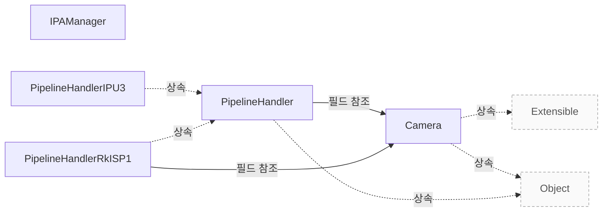

# libcamera 제품 개요

**제공 기능과 공통 설계의 강점을 확인하고 도입할 범위를 판단하세요.**

| 지금 확인할 내용 | 이동할 절 |
|---|---|
| 연동 가이드에서 필요한 내용을 확인합니다. | [vendor-integration](vendor-integration.md) |
| 지원 범위와 검증에서 필요한 내용을 확인합니다. | [vendor-assurance](vendor-assurance.md) |
| 장치별 파이프라인을 구현합니다. | [pipeline-handler](pipeline-handler.md) |

## 복잡한 카메라를 공통 API로 제어하기

libcamera 는 Linux 기반 시스템에서 카메라 하드웨어의 구성과 이미지 제어 알고리즘을 추상화하여 개발자가 원하는 결과를 얻기 위해 필요한 복잡한 작업을 단순하고 일관된 방법으로 수행할 수 있도록 돕습니다. `Documentation/introduction.rst:42`

근거 원문: [Documentation/introduction.rst:42](#source-d40613f3899f0ffc)

## 제공 기능과 지원 범위

`Camera` 클래스는 단일 이미지 소스에서 하나 이상의 이미지 스트림을 생성할 수 있는 카메라 장치를 모델링합니다. `src/libcamera/camera.cpp:752`

`PipelineHandler` 하위 클래스는 시스템에 존재하는 미디어 장치를 해당 구현이 필요로 하는 장치와 매칭한 뒤 모든 장치가 확보되면 대응하는 `Camera` 인스턴스를 생성해야 하며, 이러한 파이프라인 핸들러 구현체는 REGISTER_PIPELINE_HANDLER() 매크로를 사용하여 libcamera 에 등록되어야 합니다. `src/libcamera/pipeline_handler.cpp:30`

근거 원문: [src/libcamera/camera.cpp:752](#source-8264067114dccdee) · [src/libcamera/pipeline_handler.cpp:30](#source-05721740b01bcd0e)

## 구현 근거로 보는 강점

`PipelineHandler::queueRequest` 는 요청을 내부 대기 목록에 추가한 후, 해당 요청이 준비될 때까지 기다렸다가 `maxQueuedRequestsDevice_` 개수만큼의 준비된 요청을 동일한 순서대로 파이프라인 핸들러로 전달합니다. `src/libcamera/pipeline_handler.cpp:447`

요청이 준비 단계에서 실패하거나 파이프라인 핸들러가 요청을 하드웨어 큐에 등록하는 데 실패한 경우 해당 요청은 취소됩니다. `src/libcamera/pipeline_handler.cpp:460`

공통 queueRequest 의 요청 추적이 stop() 시 완료와 어떤 관계가 있는지는, 파이프라인 핸들러가 stop() 으로 중지될 때 대기 중인 모든 요청이 자동으로 완료되도록 보장하며, 이때 completeRequest() 함수를 사용하여 요청 완료를 신호로 전달합니다. `src/libcamera/pipeline_handler.cpp:463`

파이프라인 핸들러는 stop()으로 파이프라인이 중지될 때 대기 중인 모든 요청의 완료를 보장하기 위해 completeRequest() 함수를 사용하여 완료 신호를 보내야 합니다. `src/libcamera/pipeline_handler.cpp:463`

근거 원문: [src/libcamera/pipeline_handler.cpp:447](#source-106682bf83e3416a) · [src/libcamera/pipeline_handler.cpp:460](#source-0a5bda976f5815de) · [src/libcamera/pipeline_handler.cpp:463](#source-35ab684c1adef175)

## 장치 요청 한도와 대기 큐

`PipelineHandler` 생성자의 `maxQueuedRequestsDevice` 인자는 기본값으로 16 을 사용합니다. `include/libcamera/internal/pipeline_handler.h:38`

`PipelineHandler::maxQueuedRequestsDevice_` 가 제한하는 요청 수는 하드웨어로 직접 대기 중인 요청의 최대 개수에 해당하며, 이 수를 초과하는 요청은 내부 대기 큐에 남아 나중에 처리됩니다. `src/libcamera/pipeline_handler.cpp:805`

애플리케이션이 장치 한도보다 많은 요청을 제출하면, 초과된 요청들은 내부 대기 큐에 보관되어 나중에 처리될 때까지 기다립니다. `src/libcamera/pipeline_handler.cpp:805`

근거 원문: [include/libcamera/internal/pipeline_handler.h:38](#source-9178a27bc8eec581) · [src/libcamera/pipeline_handler.cpp:805](#source-bf25a409490e6fa9)

??? note "설계 질문과 검증 범위"
    질문별 답변과 근거 연결을 검사했습니다. 의미와 실행 결과는 사람 검토가 필요합니다.
    
    | 설계 질문 | 설명 위치 | 확인 범위 |
    |---|---|---|
    | 어떤 고객 문제를 해결하며 어떤 환경을 대상으로 합니까? | [복잡한 카메라를 공통 API로 제어하기](#복잡한-카메라를-공통-api로-제어하기) | 코드 근거와 설명 연결 |
    | 어떤 기능을 제공하며 지원 범위는 어떤 구현에 달려 있습니까? | [제공 기능과 지원 범위](#제공-기능과-지원-범위) | 코드 근거와 설명 연결 |
    | 공통 구현을 활용할 수 있는 강점과 그 조건은 무엇입니까? | [구현 근거로 보는 강점](#구현-근거로-보는-강점) | 코드 근거와 설명 연결 |
    | 장치에 동시에 제출하는 요청 수의 기본 한도와 대기 요청의 처리는 무엇입니까? | [장치 요청 한도와 대기 큐](#장치-요청-한도와-대기-큐) | 코드 근거와 설명 연결 |

## 소스 근거

같은 발췌는 한 번만 싣습니다. 필요한 원문을 펼쳐 설명과 대조하세요.

<a id="source-d40613f3899f0ffc"></a>

??? note "소스 근거: Documentation/introduction.rst:42"
    `Documentation/introduction.rst:42`에서 시작하는 발췌입니다. 종료 줄은 51이며, 아래 원문을 설명과 대조할 수 있습니다.
    
    SHA-256: `549b7b082e82dd29575a830fc4731f3a5cae8a8a8adb4e49e085f1c991fec9ac`
    
    ```text
    What is libcamera for?
    ======================
    
    libcamera provides a complete camera stack for Linux-based systems to abstract
    the configuration of hardware and image control algorithms required to obtain
    desirable results from the camera through the kernel's APIs, reducing those
    operations to a simple and consistent method for developers. In short instead of
    having to deal with this:
    
    .. graphviz:: mali-c55.dot
    ```

<a id="source-8264067114dccdee"></a>

??? note "소스 근거: src/libcamera/camera.cpp:752"
    `src/libcamera/camera.cpp:752`에서 시작하는 발췌입니다. 종료 줄은 784이며, 아래 원문을 설명과 대조할 수 있습니다.
    
    SHA-256: `325c2af6569c185be1bc686e1fb6d161782dcbc8db34a0fbb719cff005ba7625`
    
    ```text
    \class Camera
     * \brief Camera device
     *
     * \todo Add documentation for camera start timings. What exactly does the
     * camera expect the pipeline handler to do when start() is called?
     *
     * The Camera class models a camera capable of producing one or more image
     * streams from a single image source. It provides the main interface to
     * configuring and controlling the device, and capturing image streams. It is
     * the central object exposed by libcamera.
     *
     * To support the central nature of Camera objects, libcamera manages the
     * lifetime of camera instances with std::shared_ptr<>. Instances shall be
     * created with the create() function which returns a shared pointer. The
     * Camera constructors and destructor are private, to prevent instances from
     * being constructed and destroyed manually.
     *
     * \section camera_operation Operating the Camera
     *
     * An application needs to perform a sequence of operations on a camera before
     * it is ready to process requests. The camera needs to be acquired and
     * configured to prepare the camera for capture. Once started the camera can
     * process requests until it is stopped. When an application is done with a
     * camera, the camera needs to be released.
     *
     * An application may start and stop a camera multiple times as long as it is
     * not released. The camera may also be reconfigured.
     *
     * Functions that affect the camera state as defined below are generally not
     * synchronized with each other by the Camera class. The caller is responsible
     * for ensuring their synchronization if necessary.
     *
     * \subsection Camera States
    ```

<a id="source-05721740b01bcd0e"></a>

??? note "소스 근거: src/libcamera/pipeline_handler.cpp:30"
    `src/libcamera/pipeline_handler.cpp:30`에서 시작하는 발췌입니다. 종료 줄은 43이며, 아래 원문을 설명과 대조할 수 있습니다.
    
    SHA-256: `2ba321cd394e987c2851002e9db5df0634635d71c749580c066e5556df90a715`
    
    ```text
    \file pipeline_handler.h
     * \brief Create pipelines and cameras from a set of media devices
     *
     * Each pipeline supported by libcamera needs to be backed by a pipeline
     * handler implementation that operate on a set of media devices. The pipeline
     * handler is responsible for matching the media devices it requires with the
     * devices present in the system, and once all those devices can be acquired,
     * create corresponding Camera instances.
     *
     * Every subclass of PipelineHandler shall be registered with libcamera using
     * the REGISTER_PIPELINE_HANDLER() macro.
     */
    
    using namespace std::chrono_literals;
    ```

<a id="source-106682bf83e3416a"></a>

??? note "소스 근거: src/libcamera/pipeline_handler.cpp:447"
    `src/libcamera/pipeline_handler.cpp:447`에서 시작하는 발췌입니다. 종료 줄은 458이며, 아래 원문을 설명과 대조할 수 있습니다.
    
    SHA-256: `93b81531d0a6f65b242cd4cfe014e0a861502c2fc2ad1d5e1f593dda7564c17d`
    
    ```text
    \fn PipelineHandler::queueRequest()
     * \brief Queue a request
     * \param[in] request The request to queue
     *
     * This function queues a capture request to the pipeline handler for
     * processing. The request is first added to the internal list of waiting
     * requests which have to be prepared to make sure they are ready for being
     * queued to the pipeline handler.
     *
     * The queue of waiting requests is iterated and up to \a
     * maxQueuedRequestsDevice_ prepared requests are passed to the pipeline handler
     * in the same order they have been queued by calling this function.
    ```

<a id="source-0a5bda976f5815de"></a>

??? note "소스 근거: src/libcamera/pipeline_handler.cpp:460"
    `src/libcamera/pipeline_handler.cpp:460`에서 시작하는 발췌입니다. 종료 줄은 461이며, 아래 원문을 설명과 대조할 수 있습니다.
    
    SHA-256: `06067fbd4ead51418e85617bc3d67c04439619836e4f024497d1583f6ac0787c`
    
    ```text
    If a Request fails during the preparation phase or if the pipeline handler
     * fails in queuing the request to the hardware the request is cancelled.
    ```

<a id="source-35ab684c1adef175"></a>

??? note "소스 근거: src/libcamera/pipeline_handler.cpp:463"
    `src/libcamera/pipeline_handler.cpp:463`에서 시작하는 발췌입니다. 종료 줄은 465이며, 아래 원문을 설명과 대조할 수 있습니다.
    
    SHA-256: `c3d1253c0ef92dd7f0ef5fd41450b788e9aa00145ac2f65bf727bf6a11e08863`
    
    ```text
    Keeping track of queued requests ensures automatic completion of all requests
     * when the pipeline handler is stopped with stop(). Request completion shall be
     * signalled by the pipeline handler using the completeRequest() function.
    ```

<a id="source-9178a27bc8eec581"></a>

??? note "소스 근거: include/libcamera/internal/pipeline_handler.h:38"
    `include/libcamera/internal/pipeline_handler.h:38`에서 시작하는 발췌입니다. 종료 줄은 40이며, 아래 원문을 설명과 대조할 수 있습니다.
    
    SHA-256: `3b3b029c27426dac78550c3461b3b9e875b025e0fca6bc5d32d84bb6dda0a805`
    
    ```text
    PipelineHandler(CameraManager *manager,
    			unsigned int maxQueuedRequestsDevice = 16);
    	virtual ~PipelineHandler();
    ```

<a id="source-bf25a409490e6fa9"></a>

??? note "소스 근거: src/libcamera/pipeline_handler.cpp:805"
    `src/libcamera/pipeline_handler.cpp:805`에서 시작하는 발췌입니다. 종료 줄은 819이며, 아래 원문을 설명과 대조할 수 있습니다.
    
    SHA-256: `bebb0d8c2cd1119a344011aa4263c60740456a685b32ed3f02cd6f49c1d6101e`
    
    ```text
    \var PipelineHandler::maxQueuedRequestsDevice_
     * \brief The maximum number of requests the pipeline handler shall queue to the
     * device
     *
     * maxQueuedRequestsDevice_ limits the number of request that the
     * pipeline handler shall queue to the underlying hardware, in order to
     * saturate the pipeline with requests. The application may choose to queue
     * as many requests as it desires, however only maxQueuedRequestsDevice_
     * requests will be queued to the hardware at a given point in time. The
     * remaining requests will be kept waiting in the internal waiting
     * queue, to be queued at a later stage.
     */
    
    /**
     * \fn PipelineHandler::name()
    ```


<!-- sdd:class-diagram -->
## 클래스 관계

화살표의 글자는 추출한 관계를 나타내며, 점선은 상속입니다. 화살표는 참조 대상 또는 기반 클래스를 향합니다. 호출 순서를 뜻하지 않습니다.


<!-- /sdd:class-diagram -->

??? note "근거와 검토 정보"
    - 생성 방식: 추출 사실과 LLM 설명
    - 검증 범위: 표·그림은 facts로 만들고 설명은 LLM이 작성합니다. 인용·문장 및 설정된 구조 검사를 적용합니다.
    - 근거 파일: `Documentation/introduction.rst`, `include/libcamera/camera.h`, `include/libcamera/internal/ipa_manager.h`, `include/libcamera/internal/pipeline_handler.h`, `src/libcamera/camera.cpp`, `src/libcamera/ipa_manager.cpp`, `src/libcamera/pipeline/ipu3/ipu3.cpp`, `src/libcamera/pipeline/rkisp1/rkisp1.cpp`, `src/libcamera/pipeline_handler.cpp`
    - 근거 수준: 코드 확인 (정적 분석, simple_compdb 구성, commit `20189587ca`)
    - 자동 검사 (인용·문장 및 설정된 구조 검사): 통과
    - 검토 상태 기록일: 2026-10-25 · 사람 검토 전

다음 단계: [연동 가이드](vendor-integration.md)
